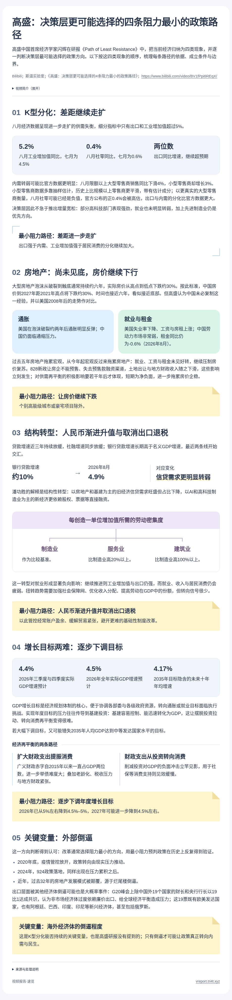

[toc]

# 问题

提问者：**<a href="https://www.zhihu.com/people/bu-tao-65-98">不逃</a>**
提问时间: 2024-9-19 9:39:2
总回答数: 271
总访问量: 3332982

房价最终会降到什么地步？

# 回答

回答者： **<a href="https://www.zhihu.com/people/si-wu-xie-8-93">Social Observer</a>**
回答时间: 2026-10-11 10:49:36
点赞总数: 344
评论总数: 33
收藏总数: 174
喜欢总数：9

高盛认为，决策层倾向于选择“阻力最小”的路径：

一是容忍K型分化加剧，依赖出口与工业，内需继续疲软；

二是让房价继续下行；

三是人民币渐进升值并取消出口退税；

四是逐步下调GDP增长目标。

外部倒逼是推动政策真正转向内需的关键变量。

  

原文地址：[(Social Observer)房价最终会降到什么地步？](https://www.zhihu.com/question/667562389/answer/2092567525955474365) 

# 评论

1. <a href="https://www.zhihu.com/people/syukite">于越</a> (<small title="北京">2026-10-12 6:40:11</small>): 高盛所有对外公开的研报和分析，有且只有一个目的，就是帮自己的各个销售部门卖出更多的合约和金融衍生产品。看这个就只能当是兼听则明的一个参考，不可能只依据投行研报做个人决策
   - <a href="https://www.zhihu.com/people/meng-ling-hao-44">QD新韭菜</a> (<small title="山东">2026-10-12 7:46:41</small>): 那你的个人决策是啥？
   - <a href="https://www.zhihu.com/people/kkkk-33-9">kkkk</a> (<small title="湖北">2026-10-12 8:3:41</small>): 赢
   - <a href="https://www.zhihu.com/people/duo-wen-ke-ke-88">多闻克克</a> (<small title="回复于 2026-10-12 8:33:29/江苏"> ✉️:kkkk</small>): 他说要你兼听则明，有毛病吗？
   - <a href="https://www.zhihu.com/people/jerry-28-17">Jerry</a> (<small title="回复于 2026-10-12 8:46:38/安徽"> ✉️:多闻克克</small>): 漂亮话谁都会说，问题是兼听听什么？高盛这种投行本身就是有着普通人接触不到的管道和专业能力帮人做投资决策服务存在。不听他们的听媒体宣传的听恒大不会爆雷？房价不会下跌？
   - <a href="https://www.zhihu.com/people/li-fan-zhou-88">油炸兔头</a> (<small title="回复于 2026-10-12 8:49:37/广东"> ✉️:Jerry</small>): 研报这种东西，本来做出来的目的就是让局外人看的。你如果觉得研报是为了做好事启蒙啥也不懂的人，那你尽可以看研报去炒股或者之类的试试看你能亏多少。
   - <a href="https://www.zhihu.com/people/gdgczx">丫丫树的天空</a> (<small title="回复于 2026-10-12 8:50:50/广东"> ✉️:Jerry</small>): 前两天流行听懂车帝［捂脸］［捂脸］
   - <a href="https://www.zhihu.com/people/mibmqt">低频酱-二世</a> (<small title="浙江">2026-10-12 8:59:22</small>): 论迹不论心OK？
   - <a href="https://www.zhihu.com/people/juwkkusgwkywgh">知乎用户</a> (<small title="回复于 2026-10-12 9:3:29/福建"> ✉️:Jerry</small>): 合订本不会看是吧［飙泪笑］高盛的预测也有多次错得离谱，你要真只信高盛，那要么爆仓，要么精神分裂
   - <a href="https://www.zhihu.com/people/duo-wen-ke-ke-88">多闻克克</a> (<small title="回复于 2026-10-12 9:31:49/江苏"> ✉️:Jerry</small>): 我同样也可以回复你高盛翻车过好多次，让你所谓的专业能力，管道变得苍白无力
   - <a href="https://www.zhihu.com/people/jerry-28-17">Jerry</a> (<small title="回复于 2026-10-12 9:46:14/安徽"> ✉️:多闻克克</small>): 虽然天真但至少你比上面回复就拉黑的好一些，那就最后再展开说明一句。  
 
研报本身就是预测，预测就存在错误的风险；但是无论是汇丰花旗高盛摩根大通他们能一直被投资者信任和参考的原因就是他的评估至少基于帮你赚钱的事实面去出发。这种分析报告你高喊他也会错要“兼听则明”，然后转头去信恒大没有风险不会爆雷、房价一切坚挺、疫情管控有序不会放开的机构和媒体，那才是类似给大模型数据投毒的行为，只会拉低整体输出决策水平。
   - <a href="https://www.zhihu.com/people/uiv30427h">uiv30427h</a> (<small title="河北">2026-10-12 10:26:24</small>): 你有啦［捂嘴］
   - <a href="https://www.zhihu.com/people/duo-wen-ke-ke-88">多闻克克</a> (<small title="回复于 2026-10-12 10:43:41/江苏"> ✉️:Jerry</small>): 不是，我也没说要信恒大那些吧？你在暗示我双标？
2. <a href="https://www.zhihu.com/people/ying-xiong-zhong-58">雾凇</a> (<small title="山东">2026-10-12 5:27:16</small>): 即使是ai，写的也是很好的
3. <a href="https://www.zhihu.com/people/a-hua-76-70">阿华</a> (<small title="江苏">2026-10-12 8:26:19</small>): 对普通人的建议就是，放弃幻想，节衣缩食
   - <a href="https://www.zhihu.com/people/mibmqt">低频酱-二世</a> (<small title="浙江">2026-10-12 8:56:7</small>): 放心，一定会有外部压力倒逼改革
   - <a href="https://www.zhihu.com/people/zhil4s5zu">行走的小蚂蚁</a> (<small title="广东">2026-10-12 9:19:1</small>): 哪里只有一味的防守。保底，有选择性的进攻
   - <a href="https://www.zhihu.com/people/uiv30427h">uiv30427h</a> (<small title="回复于 2026-10-12 10:29:40/河北"> ✉️:低频酱-二世</small>): 太乐观了
4. <a href="https://www.zhihu.com/people/zhang-kai-lin-52">我是xxx</a> (<small title="辽宁">2026-10-12 8:48:33</small>): 出口卖谁？都要跟你打贸易战［大笑］［大笑］
   - <a href="https://www.zhihu.com/people/66-12-82-68">从不说话</a> (<small title="重庆">2026-10-12 9:8:47</small>): 人家不说了吗：外部倒逼是推动政策真正转向内需的关键变量。
   - <a href="https://www.zhihu.com/people/wo-wo-de-wo-de-wei-bo">我我的我的微博</a> (<small title="回复于 2026-10-12 10:4:52/上海"> ✉️:从不说话</small>): 在此之前，分配改革必须先落地
   - <a href="https://www.zhihu.com/people/896754-3">896754</a> (<small title="吉林">2026-10-12 10:7:47</small>): 他们很快就会发现收关税比从企业那里收增值税有利于财政可持续（带清直呼内行）［酷］
   - <a href="https://www.zhihu.com/people/66-12-82-68">从不说话</a> (<small title="回复于 2026-10-12 10:14:12/重庆"> ✉️:我我的我的微博</small>): 如果还能卖的出去货 为什么要做分配改革呢？
5. <a href="https://www.zhihu.com/people/tudou-11-88">学否</a> (<small title="广东">2026-10-12 10:35:52</small>): 最大的人口问题提都没提到？
6. <a href="https://www.zhihu.com/people/you-you-50-48-42">章子强</a> (<small title="湖北">2026-10-12 10:35:11</small>): 不把欧美工业基础冲垮，怎么搞民生？
7. <a href="https://www.zhihu.com/people/michaeliuxp">大汉小人物</a> (<small title="上海">2026-10-11 23:53:58</small>): AI味很浓，人均GDP提高没那么难，因为今后每年会有1%以上的被动增长［为难］
   - <a href="https://www.zhihu.com/people/zhu-zhu-wang-45">珠珠旺</a> (<small title="安徽">2026-10-12 4:37:24</small>): 这个真的很地狱［捂脸］
   - <a href="https://www.zhihu.com/people/dai-ge-mian-bao-qu-liu-lang-94-22">带个面包去流浪</a> (<small title="广东">2026-10-12 7:6:56</small>): 货币贬值 GDP也会增加［飙泪笑］
   - <a href="https://www.zhihu.com/people/1234-42-41-92">1234</a> (<small title="山西">2026-10-12 8:10:33</small>): 美元计价还是人民币计价
   - <a href="https://www.zhihu.com/people/16-39-98-61-93">天天被丰号</a> (<small title="回复于 2026-10-12 10:12:45/湖北"> ✉️:1234</small>): 意思是人口减少，人均增加［飙泪笑］
8. <a href="https://www.zhihu.com/people/ni-rui-feng-53">大侠无敌了</a> (<small title="上海">2026-10-12 9:51:9</small>): 这个报告是ai出的吗哈哈，一股熟悉的味道
   - <a href="https://www.zhihu.com/people/896754-3">896754</a> (<small title="吉林">2026-10-12 10:9:7</small>): 没事，反正意见也就是个如说［发呆］除了高盛认证以外跟没说也差不多
   - <a href="https://www.zhihu.com/people/kar-84-97">Alle</a> (<small title="浙江">2026-10-12 10:30:21</small>): Gs研报喂给Ai做的输出

=[评论](./attachments/comments.json)

