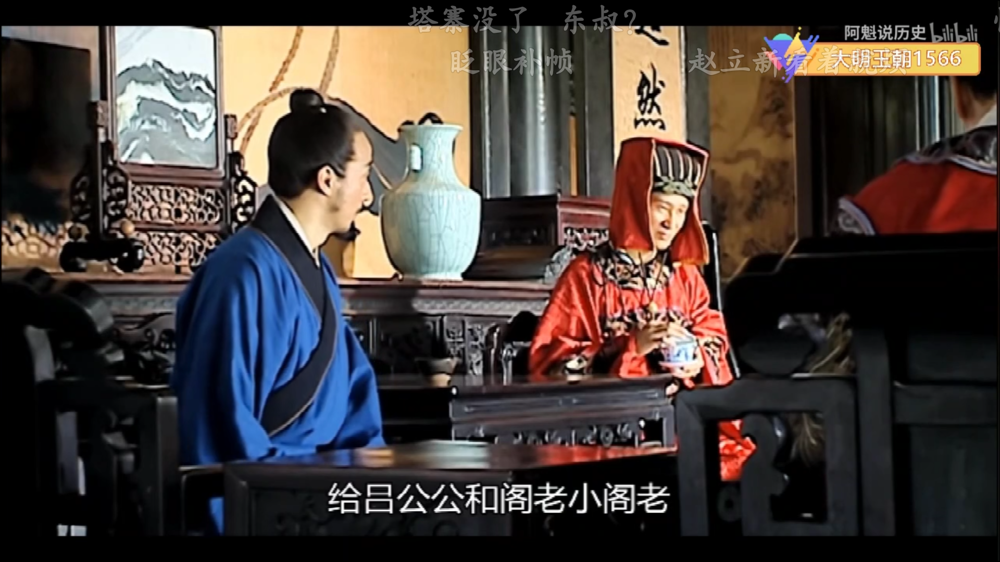
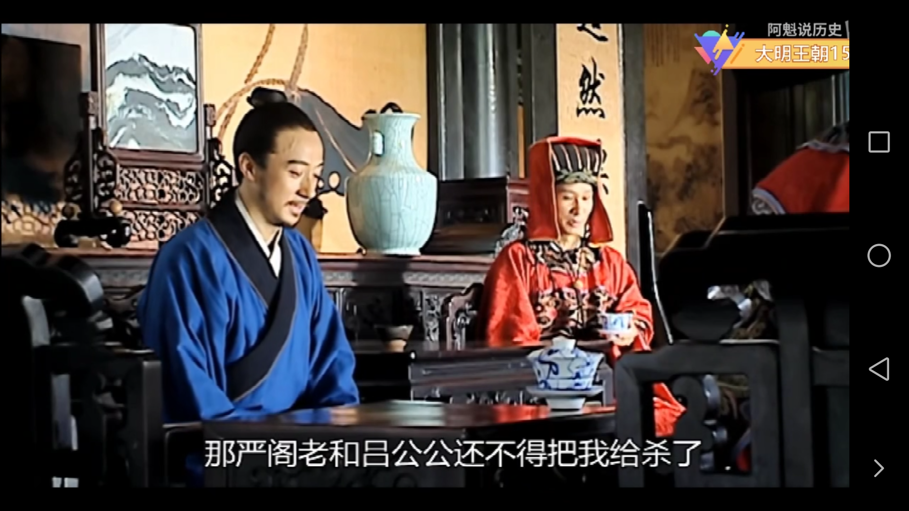
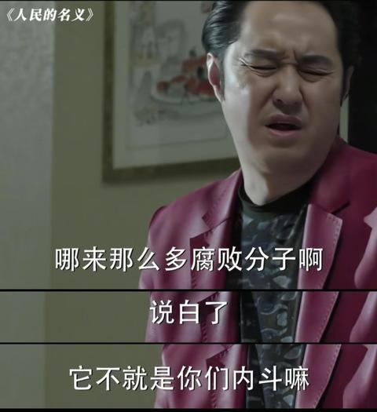

[toc]

# 问题

提问者：**<a href="https://www.zhihu.com/people/">匿名用户</a>**
提问时间: 2018-12-13 10:16:20
总回答数: 0
总访问量: 0

最初发布这个问题时态度过于偏激主观且钓鱼激起部分人的反感，现修改。并添加小说原文供探讨。

由这位答主的回答引发的思考[https://www.zhihu.com/question/284352699/answer/452169420](https://www.zhihu.com/question/284352699/answer/452169420)

___

严世蕃：“江浙是朝廷赋税重地，修河多出的公款，河道衙门详细账目可查，而且河道监管都是宫里派去的中官，你们不签字，不只是对着我们工部来的吧！”

“还有哪些没签字？”吕芳不再容高拱回话，接着问道。

高拱：“还有宫里修殿宇的木料货款。年初工部的预算是三百万两，这次结账高达七百万两。亏空四百万两！”

“我就知道你们算来算去就为算到皇上头上！”严世蕃说这话时已经亮出了手里那把无形的刀。

___

沈一石笑着：“今年第一茬的狮峰龙井，赶在夜里露芽的时候采的。”

杨金水和郑泌昌、何茂才都端起了茶碗轻轻啜了一口。

“好。”郑泌昌赞道。

“是顶尖的上品。”何茂才跟着赞道。

沈一石歉意地笑笑：“产得少，给吕公公和阁老、小阁老各准备了两斤，各位大人委屈点，每人准备了一斤。”

___

  

  

吕芳作为太监集团的领袖在极致贪污腐败的明末权力结构中处于怎样一个位置？

# 回答

回答者： **<a href="https://www.zhihu.com/people/17-30-25-27-95">作死小能手</a>**
回答时间: 2024-5-6 12:25:37
点赞总数: 36807
评论总数: 1197
收藏总数: 37101
喜欢总数：2899

知乎这个平台，明面上说是精英平台，其实也就是个小中产平台。

这些回答里，99%都没送过钱，更没收过钱，压根就不知道权力的运行规则。

还有人刷梗，你不拿，我不拿，史密斯专员怎么拿。

这都是影视剧方便平头老百姓理解，而把权力寻租的过程给简单化，具象化了。

我打个比方。

现在我是某部门分管业务的二把手，提拔我起来的是上级部门的一把手，我年轻的时候给他拎包，心腹中的心腹。

现在我在岗位上，捞的钱，难道年底四六分成，交四成给他？

不是这么玩的。

你要是怎么玩，根本就不会被提起来。

我在岗位上，能捞多少钱，那是我的本事，也是他给我的报酬。当然你也可以说是人民赋予的，但辩论政治伦理不是这个回答的重点。

这些钱，都是我的。我做的事情，我担责任，被抓，被举报，锅我自己背好，跟我的领导没关系。

那怎么回报提拔我的领导呢。平时的那些请安问候，三节两寿就不说了。最重要的是当好权力的触手。

权力权力，力要有着力点。什么叫自己人，无条件不打折执行才叫自己人。领导交待的工作，办明白，办好，明面上不能有任何违法违规的差错。至于找他办事的人给了他什么好处，我不知道，也不想知道，更不会问。如果实在不能办，也要解释说明清楚，并能给出其他的选项。

要是再机灵点，能提前发现领导的需求，什么斯提庞克啦，玉座金佛啦，那就进步地更快了。傻乎乎的去干送，谁缺你这个钱，鬼知道这个钱你怎么来的。

所以，权力节点上的关键人物，都有自己的职权范围。在这个职权范围内，你是直接贪也好，还是变相的寻租也好，这份收益和风险都是你自己的。你有你的职权范围，他有他的范围，每个人在各自领域里各显神通。你给他办事，他帮你挡事，这才是稳固长久的利益网关系链。

我所能接触到的上下级关系，同僚关系，都极其避讳谈钱，而是更讲人情，讲维系。每个人都有自己的手段，这些手段是不会分享交流的。

回到吕方这件事上。

李旋修河堤，他捞的钱会直接给杨金水一份？不会的，杨公公作为干爹，会指导李旋的工作。比如要用李记材料商，他们家的材料货真价实，你去把招标搞定。

杨公公收了沈一石那么多好处，难道会直接分一半给吕方。肯定也不是啊。吕方也会在其他地方指导杨公公的工作，但这一方面剧情里没有明示。

沈一石的账册，其实把问题已经说的很清楚了。他这个所谓的江南首富，就是道长，太监和浙江官府的小金库。就是放到现在，哪家机构单位没几个这样的乙方服务商？

狭义上讲，他肯定贪了，各种孝敬绝对没少拿。他要是个海瑞也做不到那个位子，底下人也管不住。

但，如果是那种巨贪大蠹，仅仅就剧里情节来说，还真算不上。外宅私产，家族子侄剧情都没交代清楚，无法判断。

吕方贪不贪，完全取决于他自己。他要是想贪，前有王振后有九千岁，有的是办法。他要是不想贪，也完全可以。

但是大明上下，绝大部分官吏都是秉持过手三分肥的原则，你不拿，就有别人拿。总不能把白花花的银子便宜了那帮子唱戏都唱不明白的商人和只懂得种地的泥腿子吧。

题外话，郑何杨，死了两个疯了一个，他们真正获罪的原因是贪污吗？

  

原文地址：[(作死小能手)吕芳有贪污过吗？](https://www.zhihu.com/question/305574093/answer/3488986683) 

# 评论

1. <a href="https://www.zhihu.com/people/zuo-yi-feng-19">小新星</a> (<small title="山东">2024-5-11 21:40:27</small>): 正解。我现在才逐渐发现，搞关系其实本质上是资源交换。这个资源绝对不是金钱。你把我提拔，将来你的侄子外甥的工作我给你上心。吃吃喝喝什么的都是添头。
   - <a href="https://www.zhihu.com/people/zhang-jiao-zhu-liu-bu">张教主留步</a> (<small title="陕西">2024-5-12 11:51:17</small>): 吃吃喝喝连添头都算不上，最多只是个润滑剂［微笑］
   - <a href="https://www.zhihu.com/people/forest-wheat">forest wheat</a> (<small title="河南">2024-11-10 18:57:13</small>): 你能帮我，我能帮你，才叫关系，否则有啥好社交的？不如回去偷懒睡个好觉
   - <a href="https://www.zhihu.com/people/zhao-jia-52-92">Eversmann</a> (<small title="回复于 2024-11-16 8:18:31/浙江"> ✉️:张教主留步</small>): 也是经济发达的地方，吃喝年节是添头，送一箱茅子也都是应个景。欠发达地区可能就指着年节捞一些，自然吃相直白一点了
   - <a href="https://www.zhihu.com/people/doubting-58">doubting</a> (<small title="澳大利亚">2024-11-27 11:22:43</small>): 教父老早就告诉我们了，我的朋友
   - <a href="https://www.zhihu.com/people/wu-yi-fan-72-87">日内瓦战俘</a> (<small title="回复于 2024-12-3 9:50:54/江西"> ✉️:张教主留步</small>): 应该说就是个提供一个谈话的场所，就算做的再好再贵，谁也不缺那顿饭
   - <a href="https://www.zhihu.com/people/75-45-69-73">知乎用户IvtPDw</a> (<small title="江苏">2024-12-4 8:23:31</small>): 吃吃喝喝能算什么添头，你到点儿了不吃饭？
   - <a href="https://www.zhihu.com/people/ke-la-jin-9">咔嚓非黄</a> (<small title="云南">2024-12-4 16:18:5</small>): 任何人的关系就是资源交换啊，要么实在的资源，要么务虚的情绪
   - <a href="https://www.zhihu.com/people/lao-meng-14-75">知乎用户QGQUVB</a> (<small title="辽宁">2024-12-7 21:3:30</small>): 说白点，互相利用，如果你有价值的话，就这点事［飙泪笑］
   - <a href="https://www.zhihu.com/people/virus-36-47">Virus</a> (<small title="广东">2025-1-20 23:43:38</small>): 不只是金钱而已……不是金钱就大错特错了……
   - <a href="https://www.zhihu.com/people/lll-40-26">LLL</a> (<small title="山西">2025-1-29 9:44:8</small>): 不是这么简单，想搞钱肯定涉及有灰色地带，不分领导一份，还想安心弄？
   - <a href="https://www.zhihu.com/people/su-ding-ding-13">冰苏打</a> (<small title="回复于 2025-2-9 17:6:35/山东"> ✉️:日内瓦战俘</small>): 对的，吃饭就单一了，得组局
   - <a href="https://www.zhihu.com/people/james-16-3">James</a> (<small title="回复于 2025-5-14 14:11:32/广东"> ✉️:日内瓦战俘</small>): 到了45以后，喝酒纯受罪！
   - <a href="https://www.zhihu.com/people/hahaha-47-7">hahaha</a> (<small title="安徽">2025-5-17 16:38:33</small>): 华强:国权，你是我朋友吗？  
 
国权:是啊！当然是啦
   - <a href="https://www.zhihu.com/people/gu-shi-xi-shou">大摩王</a> (<small title="回复于 2025-5-18 11:49:16/广西"> ✉️:Virus</small>): 你才是对的，身份差距一大，通常就得金钱开路。
   - <a href="https://www.zhihu.com/people/qaqwu">momo</a> (<small title="浙江">2025-5-20 15:8:54</small>): 吃吃喝喝最多算是找个聚聚的由头。毕竟你给领导送东西谈事情，总不能直说。所以安排点吃吃喝喝，酒过三巡跟聊天一样把事情说一下
   - <a href="https://www.zhihu.com/people/lu-yin-ji-77">木公子</a> (<small title="四川">2025-5-22 13:53:7</small>): 投名状不是添头
   - <a href="https://www.zhihu.com/people/chen-wei-62-15-54">陈伟</a> (<small title="回复于 2025-5-24 16:48:32/山西"> ✉️:Eversmann</small>): 所以欠发达地区这些人才被百姓痛恨。而且现在抓得严了，不敢吃拿卡要了，就不办事了。
   - <a href="https://www.zhihu.com/people/chen-wei-62-15-54">陈伟</a> (<small title="回复于 2025-5-24 16:49:55/山西"> ✉️:LLL</small>): 回答写的很清楚呀，不会直接朝下属拿，从供应商那里拿。
   - <a href="https://www.zhihu.com/people/bu-gao-xing-de-pang-zi">不高兴的胖子</a> (<small title="回复于 2025-5-24 18:1:44/福建"> ✉️:LLL</small>): 你来源不明还带灰色的钱，领导拿了是怕你手上没他的把柄是吧？［飙泪笑］
   - <a href="https://www.zhihu.com/people/lll-40-26">LLL</a> (<small title="回复于 2025-5-24 23:0:52/北京"> ✉️:不高兴的胖子</small>): 不给领导分，你肯定干不成
   - <a href="https://www.zhihu.com/people/qing-feng-xu-lai-1-92">上道咨询中心</a> (<small title="回复于 2025-6-3 17:15:27/海南"> ✉️:知乎用户QGQUVB</small>): 互帮帮助好吧，不要说得那么难听😀
   - <a href="https://www.zhihu.com/people/ha-ha-82-15-97">哈哈</a> (<small title="回复于 2025-6-30 2:44:13/湖南"> ✉️:大摩王</small>): 能开路的是人家的软肋 君子爱财 取之有道 送生意比送钱好
   - <a href="https://www.zhihu.com/people/han-yu-74-73">陆小凤</a> (<small title="回复于 2025-9-3 14:21:53/上海"> ✉️:doubting</small>): 你甚至不愿叫我一声教父［生气］
   - <a href="https://www.zhihu.com/people/66-45-91-72">海边的风</a> (<small title="山东">2025-9-6 11:28:40</small>): 别扯了，被查的那个不是贪污很多钱
   - <a href="https://www.zhihu.com/people/sha-du-xiang-zhi-dao-81">啥都想知道</a> (<small title="回复于 2025-9-8 20:49:25/江苏"> ✉️:LLL</small>): 真二。领导让你去弄你才能给领导分。领导没让你捞，你主动捞完去送非常惹人反感，说不定领导直接把你弄进去。
   - <a href="https://www.zhihu.com/people/lll-40-26">LLL</a> (<small title="回复于 2025-9-8 21:3:33/北京"> ✉️:啥都想知道</small>): 二的是你吧，想啥好事呢［捂嘴］自己能做主捞的，也是领导看不上的三瓜两枣，偷着乐得了。但凡像个样的，别说不给领导分了，同事看见就举报你
   - <a href="https://www.zhihu.com/people/jing-zuo-ting-yu-53-83">丙焱</a> (<small title="江苏">2025-9-24 20:33:59</small>): 基层干部就要搞钱。中层的中年干部要为自己的子女考虑就业。上层大概率就是政治派别了。都是毫无依据的瞎猜，别当真啊［感谢］［感谢］
   - <a href="https://www.zhihu.com/people/pai-you-50">俳优</a> (<small title="上海">2025-12-2 21:34:55</small>): 看看，强哥，给京海公务人员做了多少实事。学着点~
   - <a href="https://www.zhihu.com/people/xue-luo-shi">天涯共此时</a> (<small title="福建">2026-1-7 23:23:12</small>): 吃饭很多人不愿意吃，不差那顿饭，还耽误别人时间。
   - <a href="https://www.zhihu.com/people/dc08171">吴苏磊逗</a> (<small title="安徽">2026-3-10 10:33:2</small>): 资源交换，
2. <a href="https://www.zhihu.com/people/ni-mo-98-24">明月照沟渠</a> (<small title="广东">2024-5-12 2:10:26</small>): 你是懂权力的，［飙泪笑］［飙泪笑］知乎几乎很少有人懂权力怎么玩，真的太年轻了。  
 
  
 
  
 
下属心腹最重要的就是维护上级的权力，这比什么都重要。
   - <a href="https://www.zhihu.com/people/zhou-bu-tong-60">成步堂 龍二</a> (<small title="江苏">2024-5-13 9:39:52</small>): 权力和义务也是对等的，下属有事了，你得有能力摆平，如此才能服众
   - <a href="https://www.zhihu.com/people/chang-ya-qian-9">YOLO</a> (<small title="河南">2024-5-14 17:37:4</small>): 其实忠心是最重要的，其他都是虚的，你可以贪但是忠心必须不打折扣
   - <a href="https://www.zhihu.com/people/woqi2w">清风道童</a> (<small title="回复于 2024-5-24 19:48:28/四川"> ✉️:YOLO</small>): 忠心是必须的，但是不是最重要的，想忠心的多的去了，主要是既要忠心，又要会办事
   - <a href="https://www.zhihu.com/people/qin-ling-jiu-hua">天成</a> (<small title="回复于 2024-6-6 19:20:13/河南"> ✉️:YOLO</small>): 杨金水吕芳类似
   - <a href="https://www.zhihu.com/people/braushh">braushh</a> (<small title="上海">2024-6-8 23:13:54</small>): 忠诚不绝对就是绝对不忠诚，体制内为什么大家流传这句话呢
   - <a href="https://www.zhihu.com/people/oattul-87">Oattul</a> (<small title="江苏">2024-7-8 19:35:2</small>): 以前做比赛给师弟排第一，绝不是为了他请我吃饭啥的，而是希望后面做实验做项目帮我搭一把手
   - <a href="https://www.zhihu.com/people/48-7-26-48">知乎用户va11oI</a> (<small title="云南">2024-7-25 8:58:27</small>): 权力只对权力的来源负责。
   - <a href="https://www.zhihu.com/people/43-98-5-25">帅气惊人</a> (<small title="回复于 2024-9-19 18:9:48/湖北"> ✉️:清风道童</small>): 领导最不缺的就是忠心的人，手底下多少人天天想忠心？普通人穷的就只剩忠心了
   - <a href="https://www.zhihu.com/people/gao-cheng-yuan-74">天涯麦克</a> (<small title="北京">2024-10-16 18:24:9</small>): 老大要罩小弟，小弟要勇于背锅。黑社会都这么玩了。［捂嘴］
   - <a href="https://www.zhihu.com/people/da-lian-34-19">大脸</a> (<small title="回复于 2024-11-10 19:23:2/河北"> ✉️:帅气惊人</small>): 以我十五年工作经验。其实没几个人有忠心，大部分都想搞死你［捂嘴］  
 
我说的是，领导有这个权力，给你了，你真的忠吗？  
 
多数人不会为领导抗雷的，都想明哲保身。不能用结果去推前因。
   - <a href="https://www.zhihu.com/people/yang-wei-li-27-12">杨威利</a> (<small title="四川">2024-11-10 23:13:31</small>): 没掌权的能懂权力，臆想罢了。说的这些看下人民的名义就清楚了。而权力是电视剧展现的那样吗？
   - <a href="https://www.zhihu.com/people/xlfans-82">宇下</a> (<small title="回复于 2024-11-14 0:41:1/山东"> ✉️:YOLO</small>): 真衷心的也就是几个人，人走茶凉，等不在那个位置了，当年下属凭什么对你衷心
   - <a href="https://www.zhihu.com/people/yao-you-guang-41-84">快乐大锤</a> (<small title="回复于 2024-11-15 22:37:17/陕西"> ✉️:成步堂 龍二</small>): 罩得住
   - <a href="https://www.zhihu.com/people/wu-xu-54-47">毋恤</a> (<small title="回复于 2024-11-17 10:49:41/吉林"> ✉️:braushh</small>): 幼稚的搞笑［捂脸］  
 
你以为黑社会呢，还绝对忠诚［捂脸］［捂脸］
   - <a href="https://www.zhihu.com/people/55988-75">知乎用户55988</a> (<small title="回复于 2024-11-21 1:21:49/四川"> ✉️:YOLO</small>): 你看最近特朗普上台，重新任命的国防部长，司法部长
   - <a href="https://www.zhihu.com/people/han-han-ni-zai-ma">涵涵你在吗</a> (<small title="回复于 2024-11-22 16:30:11/黑龙江"> ✉️:帅气惊人</small>): 忠心可不是两个字那么简单，是刘新建那种
   - <a href="https://www.zhihu.com/people/chen-hao-fu-27">夫夫夫</a> (<small title="回复于 2024-11-24 21:42:27/辽宁"> ✉️:成步堂 龍二</small>): 换个角度 下属不听话 就给找点事然后给摆平［大笑］
   - <a href="https://www.zhihu.com/people/42-61-16-23-59">知乎用户KyL2P2</a> (<small title="回复于 2024-11-24 23:35:34/广东"> ✉️:YOLO</small>): 忠心是最无所谓的，因为看不见。不是你说忠就忠。不管在哪里，领导需要的是我说一，你就去做一。不需要疑问，也不需要答案。你唯一能提出疑问的时候，就是领导这个一有可能损害到领导，才能提出来的。
   - <a href="https://www.zhihu.com/people/zhou-bu-tong-60">成步堂 龍二</a> (<small title="回复于 2024-11-25 11:11:34/江苏"> ✉️:夫夫夫</small>): 这是常规操作，比如你看到了某个风险，但认为基本可控，就可以放任下面去做。等到出问题了，你办法早就想好了，先等问题发酵，然后在问题升级之前迅速摆平，并表示这次就算了，不扣你绩效。一来他会感恩，二来展示你的能力。
   - <a href="https://www.zhihu.com/people/12-76-94-90">呜呜</a> (<small title="山东">2024-11-26 18:20:15</small>): 和年轻没关系，和圈子见识有关系！你问问官二代懂不懂这些？再问问八十岁的老农民懂不懂？记住，圈子就是一切，一切就是圈子！中国最大的奥秘在于小圈子！
   - <a href="https://www.zhihu.com/people/yuan-ya-long">太能猫</a> (<small title="江西">2024-12-17 15:24:46</small>): 都喜欢当狗，而且还分等级的狗，权力大点的狗上面还有更大的狗，往上还有再更大的dog
   - <a href="https://www.zhihu.com/people/hao-yi-zi-nan-cao-da-gun-de-b">吃着拿着的苏了了</a> (<small title="山东">2024-12-17 15:28:18</small>): 忠于党国，首先要忠于长官。
   - <a href="https://www.zhihu.com/people/chen-ban-xian-83-20">陈半仙</a> (<small title="回复于 2024-12-18 7:56:37/安徽"> ✉️:成步堂 龍二</small>): 反了，因果关系倒了，绝对的忠心才能换来上级的帮助，不然从属关系这么明显上位拼什么帮下位
   - <a href="https://www.zhihu.com/people/zhou-bu-tong-60">成步堂 龍二</a> (<small title="回复于 2024-12-18 9:39:32/江苏"> ✉️:陈半仙</small>): 上级的政绩是要考下级做事来完成的，下面做事情是摸鱼态度还是尽心尽力，结果差别是巨大的。有时候你擦屁股都来不及，问责下去又抓不到一点把柄，问就是照章办事。就算炒掉换人，其实也差不多，人都是一样的。御下讲究恩威并施，威很简单，绩效考核就行了，恩怎么弄？有格局的领导碰到可以施恩的机会，都会大张旗鼓弄，这也是巩固权威的好机会。被帮助的固然感恩戴德，旁观的人也在看着，也在想着将来是不是有你可以帮忙的地方，那么他们做事的时候就不会过于离谱
   - <a href="https://www.zhihu.com/people/just-6-64">just</a> (<small title="回复于 2025-1-20 17:16:4/江苏"> ✉️:成步堂 龍二</small>): 肯定啊，有的贪官就是自己不仁不义最后被自己人举报了
   - <a href="https://www.zhihu.com/people/xiao-xing-yun-7-49-11">知乎用户</a> (<small title="回复于 2025-5-18 15:12:35/新疆"> ✉️:braushh</small>): 因为忠诚的人实在是太少太少太少了
   - <a href="https://www.zhihu.com/people/liu-liu-93-7-44">六六</a> (<small title="回复于 2025-5-19 9:37:35/广东"> ✉️:呜呜</small>): 天下大事，坏就坏在，我中有你，你中有我啊
   - <a href="https://www.zhihu.com/people/apollo-88-86">Apollo</a> (<small title="浙江">2025-5-20 11:1:20</small>): 不过有的领导很不够意思，忠于他们死得很快
   - <a href="https://www.zhihu.com/people/pan-fu-lu-77">知乎用户y7Oz</a> (<small title="吉林">2025-5-26 6:53:3</small>): 沈一石的明前茶都说了，阁老吕公公每人两斤，杨公公郑大人何大人每人一斤［捂脸］［捂脸］［捂脸］［捂脸］［捂脸］
   - <a href="https://www.zhihu.com/people/men-yan-huang-hun-3">门掩黄昏</a> (<small title="河南">2025-5-26 13:53:55</small>): 答主说的情况，是那种有晋升空间的人才会玩的。能晋升，以后就有更大的操作空间，所以，短期内直接进行货币变现是最蠢的方法。  
 
如果晋升无望，货币变现的逆天程度，超乎你的想象。小官巨贪的重要原因就是自己晋升无望，自己的实力又不足以福茵子孙，在权力失效之前，只能疯狂的进行货币变现。  
 
前途光明的人，更在意以后你能给他解决多少问题，而不是你能分他多少钱。  
 
杨公公这个位置，核心任务是给道长捞钱，只要能解决这个问题，他自己贪多少都小问题，也不耽误他以后升个差不多的位置内退养老。他要是解决不了这个问题，他贪或者不贪，都得下去。
   - <a href="https://www.zhihu.com/people/liu-xia-ling-long-kan-jie-chu">留下玲珑看杰出</a> (<small title="回复于 2025-6-3 8:42:59/浙江"> ✉️:帅气惊人</small>): 你那叫忠心吗［飙泪笑］换个人是不是一样忠心？我遇事了你是不是就不管了？你遇事了是不是就把我抖出来邀功［飙泪笑］
   - <a href="https://www.zhihu.com/people/qing-feng-xu-lai-1-92">上道咨询中心</a> (<small title="海南">2025-6-3 17:44:59</small>): 有定力不足的领导可能两种都可都要。关键是看人了。
   - <a href="https://www.zhihu.com/people/wink-1-63-41">食得咸鱼抵得渴</a> (<small title="回复于 2025-6-11 23:24:2/湖北"> ✉️:成步堂 龍二</small>): 权利和义务才对等，权力不需要和义务对等。
   - <a href="https://www.zhihu.com/people/61-88-55-49">胖玻璃球</a> (<small title="回复于 2025-7-25 18:45:37/安徽"> ✉️:清风道童</small>): 忠心的优先级第一，剩下的能力可以培养，人的可塑性是很强的
   - <a href="https://www.zhihu.com/people/wobokoso">怂侠艾之助</a> (<small title="河北">2025-7-28 18:7:58</small>): 安全第一。［大笑］
   - <a href="https://www.zhihu.com/people/62-65-23-36-39-74">写不完作业</a> (<small title="天津">2025-9-5 13:56:19</small>): 卡位置，占山头，需要说话的时候可以一呼百应，需要蛰伏的时候可以令行禁止
   - <a href="https://www.zhihu.com/people/17-36-38-29">熵增时代</a> (<small title="回复于 2025-9-9 0:38:37/辽宁"> ✉️:大脸</small>): 杀主这个事常见，而且我个人感觉人与人的信任构建成本其实很高［思考］同时交流成本也因此会增加［思考］  
 
在一个草台班垃圾项目里，日常就是领导不信任员工，员工彼此也不信任，谁也不交流，然后都不干［飙泪笑］
   - <a href="https://www.zhihu.com/people/35-42-94-55">蒲公英的飘伴</a> (<small title="北京">2025-10-16 8:33:48</small>): 上几年班应该知道吧，像我之前，我们项目经理负责采购，我负责找器械、买点日用杂品，各管各的，你要有本事拿200花100干200的活那叫你有本事，你要是花200都干不成事那叫你没本事
   - <a href="https://www.zhihu.com/people/que-yue-wu-tong-91-77">缺月梧桐</a> (<small title="广东">2025-11-30 12:24:27</small>): 领导表示我也看不懂，实在不行我签个字给你吧！
   - <a href="https://www.zhihu.com/people/zhao-yang-50-95-61">赵杨</a> (<small title="回复于 2025-12-5 18:17:59/安徽"> ✉️:braushh</small>): 因为这句话是假的
   - <a href="https://www.zhihu.com/people/da-mao-huo-guo-dian-de-lao-ban">阙欣妍子</a> (<small title="安徽">2026-2-12 11:3:55</small>): 你说的很对，能在体制内混的上的，没几个是所谓能力不足的，缺的是机会和培养，关键在于领导为什么培养你，给你机会。领导要用的是绝对拥护自己权力的人，听话，绝对的听话是最重要的。普通人看重的那些所谓能力和才华，领导把你放在锻炼的位置上，给你一年的提升顶过自己摸爬滚打十年。
   - <a href="https://www.zhihu.com/people/qiao-ran-guo-liu-nian">悄然过流年</a> (<small title="回复于 2026-3-9 14:54:36/天津"> ✉️:涵涵你在吗</small>): 那是殉道者，人家很自洽的。
   - <a href="https://www.zhihu.com/people/arc100">Arc100</a> (<small title="浙江">2026-3-10 23:55:26</small>): 当然是绝对的执行和消息上报，这你就是大人的跟班了，怎么搞钱都是私下做的，高级的都是有手套去做
   - <a href="https://www.zhihu.com/people/chi-zi-yun-62">可可可</a> (<small title="回复于 2026-5-31 10:17:6/安徽"> ✉️:braushh</small>): 忠诚是需要能力的，他的事你做的一团糟那就是不忠诚
3. <a href="https://www.zhihu.com/people/mi-cuo-cuo">月半卷</a> (<small title="江苏">2024-5-11 5:52:13</small>): 唉。  
 
严党怎么贪的。除了办事，严党是怎么给嘉靖供钱的。严党最后被踹的那根稻草是什么。  
 
前半部分借着茶叶，已经把当地官员，吕方，嘉靖如何分赃，乃至比例都说得清清楚楚。  
 
你是真不看也真不提啊。  
 
  
 
也别说别人小中产阶级了，你这还不如呢。
   - <a href="https://www.zhihu.com/people/gong-ze-wu-34">昏绘</a> (<small title="江西">2024-5-11 7:53:6</small>): 所以严党凉了，因为吃相难看
   - <a href="https://www.zhihu.com/people/mi-cuo-cuo">月半卷</a> (<small title="回复于 2024-5-11 9:23:55/江苏"> ✉️:昏绘</small>): 倒了严还有徐高张，倒了吕芳还有冯保。你以为他们的套路又会换多少呢。
   - <a href="https://www.zhihu.com/people/advice008">no today</a> (<small title="河北">2024-5-11 16:1:29</small>): 道长是因为比例问题嘛，他那是因为他觉得底下人不把他当回事了才开始收拾严党的，哪有狗骑主人头上的
   - <a href="https://www.zhihu.com/people/mi-cuo-cuo">月半卷</a> (<small title="回复于 2024-5-11 21:22:3/江苏"> ✉️:no today</small>): 别抬杠。不把他当回事的表象就是分赃比例出问题。
   - <a href="https://www.zhihu.com/people/jiang-wen-wen-47">野溪</a> (<small title="回复于 2024-5-11 23:29:20/安徽"> ✉️:月半卷</small>): 你把古代的事生硬的套到现在，有点偏颇了，古代有些监管监督手段有限，另一方面顶头老大允许，所以可以这么明显的玩，甚至构建全国性的上下统一的链条，就你说的这事，别说现在，换到朱重八年代这帮人敢这么玩，剥皮都是小事，搞不好三族都没了［惊喜］
   - <a href="https://www.zhihu.com/people/mi-cuo-cuo">月半卷</a> (<small title="回复于 2024-5-12 6:21:43/江苏"> ✉️:野溪</small>): 哥们你没问题吧？剧集和讨论，本就在说明朝的事，你搁这说啥呢？
   - <a href="https://www.zhihu.com/people/wu-yu-nai-luo">无语奈落</a> (<small title="回复于 2024-5-19 22:10:8/天津"> ✉️:昏绘</small>): 严党凉的原因不是吃相难看，而是因为他们不是皇上
   - <a href="https://www.zhihu.com/people/xing-huo-mcd">大学城民工</a> (<small title="湖南">2024-5-20 15:51:53</small>): 评论里都没看明白，严党倒了是因为严嵩对于下面人的掌控全面丧失，从内部来看，既无法给道长捞足够的钱（重点），也无法满足国家开支需求，从外部看还面临清流的攻击，内忧外患啊
   - <a href="https://www.zhihu.com/people/mi-cuo-cuo">月半卷</a> (<small title="回复于 2024-5-20 21:20:33/江苏"> ✉️:无语奈落</small>): ［捂脸］［捂脸］［捂脸］［捂脸］你这，算了。
   - <a href="https://www.zhihu.com/people/ge-wei-guan-zhong-si-tiao-ai-si-78">各位观众四条艾斯</a> (<small title="回复于 2024-5-22 11:25:55/辽宁"> ✉️:大学城民工</small>): 是的，光从电视剧里来看，根本原因是严嵩上了岁数了，小阁老又没他爹的手段，管不住下面的人了，维持不了原来的体系了，所以嘉靖想换人，倒严而不倒严嵩。
   - <a href="https://www.zhihu.com/people/xing-huo-mcd">大学城民工</a> (<small title="回复于 2024-5-22 15:54:21/湖南"> ✉️:各位观众四条艾斯</small>): 这个裱糊不好了，换一个裱糊匠就是了［可怜］谁既能满足嘉靖私欲，又能让朝廷开支的下去，谁就是优秀的裱糊匠［可怜］
   - <a href="https://www.zhihu.com/people/li-chang-feng-83-99">知乎用户MrCBbc</a> (<small title="回复于 2024-5-28 5:54:59/天津"> ✉️:大学城民工</small>): 剧里严嵩是最明白的人，他已经说的很清楚了“大明朝只有皇上才能呼风唤雨，也只有他严嵩才能遮风挡雨”，严世蕃和他用的人只能招风惹雨，所以最后严党脱离了严嵩的控制，不能给嘉靖遮风挡雨让嘉靖呼风唤雨招风惹雨了所以只能出局了
   - <a href="https://www.zhihu.com/people/li-chang-feng-83-99">知乎用户MrCBbc</a> (<small title="回复于 2024-5-28 5:55:36/天津"> ✉️:野溪</small>): 这剧虽然叫大明王朝但其实剧情除了披个皮和大明和古代几乎没任何具体关系
   - <a href="https://www.zhihu.com/people/gong-ze-wu-34">昏绘</a> (<small title="回复于 2024-5-29 19:28:8/江西"> ✉️:知乎用户MrCBbc</small>): 确实，只是权力这几千年玩法确实是变化不大啊［捂脸］
   - <a href="https://www.zhihu.com/people/li-chang-feng-83-99">知乎用户MrCBbc</a> (<small title="回复于 2024-6-1 12:36:39/天津"> ✉️:昏绘</small>): 其实还是挺大的，举个小例子，21世纪前不可能有网上曝光这种玩法，20世纪前也没有多少报纸媒体的玩法，当然其他差别还多的是
   - <a href="https://www.zhihu.com/people/zhi-shi-jiu-shi-cai-fu-41">知识就是财富</a> (<small title="广东">2024-6-18 8:35:56</small>): 嘉靖有说：朕的钱，他们拿两百万，朕分一百万，还要朕感谢他们吗
   - <a href="https://www.zhihu.com/people/yijian-xian-ren-gui-52">栀子知难不难</a> (<small title="福建">2024-7-28 11:20:9</small>): 他们一斤，你们半斤
   - <a href="https://www.zhihu.com/people/xy2000ca">故侯瓜</a> (<small title="回复于 2024-8-12 13:6:25/北京"> ✉️:no today</small>): 敛聚十两入宫一两突破底线了嘛［doge］，一个“小小的”改稻为桑特别举措，还要像日常田賦岁贡那样层层扒皮（严党利益链顽固不化不能特事特办直通车，至少500万两入宫自然欢喜），织造局涨一成价自然压缩了产量（洋人的银子也不是大风刮来的），实在完不成任务（桑树三年可用远水不解近渴，胡宗宪说得明白，不能急功近利）再想别的办法（江西景德镇）呗［酷］
   - <a href="https://www.zhihu.com/people/yu-chang-hai-15">扯乎</a> (<small title="回复于 2024-9-22 14:17:12/山东"> ✉️:昏绘</small>): 严党贪不是问题，问题是不要贪皇上的钱，贪老百姓百官的钱，嘉靖都不会管
   - <a href="https://www.zhihu.com/people/gong-ze-wu-34">昏绘</a> (<small title="回复于 2024-9-22 17:56:31/江西"> ✉️:扯乎</small>): 民反就要管了
   - <a href="https://www.zhihu.com/people/guyibin">CAPT.GYB</a> (<small title="回复于 2024-11-11 23:18:15/澳大利亚"> ✉️:昏绘</small>): 倒也不全是，而是任何一个组织到了后期分肥的多了，不够分，没办法。所以小到人，大到民族国家，都有周期。
   - <a href="https://www.zhihu.com/people/liang-yi-liang-xiang-can-tian-di-34">良医良相参天地</a> (<small title="江苏">2024-11-13 10:30:26</small>): 大阁老说了么，贪的前提是有胡汝贞这种能扛事的人也是严党。
   - <a href="https://www.zhihu.com/people/pao-jian-6">魔幻麻婆豆腐</a> (<small title="湖北">2024-11-16 10:4:32</small>): 严党这个属于后期了，僭越了吧，腐败导致的权力增长，膨胀的停不下来了
   - <a href="https://www.zhihu.com/people/xxxx-46-81-71">恨绵绵爱淡淡</a> (<small title="回复于 2024-11-17 15:38:39/湖北"> ✉️:知乎用户MrCBbc</small>): 错了。这种事不是他儿子顶上去，严党早没了。上面放一分，下面就直接不当一回事了。搞钱增财政不雪里进风里出，银子就凭空出来的？背水一战那至于后面巡盐退贪，不就是借胡官位来的？
   - <a href="https://www.zhihu.com/people/dream-walker-96">Such</a> (<small title="浙江">2024-11-18 13:43:59</small>): 严党这种直接向最高权力供钱的还不一样，只要最高权力不抛弃他们别人就没办法
 
严党被踹是严世蕃拎不清自己的位置
   - <a href="https://www.zhihu.com/people/gang-gang-hao-75-6">刚刚好</a> (<small title="回复于 2024-12-11 0:23:29/山西"> ✉️:各位观众四条艾斯</small>): 换人肯定最好的，而且还可以吃一波福利
   - <a href="https://www.zhihu.com/people/cao-liu-75">大西瓜</a> (<small title="回复于 2024-12-17 9:12:23/广东"> ✉️:昏绘</small>): 不是因为吃相难看，而是嘉靖活不了多久了，给他儿子清扫障碍，为他儿子留下政治遗产
   - <a href="https://www.zhihu.com/people/liu-zhe-67-84">用头撞钟</a> (<small title="湖北">2024-12-18 0:40:51</small>): 经济基础都不一样，在这电视剧键政了［飙泪笑］
   - <a href="https://www.zhihu.com/people/mi-cuo-cuo">月半卷</a> (<small title="回复于 2024-12-18 6:35:24/江苏"> ✉️:用头撞钟</small>): 看剧聊个剧情，给你这键政ptsd刺激犯了。您这不是上赶着找不痛快吗，不看不就完了。
   - <a href="https://www.zhihu.com/people/jiu-shi-yi-dun-ti">九十亿吨踢</a> (<small title="回复于 2024-12-18 17:15:25/内蒙古"> ✉️:昏绘</small>): 是作为老大已经不能安排明白底下的人了 严党就是嘉庆的背锅侠 坏事你干好处老道拿 等换到了徐阶对道长就没那么客气了
   - <a href="https://www.zhihu.com/people/ZW726">吐息间时光中</a> (<small title="陕西">2024-12-25 10:54:19</small>): 剧中还有你是不是也没看的？严嵩都大明其白说了：“跟皇上过不去的，要靠我用的人去对付；边关要靠我用的人去打仗……”你就只盯着钱的事了？
   - <a href="https://www.zhihu.com/people/mi-cuo-cuo">月半卷</a> (<small title="回复于 2024-12-25 15:5:39/江苏"> ✉️:吐息间时光中</small>): 这儿只是在聊贪。有啥问题吗？别抬杠。还没说小阁老几个小妾呢。
   - <a href="https://www.zhihu.com/people/5-25-68-41-24">萍水相逢</a> (<small title="回复于 2025-2-20 14:38:35/陕西"> ✉️:月半卷</small>): 说白就是他们之间的内斗，严党捞的太多别人眼红了，想把严赶下去自己做大做强，所谓的清流不过是借道德名义迫使道长给百姓吐出来一点残羹，清流自己的那一份不会比严党少一点。
   - <a href="https://www.zhihu.com/people/11-79-65-54-59">不发言</a> (<small title="回复于 2025-6-7 11:28:7/湖北"> ✉️:大学城民工</small>): 金钱流向岩松是流，流向所谓的清流也是流，有什么区别。流向岩松至少嘉靖可以掌握一部分用来维护国家开支和朝廷体面，流向清流就是啥也没有。国家需要用钱时找谁，税收早就被官员层层克扣完了，具体人都找不到，清流体系也不是正义。
   - <a href="https://www.zhihu.com/people/wu-zong-22-81">啦啦啦22</a> (<small title="回复于 2025-6-12 8:40:47/江西"> ✉️:野溪</small>): 说的对，有些人真没在体制内的
   - <a href="https://www.zhihu.com/people/long-de-chen-shui">龙的沉睡</a> (<small title="河南">2025-8-31 13:23:52</small>): 皇帝在这里是另类的存在 是既当裁判又参赛 按理说天下的钱都是道长的 但是他还是要有自己的金库 受表面法治制约
   - <a href="https://www.zhihu.com/people/li-er-gou-87-45">羡鱼客</a> (<small title="回复于 2026-7-5 13:54:3/四川"> ✉️:月半卷</small>): 底裤穿久了要换，一个道理
   - <a href="https://www.zhihu.com/people/mei-ao-wei-86">南城以南</a> (<small title="回复于 2026-10-2 9:59:46/湖北"> ✉️:昏绘</small>): 后来的徐党是一样的
4. <a href="https://www.zhihu.com/people/6-35-92-63">陶言</a> (<small title="广西">2024-5-11 10:19:53</small>): 你说的，是新时代的套路，说白了官员只能靠受贿，吃回扣，很少直接贪污公款，但民国和明朝应该不完全一样，那个时代可以直接吃拨款，贪污公款，既然贪污上面拨的银子，肯定一级一级都得沾点啊。
   - <a href="https://www.zhihu.com/people/he-wang-4">知乎用户4qTuQD</a> (<small title="浙江">2024-5-31 17:47:17</small>): 火耗和敬，摆明面上的；超出这个范围的也依然算贪污。还有明朝的公务员薪资是定的特别低的，很难不贪污
   - <a href="https://www.zhihu.com/people/kgg-25">KGG</a> (<small title="北京">2024-11-20 13:41:3</small>): 海瑞清官饿死妻儿
   - <a href="https://www.zhihu.com/people/lin-jian-gu-yue-47">林间孤月</a> (<small title="北京">2024-11-20 17:54:50</small>): 在雍正的养廉银之前，明清官员的工资都不高，清朝还好一些，明朝要是只靠死工资那是真的会饿死的
   - <a href="https://www.zhihu.com/people/qujiayin">曲佳音</a> (<small title="广东">2024-12-2 23:56:8</small>): 很少有人说明朝俸禄高，你是从哪里得来的结论，请教下。
   - <a href="https://www.zhihu.com/people/bu-zhi-ming-de-yi-wei-15">不知名的意味</a> (<small title="湖南">2025-5-19 11:25:49</small>): 时代变了 这两天闹得沸沸扬扬的那个雅安杨姓公务员 女儿一副耳环230万 这种不保值的都直接几百万花出去 你说他家流动资产保守估计多少y？ 他是公务员 拿的是地震灾后重建的捐款 疫情期间又下场开公司 赚多赚少心里有点数就行 不过他是2016辞职以后搞的这些 受到的管制肯定没在职严
   - <a href="https://www.zhihu.com/people/sam-wade">Sam Wade</a> (<small title="回复于 2025-9-12 9:46:0/四川"> ✉️:不知名的意味</small>): 你还是没看懂这个大问题下这个答主的回答，根本不需要贪赈灾款，这个是重罪，保质保量的几家乙方丙方选一个（或者仅仅是“搭把手”）就好了（也是靠谱的中间人介绍认识搭线的），退下来后经商给予各种方便就能赚钱了，还是合法的干净钱～ ［捂脸］
   - <a href="https://www.zhihu.com/people/lily-32-60-76">Lily</a> (<small title="山东">2026-1-12 22:32:20</small>): 也只有他们文脉渊集之处是这样玩的。小地方的操作前几年也还是充满着野生动物的灵性与魅力
   - <a href="https://www.zhihu.com/people/50-72-81-59-29">只是近黄昏</a> (<small title="广东">2026-3-12 21:21:13</small>): 受贿最高无期，贪污最高死刑。刑法就说得很清楚了［飙泪笑］
   - <a href="https://www.zhihu.com/people/67-90-36-56">东食西宿</a> (<small title="回复于 2026-5-1 0:25:53/湖南"> ✉️:Lily</small>): 玩的越野越容易翻车
5. <a href="https://www.zhihu.com/people/ni-ji-liu">欠缺毒打</a> (<small title="四川">2024-8-27 17:15:52</small>): 我发现很多人有一个误区，就是认为权利是自上而下的，但是权利的本质是自下而上。你权利的大小是取决于有多少人认可并愿意落实你的决定
   - <a href="https://www.zhihu.com/people/yuan-ya-long">太能猫</a> (<small title="江西">2024-12-17 15:41:59</small>): 权力可以获取资源，但新中国成立主打权力为人民服务，只有未受开化的封建残余才对权力趋之若鹜，可见共产主义之路任重而道远。
   - <a href="https://www.zhihu.com/people/wang-yun-shan-1">布斯尼奥</a> (<small title="上海">2025-5-19 20:44:43</small>): 顶层是这样的，基层并不是，基层的权力就是自上而下的。  
 
另外在贵金属货币年代，直接贪污很正常，很难查证。
   - <a href="https://www.zhihu.com/people/V.o.n">藤原妹红</a> (<small title="回复于 2025-8-31 18:1:38/重庆"> ✉️:布斯尼奥</small>): 基层更是［尴尬］ 上层要考虑规则 考虑体面
   - <a href="https://www.zhihu.com/people/deng-jun-feng-27">诸葛警我</a> (<small title="回复于 2025-10-19 14:51:30/广东"> ✉️:布斯尼奥</small>): 基层更是的，我拿自己举例，我做最底层月薪3000的时候，真的可以摆烂不鸟领导，领导还得给我提供情绪价值让我好好干。
   - <a href="https://www.zhihu.com/people/wen-zhen-cheng-70">逃出绝命箱之0323</a> (<small title="回复于 2025-11-29 18:27:41/广东"> ✉️:布斯尼奥</small>): 其实本质上还是自下而上，因为上中有上，有更高的上为其背书。
   - <a href="https://www.zhihu.com/people/81-74-66-28">老侃</a> (<small title="回复于 2026-1-13 10:26:49/安徽"> ✉️:诸葛警我</small>): 你不鸟领导，是因为你最坏的结果不过是换份工作。但放封建社会，说砍你头就砍你头了，你还敢？？
   - <a href="https://www.zhihu.com/people/deng-jun-feng-27">诸葛警我</a> (<small title="回复于 2026-1-13 18:8:23/广东"> ✉️:老侃</small>): 封建社会，底层也会哗变的，底层也不是机器人，无条件服从
   - <a href="https://www.zhihu.com/people/81-74-66-28">老侃</a> (<small title="回复于 2026-1-15 21:55:33/安徽"> ✉️:诸葛警我</small>): 是的，几百年哗变一次，有意吗？我考试考一百次当中会有一次考满分，然后我就说我考试都是满分的，有意义吗？
   - <a href="https://www.zhihu.com/people/deng-jun-feng-27">诸葛警我</a> (<small title="回复于 2026-1-16 10:32:26/广东"> ✉️:老侃</small>): 我估计你连天理教，白莲教，捻军都没听过，可能只知道太平天国
   - <a href="https://www.zhihu.com/people/deng-jun-feng-27">诸葛警我</a> (<small title="回复于 2026-1-16 10:35:20/广东"> ✉️:老侃</small>): 还有回民起义，南方还有土客械斗，你真以为大家老老实实听官府的［捂脸］，太天真了
   - <a href="https://www.zhihu.com/people/81-74-66-28">老侃</a> (<small title="回复于 2026-1-17 13:8:25/安徽"> ✉️:诸葛警我</small>): 最后他们都去哪了？变成骨头了吧，有用吗？起义被镇压更说明在执行层面权力是自上而下
   - <a href="https://www.zhihu.com/people/deng-jun-feng-27">诸葛警我</a> (<small title="回复于 2026-1-17 19:18:45/广东"> ✉️:老侃</small>): 好好好，不跟你争了，你是对的，优秀，很棒
   - <a href="https://www.zhihu.com/people/81-74-66-28">老侃</a> (<small title="回复于 2026-1-18 20:32:59/安徽"> ✉️:诸葛警我</small>): 没人跟你争，讲事实而已
   - <a href="https://www.zhihu.com/people/ke-lai-yin-lan-59">克莱茵蓝</a> (<small title="回复于 2026-1-27 15:29:58/广东"> ✉️:老侃</small>): 砍你头就砍你头了，你简直搞笑，消极怠工，信息瞒报，欺上瞒下，你连砍人的理由都找不到，你要是不能带领大家一起获利，帮你砍头的人都卡你，反正照你的理论，封建社会只要当上皇帝永远不会倒，你的想法有点像现代的幼稚的女频思想。
   - <a href="https://www.zhihu.com/people/yin-tong-xue-34">楚雨轻洛尘</a> (<small title="回复于 2026-3-12 9:40:51/湖北"> ✉️:老侃</small>): 五代十国历史是完全没看呀，下面军士随便换老大，不配合下面利益就等着呵呵吧［思考］
   - <a href="https://www.zhihu.com/people/wang-ming-wei-25-96">书山空空儿</a> (<small title="回复于 2026-3-12 10:46:33/湖北"> ✉️:老侃</small>): 你没明白他这里的“下”是指的什么，人家的“下”不是指的的底层老百姓，而是权利的“抓手”，也就是你命令的执行者，放在封建社会，那就是乡里的村长、乡贤、保长，政府部门的吏员。封建社会多的是地方吏员架空外来县令的，县官不如现管。那这些吏员、乡贤、保长的权利又是怎么来的呢？是上面给的吗？不是，是他们有自己的亲随、帮闲、无赖、捕快、族丁。
   - <a href="https://www.zhihu.com/people/la-pu-lei-si-yao">拉普雷斯妖</a> (<small title="广东">2026-4-18 14:3:27</small>): 但是你不要忘了，我手里的权力能直接决定谁有资格在我下面，来，你告诉我，权力什么时候能自下而上？
   - <a href="https://www.zhihu.com/people/leon-12-61">Leon</a> (<small title="北京">2026-6-29 15:15:41</small>): 权力
   - <a href="https://www.zhihu.com/people/jian-qi-lei-yin-26">剑气雷音</a> (<small title="回复于 2026-7-7 2:29:42/广东"> ✉️:老侃</small>): 清朝有个杜凤治的县令，记了几十万字的笔记，有专门的研究，你随便找个视频看知道，完全不是你说的那么回事。
   - <a href="https://www.zhihu.com/people/he-jing-jin-89">西红柿西瓜汤</a> (<small title="回复于 2026-9-13 14:9:10/浙江"> ✉️:楚雨轻洛尘</small>): 其实基层权力名义上是上层指定的，但是即使指定也要考虑底层人是不是接受，选一个底层大都能接受的那事情就能做成做好，反之就要出问题，也就是一种变相的自下而上
6. <a href="https://www.zhihu.com/people/qing-shui-94-91">清水</a> (<small title="广东">2024-5-11 13:0:52</small>): 没那么复杂，多看几期法治节目就知道了，贪官光明正大伸手要钱，你不给不行，举报？人家有得是后台，哪个纪委抽屉里不是满满的举报材料，还没到抓你的时候而已
   - <a href="https://www.zhihu.com/people/li-tai-ji-78">李太极</a> (<small title="日本">2024-5-11 20:16:22</small>): 这个 我觉着 法治节目都是报道已经抓了的和能抓的 抓不到的没法抓的是不会被报道的
   - <a href="https://www.zhihu.com/people/jia-zai-tao-yuan">ZNBY</a> (<small title="江苏">2024-5-15 16:29:35</small>): 什么钱都收的太容易出事了，级别高了肯定有对立面，会抓着这个搞事的
   - <a href="https://www.zhihu.com/people/pswei-lai-v">ps未来v</a> (<small title="回复于 2024-5-28 6:51:14/福建"> ✉️:ZNBY</small>): 对，要借势
   - <a href="https://www.zhihu.com/people/jiao-wo-yu-zhi-qing">叫我于志清</a> (<small title="江苏">2024-12-1 13:20:58</small>): 那都是经济不发达地区的玩法吧［好奇］我看的资料那都是除了个别几个人朋友的钱，其他都是一文不取
   - <a href="https://www.zhihu.com/people/qujiayin">曲佳音</a> (<small title="广东">2024-12-2 23:57:12</small>): 幸存者偏差。
   - <a href="https://www.zhihu.com/people/just-6-64">just</a> (<small title="江苏">2025-1-20 17:19:39</small>): 有举报材料，不代表是铁证，还要调查的，真是铁证早就抓了，这可是白得的工作绩效啊
   - <a href="https://www.zhihu.com/people/chen-jun-hun-32">陈俊珲</a> (<small title="广东">2025-1-22 15:11:56</small>): 哥们，不是不信国家公布的，而是这些人随随便便就可以找个名堂欠几百亿，而且是兜底的，没人查的，有什么需求何必拿钱？直接凑几个项目就完事了
   - <a href="https://www.zhihu.com/people/diao-si-qiu-nu-you">有空多看看书</a> (<small title="广东">2025-5-27 22:15:54</small>): 法治节目报道的都是被抓的，很多安全落地的不就没抓。比如深圳的北极鲶鱼，江西的周公子，故宫大G。
   - <a href="https://www.zhihu.com/people/33-76-89-43-93">天淡银河垂地</a> (<small title="广东">2025-11-17 10:53:16</small>): 所以直接伸手拿钱的都抓了，2000万的耳环却能光明正大显摆［doge］
7. <a href="https://www.zhihu.com/people/kaka-9527">undefined</a> (<small title="四川">2024-5-11 7:45:31</small>): 明朝没那么多弯弯绕， 毕竟张居正都是踢斛的高手，不过喃，话说回来，这剧就不是讲明朝那些事儿的［思考］
8. <a href="https://www.zhihu.com/people/hu-guang-yong-14">胡光墉</a> (<small title="内蒙古">2024-5-11 8:14:58</small>): 收藏比评论还多，以前的我嗤之以鼻，现在的我逐帧分析［大笑］［大笑］［大笑］
   - <a href="https://www.zhihu.com/people/zen-yao-cheng-hu-nin-17">知乎骗子</a> (<small title="广西">2024-5-11 8:52:8</small>): ［大哭］［大哭］
9. <a href="https://www.zhihu.com/people/38-76-68-31-60">抽象傻懒子</a> (<small title="广东">2024-5-11 9:26:40</small>): 现实中很多贪官确实不缺下属孝敬的三瓜两枣，对于的任何一个团伙不论公私，不用钱站队的技术比用钱高几个数量级，也稳几个数量级。
   - <a href="https://www.zhihu.com/people/ju-ying-53-15">小小预见</a> (<small title="上海">2024-5-15 12:26:25</small>): 说到底要进步，砸钱是小道，最终还是归于自己的能力，各种意义的能力。
   - <a href="https://www.zhihu.com/people/baby-97-40">baby</a> (<small title="回复于 2024-5-23 22:58:24/安徽"> ✉️:小小预见</small>): ［赞］
   - <a href="https://www.zhihu.com/people/oattul-87">Oattul</a> (<small title="回复于 2024-7-8 19:39:51/江苏"> ✉️:小小预见</small>): 没上升空间了，那只能收点钱等退休了  
 
但凡中年还想往上爬一把的，那上班劲头真几把夸张
   - <a href="https://www.zhihu.com/people/lyhjl">ly木槿花</a> (<small title="回复于 2024-11-26 1:27:22/新疆"> ✉️:Oattul</small>): 感觉他们精力不要钱一样［捂脸］铁人［大哭］
   - <a href="https://www.zhihu.com/people/gu-du-de-mu-yang-ren-1975">孤独的牧羊人</a> (<small title="回复于 2026-3-9 10:50:26/浙江"> ✉️:ly木槿花</small>): 权力是一种兴奋剂，毒品。
   - <a href="https://www.zhihu.com/people/lyhjl">ly木槿花</a> (<small title="回复于 2026-3-9 11:35:27/新疆"> ✉️:孤独的牧羊人</small>): 是的［捂脸］我就不行
   - <a href="https://www.zhihu.com/people/mo-ban-ba-shi-61">末班巴士</a> (<small title="北京">2026-4-23 16:29:46</small>): 领导有领导的渠道，你有你的渠道，领导要的是你对他的指示绝对落实
10. <a href="https://www.zhihu.com/people/ma-chao-20-78">马超</a> (<small title="浙江">2024-11-16 13:41:23</small>): 我以前也像你这么认为，后来接触过了才知道，有些人搞钱的水平真的很低，低到出乎你想象［捂脸］
    - <a href="https://www.zhihu.com/people/qin-yan-zhi-10-53">四平马斯克</a> (<small title="吉林">2025-7-3 1:5:24</small>): 说不上［捂脸］
    - <a href="https://www.zhihu.com/people/tian-di-wu-ji-gan-kun-jie-fa-23-93">天地无极乾坤发法</a> (<small title="广东">2025-7-17 8:23:45</small>): 毕竟一条河里啥鱼都有
    - <a href="https://www.zhihu.com/people/jun-chi-ge">子玄</a> (<small title="广东">2025-10-23 22:1:19</small>): 都说了，各有各的玩法，有些人的玩法比较粗暴，有些人的玩法比较“雅”
    - <a href="https://www.zhihu.com/people/85-94-92">后来</a> (<small title="广东">2026-5-26 15:3:55</small>): 现实中大多数都是像三国里都邮向刘备索贿那样简单直接
11. <a href="https://www.zhihu.com/people/shi-ku-shan-ren">胆小如鼠的喷子</a> (<small title="广东">2024-5-10 23:12:4</small>): 没毛病！你能搞钱，领导也有搞钱的渠道，但在你面前，领导是清白的。你分账给他，是想拿捏他，还是想让他背锅？这事肯定不是感恩
    - <a href="https://www.zhihu.com/people/65-57-58-88">次要矛盾</a> (<small title="广东">2024-5-11 12:19:13</small>): 小张啊，听说这个公司承包的工程质量很扎实，口碑很好嘛，你们组织招标的时候多注意一下［酷］
    - <a href="https://www.zhihu.com/people/a-mai-39-69">阿霾</a> (<small title="山东">2024-5-11 13:46:56</small>): 是的，利益交换是个非常复杂，极难操作的事情。
 
钱之所以这么有价值，就是因为“一手交钱一手交货”是最能节省这些环节的利益交换方式。
    - <a href="https://www.zhihu.com/people/wang-danfor">Denver Wang</a> (<small title="北京">2024-5-11 14:1:4</small>): 分钱这事企业里常见，销售方面是最多的，供应商那边也有，但是现在套路不太一样了，直接拿的少。
    - <a href="https://www.zhihu.com/people/tian-kong-zhi-cheng-75-56">难道就这样么</a> (<small title="上海">2024-5-11 14:30:33</small>): 有的企业是把回扣放在半明面的，方便业务员搞业务
    - <a href="https://www.zhihu.com/people/71-49-72-21-76">河东之夏</a> (<small title="回复于 2024-5-11 15:57:29/江苏"> ✉️:Denver Wang</small>): 现在直接收钱太low了，好多销售经理在外面开个皮包公司往自己厂里送货的［飙泪笑］
    - <a href="https://www.zhihu.com/people/9-21-1-52-63">云止</a> (<small title="回复于 2024-5-12 19:39:49/山东"> ✉️:次要矛盾</small>): 领导一般是说，公平公正，不要因为是我介绍的就特殊对待，党和人民没有给我们这样的权力［doge］
    - <a href="https://www.zhihu.com/people/zuo-ni-de-ai-jiang">猎手</a> (<small title="回复于 2024-5-13 9:49:53/广东"> ✉️:次要矛盾</small>): 老哥稳
    - <a href="https://www.zhihu.com/people/97-83-51-50">知乎用户pIEfwP</a> (<small title="回复于 2024-5-13 15:37:16/山东"> ✉️:阿霾</small>): 权力寻租现在都是通过合法渠道指示你几个合规合法的公司实体，而不是仅仅只给你一个选择［捂脸］［捂脸］［捂脸］这事其实市场经济开始后就有了
    - <a href="https://www.zhihu.com/people/yoyomario">yoyololo</a> (<small title="北京">2024-5-13 15:41:38</small>): 那是你这个金额小 。 弄个一千万 你独吞试试
    - <a href="https://www.zhihu.com/people/loki.wang">1566</a> (<small title="回复于 2024-5-14 19:16:2/广东"> ✉️:云止</small>): 还是领导会说话,语言艺术天赋点满.那我就按照领导意思公事公办,绝对公平.［爱］
    - <a href="https://www.zhihu.com/people/ferya-2">厘尔疏</a> (<small title="回复于 2024-5-22 17:0:5/江苏"> ✉️:知乎用户pIEfwP</small>): 权力寻租在原始社会就有了［捂脸］
    - <a href="https://www.zhihu.com/people/97-83-51-50">知乎用户pIEfwP</a> (<small title="回复于 2024-5-22 21:22:56/山东"> ✉️:厘尔疏</small>): 我也没否认啊［惊喜］［惊喜］
    - <a href="https://www.zhihu.com/people/lu-yu-sheng-24-14">卡卡gogo</a> (<small title="回复于 2024-5-31 0:46:53/江苏"> ✉️:知乎用户pIEfwP</small>): 对于领导来说，他想操作，三方比价，合规合法，结果三方全是自己人［doge］  
 
对于一线负责人来说，三方比价，三方都给了我承诺的好处，最后上面选谁都一样。  
 
承诺也是中标了兑现，这个承诺严格算起来算不上回扣，只是入场券。  
 
你给承诺我不能保证你中标，但你没表示，我能保证你进不了比价清单［doge］
    - <a href="https://www.zhihu.com/people/21-16-35-12">知乎用户2nGZoe</a> (<small title="回复于 2024-6-3 16:32:12/吉林"> ✉️:次要矛盾</small>): 不会这么直接的 这么说纯作死了 实际上是没有任何人会跟你打招呼 你按程序和标准评标一定是他中 因为中标的一定是资质最全评分最高的那家 其他家也是资质条件符合要求的企业 这叫“陪标” 有专门的公司去运营这些事 不用你操心  
 
到时候干工程的老板再和中标的那家“企业”签订“劳务分包合同”以合法的合同方式收取“管理费”在项目上派遣有资质的“管理人员”到现场建立“项目部”处理包括编制“项目策划”“施工组织设计”“施工方案”等等合规化的问题  
 
最后工程实际上是那个老板干的 钱去掉合同约定的“管理费”（其实就是抽点）剩下的都是你的  
 
所有程序合法合规  
 
然后你偶尔通过同事了解到 中标的那家企业的“法人”原先也是你们单位的 就在领导收下干 是他的得力干将 后来辞职不干了
    - <a href="https://www.zhihu.com/people/chen-ye-bin-87">小鸟儿</a> (<small title="回复于 2024-6-15 19:49:59/江苏"> ✉️:次要矛盾</small>): 这水平，顶多副科！
    - <a href="https://www.zhihu.com/people/21-16-35-12">知乎用户2nGZoe</a> (<small title="回复于 2024-6-18 15:28:25/吉林"> ✉️:小鸟儿</small>): 副科？这么说的绝对不在体制内 纯作死行为 实际上不会有任何人打招呼 你就按程序办按规章制度办就行 中标的那家一定“资质”最好的最全 评分最高的企业 其他竞标企业也是符合要求的 这些事情都有专门的公司去运营 然后中标企业会和老板签一个劳务分包合同 然后派几个有资质的人到项目上 主要就是做合规性的那些事情 什么方案措施各种报审文件 具体工程就是这个老板干 中标企业就抽个点收点管理费
    - <a href="https://www.zhihu.com/people/yang-chao-67-13">joey 杨</a> (<small title="回复于 2024-6-27 11:23:13/湖北"> ✉️:yoyololo</small>): 别人什么时候说独吞了，就是你不能傻傻送钱，又不是中介提点，也不是合伙做生意，你要帮领导办事，你收了一千万，能帮领导办500万的事么？
    - <a href="https://www.zhihu.com/people/sha-ye-bu-dong-18-79">知乎用户xUxH8t</a> (<small title="山西">2024-8-6 18:47:24</small>): 你给领导的小弟项目，小弟自然会给领到钱。
    - <a href="https://www.zhihu.com/people/wang-wang-wang-63-59">王旺汪</a> (<small title="山西">2024-8-25 11:55:27</small>): 起这么回事我感觉你还不是领导的黑手套，领导想弄钱也不能自己吆喝呀
    - <a href="https://www.zhihu.com/people/gtr08">gtr08</a> (<small title="回复于 2024-11-11 9:58:32/山东"> ✉️:次要矛盾</small>): 不用这么费劲，对着名片多瞅两眼，下属就看明白了。
    - <a href="https://www.zhihu.com/people/wangmingzhu">总预备队不动</a> (<small title="回复于 2024-11-11 10:29:41/湖北"> ✉️:次要矛盾</small>): 我看他家也稀松平常［酷］［酷］
    - <a href="https://www.zhihu.com/people/lai-yikou-mai-dong">新风吹来</a> (<small title="浙江">2024-11-11 13:58:22</small>): 只听过领导打赏底下人的，没听过手下给领导分红的
    - <a href="https://www.zhihu.com/people/tang-di-zhi-hua-83-98">棠棣之华</a> (<small title="江苏">2024-11-13 22:25:19</small>): 差不多得了，那是因为这些年抓的严了，以前都是直接要，现在间接要罢了
    - <a href="https://www.zhihu.com/people/79-2-29-88">南風向北</a> (<small title="回复于 2024-11-14 19:34:48/江苏"> ✉️:知乎用户2nGZoe</small>): 意思就是说资质也可以临时扣上是吗
    - <a href="https://www.zhihu.com/people/21-16-35-12">知乎用户2nGZoe</a> (<small title="回复于 2024-11-14 23:37:10/吉林"> ✉️:南風向北</small>): 不是 中标的都是具有资质的正经公司 这些公司 类似于中建 中能建 中电建这种 这些公司有自己的“自营”正常项目 像我说的这种叫“资源合作方”项目 表面上“合作方”是这些企业的劳务分包商 实际上“资源方”才是老板 企业只是提供咨询服务和项目合规性支持  
 
是“资源方”找有资质的企业进行合作 为什么国字头的企业愿意参与呢 因为这种项目不存在亏损 是按合同总金额抽点的 类似于10%这种 你只需要出几个人 做一些文件 提供各方面施工建议 如果是自营项目 一个项目部就要十来号人 还要承担项目亏损风险
    - <a href="https://www.zhihu.com/people/21-16-35-12">知乎用户2nGZoe</a> (<small title="回复于 2024-11-14 23:38:33/吉林"> ✉️:南風向北</small>): 而且那些项目 靠你自己正经投标 中不了 为啥叫资源合作方 因为人家有资源 你跟人家合作就能拿到项目
    - <a href="https://www.zhihu.com/people/21-16-35-12">知乎用户2nGZoe</a> (<small title="回复于 2024-11-14 23:42:3/吉林"> ✉️:南風向北</small>): 小项目十来号人 大项目上百人 再包涵公司自己的职工工人 上千人都有 这些都是自营的正经项目需要承担的
    - <a href="https://www.zhihu.com/people/21-16-35-12">知乎用户2nGZoe</a> (<small title="回复于 2024-11-14 23:45:21/吉林"> ✉️:南風向北</small>): 所有这些 从程序到资料到合同 全部合法合规 而且不存在造假
    - <a href="https://www.zhihu.com/people/79-2-29-88">南風向北</a> (<small title="回复于 2024-11-15 20:43:32/中国台湾"> ✉️:知乎用户2nGZoe</small>): 感谢大佬普及，那中建这种就是躺赚，好舒服
    - <a href="https://www.zhihu.com/people/21-16-35-12">知乎用户2nGZoe</a> (<small title="回复于 2024-11-15 23:55:30/吉林"> ✉️:南風向北</small>): 不能叫躺赚 因为要承担责任 你是总承包 要负管理责任 一旦出事你就是第一责任方  
 
就是说法律上需要你进行管理 但实际上你根本管不了 你只能提供意见 愿意听就听两句 不愿意听鸟都不鸟你
    - <a href="https://www.zhihu.com/people/pan-duo-la-43-68-87">潘朵拉</a> (<small title="回复于 2024-11-16 0:49:37/广东"> ✉️:知乎用户2nGZoe</small>): 现在中字头都是这样的模式吗
    - <a href="https://www.zhihu.com/people/li-yan-39-41">李广</a> (<small title="回复于 2024-11-16 7:15:19/四川"> ✉️:次要矛盾</small>): 哪能这么明显，只是叫你“扩大选择范围”
    - <a href="https://www.zhihu.com/people/21-16-35-12">知乎用户2nGZoe</a> (<small title="回复于 2024-11-16 9:25:13/吉林"> ✉️:潘朵拉</small>): 不是 我上面的回复说了 中标上分三种 第一种是完全由企业正常投标 正常中标的自营模式 第二种模式是通过“资源方”中标的 他实际上就起到一个中介作用 中标以后他只抽点 项目还是企业自营 第三种就是我说的“资源合作方” 这三种模式是同时存在的
    - <a href="https://www.zhihu.com/people/xie-wei-yang-96">谢未央</a> (<small title="广西">2024-11-16 13:18:32</small>): 卢恩光就是这样，一路送钱一路升。
    - <a href="https://www.zhihu.com/people/wei-zhan-peng">魏展鹏</a> (<small title="回复于 2024-11-17 2:54:38/广东"> ✉️:新风吹来</small>): 那叫白手套🧤
    - <a href="https://www.zhihu.com/people/saika-2-9">Saika</a> (<small title="回复于 2024-11-17 15:42:20/四川"> ✉️:潘朵拉</small>): 很多年以前就是这种模式了，这两年地产效益不好，办证窗口也开始收紧，资质公司不好卖，以前都是几十万一个公司。我身边那几个最好的靠卖公司开卡宴，最差的也在成都温江搞了套100多平的商品房。开卡宴那个现在还在做行，其他几个基本都转行了。
    - <a href="https://www.zhihu.com/people/95-14-11-11-84">风雨人生路</a> (<small title="回复于 2024-11-19 1:16:32/河南"> ✉️:次要矛盾</small>): 就是这句话算不算犯罪，现在通报里不是有个违规打招呼［捂脸］
    - <a href="https://www.zhihu.com/people/64-10-88-14-27">无产阶级接班人</a> (<small title="上海">2024-11-20 9:26:20</small>): 不是下属主动提出分账，是上级和下属一起用的白手套在里面撮合分账，当中得隔一层。
    - <a href="https://www.zhihu.com/people/hugegongli">hugegongli</a> (<small title="回复于 2024-11-23 10:31:24/上海"> ✉️:次要矛盾</small>): 现在一把手不敢这么干了
    - <a href="https://www.zhihu.com/people/shi-nu-bi-79">史努比</a> (<small title="浙江">2024-11-23 17:22:1</small>): 原子化贪污，谁跟你当一条绳上的蚂蚱［吃瓜］
    - <a href="https://www.zhihu.com/people/ren-yi-xue-fei">乡贡进士李道龙</a> (<small title="回复于 2024-11-25 11:23:9/广东"> ✉️:次要矛盾</small>): 一般不会这样，在批示的时候打实心重的句号，还是打空心的［看看你］。  
 
影视剧更隐晦，外八字站，就是把周云逸往死里打，一般都是潜规则
    - <a href="https://www.zhihu.com/people/julianshiesh">julianshiesh</a> (<small title="回复于 2024-12-1 13:9:8/四川"> ✉️:棠棣之华</small>): 变相合法合规的收益 条条道路通罗马
    - <a href="https://www.zhihu.com/people/jian-jue-da-ji-zhi-zhang">午夜的阳光</a> (<small title="回复于 2024-12-13 15:19:27/中国香港"> ✉️:yoyololo</small>): 你的职位这件事办了都搞了一千万，在他已经到五千万到账了
    - <a href="https://www.zhihu.com/people/qi-hai-qian-qiu-94-67">AsuYL</a> (<small title="回复于 2024-12-17 12:45:5/山西"> ✉️:知乎用户2nGZoe</small>): 学到了［大哭］
    - <a href="https://www.zhihu.com/people/niu-niu-shuo-dian-ying">对着天空比个耶</a> (<small title="回复于 2024-12-18 17:46:59/湖南"> ✉️:Saika</small>): 围标卡资质吧
    - <a href="https://www.zhihu.com/people/just-6-64">just</a> (<small title="江苏">2025-1-20 17:14:41</small>): 你只能怀疑领导收了钱，你要是有真凭实据早把你领导举报了
    - <a href="https://www.zhihu.com/people/wang-min-5-8">王敏</a> (<small title="回复于 2025-1-20 23:10:26/山东"> ✉️:次要矛盾</small>): 从哪儿听说的，难道你认识这个企业？
    - <a href="https://www.zhihu.com/people/yi-miao-39-20">凯尔斯</a> (<small title="回复于 2025-1-23 15:11:38/上海"> ✉️:次要矛盾</small>): 你是懂听说的
    - <a href="https://www.zhihu.com/people/xiao-zhong-20">Stefan</a> (<small title="回复于 2025-2-26 19:53:9/广东"> ✉️:知乎用户2nGZoe</small>): 第1种是公司自营模式  
 
第2种类食欲卖标  
 
第3种自己有资源找别的公司中标，别的公司收取管理费，这种叫平台公司（现在大部分是这种），项目还是自己经营。平台公司收取管理费、证件费乱七八糟的。
    - <a href="https://www.zhihu.com/people/null-25-24">Null</a> (<small title="回复于 2025-3-17 11:15:14/江西"> ✉️:次要矛盾</small>): 一般这种情况承包商直接给钱给小张，不会给领导。
    - <a href="https://www.zhihu.com/people/shan-shao-ke">哈哈哈你笑啥</a> (<small title="回复于 2025-4-8 17:9:8/辽宁"> ✉️:yoyololo</small>): 什么级别，有多少钱的权限，都是有规定的
    - <a href="https://www.zhihu.com/people/yin-yue-61">朴珞</a> (<small title="回复于 2025-5-14 12:12:35/浙江"> ✉️:知乎用户2nGZoe</small>): 那就让某表亲出面包呗
    - <a href="https://www.zhihu.com/people/bu-jian-15-33">不见</a> (<small title="回复于 2025-5-16 13:26:7/湖南"> ✉️:yoyololo</small>): 工资三千路过， 别人给我，我都不敢拿。
    - <a href="https://www.zhihu.com/people/bu-jian-15-33">不见</a> (<small title="回复于 2025-5-16 13:28:26/湖南"> ✉️:Stefan</small>): 项目关键岗位不到岗，都私人老板自己搞
    - <a href="https://www.zhihu.com/people/suntao1986">镧铈镨钕钷钐铕钆</a> (<small title="回复于 2025-5-16 13:41:45/河北"> ✉️:yoyololo</small>): 一千万 不会行贿给我，我头上的价目表是10-30万，没人会拿1000万给我，真的拿着1000万我也不敢收，这事太大了，我也搞不定。
    - <a href="https://www.zhihu.com/people/ilonex">新世界加载中</a> (<small title="湖北">2025-5-18 11:1:5</small>):   
 
电视就是这么演的：你给领导钱，出事了就是为了拿捏领导［飙泪笑］
    - <a href="https://www.zhihu.com/people/yin-shi-duan-38">一只爱钓鱼的青蛙</a> (<small title="回复于 2025-9-6 20:17:58/海南"> ✉️:次要矛盾</small>): 根本不是你说的那样，领导把你叫办公室，随口一问，这个项目的事，三个公司的档案放你领导办公室桌上，领导在你面前随意翻看下，公司的档案，记住，关键的来了，他手拿起档案看得最久的那个公司，你要让他中标。
    - <a href="https://www.zhihu.com/people/ta-ren-er-qi-2">踏刃而起</a> (<small title="回复于 2025-10-23 16:41:59/云南"> ✉️:次要矛盾</small>): 说了吗？没说！没说吗？说了！
    - <a href="https://www.zhihu.com/people/wu-di-jian-jian-sen-sengg">HinSen</a> (<small title="回复于 2026-2-28 22:44:46/甘肃"> ✉️:知乎用户2nGZoe</small>): 对，现在一般都是这样的，人家甲方有自己的“施工方”，你项目部最终施工肯定不是自己去搞，都是劳务分包，这个分包这一层太好操作了，最终也就是甲方的那个“施工方”，工程公司真正要看的是这个施工方的态度和人家甲方的态度，至于中标，放心，谈好合作，陪标的你自己找。最后如果第三方不知情的插队进来了，最后的劳务也是人家的，中间让你躺在收点劳务费就行了，其他的钱人家会分，也轮不到施工单位惦记怎么分钱，年底给领导意思一些的都是小钱
    - <a href="https://www.zhihu.com/people/tian-ya-41-53-41">天涯</a> (<small title="回复于 2026-3-8 23:51:59/重庆"> ✉️:次要矛盾</small>): 没这么复杂，直接把底下的人叫到办公室，这是我们单位的某某某，你们有什么事情找他，我不负责这件事情。我做了十几年销售，这种遇到好几次，既不打电话，也不发微信，就是当面在办公室说。
    - <a href="https://www.zhihu.com/people/pappageno">pappageno</a> (<small title="湖南">2026-3-13 15:41:28</small>): 分账肯定不行，端午中秋春节就不一样了
    - <a href="https://www.zhihu.com/people/she-xing-zou-wei-37">蛇行走位</a> (<small title="回复于 2026-4-28 10:27:41/江苏"> ✉️:yoyololo</small>): 你都能弄一千万了，你领导想弄不得弄一个亿啊，要你这个干啥
    - <a href="https://www.zhihu.com/people/le-ni-mei-50">知不道</a> (<small title="回复于 2026-6-10 21:20:55/河北"> ✉️:次要矛盾</small>): 合法合规合理安排［为难］
    - <a href="https://www.zhihu.com/people/cyjjjj-48">梦为鱼</a> (<small title="浙江">2026-7-2 16:13:45</small>): 收钱是专门的白手套干的活，上下级之间不干这个
    - <a href="https://www.zhihu.com/people/qin-chu-48">秦楚</a> (<small title="回复于 2026-9-14 9:46:18/浙江"> ✉️:yoyololo</small>): 你以为这一千万为什么能进入你的视野？
12. <a href="https://www.zhihu.com/people/ddd-ww-54">K2Qogir</a> (<small title="四川">2024-5-11 14:9:16</small>): 你说的至少不全面 把真实历史中最具代表性的乾隆朝甘肃冒赈案研究一下 事实是甘肃几乎全省官员 都按级别进行了分赃 就像沈一石开头说的按茶叶比例分赃  
 
另外 官场潜规则里面的各种碳敬冰敬 三节两寿 就是例行的下级对上级的直接利益分赃  
 
你说的指示办事也是存在的 但不是全部 准确的说是既要。。。又要。。。还要
    - <a href="https://www.zhihu.com/people/shi-sou-ben">Koko</a> (<small title="上海">2024-5-13 7:35:35</small>): 这种领导就是进步不了的官员，所以金钱腐化更为厉害，一般都不这样的［捂脸］
    - <a href="https://www.zhihu.com/people/ling-long-xiang-si">玲珑红豆</a> (<small title="河北">2024-5-13 10:25:41</small>): 确实有这种情况，答主这个玩法比较适合经济发达的地区，越是经济欠发达的地区蛋糕越小，玩法越少，不如直接分钱来的直接
    - <a href="https://www.zhihu.com/people/xiang-zhang-shi-jie">冲天紫烟</a> (<small title="广东">2024-5-13 11:43:31</small>): 我们毕竟比清朝还是进步不少的，现在具体项目上可能有窝案，但是不会出现这么夸张的情况
    - <a href="https://www.zhihu.com/people/lan-yu-87-19">蓝宇</a> (<small title="广西">2024-5-22 20:40:40</small>): 因为答主是拿现代官场的规则，来套古代，所有有所偏差。古代哪有那么多忌讳？也不需要伪善，直接作恶就行了。
    - <a href="https://www.zhihu.com/people/lu-cg-64">homeless</a> (<small title="回复于 2024-5-30 7:18:11/美国"> ✉️:玲珑红豆</small>): 你的描述是很精确的
    - <a href="https://www.zhihu.com/people/yan-meng-85">炎梦</a> (<small title="回复于 2024-7-2 10:7:46/浙江"> ✉️:玲珑红豆</small>): 然而问题问的是吕芳，自然应该拿同为封建社会的乾隆朝做对比，而不是拿十八大后高压反腐的现代中国来关公战秦琼［吃瓜］
    - <a href="https://www.zhihu.com/people/chuan-kao-ji-xin-jia-tang-bu-jia-yan">CasEdinburghle</a> (<small title="上海">2024-8-21 23:58:37</small>): 分赃是甘陇的玩法，江浙有江浙的规矩，中原又有中原的规矩，中国很大
    - <a href="https://www.zhihu.com/people/1433223-40-88">1433223</a> (<small title="四川">2024-10-27 12:25:12</small>): 杜凤治日记就写的很清楚了［捂脸］，他既搞钱也办事
    - <a href="https://www.zhihu.com/people/ma-hua-teng-77-40">老马识途</a> (<small title="湖北">2024-11-10 17:1:6</small>): 很多历史学者都有讲，很多京官搞钱的渠道很少，因为不和民间事物直接打交道，如果不拿地方上的"孝敬"那就是穷的叮当响。但是京官有监督考核地方官的权利， 所以很多京官的灰色收入主要靠地方上供！
    - <a href="https://www.zhihu.com/people/congxin-70">大花</a> (<small title="辽宁">2024-11-11 23:54:35</small>): 说的情况古代很普遍，但是现在少了，毕竟现在信息渠道太发达了，这么做留下的痕迹太明显，危险系数忒高。再者说，现在讲究吃相好看点，不比以往了，所以xx也得与时俱进，更新迭代打法。。。。。真的是下级的事儿上级不管，至少明面上装作不知道，自己玩自己的；上级的事儿更不会让下级知道，下级也不会或者不敢问。。。。
    - <a href="https://www.zhihu.com/people/jiao-yuan-xue-sheng-49">解烦</a> (<small title="四川">2024-11-12 16:48:1</small>): 看了《潜规则》
    - <a href="https://www.zhihu.com/people/meng-xin-76-79">大大大大大西瓜</a> (<small title="回复于 2024-11-13 11:15:44/陕西"> ✉️:蓝宇</small>): 现代直接分赃或者索贿的少吗？先否定一种大家都认同的观念，然后讲明其中一种不同情况，然后以偏概全极端化获取同样思想一根筋的群体的认同，答主这种标准的知乎体，信的人既不懂权力，也不懂知乎，而且这种水平这辈子大概率也不会懂权力。
    - <a href="https://www.zhihu.com/people/gong-chang-41-35">温章</a> (<small title="回复于 2024-11-16 5:5:58/天津"> ✉️:玲珑红豆</small>): 对，王亶望案有个时代背景，陕西因为康雍乾三代一直打仗，所以没啥钱。  
 
  
 
不过我倒认为，钱还不是主要原因，是政绩。你有这玩意才能调离这个穷省，过富裕日子。  
 
别的不说，王亶望就靠这个调走了。
    - <a href="https://www.zhihu.com/people/du-nai-16">而是饵而已</a> (<small title="陕西">2024-11-17 10:44:30</small>): 王亶望这个事整个历史都是特殊的，导致最后查下来都是贪官，区域性坏死
    - <a href="https://www.zhihu.com/people/weiyangjun">weiyangjun</a> (<small title="回复于 2024-11-18 9:4:38/广东"> ✉️:CasEdinburghle</small>): 你肯定没干过销售等岗位。一眼就看出来了［捂嘴］［捂嘴］［捂嘴］
    - <a href="https://www.zhihu.com/people/li-han-32-16">透明飞起来了</a> (<small title="广东">2024-11-18 11:47:56</small>): 你说的这个，也不太具有代表性吧？就是因为甘肃那帮人太离谱现在才会这么有名［飙泪笑］
    - <a href="https://www.zhihu.com/people/feather-jiang">feather jiang</a> (<small title="回复于 2024-11-26 16:3:41/辽宁"> ✉️:老马识途</small>): 这些已经半制度化了。冰敬炭敬拿的基本就是同乡同年门生的银子，多少根据关系都是有定数的，京官拿了也不是白拿，不光是监管的问题，也要写信递消息，地方官进京述职在京官员也是条门路。
    - <a href="https://www.zhihu.com/people/qi-hai-qian-qiu-94-67">AsuYL</a> (<small title="回复于 2024-12-17 12:50:30/山西"> ✉️:feather jiang</small>): 磨堪也是一个好东西［doge］
    - <a href="https://www.zhihu.com/people/liu-zhe-67-84">用头撞钟</a> (<small title="湖北">2024-12-18 0:39:1</small>): 社会必然是有进步的，进步的同时各方面都与时俱进，都不是农业社会那种相对存量有数夺取的贪腐了
    - <a href="https://www.zhihu.com/people/axlchn">Alex</a> (<small title="回复于 2024-12-18 14:0:58/浙江"> ✉️:feather jiang</small>): 按清人笔记，老司吏那是督抚也害怕的一种存在。［吃瓜］
    - <a href="https://www.zhihu.com/people/zhao-mr-31-77">简爱</a> (<small title="回复于 2024-12-19 6:50:21/山东"> ✉️:冲天紫烟</small>): 都一样的，甚至更过分，前两年我们因为工商问题送过，人家开口就是十万，明目张胆的要［飙泪笑］还有一些建筑承包问题，都是直接开口要百分比
    - <a href="https://www.zhihu.com/people/24584-7">知乎用户24584</a> (<small title="回复于 2024-12-23 1:40:50/山东"> ✉️:CasEdinburghle</small>): 详细说说［思考］
    - <a href="https://www.zhihu.com/people/shang-di-zhi-bian-85">上帝之鞭</a> (<small title="回复于 2025-1-21 8:32:23/河北"> ✉️:Koko</small>): 王亶望那可是一路高升啊。
    - <a href="https://www.zhihu.com/people/lilailai-13">lilailai</a> (<small title="回复于 2025-1-31 13:5:22/吉林"> ✉️:Koko</small>): 可问题就是大部分官员都晋升不了啊。
    - <a href="https://www.zhihu.com/people/44332-2">知乎用户NTWpSD</a> (<small title="黑龙江">2025-2-23 8:19:14</small>): 这个分赃是贪污分赃，贪的是国家地方国库的钱（转移支付的钱），相当与大家集体从国库里拿钱，肯定要一起啊，下层必须拿，这是投名状。跟吕芳说的从下边上供的部分里拿（受贿）不是一个性质。
    - <a href="https://www.zhihu.com/people/zhang-ke-rui-76">战忽局副主任</a> (<small title="江苏">2025-3-6 14:59:49</small>): 同时存在，大项目就是有一条线的人跟着吃饭，但是平时必须清白分明。否则大项目也不能自动组成队伍
    - <a href="https://www.zhihu.com/people/zhang-mou-77-23">张某</a> (<small title="回复于 2025-3-17 11:45:10/安徽"> ✉️:玲珑红豆</small>): 是的，因地制宜。
    - <a href="https://www.zhihu.com/people/koba-84-8">煤桶圣骑士</a> (<small title="北京">2025-3-17 17:37:47</small>): 你说的是例行公事那种，有固定规则的
    - <a href="https://www.zhihu.com/people/mu-lan-xing-82">不是吧</a> (<small title="回复于 2025-3-18 17:43:0/山东"> ✉️:CasEdinburghle</small>): 你还真说错了，王亶望后来去了浙江这套也带过去了，这说明主要看上头人怎么想
    - <a href="https://www.zhihu.com/people/onion9527-78">onion9527</a> (<small title="回复于 2025-5-13 9:29:58/福建"> ✉️:Koko</small>): 你别管他能不能进步，恰好这种人管到自己头上了就难说
    - <a href="https://www.zhihu.com/people/ken-ma-50">垦马</a> (<small title="日本">2025-5-13 23:13:59</small>): 你说的这个例子反而佐证了答主的回答 所有人都拿了银子 所有人都一起被查然后噶了 这种直接经济上的分赃就是明摆着拖下水了
    - <a href="https://www.zhihu.com/people/yang-ye-47-36">杨烨</a> (<small title="青海">2025-5-18 11:4:35</small>): 确实，这个才是事实，三国演义里，刘备当平原县令，朝廷派的小太监直接就问刘备要银子，才有的张飞鞭打督邮。还有官场现形记里的买官
    - <a href="https://www.zhihu.com/people/xiang-feng-yiyang-liu-dong">像风一样流动</a> (<small title="回复于 2025-5-18 23:10:56/河南"> ✉️:玲珑红豆</small>): 在俗与雅之间，我更偏爱雅［害羞］
    - <a href="https://www.zhihu.com/people/zong-tu-cao-shi">毁灭重生不朽</a> (<small title="回复于 2025-5-19 12:22:27/江苏"> ✉️:玲珑红豆</small>): 嗯估计两种生态在现实中都是有的，所有决定所有动作涉及到利益的就当场把钱分好，类似于华为卖岗位，进去的外包每个月工资里拿出钱，在关系链上的华为正编官兵每个月分钱，这种被查的话，就是通报里说的“塌方式腐败”。
    - <a href="https://www.zhihu.com/people/chen-qian-61-26-38">贤者润莲</a> (<small title="回复于 2025-5-19 15:47:46/内蒙古"> ✉️:玲珑红豆</small>): 确实啊
    - <a href="https://www.zhihu.com/people/jiang-xiao-bo-64-13">东吴大帝曹玄德</a> (<small title="回复于 2025-5-20 1:55:51/北京"> ✉️:Koko</small>): 王亶望和勒尔谨还咋进步？这搁现代官场剧已经是天花板级别的了。
    - <a href="https://www.zhihu.com/people/44-62-1-85">超级汉堡王</a> (<small title="山东">2025-5-20 5:2:52</small>): 贪污受贿虽然经常一起说，但是两个词
    - <a href="https://www.zhihu.com/people/liu-lan-wei-36">刷我的卡</a> (<small title="山东">2025-5-20 15:20:39</small>): 让我想起了花石纲、生辰纲［看看你］
    - <a href="https://www.zhihu.com/people/liu-xia-ling-long-kan-jie-chu">留下玲珑看杰出</a> (<small title="浙江">2025-6-3 8:38:21</small>): 按指示办事好处是风险小，稳定，直接给钱会让人眼红
    - <a href="https://www.zhihu.com/people/lvqp2512">lvqp2512</a> (<small title="回复于 2025-6-4 21:45:21/湖北"> ✉️:玲珑红豆</small>): 哎，看看你们，哪有那么麻烦的，你看看人家黄杨钿甜她爹，直接把自己的银行卡号写到红会的收款账号，善款这不就哗哗哗的进来了嘛，哪有那么麻烦的［害羞］
    - <a href="https://www.zhihu.com/people/chi-qi-80-55">迟七吶</a> (<small title="回复于 2025-6-5 16:12:14/陕西"> ✉️:玲珑红豆</small>): 是的，各种现代金融手段都用上了
    - <a href="https://www.zhihu.com/people/wink-1-63-41">食得咸鱼抵得渴</a> (<small title="湖北">2025-6-11 23:22:49</small>): 只能说中国太大历史太长，实在是无法一概而论，林子大了什么样的鸟都有。
    - <a href="https://www.zhihu.com/people/wo-shi-qi-sui-na-nian-38">我十七岁那年</a> (<small title="回复于 2025-6-13 17:14:37/黑龙江"> ✉️:大大大大大西瓜</small>): 并不是否定。而是告诉你“标准”流程。但是大多数人不喜欢走标准流程
    - <a href="https://www.zhihu.com/people/xue-ji-21-12">momo</a> (<small title="江苏">2025-11-23 4:7:29</small>): 分赃是全部都参与进去了，所以才需要分赃，如果是每个节点各自干自己的事情，只需要把领导交办的事情办好那么领导是不是靠这个捞钱了你不需要管，同样的，你自己挣的钱不需要向领导上供。但是如果领导做一件贪赃枉法的事情，需要你的积极配合，而且你明知是贪赃枉法的，你需要承担风险，那么就得进行分赃。
    - <a href="https://www.zhihu.com/people/36-54-93-71">子渊</a> (<small title="上海">2025-12-30 11:20:29</small>): 因为现在管的比较严，制度也更加完善
    - <a href="https://www.zhihu.com/people/ccnyou">逍遥丶剑侠</a> (<small title="广东">2026-1-20 17:30:7</small>): 所以这种属于低级的贪污，一锅炖了。要是像答主说的，至少牵连不出这么多人。
    - <a href="https://www.zhihu.com/people/ma-ke-52-34-65">马克</a> (<small title="回复于 2026-3-12 18:50:31/江苏"> ✉️:冲天紫烟</small>): 呵呵
    - <a href="https://www.zhihu.com/people/bi-tiao-48">会跑的萝卜</a> (<small title="回复于 2026-4-14 20:14:41/湖北"> ✉️:冲天紫烟</small>): 呵呵
    - <a href="https://www.zhihu.com/people/yizhi-shi-cai-niao">一直是菜鸟</a> (<small title="广东">2026-4-18 14:44:2</small>): 不一样，冰敬碳敬这些公开按级别分脏的，与贪腐还是有不同的。这种更多的是像税收多入入国库，多少入省级，市级，县级单位。  
 
  
 
明朝一个官员的奉禄才几百石粮食，养的不是官员自己，而是官员的行政团队。所有奉禄养不起一个师爷或幕臣，还有其他人，还有各种行政开支，招待开支等。
    - <a href="https://www.zhihu.com/people/a-ji-37-23">子皮</a> (<small title="四川">2026-5-9 0:45:25</small>): 这种分账就是拖你下水，把你绑一条船上。你不拿根本待不下去
    - <a href="https://www.zhihu.com/people/chi-zi-yun-62">可可可</a> (<small title="回复于 2026-5-31 10:18:19/安徽"> ✉️:玲珑红豆</small>): 是的，穷的地方油水太少只能直接要返点了
    - <a href="https://www.zhihu.com/people/xie-7-30">葉7</a> (<small title="回复于 2026-8-1 12:45:1/重庆"> ✉️:玲珑红豆</small>): 他说的这套适合中上层玩法，不止是发达地区。
13. <a href="https://www.zhihu.com/people/di-liang">leon kingleoric</a> (<small title="上海">2024-5-10 22:25:46</small>): 比较清晰了，是这个道理，就跟青瓷里的雅贿一样
    - <a href="https://www.zhihu.com/people/ti-feng-3">顾云铮</a> (<small title="江苏">2024-5-25 23:13:23</small>): 事实上，我很难以想象张国立演的那位怎么会事发呢，以他们那种方式，只是提供捷径和方向。可能是在给出的东西能直接决定结果留下了痕迹
    - <a href="https://www.zhihu.com/people/qin-ling-jiu-hua">天成</a> (<small title="回复于 2024-6-6 19:27:26/河南"> ✉️:顾云铮</small>): 王志文肯定手里有牌，他最后掀桌子了，这样张国立玩脱了，财物走动会有记录，后面徐艺和他自首了。常在河边走，哪有不湿鞋。看你有没有实力顾好里子面子
    - <a href="https://www.zhihu.com/people/ti-feng-3">顾云铮</a> (<small title="回复于 2024-6-7 23:28:56/江苏"> ✉️:天成</small>): 还真没财务走动，雅贿，他们俩都是通过他老婆，亲妹妹的店正规途径做买卖规则外交易。甚至还有其他手段。根本就没留下痕迹。只要不在规则内搞动作，规则外你也没办法。看不到不说看到了也不违规。
    - <a href="https://www.zhihu.com/people/ti-feng-3">顾云铮</a> (<small title="回复于 2024-6-7 23:30:20/江苏"> ✉️:天成</small>): 反正我感觉最后莫名其妙张国立被抓，太坑了。估计是和王志文以外的人做交易，不如王志文做事稳重啊
14. <a href="https://www.zhihu.com/people/zhen-mu-yi-1">真木一</a> (<small title="广西">2024-7-8 17:58:5</small>): ［大笑］［大笑］［大笑］说得啥一样 但凡你上网看看判决书 就知道人家贪官就喜欢简单粗暴直接的 广西这有一起案例是受人家多少箱扣肉的 就是这么性情
15. <a href="https://www.zhihu.com/people/32-8-58-15">知乎用户yvV9fn</a> (<small title="江苏">2024-5-23 12:37:1</small>): 我们这上市公司，原来一些零碎的采购，比如五金，劳保用品，小配件小设备采购，软件服务购买等都是采购部门直接找厂家或者销售商，前几年改成对接一个本地贸易公司，我们用的一个小配件直接比从厂家买贵了200块钱，年年降本增效，这块的采购成本看来不能省，还得大大增加，就是贸易公司后面不知道是哪些人了
    - <a href="https://www.zhihu.com/people/baby-97-40">baby</a> (<small title="安徽">2024-5-23 23:1:9</small>): 神tm降本增效［飙泪笑］［飙泪笑］［飙泪笑］
16. <a href="https://www.zhihu.com/people/75-65-26-25">半山</a> (<small title="辽宁">2024-5-10 18:18:8</small>): ［捂脸］说的太明白了
17. <a href="https://www.zhihu.com/people/feng-ze-cheng-79-51">枫泽城</a> (<small title="广东">2024-5-12 20:24:14</small>): 忠诚干净担当，忠诚排第一位
18. <a href="https://www.zhihu.com/people/partysheng-dian">PARTY盛典</a> (<small title="辽宁">2024-5-11 8:9:4</small>): 个人浅薄理解，高层建筑当然也有跟钱挂钩，毕竟什么事情没了钱都玩不转。但在高层钱是次要的，重要的是忠诚，甚至钱在某种程度上也是忠诚的一部分。因为高层都不缺钱根本不差你这仨瓜俩枣，他们动动手都不止这个数字了，对高层来说是否能守好他麾下的权力疆土才是最重要的
19. <a href="https://www.zhihu.com/people/fwkjdn">知乎用户FWKJdn</a> (<small title="北京">2024-5-13 10:51:30</small>): 小中产被侮辱的最惨的一次［惊喜］知乎就是个学生为主的平台
    - <a href="https://www.zhihu.com/people/flybu-wei-distance">飞非菲</a> (<small title="江苏">2024-10-31 9:4:43</small>): 学生做题做习惯了所以适合阅读文字、空闲时间多、水课玩手机也不能外放声音。这几项因素叠加，确实这个平台的用户主要是学生
    - <a href="https://www.zhihu.com/people/qiang-zhe-wu-di-76-52">Hello girl</a> (<small title="回复于 2025-4-28 14:23:29/吉林"> ✉️:飞非菲</small>): 别骂了［大哭］
    - <a href="https://www.zhihu.com/people/chang-chen-yuan">星辰的征途</a> (<small title="江苏">2025-5-21 22:29:57</small>): 你说的没错，知乎只能代表一部分人的观点。
 
很多的观点仿佛不食人间烟火。
    - <a href="https://www.zhihu.com/people/85-80-34-66">简简单单</a> (<small title="福建">2025-8-21 15:8:39</small>): 简称愤青［飙泪笑］，一些评论一看就是还没被社会扇过大嘴巴子，不过有这样的平台让他们发声也不错，不然就真的什么都改变不了了
    - <a href="https://www.zhihu.com/people/miao-lian-41">一生俯首拜阳明</a> (<small title="回复于 2025-8-28 9:26:56/广东"> ✉️:飞非菲</small>): 上班摸鱼刷视频也不合适，只能打开文字阅读为主的知乎了［大笑］
    - <a href="https://www.zhihu.com/people/zhu-gan">朱淦</a> (<small title="广东">2025-10-15 13:36:45</small>): 天天在讨论买什么椅子的能高到哪里去
    - <a href="https://www.zhihu.com/people/stan-zhou">lononais</a> (<small title="日本">2025-10-19 10:49:30</small>): 差不多 小中产的主体是打工仔 上班加班家庭子女直接就把时间抽干了 那有空上网跟陌生人对线 小中产家里人都说服不了还有空说服陌生人［飙泪笑］［飙泪笑］［飙泪笑］
    - <a href="https://www.zhihu.com/people/chong-zhi-ya-jie-de-huo-lei-feng-20">消费医疗</a> (<small title="北京">2025-10-20 15:3:55</small>): 还真是，很多给我回复甚至咒骂我的，感觉是完全没有接触过社会~［飙泪笑］
    - <a href="https://www.zhihu.com/people/bu-lu-ke-lin-you-ke-shu-47">布鲁克林有棵树</a> (<small title="回复于 2026-9-30 16:17:17/江苏"> ✉️:飞非菲</small>): 还有个原因是，看文字流量跑的少［捂脸］，而且不吃网速
20. <a href="https://www.zhihu.com/people/fuzheng-12">按一复活牢大</a> (<small title="山东">2025-4-13 15:44:32</small>): 你还是低估了世界是个草台班子这句话的含金量。什么所谓的资源置换？你以为那些落马官员的通报里所说的什么白手套，什么以自身影响力影响工程决定这些是白来的吗？这个世界上不存在不透风的墙，你只要做了，不管你用什么方式进行了利益交换，只要想查你，就一定会查到你。反而是直接粗暴简单的拎一书包现金，一盒子的金条最安全最隐蔽。
    - <a href="https://www.zhihu.com/people/RchenR">午庚</a> (<small title="广东">2025-4-21 17:32:39</small>): 说出了我想说的话意思，如果权利运转真的是一套无懈可击尊重森严的机制，甚至是照着书面那种机灵巧妙的权谋，就没有存在一抓一个准的情况。体制内待过了解过都知道，什么策什么略，到底是屁股定义的话术，他们可能自己也不懂，也可能不想让你弄得全懂保留自己的最终解释权——这个最终解释权就是在更高的权利未介入之前，自己一直处于一种无懈可击的状态，而在这种自我为中心的圆圈里，他已经能够随心所欲地玩，现实世界里大众所见的荒唐景象大抵事这些人圈圈点点玩出来的。  
 
说形象一点，就是在下级、平级、上级这三大圈层里，你对下级平级只要表现得像个正常人吃喝玩乐，该你把关的时候，该你话事的时候，你翘起二郎腿可以堂而皇之接受别人的恭维，乃至私底下的金钱与物质的利益输送，直接一点，就是给张卡打点钱，给点土特产给张票，介绍一门姻亲，跟跳广场舞的大妈有区别吗？有人坐着有人站着有人蹲着把事情办好，皆大欢喜。你对上级就如同你的下级一般，不须可以掩盖本性，很多难听的，不能让外人听到的话，办公室的门一关可以随便说，但也无须受慑于上级的威严。在这个圈层里面所有人其实没有务必行三拜九叩之礼，只要能把事情做好，就是一个利益生态链了，也可以正常表现出该有的脾气和喜好——一切平静如水，只要不触碰有杀予夺赦的权利等级颁发的规则。
    - <a href="https://www.zhihu.com/people/36-95-80-28-45">云端</a> (<small title="回复于 2026-9-7 19:38:35/山东"> ✉️:午庚</small>): 老哥说的比较贴切。不用神话领导，感觉就是领导本人，多数情况下也不会对政策、事、人得把控非常充分，很多时候出不出事取决于后来上级查处的尺度，这个当初是预料不到的。楼主的文风有宏大叙事的感觉［飙泪笑］
21. <a href="https://www.zhihu.com/people/wu-xiao-er-50-74">小二</a> (<small title="广西">2024-5-23 15:52:57</small>): 这才合理。独自把上面的任务按程序正确完成，才是上面需要的。成天想着跟领导搞金钱捆绑的，是最低级的［思考］
    - <a href="https://www.zhihu.com/people/23-35-86-38">峰回路转</a> (<small title="海南">2025-5-18 20:15:33</small>): 乐了事实就是直接要钱简单粗暴
    - <a href="https://www.zhihu.com/people/23-35-86-38">峰回路转</a> (<small title="海南">2025-5-18 20:16:23</small>): 直接拿钱是最隐蔽最安全的
    - <a href="https://www.zhihu.com/people/yan-bing-47-47">彦兵</a> (<small title="回复于 2025-8-4 21:5:26/广东"> ✉️:峰回路转</small>): 现金啊
22. <a href="https://www.zhihu.com/people/ri-zhi-hu-da-ye">日破云涛</a> (<small title="浙江">2024-5-12 8:57:29</small>): 不完全吧，前阵子看见反腐的案例，孙力jun还收小黄鱼呢
    - <a href="https://www.zhihu.com/people/gu-gu-gu-45-17-3">科菲-曼勒</a> (<small title="山东">2024-11-22 12:28:2</small>): 我收你东西代表我把你当自己人，别人想送我我还不收呢。你想请我吃饭，想请我吃饭的人多了去了，我去是给你面子。懂了吧
    - <a href="https://www.zhihu.com/people/xue2024">xue2024</a> (<small title="回复于 2025-9-6 8:2:21/广东"> ✉️:科菲-曼勒</small>): 对啊，下面的人并不比你傻，只是晚出生几年！
    - <a href="https://www.zhihu.com/people/sxdxyaoyi">旭升</a> (<small title="湖北">2026-3-6 16:41:55</small>): 抱歉，把头像看成别的了［捂脸］
23. <a href="https://www.zhihu.com/people/yu-bo-62-89">小鱼鱼</a> (<small title="陕西">2024-5-15 6:58:39</small>): 一句话，就是交易，但交易的细节，得站在领导的角度，保障领导的利益和绝对安全
24. <a href="https://www.zhihu.com/people/leng-da-37">七彩大帅比</a> (<small title="四川">2024-11-20 14:39:18</small>): 说得对，我是甲方，经常有朋友想通过我介绍领导给他们拿项目，我说：你想啊，我介绍你去，领导绝对客客气气接待，但一定不会用你的，不然，不是拿把柄在我手里了吗？还不如你自己找上门去，一句别提我。  
 
  
 
我领导从来不跟我谈钱，只安排我办事，后来他被抓了，我配合调查了几天就放了，因为我不知道他收了没有，他也不知道我到底收了没有。
25. <a href="https://www.zhihu.com/people/xiao-yao-36-25">小幺</a> (<small title="上海">2024-11-27 13:41:32</small>): 片面了。
 
研究一下各地官员落马的判决书，直接送钱定时送钱还是很多的。
 
没错，肯定不会说这个工程我贪了100万，给您孝敬40万。直接一箱月饼送过去，一句话不说。但这就是分赃。
 
什么金佛、斯提庞克，有钱啥不能自己去买？
26. <a href="https://www.zhihu.com/people/zhang-hai-yun-97-79">小书童</a> (<small title="广东">2024-5-11 10:31:26</small>): 严嵩也没收过胡宗宪的东西
    - <a href="https://www.zhihu.com/people/qin-ling-jiu-hua">天成</a> (<small title="河南">2024-6-6 19:28:40</small>): 这是他的安全防线，他对胡是国士待之
    - <a href="https://www.zhihu.com/people/jiang-jiang-63-43">江江</a> (<small title="湖北">2025-5-31 12:25:15</small>): 手下人作用各不同，有手下胡宗宪他才能坐稳位置，比送钱的手下价值高百倍
27. <a href="https://www.zhihu.com/people/tangryshe">tangryshe</a> (<small title="湖北">2024-12-9 13:44:38</small>): 当领导开始给你组私人饭局时候，就是要将自己的资源介绍给你了。
28. <a href="https://www.zhihu.com/people/bei-wang-69">北往</a> (<small title="陕西">2024-11-22 8:45:2</small>): 呵呵，哪有那么高大上，真是小说看多了，书生意气，简单粗暴的作法最实用，现实中很多都是直接拿的、送的，历史上也是，哪有那么多弯弯绕，包括你说的这个吕方（历史原型太监李芳）。别问我为什么知道，只能说你这个位置拿不拿大家都知道，就看想不想查你、能不能查你，你以为你那些所谓的规避手段、小动作能瞒天过海？所谓的利益交换能掩人耳目？［酷］
    - <a href="https://www.zhihu.com/people/12-36-9-6-38">蓝鸟运动</a> (<small title="江苏">2024-11-25 19:52:0</small>): 你说的靠谱，这个答主说的就是一些书生之见。现实中就是送钱送烟酒，哪有那么多权力寻租什么的
    - <a href="https://www.zhihu.com/people/123-49-2-88-57">红旗漫卷西风</a> (<small title="河北">2025-10-30 22:7:50</small>): 他的意思是，下属不送执行好指示，维护好领导权威就行，自己搞多少也没必要给领导送。而领导有别的途径亲自下场搞钱。下属不送，自己亲自下场搞，这不风险更大吗？实际上钱这东西，比什么人情都好用，除了皇帝不需要搞钱。强如和珅甚至太子也得用钱办事。领导比下属有钱但是更需要钱，维护关系，动位置都需要钱开路。
29. <a href="https://www.zhihu.com/people/one-39-37">One</a> (<small title="上海">2024-5-13 0:1:35</small>): 什么样的都有，局一级办事明码标价的，再往上蚂蚁集团定向提供打新额度，或者直接国有资产揣自己兜里。体面，永远属于少数人
30. <a href="https://www.zhihu.com/people/zhy-89-5">zhy</a> (<small title="北京">2024-5-11 8:51:2</small>): 最近很多领导不敢自己全拿了，而是类似小金库全员发奖金这样的模式了，被举报怕了
    - <a href="https://www.zhihu.com/people/qioer">雷雨夜行</a> (<small title="安徽">2024-5-11 12:29:52</small>): 自己还是拿大头的
    - <a href="https://www.zhihu.com/people/ma-ke-47-86-18">一颗韭菜</a> (<small title="河南">2024-5-11 13:40:33</small>): 小金库这种二三十年前都开始打了  
 
  
 
下面人拿个仨瓜俩枣，绑到领导车上
    - <a href="https://www.zhihu.com/people/wang-danfor">Denver Wang</a> (<small title="北京">2024-5-11 13:48:45</small>): 以前是领导一份小鬼一份，现在各种规定和技术条件把小鬼那份绝了，领导那份拿的方式也优化到润物细无声。  
 
但是领导就开始坐蜡，独吞吧群狼环伺被撅的概率太大，多少给底下人分分会留痕还是会被撅。不拿彻底安全还做什么领导。  
 
所以，就开始了新一轮的系统自适应。
    - <a href="https://www.zhihu.com/people/-lct-15">狂言日记-Lct</a> (<small title="浙江">2024-5-11 16:55:52</small>): 小金库相当于防火墙，要用就从里面拿，暂时不用的就存在单位里  
 
反正小金库不正规肯定也不记账  
 
纪委只能查到小金库剩余的，很难查你挥霍掉的部分
    - <a href="https://www.zhihu.com/people/ku-wo-5-48">张珂</a> (<small title="江苏">2024-5-12 3:23:48</small>): 这种集体腐败最恶心
    - <a href="https://www.zhihu.com/people/shao-feng-wen">在屯子里找狗儿</a> (<small title="回复于 2024-5-21 8:16:5/江西"> ✉️:Denver Wang</small>): 现在是能干活的小鬼在体系外拿，没有阳光普照所有基层都有的拿［捂脸］［捂脸］
    - <a href="https://www.zhihu.com/people/47-28-41-83-60">时光</a> (<small title="回复于 2024-5-23 23:0:51/广西"> ✉️:Denver Wang</small>): 兄弟，假如有这么一个搞采购的小鬼。领导现在想借他的手贪污然后有问题送小鬼出去砍头，请问小鬼怎么保护自己呢
    - <a href="https://www.zhihu.com/people/wang-danfor">Denver Wang</a> (<small title="回复于 2024-5-24 7:3:39/北京"> ✉️:时光</small>): 过手油给的够多那就吃顿好的然后洗干净去死，手套要有手套的自觉，给钱就是用来买命用的［惊喜］  
 
如果钱给的不够多，利益和责任不统一，小鬼可以选择躺尸不贪啊，这事又不能强求［doge］  
 
还有啊，组织部这东西是专业的，手套这东西根本不经查，只是想不想查的问题，真想查一块进去谁都跑不了。
    - <a href="https://www.zhihu.com/people/47-28-41-83-60">时光</a> (<small title="回复于 2024-5-24 21:41:29/广西"> ✉️:Denver Wang</small>): 小鬼是拉磨的，距离磨盘也最近，但是磨盘是公家的。老鬼用鞭子抽着小鬼去捞磨里的豆子，但是磨盘盯着的人太多非常危险，  
 
上一个不听话的小鬼已经被抽的离开岗位了，现在的这个小鬼怎么才能不得罪老鬼又安心拉自己的磨呢。
    - <a href="https://www.zhihu.com/people/da-ling-shan-ren">大陵山人</a> (<small title="回复于 2024-6-22 19:8:58/陕西"> ✉️:张珂</small>): 原来的云高院就是这个玩法啊，孙某人直接参与走私然后把利润分给全院职工，分车 分房。所以记者去采访，下属们都说他是一个好院长。［飙泪笑］
    - <a href="https://www.zhihu.com/people/3210508">东道堂</a> (<small title="江苏">2024-11-10 5:3:35</small>): 所以要拿自己拿坚决不为领导背书
    - <a href="https://www.zhihu.com/people/3210508">东道堂</a> (<small title="回复于 2024-11-10 5:4:10/江苏"> ✉️:Denver Wang</small>): 下属也不傻 坚决不给领导背书 给我也不要
31. <a href="https://www.zhihu.com/people/deng-ming-ming-11">心医</a> (<small title="四川">2024-5-21 23:14:52</small>): 给领导办事搞玉座金佛庞迪斯克，或者干脆就在境外账户发美刀。直接去谈几几分账，那是脑子有病。
    - <a href="https://www.zhihu.com/people/la-ni-81-54">拉你</a> (<small title="山西">2025-10-16 1:1:38</small>): 为啥不能
32. <a href="https://www.zhihu.com/people/sheng-ding-42-58">Dxoj</a> (<small title="上海">2024-11-18 18:57:53</small>): 你太高级了。90%根本到不了你这谨慎级别程度。
33. <a href="https://www.zhihu.com/people/yuan-sheng-tai-xian-yu-98">原生态咸鱼</a> (<small title="湖南">2024-11-15 13:41:6</small>): 以前水平确实在线，现在林子大了，多说二句就被删，少说二句就成了各人的哈利波特，黑手套白手套是最基本的事情，钱只是普通人用来消费的方式，并不能和权力一概而论
34. <a href="https://www.zhihu.com/people/RQ-777">转子磁场定向</a> (<small title="广东">2024-9-1 16:25:55</small>): 知乎是个精英平台？全是故事会的精英平台？
35. <a href="https://www.zhihu.com/people/mugen-96-32">搏击俱乐部</a> (<small title="四川">2024-12-18 9:42:19</small>): 真正的青年大学习.jpg
36. <a href="https://www.zhihu.com/people/zhen-dan-sheng-ren">圣人</a> (<small title="浙江">2024-11-28 18:2:33</small>): 答主说的只是其中一种方式，实际上分层拿的很多，雁过拔毛拿的更多，我不问你要钱，我严格按规范来，你自己找安全的渠道给我送钱，我灵活的来［酷］
37. <a href="https://www.zhihu.com/people/yue-tian-xia-shu-zhi-suo-yi-ran">阅然</a> (<small title="广西">2024-5-12 8:24:56</small>): 那赵立科给副部长送的美刀小海鲜，难道不是干送？
    - <a href="https://www.zhihu.com/people/22-80-49-98-61">好人一生平安</a> (<small title="黑龙江">2024-10-3 6:1:32</small>): 可以看成投名状。你主动向我靠拢
38. <a href="https://www.zhihu.com/people/xiaowu3">知乎用户hpgGmV</a> (<small title="河南">2024-11-19 8:20:1</small>): 小中产？去看看多少人反对一年 400 的居民养老保险就知道 知乎用户究竟是什么水平了
39. <a href="https://www.zhihu.com/people/cai-liao-pin-zhi-jie-ge">材料品质价格</a> (<small title="陕西">2024-11-15 8:3:18</small>): 你接触的领导太少了而已。每个领导的方式方法不同
40. <a href="https://www.zhihu.com/people/62-33-69-9-90">海边的小北</a> (<small title="江苏">2024-12-19 19:6:38</small>): 你说的倒是没啥毛病，但是你说知乎99%是中产这一点不同意，知乎上绝大多数都是一无所知的小白大学生罢了，他们那见过送钱，也不曾见过社会到底如何运行的，只知道yy而已。收钱和革命类似都是要担责任的，他们连扶老人制止小偷都不敢，甚至都没报过警和警察真正打个交道
41. <a href="https://www.zhihu.com/people/lenin-26">Sunny</a> (<small title="陕西">2024-5-11 5:50:50</small>): 官场黑暗森林
42. <a href="https://www.zhihu.com/people/sun-yi-bo-94">孫藝博</a> (<small title="广东">2024-11-14 11:23:15</small>): 劳烦用你的逻辑解释解释巡盐的银子为什么有一船直接跑到严嵩家了。
43. <a href="https://www.zhihu.com/people/yi-chan-ti-12">一阐提</a> (<small title="陕西">2024-7-7 11:47:57</small>): 你说的对，但你这个权力逻辑太现代化了，忽略了古代社会高度人身依附的本质。  
 
从最基础的来说，你们领导会给你买房买地吗？你领导的私人产业会给你分干股吗？你们领导帮你娶妻纳妾吗？你自己在和工作无关的地方违法犯罪你们领导会动用自己的关系平事吗？  
 
明朝太监收干儿子，这些手段都是基操，相对应的，干爹对干儿子这么好，那么干儿子的回报就只能是肝脑涂地。
44. <a href="https://www.zhihu.com/people/dc-wei-87">阿尔卑斯狠</a> (<small title="贵州">2024-11-21 7:1:23</small>): 去看看《二十年目睹之怪现状》，各种方法都在里头！
45. <a href="https://www.zhihu.com/people/shang-hai-lan-yu-xi-lu-shi-12">知乎用户ONgOVT</a> (<small title="上海">2024-5-11 20:46:27</small>): 别搞神秘了，程序员都说了，行贿就是直接往沙发上放两个装满钱的书包。
    - <a href="https://www.zhihu.com/people/ling-du-gong-jue">亚父</a> (<small title="江苏">2024-5-13 20:21:26</small>): 这是写前端的程序员吗［吃瓜］
    - <a href="https://www.zhihu.com/people/shang-hai-lan-yu-xi-lu-shi-12">知乎用户ONgOVT</a> (<small title="回复于 2024-5-13 20:58:54/上海"> ✉️:亚父</small>): 足球由黑白两种皮组成恰似电脑里的0和1
    - <a href="https://www.zhihu.com/people/ferya-2">厘尔疏</a> (<small title="江苏">2024-5-22 17:2:45</small>): 土特产
    - <a href="https://www.zhihu.com/people/zhen-zhi-dao-liao-35-17">淮左布衣</a> (<small title="广西">2024-11-20 18:11:27</small>): 我们这广为流传的，怀中去给哈妹夫送礼，嫌少，后装车去。  
 
很高级吗？
46. <a href="https://www.zhihu.com/people/Alphonse.JI">OhCe</a> (<small title="广东">2024-5-11 15:4:57</small>): 你把话说这么透 以后人民群众该怎么看待领导
    - <a href="https://www.zhihu.com/people/jiao-yuan-xue-sheng-49">解烦</a> (<small title="四川">2024-11-12 17:3:48</small>): 反正也没当好人看～
    - <a href="https://www.zhihu.com/people/ly790408552">数字游民老何</a> (<small title="汤加">2024-11-20 3:29:0</small>): 多看看真正的历史，黑暗到你无法呼吸
47. <a href="https://www.zhihu.com/people/zhang-qi-yan-31">社会位面观察者</a> (<small title="海南">2024-11-15 6:47:26</small>): 楼主的工程搞钱逻辑和以项目采购变相送钱法，大概应该是江苏常州一代的建筑承包商出身。这是住建发改财政逻辑，人家吕方是锦衣卫老大。
48. <a href="https://www.zhihu.com/people/hun-yuan-xing-yi-tai-ji-zhang-men-ren-13">混元形意太极掌门人</a> (<small title="广西">2024-5-12 13:17:13</small>): 但是有的人就是那么收钱啊，说破大天，山就是山，水就是水，你的收入无外乎钱和物，装的再好有什么用，一查便知，查不是因为贪了，而是失衡
    - <a href="https://www.zhihu.com/people/65-1-32-83">喷子滚开</a> (<small title="上海">2024-8-3 6:46:54</small>): 你这回答一看就是打工人，没接触过权利层，哪怕是有小权利的底层喽啰你也没接触过
49. <a href="https://www.zhihu.com/people/742bi-zhi-hu">夜船吹笛雨萧萧</a> (<small title="山东">2024-5-10 12:37:12</small>): 名牌干货
50. <a href="https://www.zhihu.com/people/roubaoziderou">绣花枕芯</a> (<small title="江苏">2024-11-16 12:27:1</small>): 评论区南北观点泾渭分明啊［捂脸］
51. <a href="https://www.zhihu.com/people/diao-si-qiu-nu-you">有空多看看书</a> (<small title="广东">2025-5-27 22:14:26</small>): 提拔的本质是利益交换，而不是简单的金钱交换。当到了一定级别的时候，金钱已经没有多大的意义了，比如高育良这种级别，出行喝水看病都能报销有人伺候，他要那么多钱干嘛。但是你能把那个强势的市长调走，让我当上真正的市一把手，批个月牙湖美食城那就批吧，苦一苦月牙湖边上的百姓，骂名我来担。后面我还当上省委常委了，我再给你批个山水庄园没问题，至于钱的事赵瑞龙不会给我送，我也不会要。至于什么样的人喜欢捞钱，赵德汉孙连成这种，年纪不小了，官不大，在不抓紧捞点等下退居二线给年轻人让位了。贪污对我们老百姓来说该杀，其实对上面来说无所谓吧，反正让谁坐那个位置都要捞，关键是能不能把我交代的事情办好，所以这也是为什么贪官几个亿很少死刑，但是你诈骗几个亿可能就吃花生米了
    - <a href="https://www.zhihu.com/people/123-49-2-88-57">红旗漫卷西风</a> (<small title="河北">2025-10-30 22:14:57</small>): 两个亿的基金了解一下。老高不需要钱，不代表小高不需要，小高不需要不代表小小高不需要。李达康比老高工资差不了多少吧？剧中欧阳菁也表达了靠李的工资送女儿出国留学的费用都不够。实际上亲王之下，钱都非常重要。常委之下，钱非常重要，工资不够，领导也不可能亲自下场搞钱，下属不送，让领导喝西北风啊？
    - <a href="https://www.zhihu.com/people/diao-si-qiu-nu-you">有空多看看书</a> (<small title="回复于 2025-10-31 9:55:33/广东"> ✉️:红旗漫卷西风</small>): 高育良这种级别要捞2个亿还叫捞？规划高速的时候叫小高去包荒山，高新区开发的叫小高提前去拿地。像今年新查的云南某位十年贪污五万多，平均一年不到买散装酒待客的那个叫贪官？他们食堂买菜的人十年贪的都比他多
52. <a href="https://www.zhihu.com/people/gong-xiao-long-6">爱历史的小龙</a> (<small title="浙江">2024-12-2 15:16:38</small>): 点赞！  
 
人情世故∽  
 
人情练达，不是至亲至近，谁会跟你说的太明白。
53. <a href="https://www.zhihu.com/people/chachacats">chachacats</a> (<small title="福建">2024-7-6 16:9:2</small>): 但是，拿归拿，嘴巴要严，人要勤快  
 
还不能出头
54. <a href="https://www.zhihu.com/people/wang-xiao-feng-99-73">王小八</a> (<small title="山西">2024-11-11 15:47:34</small>): 答主应该是体制内人，体制内的答案和体制外可能截然相反。
55. <a href="https://www.zhihu.com/people/wo-de-hai-33">星辰大海</a> (<small title="山东">2024-11-19 8:15:30</small>): 人治体制，不可能有清官，所谓清官只是相对而已或是时势早就的。
56. <a href="https://www.zhihu.com/people/ming-jing-zhi-shui-55-27">明镜止水</a> (<small title="陕西">2024-11-14 19:11:19</small>): 领导介绍给你的高收入合法副业，这个是要给领导钱的。
57. <a href="https://www.zhihu.com/people/yuan-zhi-jing-zhu-49">远致静宁</a> (<small title="江苏">2024-8-23 18:50:47</small>): 你说的这种是有点智慧的人了，现实里，还是蠢货比较多
58. <a href="https://www.zhihu.com/people/niu-jia-xi-7">OK绷带</a> (<small title="江苏">2025-1-22 15:47:27</small>): 你讲的是比较理想主义的情形，事实上一线城市，二线城市和十八线城市做法都完全不一样，别说十八线，就2线城市明着伸手要钱明码标价出场费的都有。你说人家没接触过，人家笑你活在天宫里。
    - <a href="https://www.zhihu.com/people/dan-yi-xin-49">委员</a> (<small title="吉林">2025-1-27 14:57:43</small>): 明着要的那都是小角色
59. <a href="https://www.zhihu.com/people/a-jun-20-64">阿俊</a> (<small title="江西">2024-11-29 1:10:57</small>): 你这个只适合你接触的风气网络关系而已。猖狂的不要太多，其实都是凡人，并没有那么神秘，就是恶心不恶心的事。
60. <a href="https://www.zhihu.com/people/mugegegege">木格格格格</a> (<small title="广西">2024-11-17 11:20:39</small>): 精英平台×，小中产平台×，单身无offer理工男大√
61. <a href="https://www.zhihu.com/people/chen-xi-35-45">狼獾</a> (<small title="四川">2024-11-11 8:30:11</small>): 帮助领导完成“又当又立”的愿望就是最好的［飙泪笑］余则成不就是又让老吴吃美了又不让老吴脏了嘴
    - <a href="https://www.zhihu.com/people/chu-tou-26">大锤子哥哥</a> (<small title="江西">2024-11-12 20:23:36</small>): 怎么弄的？那小蝼蚁应该咋办［捂脸］
62. <a href="https://www.zhihu.com/people/mu-yang-yang-72-29">木昜杨</a> (<small title="江西">2024-5-8 17:56:2</small>): 明清贪污也搞指定供应商回扣这套？
    - <a href="https://www.zhihu.com/people/zhi-hu-zhe-ye-3-6-77">之乎者也</a> (<small title="安徽">2024-5-9 13:48:7</small>): 历史总是吸取教训并走向一致的 不然为什么郑何要把沈一石的家产卖给胡宗宪的本家同乡 胡宗宪那么生气［赞同］
    - <a href="https://www.zhihu.com/people/mu-yang-yang-72-29">木昜杨</a> (<small title="回复于 2024-5-9 15:0:41/江西"> ✉️:之乎者也</small>): 像这种古代考据的历史可必修，我觉得要加入审计 管理类的必修课
    - <a href="https://www.zhihu.com/people/zhang-ming-feng-91">张明锋</a> (<small title="山东">2024-5-10 16:53:1</small>): 乡绅怎么来的？ 不然他们怎么会靠山吃山靠海吃海。还有浙江一带的通倭都是浙江商人搞出来的--他们大头领汪直而不是收下的那些垃圾小日本。
    - <a href="https://www.zhihu.com/people/mu-yang-yang-72-29">木昜杨</a> (<small title="回复于 2024-5-10 17:19:11/江西"> ✉️:张明锋</small>): 我知道胡雪岩那种，过去和珅那种贪污就是各种孝敬，官员也不办什么公司作坊啊
    - <a href="https://www.zhihu.com/people/chen-jian-kun-45-40">Boondocks不道</a> (<small title="北京">2024-5-10 22:5:12</small>): 走向共和［doge］
    - <a href="https://www.zhihu.com/people/shi-ku-shan-ren">胆小如鼠的喷子</a> (<small title="广东">2024-5-10 23:12:31</small>): 甲指乙供又不是现在才有［大笑］
    - <a href="https://www.zhihu.com/people/dao-you-qing-liu-bu-91-70">道友请留步</a> (<small title="回复于 2024-5-11 1:0:17/广东"> ✉️:木昜杨</small>): 过去外官给京官准备碳敬冰敬是合理的，京官太穷了，开销也大
    - <a href="https://www.zhihu.com/people/3210508">东道堂</a> (<small title="江苏">2024-11-10 5:7:55</small>): 都是汉人能有多大区别
    - <a href="https://www.zhihu.com/people/xiao-can-586">青天色等烟雨</a> (<small title="回复于 2024-11-11 19:25:3/河南"> ✉️:木昜杨</small>): 胡雪岩那种都是在历史留名的了，大的你也看不到，你看到的也是想让你看到的，更多的是中小阶层的可能会接触一下
63. <a href="https://www.zhihu.com/people/bo-lan-74-28">momo</a> (<small title="英国">2025-12-14 7:36:50</small>): 其实没那么玄乎，不至于区分什么精英认知什么中产认知，这种脏活其实就是萧随曹规。  
 
  
 
大明到嘉靖都多少代了，机制早建立了，以前的是直接定期孝敬就定期分红，以前没有陋规就没有。如果新领导大贪或者接近不贪，会暗示修改这一任的机制，这是领导个人特点。  
 
  
 
官场几千年了，这些本来就是师爷文化的重要部分。各个部门各条线都不一样。其他评论都在讲项目。审批权只是权力的一个小部分。兵部的活贪钱分钱跟工部能一样吗 跟内廷能一样吗 各有各的机制
64. <a href="https://www.zhihu.com/people/zhang-you-shan-47">押司不招安</a> (<small title="福建">2026-9-15 11:17:45</small>): 政治家需要具备的能力不是在于知道了说，而是知道了不说。你这样满世界说的，领导怎么敢用你的？［思考］
65. <a href="https://www.zhihu.com/people/ye-yue-9-65">阿月</a> (<small title="浙江">2026-9-9 12:51:2</small>): 你笑话别人：你以为皇帝拿着金锄头耕地呢？人家请了一百个长工呢！  
 
所以我们大部分人，依旧是无知的。
66. <a href="https://www.zhihu.com/people/qing-tian-77-93-3">秋水河畔</a> (<small title="广东">2026-3-9 21:19:22</small>): 这个答主，yy的有点厉害了。 18大以来的记录片你看看，大多数贪官就是直接接受下级贿赂，你非得另寻角度。
67. <a href="https://www.zhihu.com/people/dong-zhi-wei-zhi-20">冬至未至</a> (<small title="江苏">2026-7-31 8:27:56</small>): 看到这个回答我第一反应想到了这个［开心］ 
68. <a href="https://www.zhihu.com/people/52-35-66-29-25">狼叔</a> (<small title="北京">2026-7-5 0:3:6</small>): 还是那句老话，权力只对权力的来源负责。
69. <a href="https://www.zhihu.com/people/liu-yishi-93">流一世</a> (<small title="北京">2024-11-16 14:53:1</small>): 我觉得你说得有道理
70. <a href="https://www.zhihu.com/people/feng-hen-xue-wu">风痕雪舞</a> (<small title="广西">2025-6-11 10:11:39</small>): 没那么高级，好多时候贪污水平就是低的离谱，但就是各种原因没人查
71. <a href="https://www.zhihu.com/people/39-88-29-65-23">明昊</a> (<small title="江苏">2025-3-18 13:53:55</small>): 你也是以偏概全的好手啊！每个生态圈都有各自的脉络传承，快乐8的玩法都不止一种，贵圈的规则你直接就给统一了？［捂脸］
72. <a href="https://www.zhihu.com/people/zhang-guo-dong-70-23">佳佳和晴朗</a> (<small title="山东">2024-11-25 15:39:59</small>): 你还挺骄傲［发呆］
73. <a href="https://www.zhihu.com/people/86-45-24-68-82">知乎用户NXh4</a> (<small title="天津">2024-5-21 11:55:33</small>): 感谢。 就是感觉现实里的敛财利用率太低了，为了1%的利益浪费了99%的成本［捂脸］
74. <a href="https://www.zhihu.com/people/wen-fei-49-75">文非</a> (<small title="美国">2025-5-1 23:51:18</small>): 轻松央视播出的若干反腐纪录片直接点破了这个事，那些省部级落马的镜头前说的明明白白：就是直接送。通过家属接项目的也有。这事也不要说的太玄虚了。回头多看看电视吧。
    - <a href="https://www.zhihu.com/people/123-49-2-88-57">红旗漫卷西风</a> (<small title="河北">2025-10-30 22:26:47</small>): 作者的意思是，下属不送，领导怕惹上骚。领导都是亲自或者亲属下场搞钱。但凡用脑子想想，也知道扯淡。
75. <a href="https://www.zhihu.com/people/reseted1568559060863">精密铸造-小符总</a> (<small title="江西">2025-1-31 15:14:27</small>): 今年的茶叶产量少一些，但是我已经分好了，吕公公和严阁老各两斤，杨公公少一些只备了一斤。  
 
杨；一斤已经不少了，你自己个儿留了多少？
76. <a href="https://www.zhihu.com/people/zhang-yan-46-1-9">风语</a> (<small title="四川">2025-1-29 14:57:11</small>): 说是这么说，确实不直接分钱比较稳妥，但实际上哪里有这么理智，我们内部通报领导就是一起搞生意一起分钱，人就是什么都会做的，你以为都是不会犯错的神仙？
77. <a href="https://www.zhihu.com/people/Token-Alchemy">AI炼丹日记</a> (<small title="上海">2024-12-16 17:45:44</small>): 什么叫自己人，无条件不打折执行才叫自己人！［调皮］
78. <a href="https://www.zhihu.com/people/jackpot-45">Jackpot</a> (<small title="上海">2024-12-1 8:16:29</small>): 柯里昂老爷子帮你在纽约支起热狗摊。不是要你个卖热狗的帮他去砍人，那不叫让你帮忙，那叫要你命，而且万一你手生没杀成不是坏他的事，所以砍人是卢卡的活。他只是有时候想吃热狗了让你送个就行，简简单单力所能及。
79. <a href="https://www.zhihu.com/people/ai-meng-3-20">孔脱祥</a> (<small title="广东">2024-11-19 10:38:56</small>): 我发现中国从古至今的体制，最怕两个字，躺平
80. <a href="https://www.zhihu.com/people/xu-xin-qiu-jiao-72-77">专业捣乱</a> (<small title="河南">2024-11-16 10:44:24</small>): ［捂脸］我没看清楚问题，我以为问的是吕端呢，我寻思这是能说的吗，原来是吕芳啊，那没事了
81. <a href="https://www.zhihu.com/people/ykfcgjki57689">ykfcgjki57689</a> (<small title="广东">2024-11-13 21:36:23</small>): 虽然你这套很合理，但是我记得明朝那些事儿里严世蕃是直接跟手下伸手要钱了的，作者夸他账算得好，是个造价人才
82. <a href="https://www.zhihu.com/people/qia-qia-qia-jia-jia">峰峰的康康</a> (<small title="安徽">2024-8-25 0:26:16</small>): 大哥带你进吃鸡圈子，不代表要和你吃同一只鸡。
83. <a href="https://www.zhihu.com/people/47-11-68-49">松鼠鱼</a> (<small title="美国">2024-8-20 11:0:55</small>): 旺财你好［爱］
84. <a href="https://www.zhihu.com/people/li-si-39-73-36">夜空中最亮的星</a> (<small title="广东">2024-5-11 8:58:57</small>): 楼主对古今官场生态颇有研究，观点清晰，不像有些人的臆想
    - <a href="https://www.zhihu.com/people/ge-bi-miao-shu-shu">小字林北</a> (<small title="甘肃">2024-5-15 11:24:3</small>): 楼主才是臆想，做官的是人，不是tm的人人邬思道，搁这战略博弈呢。你但凡真的行过贿就知道答主搁这写故事呢。规模不大的受贿对一定级别的干部来说跟他妈吃饭喝水一样自然，这种事情里不会有任何多余的心机部分，关键在于你用什么样的手段进入这个行贿的流程，一旦进入，就是最简单原始的手段，靠流程渠道保证的安全性比这些弯弯绕靠谱的多。
    - <a href="https://www.zhihu.com/people/ge-bi-miao-shu-shu">小字林北</a> (<small title="甘肃">2024-5-15 11:26:19</small>): 能到答主说的这种体面的大额受贿方式，级别全中国恐怕也就四位数，我不信答主能接触到，纯臆想。
85. <a href="https://www.zhihu.com/people/gao-jian-feng-44-56">剑心琴胆</a> (<small title="山东">2024-5-11 9:47:28</small>): 那么那些通报里卖官鬻爵的部级以上的大鱼们怎么解释呢？［爱］
    - <a href="https://www.zhihu.com/people/10-46-22-58">知乎用户XDiVsO</a> (<small title="江苏">2024-5-11 23:37:6</small>): 太熟了［好奇］走通了
    - <a href="https://www.zhihu.com/people/love-jy-62">等天黑</a> (<small title="山东">2024-5-12 9:6:51</small>): 你没理解答主的意思
86. <a href="https://www.zhihu.com/people/yao-yao-69-31">大姚</a> (<small title="江苏">2024-5-10 21:33:54</small>): 透彻
87. <a href="https://www.zhihu.com/people/pengdaotou">pengdaotou</a> (<small title="湖南">2024-5-11 7:51:3</small>): 呵呵，这些做了没错，但是不送还是不行。
88. <a href="https://www.zhihu.com/people/meng-gu-shang-dan-74">abcd</a> (<small title="北京">2024-11-19 18:13:11</small>): 认真学习如何进步［赞］
89. <a href="https://www.zhihu.com/people/chen-bai-ge-95">路南小皮客</a> (<small title="广东">2026-1-6 10:40:38</small>): 上来就把他们的抬太高了，而且故作高明。对于贪污这件事，你去央视找两个纪委拍的视频看看不就可以了，如果你在厅级以上的单位，每年还会请中纪委的人来内部培训。如果你再认识几个考入纪委的人，其实就知道你把这件事想太复杂了。绝大部分就是吃吃喝喝，送礼送钱，只是送的手段在变化，什么借款、股票、比特币，还有很多领导直接逼着下属送的，下属也会撮合领导与商人见面，领导有时候就是这样被拉下水的。官员也是普通人啊，哪里有电视剧里面聪明和严谨啊，而且前些年监管不严的话，包点别墅，大事小事，大拿小拿都是包间里面就搞定了。
90. <a href="https://www.zhihu.com/people/ff9394">一份干炒牛河</a> (<small title="广东">2025-6-24 1:49:43</small>): 答主真的说的很对！！！我公司管理层的一把手（小股东，其他大股东基本不管日常事务）。有一次也是在他自己的私人饭局，酒后算是明着和我说，说我现在养家糊口不容易，家里又有小孩，该挣的钱可以挣。
 
后续现实情况也是跟答主说的一样。我捞我的，我也同样带着我下面的人捞。但跟答主说的一样，我没直接往上贡的，感觉这样做确实不合适。他看中我是需要我去帮他处理一些事，或者平时公司一些需要站队的事情。不过过节我也会送土特产，或者他家里有啥事我也会主动忙前忙后。
91. <a href="https://www.zhihu.com/people/zhi-hu-yong-hu-31197-30">巴蒂斯图塔</a> (<small title="重庆">2025-7-18 18:48:34</small>): 领导拿钱不会从下属那儿拿大钱，拿点烟酒和红包是可以的，领导都有白手套，给下属打招呼，项目安排给白手套就行了！下属真出事了，也就是交代到白手套！领导出事了，也是到白手套，一般下属不会拿白手套的钱，礼物可能润滑关系会收！
92. <a href="https://www.zhihu.com/people/li-ze-14-87">李择</a> (<small title="天津">2025-12-28 16:51:13</small>): 你这才是臆想，就不说历史上直接贿赂的例子，陈行甲写的书自己去看看，年代离现在不远
93. <a href="https://www.zhihu.com/people/yin-zhen-66-62">相忘于江湖</a> (<small title="重庆">2024-11-16 11:58:30</small>): 解释的不错，但是稍微片面了古代和现代还是略有区别，而且还和额度大小有关系。搂主的解答一看就是行里人，但是级别肯定和主人公有很大差距［害羞］
94. <a href="https://www.zhihu.com/people/iron-king">Steve Neo</a> (<small title="湖北">2025-8-1 10:12:35</small>): 老吕在那个位置太高，嘉靖这个聪明的皇帝直接盯着，其实比较难贪，当然也不缺钱。
 
而且钱对于那种位置的人来说，并不一定是好东西，一个抄家什么都没了。
 
杨金水那个最自在，比吕芳都爽，只要把皇上的差事办好，他想怎么享受都行。
 
吕芳每天都陪在嘉靖身边，就是有钱也没法花。
95. <a href="https://www.zhihu.com/people/xu-ye-19-73">Xand</a> (<small title="江苏">2026-3-11 13:30:17</small>): 一个底层业务员的帖子，居然有这么多人跟帖。
96. <a href="https://www.zhihu.com/people/xiao-xin-yi-yi-86-34">小心翼翼</a> (<small title="越南">2026-9-24 14:36:37</small>): 沈一石喝茶的时候怎么说的，阁老吕公公每人一斤，各位大人每人半斤，这就是最明显也最隐晦的分赃方案。
97. <a href="https://www.zhihu.com/people/lao-ge-ge-wu">老哥格物</a> (<small title="广东">2025-8-2 10:10:32</small>): 其实也是片面了，利益的奥义是一样的，但是表现形式是多样的；不同的领导，也就有不同的性格，不同的需求；有些是属于领导把你的放到某个好捞的位置，为领导捞，有些是把你放到他待过的位置，替他盖住里边的东西；有些就是你说的，领导给你的酬劳等等。
98. <a href="https://www.zhihu.com/people/wu-tuo-bang-46-25">瞬息光年</a> (<small title="陕西">2025-7-15 0:37:44</small>): 所以就是公民纳税人拿血汗钱养了一群寄生虫杂碎畜生吗？？？？？这些寄生虫杂碎还津津乐道一副骄傲自得的炫耀贪污腐败的过程？而作为一群纳税人竟然还给这种东西点赞？？？？？
99. <a href="https://www.zhihu.com/people/zxsazxjj">zxsazxjj</a> (<small title="安徽">2026-10-4 15:52:15</small>): 按照剧里的设定，杨金水固然生活奢靡，吕方更是官拜内相。但是二人其实对钱不那么看重，因为他俩头上只有一片云，就是宫里，就是嘉靖皇帝。有嘉靖皇帝的赏识，他俩一个能横行地方，另一个能压制朝野。这种时候钱是没用的，因为他们有比钱更硬的货。假如嘉靖不需要他们了，那他们就得老老实实去南京或者老老实实装疯，钱也没用，因为贿赂别人没用，老道则不吃贿赂这套。
100. <a href="https://www.zhihu.com/people/Gilleco">Gilleco</a> (<small title="北京">2025-7-16 10:15:15</small>): 其实说来说去 所谓的资源互换 本质上还是利益，或钱或权或色
101. <a href="https://www.zhihu.com/people/yi-xing-66-13-44">亦行</a> (<small title="河北">2025-5-24 0:17:40</small>): 对，上下级是很忌讳谈钱送钱的，因为这样责任就说不清楚了。你能把上级交代的事情办好，按照他的意愿去办，就足够了，他用你的支撑就足够他在其他地方更安全的拿钱，而不是和下级搅在一起。
102. <a href="https://www.zhihu.com/people/zhao-dao-jin-feng-die">找到金凤蝶</a> (<small title="北京">2024-12-3 13:36:29</small>): 小地方：代理人直接收钱，办不成顶多把钱再送回去［微笑］  
 
大地方：指定施工单位与设备供应商［机智］
 
首都：小事不想管，大事管不了［小情绪］
103. <a href="https://www.zhihu.com/people/15600008181">打铁还得自身硬</a> (<small title="山西">2024-11-16 14:38:33</small>): 听君一席话，胜读十年书
104. <a href="https://www.zhihu.com/people/wang-xiao-xiu-50-42">白小飞</a> (<small title="上海">2024-5-10 23:33:55</small>): 人不为已，天诛地灭（如何理解就看个人的造化了）
105. <a href="https://www.zhihu.com/people/71-71-13-8-77">诗酒趁年华</a> (<small title="浙江">2024-11-20 11:50:12</small>): 我想针对你文章的前两段话问4个问题：  
 
1.你送过钱吗？  
 
2.你收过钱吗？  
 
3.你知道权力的运行规则吗？  
 
4.你是精英阶级还是小中产？  
 
期待你的回复［惊喜］［惊喜］［惊喜］［惊喜］［惊喜］
106. <a href="https://www.zhihu.com/people/deng-tu-zi-20">登徒子</a> (<small title="湖北">2024-5-12 17:31:47</small>): 很难想像，就中国这文明生态如果在地球只此一家，那过几千年人类社会还没进化到蒸汽机时代。
     - <a href="https://www.zhihu.com/people/xia-le-mao">精神病主任医师</a> (<small title="广西">2024-5-19 16:51:18</small>): 也就你觉得全世界就中国这套玩法，真瞧得起自己
     - <a href="https://www.zhihu.com/people/pswei-lai-v">ps未来v</a> (<small title="福建">2024-5-28 6:56:48</small>): 哪都一样，只是汉朝的影响力太大而已
     - <a href="https://www.zhihu.com/people/pswei-lai-v">ps未来v</a> (<small title="福建">2024-5-28 6:57:19</small>): 文化之强硬，直接影响后世
     - <a href="https://www.zhihu.com/people/zui-wo-sha-chang-jun-mo-xiao-18-61">知乎用户NLv0Ad</a> (<small title="山西">2024-5-30 23:32:32</small>): 中国文明落后是因为清朝的原因，别东拉西扯。只要是人都一样，美国确实没这些弯弯绕绕，但那是因为贪腐合法不需要绕
     - <a href="https://www.zhihu.com/people/xiao-mai-ge-91">小迈哥</a> (<small title="回复于 2024-7-28 16:46:39/贵州"> ✉️:知乎用户NLv0Ad</small>): 大清亡了，所以一切责任在大清，你就不想过什么缔造的大清？大清又是继承了谁的优良传统？纯纯玩历史虚无主义的家伙
     - <a href="https://www.zhihu.com/people/rui-rui-rui-rui-rui-9-29">瑞瑞瑞瑞瑞</a> (<small title="广东">2024-8-22 2:38:58</small>): ？？
     - <a href="https://www.zhihu.com/people/zuo-sheng-yan-76">程以理</a> (<small title="山东">2024-11-24 4:10:1</small>): 拉倒吧，人性都是一样的。在美国政治献金都是合法的，这怎么说？
     - <a href="https://www.zhihu.com/people/long-shen-45-11">1988</a> (<small title="湖南">2025-1-12 15:31:52</small>): 全世界都一样，只是国外那边比较直白
     - <a href="https://www.zhihu.com/people/jcyi-fan">JC一FAN</a> (<small title="回复于 2025-1-20 23:2:40/山西"> ✉️:知乎用户NLv0Ad</small>): 有点遇事不决怪大清［捂嘴］
     - <a href="https://www.zhihu.com/people/wx7fa95f0d8771c5b0">wx7fa95f0d8771c5b0</a> (<small title="回复于 2025-1-25 9:10:7/黑龙江"> ✉️:精神病主任医师</small>): ［打招呼］确实外国都是很直接送政治献金
     - <a href="https://www.zhihu.com/people/ranra">源方月古</a> (<small title="山东">2025-2-2 14:59:14</small>): 拉倒吧，欧美名校，最重要的是那一封推荐信。根本不耽误出科学家。
     - <a href="https://www.zhihu.com/people/weigee-22">Weigee</a> (<small title="湖南">2025-5-20 8:32:51</small>): 你是真的无聊，马斯克捐钱当效率部长，哈里斯当小三从政，都啪你脸了，还扯东西区别，
     - <a href="https://www.zhihu.com/people/hei-sen-56">黑森</a> (<small title="回复于 2025-5-24 2:17:37/江苏"> ✉️:知乎用户NLv0Ad</small>): 你现在去解放朝鲜吧
     - <a href="https://www.zhihu.com/people/zhao-wen-xing-24">半兽人</a> (<small title="回复于 2025-6-4 11:28:51/湖北"> ✉️:知乎用户NLv0Ad</small>): 这锅还能让满清背我也是没想到，日本、韩国战后一穷二白，也不影响人家现在经济腾飞。
107. <a href="https://www.zhihu.com/people/marks-78-3">每天赢一大步</a> (<small title="广东">2024-5-11 9:22:44</small>): 很多人只是瞎猜，没有站在领导角度考虑问题。  
 
最简单一句，A下属分点给我，B下属分点给我，十几个下属，另外有各种其他人都分点给我？  
 
然后呢，这些把柄全给人拿住了。  
 
然后每年都有一两个被纪委揪住的，他们揪住了就会把你搞出来，希望我摆平。我要不要摆平？  
 
我摆平一两个没问题，每年都摆平几个？  
 
当其他人吃素的，我就不怕有一个硬茬，借某个事，一定要拉我下水？  
 
到时候证据确凿，我咋办？  
 
我能找关系，好像别人不能找关系一样。  
 
所以我会怎么办？  
 
所以首先一条，就是要安全。不是说绝对安全，而是尽量安全。  
 
又不是没钱花，假如你家里几个亿，你还会为了几百万急吼吼？什么事都干？  
 
所以我如果是领导，那绝对不会是什么都拿的，  
 
什么都搞一把，那是皇帝的金扁担，那些人瞎想的。  
 
第一个就是安全，哪些可以拿，哪些绝对不能拿，哪些可以合法的拿。  
 
最简单例子，你天天去会所看美女，都会看腻了，你会看到一个技师就想上吗？
     - <a href="https://www.zhihu.com/people/cmx-27-20">cmx</a> (<small title="上海">2024-5-12 16:46:20</small>): 重视安全的领导很多，但是另一种致力于把所有人拉下水的领导也很多，正因为塌方式腐败不好处理，所以人人都不安全，才人人都安全。而且长期在领导岗位，掌握权力的人，思维和普通人不一样，是的，我奋斗多年，早就不缺手下逢年过节这点孝敬，但是“我可以不收，他不能不送啊”，什么叫对上级忠诚，什么叫维护领导的权威，有人敢不送，恰恰说明自己的掌控力下降了，这才是真正危险了，所以大节小庆所有下属必须孝敬的领导有之，单位是个女人就必须染指的领导有之，这不但是行使权力的方式，甚至是巩固权力的一种手段［doge］
     - <a href="https://www.zhihu.com/people/harold_fry">朝圣的谎者</a> (<small title="回复于 2024-5-13 9:39:52/北京"> ✉️:cmx</small>): 你这个角度也很有意思，更接近人性、动物本性之类的
     - <a href="https://www.zhihu.com/people/tang-yi-95">光影之间</a> (<small title="回复于 2024-5-16 0:18:46/广西"> ✉️:朝圣的谎者</small>): 其实他们说的都对，只是各自适用的地方不同，这方面还真每个地方有每个地方的不同，但总归来说，层级越高吃相越偏向答主说的那样
     - <a href="https://www.zhihu.com/people/xia-er-xie-fu">夏尔谢夫</a> (<small title="回复于 2024-11-10 18:21:28/上海"> ✉️:cmx</small>): 你那权力是纸糊的吗？还需要送礼来考验？大风厂搬迁类似的事不需要人去做的？
     - <a href="https://www.zhihu.com/people/cmx-27-20">cmx</a> (<small title="回复于 2024-11-10 23:34:5/上海"> ✉️:夏尔谢夫</small>): 潜移默化的驯化，为什么领导都喜欢逼下属喝酒？没有被权力驯服的下属，是干净活都不能交给他去办的，办砸了是自己用人不当，办好了这种下属也不感恩报效，领导用你图个啥？更别说见不得光的脏活了，所以想进步的，那是你要问自己，怎么做，领导才能放心？毕竟领导的选择是很多的
     - <a href="https://www.zhihu.com/people/smsomega">交集</a> (<small title="江苏">2024-11-27 0:12:11</small>): 真的就有这种领导，要不是他上面的倒了，他可以一直这么搞下去［doge］
     - <a href="https://www.zhihu.com/people/83-92-33-39">胖胖鱼</a> (<small title="回复于 2024-11-27 18:1:37/湖南"> ✉️:cmx</small>): 君子之交淡如水，小人之交常嘁嘁
     - <a href="https://www.zhihu.com/people/rui-ge-97-11">小白</a> (<small title="回复于 2024-12-6 13:40:11/广东"> ✉️:朝圣的谎者</small>): 人有多样性，官也有多样性，五花八门，八仙过海，各显神通。有狼吞虎咽吃相难看如土匪的，也有优雅体面温文尔雅的。
     - <a href="https://www.zhihu.com/people/cmx-27-20">cmx</a> (<small title="上海">2025-2-12 21:2:42</small>): 谁跟你说收钱不办事就不叫受贿?行贿的都脑残是吧，钱放自己家不好非往领导家塞，对于公职人员来说，就不存在”合理的人情往来”，敢拿是吧，敢拿就是视为承诺为其牟利，平时不这么办是现实困难，不能搞得官不聊生，遇上真要办的，还能让你卡bug?一次不超过?累计一下不就行了，累计都不超过，你搁这侮辱领导呢，那确实办不成事，那领导得办了你
     - <a href="https://www.zhihu.com/people/cmx-27-20">cmx</a> (<small title="上海">2025-2-12 23:11:0</small>): 再说一遍，对公职人员来说，不存在所谓合理的人情往来，纪委怎么了，纪委的不可腐蚀?，巡视组落马的都不是一个两个了，你说的一切都是潜规则，什么叫潜规则，见不得光的，区别只在于办不办你而已，真上纲上线没一个过得了的。你也知道十年前是另一个生态，十年前的官员还觉得收钱办事天经地义呢，风气转变是因为那群官老爷们良心发现了?
     - <a href="https://www.zhihu.com/people/kadyf">kagejb</a> (<small title="回复于 2025-2-13 0:4:0/湖南"> ✉️:cmx</small>): 我错了，我像个傻子一样跟你个没出社会的学生讲这么多
     - <a href="https://www.zhihu.com/people/cmx-27-20">cmx</a> (<small title="回复于 2025-2-13 0:41:31/上海"> ✉️:kagejb</small>): 自己犯傻不重要，不要把别人当傻子，这叫自欺欺人，没有一种方式是绝对安全可靠的，这些花样的实质行贿者知道，受贿者知道，所有人都知道，所谓默认的安全边界完全是由打击的力度定义的，以前官员还直接在办公室交易呢，照样安全得很。什么，真不为他人谋取利益，那鬼和你维系关系，别把自己忽悠进去了
     - <a href="https://www.zhihu.com/people/li-ta-3-10">凉薄</a> (<small title="回复于 2025-5-14 10:6:27/河南"> ✉️:cmx</small>): 我国地图很大，一个地方一个风俗，各种玩法都有存在的现实土壤［看看你］
     - <a href="https://www.zhihu.com/people/wobokoso">怂侠艾之助</a> (<small title="河北">2025-7-28 18:9:11</small>): 有人吃肉，有人喝汤，各不相妨。
     - <a href="https://www.zhihu.com/people/fei-yuan-zhu-shui">飞鸢逐水</a> (<small title="回复于 2025-9-3 9:37:23/湖北"> ✉️:cmx</small>): 生物的多样性，没毛病。混黑社会讲究的多，毕竟大佬们也不想天天担心自己被灭门，但不讲究的更多，毕竟都混黑社会了。［酷］
     - <a href="https://www.zhihu.com/people/tang-jiu-cang-60">kawayi</a> (<small title="四川">2025-9-8 18:20:44</small>): 每个技师都有自己的特色。［害羞］
     - <a href="https://www.zhihu.com/people/yuan-chao-ying-3-42">知乎用户kZuYLw</a> (<small title="回复于 2025-12-4 8:7:16/湖北"> ✉️:cmx</small>): 现在这个态势，你说的那种只会越来越少，现在是打法升级了呀
     - <a href="https://www.zhihu.com/people/26-37-25-14-98">知乎用户MocHdb</a> (<small title="浙江">2026-1-26 2:15:9</small>): 但现实案例更滑稽  
 
因为行贿受贿双方处罚不一致，导致个别行贿者肆无忌惮  
 
某贪官忏悔：“下属直接把钱扔上级办公桌上，声称不收就是看不起人、不收就事事和上级对着干”  
 
最终不了了之［生气］
     - <a href="https://www.zhihu.com/people/dang-jin-tian-xia">荡尽天下爱吃肉</a> (<small title="回复于 2026-6-3 19:4:40/河南"> ✉️:知乎用户MocHdb</small>): 太离谱以至于不得不信了［飙泪笑］
108. <a href="https://www.zhihu.com/people/theflyingBMW">我住隔壁我姓王</a> (<small title="河北">2024-5-11 9:55:55</small>): 结尾部分，李妃，李妃的弟弟，高翰文，芸娘，这几个不就是沈一石前期的雏形吗？
     - <a href="https://www.zhihu.com/people/weng-xia-xi-30">大脸猫</a> (<small title="福建">2024-5-11 13:21:23</small>): 沈一石毕竟还有能力。高翰文真的不适合干这个，要不是李妃的弟弟下去撑场面，松江棉布能不能运作的起来还是一回事呢［飙泪笑］
     - <a href="https://www.zhihu.com/people/liyu-62">liyu</a> (<small title="回复于 2024-5-11 16:0:44/北京"> ✉️:大脸猫</small>): 松江棉布关系网那是芸娘弄得。李妃弟弟是收钱的，后续不会管这个
     - <a href="https://www.zhihu.com/people/bei-ming-dao">北冥岛</a> (<small title="回复于 2024-5-11 22:24:59/美国"> ✉️:liyu</small>): 就最后的情形来说，高的身份地位，和郑何二人区别也不大。等几十年以后，李太后也无了，高家后人就该被抄家了。
     - <a href="https://www.zhihu.com/people/10-46-22-58">知乎用户XDiVsO</a> (<small title="回复于 2024-5-11 23:32:54/江苏"> ✉️:北冥岛</small>): 很正常，分包商总会换的
     - <a href="https://www.zhihu.com/people/hai-mian-11-62">游戏人生</a> (<small title="回复于 2024-5-12 10:29:24/湖北"> ✉️:大脸猫</small>): 当时做不到不代表以后做不到，高翰文还年轻，人是会成长的。严世蕃送笔墨纸砚时候的高翰文和剧末在京城波澜不惊的高翰文你觉得是一个水平的吗？这变化成长还不够大吗，也才过去一两年而已。
     - <a href="https://www.zhihu.com/people/weng-xia-xi-30">大脸猫</a> (<small title="回复于 2024-5-12 11:32:23/福建"> ✉️:游戏人生</small>): 这不是能不能做到的原因。而是制度上的问题，哪怕是再怎么做，也是下一个沈一石。剧中也说了高回京以后向裕王回复了松江棉布的分成比例，631，6成是徐家和当地官员的，3成国库，1成百姓.就这比例，今年能收上来这十万匹松江棉布，一是李王妃弟弟下去收税，二还是高翰文和芸娘拿出自己家产一半来补充的。裕王说，这和当时严嵩有何分别？所以无论高瀚文再怎么做，也和沈一石没啥分别，那下场能好到哪里去？所以芸娘才向李妃求恩典，让高瀚文以后恢复功名，别再趟这浑水了。
     - <a href="https://www.zhihu.com/people/hai-mian-11-62">游戏人生</a> (<small title="回复于 2024-5-12 12:22:46/湖北"> ✉️:大脸猫</small>): 你在说什么奇怪的？上面本来就是说高瀚文是沈一石的雏形，然后你说沈一石有能力做事，高翰文不适合；你现在回答又说高翰文再怎么做和沈一石没什么分别，你自相矛盾好吧？
     - <a href="https://www.zhihu.com/people/weng-xia-xi-30">大脸猫</a> (<small title="回复于 2024-5-12 12:31:40/福建"> ✉️:游戏人生</small>): 我问你，当时沈一石一个人是不是可以撑起浙江的商界。不需要他人帮忙。高翰文如果没有芸娘，谭纶，李妃的弟弟。是不是松江棉布这一摊子是不是撑不起来。从这点说，高不如沈这没问题吧？其次，高做事还用家产来补亏空，如果不改制度，那下场和沈一石有啥区别？我说的有什么不好理解吗？
     - <a href="https://www.zhihu.com/people/hai-mian-11-62">游戏人生</a> (<small title="回复于 2024-5-12 12:37:13/湖北"> ✉️:大脸猫</small>): 我说的是高翰文后面的成长，你在说什么鬼？高翰文在剧中的成长不可否认吧，隆庆他们就是准备把高翰文打造成第二个沈一石这很明显，高翰文能不能接沈一石剧中没说但是不出意外就是他了，高翰文对上能得到清流的支持，和隆庆关系深厚，对下在浙江经历过这一烂摊子事，然后还能辞职经商，这不就是要去当白手套么。另外高翰文未来的下场和沈一石一样，和他能不能走到沈一石的位子、起相同的作用又有什么关系？白手套作用不就是用完扔么
     - <a href="https://www.zhihu.com/people/weng-xia-xi-30">大脸猫</a> (<small title="回复于 2024-5-12 14:59:40/福建"> ✉️:游戏人生</small>): 高瀚文只是对比自己有所成长，但是剧里芸娘对他的评价：要论心机，论对付朝廷和官场的谋略，论通天的手段，民妇的丈夫都不如沈一石的十分之一，沈一石到最后都被逼得一把火将自己烧死了，无数的家财叶跟着顷刻键化作了灰烬，娘娘，您想想，民富的丈夫要是来帮朝廷和官府经营棉业，他能比沈一石做的更好吗？他不但没有沈一石的手段，更没有沈一石的心狠，是个心比天高却不知天高地厚的书生，自己却偏不知道自己没有这个才具。这段话已经是高瀚文夫妇经营着一半松江棉业以后，芸娘对于高瀚文才能的评价。
     - <a href="https://www.zhihu.com/people/weng-xia-xi-30">大脸猫</a> (<small title="回复于 2024-5-12 15:4:55/福建"> ✉️:游戏人生</small>): 其次，高翰文不觉得自己是白手套，裕王在听完631分成比例后，对高翰文说：你别学沈一石。高翰文回复：王爷圣明。当年朝廷在浙江改稻为桑，‘以改兼赈，两难自解的方略就是我提出的，本意就为了兼顾朝廷也兼顾了百姓。正因为严党和织造局利用沈一石一半想着宫里，一半想着自己，一分也不想朝廷，半分也不想百姓，误国害民，才使当时那个方略功败垂成。严党败了，杨公公疯了，沈一石一把火烧死了自己，这都是我亲历亲见的。我现在已经是个庶人，一杯酒，一卷书，一张琴便可度日。出而经商，就为了要亲自试一试，我那个兼顾朝廷也兼顾百姓的方略是否切实可行。王爷指责得对，我高翰文是在学沈一石，学的就是前车之鉴。”高翰文突然如此慷慨激昂，说出这番振聋发聩的话，这倒是裕王没有想到的，一时竟愣在那里。就这，高翰文都没明白，在嘉靖体制下，他当年的想法，现在一样实行不了。到头来他还是再争一口气，所以我才说，他下场和沈一石差不多
     - <a href="https://www.zhihu.com/people/wang-zhu-ren-52">王主任</a> (<small title="回复于 2024-5-12 19:2:30/山东"> ✉️:北冥岛</small>): 他都辞职了
     - <a href="https://www.zhihu.com/people/hcm748">hcm748</a> (<small title="回复于 2024-5-13 15:57:47/浙江"> ✉️:大脸猫</small>): 他跟沈一石最大的不同你倒是一点不提啊，最大的不同就是信念追求不同。好官和贪官，最后落实到具体的执行上，就会不同。好官很多时候就会去考虑方案最终实施的时候，会不会祸国殃民。就比如改稻为桑，胡宗宪就会考虑到奸商囤粮，趁机抬高粮价，低价收买田地。所以他不惜以军费的名义，强行调粮。不惜得罪顶头上司严世蕃，建议把改稻为桑分为三年逐步执行。海瑞最后不也在实施改稻为桑吗？因为他也要向上头交差啊。高瀚文不会变成沈一石就是在这里。严嵩这一点说的是没错的，当首辅，最重要的是用人，用对了人，事情才能办好，用错了人，那什么政策。一下去就变样。真的是政策本身就有那么大的问题吗？
     - <a href="https://www.zhihu.com/people/weng-xia-xi-30">大脸猫</a> (<small title="回复于 2024-5-13 17:21:23/福建"> ✉️:hcm748</small>): 我没有否定高翰文是一个好人，我同时也肯定他的理想。本质上高翰文和沈一石是一样的人。所以沈一石一开始才会对高翰文如实相告，把账本的事情和他说，让他抽身。但是我前面有说，高翰文所做的事情，在那个大环境下，结果会和沈一石一样。并不是高翰文无能，而是制度的问题。  
 
后面张居正有一段话：改制！”张居正这两个字虽压低了声调却依然像一声闷雷。  
 
裕王一惊，目光立刻望向了门外：“慎言。”  
 
张居正：“我知道。王爷，有些话不是眼下当说的，可藩王不纳税，官绅也不纳税，朝廷的赋税全压在平民百姓身上，百姓不堪重负，就只能将田土卖给藩王或者官绅，如此兼并下去，总有一天国库一空如洗，百姓也一贫如洗！再不改制，便要改朝换代了！”  
 
说明现在高翰文徐阶他们做的事结果还是一样的。除非把制度改了。
     - <a href="https://www.zhihu.com/people/theflyingBMW">我住隔壁我姓王</a> (<small title="回复于 2024-5-14 13:59:0/河北"> ✉️:大脸猫</small>): 其实，不管高翰文如何做，最后跟沈一石的处境，一定是一样的。李妃在这里代表了权利，而这几个人则是权利寻租的链条，就跟嘉靖、吕方、杨金水、沈一石，是一样的。剧中，用这么几分钟来表现高翰文，那沈一石前期呢？是不是也这么慷慨激昂，也想着要为百姓做点事，践行下自己的理念？不过那都不重要了。上头有人要过骄奢淫逸的生活，沈一石也好，高翰文也好，就是用来搞钱的，搞不到钱了，就会被一脚踢开、重新洗牌！一切贪墨皆始于内庭也！
     - <a href="https://www.zhihu.com/people/lao-bei-jing-77">老北京</a> (<small title="回复于 2024-5-14 19:42:39/北京"> ✉️:我住隔壁我姓王</small>): ［赞］
     - <a href="https://www.zhihu.com/people/xiang-xiao-ming-73">龙腾</a> (<small title="回复于 2024-11-12 10:48:48/浙江"> ✉️:大脸猫</small>): 两位的讨论是好的。 太阳底下无新鲜事，现在也是大明朝
     - <a href="https://www.zhihu.com/people/wang-jin-cheng-96-11">小王</a> (<small title="回复于 2024-11-18 10:21:50/河南"> ✉️:大脸猫</small>): 松江棉布，算是徐阁老的私产了，等于说分一杯羹给高瀚文，高瀚文就是首富了
     - <a href="https://www.zhihu.com/people/hcm748">hcm748</a> (<small title="回复于 2024-12-10 15:44:14/浙江"> ✉️:大脸猫</small>): 政治制度不也一样，需要人去执行的嘛。高翰文和沈一石的最大区别，就在于底层的信念不同。沈一石可以毫无顾忌的去策动毁堤淹田，就知道他是个什么货色了。他最后自杀，没什么好同情的。高翰文做为严世蕃一手提拔重用的官员，一下去就跟严党翻脸，就是因为他知道真相以后，有自己的方向可以走，不会被裹挟。过于强调制度和过于迷信人性，都不可取。法律是道德的彰显，道德是法律的底色。只靠法律惩戒来维持的社会，崩的会比什么都快。所以说选人用人就特别重要。选对了人，哪怕方案错了，下面也会及时反馈上来，可以进行调整。选错了人，哪怕是对的政策，下去马上就变形。
     - <a href="https://www.zhihu.com/people/hcm748">hcm748</a> (<small title="回复于 2024-12-10 15:48:30/浙江"> ✉️:小王</small>): 比如松江棉布事件，裕王最终就得到了正面的反馈，理解了下面到底是一个什么情形。这就对下一步的政策调整，提供了一个方向。换个不要脸的，下去直接跟徐阶打成一片。各种困难往上推，最后给你交个1W匹应付差事，自己拿个5000匹回家。这才是沈一石会干的事情。
     - <a href="https://www.zhihu.com/people/51-52-61-61-66">momo</a> (<small title="回复于 2025-1-20 18:2:53/河北"> ✉️:北冥岛</small>): ［doge］［doge］还好现在还有国外，可以提前转移风险和资金
     - <a href="https://www.zhihu.com/people/li-ta-3-10">凉薄</a> (<small title="回复于 2025-5-14 10:9:28/河南"> ✉️:momo</small>): 没用哦，真的乱起来，他们在国外也会被清算的，你看苏联解体后那些寡头在国外是怎么被打劫的 ［看看你］
     - <a href="https://www.zhihu.com/people/wang-shi-tou-8-67">王石头</a> (<small title="回复于 2025-7-17 10:37:28/浙江"> ✉️:大脸猫</small>): 张居正的改革跟之前嘉靖年桂萼改革没大差，包括一条编法考成法。历史是个圈不是靠几个人能改变
     - <a href="https://www.zhihu.com/people/wang-shi-tou-8-67">王石头</a> (<small title="回复于 2025-7-17 10:44:5/浙江"> ✉️:小王</small>): 徐阶占的是田产，大部分估计是挂靠的，按棉布的规模不可能他家的产业，最多有股份
     - <a href="https://www.zhihu.com/people/wang-han-xing-83-10">KHS1912</a> (<small title="回复于 2025-12-8 2:1:42/越南"> ✉️:游戏人生</small>): 高翰文确实能做到，但这条路其实就是给天家做黑手套，上限基本就是沈一石了，沈一石的结局高翰文也逃不掉
     - <a href="https://www.zhihu.com/people/moonlight-2">moonlight</a> (<small title="江苏">2025-12-13 17:28:31</small>): 名义里老高有句话，用权力得来的利益，必将被新的权力所没收［doge］
109. <a href="https://www.zhihu.com/people/90-47-18-14">未定义的账号</a> (<small title="辽宁">2024-5-11 10:2:5</small>): 扯淡，不说古代了，就现在新闻里那些进去的，哪个没直接收钱！以权谋私哪有直接收钱爽！
     - <a href="https://www.zhihu.com/people/32-46-33-15">限制状态</a> (<small title="山东">2024-5-11 17:6:6</small>): 他们收的都是办公室下属的钱？
     - <a href="https://www.zhihu.com/people/zhao-xing-fei-12">星飞</a> (<small title="回复于 2024-5-12 8:37:56/广东"> ✉️:限制状态</small>): 这都是新时代查得严了，你往上数二十年直接收钱的大把都是［微笑］
     - <a href="https://www.zhihu.com/people/shao-feng-wen">在屯子里找狗儿</a> (<small title="回复于 2024-5-21 8:8:59/江西"> ✉️:限制状态</small>): 收三十万美金小海鲜那是把你当自己人的逢年过节礼品，但是收某铝业公司几千万上亿现金那是摆平送礼人的麻烦，这么看吃卡拿要那是齐全了。［白眼］
     - <a href="https://www.zhihu.com/people/oattul-87">Oattul</a> (<small title="回复于 2024-7-8 19:37:7/江苏"> ✉️:星飞</small>): 这才几个钱
     - <a href="https://www.zhihu.com/people/41-17-98-38-25">momo</a> (<small title="山西">2024-11-18 23:32:15</small>): 所以说，他进去了。不直接收的都在外面
     - <a href="https://www.zhihu.com/people/chun-nuan-hua-kai-35-72">春暖花开</a> (<small title="新疆">2025-1-20 23:56:29</small>): 年轻啊！你看见的听见的是让你听见的，神仙们永远都是清心寡欲，无欲无求，普渡众生的，坏事都是妖怪干的，真不懂你是吃啥长大的……
110. <a href="https://www.zhihu.com/people/huang-le-zhi">可乐不加冰</a> (<small title="湖南">2024-5-23 8:10:24</small>): 还有那么多人说看法制节目，足以证明知乎er的平均水平是多么的幼稚。法制节目能播出来都是想让你看到的，你想想法制如果像答主这样说，节目能过审吗？那些被采访的贪官，每一句话都是安排👌的，甚至连他们进去之前，在法庭上讲的话都是安排好的。
     - <a href="https://www.zhihu.com/people/da-ling-shan-ren">大陵山人</a> (<small title="陕西">2024-6-22 19:28:8</small>): 对啊，就好比播出的那两个所谓的正直“掮客”全靠行骗忽悠，下飞机省一把去接机，二把陪吃饭，腹部敢随手打耳光，这群人都是若只么？？？还不如个老农民有分辨能力？没有大神撑着它们敢这样做？
     - <a href="https://www.zhihu.com/people/niu-niu-shuo-dian-ying">对着天空比个耶</a> (<small title="回复于 2024-12-18 18:58:30/湖南"> ✉️:大陵山人</small>): 你看看文烈宏把副厅咋搞的，看了那个文章就知道了，被拿捏了就没有尊严了
111. <a href="https://www.zhihu.com/people/hai-tian-yixian-26">海天一线</a> (<small title="湖北">2024-5-11 13:14:57</small>): 整那么多虚的，就送整箱茅台，领导不用可以变现或者送给他的领导，至少到厅级都好使。
     - <a href="https://www.zhihu.com/people/yuan-tian-yichen-zi">元天一尘子</a> (<small title="湖南">2024-5-13 20:42:11</small>): 茅台才多少钱啊，你想用卡车送吗，你想他死吧［飙泪笑］
     - <a href="https://www.zhihu.com/people/hai-tian-yixian-26">海天一线</a> (<small title="回复于 2024-5-13 22:59:52/江西"> ✉️:元天一尘子</small>): 茅台多少钱［好奇］［好奇］一箱两万，每年3-4次，一次几箱，五十万上下干过去了。真以为动动手五十万很容易？
     - <a href="https://www.zhihu.com/people/22-80-49-98-61">好人一生平安</a> (<small title="黑龙江">2024-5-13 23:47:21</small>): 你真厉害，确实到厅级都好使，硬通货
     - <a href="https://www.zhihu.com/people/xia-le-mao">精神病主任医师</a> (<small title="广西">2024-5-19 16:49:20</small>): 兄弟，你是靠谱的，硬通货
     - <a href="https://www.zhihu.com/people/rui-rui-rui-rui-rui-9-29">瑞瑞瑞瑞瑞</a> (<small title="广东">2024-8-22 2:37:39</small>): 你有这臭钱好了不起啊，天天这送那送，人家都怕沾了你的臭钱脏了人的手［尴尬］［尴尬］［尴尬］还茅台一箱茅台二三十万的算什么东西
     - <a href="https://www.zhihu.com/people/jiang-nan-zui-shen-qin">人在飞机刚下美国</a> (<small title="浙江">2024-8-24 11:18:25</small>): 整箱茅台那都不叫送礼，说实话
     - <a href="https://www.zhihu.com/people/liu-xiao-ran-76-18">李小白</a> (<small title="湖北">2024-11-11 13:6:57</small>): 你是真瞧不起那些动辄上亿的腐败啊［惊喜］。
     - <a href="https://www.zhihu.com/people/yun-shang-a-71">云伤99</a> (<small title="回复于 2024-11-18 7:8:33/辽宁"> ✉️:瑞瑞瑞瑞瑞</small>): 他敢说厅级以下都好使，就明显是干过的
     - <a href="https://www.zhihu.com/people/xia-xiao-ya-39">夏小丫</a> (<small title="回复于 2024-11-18 9:56:54/湖南"> ✉️:李小白</small>): 关键我小老百姓那点事，就值这个价
     - <a href="https://www.zhihu.com/people/ailunniu">历心熹</a> (<small title="山东">2024-11-19 12:0:57</small>): 某老板演讲的时候说直接找酒商给50万买酒，然后拉给某一领导，领导一看不是茅台，说你拉回去吧，这么多我没地方放。［捂脸］
     - <a href="https://www.zhihu.com/people/rui-ge-97-11">小白</a> (<small title="回复于 2024-12-6 13:55:23/广东"> ✉️:瑞瑞瑞瑞瑞</small>): 那当然得是对的人送的茅子才能收啊。有时候得通过双方信任的中间人才能完成送礼过程。还真别看不起茅台［惊喜］一看你就没有送礼求实权正科级以上领导办过事的经历
     - <a href="https://www.zhihu.com/people/he-jie-93-22">干代</a> (<small title="回复于 2025-2-1 22:39:35/贵州"> ✉️:海天一线</small>): 刷知乎而已，是不是人在美国刚下飞机。
     - <a href="https://www.zhihu.com/people/gaonengguang">摸鱼森林</a> (<small title="广西">2025-5-13 0:32:30</small>): 若治，把送礼恶习当骄傲了，不知廉耻
     - <a href="https://www.zhihu.com/people/deng-kang-hou">够日的沙泥泉佳</a> (<small title="北京">2025-5-14 15:1:56</small>): 茅台绝对是硬通货，jw眼里只有茅台和其他［捂脸］
     - <a href="https://www.zhihu.com/people/zhao-you-ji">赵有忌</a> (<small title="山东">2025-5-15 15:46:33</small>): 可以15 30 50年的整香味，到多大官都需要
     - <a href="https://www.zhihu.com/people/71-31-25-64">淡然</a> (<small title="广东">2025-5-21 20:28:28</small>): ？？？朋友，你是真的没见过钱。我们湖南永州道县，一个贫困县，被爆出来的贪的钱按照亿为单位，一个学校校长也是百万级别。。你的几箱茅子算个嘚
     - <a href="https://www.zhihu.com/people/tian-di-wu-ji-gan-kun-jie-fa-23-93">天地无极乾坤发法</a> (<small title="回复于 2025-7-17 8:21:7/广东"> ✉️:元天一尘子</small>): 🌚有些茅台只是外面壳子
     - <a href="https://www.zhihu.com/people/tian-di-wu-ji-gan-kun-jie-fa-23-93">天地无极乾坤发法</a> (<small title="回复于 2025-7-17 8:22:24/广东"> ✉️:摸鱼森林</small>): ？就您清高？
     - <a href="https://www.zhihu.com/people/gaonengguang">摸鱼森林</a> (<small title="回复于 2025-7-20 16:2:24/广西"> ✉️:天地无极乾坤发法</small>): 你受苦关我屁事
     - <a href="https://www.zhihu.com/people/wei-xiao-15-3-34">微笑</a> (<small title="回复于 2025-10-20 10:26:1/天津"> ✉️:云伤99</small>): 一个处级，不是实权的情况下一年也挣不了多少。即使是实权，也不敢明目张胆的大贪特贪。
     - <a href="https://www.zhihu.com/people/wei-xiao-15-3-34">微笑</a> (<small title="回复于 2025-10-20 10:30:14/天津"> ✉️:淡然</small>): 你别管他是贪几百万还是几个亿，一般喝的也是茅台，即使他有实力喝更贵的，那跟他一桌的下属呢，一桌是十个人，茅台是标配。而且你贪的多，整箱整箱的买茅台也不合适，所以他们永远需要茅台，就像工薪阶层需要方便面一样，都是速消品
     - <a href="https://www.zhihu.com/people/guo-song-song-96">Soul.K</a> (<small title="回复于 2025-10-23 18:31:3/福建"> ✉️:微笑</small>): 我们这小城市的要请一把手正科级喝酒最差都年份和没年份的茅兑着喝
112. <a href="https://www.zhihu.com/people/tan-xiao-tian-99-40">净火天</a> (<small title="山东">2025-5-25 17:46:47</small>): 看起来很有道理，但和我看的官方出版一些记录不一样啊，那上面不少真就直接收钱来者不拒
113. <a href="https://www.zhihu.com/people/7dmjab">MOMO</a> (<small title="湖北">2026-6-19 18:53:16</small>): 一句话概括，钱是维系关系的工具，不是唯一的目的
114. <a href="https://www.zhihu.com/people/zhiih1mn2vs">知乎用户L0mx4D</a> (<small title="浙江">2026-6-3 18:52:28</small>): 别人只想当流寇，你非让人做军阀
115. <a href="https://www.zhihu.com/people/skorpion-36">skorpion</a> (<small title="浙江">2026-10-11 10:57:32</small>): 纯粹是理想化的臆测……直接分钱、送钱的多了去了
116. <a href="https://www.zhihu.com/people/liu-feng-69-49">刘锋</a> (<small title="中国香港">2026-10-8 14:24:3</small>): 类似于李达康和丁义珍的关系，李充分放权给丁，丁贪不贪是丁的事，但是必须把活儿干好，孙连城不想担责任，不干活自然就没法进步。
117. <a href="https://www.zhihu.com/people/zhang-heng-45-25">张衡</a> (<small title="陕西">2026-10-8 2:0:38</small>): 吕芳是司礼监首席秉笔太监，基本一人之下了，他没必要贪了
118. <a href="https://www.zhihu.com/people/zhan-lin-yun">詹铁蛋</a> (<small title="福建">2026-10-4 1:19:49</small>): 略懂。
119. <a href="https://www.zhihu.com/people/gun-feng-yue-gun">丨风月丨</a> (<small title="河南">2026-10-3 5:39:57</small>): 杨金水也只是最得力的一个儿子而已  
 
除了杨金水外，还有盐茶铜铁瓷器棉纱
120. <a href="https://www.zhihu.com/people/po-yin-da-di">破音大帝</a> (<small title="广东">2026-10-2 22:47:34</small>): 现实中比这个复杂得多，这只是一个简要模型，事实上很多身居高位的人都未必玩得明白，翻车的不在
121. <a href="https://www.zhihu.com/people/xiao-bing-btx">小兵btx</a> (<small title="上海">2026-9-21 12:37:4</small>): 粗浅理解:  
 
心腹当然是来维护好自己的权力的，毕竟权有制嘛。  
 
四六分成？那是白手套的活。
122. <a href="https://www.zhihu.com/people/10-94-79-82-46">无奈得很</a> (<small title="浙江">2026-9-19 13:53:27</small>): 我觉得你太高估自己了，下属年底肯定不会分账，你以为是黑社会团伙呢，或合作伙伴？。这种团派，授业恩师，提携领导，只是把年底分账换成了礼尚往来，节日送礼，平时互相便利，你就是自己人。纸牌屋我只看了几集，又一集印象很深刻啊，女人和男人的身体也是一种资源互换，说白了给你睡一下又怎么了？缺块肉吗。但如果你不是团派，只是介绍人关系，不拿了项目不给他分账？这叫回扣。
123. <a href="https://www.zhihu.com/people/okk-23-48-33">不是假发是桂</a> (<small title="江苏">2026-9-12 19:40:55</small>): 我在岗位上，能捞多少钱，那是我的本事，也是他给我的报酬。当然你也可以说是人民赋予的，但辩论政治伦理不是这个回答的重点。这些钱，都是我的。我做的事情，我担责任，被抓，被举报，锅我自己背好，跟我的领导没关系。［赞同］
124. <a href="https://www.zhihu.com/people/23-54-30-23-6">许涤</a> (<small title="湖南">2026-9-7 22:21:12</small>): 如果贪污这么简单就能解释清楚，这个世界还会有贪污？
125. <a href="https://www.zhihu.com/people/libra0920">梁山伯与猪硬来</a> (<small title="北京">2026-9-7 11:50:10</small>): 说就说，先把别人贬损一通是什么毛病。古代官员不是谁都有工程有项目，你了解了解冰敬炭敬这些词再说
126. <a href="https://www.zhihu.com/people/arthurwang-99">arthurwang</a> (<small title="北京">2026-8-27 12:31:13</small>): 唉，你既然都提了玉坐金佛、斯蒂庞克，这不是送钱是什么呢，不会只有现金才算钱吧，自己论据打自己论点也是厉害
127. <a href="https://www.zhihu.com/people/36-21-2-14">青川体育</a> (<small title="北京">2026-8-26 10:4:6</small>): 谢谢了，我是没机会了
128. <a href="https://www.zhihu.com/people/iroffy-85">三十四十</a> (<small title="北京">2026-8-25 11:56:21</small>): 现实是有些人的权利不是自己挣来的，想不到这么多，想这么多会被现实打脸。
129. <a href="https://www.zhihu.com/people/zhao-ru-hui-42">MR.Z</a> (<small title="山东">2026-8-23 11:3:50</small>): 知乎用户年入10-100个的估计有99%［酷］
130. <a href="https://www.zhihu.com/people/liang-ma-zhu-li-jian-zhen">良马逐利艰贞</a> (<small title="湖北">2026-8-15 12:56:35</small>): 这篇答案也对得起答主的ID了［捂脸］［捂脸］［捂脸］［捂脸］
131. <a href="https://www.zhihu.com/people/ni-li-8ti-meng-lu">倪李8体梦露</a> (<small title="四川">2026-8-10 22:56:49</small>): 《人民的名义》里赵立春和高育良、李达康就是一个很好的例子
132. <a href="https://www.zhihu.com/people/bai-yi-87-30">浊酒问苍天</a> (<small title="湖北">2026-8-2 8:20:48</small>): 都是无产阶级。
133. <a href="https://www.zhihu.com/people/yu-xiao-he-82">俞小禾</a> (<small title="北京">2026-7-23 11:12:30</small>): 那 这就叫专业…
134. <a href="https://www.zhihu.com/people/you-shi-wang-bao-zi">又是王包子</a> (<small title="陕西">2026-7-16 8:20:19</small>): 可是纪录片拍的很明白，就是直接送。小海鲜，大金条。没那么多虚的
135. <a href="https://www.zhihu.com/people/mike-68-47-71">mike</a> (<small title="四川">2026-7-14 22:46:8</small>): 真实，博主真的写的好，简明意骇
136. <a href="https://www.zhihu.com/people/gu-xie-ling-95">孤叶翎</a> (<small title="重庆">2026-7-14 18:46:57</small>): 你把我的秘书安排明白，我把你的亲戚提拔妥当，明面上完全合法，各种流程都走，这秘书和亲戚既然能成为心腹，本身肯定也不是酒囊饭袋，都有一定的水平，完全可以胜任新岗位，谁也挑不出毛病，经得起组织检验，但就是心照不宣。钱肯定是没有直接收的，那玩意风险太大，不是这样玩的。
137. <a href="https://www.zhihu.com/people/elliott-29-3">任盈盈</a> (<small title="广东">2026-7-13 18:2:49</small>): 很早就明白这个道理，自己做的事是自己的本事，肯定不能直接告诉上级自己违规了。
 
难道要上级去帮你兜底？
138. <a href="https://www.zhihu.com/people/liu-xiao-pang-37">零础基</a> (<small title="山东">2026-7-4 10:39:39</small>): 体制内这批人的智商情商政商，比普通人不知道高到哪里去了，权利寻租的方式让你想都想不到
139. <a href="https://www.zhihu.com/people/ba-li-yuan-lai-bu-lang-man">巴黎原来不浪漫</a> (<small title="河南">2026-7-1 23:19:46</small>): 这个回答我在抖音上看到过一个讲历史的大博主，你和他的回答几乎一字不差
     - <a href="https://www.zhihu.com/people/jian-qi-lei-yin-26">剑气雷音</a> (<small title="广东">2026-7-7 2:45:1</small>): 抖音基本都是洗知乎的稿。
140. <a href="https://www.zhihu.com/people/diao-zha-tian-38-39">水底的鸟</a> (<small title="湖北">2026-7-1 15:37:58</small>): 我们公司被抓的总公司一把手，就直接让供应商送钱，要下面分公司给他套钱
141. <a href="https://www.zhihu.com/people/bao-bao-42-89-31">噢嗣嗣</a> (<small title="上海">2026-6-30 14:48:7</small>): 话说到点子上。
 
高层领导要求的是中层不条件执行，而不在乎你那点三瓜两枣。
 
在乎三瓜两枣的要么是最基础的领导，要么是没有业务往来的。［爱］
142. <a href="https://www.zhihu.com/people/wo-shi-da-niu-bi">我是大牛逼</a> (<small title="江苏">2026-6-29 10:6:13</small>): 正解，上下级怎么可以直接送钱嘛，万一这样，领导就被下级抓着小辫子了，下级出事你不保他就给你供出来［捂脸］［捂脸］
143. <a href="https://www.zhihu.com/people/hong-li-yu-yu-lv-li-yu-yu-yu-63-79">红鲤鱼与绿鲤鱼与鱼</a> (<small title="河北">2026-6-24 23:35:48</small>): 听话
144. <a href="https://www.zhihu.com/people/xiu-xuan-29-39">秀炫</a> (<small title="山西">2026-6-20 10:29:15</small>): 权力就是你想怎么干就怎么干，你可以打直球，也可以打弯球，也可以打高吊球，甚至可以不打球
145. <a href="https://www.zhihu.com/people/wang-zhao-bei-fang-de-hui">小北的灰</a> (<small title="江苏">2026-6-17 10:1:7</small>): 清白是主管上存在的，客观上的事情另算。
 
绝大部分人一辈子都没机会去体验行贿受贿，毕竟不在那个圈层里，所以楼主说的没毛病。
 
当然如果有人把吃顿饭两条烟也算，那会很多人都经历过。00后们已经步入职场了，希望他们开始，职场风气慢慢好转。
146. <a href="https://www.zhihu.com/people/allin-3-27">Allin</a> (<small title="四川">2026-6-13 17:8:51</small>): 答主说的很好，明里我不会赏你，我就暗中给你点个赞吧吧
147. <a href="https://www.zhihu.com/people/fu-cong-89">战斗修女艾尔庄森</a> (<small title="四川">2026-6-11 23:21:4</small>): ［飙泪笑］不是我抬杠啊，我也觉得你说的有道理，但鄢懋卿巡盐弄来了钱为啥要分给严家
148. <a href="https://www.zhihu.com/people/li-jun-jie-18-5">李二丁</a> (<small title="云南">2026-6-12 7:6:27</small>): 所以说当心腹，放在某个位子上，本来就是让你平时别努力为所有人服务，甚至还要擅长推诿扯皮，把有限的时间精力留在领导“特别关照”的事情上，这样事情背后肯定是在另外一个层面能给他利益的，你看不到也不需要懂。
149. <a href="https://www.zhihu.com/people/bu-yao-shuo-hua-73-32">抬头走路</a> (<small title="广东">2026-6-11 18:19:37</small>): 有理，学习了
150. <a href="https://www.zhihu.com/people/yan-sheng-hua-xiang">冷灯参剑</a> (<small title="山东">2026-6-10 12:6:32</small>): 是这样，大家好奇主要是好奇吕芳到底贪不贪［酷］，毕竟代表的是新中国唯一彻底消灭了的政治群体——没有自己生活的无后之人，剧里吕芳连个承继香火的养子都没有，也几乎没有独立行动的自由［酷］
151. <a href="https://www.zhihu.com/people/chang-qing-14-54">长卿</a> (<small title="山东">2026-6-9 18:13:13</small>): 知乎不还有你嘛
152. <a href="https://www.zhihu.com/people/zhou-cui-wei-50">神影之月</a> (<small title="上海">2026-6-8 3:0:24</small>): 这个还是比较贴合实际的，至少地产都是这样的
153. <a href="https://www.zhihu.com/people/feng-chui-feng-xie-hong">风吹枫叶红</a> (<small title="广东">2026-10-12 9:44:32</small>): 我就不说别的，从来没见帖子这么多收藏量，你就说这个国家的人民心态［捂脸］，大家其实都不反对贪污腐败，反对的是自己没有能力贪污腐败
154. <a href="https://www.zhihu.com/people/jin-wan-da-lao-hu-24-14-75">今晚打老虎</a> (<small title="浙江">2026-6-2 22:39:35</small>): 潜规则一书比较全面的阐释了权力运作的方式
155. <a href="https://www.zhihu.com/people/lz8086">lz8086</a> (<small title="北京">2026-6-2 12:17:22</small>): 这里更多指上下级的利益关系，不在这个前提下，还是得需要金钱开路和关系铺垫
156. <a href="https://www.zhihu.com/people/pang-hu-bu-chi-ren">纸扇客</a> (<small title="江苏">2026-6-2 7:49:19</small>): 这个问题说到底还得你有本事。  
 
你的本事提现在哪？  
 
提现在你能准确无误的领悟、做好领导给你的任务，这是基本功。  
 
除了基本功，剩下的就是你的真本事了。  
 
首先你得能搞到钱，搞到资源，其次你要了解你领导和其家人需要什么，最后用什么方法把你搞到的钱与资源送给领导。  
 
事情有时复杂，有时容易，看你把握时的度。
157. <a href="https://www.zhihu.com/people/11-20-75-61">拼马淘</a> (<small title="河南">2026-6-1 12:59:35</small>): 都啥时候了，还在钻研这些。。。
158. <a href="https://www.zhihu.com/people/hezy-50">nanren</a> (<small title="广东">2026-5-29 8:32:58</small>): 大清是要直接送的 就算朝廷封了你官 你也要去送 不送 上任不了
159. <a href="https://www.zhihu.com/people/gang-beng-46-24">精灵副将马国成</a> (<small title="山东">2026-5-28 18:30:17</small>): 是的。我是到三十五六岁的时候才明白这个道理［捂脸］家里都是平民百姓，也没人指点过…
160. <a href="https://www.zhihu.com/people/dou-wei-8-34">窦唯</a> (<small title="河南">2026-5-26 22:8:7</small>): 其实就是这些东西这么些年了，没法放在明面上来讲。以前的知乎还是有很多大佬的，
161. <a href="https://www.zhihu.com/people/ma-hong-yue-97">上弦月</a> (<small title="河北">2026-5-26 8:27:56</small>): 千人千面，不要拿你所在系统的规则去套搬别的体制，不同分公司玩法都不一样。
162. <a href="https://www.zhihu.com/people/0eeg1uy">小看山0Eeg1uy</a> (<small title="上海">2026-5-24 19:23:3</small>): 形象点  
 
我是个百夫长，你是十夫长，你怎么喝兵血啊，你怎么贪墨战利品，我不管  
 
我只管，上去砍人的时候你的表现
163. <a href="https://www.zhihu.com/people/71-33-22-10-61">酒酣胸胆尚开张</a> (<small title="天津">2026-5-23 19:16:24</small>): 对，和珅不会蠢到直接给乾隆爷送钱，他要表现的是忠心可靠，能替领导把事办好。不论公事还是私事
     - <a href="https://www.zhihu.com/people/zqhvm">元很迈</a> (<small title="浙江">2026-10-5 7:47:16</small>): 但是和珅最重要的是帮乾隆解决内务府亏空［思考］内务府就是乾隆金库，这不算给钱？
164. <a href="https://www.zhihu.com/people/jiang-yang-81-83">姜洋Dirk</a> (<small title="浙江">2026-5-20 8:28:0</small>): 中产你都高估他们了，就是纯打工人还得基层员工，我当初刚毕业在恒大做行政，管食堂仓库这种肥差，长春这种月薪三千的地方我们一个中型项目一个月食堂的流水大概有三万，我能做到五千块钱进腰包的情况下，大鱼大肉大虾的供给保障且每月评比稳定第一，我也尝试过给一部分到项目总，但是人家根本不屑于要，在领导眼里你把食堂给我管好，对内平稳安定对外评比让领导脸上有光就足够了。小小的企业项目都是如此，公务员体系更是这样
165. <a href="https://www.zhihu.com/people/ai-yo-bu-cuo-mo">哎哟不错嘿</a> (<small title="山东">2026-5-9 8:38:15</small>): 这才是真正的知乎
166. <a href="https://www.zhihu.com/people/cheng-qinxin">吐核桃不吐鱼</a> (<small title="四川">2026-4-30 15:12:29</small>): 精英除了要赚钱的，其他基本上都是只评论不作答了
167. <a href="https://www.zhihu.com/people/sglang">AmariLang</a> (<small title="山东">2026-4-24 9:56:27</small>): 新与旧不一样，但归根结底 权力是人民赋予的
168. <a href="https://www.zhihu.com/people/admin-22-64-94">爱玩猫</a> (<small title="广东">2026-4-16 22:59:25</small>): 虽然也是简单化了，但至少说得在理，很多人都以为五五，四六，甚至三七的，只能说根本没经历过，连体制内都不是
169. <a href="https://www.zhihu.com/people/wu-jia-rong-69">Bond</a> (<small title="广东">2026-4-6 22:29:27</small>): 你收过或者送过？
170. <a href="https://www.zhihu.com/people/dun-ye-70">顿顿</a> (<small title="广东">2026-4-4 3:33:8</small>): 你这才是臆想。张口要的人不要太多［飙泪笑］［飙泪笑］［飙泪笑］
171. <a href="https://www.zhihu.com/people/dong-xi-47-64">东西</a> (<small title="甘肃">2026-3-26 23:23:53</small>): 说得很对。但这是近些年来的玩法，在生猛年代的“冰敬”，“炭敬”都是明码标价的。
172. <a href="https://www.zhihu.com/people/an-xiao-shi-79">叨叨叨叨</a> (<small title="浙江">2026-3-17 21:30:53</small>): 肯定贪了啊，老祖宗老祖宗的叫法，叫的嘉靖都发火了。底下那么多儿子孙子，哪个会不孝敬？？？？
173. <a href="https://www.zhihu.com/people/fang-yong-kang-37">逝水</a> (<small title="安徽">2026-3-16 15:7:24</small>): 提拔的人出事了，还是要担一点关系的
174. <a href="https://www.zhihu.com/people/yao-kai-sen-3">姚凯森</a> (<small title="安徽">2026-3-13 23:43:37</small>): 人情世故［思考］
175. <a href="https://www.zhihu.com/people/cui-zhi-peng-28-84">直板只会横打</a> (<small title="河北">2026-3-12 22:3:33</small>): 都是一个班子的，低头不见抬头见………
176. <a href="https://www.zhihu.com/people/jiu-sha-han-bing-qi-bai-yin">酒杀寒冰弃白银</a> (<small title="山东">2026-3-13 10:33:27</small>): 当好领导的差［doge］
177. <a href="https://www.zhihu.com/people/he-ni-pin-liao">和你拼了</a> (<small title="湖南">2026-3-12 20:14:12</small>): 哎，我对这种事理解迟了，所以发不了大财……
178. <a href="https://www.zhihu.com/people/liu-mang-60-15">刘忙</a> (<small title="河南">2026-3-12 20:35:7</small>): 就两种交换模式叽里呱啦说半天  
 
  
 
1、权利VS货币，权利集团和外部主体以这种模式交换。  
 
2、权利VS权利，权利团体内部以这种模式交换、共享。
179. <a href="https://www.zhihu.com/people/sai-na-93-80">左岸潮流向西</a> (<small title="辽宁">2026-3-11 23:15:26</small>): 小海鲜
180. <a href="https://www.zhihu.com/people/oka-56-22">Oka</a> (<small title="北京">2026-3-12 14:41:47</small>): 文章一开头就猜到是江浙ip，江浙有江浙的玩法，别的地方有别的地方的说道［尴尬］
181. <a href="https://www.zhihu.com/people/xiong-mao-21-90">熊猫</a> (<small title="湖南">2026-3-12 9:8:9</small>): 搞关系就是满足领导或者对方的需求，虽然钱是最明显的媒介工具，但是你直接给领导送钱让领导自己去买，兄弟你这种直接给钱的行为，你女朋友都会嫌你没有态度的啦。
     - <a href="https://www.zhihu.com/people/zhiih1mn2vs">知乎用户L0mx4D</a> (<small title="浙江">2026-6-3 18:56:19</small>): 租客成了仆人，态度好极了
182. <a href="https://www.zhihu.com/people/liuxingdeyu">liuxingdeyu</a> (<small title="北京">2026-3-12 9:28:41</small>): 过去的大爷们都喜欢没事在村头或者楼下小卖铺的某个地方侃侃大山，下下象棋，知乎这个平台，就是那个赛博村头树下，真当官的人，涉g的都不咋说话，企业里的都忙得要死要活的，都不太会在这种地方刷存在感，这这种地方的都是我们这些屌丝
183. <a href="https://www.zhihu.com/people/liu-fu-cheng-97-4">pullo</a> (<small title="上海">2026-3-11 9:26:21</small>): 医药代表就是，提成医生不拿，会有别人替你拿。
184. <a href="https://www.zhihu.com/people/chen-93-81-43">CC来聊聊</a> (<small title="上海">2026-3-10 0:10:41</small>): 我家人没教我的社会潜规则，都在知乎上学会了。
185. <a href="https://www.zhihu.com/people/wang-rui-43-5">做对的事</a> (<small title="江苏">2026-3-9 15:12:6</small>): 点赞
186. <a href="https://www.zhihu.com/people/61-82-97-92">只对君王说人话</a> (<small title="湖南">2026-3-9 21:41:15</small>): 安全！无论做什么，在这个圈子里，你首先要保证对方的安全感才能成事！
187. <a href="https://www.zhihu.com/people/xiao-zhi-wei-66-67">贵乎取名真难</a> (<small title="上海">2026-3-5 17:32:47</small>): 贪污永远是最不重要的，摆平事和人才是最大的能耐
188. <a href="https://www.zhihu.com/people/vic-55-44">Vic</a> (<small title="山东">2024-11-25 7:48:2</small>): 懂得权力运行规则的这帮蛀虫、水蛭，也依然是猪狗不如的东西，虽然明面上，人五人六［笑哭］
189. <a href="https://www.zhihu.com/people/guo-fu-shan-40">我亦飘零久</a> (<small title="广东">2025-5-23 13:42:25</small>): 不要侮辱中产，只是高级牛马阶层［捂脸］
190. <a href="https://www.zhihu.com/people/---57-86-88-87">Stillness</a> (<small title="上海">2025-1-28 7:59:35</small>): 那世界也就是个草台班子，知乎作为“小中产平台”怎么了［惊喜］

=[评论](./attachments/comments.json)

