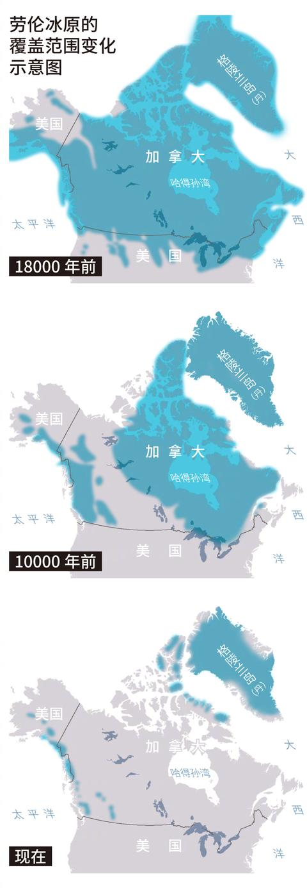

[toc]

# 问题

提问者：**<a href="https://www.zhihu.com/people/long-cheng-hai-dong-24">脑洞局</a>**
提问时间: 2024-10-12 11:54:43
总回答数: 60
总访问量: 361169

您认为这场全球变暖大概会持续几个世纪?

# 回答

回答者： **<a href="https://www.zhihu.com/people/li-ang-22-87">捻军李去劫</a>**
回答时间: 2025-11-16 22:24:24
点赞总数: 1083
评论总数: 140
收藏总数: 734
喜欢总数：75

全球变化就是大西洋主义者的风水说。

因为西欧和北美东海岸仰仗的就是大西洋暖流。

大西洋暖流就是西欧和美国加拿大的龙脉，是大西洋主义的龙脉。

大西洋暖流停止，就意味着伦敦，巴黎，纽约，波士顿变成严寒地区。欧洲生产力跌到爆。

如果全球变暖，格陵兰岛冰雪融化，北极和高纬海域的海水变淡，大西洋暖流就会被切断。

欧美龙脉就断了。

所以，谁排放温室气体，谁就是在掘欧美的龙脉。因此，欧美的大西洋主义者，直接把气候变化控制幅度定义为2°，然后又急吼吼的定义为1.5°。

无论从科学上看，还是从产业政策上看，控温1.5°都是不合常理的。人类历史上面临1.5°的温度变化多去了，大家都活得好好的。

只能用风水来解释了。

大家看一下，我国农村。因为盖房子导致风水出问题，然后两家械斗的情况，有时候的理由也是非常非常古怪的。比如屋檐比对方高了，对着对方开窗户了。这些无脑理由，跟1.5°控温是一样的。

所以，全球变暖相关的东西，就是一个大型的风水说，被西方国家运用从科学到宣传等方面的软实力，加以固化。一方面掩盖阶级矛盾，一方面旨在支持全球资本从主权国家侵蚀权力。

跟北大西洋这条龙脉不相干的大型国家或者政治力量，对气候变化都比较淡漠。比如俄罗斯，川普的maga，以及我国。

南欧国家有阿尔卑斯山这条龙脉，对气候变化就不如西欧国家积极。

___

解释一下，美国为啥不死守北大西洋暖流龙脉，而是左右摇摆。

这是因为从地势上看，美国龙脉有两条。第一条是始于白令海峡与阿留申群岛，贯穿北美大陆，终结于南极。其美洲段以‌ **落基山脉** ‌为“龙脊”。也就是太平洋西海岸。美国西进运动达到太平洋西岸，买下阿拉斯加，门罗宣言控制南美，形成了这条大龙脉，登上世界老大位置。

美国建国初，在东部有个小龙脉。‌ **阿巴拉契亚山脉龙脉** ‌：这是美国东部一个相对独立的“小龙脉”体系。它呈东北-西南走向，是美国建国之地和最初最发达的区域。美国首都华盛顿特区的龙脉便被认为是由阿巴拉契亚山脉出脉所结。五大湖区（苏必利尔湖、密歇根湖、休伦湖、伊利湖、安大略湖）构成了美国“负海神鼋”地貌的“左前爪”，是“聚炁池”，主掌财富的沉淀与积累。这条小龙脉和北大西洋暖流这条水龙脉相呼应，当美国重心在东海岸时，他就能成为列强，但是因为这条龙脉太短，所以登不了顶，不能成为世界主宰。

因此，北大西洋暖流只和美国小龙脉相关。

美国吞并格林兰和加拿大西部，加拿大西部在历史上有加入美国的动机。对美国巩固大龙脉非常有价值。川普这个动议是懂行的。同理，南美洲出现一个世界一极，对美国是很麻烦的事情，等于大龙脉被截断。

___

英国成为世界霸主，是因为日不落帝国时期，有大西洋暖流、印度洋环流，南大西洋环流、南太平洋环流加持。所以是海上霸主。但是英国没有连续的大山，只有水龙脉，所以龙气容易发散。

___

 **[axiba](https://www.zhihu.com/people/3d2c7f205714246e9ee68c689c377808)网友的见解：**   

北海道的虾夷山系为“祖山发脉”，本州中部山脉如“青龙昂首”，整体呈东北-西南走向的“苍龙入海”局，但龙脉断续难以聚气，虽有新干线金针督脉，但难解富士山离火插天，再加上大量的核电站位置多数犯龙鳞忌火，难免气散风冲之局’

___

大中华圈的龙脉，在亚洲部分是

-   北龙：自昆仑山向北延伸至阴山、祁连山、阴山、贺兰山，转向大兴安岭和长白山，最终延伸至朝鲜的白头山入海‌
-   中龙：中龙起源于昆仑山，沿青藏高原东缘奔腾而下‌，龙脉以华山为龙角，太白山为龙首，终南山为龙颈，在关中平原形成结穴之势‌。过大别山后，北支转向太行山入渤海，南支经桐柏山、大别山继续东行‌。
-   南龙：西起昆仑山，经横断山脉至云贵高原，沿横断山脉向东延伸‌，贵阳是其核心节点‌，后经南岭山脉、武夷山脉，最终通过福建、浙江等地区入海‌.

所以当年秦岭别墅，祁连山非法采煤都是环保大案。一开始不太理解，后来从风水国运高度看了一下，就理解其被赋予的战略意义了。

___

同理，西方在全球变暖议题上投放如此多的力量，就是力保大西洋暖流这条水龙脉不受干扰，一直能够聚风聚气。一直能把非洲南美的资源往西欧抽提。但是，这条水龙脉跟东亚无关。所以，东北亚国家还是发展起来了。但是，如果这条水龙脉耗散了，那么西欧和美国东海岸的王气就泄了。而这条水龙脉最大的威胁，就是非洲和南美的油气和煤电化了。非洲和南美的荒漠化，也是值得期待的。

同理，威胁大中华圈三条巨龙，有两条，一个是俄罗斯的冷龙，一个是日本的海龙。东南亚是破碎的，是蛇虫之相。全球变暖时代，冷龙的经脉不畅，对大中华圈三条龙压制不大。但是海龙和美国这条全球巨型龙脉整合，威胁很大。

但是，小冰期时候，冷龙就厉害了，中华圈的北龙会被直接压制。

因此，我国还是要保持灵活可控的温室气体排放政策，不能搞得太热，也不能搞得太冷，就碳中和吧。

___

到哪山，唱哪歌。跟巨佬聊天，就得听他们聊龙脉。

有时候还得听他们聊转世，听他们考据他们自己的上辈子是哪个人物，这一系的人物属于哪个星宿。

  

原文地址：[(捻军李去劫)您认为这场全球变暖大概会持续几个世纪?](https://www.zhihu.com/question/828371257/answer/1973516770431219258) 

# 评论

1. <a href="https://www.zhihu.com/people/liu-alfie">秦汉楚</a> (<small title="湖南">2025-11-17 5:38:44</small>): 坏消息是全球变暖难以阻挡，  
 
好消息是全球变不变暖，欧洲都衰落定了
   - <a href="https://www.zhihu.com/people/panda_k">潘达儿王</a> (<small title="山东">2025-11-22 16:53:59</small>): 这句话说的精准且精彩［赞］［赞］［赞］
   - <a href="https://www.zhihu.com/people/fan-55-61">Lynn</a> (<small title="江苏">2026-7-31 7:38:41</small>): 先顾好自己吧，天天想着别人衰落
   - <a href="https://www.zhihu.com/people/liu-alfie">秦汉楚</a> (<small title="回复于 2026-7-31 14:28:28/湖南"> ✉️:Lynn</small>): 确实，欧洲整天啥事都推不动还天天妄想中美衰落
   - <a href="https://www.zhihu.com/people/ludlows-43">知乎用户06hOqh8e</a> (<small title="广东">2026-9-10 16:22:11</small>): 欧洲衰落也不是什么好事，最好的格局是欧洲东亚各占大陆两极，美俄半死不活，中东做二道贩子
2. <a href="https://www.zhihu.com/people/zhi-hu-yong-hu-28798">知乎用户28798</a> (<small title="宁夏">2025-11-17 8:52:54</small>): 如果全球变暖，格陵兰岛冰雪融化，北极和高纬海域的海水变淡，大西洋暖流就会被切断。——我这边也有类似的反直觉事实。随着气候变暖，宁夏冬季反而变冷了。因为历史上西伯利亚寒流一般是直扑京津东北，深处西北内陆的宁夏基本不受影响。但近年来寒流大增强，能从山西陕北拐弯进入宁夏了。
   - **捻军李去劫** (<small title="北京">2025-11-17 9:19:12</small>): 你这个格局太小了。
   - <a href="https://www.zhihu.com/people/xie-bing-81-44">薛阳</a> (<small title="黑龙江">2025-11-17 9:52:40</small>): 东北反倒变暖和了
   - <a href="https://www.zhihu.com/people/zhi-hu-yong-hu-28798">知乎用户28798</a> (<small title="回复于 2025-11-17 10:23:34/宁夏"> ✉️:薛阳</small>): 是的，我在盘锦待过，当时零下20以下是家常便饭，但近几年越来越少了。
   - <a href="https://www.zhihu.com/people/zhi-hu-yong-hu-28798">知乎用户28798</a> (<small title="回复于 2025-11-17 10:25:13/宁夏"> ✉️:捻军李去劫</small>): 格局大点就是西北变湿成为大粮仓了，南疆都能种水稻了。
   - <a href="https://www.zhihu.com/people/dowager-67">粲粲薛薛</a> (<small title="广东">2025-11-18 3:44:13</small>): 不是，问题[格陵兰冰盖](https://www.zhihu.com/search?comment_id=11344556743&comment_type=COMMENT&content_id=756817237&content_type=answer&parent_comment_id=11343743998&q=%E6%A0%BC%E9%99%B5%E5%85%B0%E5%86%B0%E7%9B%96&request_click_id=80cf370a-c3c1-4346-a903-2ba4ec00af0e&search_source=CommentEntity)融化真会切断暖流吗？有严谨的科学界定论吗？
   - <a href="https://www.zhihu.com/people/42-44-29-33-62">雷点低</a> (<small title="山东">2025-11-18 10:24:21</small>): 恰恰是天气变暖了秋冬季长城以南的暖势力强大，北方直下的冷势力顶不过就往两边跑！一股向西一股向东［捂脸］你那里可不就冷了［捂脸］
   - <a href="https://www.zhihu.com/people/63-23-41-25-98">七纵八横</a> (<small title="回复于 2025-11-18 23:25:35/江苏"> ✉️:粲粲薛薛</small>): 会啊，正常循环：暖水北上→冷却→盐度增加→密度增大→下沉→形成深层回流→推动整环流，淡水会导致表层水沉不下去从而减弱循环
   - <a href="https://www.zhihu.com/people/xin-xiang-qie-liu-45">同人于野</a> (<small title="回复于 2025-11-19 7:14:33/河南"> ✉️:粲粲薛薛</small>): 会呀，曾经1万多年前的[新仙女木事件](https://www.zhihu.com/search?comment_id=11345399227&comment_type=COMMENT&content_id=756817237&content_type=answer&parent_comment_id=11343743998&q=%E6%96%B0%E4%BB%99%E5%A5%B3%E6%9C%A8%E4%BA%8B%E4%BB%B6&request_click_id=80cf370a-c3c1-4346-a903-2ba4ec00af0e&search_source=CommentEntity)就是。持续了1300年
   - <a href="https://www.zhihu.com/people/dowager-67">粲粲薛薛</a> (<small title="回复于 2025-11-19 10:56:3/广东"> ✉️:七纵八横</small>): 你可以说这个逻辑，但会不会真的像描绘里那样的水文气候影响，我觉得很值得商榷吧，得严谨的调研计算机模拟一下吧
   - <a href="https://www.zhihu.com/people/jia-bu-li-ai-er-zhi-xue">北极驴鼠</a> (<small title="回复于 2025-11-19 16:39:47/江苏"> ✉️:七纵八横</small>): 我不太明白，格陵兰岛冰盖融化会使得附近海域盐度降低，也就是说从热带随暖流而来的海水相对盐度变大，下沉效应更为显著，这么分析北大西洋暖流应该会得到加强，和你的结论相左啊。
   - <a href="https://www.zhihu.com/people/63-23-41-25-98">七纵八横</a> (<small title="回复于 2025-11-20 9:5:27/江苏"> ✉️:北极驴鼠</small>): 量呢？光下沉显著有啥用？这些冰冷的淡水占住位置不走，来自低纬度的热海水能过来多少？
   - <a href="https://www.zhihu.com/people/jia-bu-li-ai-er-zhi-xue">北极驴鼠</a> (<small title="回复于 2025-11-21 16:49:8/江苏"> ✉️:七纵八横</small>): 占住位置是什么鬼，北大西洋暖流的直接动力学成因是盛行西风，融化的淡水又不是固体，也受西风吹拂，为什么你会认为它阻碍洋流呢。
   - <a href="https://www.zhihu.com/people/63-23-41-25-98">七纵八横</a> (<small title="回复于 2025-11-21 19:26:33/江苏"> ✉️:北极驴鼠</small>): 还是先了解一下翻转环流吧，光靠西风进多出少有用吗？北方供暖热水冷了还要流回去呢
   - <a href="https://www.zhihu.com/people/jia-bu-li-ai-er-zhi-xue">北极驴鼠</a> (<small title="回复于 2025-11-24 9:25:45/江苏"> ✉️:七纵八横</small>): 下沉效应不就是构成环流的条件么？  
 
我一开始说下沉加剧环流，你说淡海水占位；我说明淡海水不占位，你又回来说环流没有加强。  
 
打一枪换一个地方，你是懂游击战的。
3. <a href="https://www.zhihu.com/people/dui-shi-jie-hen-shi-wang">对世界很失望</a> (<small title="河南">2025-11-17 8:4:50</small>): [@床单军团菲利克斯](http://www.zhihu.com/people/ba807bd3a615aee690c1d82121de24c5) 给你看个好玩的
4. <a href="https://www.zhihu.com/people/mo-lao-huo-ji-69">axiba</a> (<small title="上海">2025-11-18 11:2:1</small>): 北海道的虾夷山系为“祖山发脉”，本州中部山脉如“青龙昂首”，整体呈东北-西南走向的“苍龙入海”局，但龙脉断续难以聚气，虽有新干线金针督脉，但难解富士山离火插天，再加上大量的核电站位置多数犯龙鳞忌火，难免气散风冲之局
   - **捻军李去劫** (<small title="北京">2025-11-18 13:33:40</small>): 您这个好。
   - <a href="https://www.zhihu.com/people/zhao-yu-xing-20-52">老魔芋</a> (<small title="回复于 2025-11-21 13:25:7/江苏"> ✉️:捻军李去劫</small>): 海龙活、冰龙硬、冷龙僵，陆龙是山系串起来。假如没有生腾的活气，那您那陆龙不就是龙骨吗？［惊喜］
5. <a href="https://www.zhihu.com/people/shui-jiao-mt-43">致敬死鹰岭</a> (<small title="北京">2025-11-17 14:46:8</small>): 郭德纲：你想不想做我徒弟
   - **捻军李去劫** (<small title="北京">2025-11-17 15:24:28</small>): 他也配
6. <a href="https://www.zhihu.com/people/fu-leous">涸辙的鱼盼着雨水</a> (<small title="河北">2025-11-17 12:5:31</small>): 太幽默了兄弟。
7. <a href="https://www.zhihu.com/people/25-94-90-10-57">知乎用户ngwdpD</a> (<small title="湖南">2026-1-5 11:17:45</small>): 想象力丰富，不改成小说就浪费了
8. <a href="https://www.zhihu.com/people/qwqchu-xin-jiang">qwq初心酱</a> (<small title="安徽">2025-11-17 19:36:31</small>): ［doge］好看爱看多写点
9. <a href="https://www.zhihu.com/people/chang-qian-wu">安川风亭</a> (<small title="浙江">2025-11-19 14:54:27</small>): 还是被极端天气拷打少了
10. <a href="https://www.zhihu.com/people/yun-fei-yang-83-1">云飞扬</a> (<small title="四川">2025-11-17 15:25:41</small>): 从地球的角度，人类活动对气候变化有限，可能有微乎其微的加减速的作用
11. <a href="https://www.zhihu.com/people/Z10Beaver">Z10Walker</a> (<small title="重庆">2025-11-18 21:47:21</small>): ［赞］真风水之术
12. <a href="https://www.zhihu.com/people/zi-xu-xian-sheng-29">子虚先生</a> (<small title="北京">2026-7-14 3:54:15</small>): 你不觉得热吗哥们儿？
13. <a href="https://www.zhihu.com/people/mei-you-ge-xing-1">没有个性</a> (<small title="意大利">2025-12-16 7:28:11</small>): 拉倒吧，欧洲更在意全球变暖是因为欧洲是全球变暖最明显的受害者，十年前很多地方最高温度不超过30度，现在年年40度，谁扛得住啊？
14. <a href="https://www.zhihu.com/people/32-31-81-34-61">林中的维吉尔</a> (<small title="湖北">2025-11-24 17:4:58</small>): 虽然看起来像是整活，但是这个观点很有意思，值得思考［惊喜］［惊喜］［惊喜］
15. <a href="https://www.zhihu.com/people/xiao-du-xiong-1">小度熊</a> (<small title="四川">2025-11-17 23:0:51</small>): 有趣的说法，[堪舆学](https://www.zhihu.com/search?comment_id=11344321265&comment_type=COMMENT&content_id=756817237&content_type=answer&q=%E5%A0%AA%E8%88%86%E5%AD%A6&request_click_id=b58c305a-5112-47bb-8c1c-600429cb96fc&search_source=CommentEntity)早就应该具备全球视野去指点外人的江山了
    - <a href="https://www.zhihu.com/people/dong-li-ren-jian">洞里人间</a> (<small title="湖北">2025-11-21 14:37:23</small>): 你以为西方不懂堪舆吗？［吃瓜］
    - <a href="https://www.zhihu.com/people/xiao-du-xiong-1">小度熊</a> (<small title="回复于 2025-11-21 14:44:48/四川"> ✉️:洞里人间</small>): 不然呢？西方地理学和中国[堪舆学](https://www.zhihu.com/search?comment_id=11347480606&comment_type=COMMENT&content_id=756817237&content_type=answer&parent_comment_id=11344321265&q=%E5%A0%AA%E8%88%86%E5%AD%A6&request_click_id=93194030-2d16-4ac4-a8aa-ba399cbf00df&search_source=CommentEntity)能够等量齐观吗？  
 
只能说明你看不懂奢侈品，不知道文化差异带来的情绪价值［吃瓜］
16. <a href="https://www.zhihu.com/people/gao-tao-66-94">逃离餐桌鲶鱼公</a> (<small title="山东">2025-11-20 14:48:47</small>): 所以只要修一条横贯中央山脉的隧道就可以消灭台湾［害羞］
17. <a href="https://www.zhihu.com/people/spray-50-24">spray</a> (<small title="广西">2025-11-18 10:18:49</small>): 西方的风水市场是个巨大的空白！
18. <a href="https://www.zhihu.com/people/chu-xia-44-56">初夏</a> (<small title="四川">2025-11-25 16:46:48</small>): 关注您了，爱看玄学故事
19. <a href="https://www.zhihu.com/people/xiong-kou-sui-da-shi-33-42">胸口碎大石</a> (<small title="青海">2025-11-18 5:15:42</small>): 日本不是背水面山吗？风水不好啊
20. <a href="https://www.zhihu.com/people/dowager-67">粲粲薛薛</a> (<small title="广东">2025-11-18 3:44:39</small>): 不是，问题格陵兰冰盖融化真会切断暖流吗？有严谨的科学界定论吗？为啥一堆人在这里自嗨？
    - <a href="https://www.zhihu.com/people/you-yi-si-28">momo</a> (<small title="北京">2025-11-18 18:40:26</small>): 都讨论风水了，还需要科学定论吗［飙泪笑］
    - <a href="https://www.zhihu.com/people/sunny-49-10-38">知乎用户nvQNOz</a> (<small title="浙江">2025-11-19 14:38:0</small>): 北大西洋温盐环流又称大西洋经向翻转环流（AMOC），是由海水温度与盐度差异驱动的全球性海洋环流系统，在格陵兰岛附近因低温高盐特性下沉形成深层回流，IPCC评估认为21世纪AMOC极可能出现减缓，但完全崩溃可能性较低
    - <a href="https://www.zhihu.com/people/sunny-49-10-38">知乎用户nvQNOz</a> (<small title="浙江">2025-11-19 14:44:8</small>): 研究格陵兰及北极冰盖融化对[AMOC](https://www.zhihu.com/search?comment_id=11345563900&comment_type=COMMENT&content_id=756817237&content_type=answer&parent_comment_id=11344006532&q=AMOC&request_click_id=18a1aac3-8279-45c9-b8c0-105d2cf57880&search_source=CommentEntity)可能影响的论文还挺多的，还有很多估测全球温度变化对AMOC强弱周期的关联
21. <a href="https://www.zhihu.com/people/xi-chao-mu-bai">汐潮慕白</a> (<small title="江苏">2025-11-17 16:54:39</small>): 从风水堪舆的角度赢［大笑］［大笑］［大笑］
22. <a href="https://www.zhihu.com/people/bo-ran-hai-lang-yi-qian-kong">勃然骇浪亦潜空</a> (<small title="上海">2025-11-17 11:23:41</small>): 话说当年地球唯一大陆“盘古大陆”的龙脉—中央山脉被断开后，孑遗一半就是北美东部的“[阿巴拉契亚山脉](https://www.zhihu.com/search?comment_id=11343723948&comment_type=COMMENT&content_id=756817237&content_type=answer&q=%E9%98%BF%E5%B7%B4%E6%8B%89%E5%A5%91%E4%BA%9A%E5%B1%B1%E8%84%89&request_click_id=9bd75a09-7dbe-43cc-8811-be463fc681f1&search_source=CommentEntity)”，另一半就是西北非的“阿特拉斯山脉”，后者和欧洲主脉“阿尔卑斯山”合围出了地中海，乃西方脉眼之所在。
    - <a href="https://www.zhihu.com/people/wang-hu-lin-97">王卿</a> (<small title="甘肃">2025-11-17 12:59:44</small>): 一截遗欧，一截赠美，一截还东国。太平世界，环球同此凉热。
    - <a href="https://www.zhihu.com/people/yuan-shan-47-62">江枫渔火</a> (<small title="回复于 2025-11-17 16:12:46/湖北"> ✉️:王卿</small>): 还是伟人看得远。
    - <a href="https://www.zhihu.com/people/5-11-72-18">耐心等待积极争取</a> (<small title="山东">2025-11-17 17:51:41</small>): 只要板块运动把西班牙的那个什么海峡封闭，整个欧洲就完蛋了［doge］
23. <a href="https://www.zhihu.com/people/a-er-tai-er-21">塔尔米纳斯提尔</a> (<small title="江苏">2025-11-16 23:37:34</small>): 你确定吗？北大西洋暖流真崩了北美比欧洲惨得多，末次冰期整个加拿大都是大冰盖，美国五大湖以北全部上冻，极端低温超过-90度堪比南极，比西伯利亚还冷。  
 
并且因为冰盖全年都会来强寒潮，哪怕盛夏气温都有可能被打回个位数，难道要指望maga们在这种鬼天气里实现宏图霸业？  
 

    - **捻军李去劫** (<small title="北京">2025-11-16 23:46:42</small>): 美国还有西雅图到加州这条大龙脉，不碍事
    - <a href="https://www.zhihu.com/people/a-er-tai-er-21">塔尔米纳斯提尔</a> (<small title="回复于 2025-11-17 0:6:0/江苏"> ✉️:捻军李去劫</small>): 那不是民主党铁盘区吗？看来maga们还要先在内部发起一场大远征
    - <a href="https://www.zhihu.com/people/wang-ke-6-91">Calculus</a> (<small title="江苏">2025-11-17 4:18:29</small>): 问题在于，maga心目中的霸业不是你理解的那个“霸业”，他们不会介意退化成科技野蛮人，甚至于说，他们“向往”成为科技野蛮人。
    - <a href="https://www.zhihu.com/people/xiao-ze-ma-da-ha">小泽马大哈</a> (<small title="美国">2025-11-17 9:33:8</small>): 美国人口少，还有西海岸和南方。
    - <a href="https://www.zhihu.com/people/a-er-tai-er-21">塔尔米纳斯提尔</a> (<small title="回复于 2025-11-17 9:58:34/江苏"> ✉️:小泽马大哈</small>): 南方不行，大平原无险可阻，冰盖冷空气能一口气捅到墨西哥，哪怕现在德州来大寒潮都动不动-20度，到那会-40度都是家常便饭。  
 
更何况因为冰盖存在，寒潮全年都会出动，哪怕盛夏气温都能给你干到个位数，这个条件下农业基本没法发展。只有落基山脉庇护下的西海岸能幸免于难，但那里是民主党铁盘，maga们得先来场内部大远征
    - <a href="https://www.zhihu.com/people/O_O_O_O">CoNumeraire</a> (<small title="回复于 2025-11-17 10:7:6/美国"> ✉️:捻军李去劫</small>): 这条不是大龙脉，能承载的人口和东边的那条不能比
    - <a href="https://www.zhihu.com/people/lin-chen-90">林晨</a> (<small title="回复于 2025-11-17 12:48:40/广东"> ✉️:塔尔米纳斯提尔</small>): 谁的铁盘是动态变化的，里根时期加州还是红州，[施瓦辛格](https://www.zhihu.com/search?comment_id=11343495502&comment_type=COMMENT&content_id=756817237&content_type=answer&parent_comment_id=11343081095&q=%E6%96%BD%E7%93%A6%E8%BE%9B%E6%A0%BC&request_click_id=f69b1e69-1865-4869-9c0a-bb37a95f3918&search_source=CommentEntity)这个共和党人10几年前还是加州州长。
    - <a href="https://www.zhihu.com/people/lzsiba">知乎用户Co8a8W</a> (<small title="回复于 2025-11-17 15:47:25/广东"> ✉️:捻军李去劫</small>): 蓝州，崛起
    - <a href="https://www.zhihu.com/people/yuan-steven-92">沁园</a> (<small title="广东">2025-11-17 16:26:52</small>): maga南下进军阳光带［酷］
    - <a href="https://www.zhihu.com/people/5-11-72-18">耐心等待积极争取</a> (<small title="回复于 2025-11-17 17:53:44/山东"> ✉️:塔尔米纳斯提尔</small>): 加州变成民主党铁盘也就20多年［微笑］
    - <a href="https://www.zhihu.com/people/zhi-xue-20">志雪</a> (<small title="回复于 2025-11-18 23:44:4/湖南"> ✉️:捻军李去劫</small>): B站的[西雅图冰雨夜](https://www.zhihu.com/search?comment_id=11344907787&comment_type=COMMENT&content_id=756817237&content_type=answer&parent_comment_id=11343081095&q=%E8%A5%BF%E9%9B%85%E5%9B%BE%E5%86%B0%E9%9B%A8%E5%A4%9C&request_click_id=f69b1e69-1865-4869-9c0a-bb37a95f3918&search_source=CommentEntity)万圣节［doge］
    - <a href="https://www.zhihu.com/people/gui-zheng-er-lun">2333Vladimir</a> (<small title="回复于 2026-7-18 10:15:17/广西"> ✉️:捻军李去劫</small>): 那么可以说一下[穿堂风](https://www.zhihu.com/search?comment_id=11533227678&comment_type=COMMENT&content_id=756817237&content_type=answer&parent_comment_id=11343081095&q=%E7%A9%BF%E5%A0%82%E9%A3%8E&request_click_id=f69b1e69-1865-4869-9c0a-bb37a95f3918&search_source=CommentEntity)问题（美国是两山包夹）？
24. <a href="https://www.zhihu.com/people/fu-la-ji-mi-er-dtang-na-de">闭嘴的吹哨人</a> (<small title="山东">2025-11-17 22:12:48</small>): 这也是现在和老毛子事实上联盟的原因吧，老美和小鬼子的龙脉本质上是环太平洋一系列山峦岛链的分支综合，而老毛子控制东西伯利亚的[堪察加半岛](https://www.zhihu.com/search?comment_id=11344205989&comment_type=COMMENT&content_id=756817237&content_type=answer&q=%E5%A0%AA%E5%AF%9F%E5%8A%A0%E5%8D%8A%E5%B2%9B&request_click_id=9bd75a09-7dbe-43cc-8811-be463fc681f1&search_source=CommentEntity)和千岛群岛，这样就让老美和小鬼子的山川兴盛的力量没办法连起来，反而可以逐一击破。换句话说，老美的一二岛链不也是两条海龙脉吗［好奇］
25. <a href="https://www.zhihu.com/people/kingofthing">Igor Strelkov</a> (<small title="山东">2025-11-28 19:14:2</small>): 全球变暖西欧北欧和北美新英格兰地区彻底变苦寒之地。中俄反倒坐收千万平方公里的严寒地区变得温暖湿润［捂嘴］。你要是主导舆论霸权的美西方你急不急［捂脸］。
26. <a href="https://www.zhihu.com/people/da-heng-57-10">大亨</a> (<small title="山西">2025-11-17 13:16:5</small>): 额😓欧美有龙脉这种说法么？？他们不是信奉星座血统一类的么？？
    - **捻军李去劫** (<small title="北京">2025-11-17 14:22:28</small>): 接纳了。上周跟欧盟教授聊了一晚上的风水理论。他们是顶级科学家，但是花了1年在香港学习了中国风水。
    - <a href="https://www.zhihu.com/people/bai-yun-41-35">白云</a> (<small title="广西">2025-11-17 20:19:54</small>): 我说一个观点供大家探讨一下 ，风水为地运，文明盛衰，地运迁移变化固然是一大因素，但还有天运，人运，所以中国风水的确厉害，能对文明、国家起到优化作用，但不足以完全起到主导作用，近代中国落后于欧美，处处挨打，自满清积弊三百余年，可谓深唉，如果不是一百年来各方面仁人志士为了整个国家、整个民族救亡图存，付出极大牺牲，是没有办法扭转这种危局，这就是人自身努力所起到作用，所以人运也是一个非常重大原因
    - <a href="https://www.zhihu.com/people/yao-bu-neng-ting-12-41">耀不能停</a> (<small title="福建">2025-11-17 21:8:58</small>): 得益于互联网、交通和人口流动等，至少世界主流国家的玄学都被广泛传播了，像欧美的塔罗、阴谋论等等，国人不是一堆讨论的吗
    - <a href="https://www.zhihu.com/people/hua-hong-chang-83">GunSmithCats</a> (<small title="上海">2025-11-17 21:49:59</small>): 福兮祸之所伏，祸兮福之所倚懂不？
    - <a href="https://www.zhihu.com/people/fu-la-ji-mi-er-dtang-na-de">闭嘴的吹哨人</a> (<small title="山东">2025-11-18 8:38:28</small>): 星座八字实际上本质是一体两面，比如星座实际上就是中国八字里面的月令，比如摩羯座的月份就是传统八字里面子月后十五天和丑月的前十五天。
    - <a href="https://www.zhihu.com/people/zhi-xue-20">志雪</a> (<small title="回复于 2025-11-18 23:42:47/湖南"> ✉️:闭嘴的吹哨人</small>): 第二柱，月柱
    - <a href="https://www.zhihu.com/people/yue-luo-wu-ti-35-47">月luo乌啼</a> (<small title="回复于 2025-11-19 18:18:0/广东"> ✉️:志雪</small>): 【十二星座、四柱八字与天文学-哔哩哔哩】 [https://b23.tv/s24z5IX](https://b23.tv/s24z5IX)
    - <a href="https://www.zhihu.com/people/yue-luo-wu-ti-35-47">月luo乌啼</a> (<small title="回复于 2025-11-19 18:18:56/广东"> ✉️:闭嘴的吹哨人</small>): 太阳星座-月支，上升星座-时支，月亮星座-日柱
27. <a href="https://www.zhihu.com/people/ha-mo-73">哈默</a> (<small title="浙江">2025-11-18 9:10:26</small>): 哈哈哈，那美国之前巨龙怎么没起作用
    - **捻军李去劫** (<small title="北京">2025-11-18 13:34:2</small>): 问得好，大家一起完善理论吧
28. <a href="https://www.zhihu.com/people/john-brown-01">大唐左威卫将军</a> (<small title="陕西">2025-11-21 13:9:11</small>): 看来答主觉得国内这两年夏天连着几个星期40度的日子还是太少了［尴尬］
29. <a href="https://www.zhihu.com/people/xie-fan-64-11">知乎用户</a> (<small title="广东">2025-11-17 8:28:52</small>): 西边是民主党地盘，内陆气候崩了和东边一起死去
    - <a href="https://www.zhihu.com/people/xiong-kou-sui-da-shi-33-42">胸口碎大石</a> (<small title="青海">2025-11-18 5:23:43</small>): 东海岸有吸血鬼科学家爱迪生，应该不怕冷，当年好莱坞就是被吓跑的
30. <a href="https://www.zhihu.com/people/tumantumeng">Nuclear Carrot</a> (<small title="加拿大">2025-11-18 5:29:4</small>): 非洲和南美的[荒漠化](https://www.zhihu.com/search?comment_id=11344211451&comment_type=COMMENT&content_id=756817237&content_type=answer&q=%E8%8D%92%E6%BC%A0%E5%8C%96&request_click_id=9bd75a09-7dbe-43cc-8811-be463fc681f1&search_source=CommentEntity)，也是值得期待的。能细说一下是什么导致的吗？
    - <a href="https://www.zhihu.com/people/l-31-56-48">L你我</a> (<small title="江苏">2025-11-21 20:45:54</small>): 我也感兴趣
31. <a href="https://www.zhihu.com/people/chui-lian-74-91">zi乎史官</a> (<small title="内蒙古">2025-11-20 18:43:27</small>): 如果是这样说国运的话，咱就不提龙，只说温度。历史上也是气温提高之后，中华文明变强盛。以压胜之说，蛮夷就不能让全球的温度热起来。［doge］
    - <a href="https://www.zhihu.com/people/56-48-94-43">殷长生</a> (<small title="湖北">2025-11-22 13:37:8</small>): 不过相对的，南方就可以被认定为彻底废掉了：不是所有人都能在40度的高温坚持工作的…  
 
这边只能热切希望北方当时修的各种防护林一定能做到固风固沙固土的作用了，以及黄河这个地上河不要出不岔子。不然就是是像[塔克拉玛干大沙漠](https://www.zhihu.com/search?comment_id=11348228230&comment_type=COMMENT&content_id=756817237&content_type=answer&parent_comment_id=11346875438&q=%E5%A1%94%E5%85%8B%E6%8B%89%E7%8E%9B%E5%B9%B2%E5%A4%A7%E6%B2%99%E6%BC%A0&request_click_id=e1968953-687f-41b0-97ac-bd63cc96265b&search_source=CommentEntity)当时下大雨一样，光雨水浮在沙子上，渗不进沙地…黄河再来个夺淮入海的那种…那北方也就只能一起废掉了…
    - <a href="https://www.zhihu.com/people/88-2-20-29-74">精神离片锥动物</a> (<small title="回复于 2026-1-15 14:10:10/广东"> ✉️:殷长生</small>): 不怕，有空调
    - <a href="https://www.zhihu.com/people/hzxs">hzxs</a> (<small title="回复于 2026-2-11 8:9:42/浙江"> ✉️:殷长生</small>): 南方只会变湿热而非干热，也就是会东南亚化，印度化
32. <a href="https://www.zhihu.com/people/2rywew">知乎用户2rYWeW</a> (<small title="海南">2025-11-19 11:54:54</small>): 没有山，越南早被明剿灭
    - <a href="https://www.zhihu.com/people/liu-ma-90-85">遛马</a> (<small title="辽宁">2025-11-22 9:54:3</small>): 没有山，都不需要明去灭，汉朝时就不会丢。
33. <a href="https://www.zhihu.com/people/ydc-53-74">YDC信任自然</a> (<small title="河南">2026-8-25 15:54:53</small>): 地球环境的高温与[冰河期](https://www.zhihu.com/search?comment_id=11562149934&comment_type=COMMENT&content_id=756817237&content_type=answer&q=%E5%86%B0%E6%B2%B3%E6%9C%9F&request_click_id=6e6c4044-db59-4b58-a2b6-7c306b766960&search_source=CommentEntity)。  
 
[https://www.zhihu.com/pin/2050822491384369253?native=1&scene=share&share\_code=Q6EyplkMbeip&utm\_psn=2072638370229101943](https://www.zhihu.com/pin/2050822491384369253?native=1&scene=share&share_code=Q6EyplkMbeip&utm_psn=2072638370229101943)
34. <a href="https://www.zhihu.com/people/88-17-66-20">松间雪</a> (<small title="四川">2026-6-2 11:33:25</small>): 为什么搞风水的总是那么爱日本呢？最后是不是要和日本阴阳师大战？
35. <a href="https://www.zhihu.com/people/zhi-jian-sui-xing-he-57">至诚明心</a> (<small title="山东">2026-5-24 9:15:22</small>): 国家文明的气运，确实天气地脉最重要［思考］
36. <a href="https://www.zhihu.com/people/dong-nan-xi-bei-zhong-dong-10">冬天雪霜</a> (<small title="浙江">2026-5-23 14:5:22</small>): 不可能降温的，只要人类的物质条件还继续发展，那必然会越来越热，25年前的夏天，根本没有现在那么热
37. <a href="https://www.zhihu.com/people/yu-si-tian-64">雨思天</a> (<small title="山东">2026-5-23 7:49:58</small>): 党校也讲过这个东西，你这样不违规嘛
    - <a href="https://www.zhihu.com/people/bi-hai-qing-tian-tou-yue">碧海青天偷月</a> (<small title="湖南">2026-5-23 14:31:30</small>): 90年代欧美就兴起一股风水堪舆学了，早就研究透了，网上大把的言论
38. <a href="https://www.zhihu.com/people/7847656289">用户7847656289</a> (<small title="北京">2026-5-21 19:43:5</small>): 欧洲几乎全域都比漠河更靠北，这要是没有北大西洋暖流，我不知道该怎么活
39. <a href="https://www.zhihu.com/people/a-le-man-ni-da-qiu-chang-71">阿勒曼尼大酋长</a> (<small title="山东">2025-12-12 19:57:3</small>): 毛子真的不相干吗，没了北大西洋暖流你确定莫斯科不会变成一个大号漠河？
40. <a href="https://www.zhihu.com/people/xi-yang-yang-90-93-13">喜洋洋</a> (<small title="上海">2025-11-23 0:42:38</small>): 者有点东西
41. <a href="https://www.zhihu.com/people/ma-ye-92-26-26">南荒之海</a> (<small title="新加坡">2025-11-21 3:45:48</small>): 多变暖三五个千年等到没有暖流也照样暖就行了
42. <a href="https://www.zhihu.com/people/xu-xiao-pang-21">积年老魔</a> (<small title="北京">2025-11-21 11:41:28</small>): 这个好玩
43. <a href="https://www.zhihu.com/people/chen-xi-qi-ming-57">晨曦启明</a> (<small title="广东">2025-11-20 2:11:36</small>): ［赞］［赞］［赞］［赞］
44. <a href="https://www.zhihu.com/people/kkaabc">向光前行</a> (<small title="湖北">2025-11-19 18:51:42</small>): 不知[昆仑山](https://www.zhihu.com/search?comment_id=11346057607&comment_type=COMMENT&content_id=756817237&content_type=answer&q=%E6%98%86%E4%BB%91%E5%B1%B1&request_click_id=58bf9039-a8e8-438a-8208-4981acb7543e&search_source=CommentEntity)作为中华龙脉根基的地位有无官方背书，确实很想了解一下。既然如此重要，总应该露出些线索吧
    - **捻军李去劫** (<small title="浙江">2025-11-20 0:17:38</small>): 官方不可能出来背书啦，我们是唯物主义国家。但是，不代表上层不信呐。
45. <a href="https://www.zhihu.com/people/zhi-shi-a-man">我的频率52赫兹</a> (<small title="北京">2025-11-19 9:2:18</small>): 江南的设定要是能有这个格局，何愁这小说写不出来
46. <a href="https://www.zhihu.com/people/hong-xiao-hang-13">飞天面条</a> (<small title="云南">2025-11-18 18:18:14</small>): 卧槽，写得真好
47. <a href="https://www.zhihu.com/people/tangqing-pei-48">唐朝沙飞</a> (<small title="广东">2025-11-18 8:30:53</small>): 好玩［赞］［捂脸］好玩［赞］［飙泪笑］
48. <a href="https://www.zhihu.com/people/zhang-du-53-76">Sheenaneko</a> (<small title="广东">2025-11-17 22:57:52</small>): 且听🐲吟
49. <a href="https://www.zhihu.com/people/jiu-ni-61-5">centurium</a> (<small title="江苏">2025-11-17 19:49:57</small>): 非常新奇的视角，有意思
50. <a href="https://www.zhihu.com/people/leng-qin-yuan">冷沁园</a> (<small title="北京">2025-11-17 20:40:17</small>): 廖平看多了［哇］
51. <a href="https://www.zhihu.com/people/okstar-1">okstar</a> (<small title="上海">2025-11-18 7:31:4</small>): 我居然看完了
52. <a href="https://www.zhihu.com/people/tian-li-niao">田里鸟</a> (<small title="浙江">2025-11-17 14:44:18</small>): 这个解释老牛逼了。
53. <a href="https://www.zhihu.com/people/ren-yun-yi-yun-31-49">人云亦云</a> (<small title="广东">2025-11-18 0:25:53</small>): 哈哈哈哈哈，笑得停不下来
54. <a href="https://www.zhihu.com/people/yan-qing-yuan">今年我要十点睡</a> (<small title="河南">2025-11-18 0:4:26</small>): 青藏高原有没有龙脉？[三江源](https://www.zhihu.com/search?comment_id=11344062853&comment_type=COMMENT&content_id=756817237&content_type=answer&q=%E4%B8%89%E6%B1%9F%E6%BA%90&request_click_id=9a597983-6929-495a-b4e7-465b09493ca9&search_source=CommentEntity)有没有啊？
55. <a href="https://www.zhihu.com/people/shen-dun-ju-5">momo</a> (<small title="天津">2025-11-17 16:14:28</small>): 怎么没有印度的龙［好奇］
    - <a href="https://www.zhihu.com/people/he-xie-fu-xing-68">德干帕迪沙</a> (<small title="江苏">2025-11-17 16:28:39</small>): 南亚感觉龙不起来，[西高止山脉](https://www.zhihu.com/search?comment_id=11343820567&comment_type=COMMENT&content_id=756817237&content_type=answer&parent_comment_id=11344049973&q=%E8%A5%BF%E9%AB%98%E6%AD%A2%E5%B1%B1%E8%84%89&request_click_id=e0bd8131-93fc-4866-a6e2-bfc1151b3684&search_source=CommentEntity)？兴都库什？（这也是阿富汗的，最多巴基斯坦沾点边，而且名字对印度也太晦气了）
56. <a href="https://www.zhihu.com/people/mo-zhu-xian-58">lhgbtbtnrnw</a> (<small title="北京">2025-11-17 20:5:19</small>): 好解释［开心］
57. <a href="https://www.zhihu.com/people/49-1-55-34">老二叔</a> (<small title="江苏">2025-11-16 22:46:30</small>): maga为啥会不在意暖流呢
    - **捻军李去劫** (<small title="北京">2025-11-16 23:1:16</small>): maga的龙兴之地在于内陆，不在于沿海
58. <a href="https://www.zhihu.com/people/73-70-35-89">听天由命</a> (<small title="广西">2025-11-17 10:37:56</small>): 这个角度不错！
59. <a href="https://www.zhihu.com/people/bu-cun-zai-de-65-10">不存在的</a> (<small title="陕西">2025-11-17 0:24:44</small>): 老师还研究风水啊［好奇］
    - **捻军李去劫** (<small title="北京">2025-11-17 7:24:16</small>): 和巨佬更好沟通。
    - **捻军李去劫** (<small title="北京">2025-11-17 7:24:0</small>): 嗯嗯
60. <a href="https://www.zhihu.com/people/DavidCajooron">佐倾姬会主义</a> (<small title="黑龙江">2025-11-17 0:1:55</small>): 那么东亚的龙脉在于哪呢？
    - <a href="https://www.zhihu.com/people/gu-yue-han-tan-60">万恶穷为首</a> (<small title="江苏">2025-11-17 0:9:51</small>): 在三江平原啊。  
 
如果没有东北的粮食垫底，老钟肯定发慌。
    - **捻军李去劫** (<small title="北京">2025-11-17 7:23:49</small>): 从[青藏高原](https://www.zhihu.com/search?comment_id=11343683662&comment_type=COMMENT&content_id=756817237&content_type=answer&parent_comment_id=11342989512&q=%E9%9D%92%E8%97%8F%E9%AB%98%E5%8E%9F&request_click_id=0d04fd60-6cfb-4c50-b60b-11f7ef811d2d&search_source=CommentEntity)向四周辐射的四条洲际山脉
    - <a href="https://www.zhihu.com/people/mo-ying-zhi-shang-66">愚者</a> (<small title="回复于 2025-11-17 8:43:19/四川"> ✉️:捻军李去劫</small>): 横断秦岭天山还有哪个呢
    - **捻军李去劫** (<small title="回复于 2025-11-17 8:52:16/北京"> ✉️:愚者</small>): 昆仑啊。
61. <a href="https://www.zhihu.com/people/xuipol">xuipol</a> (<small title="山东">2026-8-26 13:18:7</small>): 闹麻了，华北极端降水还嫌少吗？
62. <a href="https://www.zhihu.com/people/guan-yue-74-53">晋王</a> (<small title="湖南">2026-5-23 3:59:33</small>): 真没想到学术大牛也整这出？还说的头头是道［飙泪笑］
63. <a href="https://www.zhihu.com/people/jinxchaos">JinXChaoS</a> (<small title="河南">2025-11-18 9:38:38</small>): 哎，你这，不开盐选可惜了啊［思考］。
64. <a href="https://www.zhihu.com/people/mic148">Volare</a> (<small title="北京">2025-11-17 9:43:24</small>): 你知道碳中和是什么意思么.......
    - **捻军李去劫** (<small title="北京">2025-11-17 9:52:3</small>): 我不知道，您来展开讲讲。
    - <a href="https://www.zhihu.com/people/mic148">Volare</a> (<small title="回复于 2025-11-17 10:8:38/北京"> ✉️:捻军李去劫</small>): 我主要好奇碳中和你是怎么跟不能太热不能太冷挂上钩的.......
    - **捻军李去劫** (<small title="回复于 2025-11-17 10:42:8/北京"> ✉️:Volare</small>): 我不知道您怎么认为碳中和，与不太冷不太热，不能挂钩的。
    - <a href="https://www.zhihu.com/people/mic148">Volare</a> (<small title="回复于 2025-11-17 10:52:22/北京"> ✉️:捻军李去劫</small>): 哦，那你赢了
    - <a href="https://www.zhihu.com/people/5-11-72-18">耐心等待积极争取</a> (<small title="回复于 2025-11-17 17:56:13/山东"> ✉️:Volare</small>): 他确实赢了［飙泪笑］
65. <a href="https://www.zhihu.com/people/5-11-72-18">耐心等待积极争取</a> (<small title="山东">2025-11-17 17:48:38</small>): [@云舞空城](http://www.zhihu.com/people/c39f4121c89698006dd97f020769c19b) 你来拷打他
    - <a href="https://www.zhihu.com/people/cloudycity">云舞空城</a> (<small title="北京">2025-11-17 18:4:18</small>): 不值得［感谢］
    - **捻军李去劫** (<small title="北京">2025-11-17 18:55:27</small>): 不要挑事。我是向来尊重人的。
    - **捻军李去劫** (<small title="回复于 2025-11-17 18:56:18/北京"> ✉️:云舞空城</small>): 你大可以不看不回。但是你这个回复太不礼貌了。
    - <a href="https://www.zhihu.com/people/chen-xi-9-6-80">曦和</a> (<small title="回复于 2025-11-18 18:43:3/上海"> ✉️:云舞空城</small>): 他说的太扯吗

=[评论](./attachments/comments.json)

