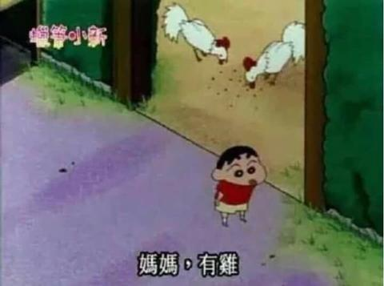

[toc]

# 问题

提问者：**<a href="https://www.zhihu.com/people/65-68-23-56">珀球</a>**
提问时间: 2023-7-12 17:51:56
总回答数: 12918
总访问量: 506226329

欢迎分享投稿

# 回答

回答者： **<a href="https://www.zhihu.com/people/twgxqy">桃子是妹妹哦</a>**
回答时间: 2026-10-19 13:38:56
点赞总数: 14
评论总数: 4
收藏总数: 18
喜欢总数：2

有的。

这组是雨天偶然拍出来的，原本只是随手记录，回看的时候突然觉得很心动。湿漉漉的长发，木窗和落雨，没有刻意摆很重的姿势。

  

[威博分享](http://t.cn/AX0H9XeK)

照片留住的是一瞬间松弛又朦胧的氛围感。不算完美，但就是这个瞬间，我自己看了很久，算是我眼里瞬间封神的一组。

  

  

原文地址：[(桃子是妹妹哦)有没有瞬间封神的照片？](https://www.zhihu.com/question/611743044/answer/2095509243273261227) 

# 评论

1. <a href="https://www.zhihu.com/people/mu-xi-73-89-79">木兮</a> (<small title="江苏">2026-10-19 13:49:13</small>): 至尊骨有反应了，鉴定为好图
2. <a href="https://www.zhihu.com/people/Enck">得儿驾</a> (<small title="上海">2026-10-19 13:56:15</small>): 
   - <a href="https://www.zhihu.com/people/bai-li-xing-ye">百里星夜</a> (<small title="浙江">2026-10-19 14:52:43</small>): 还得是你啊［捂嘴］什么图都有
3. <a href="https://www.zhihu.com/people/zhe-shi-shi-yao">这是什么</a> (<small title="天津">2026-10-19 13:53:3</small>): 不就是烧鸡么，别侮辱题目了

=[评论](./attachments/comments.json)

