[toc]

# 问题

提问者：**<a href="https://www.zhihu.com/people/xi-zhuang-bu-yi-ding-zui-shuai">西装不一定最帅</a>**
提问时间: 2025-9-9 9:47:42
总回答数: 81
总访问量: 275126

只知道思路在明朝能不能批量造出燧发枪？

# 回答

回答者： **<a href="https://www.zhihu.com/people/ruisseau-28">水清木秀</a>**
回答时间: 2025-9-20 20:43:10
点赞总数: 2287
评论总数: 234
收藏总数: 2592
喜欢总数：109

只要知道正确的思路, 在明朝就能批量制造三酸两碱, 雷汞, 无烟火药, 炸药, 手榴弹, 步枪, 火炮, 等等.

看看当年的八路军敌后根据地兵工厂, 那条件简陋得简直令人发指. 但是人家八路军就是利用那些生活中最普通的水缸, 瓦罐, 铅管等等最最简陋的工具做为生产工具, 批量生产硫酸硝酸以及雷汞炸药等等.

[土八路如何造现代火炸药？用水缸大坛，靠胆大心细——人民兵工系列（4）](https://mp.weixin.qq.com/s?__biz=MzU5NTE3MjkzNA==&mid=2247506287&idx=2&sn=f41babe2938bccbb43c3231e062906c5&chksm=fe749246c9031b504987511d2e6b0548e73ac1a8b245ad59833d7db548af28dacacd0d2a0fad&scene=27)

  

  

　　前几期我们介绍了抗战时期的人民兵工怎么克服困难，造出自己的枪械、掷弹筒、子弹榴弹、地雷炮弹。这些弹药都需要炸药、发射药，因此火炸药是兵工系统里消耗仅次于钢铁的重要材料。没有现代化学工业设备的人民兵工，必须克服很多难以想象的困难，才能做到火炸药的自主供应，让我军战士有热兵器与敌人战斗。  
 **最容易得到的火炸药** ，自然是我国传统的四大发明之一， **黑火药** 。一磺二硝三木炭，是流传在民间的黑火药配方。很多地方的群众也能自造黑火药，用于制造鞭炮等。因此在各根据地，我们发动群众开采硫磺矿石，在盐碱地收集硝土，然后用土法提炼出硫磺、火硝。

  

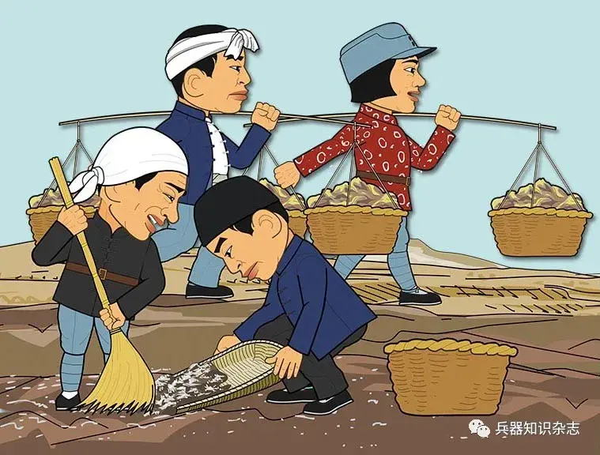

  

　　黑火药的配置也扩大规模、加强管理，尽量提高质量。  
　　但和现代火炸药相比，黑火药的爆炸威力小得多，限制了手榴弹、地雷的威力。特别是作为发射药，它会产生固体残渣，当时的步枪都无法使用。  
　　抗战初期，根据地使用的 **高级火药和炸药** ， **主要来源** 是从敌人那缴获的炮弹、航空炸弹。比如在有一次，美军轰炸机遭到日军战斗机拦截，扔下一批炸弹。我军工部人员赶到现场，冒着危险挖出10余枚227千克级炸弹，卸掉引信，掏出炸药，用来装配了一批迫击炮弹。

  

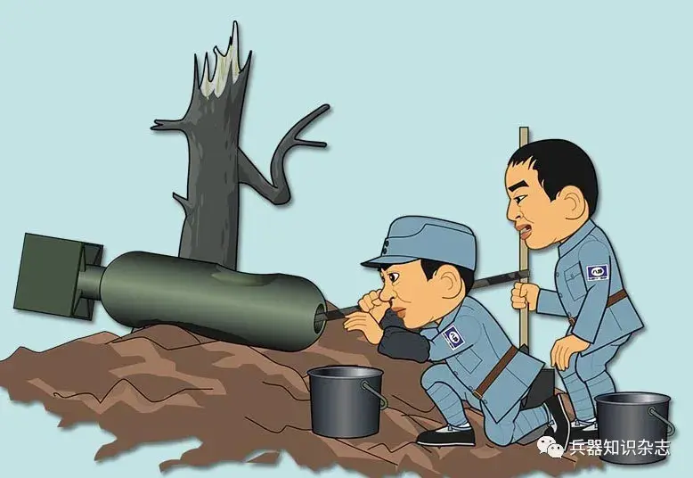

  

　　这项工作异常危险，不少兵工人为此献出了生命。因此如何依靠根据地的物资条件，能自产高级火炸药，一直是兵工部门奋斗的重要目标。  
  
　　需求量最大的，是 **复装子弹** 里的 **无烟发射药** 。  
　　兵工人根据化学原理知识，探讨了用硫酸制造硝酸以脱、硝化棉直至无烟药的方法。后来又根据一些书籍的提示，用医用脱脂棉和手边的化学药品，在实验室里制出了粘胶状的 **火棉胶** 。

  

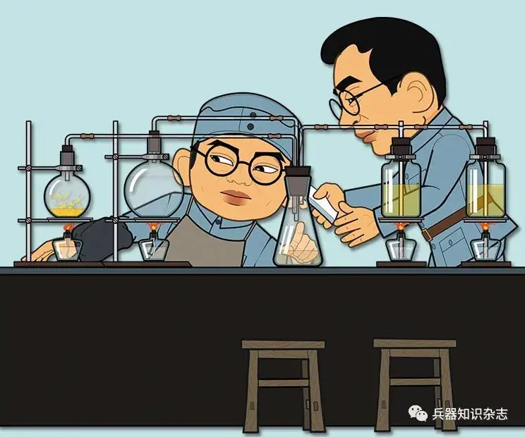

  

　　初步探索的成功，给了他们巨大鼓舞。随后的难题是 **如何大规模生产硫酸** 。硫酸是火药的重要原料，被称为“火药之母”。  
　　根据书本上介绍的知识，硫酸的制造方法有 **接触法** 和 **铅室法** 。接触法需要铂、五氧化二钒等做触媒，根据地做不到。铅室法还有一线希望。因为它是把硫磺燃烧产生二氧化硫气体，混入过量的空气、水蒸汽后，通入耐腐蚀的铅室，变成稀硫酸，不需要特殊材料。  
　　但根据地怎么弄到大量的铅？兵工人想了很多方法，后来有人提出用 **大坛** 作反应室，解决耐酸和容器问题。大家认为可行性很高，于是到老乡家里看坛子。

  

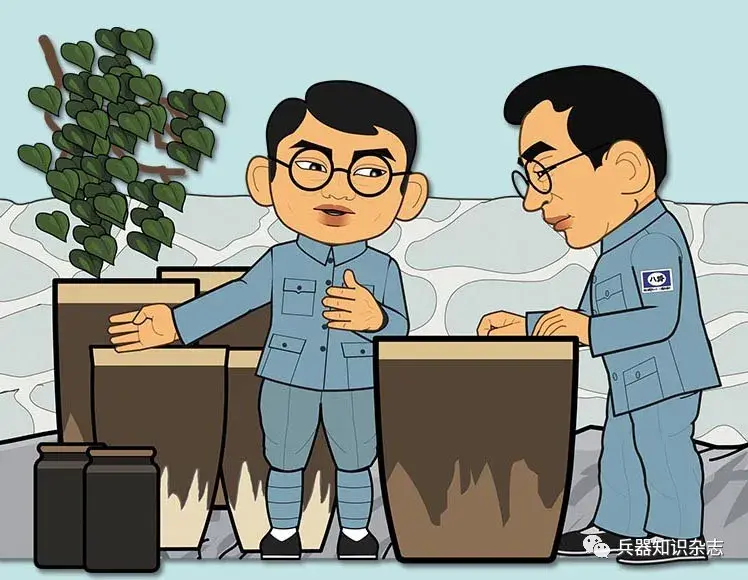

  

　　1940年初，晋察冀根据地开始试验工业制取硫酸。  
　　第一代硫酸“生产设备”，是用老百姓盛水或储粮的陶瓷缸，加上陶管组成的。水缸上用锤子和楔子凿出所需孔洞，将一对水缸对扣起来，用铅水在对接处铸封，就成了一个“反应室”。整个反应装置由五个反应室构成，用铅管互相串联。这些反应室统称为“塔”。

  

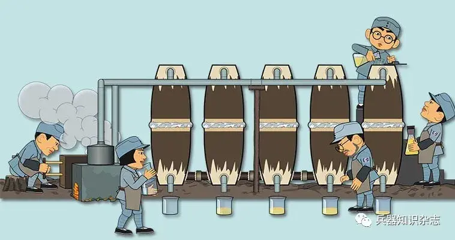

  

　　第一个塔和最后一个塔装有小块焦炭，作为起阻尼作用的填充物。最前面还有两个设备：一个是用铁皮铆成的盒子，在其中点燃硫黄，用风箱鼓风，产生二氧化硫气体，和多余的空气一道导入前塔；另一个是铸铁壶，装入火硝和硫酸，加热后产生氮氧化物气体，也导入前塔。“设备”启动后，把几个塔下流出的东西，靠人工淋来倒去的，就应该能在第一个塔下得到硫酸。  
　　可最初生产得到的是灰色糊状物。这啥玩意呐？

  

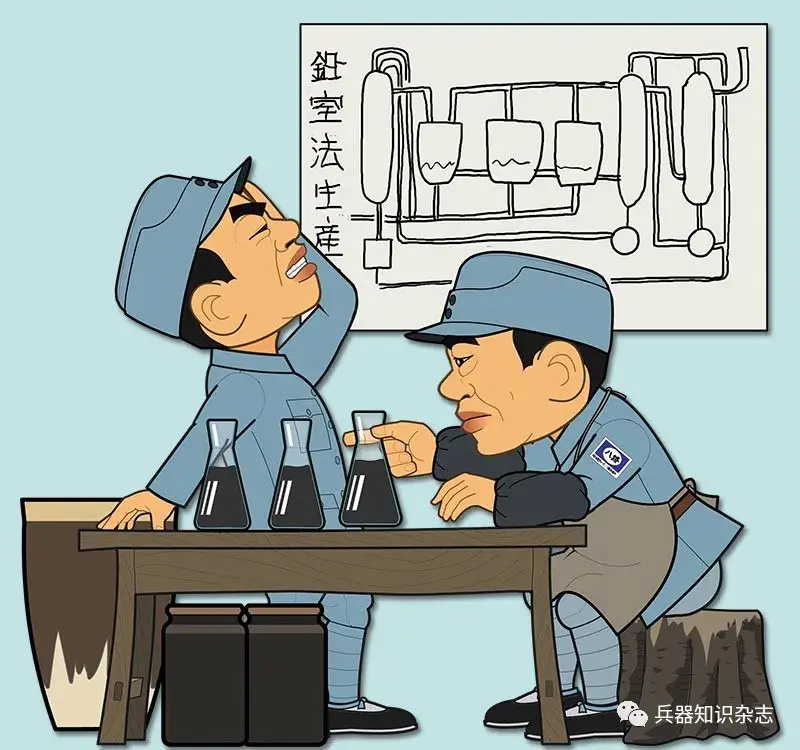

  

　　分析后大家认为，这里可能是混杂了焦炭末和铁盐的硫酸，罪魁祸首是用作填充物的焦炭（其中可能混有铁的成分）。虽然没有制成合格的硫酸，但已经可以证明：用 **缸坛代替铅室** 的方法是成功的。  
　　1940年秋， **晋察冀根据地** 工业部的 **第一个化学厂** ，在青虚山里大岸沟创建。这次的缸坛是特制的：圆柱形的缸体上，缸口逐渐收缩成小口，两肩处各有一个管口。三个这样的缸坛用木架托着，斜着摆放，用铅管串联起来。这次没用前塔和后塔了，主要是为了不必用焦炭作填充物。制成稀硫酸从各缸坛下的小孔流出，经过蒸浓，得到洁白透明的硫酸。

  

  

　　1940年7月， **大岸沟** 生产出 **第一瓶** 合格的 **硫酸** 。样品送到军区时，聂荣臻司令员高兴地说：“有了第一瓶，就能有第二瓶、第三瓶。”  
　　兵工人不满足于这已经成功的第二代设备，因为这种缸坛的坛口太小，内部不能涂釉，于是很快被酸液腐蚀坏，而订烧新的特制缸坛时间太长。另外没了前塔和后塔，大量氮氧化物气体被浪费掉。于是他们设计建造了 **第三代硫酸制造设备** ：用4只水缸对扣着摞放起来，中间打通，形成一个容积较大的高塔；7个或9个这样的高塔，用直径较粗的陶瓷管、玻璃管串联起来；前塔和后塔内用耐酸的瓷片作填充物；附属设备也相应地加大。  
　　这套制酸设备比较理想，1941年11月开始生产， **日产量增长了数十倍** 。当然，这里的工作条件很差，很远就会看见蒸馏塔雾气腾腾，气味刺鼻，衣服很容易被腐蚀坏。

  

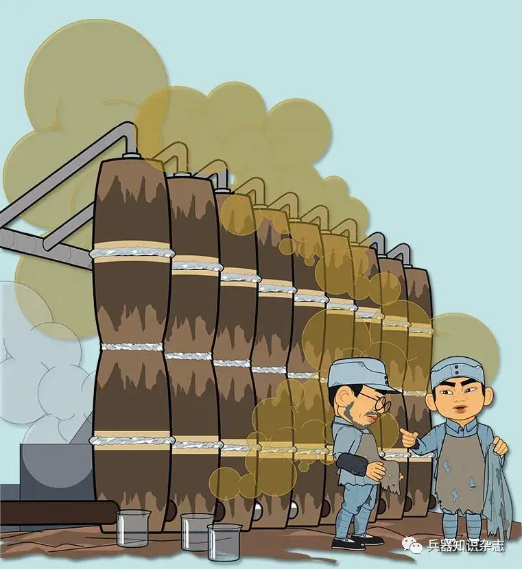

  

  
　　这第三代设备用了一段时间后，大家发现前塔成酸效率最高，其它塔的用法还有待改善。为此大家又对设备作进一步的修改。比如在中间每个反应塔内都交叉地扣放瓷碗，使反应更加充分；用烟道把烧热铁罐的热烟器引过来，从塔外提高前塔的温度，以再次提高前塔成酸的效率……

  

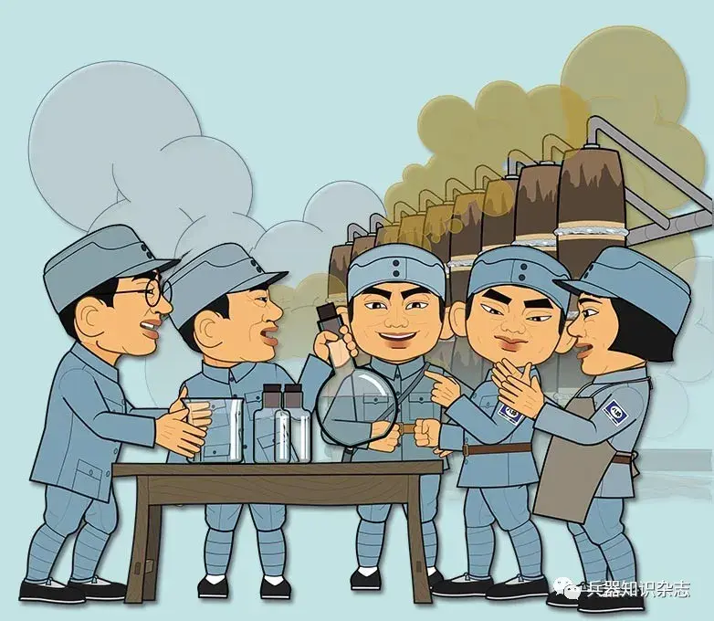

  

　　至此，根据地制造硫酸的独特技术， **缸塔法** ，趋于完善。  
　　其它根据地还结合自身特点，学习并改进缸塔法。比如1943年春，山东根据地用当地含云母少、含酸程度高的花岗岩砌成几座塔进行试验。从筹备到试验成功仅用了15天，而后到生产只用了不到2个月。  
　　缸塔法的成功可以说是“土洋结合”。有一次晋察冀军工部的张珍向聂荣臻司令员汇报工作，聂司令员风趣地说：你们都是土专家嘛！张珍奇怪地说：我们这些人中许多来自清华、北大、师大、南开等名牌大学，有的还留过洋呢。聂司令员说：我在国外看到人家生产这样产品的设备，都是现代化的，许多是用不锈钢和特殊合金制成的，而你们就用这山沟里的坛坛罐罐，产出高质量的硫酸，怎么不是土专家呢！

  

  

　　生产出硫酸后，晋察冀军工部开始用工厂铸的硝酸锅和缸窑烧的专用冷凝弯管， **试制硝酸** 。可是在得到稀硝酸的同时，他们发现有许多黄色气体从管口飞走。观察分析一番后意识到：硝酸锅是参照书中大量生产用的硝酸锅图样缩小尺寸铸造的，锅颈太短，同时灶火不均匀，结果硝酸蒸汽升到上部后提前凝成液体，滴回锅内反复受热，分解产生了黄色的二氧化氮气体，硝酸也成了稀硝酸。

  

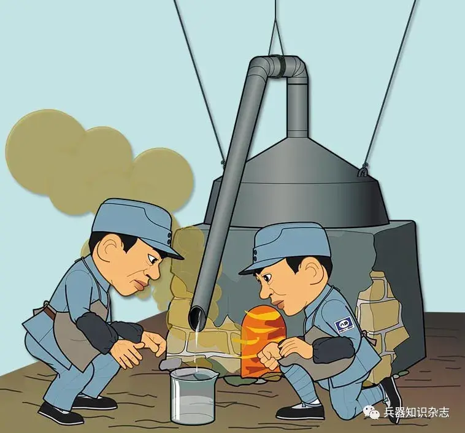

  

　　机械地搬用书中图样，不行啊。于是他们改用陶瓷大缸制造硝酸，在缸体外糊上一层耐火黏土，用陶瓷盆封闭缸口并用小火加热，从而让缸体上下温差不大，防止硝酸蒸汽凝结滴回、分解。用这套自创的装置，制成了合格的浓硝酸。

  

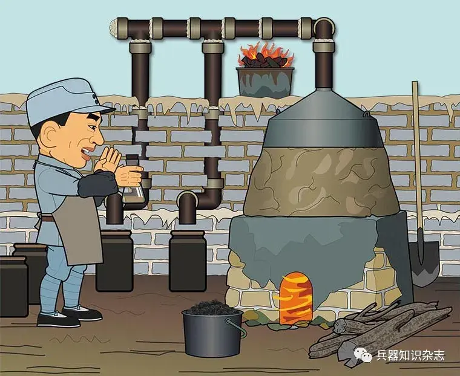

  

  
　　在蒸取硝酸的同时，军工部还制成了酒精和以脱。生产无烟发射药的重要原料都有了。  
　　随后在实验室里，军工部人员将硫酸和硝酸按比例配成混合酸液，然后把棉花脱脂，浸饱在这种混酸中，制成了 **硝化棉** 。再将它洗净、晾干，用酒精和以脱的混合溶剂溶解。原本以为此时就能得到无烟发射药、火棉胶了，结果却发现硝化棉没有溶解。这是怎么回事？

  

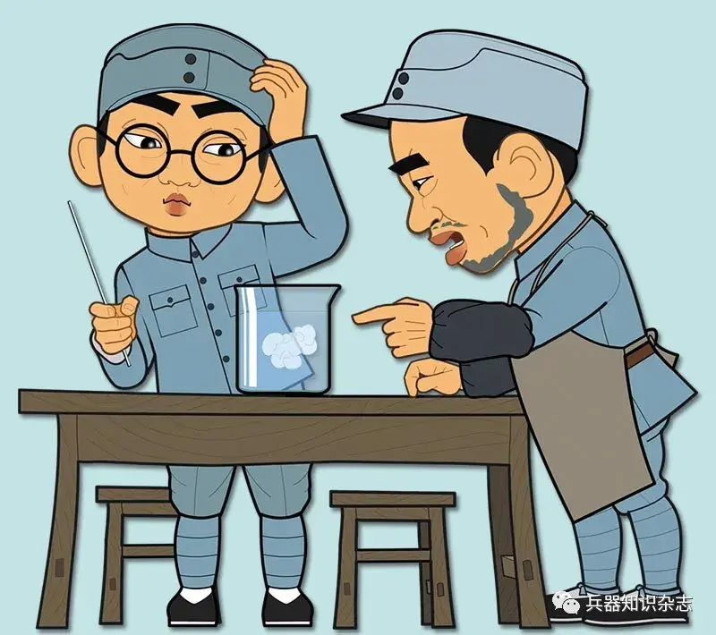

  

　　经过研究，又查阅了书籍，大家才知道自己做的混酸是用浓硫酸和浓硝酸配制的，用它浸饱的脱脂棉只能制成强火棉，而强火棉只溶解于丙酮，不能溶解在酒精、以脱的混合溶剂中。那为什么以前的试验成功了呢？当事人回想起来，以前试制火棉胶时，用的是从冀中运来的小瓶酸液，应该是瓶塞不严密，放置久后受了潮，瓶内的酸已不太浓了，用它做出的硝化棉是弱火棉。弱火棉在酒精、以脱的混合溶剂中能够溶解。  
　　大家还在《高级火药学》一书中找到个三角图解，图中曲线显示了混酸中所含水分的适当数值。只有水分适当，硝化棉才可以在酒精、以脱的混合溶剂中溶解。这下帮了个大忙。大家参考这三角图解，通过计算，分别用合适的硫酸和硝酸，配成合适的混酸，做出了合用的弱火棉和强火棉。下面就是怎么批量生产无烟发射药了。  
  
 **批量生产无烟发射药** ，根据地的土办法有点 **像做面条** 。  
　　首先是要对硝化棉 **消除残酸** 。正规工艺是用打浆机把硝化棉打碎，再行煮、洗，才能将留藏在纤维管中的残酸洗净。硝化棉不含残酸了，以后硝化棉才不致“脱硝”，丧失它的燃烧性能。  
　　根据地没有打浆机，就 **用石磨** 研磨硝化棉。虽然设备条件不好，但靠“认真”二字的精神激励，去残酸的工作做得认真，没有发生过脱硝问题。

  

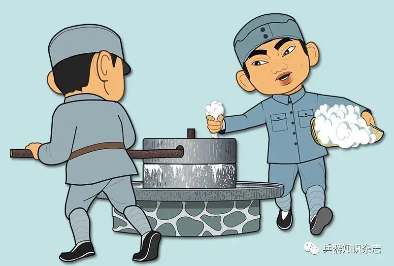

  

　　磨碎、洗净、干燥的强火棉、弱火棉，按照一定比例和酒精、以脱一起装入自制的胶化器中，转动叶片， **混合、胶化** ，就变成了面团样的东西，混合胶化后的硝化棉。  
　　后面是把这团发射药弄成固定大小的小颗粒，这样才能得到稳定、合格的燃烧。根据地没有专门的 **压片、切块** 工具，就找来一架做挂面用的旧 **切面机** ，用它把“面团”压成厚度恰当的“面片”。

  

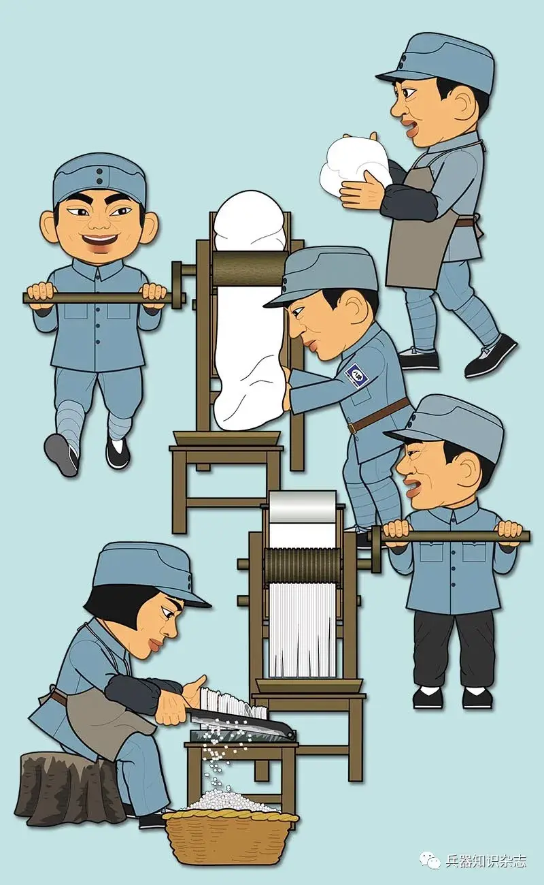

  

　　用尺寸合用的辊刀，将“面片”切成“面条”，再横过来切成小方块。  
　　硝化棉经过胶化、压片后，质地微密了，遇到高压火焰，也只能沿药片表面向内部燃烧，不至于内外全部同时发火，这样才能是 **基本合格** 的子弹发射药。  
　　说基本合格，是因为这些小颗粒发射药还得和石墨粉一起装入木制滚桶中 **反复摇滚** 。

  

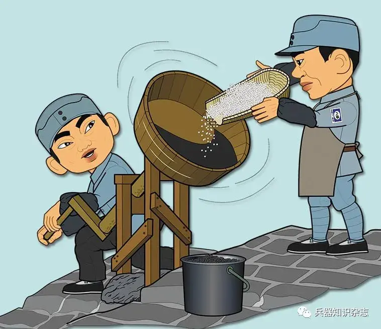

  

　　为啥呢？溶剂挥发后，发射药上出现小针孔、裂纹。在表面涂一层石墨，可以填塞它们，让发射药保持从外到内的稳定燃烧。  
  
　　1942年9月，我军制造出第一批硝化棉发射药。下面就该往子弹壳里装了。  
　　不过发射药装几克？以前人家三八大盖、中正式用的发射药，都是正规兵工厂里造的，火药力和咱们这土造的，能一样吗？  
　　发射药装少了，影响子弹初速，进而影响精度、威力。装多了，不仅浪费，更重要的是让膛压过高，缩短枪的寿命，严重的还可能引起炸膛。正规工厂，都要 **测试子弹初速和枪膛膛压** ，以此判断发射药的多寡。  
　　于是军工部自造土设备，完成这两项测量。

  

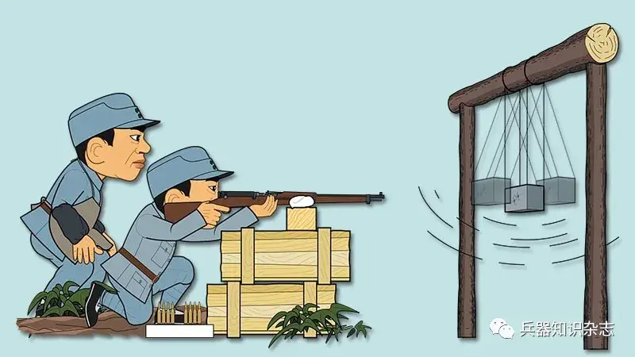

  

　　用铅板焊成一个方铅盒，装满沙土，称好重量；用四根平行的绳子将它吊在房梁上，然后用两颗子弹，一颗是装自制无烟药的，另一颗装日本无烟药，同样的发射药量，在相同距离上轮流地向铅盒射击。记下各次铅盒摆动的幅度，就能计算比较子弹弹头的速度。  
　　测膛压，比测初速难一些。好在部队里有同志以前在工厂里做过膛压枪，自告奋勇地把一支 **废枪改成了膛压枪** 。

  

  

　　他在步枪的枪膛里，对着子弹壳肩部的位置打个透孔，装上一个小活塞，活塞外端夹了一个标准铜柱。测试用的子弹，也在弹壳肩部打个孔，正对着小活塞放置。枪射击后，枪膛内的高压气体通过小孔、活塞，压缩标准铜柱。测量铜柱被压缩的尺寸，就可以算出、比较枪的膛压大小了。而所谓的“标准铜柱”，就是从一根很粗的铜丝上截下两段长度完全相同的。  
　　测试结果表明，自制无烟药的膛压和日本无烟药的相似，可以大量生产了用于复装枪弹。  
　　除了以上方法，我军兵工人员还抓住其它一切机会自产发射药。比如1943年，苏北根据地的新四军第3师兵工厂，利用从大城市搞来的 **电影胶片** ，试制出 **发射药** 。

  

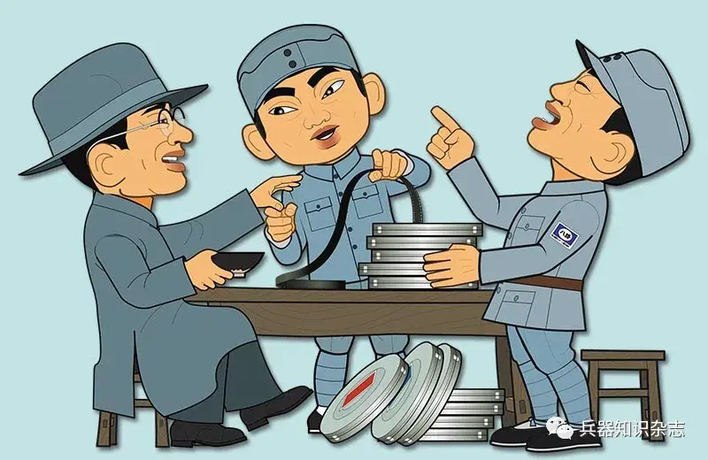

  

  
　　上面是子弹用的发射药，属于单基无烟药。而掷弹筒弹、迫击炮弹用的，应该是双基无烟药，需要用硝化甘油、胶化硝化棉制成。硝化甘油是用甘油滴注在酸液中进行硝化的，甘油则是对油脂加高压蒸汽使油脂分解得到的。在敌后根据地的条件下，无法得到高压蒸汽，因此一开始只好将单基无烟药压得很薄，作为炮弹发射药使用。  
　　1942年秋，晋察冀根据地的军区工业部得到加强和改组，集中技术人员成立了较大的技术研究室。室里的何振廉同志原在工矿局负责做轻油工作，有一次提出：先将油脂做成不溶于水的钙皂，然后可以用水洗出甘油。于是研究室照此方法，先用石灰乳将油脂做成钙皂，将它压碎，用水洗出甘油；蒸浓甘油后，将它小心地滴入硫酸、硝酸的混合酸液中，进行硝化，然后用水洗净，就得到了 **硝化甘油** 。

  

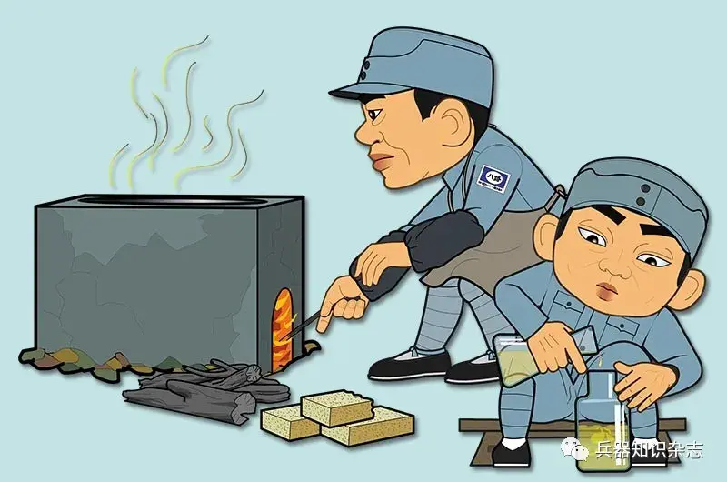

  

　　后来山东、陕甘宁等根据地也制出了硝化甘油炸药，还又用硫酸铵和硝石双分解制成 **硝酸铵炸药** 。这可是比黑火药、硝化棉更有威力的高级炸药了，显著提升了我军炮弹、枪榴弹的杀伤性能。  
　　硝化甘油是一种液态烈性炸药，灵敏度很高，生产它需要有严密的安全措施。在把甘油滴入混酸中硝化时，过分的冲击、温度，都有可能引爆正在生成的硝化甘油。  
　　于是兵工人想出了个 **“盆式硝化法”** 。每天在气温较低的拂晓，蹲在山泉小溪边，端着盛有3.5公斤混酸的瓷盆，将半公斤甘油慢慢滴入盆内。借流水从盆底通过，可以让盆内硝化温度保持在16℃~20℃之间。若发现盆内冒烟，即是爆炸的前兆，立即将盆沉入水底，人员避开。  

  

  

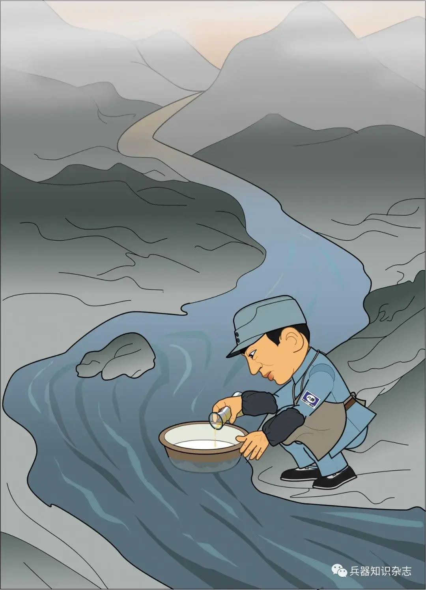

  

　　我们的兵工战士，就是在这样简陋危险的生产条件下，凭着顽强的革命意志和一不怕苦、二不怕死的精神，克服了技术和设备上的困难，成功地制造出硝化甘油。  
　　硝化甘油的问世，为根据地生产多种烈性炸药奠定了基础。  
  
　　引爆炸药的 **雷管** ，也是关键的火工品。特别是烈性炸药，不像黑火药那样容易引爆。普通的雷管都是用 **雷汞** 制造，其中的主要原料，汞，也就是水银，只能通过商人从敌占区购进。1943年，因为日寇的经济封锁越来越紧，很难买到了。于是有人提出用银元代替汞，做成 **雷银** 。  
　　试验成功了，根据地专门通告各地收购民间银元，专供军工生产雷银之用。雷银不能装入铜管中，因为它与铜接触会产生置换反应，变成灵敏度很高的雷铜。于是有人又提出用纸管代替铜管。虽然有人怀疑纸雷管引爆力是否太小，但试验表明其引爆力不低。  
　　随着硫酸、硝化甘油的难关被突破，我军的火炸药生产水平跨上一个新台阶。比如用硝化甘油和棉混合胶化，热压成薄药片，再用辊刀切成小方块，制成的无烟药发射掷弹筒弹、迫击炮弹时效果很好。

  

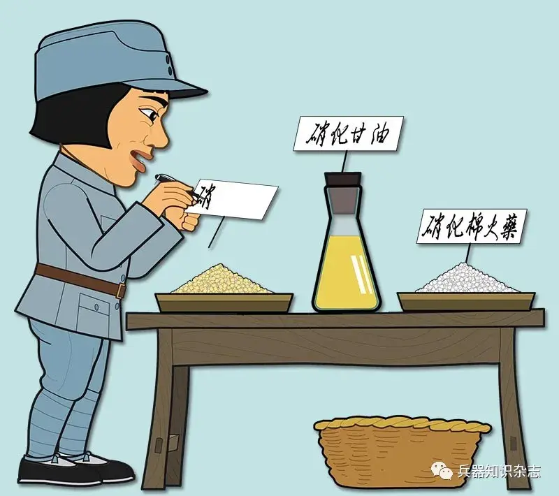

  

　　制出硝化甘油后，我军还积极扩大它的用途。过去根据地自制的高级炸药是用火硝和硫铵进行代换，制成硝铵，再制成硝铵混合炸药。后来购买硫铵十分困难。于是大家参考《高级火药学》中介绍的消耗硝化甘油最少的配方，用5%左右的硝化甘油，混合脱去结晶水的火硝粉末和少量谷糠，制成了 **仿朱迪生炸药** 。  
　　到1943年， **晋察冀根据地** 已有 **3个化学厂** ，职工2000多人，年产发射药136吨，各种炸药2511吨，还能生产酒精、煤油、肥皂等民用产品。到1944年底，他们的日产量更高：浓硫酸300公斤，浓硝酸100公斤，硝化棉15公斤，硝化甘油16公斤，仿朱迪生炸药330公斤，雷银5公斤，雷银纸雷管3 300余个，无烟药15公斤。  
 **山东根据地** 用 **花岗石砌塔制硫酸** ，先后建立 **6个硫酸厂** ，日产1吨。在此基础上生产了硝化棉、硝化甘油、乙醚、丙酮等原料，又自制了切药机、打浆机、离心机等生产设备，1943开始生产单基和双基无烟药。  
　　晋冀鲁豫根据地从1941年开始小量生产硝化棉发射药。  
 **陕甘宁边区** 的八路军总部军工部，1942年基本建成 **紫芳沟化学厂** ，先后可以生产硝酸、硫酸、硝化甘油、底火、雷管等。后来总部军工部还自行设计和制造出生产无烟火药的打浆机、胶化机、碾片机、切药机、光泽机等成套设备。  
　　到抗战后期，那种手榴弹炸两片，敌人被地雷只熏得黑头土脸的情况，越来越少了。我军手里有了更多能真正、彻底消灭日寇的弹药。

  

  

原文地址：[(水清木秀)只知道思路在明朝能不能批量造出燧发枪？](https://www.zhihu.com/question/1948683965188804698/answer/1952835188217345437) 

# 评论

1. <a href="https://www.zhihu.com/people/da-peng-11-4">青山二科临退休</a> (<small title="广东">2025-9-21 8:15:38</small>): 这种放在[抗战博物馆](https://www.zhihu.com/search?comment_id=11294402297&comment_type=COMMENT&content_id=748090754&content_type=answer&q=%E6%8A%97%E6%88%98%E5%8D%9A%E7%89%A9%E9%A6%86&request_click_id=c846bb97-73d3-427c-85ad-00199bf9e512&search_source=CommentEntity)里，对孩子们的吸引力远超照片那些展物！！！！馆长他糊涂啊！！！！！
   - <a href="https://www.zhihu.com/people/ke-xue-jia-xi-qia-li">科学家希卡利</a> (<small title="广东">2025-9-21 10:31:20</small>): 怕点子王，一手化学课本，一手酸菜坛子……
   - <a href="https://www.zhihu.com/people/yun-yi-you-47">云逸悠</a> (<small title="回复于 2025-9-21 12:1:32/上海"> ✉️:科学家希卡利</small>): 不小心就炸了
   - <a href="https://www.zhihu.com/people/liu-zheng-31-98">爱吃鱼</a> (<small title="北京">2025-9-21 14:15:39</small>): 我小时候看过一套黑色封面的十万个为什么，这些内容全都有［捂脸］
   - <a href="https://www.zhihu.com/people/bai-shui-10-10">白水</a> (<small title="浙江">2025-9-21 17:57:57</small>): 我的高中化学课本，有三硝基苯酚的课堂实验［捂脸］
   - <a href="https://www.zhihu.com/people/hen-xi-huan-cheng-zi">相思陌路</a> (<small title="回复于 2025-9-21 19:14:47/浙江"> ✉️:白水</small>): ［捂脸］三。。。三硝基甲苯？  
 
学校还活着吗。。。
   - <a href="https://www.zhihu.com/people/lu-guang-man-tian">绿光满天</a> (<small title="回复于 2025-9-21 19:32:8/上海"> ✉️:科学家希卡利</small>): 有神人自己在家搓了三百克黑索金［飙泪笑］
   - <a href="https://www.zhihu.com/people/bai-shui-10-10">白水</a> (<small title="回复于 2025-9-21 20:13:5/浙江"> ✉️:相思陌路</small>): 课本上原文写着“必须要雷汞引爆，否则最多只是燃烧”  
 
［捂脸］
   - <a href="https://www.zhihu.com/people/a-xin-you-99">命运.destiny</a> (<small title="重庆">2025-9-22 1:38:4</small>): 别这样了，美国有个熊孩子，在家里弄出了核武器，导致大半个街区都被放射源污染了。［为难］
   - <a href="https://www.zhihu.com/people/a-xin-you-99">命运.destiny</a> (<small title="回复于 2025-9-22 1:38:37/重庆"> ✉️:命运.destiny</small>): 不严谨，核反应物质。
   - <a href="https://www.zhihu.com/people/klxmouse">klxmouse</a> (<small title="回复于 2025-9-22 10:40:3/山西"> ✉️:爱吃鱼</small>): 并没有
   - <a href="https://www.zhihu.com/people/liu-zheng-31-98">爱吃鱼</a> (<small title="回复于 2025-9-22 11:28:17/北京"> ✉️:klxmouse</small>): 土法制酸，[硝化纤维](https://www.zhihu.com/search?comment_id=11295370983&comment_type=COMMENT&content_id=748090754&content_type=answer&parent_comment_id=11294402297&q=%E7%A1%9D%E5%8C%96%E7%BA%A4%E7%BB%B4&request_click_id=6ccbae0e-7966-4e7e-9209-d88670b8bb83&search_source=CommentEntity)都有啊，还有躲核弹，铁制品发蓝工艺之类的…
   - <a href="https://www.zhihu.com/people/han-dong-yang-2-39">风吹草低见流氓</a> (<small title="河南">2025-9-22 13:39:29</small>): 科创论坛能材板块那帮神仙还有人记得吗
   - <a href="https://www.zhihu.com/people/xi-bin">DNA-X</a> (<small title="回复于 2025-9-22 15:5:33/四川"> ✉️:爱吃鱼</small>): 你说的那套《十万个为什么》我看过，相关内容语焉不详，做不出来的［思考］
   - <a href="https://www.zhihu.com/people/lu-man-man-5-36">啃书到天亮</a> (<small title="回复于 2025-9-22 15:13:8/广西"> ✉️:相思陌路</small>): 忘记有没有实验了，但是我记得是有[原子结构](https://www.zhihu.com/search?comment_id=11295320348&comment_type=COMMENT&content_id=748090754&content_type=answer&parent_comment_id=11294402297&q=%E5%8E%9F%E5%AD%90%E7%BB%93%E6%9E%84&request_click_id=6ccbae0e-7966-4e7e-9209-d88670b8bb83&search_source=CommentEntity)和化学方程式的，可能我们老师还偷偷讲过制备
   - <a href="https://www.zhihu.com/people/da-peng-11-4">青山二科临退休</a> (<small title="回复于 2025-9-22 22:2:44/广东"> ✉️:爱吃鱼</small>): ［捂脸］你说的那套是不是跟我家一样，序言里面有毛泽东语录的。
   - <a href="https://www.zhihu.com/people/liu-zheng-31-98">爱吃鱼</a> (<small title="回复于 2025-9-23 7:0:36/河北"> ✉️:青山二科临退休</small>): wenge版［为难］
   - <a href="https://www.zhihu.com/people/32-30-9-71">清风明月</a> (<small title="回复于 2025-9-23 10:42:46/浙江"> ✉️:相思陌路</small>): 不是同一种东西啦
   - <a href="https://www.zhihu.com/people/shape-67-89">shape</a> (<small title="回复于 2025-9-26 18:11:45/福建"> ✉️:相思陌路</small>): 这玩意反而挺稳定，点火堆没燃料时可以应急
   - <a href="https://www.zhihu.com/people/123-5-68-97">知乎用户123</a> (<small title="回复于 2025-9-30 12:51:29/内蒙古"> ✉️:命运.destiny</small>): 放射性
   - <a href="https://www.zhihu.com/people/momo-85-43-10">皇漢momo</a> (<small title="天津">2025-10-3 22:42:28</small>): ［赞］［赞］［赞］
   - <a href="https://www.zhihu.com/people/36-34-2-82-51">狗儿</a> (<small title="北京">2025-10-13 16:12:2</small>): 大部分孩子不懂化学，不知道这有多难。  
 
得读完高中理科化学才行。
   - <a href="https://www.zhihu.com/people/xiong-mo-mo-79-52">熊默墨</a> (<small title="回复于 2026-3-25 15:52:10/辽宁"> ✉️:狗儿</small>): 确实，而且最好是有实验操作实务的
   - <a href="https://www.zhihu.com/people/liu-liu-qiu-47-71">溜溜球</a> (<small title="回复于 2026-3-27 11:51:2/山西"> ✉️:爱吃鱼</small>): 我就不一样了，我喜欢物理和天文。最后学了会计［酷］
   - <a href="https://www.zhihu.com/people/xue-ding-e-de-lao-mao">薛定谔的老猫</a> (<small title="回复于 2026-3-28 21:12:26/吉林"> ✉️:青山二科临退休</small>): 你说的那个是黄皮的，文革时期版本，黑皮的是90年代版的。
   - <a href="https://www.zhihu.com/people/mai-mai-41-39-19">麦麦</a> (<small title="广东">2026-4-7 21:40:5</small>): 教这些不怕出事吗［飙泪笑］
   - <a href="https://www.zhihu.com/people/wei-qin-95-57-79">打瓦李氏</a> (<small title="天津">2026-4-9 10:17:15</small>): 熊孩子：I have a plan
   - <a href="https://www.zhihu.com/people/fastback">给世界一击炎拳</a> (<small title="回复于 2026-6-25 22:2:42/浙江"> ✉️:爱吃鱼</small>): 我当年读小学时还有原子弹防护演练［语塞］［语塞］［语塞］
   - <a href="https://www.zhihu.com/people/gao-jian-zhu-71">高峰</a> (<small title="回复于 2026-10-3 2:0:27/北京"> ✉️:青山二科临退休</small>): 有毛泽东语录的是工农兵版本，土法小高炉炼钢都有…
   - <a href="https://www.zhihu.com/people/gao-jian-zhu-71">高峰</a> (<small title="回复于 2026-10-3 2:1:57/北京"> ✉️:麦麦</small>): 能搓出来的都是好苗子［调皮］
   - <a href="https://www.zhihu.com/people/18005272930">徐图之</a> (<small title="回复于 2026-10-28 18:8:54/江苏"> ✉️:溜溜球</small>): 我高中还是化学课代表，后来高考考了物理方向［思考］
2. <a href="https://www.zhihu.com/people/wang-da-yan-48">王大眼</a> (<small title="安徽">2025-9-21 9:26:43</small>): 看老革命，根据地武器专家吴运泽写的书《把一切献给党》，就知道兵工厂怎么起家了。
   - <a href="https://www.zhihu.com/people/wang-da-yan-48">王大眼</a> (<small title="安徽">2025-9-21 9:29:46</small>): 顺便说一下，这里层主说的内容，就是吴运泽+90年代化学报知识混合版。  
 
  
 
当年化学报也是什么都敢登［捂脸］
   - <a href="https://www.zhihu.com/people/li-lee-90-14">Li Lee</a> (<small title="北京">2025-9-21 15:31:54</small>): 吴运铎吧？
   - <a href="https://www.zhihu.com/people/hu-lai-tou-a-niu">胡来投啊牛</a> (<small title="广东">2025-9-22 5:21:27</small>): 吴运铎，小时候看过他的纪录片还是电视剧，中国保尔。
   - <a href="https://www.zhihu.com/people/wang-da-yan-48">王大眼</a> (<small title="回复于 2025-9-23 0:40:20/安徽"> ✉️:胡来投啊牛</small>): 我是25年前看过他写的自传。  
 
  
 
写的平淡而又坚强，就是革命需要砖，我就垫上去。
   - <a href="https://www.zhihu.com/people/yan-luo-wang-48">认识你自己</a> (<small title="广东">2025-9-26 13:30:20</small>): 抗战时敌后后勤工作也是相当不易啊
   - <a href="https://www.zhihu.com/people/firwill">firwill</a> (<small title="陕西">2026-1-30 13:29:41</small>): 有点问题，盐碱地的硝土是芒硝，硫酸盐，那个没法子做火药。做火药的硝土是硝酸盐，这个需要去厕所，老墙根和牲畜圈去搞。
   - <a href="https://www.zhihu.com/people/kuai-su-ji-dan-juan">快速鸡蛋卷</a> (<small title="回复于 2026-3-31 12:58:5/江苏"> ✉️:firwill</small>): 用钾、氮和芒硝进行[复分解](https://www.zhihu.com/search?comment_id=11451044555&comment_type=COMMENT&content_id=748090754&content_type=answer&parent_comment_id=11294149429&q=%E5%A4%8D%E5%88%86%E8%A7%A3&request_click_id=5b3ad0bf-1664-4dd3-8837-46b7729387c3&search_source=CommentEntity)呗，多大点事
   - <a href="https://www.zhihu.com/people/xie-chang-song">谢昌松</a> (<small title="四川">2026-6-25 23:50:42</small>): 今年刚看完，这老同志完全就是个大神啊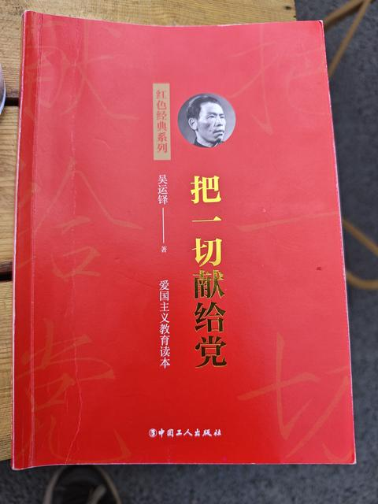
   - <a href="https://www.zhihu.com/people/18005272930">徐图之</a> (<small title="江苏">2026-10-28 18:9:27</small>): 吴运铎
3. <a href="https://www.zhihu.com/people/zhu-ba-san">眯眯眼儿</a> (<small title="北京">2025-9-20 23:29:37</small>): 战斗力强的组织，干什么都行。
   - <a href="https://www.zhihu.com/people/yin-yu-48-81">饮羽</a> (<small title="新疆">2025-9-21 17:50:50</small>): 应该是组织力强，干什么都战力爆表，总有点子王［滑稽］
   - <a href="https://www.zhihu.com/people/86-79-56-59">纸盒勇者</a> (<small title="江西">2025-9-22 11:25:56</small>): 聂帅除了指挥战争之外确实当得起“干什么都行”的评价
   - <a href="https://www.zhihu.com/people/leo-62-58">LEO</a> (<small title="回复于 2025-9-22 12:35:31/北京"> ✉️:纸盒勇者</small>): 干什么都行的背后，是正确的世界观和方法论
4. <a href="https://www.zhihu.com/people/hua-yu-ke-huan-wang">华语科幻网</a> (<small title="广东">2025-9-21 17:5:55</small>): 超模了吧，一个综合厂区的高度组织化的工人再加上黄崖洞英雄团那一千多精兵，跑到明朝去不管是晚明双雄，边关小兵，澳宋诸废，临高髦匪全都挡不住呀。
   - <a href="https://www.zhihu.com/people/hu-er-ji-zi-32">虎儿旡子</a> (<small title="河南">2025-9-21 19:51:18</small>): ［飙泪笑］
   - <a href="https://www.zhihu.com/people/fei-xing-mao-93">飞行猫</a> (<small title="黑龙江">2025-9-24 8:43:19</small>): 别的不说，光是组织度就碾压了
   - <a href="https://www.zhihu.com/people/aomei-16">aomei</a> (<small title="四川">2026-4-11 13:44:19</small>): 澳宋500废还能勉强一战。［飙泪笑］
   - <a href="https://www.zhihu.com/people/bu-sheng-bu-mie-ru-qu-ru-lai">一笑倾城</a> (<small title="回复于 2026-5-25 10:8:33/江西"> ✉️:aomei</small>): 算了吧，奥送加临高甏肥见了正牌组织来了那都是倒头便拜，接班人教育谁不知道这套的厉害，但是真的要自己当家做主白手起家那叫一个难啊！要是有正牌组织来了跟着跑省事多了，当核心有困难，开国元勋捞一个还是没问题
   - <a href="https://www.zhihu.com/people/aomei-16">aomei</a> (<small title="回复于 2026-5-25 13:17:31/四川"> ✉️:一笑倾城</small>): 澳宋有设备有人有根基，除非见到教员，否则别人谁来都不一定好使。［为难］
   - <a href="https://www.zhihu.com/people/xia-yu-39-81">夏雨</a> (<small title="回复于 2026-7-18 22:42:37/陕西"> ✉️:aomei</small>): 澳宋组织一坨，干不过正规军
5. <a href="https://www.zhihu.com/people/song-chen-wei-63">Fullishboy</a> (<small title="黑龙江">2025-9-21 8:49:45</small>): “这些小颗粒发射药还得和石墨粉一起装入木制滚桶中反复摇滚。”  
 
革命就是摇滚［doge］
   - <a href="https://www.zhihu.com/people/wang-zheng-xu-15">为何放弃电疗</a> (<small title="内蒙古">2025-9-21 12:2:23</small>): 装进铜制弹壳里，就是[死亡重金属](https://www.zhihu.com/search?comment_id=11294555690&comment_type=COMMENT&content_id=748090754&content_type=answer&parent_comment_id=11294786099&q=%E6%AD%BB%E4%BA%A1%E9%87%8D%E9%87%91%E5%B1%9E&request_click_id=b4d13bbf-ed06-437c-8943-b0549fbb0c8c&search_source=CommentEntity)［生气］
   - <a href="https://www.zhihu.com/people/chen-justin-71">chen justin</a> (<small title="瑞典">2025-9-21 18:6:57</small>): 一起摇摆［捂脸］
   - <a href="https://www.zhihu.com/people/huai-jian-ting-yu">怀剑听雨</a> (<small title="广东">2025-9-22 0:34:11</small>): 摇曳百合［doge］
   - <a href="https://www.zhihu.com/people/tian-fang-ye-tai-mei">天方夜太美</a> (<small title="内蒙古">2026-4-12 15:29:56</small>): 敌人负责死亡，我们负责摇滚🤘🏻
6. <a href="https://www.zhihu.com/people/yankj12">浪浪山巡检</a> (<small title="重庆">2025-9-20 21:16:36</small>): 革命先辈的智慧
   - <a href="https://www.zhihu.com/people/huai-jian-ting-yu">怀剑听雨</a> (<small title="广东">2025-9-22 0:33:40</small>): 一堆大学生抛头颅洒热血［大哭］
7. <a href="https://www.zhihu.com/people/63-27-57-23-61">如是我闻</a> (<small title="湖南">2025-9-21 8:14:42</small>): 明朝并不是不能造黑火药，而是黑火药的比例始终没搞清楚。
 
没有科学实验精神，就不能通过实验搞清楚比例。
 
再说，就算做得再好，又怎么样？用有位朋友评论家族企业的一句话，我努力有什么用？我再努力，难道还能从二姐夫升级为大姐夫？
   - <a href="https://www.zhihu.com/people/xznetyw">xznetyw</a> (<small title="江西">2025-9-21 11:3:58</small>): 那是降了，娶小姨子才是升［捂嘴］
   - <a href="https://www.zhihu.com/people/arthur-lim-13">Arthur Lim</a> (<small title="马来西亚">2025-9-21 16:15:22</small>): 但凡你了解一下当时欧洲各国的黑火药比例呢［尴尬］
   - <a href="https://www.zhihu.com/people/feng-wu-2-25">风舞</a> (<small title="河北">2025-9-22 9:19:19</small>): 明朝的时候，所有国家生产的黑火药中国的算是质量最好的，比例最接近完美比例的。
   - <a href="https://www.zhihu.com/people/xie-xiao-chen-71">叶消沉</a> (<small title="回复于 2025-9-22 11:8:44/浙江"> ✉️:风舞</small>): 你是不是活在梦里~~~
 
  
 
别说明朝，中国一直到清朝末期鸦片战争的时候都没有得出过黑火药的完美比例，而且是NOT EVEN CLOSE的差距。欧洲人早在15世纪就记载了接近70%的[硝酸钾](https://www.zhihu.com/search?comment_id=11295282659&comment_type=COMMENT&content_id=748090754&content_type=answer&parent_comment_id=11294058874&q=%E7%A1%9D%E9%85%B8%E9%92%BE&request_click_id=f7b77f94-647e-4012-a537-de31ef923ead&search_source=CommentEntity)比例并明确了原料的颗粒花工艺（麦粒火药），后来从化学方程式推导出硝酸钾74.64%、硫磺11.85%、木炭13.51%的最佳质量比。而中国的工艺只将原材料粉碎、搅拌就完事儿，可想质量之低劣。所以第一次鸦片战争，英军攻占虎门炮台后缴获了清军几万斤黑火药，认为劣质不堪使用，全倒进海里了。
 
  
 
更别说硝酸钾和硫磺的成熟制备工艺了，由于缺乏化学基础和标准化概念，中国完全无法制造出高纯度的硝酸钾和硫磺，这还谈什么”完美比例“。
 
  
 
最可笑的是中国现在的科普宣传里，把”一硫二硝三木炭“这种错误百出的粗陋口诀强行解释为摩尔比，于是换算成质量比是32:202:36（即使这样比例还是不对）。真特么太不要脸了，古代中国有摩尔的概念么？
   - <a href="https://www.zhihu.com/people/arthur-lim-13">Arthur Lim</a> (<small title="马来西亚">2025-9-22 13:2:9</small>): [为什么中国古代发明不出来黑火药最佳配比？](https://www.zhihu.com/question/534256992/answer/2664115620)
 
[为什么中国古代发明不出来黑火药最佳配比？](https://www.zhihu.com/question/534256992/answer/80742924537)
 
还化学方程式，比较准确的经验公式1921年才发现，大清已亡了［尴尬］，而且明朝的火药工艺比例也没那么差
 
[明朝的火药工艺如何？](https://www.zhihu.com/question/364789666/answer/991893175)
 
  
 
大明没人实验研究火炮模数大力黑没人管你，明君炮兵喜欢倍装火药（是的熊廷弼这蛮子硬生生把吕宋大铜炮弄炸膛了还沾沾自喜），没发展出欧洲那种纺锤体火炮（红夷大炮）这些也不大力黑，只会盯着所谓的黑火药比例这辈子有了［尴尬］
   - <a href="https://www.zhihu.com/people/feng-wu-2-25">风舞</a> (<small title="河北">2025-9-22 15:23:50</small>): 您老人家说得所谓的化学方程式应该是欧洲的那个歇夫列里1825年提出的黑火药最佳反应方程式吧，这跟大明有什么关系？大明都亡了几百年了。
 
火铳和火炮用的发射药还有火门药，在明朝的时候是不一样的。
 
还有直到十九世纪英国和法国所用的火药的配比都不一样。
 
另外戚继光的[纪效新书](https://www.zhihu.com/search?comment_id=11295555465&comment_type=COMMENT&content_id=748090754&content_type=answer&parent_comment_id=11294058874&q=%E7%BA%AA%E6%95%88%E6%96%B0%E4%B9%A6&request_click_id=f7b77f94-647e-4012-a537-de31ef923ead&search_source=CommentEntity)里记载的铳药配方已经十分接近你所推崇的最佳配比了。
   - <a href="https://www.zhihu.com/people/long-teng-ju-mao">龙腾大橘</a> (<small title="青海">2025-9-24 18:54:28</small>): 冷知识明朝的火药已经是最佳配比，也有湿式火药和和定装药包［大笑］
   - <a href="https://www.zhihu.com/people/49-89-68-36">伏昱皓</a> (<small title="回复于 2025-9-25 15:7:57/江苏"> ✉️:叶消沉</small>): 一斤硝，二两硫磺，三两木炭？不一定非要出现摩尔什么的才能配比吧？靠经验和穷举法可以配出大差不差的，无非是没法精确到小数点而已。
   - <a href="https://www.zhihu.com/people/jbxczq">jbxczq</a> (<small title="回复于 2025-10-3 21:28:30/浙江"> ✉️:伏昱皓</small>): 那这个配方不是跟黑火药最佳比例完全就是南辕北辙了吗
   - <a href="https://www.zhihu.com/people/49-89-68-36">伏昱皓</a> (<small title="回复于 2025-10-14 11:51:14/江苏"> ✉️:jbxczq</small>): 为啥会南辕北辙？［好奇］
   - <a href="https://www.zhihu.com/people/xie-xiao-chen-71">叶消沉</a> (<small title="回复于 2025-10-15 14:14:34/浙江"> ✉️:Arthur Lim</small>): 你就继续活在自己的梦里吧
   - <a href="https://www.zhihu.com/people/arthur-lim-13">Arthur Lim</a> (<small title="回复于 2025-10-15 14:23:37/马来西亚"> ✉️:叶消沉</small>): 说点20世纪初才有黑火药经验方程式的大实话你就接受不了啦［尴尬］
   - <a href="https://www.zhihu.com/people/arthur-lim-13">Arthur Lim</a> (<small title="回复于 2025-10-15 14:26:35/马来西亚"> ✉️:jbxczq</small>): 大英和我法兰西的火药比例不一样，到底谁才是最佳？
   - <a href="https://www.zhihu.com/people/jbxczq">jbxczq</a> (<small title="回复于 2025-10-18 22:11:43/浙江"> ✉️:Arthur Lim</small>): 哪个时代？哪种用途的火药配方？
   - <a href="https://www.zhihu.com/people/yi-mu-shui-xin">两朝剑冠</a> (<small title="回复于 2026-3-26 23:39:39/上海"> ✉️:jbxczq</small>): 明朝一斤十六两，所以比例是 16：2：3，已经接近了，木炭偏高是为了排除杂质影响。
   - <a href="https://www.zhihu.com/people/aclam-41">Aclam</a> (<small title="浙江">2026-3-29 8:38:31</small>): 你这个就是伪命题，在[提纯技术](https://www.zhihu.com/search?comment_id=11449191920&comment_type=COMMENT&content_id=748090754&content_type=answer&parent_comment_id=11294058874&q=%E6%8F%90%E7%BA%AF%E6%8A%80%E6%9C%AF&request_click_id=f7b77f94-647e-4012-a537-de31ef923ead&search_source=CommentEntity)有限的情况下哪来的固定配比？  
 
每个产地每个批次的木炭，硫磺，硝石都可以视作全新的物品，不都得重新调配比例
   - <a href="https://www.zhihu.com/people/44-84-86-68">怒火风暴</a> (<small title="江苏">2026-4-7 15:54:35</small>): 明朝黑火药恰恰是最没问题的，一硝二磺三木炭其实是一斤（16两）硝石/二两硫磺/三两木炭，考虑到硝石当中杂质比例最高，其实非常接近现代的最佳配比。另外像颗粒化之类的处理方法，明朝也都掌握了。
   - <a href="https://www.zhihu.com/people/44-84-86-68">怒火风暴</a> (<small title="江苏">2026-4-7 15:55:29</small>): 工部的产品质量不行是钱不够，钱够了的广东佛山产品，澳门的葡萄牙人也说好。
   - <a href="https://www.zhihu.com/people/85-12-86-88-10">枯除椒</a> (<small title="回复于 2026-4-16 8:23:42/安徽"> ✉️:叶消沉</small>): 还有人信欧洲的记载［大笑］
   - <a href="https://www.zhihu.com/people/zhou-hao-84-4">昊天上帝</a> (<small title="回复于 2026-9-10 7:13:15/江苏"> ✉️:叶消沉</small>): 别拿清末来举例子，因为清末本土制造业倒退严重，水平比甚至清初还差，而[明代火器](https://www.zhihu.com/search?comment_id=11573115942&comment_type=COMMENT&content_id=748090754&content_type=answer&parent_comment_id=11294058874&q=%E6%98%8E%E4%BB%A3%E7%81%AB%E5%99%A8&request_click_id=f7b77f94-647e-4012-a537-de31ef923ead&search_source=CommentEntity)确实精良，不少被清代沿用，长城现在上还留有明代大炮，明代大炮还一度出口到葡萄牙，还有个冷知识，明代中国和西方早期殖民者葡萄牙、西班牙、荷兰、英国都交战过，除了和英国是通过外交解决，其余都打赢了
8. <a href="https://www.zhihu.com/people/yi-zheng-rong-46">老伊先生</a> (<small title="浙江">2025-9-21 12:19:21</small>): 写穿越小说的人可以接受，基本上八路军是在中世纪基础上搞出的近代武器，当然有科技理论的基础，也有现代武器装备参考一下
   - <a href="https://www.zhihu.com/people/doublebacks-89">MOMO</a> (<small title="上海">2025-9-22 1:55:26</small>): 更多的是一种宣传，有外援的。
   - <a href="https://www.zhihu.com/people/zhang-zi-43-59">左岸花不开</a> (<small title="上海">2025-9-22 10:28:38</small>): 你真相信完全是中世纪基础啊，苏联和美国都有一定援助啊，再加上还是能用黄金买到一些仪器设备的
   - <a href="https://www.zhihu.com/people/nan-yun-jian-89">北上南云</a> (<small title="海南">2025-9-24 9:23:39</small>): 扯淡呢，碱矿古代都没有，第一个碱矿都光绪时代了
   - <a href="https://www.zhihu.com/people/zhang-yu-13-83-44">占位符</a> (<small title="四川">2025-10-6 23:15:14</small>): 有些基础工具可以买到，搁明朝就得自己手搓
   - <a href="https://www.zhihu.com/people/yu-fu-96-8">渔父</a> (<small title="回复于 2026-3-31 18:24:4/广东"> ✉️:占位符</small>): 黄崖洞有车床、钻床的，也有电，明朝啥都没！
   - <a href="https://www.zhihu.com/people/bonaparte-73">bonaparte</a> (<small title="河南">2026-4-16 16:2:47</small>): 明朝没机床没电整个工业科技树都得从零开始
   - <a href="https://www.zhihu.com/people/piscean-92">大风吹沙</a> (<small title="北京">2026-9-25 11:44:32</small>): 最基础的硫磺不进口都不好找
9. <a href="https://www.zhihu.com/people/chang-bian-shu-shu">长鞭叔叔</a> (<small title="广东">2025-9-21 21:28:51</small>): 还有现在很少提的建国初年核燃料获得方式～“土法炼铀”：所有前期的工人，都只有超简陋的防护～在胸前挂一个铅板［捂脸］  
 
  
 
然后通过人工：锤子敲碎、石墨碾碎、筲箕筛选、硫酸浸泡、豆浆不带过滤、阳光晒干，最终获得黄饼［捂脸］
   - <a href="https://www.zhihu.com/people/40-1-47-46">苕水向北</a> (<small title="浙江">2026-4-14 2:31:12</small>): 黄饼的辐射其实不高
   - <a href="https://www.zhihu.com/people/58-9-42-22-14">天命之上</a> (<small title="回复于 2026-6-22 22:2:15/四川"> ✉️:苕水向北</small>): 长期照射裸露皮肤，还是容易引起癌变的。
10. <a href="https://www.zhihu.com/people/yu-zhou-liu-yin">宇宙流音</a> (<small title="北京">2025-9-20 23:55:50</small>): 筚路蓝缕呀
11. <a href="https://www.zhihu.com/people/chen-ming-95-16">陈鸣</a> (<small title="湖北">2025-9-21 6:48:14</small>): 有书是关键，靠自己摸索哪里知道硫酸
    - <a href="https://www.zhihu.com/people/ping-ping-an-an-50-53">平平安安</a> (<small title="河北">2025-9-21 16:35:28</small>): 关键词，高级火药学
    - <a href="https://www.zhihu.com/people/nan-de-hu-tu-49-29-33">难得糊涂</a> (<small title="四川">2025-9-21 20:28:49</small>): 所以限定条件得要是现代穿越者，如果穿越过去一个化学家就好办了
    - <a href="https://www.zhihu.com/people/wang-lei-62-93">未知</a> (<small title="吉林">2025-9-22 8:28:46</small>): 都写了，有清华北大的，有的还流过洋
    - <a href="https://www.zhihu.com/people/men-hua">面朝大海</a> (<small title="回复于 2025-9-22 16:27:34/河北"> ✉️:难得糊涂</small>): 难办的很，八路可以，那是因为那时候是民国，本身就可以生产的东西。而明朝基本就属于洗洗睡了。
12. <a href="https://www.zhihu.com/people/shi-jian-duo-shi-bu-fu-ze-ren-de-ai">世间多是不负责任的爱</a> (<small title="河南">2025-9-21 10:18:4</small>): 这个文章太用心了，我看了特别感动，如果哪一天能拍成动画片电视剧给孩子们看就好
    - <a href="https://www.zhihu.com/people/fen-tian-zhu-que">御坂19090号</a> (<small title="山东">2025-9-21 15:21:4</small>): 别，容易刷新点子王。
    - <a href="https://www.zhihu.com/people/123456-63-14">cccp19410622</a> (<small title="内蒙古">2025-9-21 16:17:37</small>): 那家长该不干了
13. <a href="https://www.zhihu.com/people/13-58-34-87">躺赢尊者</a> (<small title="广东">2025-9-21 16:38:44</small>): 很多人以为生产条件才是困难的。实际上知道原理才是困难，这些原理是外国大量科学家经过反复实验论证后得出的结论，是智慧的结晶。
    - <a href="https://www.zhihu.com/people/huai-jian-ting-yu">怀剑听雨</a> (<small title="广东">2025-9-22 0:42:37</small>): 诺贝尔捐了一个弟弟
14. <a href="https://www.zhihu.com/people/wu-zhi-da-yu">萝御双修美伊芽</a> (<small title="湖北">2025-9-22 1:26:6</small>): 写得不错，点赞了，但不同意作者观点，原因很简单，例如，我现在也可以按原始的方法，成批量的，手工制作望远镜，质量还比原来的更优良，效率比原来更高，并不是我的水平更高，也不是我知识更全面，而是我可以在市场上买到优质的玻璃，可以买到更好的打磨机，可以买到更精确的测量仪器。
 
看起来我是按古代方法制造，条件也很简陋，但是，我背后其实有现代的工业为基础，很多材料，我可以很方便的买到，但在朱明时代，一切都要从头开始，仅仅成批量制造高透光度的玻璃，就是一个巨大的工程。
    - <a href="https://www.zhihu.com/people/gong-xi-yu-ji-zi">夜伴好音乐</a> (<small title="河南">2025-9-23 21:10:14</small>): 没电啥都白搭
    - <a href="https://www.zhihu.com/people/yu-fu-96-8">渔父</a> (<small title="广东">2026-3-31 18:27:7</small>): 黄崖洞是有车床、钻床的，也有电，而且很多东西都可以买到，外国（苏联、美国等）也有援助，还能缴获敌人的武器和材料。回到明朝，啥都没，比如铁轨钢虽然不是很好的钢材，但是明朝你也弄不到。
15. <a href="https://www.zhihu.com/people/hong-he-gu-nan-zhu-jiao">北落师门的波克</a> (<small title="四川">2025-9-21 9:26:40</small>): 此事在[临高启明](https://www.zhihu.com/search?comment_id=11294175469&comment_type=COMMENT&content_id=748090754&content_type=answer&q=%E4%B8%B4%E9%AB%98%E5%90%AF%E6%98%8E&request_click_id=f1ab3aa6-0943-4bd5-ae8a-69dbc29d6c2f&search_source=CommentEntity)中亦有记载
16. <a href="https://www.zhihu.com/people/grenadier-74">grenadier</a> (<small title="天津">2025-9-22 13:56:48</small>): 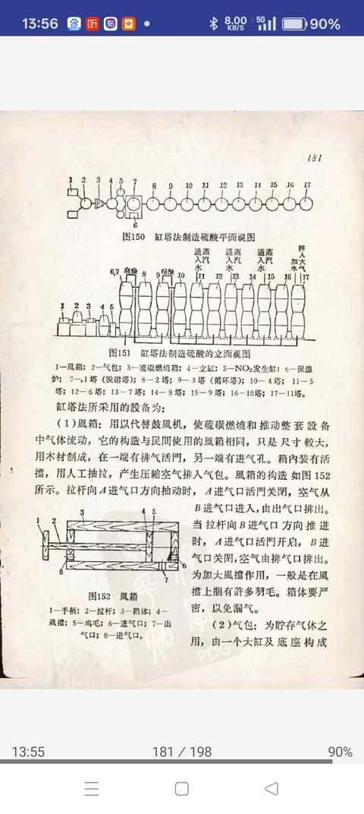
17. <a href="https://www.zhihu.com/people/chang-xia-9-7">悟空</a> (<small title="江西">2025-9-21 10:50:0</small>): 太难了
18. <a href="https://www.zhihu.com/people/su-la-2010">苏拉2010</a> (<small title="湖北">2025-9-21 15:15:17</small>): 其实还应该讲讲军工人为了做这些付出了多大的代价，这些土法化工对人体的伤害是巨大的。
    - <a href="https://www.zhihu.com/people/huai-jian-ting-yu">怀剑听雨</a> (<small title="广东">2025-9-22 0:44:18</small>): 现在的化工业也对工人伤害巨大
19. <a href="https://www.zhihu.com/people/sunlunar-33">西窗烛影</a> (<small title="北京">2025-9-21 13:7:59</small>): 前辈们太艰辛了
20. <a href="https://www.zhihu.com/people/taog-69">骗你我是小狗</a> (<small title="湖北">2025-9-21 23:56:8</small>): 国民党：（声嘶力竭地）共党是匪！匪徒！没有重火力！你们怕共军干什么？（大吼一声，扑向根据地）  
 
根据地：（发出粲粲粲的笑声）其实我早就是T阵营了（掏出炸药包）［捂脸］
21. <a href="https://www.zhihu.com/people/hzuu">东极岛</a> (<small title="河南">2025-10-2 17:29:36</small>): 似乎根据地都是硝酸根含能火药，按照当时的条件，能否点解食盐水，再用草木灰来做出氯酸钾，配白糖或者能制造红磷来做火药吗
    - **水清木秀** (<small title="安徽">2025-10-14 8:55:5</small>): 应该是可以的. 八路军敌后根据地兵工厂是搞雷汞, 但是新四军敌后根据地兵工厂因为条件比较便利一些, 于是就想办法从敌占区的药店购买洋硝和雄黄, 混合锅底灰制作底火.
22. <a href="https://www.zhihu.com/people/35-29-13-83">氰化钾</a> (<small title="河南">2025-9-21 11:26:35</small>): 太难了
23. <a href="https://www.zhihu.com/people/hu-luo-shi-li">呼逻释利</a> (<small title="山西">2025-9-21 23:6:50</small>): [吴运铎](https://www.zhihu.com/search?comment_id=11295119362&comment_type=COMMENT&content_id=748090754&content_type=answer&q=%E5%90%B4%E8%BF%90%E9%93%8E&request_click_id=063f66d6-3cbe-4286-a339-b733f7dea918&search_source=CommentEntity)，小时候看过关于他的电视剧
24. <a href="https://www.zhihu.com/people/ke-xue-jia-xi-qia-li">科学家希卡利</a> (<small title="广东">2025-9-21 10:34:57</small>): 军工自力更生从边区就开始了，难怪我们现在有东风卧槽和激光大眼萌［滑稽］
25. <a href="https://www.zhihu.com/people/li-ming-27-14-1">铭远</a> (<small title="吉林">2025-9-21 8:44:38</small>): 这才叫专业，这种东西就应该放到课堂上学习。
    - <a href="https://www.zhihu.com/people/zhi-hu-ni-ma-bi-30">直呼牛逼死了</a> (<small title="新疆">2025-9-21 14:58:28</small>): 去古代也没人用。
26. <a href="https://www.zhihu.com/people/12-53-37-15">总批准师</a> (<small title="广西">2025-9-21 13:5:14</small>): 荒谬，先不说人材和化学知识，就枪管，你从哪里造
    - <a href="https://www.zhihu.com/people/pleasant-47">阿昴 Subaru</a> (<small title="江苏">2025-9-21 15:44:16</small>): 百团大战从正太铁路沿线扒了很多轨道钢，冷轧钢没有，热轧钢还是有的。就是一开始做出来的枪管退火性能差，容易变形失准
    - <a href="https://www.zhihu.com/people/zui-sheng-meng-si-de-zhu">醉生梦死的猪</a> (<small title="回复于 2025-9-21 16:31:55/上海"> ✉️:阿昴 Subaru</small>): 他说的应该是“大明从哪里去搞钢材”。。总不见得土高炉重头上马吧。
    - <a href="https://www.zhihu.com/people/pleasant-47">阿昴 Subaru</a> (<small title="回复于 2025-9-21 16:38:54/江苏"> ✉️:醉生梦死的猪</small>): ［发呆］
    - <a href="https://www.zhihu.com/people/yu-fu-96-8">渔父</a> (<small title="回复于 2026-3-31 18:28:56/广东"> ✉️:阿昴 Subaru</small>): 轨道钢不算很好的钢材，明朝也弄不到啊！
    - <a href="https://www.zhihu.com/people/xia-yu-39-81">夏雨</a> (<small title="回复于 2026-7-18 22:46:39/陕西"> ✉️:渔父</small>): 明朝苏钢法一直用到了建国初期，作为黑火药枪管完全没问题，哪怕是无烟火药，也就是寿命短一点
27. <a href="https://www.zhihu.com/people/enterprise-3-19">enterprise</a> (<small title="上海">2025-9-21 16:50:1</small>): 共产党人真是一群有理想的理工男
28. <a href="https://www.zhihu.com/people/yang-ze-ren-27">杨泽人</a> (<small title="云南">2025-9-21 23:13:55</small>): 大明去哪里扒日本铁轨？
    - <a href="https://www.zhihu.com/people/huai-jian-ting-yu">怀剑听雨</a> (<small title="广东">2025-9-22 0:40:53</small>): 大汉就有高炉炼铁了
    - <a href="https://www.zhihu.com/people/yang-ze-ren-27">杨泽人</a> (<small title="回复于 2025-9-22 5:53:11/云南"> ✉️:怀剑听雨</small>): 对这是日本铁轨同等质量的东西？
29. <a href="https://www.zhihu.com/people/ilikechopin">Whoami</a> (<small title="上海">2025-9-21 8:50:47</small>): 太厉害了
30. <a href="https://www.zhihu.com/people/fang-guo-sheng-55">帮主</a> (<small title="浙江">2026-3-29 19:52:4</small>): 明朝没有足够的理论基础
31. <a href="https://www.zhihu.com/people/moriarty-97-38">莫里亚蒂教授</a> (<small title="广东">2025-9-21 19:11:5</small>): 一磺二硝三木炭不是“流传在民间的黑火药配方”，是中学生背化学反应式的土法助记词。
32. <a href="https://www.zhihu.com/people/ma-qian-xiao-zu-41">永远有多远</a> (<small title="江苏">2025-9-21 12:15:30</small>): 中国人只要有了好的组织，天生就是工业狂魔。
    - <a href="https://www.zhihu.com/people/zhu-jun-78-7">尽形寿</a> (<small title="江西">2026-4-16 21:14:51</small>): 对，这是最重要的［赞］
33. <a href="https://www.zhihu.com/people/wang-fu-gui-60-11">王富贵</a> (<small title="辽宁">2025-9-21 15:33:16</small>): 《临高启明》里描写过土法制酸和雷汞。当年在艰苦条件下用热血和生命拼杀的先辈们，大多也不过是二三十岁。
34. <a href="https://www.zhihu.com/people/ni-mo-di-ping-xian-57">穿林北腿空一格</a> (<small title="河南">2025-9-21 15:37:37</small>): 你别说，你还真别说，我泱泱民国就造不出来［大笑］
35. <a href="https://www.zhihu.com/people/li-teng-55">嗻语</a> (<small title="山西">2025-9-21 13:42:47</small>): 老一辈革命先烈是真不怕死啊
36. <a href="https://www.zhihu.com/people/jian-yue-35-44">涧越</a> (<small title="上海">2025-9-21 6:53:43</small>): 答主发这个想干什么？到底想干什么？
37. <a href="https://www.zhihu.com/people/18-65-28-76-21">工业党支部委员</a> (<small title="湖北">2025-9-21 18:10:59</small>): 原来化学专业的学生在抗战中起了这么大作用［赞］［赞］［赞］
    - <a href="https://www.zhihu.com/people/huai-jian-ting-yu">怀剑听雨</a> (<small title="广东">2025-9-22 0:46:27</small>): 不一定是化学专业，只是读书能力强或能看懂外文化学书的临时抱佛脚
38. <a href="https://www.zhihu.com/people/yinan-tang-77">鸡蛋灌饼童鞋</a> (<small title="河南">2025-9-21 21:59:9</small>): 向军工前辈们致敬
39. <a href="https://www.zhihu.com/people/ren-zhi-quan-44">横刀立马</a> (<small title="广东">2025-9-21 22:58:9</small>): 太强了，在一穷二白的条件下原地建立起[化学工业](https://www.zhihu.com/search?comment_id=11295267114&comment_type=COMMENT&content_id=748090754&content_type=answer&q=%E5%8C%96%E5%AD%A6%E5%B7%A5%E4%B8%9A&request_click_id=833c3dd2-d0d2-4bc3-9ed5-f119fd7aa505&search_source=CommentEntity)
40. <a href="https://www.zhihu.com/people/benjamin-50-70">Benjamin</a> (<small title="北京">2025-9-21 8:24:28</small>): 明朝连[火绳枪](https://www.zhihu.com/search?comment_id=11294314473&comment_type=COMMENT&content_id=748090754&content_type=answer&q=%E7%81%AB%E7%BB%B3%E6%9E%AA&request_click_id=833c3dd2-d0d2-4bc3-9ed5-f119fd7aa505&search_source=CommentEntity)都不能足额
41. <a href="https://www.zhihu.com/people/hua-lun-57-79">花纶</a> (<small title="广东">2025-9-21 11:15:10</small>): 只要知道正确的思路就能手搓原子弹，就能飞升月球，就能穿越过去未来，求正确思路［doge］
42. <a href="https://www.zhihu.com/people/tonyhu-53">tonyhu</a> (<small title="甘肃">2025-9-21 15:50:59</small>): 点收藏的都拷起来［赞同］
43. <a href="https://www.zhihu.com/people/81-70-77-27-5">爱子如命</a> (<small title="河南">2025-9-21 7:50:7</small>): 存着穿越用
44. <a href="https://www.zhihu.com/people/momo-52-60-37">momo</a> (<small title="广东">2025-9-21 19:17:23</small>): 先向革命者们致敬，但是有一个问题啊那就是[黄崖洞](https://www.zhihu.com/search?comment_id=11294538217&comment_type=COMMENT&content_id=748090754&content_type=answer&q=%E9%BB%84%E5%B4%96%E6%B4%9E&request_click_id=b2e409dd-73fc-4e67-842c-d9d1bbfbe413&search_source=CommentEntity)很多化工的最后牙都没了，穿越者怎么可能拼着高事故率去搞这个
45. <a href="https://www.zhihu.com/people/shui-jiao-mt-43">致敬死鹰岭</a> (<small title="北京">2025-9-21 7:38:50</small>): 太强了，壮哉
46. <a href="https://www.zhihu.com/people/51962-58">知乎用户51962</a> (<small title="江苏">2025-9-21 19:6:58</small>): 这才是知乎该有文章
47. <a href="https://www.zhihu.com/people/xi-meng-tian-jiao">猎梦甜椒</a> (<small title="河南">2026-3-30 20:51:11</small>): 筚路蓝缕，以启山林。
48. <a href="https://www.zhihu.com/people/wangchaofeng777">历史深水区</a> (<small title="辽宁">2025-9-27 12:57:57</small>): 如果你知道燧发枪制造工艺之后，你就会认为明朝造不出来了，清朝一样也造不出来［捂脸］
49. <a href="https://www.zhihu.com/people/18-96-80-74">流浪的乌鸦</a> (<small title="四川">2025-9-21 21:44:49</small>): 我觉得你还是要好好想一下明朝灭亡的根本原因，明朝的武器对大清是有优势的，所以根本的问题而非武器，如你所想的话，不过是给大清送兵器而己，明朝只会亡得更快
    - <a href="https://www.zhihu.com/people/kasuo-57">kasuo刘</a> (<small title="山东">2025-9-22 0:21:6</small>): 明末糟糕的组织和管理水平，让它的武器对大清根本没有优势。
50. <a href="https://www.zhihu.com/people/bing-lin-cheng-xia-92">兵临城下</a> (<small title="山东">2025-9-21 17:29:42</small>): 可以看看小说< [临高启明](https://www.zhihu.com/search?comment_id=11294741619&comment_type=COMMENT&content_id=748090754&content_type=answer&q=%E4%B8%B4%E9%AB%98%E5%90%AF%E6%98%8E&request_click_id=b2e409dd-73fc-4e67-842c-d9d1bbfbe413&search_source=CommentEntity)\>，穿越者搞发明创造，很真实和科学
51. <a href="https://www.zhihu.com/people/ssy250">ssy250</a> (<small title="江苏">2025-9-21 13:1:46</small>): 硫酸现在是工业副产品，卖得还没矿泉水贵
52. <a href="https://www.zhihu.com/people/li-chang-shun-99-42">人生何处不相逢</a> (<small title="山东">2025-9-21 7:10:13</small>): 办法总比困难多
53. <a href="https://www.zhihu.com/people/akechi">明智十兵卫光秀</a> (<small title="浙江">2025-9-21 2:54:11</small>): 最近看[93阅兵](https://www.zhihu.com/search?comment_id=11294198407&comment_type=COMMENT&content_id=748090754&content_type=answer&q=93%E9%98%85%E5%85%B5&request_click_id=5e5e3f7a-d893-47fe-a4cd-52f3d4020867&search_source=CommentEntity)里我军武装到牙齿的高科技武器，就想把无人机和机器狗这些东西传送到明末的萨尔浒，传送到建国时的朝鲜……
    - <a href="https://www.zhihu.com/people/da-feng-che-85-5">霹雳大喇叭</a> (<small title="广东">2025-9-21 7:24:8</small>): 电力咋办
    - <a href="https://www.zhihu.com/people/zh-xero">知乎乎</a> (<small title="山西">2025-9-21 9:8:54</small>): 明末其实军事上的问题只占很小一部分
    - <a href="https://www.zhihu.com/people/zh-xero">知乎乎</a> (<small title="回复于 2025-9-21 9:9:24/山西"> ✉️:霹雳大喇叭</small>): 带点光伏板就行了啊
    - <a href="https://www.zhihu.com/people/skwqjzwn">愧之</a> (<small title="安徽">2025-9-21 18:8:14</small>): 传到抗美援朝有用，但是传到[萨尔浒](https://www.zhihu.com/search?comment_id=11294625571&comment_type=COMMENT&content_id=748090754&content_type=answer&parent_comment_id=11294198407&q=%E8%90%A8%E5%B0%94%E6%B5%92&request_click_id=de09151b-ccc7-4497-9a48-c1712bc31843&search_source=CommentEntity)用处不大。大明不是武器比后金落后才输的，就算给了这些跨时代的武器，灭完后金叛乱，就会被用来镇压农民起义。另外，从你的网名看得出你更喜欢日本文化和历史人物。［思考］
    - <a href="https://www.zhihu.com/people/huai-jian-ting-yu">怀剑听雨</a> (<small title="回复于 2025-9-22 0:40:0/广东"> ✉️:愧之</small>): 能打秀吉就行［doge］
    - <a href="https://www.zhihu.com/people/fox-dolby">Fox Dolby</a> (<small title="山东">2025-9-22 6:45:22</small>): 送这个还得有电力和卫星的支持，如果能大量送防寒服、自热食品、迫击炮和炮弹，前辈们能把十七国鬼子们赶到太平洋里喂鱼。
54. <a href="https://www.zhihu.com/people/yu-ruo-xu">鱼若虚</a> (<small title="江苏">2026-11-1 14:3:34</small>): 土法过管子［滑稽］
55. <a href="https://www.zhihu.com/people/ren-cai-84-35">人才</a> (<small title="山西">2026-10-25 12:54:36</small>): 作者是如何了解到这些知识的,又是如何这么图文并茂的表达出来的,真是个人才,放在根据地,能当厂长
56. <a href="https://www.zhihu.com/people/you-ran-17-21">悠然</a> (<small title="河北">2026-10-25 4:47:21</small>): 一大堆点子王啊
57. <a href="https://www.zhihu.com/people/baishayesy">白砂野粟</a> (<small title="广东">2026-10-25 10:55:34</small>): 那个雷酸银
 
你说得对，我重新审视一下这个问题。之前回答确实过于依赖那篇知乎内容本身的叙述，没有做交叉验证。让我查一下更多史料。  
 
  
 
你的质疑很有道理。我重新查证了多方史料，情况比我之前说的要复杂得多。之前那篇知乎内容只讲了"成功"的一面，但史料中还有另一面——雷银这条路实际上充满了争议和血的代价。  
 
  
 
雷银（雷酸银）的完整历史图景  
 
  
 
1. 雷酸银本身的致命缺陷  
 
  
 
雷酸银（AgONC）比雷汞（雷酸汞）敏感得多，这是化学界的共识：  
 
  
 
• 雷汞含水时一般不爆炸，但雷酸银在水中就能爆炸，据报道水下放置37年仍有爆炸性。  
 
• 雷酸银的晶体堆积到一定重量就会自爆——"即使晶体的重量也会引起自爆"。  
 
• 一片羽毛落下、一滴水珠撞击，都可能引爆几毫克的雷酸银。  
 
• 专业评估的结论很明确："其极端敏感性以及制备相关的危险和困难，使其不适合军事应用"，目前只用于做摔炮（砂炮）等儿童玩具。  
 
  
 
2. 冀中根据地：熊大正的惨痛教训  
 
  
 
这是史料中最沉重的一段。冀中军区供给部长熊大正（清华大学来的技术专家）私自搞雷酸银替代雷汞，未经中试、大试就直接发到部队装地雷，结果地雷发生爆炸，死伤了100多个八路军战士。  
 
  
 
王耀南将军在调查此事时质问熊大正时说的话很能说明问题：  
 
  
 
"你玩过砂炮没有？……雷酸银非常危险，一片羽毛落到上面都可能引起爆炸。黄崖洞兵工厂试验过雷酸银，太危险，没有用。后来用雷酸铅代替雷汞，经过实验室小试、多次中试，效果稳定，比较安全，经过大试，已经装备部队了。"  
 
  
 
也就是说，黄崖洞兵工厂（八路军总部军工部）试过雷酸银，结论是太危险、不能用，最终转向了更安全的雷酸铅。  
 
  
 
3. 晋察冀根据地：高霭亭的"局部成功"  
 
  
 
另一方面，晋察冀军区工业部技术研究室的高霭亭（燕京大学化学系肄业）确实在1943年试制雷银并取得了阶段性成功：  
 
  
 
• 他突破了马歇尔《高级炸药学》中"一次只能生产几个格林"的记载，用整块银元（约300多格林）批量制取雷银。  
 
• 发明了纸壳雷银雷管代替铜管，解决了雷银与铜接触产生雷铜（雷酸铜，更敏感）的问题，同时纸管爆炸时碎片不会伤人。  
 
• 到1943年下半年实现了批量生产，保障了军工需求。  
 
  
 
但即便是高霭亭的成功也是有代价的——生产过程中发生过多次爆炸事故，有女工被炸掉手指，有工人拿不合格品玩闹被炸伤手指。高霭亭本人后来回忆时也承认"除了炸掉几个人手指头，没有出更大的事故，还真是比较幸运"。  
 
  
 
4. 抗战后的结局  
 
  
 
多个史料一致记载：  
 
  
 
"不过雷银太敏感，事故多发，成本又高，抗战结束后就很快被雷汞重新取代了。"  
 
  
 
总结  
 
  
 
所以回到你的问题"雷酸银成功了吗"——答案是两面性的：  
 
  
 
• 作为应急替代品，在晋察冀根据地高霭亭手中，雷银纸雷管确实一度批量生产并用于实战，在汞来源被封锁的特定条件下起了过渡作用。  
 
• 但作为可靠方案，它基本是失败的：冀中根据地因雷银直接导致上百名战士伤亡；黄崖洞兵工厂试过判定"太危险不能用"；即使在高霭亭那里，事故也不断，工人们付出了血和手指的代价。抗战一结束，雷银就被雷汞迅速取代。  
 
  
 
那篇知乎原文只讲了成功的一面，没有提及熊大正事件、黄崖洞的否定结论以及战后迅速被淘汰的事实，确实不够全面。你的直觉是对的——这条路的成功是有严重条件的、局部的、付出了血的代价的，不能简单说"试验成功了"。
58. <a href="https://www.zhihu.com/people/dao-yuan-91">道远</a> (<small title="浙江">2026-10-19 11:50:57</small>): 会了！等穿越过去我就开干。
59. <a href="https://www.zhihu.com/people/shi-shi-ru-qi-ju-ju-xin-90">势事如棋局局新</a> (<small title="广东">2026-10-11 11:7:55</small>): 由上到下容易，相反难啊！懂得原理寻找替代品容易，在明朝是十分难的，就算制造出试验品，大规模生产是十分难的
60. <a href="https://www.zhihu.com/people/mi-tu-nan-fan-78">寻光者</a> (<small title="广东">2026-9-11 0:8:31</small>): 只能说知识学到位了，哪里都可以是实验室，我国人民的创造力是无穷且富有创造力的，这么艰苦的环境都能无中生有［赞同］
61. <a href="https://www.zhihu.com/people/jp928-67">jp928</a> (<small title="澳大利亚">2026-8-23 9:58:3</small>): 枪药可以解决 膛线 枪管 子弹是造不出来的
62. <a href="https://www.zhihu.com/people/yin-yi-11-27">隐翼</a> (<small title="天津">2026-7-27 8:56:59</small>): 明朝最大的问题是组织度崩坏，教员看了明末的政治斗争状况都挠头。
63. <a href="https://www.zhihu.com/people/du-xin-hao-69">杜鑫豪</a> (<small title="新疆">2026-7-24 12:28:11</small>): 照这样算，解放军一万人穿越回去明末就是神兵天降了［捂脸］
64. <a href="https://www.zhihu.com/people/quzh-75">WAIT</a> (<small title="湖北">2026-7-24 11:36:0</small>): 此事在《[临高启明](https://www.zhihu.com/search?comment_id=11538202063&comment_type=COMMENT&content_id=748090754&content_type=answer&q=%E4%B8%B4%E9%AB%98%E5%90%AF%E6%98%8E&request_click_id=04e792cd-3a32-4651-85da-716db1837e5e&search_source=CommentEntity)》中亦有记载
65. <a href="https://www.zhihu.com/people/89-74-21-71">宇文晨风</a> (<small title="甘肃">2026-7-22 0:5:23</small>): 了解的越多，你就越是不得不佩服那些革命前辈的那些物质资源区。是有匮乏的年代。单凭一腔热血，开动脑筋，想方设法。解决了很多问题。在实际操作过程中，利用现有的条件因地制宜，就地取材。最大程度上确保弹药的供给就是一件非常伟大的事情，即便是今天。工业原材料大量负值更有好是一种如此之高的境界。你徒手搓手榴弹，子弹这些东西它也是很有难度的。
66. <a href="https://www.zhihu.com/people/socks-fly">socks fly</a> (<small title="北京">2026-4-29 19:13:23</small>): 枪燧石，只有英法的白垩底层的才好用，其他地方的发火率低。  
 
你做不出雷汞，做氯酸钾氯酸钠加雄黄做砸炮底火也比燧发枪领先一个时代。
67. <a href="https://www.zhihu.com/people/bao-luo-xian-sheng-54">保罗先生</a> (<small title="广东">2026-4-22 11:28:24</small>): 太强了
68. <a href="https://www.zhihu.com/people/si-yan-zi-94">四眼仔</a> (<small title="河南">2026-4-16 20:47:6</small>): 难得很，那时候用土法造出来的前提是已经有基本的工业基础了，而且还有一批正经的高级知识分子和专家，还有根据地的支持。一个人穿越过去，独木难支，除非带着金手指。
69. <a href="https://www.zhihu.com/people/ting-yu-xuan-bo-ke">听雨轩播客</a> (<small title="北京">2026-4-15 17:42:36</small>): 三大神书：[赤脚医生手册](https://www.zhihu.com/search?comment_id=11462303486&comment_type=COMMENT&content_id=748090754&content_type=answer&q=%E8%B5%A4%E8%84%9A%E5%8C%BB%E7%94%9F%E6%89%8B%E5%86%8C&request_click_id=04e792cd-3a32-4651-85da-716db1837e5e&search_source=CommentEntity)、民兵军事训练手册、军地两用人才之友
70. <a href="https://www.zhihu.com/people/fnhaibj-42">fnhaibj</a> (<small title="江苏">2026-4-15 10:1:31</small>): 别忘了有一批批大学生跑到延安
71. <a href="https://www.zhihu.com/people/denghp83">楚愚</a> (<small title="上海">2026-4-14 21:17:40</small>): 这些人才是顶级的化学家［大笑］
72. <a href="https://www.zhihu.com/people/lapointe">铂金时代暖风机</a> (<small title="浙江">2026-4-14 19:0:43</small>): 这些插画...为什么我看着会...
 
有莫名的不适感。［好奇］
73. <a href="https://www.zhihu.com/people/loubatu">指挥史阁下</a> (<small title="辽宁">2026-4-14 16:22:48</small>): 八路军能造武器是因为，在两代人：50年以前，经历过[洋务运动](https://www.zhihu.com/search?comment_id=11461380640&comment_type=COMMENT&content_id=748090754&content_type=answer&q=%E6%B4%8B%E5%8A%A1%E8%BF%90%E5%8A%A8&request_click_id=f77fa103-b064-4362-bb1b-67464ea657a0&search_source=CommentEntity)中国人已经开可以自己造现代枪炮了。已经有大量的专业技术人员了，那时候交通大学，北洋大学，福建的船政学堂等新式学堂已经了毕业了几十界专业技术人员了。明代的情况可大不一样。
74. <a href="https://www.zhihu.com/people/wu-xing-yu-run">籁棋先生舞星雨润</a> (<small title="北京">2026-4-14 0:36:1</small>): 挺新奇的，值得赞同，以后可以看看
75. <a href="https://www.zhihu.com/people/tai-jin-shu-xin">钛金属心</a> (<small title="河北">2026-4-13 10:28:43</small>): 所以说，疯狂的化学家一听就很疯狂［飙泪笑］
76. <a href="https://www.zhihu.com/people/da-tang-47-45">大唐</a> (<small title="重庆">2026-4-13 8:35:2</small>): 《临高启明》［赞］
77. <a href="https://www.zhihu.com/people/dong-wei-2-88">贝戎 月半</a> (<small title="美国">2026-4-11 16:21:52</small>): 图有点丑。文章不错
78. <a href="https://www.zhihu.com/people/zhusuyang">zhusuyang</a> (<small title="陕西">2026-4-7 23:16:28</small>): 这玩意以前咋不出现在教科书里呢，妥妥的高光啊
79. <a href="https://www.zhihu.com/people/44-84-86-68">怒火风暴</a> (<small title="江苏">2026-4-7 15:52:32</small>): 八路军还是能走私到一些东西的，就是成本很高、难度很大罢了。
80. <a href="https://www.zhihu.com/people/zhu-zhu-xia-46-75-47">猪猪侠</a> (<small title="河南">2026-3-30 14:28:30</small>): 艰苦，值得尊敬
81. <a href="https://www.zhihu.com/people/kuang-ye-de-hu-huan-91">旷野的呼唤</a> (<small title="四川">2026-3-29 17:54:11</small>): 八路军搞到高级火药学这本书，就像张无忌从胡春牛那里得了得了医书，一下打开了新世界的大门，知识就是力量啊［大笑］
82. <a href="https://www.zhihu.com/people/bei-yuan-cheng">大顺兴国公景武公</a> (<small title="日本">2026-3-28 5:33:16</small>): 纯粹是痴人说梦的幻想，你都把最重要的组织度和财政能力拉上去，还不是想做什么就做什么
83. <a href="https://www.zhihu.com/people/--46-71-43-76">活着就勇敢向前_</a> (<small title="四川">2026-3-28 13:17:30</small>): 明代没有今天的科技知识，还是有点不同。
84. <a href="https://www.zhihu.com/people/seres-2">seres</a> (<small title="湖北">2026-3-27 18:52:56</small>): 你倒是讲讲制造过程啊
85. <a href="https://www.zhihu.com/people/dao-dan-39-50">捣蛋</a> (<small title="河北">2026-3-27 12:49:40</small>): 洁白透明是个什么描述
86. <a href="https://www.zhihu.com/people/gssokd">狐克斯主义本垃灯</a> (<small title="河南">2026-3-27 10:5:38</small>): 看了这个才真正理解什么叫艰苦奋斗。以前只知道土法上马，但是不知道是此等绝境里的智慧。知道根据地自力更生，但是那只叫艰苦，这种艰苦农民自古以来就在吃，算不得什么。只有这种兵工才算真正的奋斗，是真正的只要我人还能动我就不会停止战斗。太佩服老前辈了。
87. <a href="https://www.zhihu.com/people/yao-hao-38-87">姚昊</a> (<small title="广西">2026-3-25 0:43:44</small>): 先烈什么办法都想过了，就是没想过投降
88. <a href="https://www.zhihu.com/people/sudosu">肚妖</a> (<small title="广东">2026-1-4 0:14:5</small>): 以脱是ether音译，即乙醚
89. <a href="https://www.zhihu.com/people/tian-lang-xing-61-45">天狼星</a> (<small title="甘肃">2025-10-28 1:25:49</small>): 很刑！
90. <a href="https://www.zhihu.com/people/fei-ling-jie">非零解</a> (<small title="山东">2025-10-17 9:4:21</small>): 土八路从来都不土
91. <a href="https://www.zhihu.com/people/ji-gtan">荒野的战兔</a> (<small title="黑龙江">2025-10-10 23:29:35</small>): 看一本回忆录上说不少人员牙都腐蚀没了
92. <a href="https://www.zhihu.com/people/wuwt">wuwt</a> (<small title="广东">2025-10-10 15:12:28</small>): 果然是唯物主义，没有这些，革命无从谈起
93. <a href="https://www.zhihu.com/people/xu-you-fu-86">有福哥哥</a> (<small title="江苏">2025-10-3 0:31:11</small>): 烧流光制造二氧化硫这么奢侈不是应该煅烧黄铁矿嘛
94. <a href="https://www.zhihu.com/people/qing-qiao-duo-ming-si-ji">说点啥好呢</a> (<small title="福建">2025-10-1 23:21:0</small>): woc～  
 
知识分子和劳动人民相结合，迸发出了无穷的创造力啊［感谢］
95. <a href="https://www.zhihu.com/people/qing-wu-da-rao-80-33">请勿打扰4</a> (<small title="北京">2025-9-26 14:34:14</small>): 也就是说，边区兵工厂和明朝的王恭厂火药厂除了基础理论差距，没有区别。在物资的充沛都和工作环境上，还不如后者。
 
  
 
向伟大的无产阶级人民军队致敬［赞］［赞］［赞］
96. <a href="https://www.zhihu.com/people/li-jun-25-48">狸君</a> (<small title="浙江">2025-9-26 1:7:23</small>): ［捂脸］现在谁研究谁拘留
97. <a href="https://www.zhihu.com/people/nan-yun-jian-89">北上南云</a> (<small title="海南">2025-9-24 9:21:34</small>): [三酸两碱](https://www.zhihu.com/search?comment_id=11297723512&comment_type=COMMENT&content_id=748090754&content_type=answer&q=%E4%B8%89%E9%85%B8%E4%B8%A4%E7%A2%B1&request_click_id=c5a56f32-ebe1-4533-915b-aa969b8e528c&search_source=CommentEntity)这个真没有［捂脸］ 第一个碱矿开采都已经是戊戌变法之后了
98. <a href="https://www.zhihu.com/people/wwffgg2002">wwffgg2002</a> (<small title="安徽">2025-9-24 10:31:40</small>): 土洋结合，关键是洋
99. <a href="https://www.zhihu.com/people/geng-li-41-38">耿立</a> (<small title="上海">2025-9-23 20:53:52</small>): OK，已经学会了，启动穿越程序。
100. <a href="https://www.zhihu.com/people/wu-kercheis">Happy</a> (<small title="河北">2025-9-23 14:11:0</small>): 这么多收藏的筒子都是为了穿越做准备啊
101. <a href="https://www.zhihu.com/people/LaoHuang">老黄爱说道</a> (<small title="安徽">2025-9-23 23:46:46</small>): ［赞同］这才叫知乎
102. <a href="https://www.zhihu.com/people/yang-wang-xing-chen-21">仰望星辰</a> (<small title="湖南">2025-9-23 9:6:27</small>): 我感觉，研究下复合弓，连发弩之类的也行，然后化学知识研究剧毒，现在无人机也是，用毒杀伤力更大
103. <a href="https://www.zhihu.com/people/yi-ming-18-98">亦明</a> (<small title="上海">2025-9-22 15:51:12</small>): 说到底，根据地还是利用了大量工业时代的边角料进行的土法生产，在前工业时代是行不通的
104. <a href="https://www.zhihu.com/people/zhi-li-zong-du-7">直隶总督</a> (<small title="天津">2025-9-22 16:20:5</small>): 手搓子弹，手搓炮弹，手搓原子弹，这就是排除万难的精神原子弹
105. <a href="https://www.zhihu.com/people/86-79-56-59">纸盒勇者</a> (<small title="江西">2025-9-22 11:25:31</small>): 聂帅搞建设真的是一把好手。
 
或者说，只要他不参与战斗指挥，干什么都是一把好手。
106. <a href="https://www.zhihu.com/people/hong-chen-dao-ren-zi-yao">红尘道人子尧</a> (<small title="陕西">2025-9-22 15:38:17</small>): 真不容易，前辈探索精神值得学习
107. <a href="https://www.zhihu.com/people/michael-hua">居实斋主人</a> (<small title="美国">2025-9-22 5:20:29</small>): “以脱”是什么？
108. <a href="https://www.zhihu.com/people/da-zheng-zi-90">烙饼要两面加热</a> (<small title="北京">2025-9-22 11:34:1</small>): 配图真棒，文案也棒
109. <a href="https://www.zhihu.com/people/wei-she-zhi-ming-zi-37">未设置名字</a> (<small title="福建">2025-9-22 14:51:51</small>): 往酸中滴甘油。。。这手得多稳才行啊［赞］［赞］［赞］［赞］
110. <a href="https://www.zhihu.com/people/thewarrior">放浪者</a> (<small title="美国">2025-9-22 9:41:22</small>): 那倒不是。抗日时期只是艰难，原材料或者部分关键设备难以到手，但是并不是“不存在”或者“完全没法入手”，如果一句“全部都是中世纪基础搞出来的武器”，那你也把那些往根据地送器材送设备而牺牲的烈士当作啥了，白牺牲了么。不要一天到晚就想像可以越过什么阶段去做啥。
111. <a href="https://www.zhihu.com/people/hong-chen-dao-ren-zi-yao">红尘道人子尧</a> (<small title="陕西">2025-9-22 15:38:17</small>): 真不容易，前辈探索精神值得学习
112. <a href="https://www.zhihu.com/people/michael-hua">居实斋主人</a> (<small title="美国">2025-9-22 5:20:29</small>): “以脱”是什么？
113. <a href="https://www.zhihu.com/people/da-zheng-zi-90">烙饼要两面加热</a> (<small title="北京">2025-9-22 11:34:1</small>): 配图真棒，文案也棒
114. <a href="https://www.zhihu.com/people/wei-she-zhi-ming-zi-37">未设置名字</a> (<small title="福建">2025-9-22 14:51:51</small>): 往酸中滴甘油。。。这手得多稳才行啊［赞］［赞］［赞］［赞］
115. <a href="https://www.zhihu.com/people/thewarrior">放浪者</a> (<small title="美国">2025-9-22 9:41:22</small>): 那倒不是。抗日时期只是艰难，原材料或者部分关键设备难以到手，但是并不是“不存在”或者“完全没法入手”，如果一句“全部都是中世纪基础搞出来的武器”，那你也把那些往根据地送器材送设备而牺牲的烈士当作啥了，白牺牲了么。不要一天到晚就想像可以越过什么阶段去做啥。
116. <a href="https://www.zhihu.com/people/mo-tuo-niu-zi">摩托牛仔</a> (<small title="浙江">2025-9-22 9:27:39</small>): 前辈牛逼啊！
117. <a href="https://www.zhihu.com/people/yun-xue-46">云雪</a> (<small title="浙江">2025-9-21 15:38:54</small>): 共产党那个时候就已经这么猛了，建国后老美的科技封锁必然不可能成功。
118. <a href="https://www.zhihu.com/people/yong-zhe-59-64">泳者</a> (<small title="湖北">2025-9-21 8:24:52</small>): 你用这么大威力的发射药，明朝能做出[无缝钢管](https://www.zhihu.com/search?comment_id=11294432295&comment_type=COMMENT&content_id=748090754&content_type=answer&q=%E6%97%A0%E7%BC%9D%E9%92%A2%E7%AE%A1&request_click_id=64f89ac9-4591-49ea-bb79-eac8634e183b&search_source=CommentEntity)不？［思考］
     - <a href="https://www.zhihu.com/people/chen-justin-71">chen justin</a> (<small title="瑞典">2025-9-21 18:10:14</small>): 加厚枪管［捂脸］
     - <a href="https://www.zhihu.com/people/yong-zhe-59-64">泳者</a> (<small title="回复于 2025-9-22 4:40:3/湖北"> ✉️:chen justin</small>): 拿铁皮卷的的钢管，加厚？那不就成了炮了？
     - <a href="https://www.zhihu.com/people/chen-justin-71">chen justin</a> (<small title="回复于 2025-9-22 5:27:8/瑞典"> ✉️:泳者</small>): 那个时候是用熟铁钻孔，加厚也不是很难
     - <a href="https://www.zhihu.com/people/yong-zhe-59-64">泳者</a> (<small title="回复于 2025-9-22 7:26:59/湖北"> ✉️:chen justin</small>): 手臂粗的枪管［思考］
119. <a href="https://www.zhihu.com/people/zhi-hu-ni-ma-bi-30">直呼牛逼死了</a> (<small title="新疆">2025-9-21 14:57:42</small>): 第一个就错了，四大发明那个叫黄火药，黑火药是欧洲发明的。
120. <a href="https://www.zhihu.com/people/song-rui-long-69">烟煴</a> (<small title="山东">2026-11-1 9:59:49</small>): 你是已经穿越了，在问生存指南吗？
121. <a href="https://www.zhihu.com/people/66-26-6-2-65">中二少女点外卖</a> (<small title="广东">2025-9-21 21:15:55</small>): 我觉得层主可以去踩缝纫机了
122. <a href="https://www.zhihu.com/people/yang-guang-hen-dai">阳光很傣</a> (<small title="辽宁">2025-9-21 6:4:59</small>): 知乎遗风
123. <a href="https://www.zhihu.com/people/yu-xiong-7">黑暗院长加丁</a> (<small title="辽宁">2025-9-21 9:0:42</small>): 工业党又在幻想了，要不要看看你发的这堆材料里面有多少需要利用敌占区的资源？［为难］
     - <a href="https://www.zhihu.com/people/chen-y-49">陈y</a> (<small title="浙江">2025-9-21 10:7:6</small>): 还需要现代的化学知识
124. <a href="https://www.zhihu.com/people/xi-zhuang-bu-yi-ding-zui-shuai">西装不一定最帅</a> (<small title="辽宁">2025-9-20 20:53:18</small>): 牛

=[评论](./attachments/comments.json)

