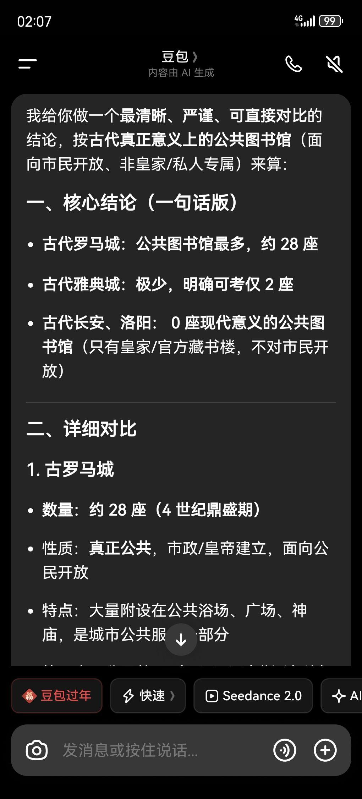
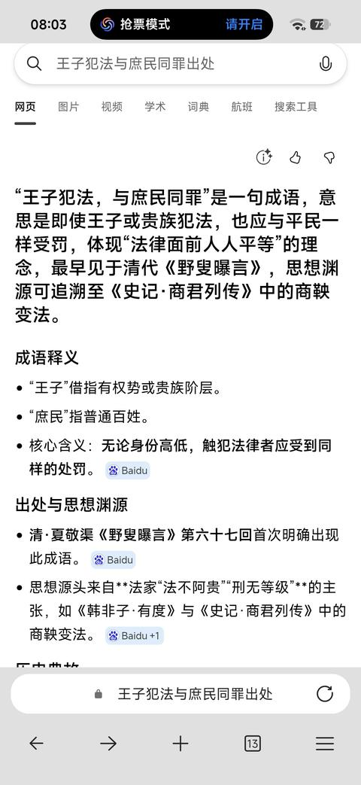
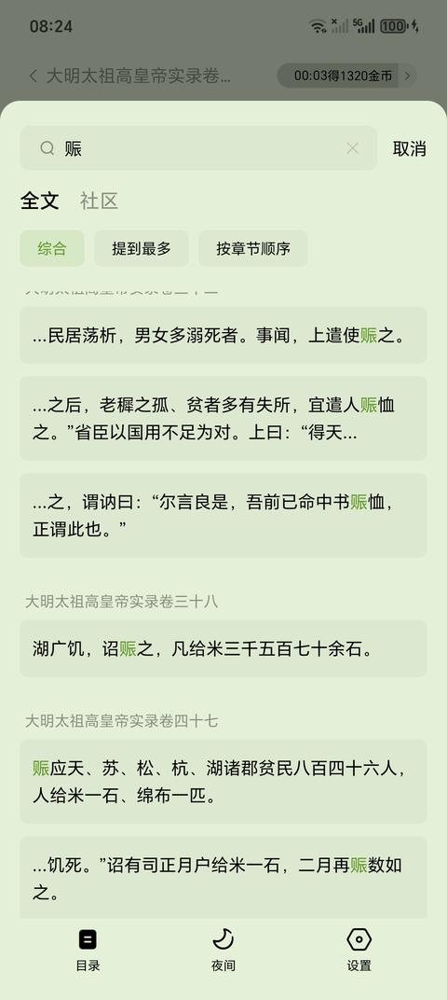
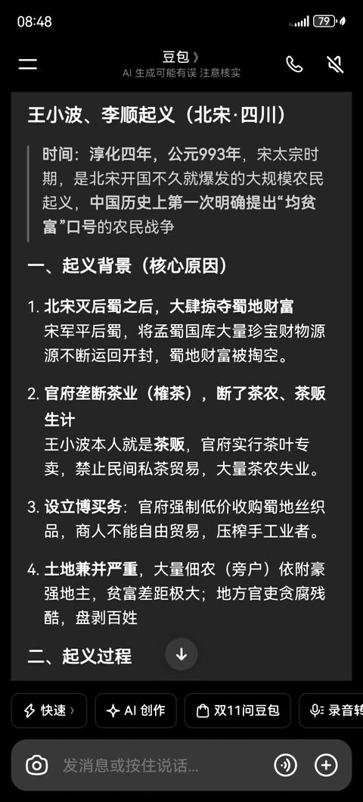

[toc]

# 问题

提问者：**<a href="https://www.zhihu.com/people/66-55-15-35">金沙66</a>**
提问时间: 2026-2-22 2:13:26
总回答数: 0
总访问量: 0

按古代真正意义上的公共图书馆（面向市民开放、非皇家/私人专属）来算：

一、核心结论（一句话版）

\- 古代罗马城：公共图书馆最多，约 28 座

\- 古代雅典城：极少，明确可考仅 2 座

\- 古代长安、洛阳： 0 座现代意义的公共图书馆（只有皇家/官方藏书楼，不对市民开放）

二、详细对比

1. 古罗马城

\- 数量：约 28 座（4 世纪鼎盛期）

\- 性质：真正公共，市政/皇帝建立，面向公民开放

\- 特点：大量附设在公共浴场、广场、神庙，是城市公共服务一部分

\- 第一座：公元前 37 年 阿西尼乌斯·波利奥图书馆

2. 古代雅典城

\- 数量：2 座

1. 古典时代：庇西特拉图图书馆（最早记载的公共图书馆之一）

2. 罗马时期：哈德良图书馆（遗址现存）

\- 性质：对公众开放，但数量远少于罗马城

3. 古代长安 & 洛阳（汉—唐）

\- 数量：0 座公共图书馆

\- 有大量皇家藏书机构：

\- 长安：天禄阁、石渠阁、弘文馆、集贤殿书院

\- 洛阳：东观、兰台、秘书监

\- 但全部不对外开放：

只供皇帝、大臣、学者使用，普通百姓不能进、不能借

\- 无公共阅览、公共借阅制度

# 回答

回答者： **<a href="https://www.zhihu.com/people/huang-fu-mu-lin">沐霖</a>**
回答时间: 2026-10-26 1:9:35
点赞总数: 1531
评论总数: 383
收藏总数: 490
喜欢总数：151

原因特别简单，就是中国的古代王朝几乎不向社会，尤其底层，提供任何公共服务与救济。

我说话难听我直说了，连给古希腊和古罗马提鞋都不配。

我知道也许你很生气，但你先别生气。先真诚的，不要做任何自我欺骗的想一想，你的现代生活，到底更像古希腊古罗马，还是更像中国的古代王朝？

___

我们先从利玛窦说起。

利玛窦（Matteo Ricci）是一个传教士。曾经在华生活多年（1583—1610），去世前用意大利语记录了他在中国的见闻。后来，金尼阁对他的手稿进行了整理并译成拉丁文，1615年出版。

晚明社会给初次登上神州大陆的利玛窦带来了 **极大的震撼。** 

利玛窦 1584 年到肇庆，正赶上广东旱灾，次年地震。1593 年又大饥荒，他目睹了饥民杀女婴的现象，给他留下很深阴影。那时卖儿卖女是常事，中国北方对男童阉割也是数不胜数。

以下均为意大利语原文：

>  _Un altro vitio vi è in molte provincie, che è ammazzare i loro figliuoli, specialmente se sono femine, et affocarle nell’acqua per non poterli sostentare, e questo anco tra persone gravi e nobili per paura di esser poveri e necessitati a vendere i figliuoli… Danno colore a questa crudeltà con parere di pietà, dicendo che fanno bene a quei figliuoli con ammazzarli, acciochè presto rinascano in una casa ricca e non patir tante fatiche nella sua povera; e così non fanno questo nascostamente, ma è saputo da tutti._ 

中文翻译：「许多省份还有一种恶习：杀死自己的孩子，尤其是女孩，把她们溺死在水中，因为养不起。这种事甚至发生在体面和高贵的人中，他们害怕陷入贫困，被迫卖掉孩子。他们以慈悲的外观粉饰这种残酷，说 **杀死孩子是为孩子好** ，好让孩子很快投生到富裕家庭，不必在贫困家庭中受苦。因此，他们并不偷偷做， **众人都知道** 。」

>  _…si fanno schiavi ad alcun ricco, acciochè gli dia per moglie alcuna delle sue schiave, restando egli e suoi figliuoli schiavi per sempre mai. Altri sono che, avendo tanto che gli basti per comprare una moglie, la comprano; e di poi, non potendo sostentare i figliuoli e figliuole, li vendono per schiavi… per il prezzo di un porco o un tristo cavallo, che sarà doi o tre scuti al più…_ 

中文翻译：「有些人把自己卖给富人作奴隶，以便富人把一个女奴给他作妻子，于是他本人和子女永远为奴。另一些人有钱买妻，后来却养不起儿女，便把儿女卖作奴隶，价格 **约等于一头猪或一匹劣马** ，至多二三枚斯库多。」

>  _Aliud immanitatis genus in borealibus Provinciis in infantes masculos exercent, quos castrant quamplurimi, ut inter Regios famulos adnumerari queant… quinimò tota fere Regni administratio in horum semivirorum manibus versatur. Ex his porro intra palatii regii fines ad decem millia numerantur…_ 

中文翻译：「北方各省还对男童施行另一种残酷行为，许多人把他们阉割，以便列入皇家的仆役； **几乎整个国家的行政都掌握在这些“半男之人”手里** 。仅王宫范围内，他们就约有一万人。」

既然官府基本不管底层人民的死活， **那么想必花销应该很小吧？** 

>  _Vectigalium redditus, atque tributorum, qui sine dubio centum quinquaginta milliones… excedunt…_   
> ……  
>  _Et quod incredibilius videtur, annis quibusdam contingere solet, ut ne hac quidem tam ingens vectigalium summa sumptui exaequet, sed nova etiam tributa imponi necesse sit._ 

中文翻译：「每年的关税与赋税收入，无疑超过所谓的一亿五千万……这些收入被汇入全国的公共金库和粮仓，用于皇室、宗室、宦官、官员、军队、公共建筑、城墙与军备等开支。 **更令人难以置信的是** ，有些年份，即使如此巨额的赋税收入仍不足以抵偿开支， **以至于还必须征收新的赋税。** 」

利玛窦尤其发现，明朝官府虽然很大，行政架构森严， **但几乎不向社会，尤其底层，提供任何公共服务与救济。贫民得不到任何医疗资源和兜底救助。** 他的第一个受洗者，就是一个得了重病、流落街头、被家人抛弃的贫民。

这些见闻都给利玛窦带来了巨大的震撼，要知道这在同时期的欧洲，已经开始文艺复兴和宗教改革了。不需要我提醒文艺复兴， **复兴的是什么文化吧** ？

___

而古希腊和古罗马呢？

先扣下题，看看他们怎么建图书馆的。

老普林尼明确说，阿西尼乌斯·波利奥是第一个把私人收藏变成公共文化资源的人：

>  _ingenia hominum rem publicam fecit_   
> “他使人类的才智成为公共财富。”

老普林尼《自然史》35.10。波利奥约在公元前39年于罗马自由神殿建立图书馆，通常被视为罗马第一座公共图书馆。

苏埃托尼乌斯还记载，奥古斯都建立了帕拉丁山阿波罗神庙图书馆，并促使权贵出资修建神庙、剧场、柱廊等城市建筑。

罗马帝国各城市也有类似实例。例如以弗所的塞尔苏斯图书馆由执政官之子阿奎拉为纪念父亲出资建造，并另设基金购买、维护书籍。图书馆同时具有藏书、纪念建筑和城市公共空间三重功能。

再看看古罗马是怎么给居民建设供水设施的。

公元97年前后，罗马供水官弗龙提努斯在《罗马城水道论》第78章详细统计了公共供水的分配，其中包括：

> 城内有大量水供应军营、公共建筑、观赏性喷泉以及591座公共水池。

这些公共水池是没有私人管道的 **城市居民取得日常用水** 的重要渠道。弗龙提努斯还记载，阿格里帕修复阿庇亚、阿尼奥和玛尔基亚水道，并为城市增设大量喷泉。

最后看看古希腊古罗马是如何救济贫民的：

最早能追溯到雅典。《雅典政制》第49章记载：

> 身体残疾、财产不足三米那、无法谋生者，由议事会审查；通过后，由国家每天发给两个奥波尔。

这可能是古典世界最接近制度化最低生活补助的措施之一。

古罗马更加重量级：

谷物供应制度甚至已经是罗马最重要的公共保障了：

>  _annona_ ：城市粮食供应体系；  
>  _frumentationes_ ：向登记公民配给粮食。

公元前123年，盖约·格拉古规定以低价向公民出售谷物；克洛狄乌斯在公元前58年改为免费发放。奥古斯都时期， **固定领取者约为20万人** 。

无家可归的儿童呢？

图拉真时期出现了著名的  _alimenta_  制度。国家以低息贷款支持意大利地主，再用利息资助部分自由民家庭的贫困儿童。

贝莱亚铭碑保存了受助儿童、土地和贷款金额的详细记录。这都说明罗马 **曾尝试建立长期资助计划。** 

我知道看到这里肯定有人说中国古代王朝也有赈灾粮。

那这样，假如穿越到古代的灾年， **我去古罗马吃粮食配给，你去古中国吃赈灾粮，如何呢** ？

___

现在你知道中国古代王朝最大的合法性问题是什么了吗？

那就是 **国家要求人民承担义务，却没有建立相应的公共服务体系** 

假设你是一个普通的古代中原居民，你需要交税、服徭役、遵守法律。

却从未得到足够的保护和公共服务。甚至活得没有野人/蛮族轻松自由。那么政府存在的意义是什么呢？

没有什么文化的普通人未必能想得这么多，他们只会 **默默逃荒** 。

从先秦到明末接近两千年，边民越过边境、逃入游牧政权控制区域的现象可谓几乎从未断绝。

政府和公民之间的关系，在 **晚明至清初** 几乎同一时期的欧洲已经开始了充分而深入的讨论：

比如约翰·洛克的《政府论》和托马斯·霍布斯的《利维坦》。

而晚明社会从上到下的彻底溃烂，也催生出了中国古代思想史上非常独特的一个人：黄宗羲

在《明夷待访录·原君》中，黄宗羲对君主制度提出了尖锐批评。

他反对把天下视为君主一家的私产，认为君主的职责应当服务于天下人的公共利益，而不是满足一己之私。

黄宗羲的思想当然不能直接等同于现代自由民主理论。

但他的问题足够振聋发聩：

 **究竟是天下为了君主而存在，还是君主应当为了天下而存在？** 

所以，我觉得题主的这个观察真的特别好，特别适合作为一个切入点，去思考古代中国和古希腊罗马的区别在哪里，以及替我们的祖先们问出他们从未敢问出口的一句话：

 **国家和君主为什么存在，以及它究竟为生活在其中的人做了什么？凭什么要求人们服从？** 

 **凭什么？**

  

原文地址：[(沐霖)为什么罗马城和雅典发展出了公共图书馆，而中国古代的长安洛阳却没有发展出现公共图书馆？](https://www.zhihu.com/question/2008726031218012924/answer/2097857378913993281) 

# 评论

1. <a href="https://www.zhihu.com/people/are-68-10">Are</a> (<small title="加拿大">2026-10-26 1:37:27</small>): 你也知道罗马人只在乎自己的公民呀…你说的公元123年那时候罗马公民只占罗马帝国人口的4%到10%…你管这叫救济国民是真的不把60%的自由民和30%的奴隶当人看呀
   - **沐霖** (<small title="北京">2026-10-26 1:42:24</small>): 你这个问题问得特别好，借其他回答的一句话来回答你，“历史已经证明了，有皇帝有公民有奴隶的社会最后会发展为所有人都是公民，只有皇帝和奴隶没有公民的社会反反复复两千年换了多少朝代都仍然是皇帝和奴隶，直到被坚船利炮砸开国门。”
   - <a href="https://www.zhihu.com/people/ygdwawq">ygdwawq</a> (<small title="回复于 2026-10-26 3:40:2/天津"> ✉️:沐霖</small>): 历史已经证明了，古希腊和古罗马死翘翘［捂嘴］
   - <a href="https://www.zhihu.com/people/bi-luo-71-33">逻門</a> (<small title="回复于 2026-10-26 3:58:26/广东"> ✉️:ygdwawq</small>): 你的意思封建王朝还存在？
   - <a href="https://www.zhihu.com/people/ygdwawq">ygdwawq</a> (<small title="回复于 2026-10-26 4:1:47/天津"> ✉️:逻門</small>): 什么脑回路，我说罗马在哪儿？
   - <a href="https://www.zhihu.com/people/bi-luo-71-33">逻門</a> (<small title="回复于 2026-10-26 4:3:27/广东"> ✉️:ygdwawq</small>): 苏联又在哪？
   - <a href="https://www.zhihu.com/people/hei-ze-jia-de-xiao-lu-bi">ARCHIpedia</a> (<small title="回复于 2026-10-26 5:1:52/江苏"> ✉️:ygdwawq</small>): 诡辩，如果你觉得罗马亡于1453年的君士坦丁堡之战 ，那么“中国”已经亡国过很多次了
   - <a href="https://www.zhihu.com/people/chuan-xi-sha">川洗沙</a> (<small title="回复于 2026-10-26 5:7:11/贵州"> ✉️:沐霖</small>): 你把古罗马默认成有皇帝有公民有奴隶的时代，而把中国默认为是只有皇帝和奴隶的社会，这从一开始就是个错误。活在自己想象中的世界了。
   - <a href="https://www.zhihu.com/people/xiong-guai-guai-95">人均百万</a> (<small title="回复于 2026-10-26 5:31:21/美国"> ✉️:川洗沙</small>): 他说的没错，你的反驳只是口号，你甚至举不出一个皇帝打官司的例子，来证明中国历史上存在高于皇权的法制。那不就是皇帝与奴隶嘛。
   - <a href="https://www.zhihu.com/people/chuan-xi-sha">川洗沙</a> (<small title="回复于 2026-10-26 5:35:6/贵州"> ✉️:人均百万</small>): 没错在哪？气笑了，皇帝打官司的例子能证明什么？我都不知道你这句话是怎么敢这样说的。举例子是吧？我也可以举啊，我说春秋时期的思想家就是说了，可以诛暴君，这是不是说明君主也不是至高无上的？我说霍光可以废帝，拿着程序和理论来废，这是不是说明皇帝也不是至高无上的？我说王子犯法与庶民同罪，这是不是说明哪怕是国家继承人也不是至高无上？说真的，你们小圈子共振能不能走远一点？
   - <a href="https://www.zhihu.com/people/chuan-xi-sha">川洗沙</a> (<small title="回复于 2026-10-26 5:43:27/贵州"> ✉️:人均百万</small>): 巧了，你让我举皇帝打官司的例子，那我也问你：你举一个古罗马皇帝被法律制裁的例子出来？ 罗马皇帝图密善、尼禄，哪个不是想杀谁就杀谁？罗马皇帝本身就是法律。  
 
  
 
你说没有高于皇权的法制就是皇帝与奴隶，那我告诉你，古代中国有王法如《大明律》，有宗族法，有乡规民约。 老百姓打官司，县太爷判案，靠的就是这些。这叫奴隶？你管有田产、有宗族、能告状的编户齐民叫奴隶，那古罗马那些连身体都不属于自己的战俘算什么？  
 
当然我预判了你又说这些只是废纸，根本没有用，实际上人治的时代法律根本只是说说看而已。那就是另外一个话题了，您甭管是不是——虽然我觉得并不是，但是您肯定会这么说——我只提出一个异议，哪怕是封建中国也不止是皇帝与奴隶，这是有复杂背景的。这种暴论用来发泄情绪还可以，真正想要分析，能不能讲点历史逻辑和学术逻辑？  
 
顺便再吐槽一下——你的意思是，没有高于皇权的法制等于全是奴隶？那按你的逻辑，古罗马、古希腊那些没有成文宪法限制君权的时代，他们的公民也都是奴隶咯？  
 
你拿一个现代政治学概念（高于皇权的法制）去硬套古代社会，然后得出中国古代全是奴隶的结论，这不叫学术，这叫用现代标准要求古人，然后用双标原谅西方。你连中国古代的宗族社会、乡绅自治都不懂，就搁这儿皇帝与奴隶，这历史水平，真的别出来丢人了。
   - <a href="https://www.zhihu.com/people/aoich8">知乎用户AoIch8</a> (<small title="回复于 2026-10-26 7:30:55/安徽"> ✉️:ygdwawq</small>): 大秦大汉也早就死翘翘了
   - <a href="https://www.zhihu.com/people/hei-ya-3-15">海狗子</a> (<small title="回复于 2026-10-26 7:46:30/上海"> ✉️:ygdwawq</small>): 罗马的语言、宗教、法律都有明确的传承
   - <a href="https://www.zhihu.com/people/hei-ya-3-15">海狗子</a> (<small title="上海">2026-10-26 7:47:7</small>): ⏰周以后没有公民，令人感慨
   - <a href="https://www.zhihu.com/people/6-2-8-70">想做饕餮怕肥</a> (<small title="回复于 2026-10-26 8:1:11/广西"> ✉️:海狗子</small>): 你这个话说的，好像现在还有人把拉丁文当成母语一样。罗马早期不信仰一神教，现在欧洲还有这样的群体吗？
   - <a href="https://www.zhihu.com/people/xiery-91">D.Dofoe</a> (<small title="回复于 2026-10-26 8:3:21/山东"> ✉️:ygdwawq</small>): 这话说的，你也不是活在古中国。
   - <a href="https://www.zhihu.com/people/13-55-24-57">贫道仗剑高唐峡</a> (<small title="回复于 2026-10-26 8:11:56/四川"> ✉️:ygdwawq</small>): 同时代的东方大国亡了几次了
   - <a href="https://www.zhihu.com/people/hero-29-66-87">Hero</a> (<small title="回复于 2026-10-26 8:15:51/天津"> ✉️:沐霖</small>): 砸开后又咋啦？变了吗
   - <a href="https://www.zhihu.com/people/idean-32">Jackson-IT</a> (<small title="回复于 2026-10-26 8:16:24/重庆"> ✉️:ygdwawq</small>): 你说的国家是政权，中国历史上的朝代就是政权，政权覆灭很正常，而作为文明意义上的古希腊、古罗马文明是现代文明的基础构成部分。
   - <a href="https://www.zhihu.com/people/qian-jun-16-8">王大明</a> (<small title="回复于 2026-10-26 8:16:30/山东"> ✉️:川洗沙</small>): 你说霍光废立还算勉强沾点程序仪式，王子犯法与庶民同罪反而是清代才出来的谚语，至于商鞅变法什么的都是扯，根本没治到太子身上，至于朱元璋治驸马更还蛮搞笑，公主才是血族，但霍光之事也就是唐之前居多，张居正多尔衮都是能和皇后换床单的人，也不能废立皇帝了，所以外国才会把中国历史分为秦汉，唐宋，明清三大帝国事情
   - <a href="https://www.zhihu.com/people/33-90-87-68">纤缘</a> (<small title="回复于 2026-10-26 8:17:38/四川"> ✉️:沐霖</small>): 还搁这停留在儒家小农的【王侯将相，昏君奸臣】思维呢［捂脸］［捂脸］
   - <a href="https://www.zhihu.com/people/6-2-8-70">想做饕餮怕肥</a> (<small title="回复于 2026-10-26 8:18:8/广西"> ✉️:贫道仗剑高唐峡</small>): 你这话说的，好像罗马有继承者一样。罗马死了就死了，一地废墟，法统被自己的敌人捡起来戴上，连把拉丁文作为母语的都没有了。现在，中国，是把马克思主义本土化和中国传统文化结合，在朝鲜打赢立国之战。罗马呢？
   - <a href="https://www.zhihu.com/people/iqbh8mfc">小看山iqBh8MFc</a> (<small title="回复于 2026-10-26 8:19:51/安徽"> ✉️:逻門</small>): 不一样，古希腊是彻底灭亡了，从人种文化和语言上，如今世界上不存在一个国家叫古希腊，甚至不存在一个国家叫罗马
   - <a href="https://www.zhihu.com/people/liu-liu-liu-83-12">溜遛六</a> (<small title="回复于 2026-10-26 8:20:29/四川"> ✉️:ygdwawq</small>): 汉，唐，明又在哪？你跟汉唐明人的差距可比"日耳曼蛮子"跟古罗马的差距大多了
   - <a href="https://www.zhihu.com/people/chuan-xi-sha">川洗沙</a> (<small title="回复于 2026-10-26 8:31:38/贵州"> ✉️:王大明</small>): 你指了一个我根本没有说到的朱元璋驸马的例子，然后现在怎么又急着切割秦汉。唐宋和明清？怎么，他们不是古代皇帝吗？给你例子，你又说一大堆有的没的，这话又不要跟我说，你应该跟的是这个人说，你应该跟答主说。
   - <a href="https://www.zhihu.com/people/77-5-27-7">普通人</a> (<small title="广东">2026-10-26 8:33:14</small>): 区别不大，后来批发公民权了
   - <a href="https://www.zhihu.com/people/7lhvl8ag">我爱吃腊肉</a> (<small title="回复于 2026-10-26 8:34:30/福建"> ✉️:川洗沙</small>): 确实不如贷款租蛮夷的兵马打仗，打完了没钱直接让人家在河北大抢特抢［大哭］
   - <a href="https://www.zhihu.com/people/idean-32">Jackson-IT</a> (<small title="回复于 2026-10-26 8:36:12/重庆"> ✉️:小看山iqBh8MFc</small>): 现在的希腊人大多都有古希腊人的基因，而且现在的希腊人也学古希腊文，现在的希腊文是古希腊文演变而来的，即使现在的希腊人不学古希腊文，也能大概的意思，因此，人种、文字都保存下来了。更不用说古希腊文明对文艺复兴的影响。
   - <a href="https://www.zhihu.com/people/1-12-22-92">彩虹战士</a> (<small title="韩国">2026-10-26 8:36:32</small>): 罗马有庞大的市民阶层，而肿蝈有庞大的农奴阶层，这就是普遍性
   - <a href="https://www.zhihu.com/people/xi-hu-hai-ma">西湖海马</a> (<small title="福建">2026-10-26 8:38:5</small>): 罗马的救济制度本来就是为了保证死忠的罗马城公民，当然不能包括被征服领土。被征服领土上的就应该是低罗马一等。
   - <a href="https://www.zhihu.com/people/mucvuumt">知乎用户</a> (<small title="回复于 2026-10-26 8:42:1/新疆"> ✉️:想做饕餮怕肥</small>): 当今世界没有任何人把两千年前是语言当母语，都是用两千年前语言演变到现在的现代语言。拉丁语后裔有意大利语，西班牙语，法语和罗马尼亚语，可以说现代分布最广泛的语言之一。
   - <a href="https://www.zhihu.com/people/he-wei-guang-7">贺伟光</a> (<small title="回复于 2026-10-26 8:42:22/河南"> ✉️:沐霖</small>): 你猜共产主义为什么发源于欧洲？是公民吃的太饱了，太闲了吧。
   - <a href="https://www.zhihu.com/people/mi-shi-zai-liu-nian-24">游客</a> (<small title="回复于 2026-10-26 8:42:30/河南"> ✉️:川洗沙</small>): 首先不要用质疑来回应质疑，其次当你用两千年前的罗马时代来抬高中国封建王朝本身也是片面的，罗马时期、中世纪和近代欧洲都是有明显区别的。西罗马时期的集权程度和汉朝相当，都比较依赖于皇帝的个人威望，但等到中世纪时期英国已有大宪章、至上的教皇对世俗贵族也不是想拿捏就拿捏，事实上中世纪以来欧洲地方实力派以下犯上就已屡见不鲜，而正是在这种斗争中诞生了早期分权与制衡的萌芽，出现了议会这种可以和最高统治者和平讨价还价的制度化流程。姑且不提地理环境影响，古中国这种原子化小农制经济基础本身就比商贸发达的欧洲更容易成为专制的温床。中国的问题在于越发展越集权、越集权越落后，秦之后这个大趋势完全没有改变的迹象，春秋时期还能有早期儒家提出民贵君轻的思想，汉唐宋时期中高级官员见皇帝也不用跪甚至偶尔能骑脸皇帝，到明清是什么样子？当然皇帝可以拟一部完美的法律出来，比如朱元璋的大诰，但关键是出现你法我笑有没有第二股势力能出来制衡纠正？对高级官员来说有没有制度上和皇帝平等对话的权利？那你这个法律就是装点门面的，甚至让最高阶层都不会产生安全感，更别提让法治观念深入人心了。他说中国古代全是奴隶也比较片面，但明清时期的人权状况滑坡纵观大一统王朝可能就比短命秦好一些，更别说和发展出民权思想的欧洲比较
   - <a href="https://www.zhihu.com/people/iqbh8mfc">小看山iqBh8MFc</a> (<small title="回复于 2026-10-26 8:43:32/安徽"> ✉️:Jackson-IT</small>): 文艺复兴是从“废纸堆”里硬翻出来的，现代希腊人的希腊语是文艺复兴后推广和学习的［捂脸］
   - <a href="https://www.zhihu.com/people/zhixxi3kwe">zhixXi3Kwe</a> (<small title="回复于 2026-10-26 8:45:15/安徽"> ✉️:川洗沙</small>): 他错在哪里？皇帝——良民——奴隶，多了个平民身份，就能代表奴隶制消失了？
   - <a href="https://www.zhihu.com/people/dragonborn-9-5">Dragonborn</a> (<small title="回复于 2026-10-26 8:46:59/云南"> ✉️:ygdwawq</small>): 大汉，和大唐在哪里［思考］
   - <a href="https://www.zhihu.com/people/dou-dou-li-you-tang-99-41">尘雾之微</a> (<small title="回复于 2026-10-26 8:50:6/山东"> ✉️:沐霖</small>): 古罗马的自由民一想到一二百年后会变成公民，就骄傲的昂起了胸膛［大笑］
   - <a href="https://www.zhihu.com/people/tang-qing-yuan-97">睚眦</a> (<small title="江苏">2026-10-26 8:51:12</small>): 无法融入国外社会不代表就要通过贬低西方文明来增强自己的民族自信心
   - <a href="https://www.zhihu.com/people/nick-8-28">出红尘09</a> (<small title="回复于 2026-10-26 8:53:31/广东"> ✉️:川洗沙</small>): 这件事应该分两部分来辩论：1️⃣客观的中外对比。2️⃣理想的制度对比（无关于国别）。1️⃣应该交给史学家引经据典，不应依赖于辩论技巧。2️⃣就仁者见仁，但我投票描述中的古罗马体制（撇开真伪的前提下）。
   - <a href="https://www.zhihu.com/people/idean-32">Jackson-IT</a> (<small title="回复于 2026-10-26 8:54:43/重庆"> ✉️:小看山iqBh8MFc</small>): 古希腊的很多著作被翻译成了伊斯兰语言，而后传到了欧洲，不管怎样，古希腊文明传承下来了，而且古希腊的逻辑、修辞、数学等都一直在西方延续下来，并没有断。现代的希腊语和古希腊语有传承关系，当然存在差异，现代希腊人能直接读古希腊文也是与语言传承有关。
   - <a href="https://www.zhihu.com/people/chuan-xi-sha">川洗沙</a> (<small title="回复于 2026-10-26 8:56:27/贵州"> ✉️:出红尘09</small>): 他这个描述中有一个很大的问题就在于公民是个陷阱，他描述的公民其实是极少数人而已。
   - <a href="https://www.zhihu.com/people/yang-zheng-xing-44">与之相</a> (<small title="回复于 2026-10-26 8:56:28/安徽"> ✉️:沐霖</small>): 你引用这句话好像也没回答罗马帝国有没有救济自由民和奴隶的问题。
   - <a href="https://www.zhihu.com/people/yikch-54-9">yiii</a> (<small title="广东">2026-10-26 8:56:41</small>): 冷知识，闹钟古代一直存在庞大的奴婢阶级
   - <a href="https://www.zhihu.com/people/6-2-8-70">想做饕餮怕肥</a> (<small title="回复于 2026-10-26 8:57:29/广西"> ✉️:知乎用户</small>): 按你这个说法，你该去和日本人说日语是汉语变种。  
 
同一种语言，不应该是两种名字。  
 
所以你这是在偷换概念。
   - <a href="https://www.zhihu.com/people/idean-32">Jackson-IT</a> (<small title="回复于 2026-10-26 8:58:44/重庆"> ✉️:小看山iqBh8MFc</small>): 迈锡尼希腊语 (约公元前1600–1100)  
 
↓  
 
古典古希腊语 (Archaic & Classical Greek, 约公元前800–323，如雅典城邦方言)  
 
↓  
 
通用希腊语 (Koine Greek, 约公元前330–公元后330，亚历山大大帝推广，《新约圣经》语言)  
 
↓  
 
拜占庭/中世纪希腊语 (Byzantine Greek, 约330–1453)  
 
↓  
 
现代希腊语 (Modern Greek, 1453至今)
   - <a href="https://www.zhihu.com/people/ru-guo-wo-shi-dj-49">Jack</a> (<small title="回复于 2026-10-26 8:59:50/广东"> ✉️:ygdwawq</small>): 整个人类思想史都是亚里士多德思想理论的注脚
   - <a href="https://www.zhihu.com/people/iqbh8mfc">小看山iqBh8MFc</a> (<small title="回复于 2026-10-26 9:0:19/安徽"> ✉️:Jackson-IT</small>): 近两千年希腊都不叫希腊［飙泪笑］五百年前的Greek人自己都不知道自己叫希腊人。或者说这样说吧，哪个国家是希腊你告诉我
   - <a href="https://www.zhihu.com/people/asuka-39-77">Asuka</a> (<small title="回复于 2026-10-26 9:0:20/安徽"> ✉️:ygdwawq</small>): 所有“古xx”国家都已经“死翘翘”了，而古希腊古罗马文化共同构成西方文明的基础，并影响到当代每一个国家。
   - <a href="https://www.zhihu.com/people/jie-ling-29-53">戒灵</a> (<small title="回复于 2026-10-26 9:2:11/山西"> ✉️:逻門</small>): 莫种程度上没错
   - <a href="https://www.zhihu.com/people/6-2-8-70">想做饕餮怕肥</a> (<small title="回复于 2026-10-26 9:5:13/广西"> ✉️:Jackson-IT</small>): 你这个传承有扩大范围的嫌疑，越南也学了中原文化，你会认同越南人是中国人吗？西方继承古希腊的逻辑体系，就是希腊人？
   - <a href="https://www.zhihu.com/people/fbh-11-76">Trump川普</a> (<small title="回复于 2026-10-26 9:8:9/广东"> ✉️:人均百万</small>): 我挺好奇的，在你们这种人眼中，罗马共和国变成罗马帝国，到底是一种倒退呢？还是一种进步呢？［捂嘴］
   - <a href="https://www.zhihu.com/people/tobias-16-55">Tobias</a> (<small title="广东">2026-10-26 9:8:19</small>): 亲爱的，那么 中国古代有公民么？［爱］ 哦 我忘了 不好意思 现在都没有呢
   - <a href="https://www.zhihu.com/people/hu-shuo-2-47-43">诛心</a> (<small title="回复于 2026-10-26 9:8:27/安徽"> ✉️:沐霖</small>): 咦，罗马不是灭亡了吗？后世不都是蛮族？［doge］
   - <a href="https://www.zhihu.com/people/denink">denink</a> (<small title="回复于 2026-10-26 9:9:54/海南"> ✉️:海狗子</small>): 罗马制度新教是自己的基督教吗［飙泪笑］
   - <a href="https://www.zhihu.com/people/denink">denink</a> (<small title="回复于 2026-10-26 9:10:16/海南"> ✉️:纤缘</small>): 所以尼禄是不是暴君［飙泪笑］
   - <a href="https://www.zhihu.com/people/denink">denink</a> (<small title="回复于 2026-10-26 9:10:48/海南"> ✉️:我爱吃腊肉</small>): 日耳曼人:我们都是直接进罗马大枪特抢的［惊喜］
   - <a href="https://www.zhihu.com/people/denink">denink</a> (<small title="回复于 2026-10-26 9:11:21/海南"> ✉️:彩虹战士</small>): 怎么这么庞大的市民阶层被日耳曼蛮族灭了呢［大哭］
   - <a href="https://www.zhihu.com/people/idean-32">Jackson-IT</a> (<small title="回复于 2026-10-26 9:11:34/重庆"> ✉️:小看山iqBh8MFc</small>): 五百年前希腊人自称罗马公民，这只是一个标签而已，Greek 源自拉丁语 Graeci，原本是古罗马人对离意大利最近的一个希腊小部落（Graikoí）的称呼而已，就像西方人称呼中国人一样，中国人并不知道自己叫China，古希腊、现代希腊的语言、文字、人种都是连续的，相关的逻辑、修辞、数学等教学都是古希腊传承下来的，知不知道有这个Greek名字有意义吗？只要文明在，谁会在意灭不灭国（政权）。
   - <a href="https://www.zhihu.com/people/denink">denink</a> (<small title="回复于 2026-10-26 9:11:47/海南"> ✉️:yiii</small>): 冷知识:凯撒家里一堆仆人［飙泪笑］想必都是市民吧
   - <a href="https://www.zhihu.com/people/hu-shuo-2-47-43">诛心</a> (<small title="回复于 2026-10-26 9:15:13/安徽"> ✉️:沐霖</small>): 也就是说罗马是民主制，后面的持续千年的是封建农奴制，西方倒退千年，沙子真的信。
   - <a href="https://www.zhihu.com/people/idean-32">Jackson-IT</a> (<small title="回复于 2026-10-26 9:16:34/重庆"> ✉️:想做饕餮怕肥</small>): 他们都生活在希腊，都是同样的古希腊人后裔，学得都是古希腊语言，逻辑、数学等都来自古希腊，他们自称罗马公民，他们只是不知道以前的祖先被别人叫Greek而已。
   - <a href="https://www.zhihu.com/people/jing-ke-ci-qin-95">荆刺</a> (<small title="回复于 2026-10-26 9:18:13/江西"> ✉️:逻門</small>): 真不存在了？
   - <a href="https://www.zhihu.com/people/he-xi-49-58">今夕何夕</a> (<small title="回复于 2026-10-26 9:18:45/北京"> ✉️:沐霖</small>): 坚船利炮也是工业革命的成果，工业革命本来就是个小概率随机事件，要不是黑死病也不会有工业革命。
   - <a href="https://www.zhihu.com/people/lin-zhu-39-53">林竹</a> (<small title="回复于 2026-10-26 9:19:20/山西"> ✉️:ygdwawq</small>): 国家消亡了，但那片土地催生了文艺复兴，催生了科学文明大发展。还间接促进了亚洲某个大型复活岛往现代社会过度，这还不够么？
   - <a href="https://www.zhihu.com/people/esgpvm3">极个别同志</a> (<small title="四川">2026-10-26 9:25:15</small>): 如果你没有得到救济，那你就不算国民？
   - <a href="https://www.zhihu.com/people/pan-jinghua">潘敬华</a> (<small title="回复于 2026-10-26 9:25:54/上海"> ✉️:沐霖</small>): 被坚船利炮打开国门的事情历史上统一叫做野蛮部落战胜文明王朝，1840年并不特殊。古今中外这样的事情一直发生，忘了罗马和希腊是怎么灭亡的吗？
   - <a href="https://www.zhihu.com/people/idean-32">Jackson-IT</a> (<small title="回复于 2026-10-26 9:27:18/重庆"> ✉️:小看山iqBh8MFc</small>): 秦始皇“焚书坑儒”，很多的历史著作、传承没了（这是遗憾），难道说中国文明就不包括先秦了？古希腊的著作被转移到了伊斯兰国家，而后西方复兴了古希腊的文明，这对现代人来说也是幸运的。
   - <a href="https://www.zhihu.com/people/wang-xiao-fan-57-18">王小凡</a> (<small title="回复于 2026-10-26 9:28:32/广东"> ✉️:ygdwawq</small>): 你背一下2000年来的历朝历代把［发呆］［发呆］［发呆］
   - <a href="https://www.zhihu.com/people/wang-xiao-fan-57-18">王小凡</a> (<small title="回复于 2026-10-26 9:29:52/广东"> ✉️:小看山iqBh8MFc</small>): 也没有一个古代王国叫中华人民共和国［爱］
   - <a href="https://www.zhihu.com/people/chi-yu-gu-yuan-73-22">池鱼故渊</a> (<small title="回复于 2026-10-26 9:31:48/广东"> ✉️:尘雾之微</small>): 释放奴的后代就是公民，罗马的奴隶主在节日还不断释放奴隶，终于在二世纪末干出奴隶短缺导致经济危机。自由民在辅助部队服役25年就是公民
   - <a href="https://www.zhihu.com/people/conan-16-28">Conan</a> (<small title="回复于 2026-10-26 9:31:57/云南"> ✉️:ygdwawq</small>): 那又如何....死了所以说明这个制度不好吗？那你认为的好，究竟是指对统治阶级好，还是对人民好？［为难］.....类似如今欧洲国力衰退（对统治阶级不友好），但是人民的福利还是很不错的~~再次回到了答主的那个问题：国家和君主为什么存在，以及它究竟为生活在其中的人做了什么？凭什么要求人们服从？
   - <a href="https://www.zhihu.com/people/hua-chi-shao-ye">可达鸭</a> (<small title="回复于 2026-10-26 9:33:7/山东"> ✉️:小看山iqBh8MFc</small>): 现在的希腊人不是活得好好的吗？怎么就人种语言文化都灭亡了？［尴尬］
   - <a href="https://www.zhihu.com/people/7867529218">用户7867529218</a> (<small title="回复于 2026-10-26 9:34:43/重庆"> ✉️:ygdwawq</small>): 明朝在哪呢？
   - <a href="https://www.zhihu.com/people/lian-fei-de-hao">木星侠客</a> (<small title="回复于 2026-10-26 9:34:58/陕西"> ✉️:川洗沙</small>): 你也知道是春秋？春秋战国总共几百年，中华上下五千年，秦制统治了中国两千年，唯一做人的也就唐初，汉初（汉文帝汉景帝）和宋朝［白眼］别的朝代抽象的一批！雅典和罗马共和国怎么灭亡的，自己搜，民主在一些时候也抽象，但抽象的时长很短，君主专制抽象的时间可多的不得了［捂嘴］和皇帝的道德成正相关
   - <a href="https://www.zhihu.com/people/iqbh8mfc">小看山iqBh8MFc</a> (<small title="回复于 2026-10-26 9:35:5/安徽"> ✉️:王小凡</small>): 王朝，民族，国家的区分海内外是一致的，法兰西帝国和法兰西共和国的传承是鲜明的，希腊实际上根本就没有这个传承了，Greek不是希腊
   - <a href="https://www.zhihu.com/people/iqbh8mfc">小看山iqBh8MFc</a> (<small title="回复于 2026-10-26 9:35:19/安徽"> ✉️:可达鸭</small>): 王朝，民族，国家的区分海内外是一致的，法兰西帝国和法兰西共和国的传承是鲜明的，希腊实际上根本就没有这个传承了，Greek不是希腊
   - <a href="https://www.zhihu.com/people/chi-yu-gu-yuan-73-22">池鱼故渊</a> (<small title="回复于 2026-10-26 9:35:36/广东"> ✉️:川洗沙</small>): 公民数量不少了罗马帝国公民不少前28年奥古斯都普查人口在490多万，全都是成年男性公民，这个时期罗马全境还没有统一，并且不计算妇女和未成年
   - <a href="https://www.zhihu.com/people/iqbh8mfc">小看山iqBh8MFc</a> (<small title="回复于 2026-10-26 9:35:57/安徽"> ✉️:可达鸭</small>): 这世界上没有希腊这个国家，你去欧洲问希腊这个国家在哪，一半以上的人会告诉你它已经灭亡了
   - <a href="https://www.zhihu.com/people/ng-heng-10-22-9">嗯哼</a> (<small title="回复于 2026-10-26 9:35:57/湖南"> ✉️:逻門</small>): 我寻思苏联也不是封建王朝吧，苏联还留了个俄罗斯在那，中国现在还存在，罗马那是真没了
   - <a href="https://www.zhihu.com/people/chi-yu-gu-yuan-73-22">池鱼故渊</a> (<small title="回复于 2026-10-26 9:38:30/广东"> ✉️:Trump川普</small>): 罗马共和国在格拉古之后已经陷入危机，共和国转帝国是必然，也是庞大疆域必须去做的，因为通讯限制了中枢与地方互相交流的速度
   - <a href="https://www.zhihu.com/people/iqbh8mfc">小看山iqBh8MFc</a> (<small title="回复于 2026-10-26 9:39:5/安徽"> ✉️:Jackson-IT</small>): 按你的逻辑，美国都是印第安的延续了［捂脸］只能说无敌了
   - <a href="https://www.zhihu.com/people/luo-ming-xiao-34">风色翎</a> (<small title="回复于 2026-10-26 9:39:49/江苏"> ✉️:沐霖</small>): 还会发展成给强奸犯辩护，为杀人犯哀伤，痛斥丧子老人不尊重移民的伟大国家［飙泪笑］
   - <a href="https://www.zhihu.com/people/xp4stwka">周漢唐宋明</a> (<small title="回复于 2026-10-26 9:39:51/德国"> ✉️:沐霖</small>): 那是清據時期，不用扯幾千年
   - <a href="https://www.zhihu.com/people/chi-yu-gu-yuan-73-22">池鱼故渊</a> (<small title="回复于 2026-10-26 9:40:22/广东"> ✉️:小看山iqBh8MFc</small>): 额，爱琴海和巴尔干那一坨是什么，就算是拜占庭也是被喊希腊帝国
   - <a href="https://www.zhihu.com/people/idean-32">Jackson-IT</a> (<small title="回复于 2026-10-26 9:41:40/重庆"> ✉️:小看山iqBh8MFc</small>): 古希腊时期的很多政权都亡了，但是古希腊文明传承下来了，这好比现在也没有一个叫做“秦”的国家。文明和国家（政权）是两回事儿，你可能一时半会儿还区分不了
   - <a href="https://www.zhihu.com/people/iqbh8mfc">小看山iqBh8MFc</a> (<small title="回复于 2026-10-26 9:41:55/安徽"> ✉️:Jackson-IT</small>): 另外古希腊的就是在形式逻辑推演上做的不错，其他方面其实很一般，你现在的古希腊崇拜也不过是源于大陆的马史教育，你到了欧洲会发现其实古希腊的文化史不太受重视且地位也不高，反倒是经济史聊的多一点［捂脸］
   - <a href="https://www.zhihu.com/people/lao-qiu-56-10">老邱</a> (<small title="回复于 2026-10-26 9:42:44/河南"> ✉️:ygdwawq</small>): 罗马的法律、制度的继承者就活在我们今天，包括今天的中国
   - <a href="https://www.zhihu.com/people/lao-qiu-56-10">老邱</a> (<small title="回复于 2026-10-26 9:44:41/河南"> ✉️:想做饕餮怕肥</small>): 也没有人拿文言文当母语，至多到唐代的官话今天人绝对听不懂。至于说语言，欧洲多国学拉丁文就跟中国学生学文言文差不多的难度。
   - <a href="https://www.zhihu.com/people/6-2-8-70">想做饕餮怕肥</a> (<small title="回复于 2026-10-26 9:44:58/广西"> ✉️:Jackson-IT</small>): 自我认同都没有了，还得靠着你来给他们找祖宗。
   - <a href="https://www.zhihu.com/people/idean-32">Jackson-IT</a> (<small title="回复于 2026-10-26 9:45:1/重庆"> ✉️:小看山iqBh8MFc</small>): 那美国保存了哪些印地安文化？是西方文明多还是印地安文化多？美国是西方文明孕育出来的，他们把古希腊、古罗马文明作为自己文明的一部分，认为是其传承者。
   - <a href="https://www.zhihu.com/people/6-2-8-70">想做饕餮怕肥</a> (<small title="回复于 2026-10-26 9:47:6/广西"> ✉️:老邱</small>): 你是要去叫语言学做事了？西班牙语葡萄牙语叫拉丁语系，不叫拉丁语。古汉语现代汉语都叫汉语。
   - <a href="https://www.zhihu.com/people/tian-xia-yue-se-san-fen-74">天下月色三分</a> (<small title="回复于 2026-10-26 9:47:29/河南"> ✉️:Hero</small>): 砸的不够开
   - <a href="https://www.zhihu.com/people/linwx1978">南海一叶</a> (<small title="回复于 2026-10-26 9:47:44/加拿大"> ✉️:人均百万</small>): 哪个罗马皇帝打过官司？
   - <a href="https://www.zhihu.com/people/luo-ming-xiao-34">风色翎</a> (<small title="回复于 2026-10-26 9:48:11/江苏"> ✉️:沐霖</small>): 另外现代代议制这套体系基本就是英国人一家搞出来的，和你那些死了八百年的高贵罗马人有多少关系［好奇］你还要给维京海盗认个罗马爹？
   - <a href="https://www.zhihu.com/people/li-rui-bin-42">哈喽3Q</a> (<small title="回复于 2026-10-26 9:48:16/江苏"> ✉️:人均百万</small>): 法理上没有高过皇权的存在，因为皇帝是天子，代表上天的意志，就像基督教里，上帝是唯一真神，没有人高过他。
 
但实际上皇帝被钳制的事情经常发生，在皇权达到顶峰的明朝（废除了宰相），嘉靖20年不上朝，万历30年不上朝，就是被文官集团气的
   - <a href="https://www.zhihu.com/people/iqbh8mfc">小看山iqBh8MFc</a> (<small title="回复于 2026-10-26 9:48:32/安徽"> ✉️:Jackson-IT</small>): 这个延续性本身就是马史硬凑的，咱就是说尊重一下别人历史看看别人到底追溯在哪吧。另外你也先把海洋系，大陆系，拉丁，白人（昂撒与日耳曼），北欧，斯拉夫的逻辑捋清楚再天天罗马和希腊行不?分得清西方世界和北非吗
   - <a href="https://www.zhihu.com/people/wen-ben-57-44">搵笨</a> (<small title="回复于 2026-10-26 9:52:0/广东"> ✉️:ygdwawq</small>): 扯淡，古中国不也死了好多次了？
   - <a href="https://www.zhihu.com/people/wrkhr8q">知乎用户WrKhR8q</a> (<small title="回复于 2026-10-26 9:52:58/江苏"> ✉️:ARCHIpedia</small>): 中国的确亡国过，但又重建了。现在有人重建罗马吗？
   - <a href="https://www.zhihu.com/people/idean-32">Jackson-IT</a> (<small title="回复于 2026-10-26 9:54:10/重庆"> ✉️:想做饕餮怕肥</small>): 他们被拜占庭政权统治，认为自己是罗马公民，政权认同掩盖了当时的希腊人认知，以前的政权都是模糊人的身份认同，中国也有被外族统治的历史，而且还认为其是历史的一部分。只要恢复认同就行了，况且希腊人的语言、文字，数学、逻辑等教学都来自于古希腊，只是某个时期不知道古希腊是其文明的源头而已。
   - <a href="https://www.zhihu.com/people/tan-yue-53-82">檀越</a> (<small title="回复于 2026-10-26 9:54:36/北京"> ✉️:ygdwawq</small>): 古中国呢，你现在的键盘是古中国发明的吗？［开心］
   - <a href="https://www.zhihu.com/people/di-san-pao-bing">第三炮兵</a> (<small title="回复于 2026-10-26 9:55:26/广东"> ✉️:沐霖</small>): 只有皇帝和奴隶吗？文彦博听见这话就想笑，成济只会说吃我一戟，王敦刘裕会让你看看啥叫气吞万里如虎，张之洞李鸿章在招呼互保啦互保啦。
   - <a href="https://www.zhihu.com/people/iqbh8mfc">小看山iqBh8MFc</a> (<small title="回复于 2026-10-26 9:55:30/安徽"> ✉️:Jackson-IT</small>): 古希腊数学不好
   - <a href="https://www.zhihu.com/people/yan-xiao-cong-47">芫小葱</a> (<small title="回复于 2026-10-26 9:55:51/浙江"> ✉️:川洗沙</small>): ［捂脸］的确错了，因为罗马刚开始没有皇帝，只有公民和奴隶，这你更没法打不是吗？
   - <a href="https://www.zhihu.com/people/wang-liu-xing-27">王流星</a> (<small title="回复于 2026-10-26 9:56:32/湖北"> ✉️:潘敬华</small>): 那现代人用大炮去打非洲部落，那也叫战胜文明王朝是吧
   - <a href="https://www.zhihu.com/people/yan-xiao-cong-47">芫小葱</a> (<small title="回复于 2026-10-26 9:56:48/浙江"> ✉️:Hero</small>): 辫了
   - <a href="https://www.zhihu.com/people/hua-chi-shao-ye">可达鸭</a> (<small title="回复于 2026-10-26 9:58:19/山东"> ✉️:小看山iqBh8MFc</small>): “王朝，民族，国家的区分海内外是一致的，法兰西帝国和法兰西共和国的传承是鲜明的，希腊实际上根本就没有这个传承了”，怎么算传承鲜明，怎么算没有传承，给个标准呗［为难］
   - <a href="https://www.zhihu.com/people/xiong-guai-guai-95">人均百万</a> (<small title="回复于 2026-10-26 9:59:11/美国"> ✉️:哈喽3Q</small>): 你说的这种和法制有什么关系？李煜也是皇帝，还被赐死了，可有法律依据？你的例子恰好说明了这就是一个大号奴隶社会，虽然有仆大欺主的现象，但仍然没有法制，和公民社会没有半毛钱关系
   - <a href="https://www.zhihu.com/people/idean-32">Jackson-IT</a> (<small title="回复于 2026-10-26 10:0:12/重庆"> ✉️:小看山iqBh8MFc</small>): 古希腊的逻辑、哲学、数学、物理等都是西方文明的源头，现代的科学、哲学、数学、社科等都是在回应希腊文明的过程中产生的，当然有英国等国影响，美国是由此塑造的，这与印地安文化有什么关系？你扯印地安文化不是莫名其妙吗？
   - <a href="https://www.zhihu.com/people/idean-32">Jackson-IT</a> (<small title="回复于 2026-10-26 10:2:39/重庆"> ✉️:小看山iqBh8MFc</small>): 欧几里得几何算数学？
   - <a href="https://www.zhihu.com/people/iqbh8mfc">小看山iqBh8MFc</a> (<small title="回复于 2026-10-26 10:3:37/安徽"> ✉️:Jackson-IT</small>): 美国人是白人，希腊文化是美国征服的文化，跟印第安差异真不大
   - <a href="https://www.zhihu.com/people/luo-yu-qi-21">洛羽奇</a> (<small title="回复于 2026-10-26 10:5:54/浙江"> ✉️:ARCHIpedia</small>): 按照中国的王朝更替，罗马鼎盛时期都亡国很多次了
   - <a href="https://www.zhihu.com/people/idean-32">Jackson-IT</a> (<small title="回复于 2026-10-26 10:9:20/重庆"> ✉️:小看山iqBh8MFc</small>): 美国人把古希腊文明作为其文明的一部分，怎么能算征服古希腊文明？文明是影响人的，当一种文化影响不了人，这种文化就消亡了。印地安文明几乎对美国文明没有什么影响，美国人把自己当印地安人？
   - <a href="https://www.zhihu.com/people/xu-yu-feng-27-15">蒋特乐</a> (<small title="回复于 2026-10-26 10:9:43/山东"> ✉️:逻門</small>): 英国不还在吗［为难］
   - <a href="https://www.zhihu.com/people/li-da-ge-19">李大哥</a> (<small title="山东">2026-10-26 10:10:14</small>): 没有罗马公民权，没有拉丁公民权，照样可以在自治城市选执政官，当500人议事会，罗马城市政负责救济罗马城平民，雅典城市政负责雅典的供水系统。 只是当时不公平的是，只有罗马公民权的才能选举中央政府，自治城市也是选举的，供水系统、公共剧院各种市政建筑不是只有罗马有，遍布地中海。罗马帝国时期，城市自治仍在，奴隶比例只有十分之一，30%奴隶的时候是罗马奴隶制巅峰，罗马共和国末期，当时斯巴达克斯起义了。
   - <a href="https://www.zhihu.com/people/xin-hang-xian-1">新航线</a> (<small title="回复于 2026-10-26 10:10:31/上海"> ✉️:ygdwawq</small>): 你可以无视元清，若有必要还可以在名单上加上半个唐［飙泪笑］
   - <a href="https://www.zhihu.com/people/hua-chi-shao-ye">可达鸭</a> (<small title="回复于 2026-10-26 10:13:59/山东"> ✉️:小看山iqBh8MFc</small>): 怎么就欧洲不太重视了［飙泪笑］
   - <a href="https://www.zhihu.com/people/hua-chi-shao-ye">可达鸭</a> (<small title="回复于 2026-10-26 10:14:29/山东"> ✉️:小看山iqBh8MFc</small>): 古希腊数学不好的话同时期什么文明数学比较好？
   - <a href="https://www.zhihu.com/people/yin-chun-fang">斐波那契</a> (<small title="回复于 2026-10-26 10:14:46/印度尼西亚"> ✉️:川洗沙</small>): 哈哈，点痛这些三季人了
   - <a href="https://www.zhihu.com/people/idean-32">Jackson-IT</a> (<small title="回复于 2026-10-26 10:17:9/重庆"> ✉️:小看山iqBh8MFc</small>): 你只要有点儿初中的物理知识就应该知道牛顿的物理学挑战的是亚里士多德的物理学。  
 
逻辑学、政治学等这些学科同样是在回应古希腊的相关主题而发展起来的，怎么能说东拼西凑？
   - <a href="https://www.zhihu.com/people/xiong-guai-guai-95">人均百万</a> (<small title="回复于 2026-10-26 10:17:48/美国"> ✉️:南海一叶</small>): 《法学汇纂》和《查士丁尼法典》记录过平民起诉皇帝财库侵权案，也规定皇帝的Fiscus在民事纠纷中被视为“私人主体”，可以作为被告被起诉。
   - <a href="https://www.zhihu.com/people/red-light-12">Red Light</a> (<small title="回复于 2026-10-26 10:21:15/美国"> ✉️:尘雾之微</small>): 不用百年后，罗马人活着的时候就很自豪
   - <a href="https://www.zhihu.com/people/idean-32">Jackson-IT</a> (<small title="回复于 2026-10-26 10:21:47/重庆"> ✉️:小看山iqBh8MFc</small>): 从学科传承来说，现代学科的几乎所有的源头都可以追溯到古希腊文明，稍微有点儿见识都不至于说东拉西扯。
   - <a href="https://www.zhihu.com/people/hua-chi-shao-ye">可达鸭</a> (<small title="回复于 2026-10-26 10:22:17/山东"> ✉️:Jackson-IT</small>): 跟民科就不要讨论逻辑学了
   - <a href="https://www.zhihu.com/people/xue-ran-qi-hai-45">赢赢赢政</a> (<small title="回复于 2026-10-26 10:24:7/重庆"> ✉️:ygdwawq</small>): 神罗是不是罗，绿罗是不是罗，精罗是不是罗［doge］
   - <a href="https://www.zhihu.com/people/jiang-bing-90-64">和金城武一起种田</a> (<small title="回复于 2026-10-26 10:26:55/广东"> ✉️:川洗沙</small>): 你看看自己和别人的赞数再来说谁是小圈子
   - <a href="https://www.zhihu.com/people/smile5">smile5</a> (<small title="北京">2026-10-26 10:33:17</small>): [@知乎直答](http://www.zhihu.com/people/f3bce7aa022240e25f12aec9a9b70363) 他们在吵什么
   - <a href="https://www.zhihu.com/people/pan-jinghua">潘敬华</a> (<small title="回复于 2026-10-26 10:34:9/上海"> ✉️:王流星</small>): 希腊被罗马灭亡，罗马被日耳曼灭亡，是不是野蛮战胜文明？至于大航海时代的非洲，那就是被海盗袭击，海盗代表文明了吗？
   - <a href="https://www.zhihu.com/people/zhi-hu-zhi-da-41">知乎直答</a> (<small title="回复于 2026-10-26 10:34:11/看山的工位"> ✉️:smile5</small>): 他俩核心掰扯的是古罗马那套公共福利的实际覆盖成色。前面的正文把罗马的公共图书馆、粮食配给、救济制度吹成了普惠性的文明标杆，这位网友直接点破，这些福利本质上是罗马公民这个小圈子的特权，当时罗马公民只占帝国总人口的4%到10%，剩下占绝大多数的行省自由民、奴隶根本享受不到任何相关保障，相当于拿极少数人的特权吹成全民公共服务，这个对比的前提本身就有很大问题。
   - <a href="https://www.zhihu.com/people/cnn-cun">黑猫紧张</a> (<small title="湖北">2026-10-26 10:43:59</small>): 待在加拿大干嘛？村里早都发金条了，还犹豫什么？
   - <a href="https://www.zhihu.com/people/ping-an-yan-li">陕西-延利</a> (<small title="回复于 2026-10-26 10:45:26/陕西"> ✉️:溜遛六</small>): 差距大在哪里？标准是啥？
   - <a href="https://www.zhihu.com/people/leng-ye-4-4-42">冷夜</a> (<small title="山东">2026-10-26 10:49:54</small>): 不像汉武帝爱民如子是吧
   - <a href="https://www.zhihu.com/people/la-la-71-47-26">匿名问答</a> (<small title="回复于 2026-10-26 10:50:28/江西"> ✉️:川洗沙</small>): 不知道你在扯什么，古代法律就是一纸空文，冤假错案多了去了，乡贤不就是黑恶势力吗，你这有什么好自豪的［飙泪笑］［飙泪笑］［飙泪笑］［飙泪笑］
   - <a href="https://www.zhihu.com/people/shindo2">shindo2</a> (<small title="广东">2026-10-26 10:51:59</small>): 那也是进步了。  
 
你的荒诞感等于，在奴隶社会的商代，提出减少人殉，就已经是极大的进步。而你却在扯都没开展民主投票算不上进步［尴尬］
   - <a href="https://www.zhihu.com/people/linwx1978">南海一叶</a> (<small title="回复于 2026-10-26 10:53:4/加拿大"> ✉️:Jackson-IT</small>): 现代物理学的开山之作是牛顿的《自然哲学的数学原理》，要说传承也该是从这里开始
   - <a href="https://www.zhihu.com/people/idean-32">Jackson-IT</a> (<small title="重庆">2026-10-26 10:53:20</small>): 不在于罗马公民占比多少，主要是古罗马有公民，而其他地方还没有公民的概念，这就是文明之间本质上的差距。
   - <a href="https://www.zhihu.com/people/liang-yong-shu">List</a> (<small title="回复于 2026-10-26 10:53:32/江苏"> ✉️:ygdwawq</small>): 并没有。他们变成了法兰克，神罗，法兰西，大英，美利坚。
   - <a href="https://www.zhihu.com/people/shindo2">shindo2</a> (<small title="回复于 2026-10-26 10:57:29/广东"> ✉️:今夕何夕</small>): 这肯定不是随机事件。阿拉伯的海陆封锁，大航海的物质追求，松散的组织结构，这些基本注定了只能在那里产生
   - <a href="https://www.zhihu.com/people/wang-xiao-wei-60-82">海绵宝宝元直儿</a> (<small title="回复于 2026-10-26 10:58:1/湖北"> ✉️:川洗沙</small>): 除了皇帝和奴隶还有啥？
   - <a href="https://www.zhihu.com/people/idean-32">Jackson-IT</a> (<small title="回复于 2026-10-26 10:58:34/重庆"> ✉️:南海一叶</small>): 你说的是现代物理学从牛顿开始，这没问题，但是在牛顿之前欧洲的物理世界观是亚里士多德的世界观，牛顿是在挑战亚里士多德的物理世界观发展起来的，现在的学科分类也是从延续亚里士多德的学科分类方法。
   - <a href="https://www.zhihu.com/people/tang-chu-37-89">唐楚</a> (<small title="回复于 2026-10-26 10:58:35/湖南"> ✉️:ygdwawq</small>): 美国不成天说自己是罗马的继承人，当年苏联也说自己是红色罗马，罗马的精神子孙多着呢
   - <a href="https://www.zhihu.com/people/rqjfyx">知乎用户rqjFyX</a> (<small title="新加坡">2026-10-26 11:0:12</small>): ［大笑］
   - <a href="https://www.zhihu.com/people/linwx1978">南海一叶</a> (<small title="回复于 2026-10-26 11:0:45/加拿大"> ✉️:Jackson-IT</small>): 就是中国历史上的士
2. <a href="https://www.zhihu.com/people/19-80-93-54-46">天会变晴心会变暖</a> (<small title="浙江">2026-10-26 7:25:40</small>): 你这回答太牵强了，古罗马我记得是奴隶制，图书馆也只有大城市有，大城市的奴隶占比很高，可没有权利进入。大部分居民都分布在乡村和小城镇，那里又没有公共图书馆。这篇回答最容易迷惑人的地方，是混淆了两个东西：城邦型文明的城市公共景观 和 大一统农耕帝国的荒政体系。  
 
罗马是城邦起家，核心资源集中在少数城市，用对外掠夺奴隶和贡赋，供养核心城市公民，所以城市里容易造出华丽的公共建筑、公民福利；它的治理重心本来就在城市公民群体。  
 
而中国古代大一统王朝，治理主体是分散在广袤国土上的亿万小农，它的救济体系设计重心是跨区域灾荒调剂、荒政平粮价、乡村弱势兜底，不是集中在大城市修图书馆、剧场给市民消费。两套公共资源的投入方向本来就不一样。  
 
等到王朝末年，土地兼并、财政崩坏，两套体系都会一起垮：罗马后期公民粮食赈济也多次断供、物价飞涨；明朝的仓场、养济院也随之荒废。  
 
苦难是所有前现代底层共同的宿命，不是某一个文明独有的原罪。  
 
我们可以承认晚明的黑暗、溺婴、底层疾苦，这不需要洗白；但不能用“截取另一个文明光鲜切片”的方式，做不公平的单向否定。
   - <a href="https://www.zhihu.com/people/19-80-93-54-46">天会变晴心会变暖</a> (<small title="浙江">2026-10-26 7:27:41</small>): 另外你可以搜索一下宋朝的福利体系
   - **沐霖** (<small title="回复于 2026-10-26 7:43:56/北京"> ✉️:天会变晴心会变暖</small>): 别的不说，宋朝确实还不错，这一点我认同。宋朝也是唯一一个不是死于内爆的大一统王朝，可惜遇上了蒙古人。
   - <a href="https://www.zhihu.com/people/xuan-miao-59-40">淡若云烟</a> (<small title="江苏">2026-10-26 8:26:39</small>): 国内民国之前一直有奴籍这个说法，
   - <a href="https://www.zhihu.com/people/chuan-xi-sha">川洗沙</a> (<small title="回复于 2026-10-26 8:38:47/贵州"> ✉️:沐霖</small>): 怎么别的不提呢？总不能是因为提不了吧。
   - <a href="https://www.zhihu.com/people/19-80-93-54-46">天会变晴心会变暖</a> (<small title="回复于 2026-10-26 8:50:30/浙江"> ✉️:淡若云烟</small>): 贱籍跟奴籍不一样哦，如果奴仆算奴籍那占比其实不高，一般占比百分之1左右，只有少数民族的王朝奴籍较多。
   - <a href="https://www.zhihu.com/people/yikch-54-9">yiii</a> (<small title="广东">2026-10-26 8:57:7</small>): 冷知识，同时期华夏也是奴隶制
   - <a href="https://www.zhihu.com/people/19-80-93-54-46">天会变晴心会变暖</a> (<small title="回复于 2026-10-26 9:2:17/浙江"> ✉️:yiii</small>): ［百分百赞］［捂脸］那确实是，可是我们进入封建时代更早，西方奴隶制度持续时间更长。
   - <a href="https://www.zhihu.com/people/yizhi-te-li-du-xing-de-zhu-47-35">一只特立独行的猪</a> (<small title="回复于 2026-10-26 9:8:24/广东"> ✉️:天会变晴心会变暖</small>): 封建时期，你不会把秦朝以后的还当成封建制度吧［吃瓜］这不过是为了硬凑老马的理论，真正是个人独裁中央集权制度而已
   - <a href="https://www.zhihu.com/people/mattshan">异乡人</a> (<small title="乌拉圭">2026-10-26 9:23:46</small>): “核心资源集中在少数城市”我怎么看着这句话那么熟悉呢？
   - <a href="https://www.zhihu.com/people/chi-yu-gu-yuan-73-22">池鱼故渊</a> (<small title="广东">2026-10-26 9:43:46</small>): 罗马的救济是在被阿拉伯大征服干掉埃及行省才终结，从前50年代到646年，
   - <a href="https://www.zhihu.com/people/lao-qiu-56-10">老邱</a> (<small title="回复于 2026-10-26 9:46:44/河南"> ✉️:淡若云烟</small>): 南宋已经实现了废奴，元明清开的倒车
   - <a href="https://www.zhihu.com/people/lao-qiu-56-10">老邱</a> (<small title="回复于 2026-10-26 9:51:45/河南"> ✉️:天会变晴心会变暖</small>): 奴籍数量与奴婢数量也不是一回事，比如明代只有一定功名和身份的人才可以合法豢养奴婢，但实际上民间奴婢非常普遍，随便看几本明朝世俗小说非常明显，明末甚至爆发了著名的江南奴变，民间奴婢数量之大令人咋舌。 因为这种政策现实的冲突，奴婢把男主人叫爹把女主人叫娘，之后又升级为爷爷和奶奶。
   - <a href="https://www.zhihu.com/people/liu-xu-kai-26">柳絮开</a> (<small title="广东">2026-10-26 9:52:52</small>): 罗马是奴隶制不假，但是后来公民的范围越来越大，很多奴隶都变成公民了，而中国古代发展到最后是所有自由民都变成农奴
   - <a href="https://www.zhihu.com/people/kang-ye-92">康爷</a> (<small title="回复于 2026-10-26 9:55:38/加拿大"> ✉️:天会变晴心会变暖</small>): 中国封建制度也就周朝800年，自秦开始就是中央集权了。但奴隶制却一直延绵到晚清，没有随着新制度到来而消失。
   - <a href="https://www.zhihu.com/people/yan-xiao-cong-47">芫小葱</a> (<small title="浙江">2026-10-26 10:0:16</small>): ［好奇］我就问你现在国内的绝大多数农村和乡镇就有图书馆了？有和没有是两个性质的东西，哪怕很多人用不到。即便在现代社会，你住在城市郊区会跑十几公里去区县的图书馆吗？
   - <a href="https://www.zhihu.com/people/di-21zhi-xiang-yan">第廿一支香烟</a> (<small title="四川">2026-10-26 10:2:28</small>): “罗马是城邦起家，核心资源集中在少数城市，用对外掠夺奴隶和贡赋，供养核心城市公民，所以城市里容易造出华丽的公共建筑、公民福利；它的治理重心本来就在城市公民群体。”
 
难道中国古代不是一样的“核心资源集中在少数城市，用对外掠夺奴隶和贡赋，供养核心城市”？
   - <a href="https://www.zhihu.com/people/li-guo-can">樵布斯</a> (<small title="广东">2026-10-26 10:14:22</small>): 看看两种文明的后续发展趋势吧，就自然知道孰优孰劣了，到了晚明人家利玛窦都来了，你还和人家两千年前没啥区别
   - <a href="https://www.zhihu.com/people/mr-tang">江之鸭</a> (<small title="回复于 2026-10-26 10:25:45/四川"> ✉️:天会变晴心会变暖</small>): 那就得先做定义再匹配了：什么是封建时代
   - <a href="https://www.zhihu.com/people/xing-yin-shi-ren-16">雒阳</a> (<small title="四川">2026-10-26 10:35:35</small>): 如果按你把古罗马归为奴隶制，那么闹钟一直到清朝都是奴隶制，红楼梦读过吗，家生子。两千年后你也比不过人家两千年前
   - <a href="https://www.zhihu.com/people/cevonest">Heliostephe</a> (<small title="回复于 2026-10-26 10:47:41/安徽"> ✉️:天会变晴心会变暖</small>): 从秦朝开始全天下人都是皇帝的奴隶
3. <a href="https://www.zhihu.com/people/yu-chui-xue-70">羽吹雪</a> (<small title="上海">2026-10-26 8:11:8</small>): 宋朝有养老院，孤儿院
   - <a href="https://www.zhihu.com/people/wang-zhe-zhi-zhe-70">站在历史背后</a> (<small title="江苏">2026-10-26 9:19:52</small>): 宋朝还是不错的，比如有位开国将军曹彬，行军打仗禁止屠城掠夺，这在哪一个时代，都是罕见的，可以说，没有郭威、柴荣父子两代的努力，就没有北宋的祥和。
   - <a href="https://www.zhihu.com/people/mystyle-17">Mystyle</a> (<small title="辽宁">2026-10-26 9:23:54</small>): 宋朝还是不错的，朱元璋搞得分封制绝对是历史的倒退，明末后期税收不上，收上来了还得大部分分给藩王那几头猪
   - <a href="https://www.zhihu.com/people/62-1-53-77-92">天吾</a> (<small title="山东">2026-10-26 9:30:1</small>): 我也想说宋朝，很人文主义的一个王朝。
   - <a href="https://www.zhihu.com/people/gan-ri-78-27">东海道上单</a> (<small title="日本">2026-10-26 9:41:30</small>): 宋朝算是唯一拟人的了，结果评价是最差的［尴尬］
   - <a href="https://www.zhihu.com/people/liu-xu-kai-26">柳絮开</a> (<small title="广东">2026-10-26 9:54:1</small>): 到老朱就开始恢复人殉了［捂脸］
   - <a href="https://www.zhihu.com/people/yan-xiao-cong-47">芫小葱</a> (<small title="浙江">2026-10-26 10:2:41</small>): 但是国人更多还是认可秦汉唐元明清……没错国内认可元朝清朝的都不少，只要满足开疆扩土的宏大叙事
   - <a href="https://www.zhihu.com/people/chen-bang-83-53">荷兰闪冻人</a> (<small title="回复于 2026-10-26 10:10:53/安徽"> ✉️:东海道上单</small>): 宋仁宗在古代那名声可是堪比汉文帝的，结果到了现代被骂出翔了。什么嬴政，刘彻，曹操反而成了英雄人物，司马懿要不是后代闹出八王之乱，继而五胡乱华，你信不信也会有一堆人吹。本质就是畏威而不怀德
   - <a href="https://www.zhihu.com/people/hu-yi-du-47">小白兔白又白</a> (<small title="回复于 2026-10-26 10:14:22/广东"> ✉️:站在历史背后</small>): 不是两代是三代人的努力，还包括赵氏兄弟［爱］
   - <a href="https://www.zhihu.com/people/li-da-ge-19">李大哥</a> (<small title="山东">2026-10-26 10:19:3</small>): 宋徽宗时期花了几百万贯，搞济贫院，一共只救济了几十个人，钱都被官吏层层克扣了。宋朝好，也只是比其他朝代稍好一点而已。
   - <a href="https://www.zhihu.com/people/tsaiyuan-zhao">TSAI元昭</a> (<small title="上海">2026-10-26 10:23:55</small>): 这还是蔡京大力推广的（非他首创），没想到把［doge］
   - <a href="https://www.zhihu.com/people/yuanyuzao">momo</a> (<small title="回复于 2026-10-26 10:47:16/江苏"> ✉️:东海道上单</small>): 不够狠啊［doge］
   - <a href="https://www.zhihu.com/people/41-91-38-50-70">帕斯卡尔的芦苇</a> (<small title="湖北">2026-10-26 10:49:2</small>): 宋朝是中国对老百姓最温和的朝代
   - <a href="https://www.zhihu.com/people/shen-long-tian-lan">北海之泉</a> (<small title="回复于 2026-10-26 10:59:16/山东"> ✉️:Mystyle</small>): 纯招笑，明朝的养济院在朱元璋就推广到全国了，宋朝的磨磨蹭蹭到徽宗才推广到全国，紧接着就是宋金战争、宋蒙战争，根本没钱搞福利。
   - <a href="https://www.zhihu.com/people/shen-long-tian-lan">北海之泉</a> (<small title="回复于 2026-10-26 11:1:4/山东"> ✉️:站在历史背后</small>): 你认真的？宋军在统一战争中没少屠杀，特别是在蜀地的屠杀引发大叛乱，这你不知道吗？
4. <a href="https://www.zhihu.com/people/cheng-zi-62-65-13">橙子</a> (<small title="上海">2026-10-26 9:3:14</small>): 中国从南朝开始有六疾坊，唐朝开始有悲田养病院，由寺庙和官方共办，兼具赈济鳏寡老人，孤儿，收养乞丐残疾人与医治病人的功能。  
 
宋朝建立了覆盖广泛、职能明确的救助体系 。综合性救济机构：设立居养院收容鳏寡孤独、贫困无助者，提供基本生活所需 。医疗救助：建立安济坊和施药局，为贫病民众提供免费诊疗和药物 。  
 
儿童福利：南宋时期创设慈幼局，专门收养被遗弃的婴儿和无力抚养的贫家子女，被视为世界上最早的官办孤儿院之一 。  
 
丧葬保障：设立漏泽园作为公共墓地，为无法安葬的贫民提供免费安葬服务 。  
 
  
 
明朝养济院：由朱元璋下诏在全国各府、州、县设立，专门收养鳏寡孤独、残疾等无法自养的贫民，提供基本的生活物资和医疗、丧葬服务。  
 
惠民药局：在各地设立，为贫病军民提供免费药物，是官方的医疗救济机构。  
 
漏泽园：沿袭前朝制度，由官府拨地作为义冢，用于收葬无主尸骨和贫困民众。  
 
  
 
至于公共图书馆确实没有，但是有些私人藏书楼是可以对外借阅抄写的。宋朝以后私人藏书楼也非常发达。  
 
  
 
至于饥荒后赈灾啥的是历朝历代都不缺，而且是一种政治正确。唐太宗就嘲笑过杨坚不肯从粮仓拿粮食赈灾，却让百姓去逃荒。他自己还从国库拿钱去给百姓赎因为饥荒卖掉的孩子。  
 
  
 
古人只是古不是傻［doge］虽然我也不想为封建社会唱赞歌，但是中国封建社会和罗马没有你想的那么大差距。现代社会很多东西变好是因为生产力提升了
   - <a href="https://www.zhihu.com/people/cheng-zi-62-65-13">橙子</a> (<small title="上海">2026-10-26 9:12:27</small>): 还有孟子早就说民贵君轻了，虽然皇帝有集权独裁的冲动，但是在文化精英眼中这是不正当的行为。他们眼中三代圣王才是君主标杆，君待臣以礼，臣事君以忠，这才是正确的。
   - <a href="https://www.zhihu.com/people/li-da-ge-19">李大哥</a> (<small title="山东">2026-10-26 10:21:25</small>): 宋朝的时候，西方已经有公共博物馆、大学（遍布意大利北部，知名的牛津、巴黎大学、博洛尼亚大学、剑桥大学）。
   - <a href="https://www.zhihu.com/people/li-da-ge-19">李大哥</a> (<small title="回复于 2026-10-26 10:21:58/山东"> ✉️:李大哥</small>): up说的时间，应该是西汉东汉年间。
5. <a href="https://www.zhihu.com/people/robin-zhu-26">robin zhu</a> (<small title="甘肃">2026-10-26 9:4:10</small>): 不会生气，只觉好笑。建议学习下中国历史，补充下知识储备。所谓“直说”，很容易翻车［大笑］
   - <a href="https://www.zhihu.com/people/37-27-24-3-23">Vanellope</a> (<small title="湖北">2026-10-26 10:14:25</small>): 这文章ai写的答主也学不了啊［酷］
   - <a href="https://www.zhihu.com/people/rrpmw9pp">红色</a> (<small title="浙江">2026-10-26 10:15:58</small>): 知乎汉语：
 
直说，意为我要基于自己不全面不成熟充满主观立场的看法下结论了，你们反对就是你们菜
6. <a href="https://www.zhihu.com/people/han-wen-fei-90">对置双缸</a> (<small title="浙江">2026-10-26 8:52:42</small>): 国人暴动，小时候还以为是农民起义呢。
 
但答主，我小时候这么认知OK，您这边26年了还认为罗马“公共图书馆”是给贩夫走卒（还不敢说那些城外的蛮子）看的？别逗了
   - <a href="https://www.zhihu.com/people/xish-14">xish</a> (<small title="上海">2026-10-26 10:7:34</small>): 光识字就是一个门槛了［捂脸］
7. <a href="https://www.zhihu.com/people/frank-mical">frank macial</a> (<small title="上海">2026-10-26 10:0:20</small>): 评论区就很有意思，不同的评论基本上能对应上不同的ip，工作，大致收入。
8. <a href="https://www.zhihu.com/people/lu-sheng-shen">汪汪</a> (<small title="广东">2026-10-26 8:49:42</small>): 古罗马的“公共”图书馆究竟“公共”在哪呢？奴隶进不去、妇女不让进、一般工匠也无法进入，其高昂的进门收费导致稍有家资的普通公民也几乎进不去，基本上只有骑士阶层以上的极少数上层阶级人员可以进。这也是为什么古罗马的识字率连10%都不到的原因。如果能更彻底地开放知识流通渠道，更切实地实现人民平权，古罗马国祚何至于中道崩殂？甚至不及东方绵延千年的某些文明？
   - <a href="https://www.zhihu.com/people/oxo0v">布兰代斯oXo0V</a> (<small title="辽宁">2026-10-26 9:29:16</small>): 绵延几千年［飙泪笑］［飙泪笑］［飙泪笑］
   - <a href="https://www.zhihu.com/people/su-lian-guo-jia-an-quan-wei-yuan-hui">无名可用</a> (<small title="云南">2026-10-26 9:32:7</small>): 罗马一直活到1453年,也就比某个1661亡国的国家早两百年
   - <a href="https://www.zhihu.com/people/chi-yu-gu-yuan-73-22">池鱼故渊</a> (<small title="广东">2026-10-26 9:45:30</small>): 从君士坦丁一世到君士坦丁十一世罗马帝国也有一千多年了，从奥古斯都到君士坦丁十一世罗马帝国一千四百接近五百年，从罗马城开始算两千两百多年
   - <a href="https://www.zhihu.com/people/li-jing-12-98-60">滴滴答</a> (<small title="四川">2026-10-26 10:36:50</small>): 只要把外族侵略都变成汉化 我们可以绵延万年
   - <a href="https://www.zhihu.com/people/lan-lin-lin-2-04">Polka Polka</a> (<small title="回复于 2026-10-26 10:42:48/四川"> ✉️:无名可用</small>): 你认真的？东罗马经历过十多个王朝，按这个观点从周开始自称居中国，到共和国都是一个国家，反正都自认中华［尴尬］
   - <a href="https://www.zhihu.com/people/chi-yu-gu-yuan-73-22">池鱼故渊</a> (<small title="回复于 2026-10-26 10:47:37/广东"> ✉️:Polka Polka</small>): 罗马的王朝都是后世划分的，韦帕芗被推举为皇帝可以无缝接受前朝皇帝遗产。
   - <a href="https://www.zhihu.com/people/tk1000-19">TK1000</a> (<small title="回复于 2026-10-26 10:56:39/云南"> ✉️:Polka Polka</small>): 罗马王朝不按血统来、按法统来［捂嘴］
   - <a href="https://www.zhihu.com/people/alexei-dg">momo</a> (<small title="四川">2026-10-26 10:57:46</small>): 按老中被野蛮人入侵奴役都不算亡国的算法，罗马是2000年帝国
9. <a href="https://www.zhihu.com/people/2-11-62-68-66">非支配自由</a> (<small title="黑龙江">2026-10-26 9:37:54</small>): 历史跟袁腾飞学的
10. <a href="https://www.zhihu.com/people/yuyuyu-83-60">yuyuyu</a> (<small title="北京">2026-10-26 9:11:55</small>): 闹麻了，罗马不过是想让公民把一些权益分配给奴隶，结果他就暴乱了［飙泪笑］
    - <a href="https://www.zhihu.com/people/ke-ke-76-30-7">可可</a> (<small title="浙江">2026-10-26 9:43:53</small>): 就古代这生产力，你把权益分给奴隶，那所有人都是奴隶，慷他人之慨。  
 
欧美把权益分给非法移民，那所有人都是非法移民，只有最上层获益。［大笑］
    - <a href="https://www.zhihu.com/people/yuyuyu-83-60">yuyuyu</a> (<small title="回复于 2026-10-26 10:39:58/北京"> ✉️:可可</small>): 我的意思就是罗马的现实条件根本支撑不了答主的吹点，说白了就是讨好公民进一步压榨奴隶罢了
11. <a href="https://www.zhihu.com/people/yu-yang-25-68">行动不便</a> (<small title="山东">2026-10-26 9:53:13</small>): 第一，你鼓吹的罗马被文明的西方人消灭了。第二，你搁中国为什么要靠外国人的记录来了解中国历史，我国搁四千年前就有公共下水道了，从汉就有养老院、孤儿院了，公共教育更是久远。
12. <a href="https://www.zhihu.com/people/ytttxk">知乎用户yTtTxK</a> (<small title="四川">2026-10-26 8:31:52</small>): 不要把清朝当做中国的常态
    - <a href="https://www.zhihu.com/people/vv-vv-vv-18">佳佳</a> (<small title="河北">2026-10-26 9:0:15</small>): 确实，清朝没中国常态擅长整人，满蒙所有部队加起来也没曾国藩的大屠杀有效率
    - <a href="https://www.zhihu.com/people/zhang-cang-hai-46">骕骦踏风</a> (<small title="回复于 2026-10-26 9:7:21/陕西"> ✉️:佳佳</small>): 看来河北在满清朝是爱上老鼠辫子了
    - <a href="https://www.zhihu.com/people/jing-ba-6">起个啥名好呢</a> (<small title="回复于 2026-10-26 9:13:42/江苏"> ✉️:骕骦踏风</small>): 老陕还在玩大唐荣耀呢
    - <a href="https://www.zhihu.com/people/90-34-73-60">XXY9527</a> (<small title="内蒙古">2026-10-26 9:16:21</small>): 清雍正取消了贱籍，肯定不是常态。可以说前所未有的变化。
    - <a href="https://www.zhihu.com/people/gggg-53-61">刹那乘风</a> (<small title="黑龙江">2026-10-26 9:17:38</small>): 经典，正文一句清没提，都是明，然后在评论虚空索敌
    - <a href="https://www.zhihu.com/people/90-34-73-60">XXY9527</a> (<small title="回复于 2026-10-26 9:18:13/内蒙古"> ✉️:佳佳</small>): 曾剃头啊
    - <a href="https://www.zhihu.com/people/wo-shi-mao-62">粥先生</a> (<small title="广东">2026-10-26 9:21:22</small>): 利玛窦在清朝？
    - <a href="https://www.zhihu.com/people/wang-lin-29-26">淘校</a> (<small title="陕西">2026-10-26 9:26:50</small>): 你四川ip不知道为啥湖广填川？原来的四川人哪去了？是当政者太仁慈，把他们送到更好的地方了？
    - <a href="https://www.zhihu.com/people/qi-qi-cheng-33">许家卵</a> (<small title="河南">2026-10-26 9:28:58</small>): 文章写的明朝你看不到？
    - <a href="https://www.zhihu.com/people/sway-34-22">sway</a> (<small title="江苏">2026-10-26 9:31:46</small>): 全文不都是明朝吗［飙泪笑］［飙泪笑］［飙泪笑］
    - <a href="https://www.zhihu.com/people/mo-zhu-ting-feng">墨竹聽風</a> (<small title="吉林">2026-10-26 9:36:1</small>): 应该说别把宋朝当中国历史常态，怎能普遍实施底层救济的中国王朝只有宋。明朝从宋元的商业税退回到农业税立国，就不可能再有能力实施底层救济了，更别说明朝的税制系统本来就乱成一团。
    - <a href="https://www.zhihu.com/people/tian-xia-yue-se-san-fen-74">天下月色三分</a> (<small title="河南">2026-10-26 9:51:2</small>): 我曾经也这样安慰自己，但是其实清朝就是中国的常态
    - <a href="https://www.zhihu.com/people/vv-vv-vv-18">佳佳</a> (<small title="回复于 2026-10-26 9:53:13/河北"> ✉️:骕骦踏风</small>): 确实比秦制强很多
    - <a href="https://www.zhihu.com/people/zhang-cang-hai-46">骕骦踏风</a> (<small title="回复于 2026-10-26 10:6:0/陕西"> ✉️:起个啥名好呢</small>): 江苏想玩大漢荣耀好像没玩起来
    - <a href="https://www.zhihu.com/people/zhang-cang-hai-46">骕骦踏风</a> (<small title="回复于 2026-10-26 10:9:7/陕西"> ✉️:佳佳</small>): 满清这种秦制plus版你还不是乖乖受着?
    - <a href="https://www.zhihu.com/people/vv-vv-vv-18">佳佳</a> (<small title="回复于 2026-10-26 10:12:23/河北"> ✉️:骕骦踏风</small>): 曾国藩之前都没到秦制水平，曾国藩也没屠到河北，很快我们就用上马列主义这种德国人发明的先进思想，把秦制彻底消灭了
    - <a href="https://www.zhihu.com/people/tian-you-19-42">天游</a> (<small title="广东">2026-10-26 10:22:18</small>): 清朝有高产作物的引入，能养活不少人，之前的朝代只会更凄凄惨惨戚戚
    - <a href="https://www.zhihu.com/people/feng-xue-shan-shen-6">风雪山神</a> (<small title="回复于 2026-10-26 10:44:5/四川"> ✉️:天游</small>): 明朝传进来50-60年的番薯和玉米，养活谁了？？？
13. <a href="https://www.zhihu.com/people/95-35-80-22-37">胡齐斯坦总督</a> (<small title="浙江">2026-10-26 8:26:33</small>): 在明太祖实录中搜索赈字，就有很多条，譬如［吃瓜］“蒲州万泉县旱，饥，诏发廪赈之，户九千三百三十七，给粟、麦一万二千七百三十九石”
    - <a href="https://www.zhihu.com/people/guang-zhi-dao">先帝创业未半</a> (<small title="上海">2026-10-26 8:32:54</small>): 别扯了，这是怕灾民造反，随便给点吃的不饿死。平时呢，完全是把老百姓当奴隶
    - <a href="https://www.zhihu.com/people/95-35-80-22-37">胡齐斯坦总督</a> (<small title="回复于 2026-10-26 9:4:15/浙江"> ✉️:先帝创业未半</small>): 汉明帝是怕鳏寡孤独反吗［吃瓜］诏曰：“予末小子，奉承圣业……□、寡﹑孤、独、笃□粟人十斛”
14. <a href="https://www.zhihu.com/people/chuan-xi-sha">川洗沙</a> (<small title="贵州">2026-10-26 5:17:31</small>): 哪怕喂给DeepSeek他的回答也不一样。  
 
以下是DeepSeek的回答：  
 
这篇知乎回答的核心观点可以概括为：古代中国（以明清为代表）缺乏公共服务的理念与实践，国家只向民众索取（税收、徭役），却不提供相应的公共产品（如公共图书馆、供水设施、济贫制度）；而古希腊罗马则具备“公共财富”意识，建立了包括公共图书馆、公共供水、粮食救济在内的公共服务体系。因此，中国古代不可能发展出公共图书馆，其根源在于国家性质与政府职责的根本差异。  
 
  
 
下面我从几个维度对这个观点进行分析：  
 
  
 
一、 观点中合理且有史料支撑的部分  
 
  
 
1. 古希腊罗马确实存在公共图书馆及公共设施的传统。  
 
作者引用了老普林尼《自然史》、苏埃托尼乌斯等古典文献，指出罗马确实有将私人藏书“公共化”的做法（如阿西尼乌斯·波利奥建立第一座公共图书馆），以及罗马城内的公共供水系统（引水渠、公共水池）。这些在古典学和考古学上是有据可查的，罗马的“公共浴场—图书馆—供水”体系确实是古代世界罕见的公共设施群。  
 
2. 古代中国的国家职能确实高度偏向“汲取”而非“供给”。  
 
作者引用利玛窦的观察（虽然利玛窦的记录带有时代局限和传教士视角），指出明代官府行政机构庞大但“几乎不向社会、尤其底层，提供任何公共服务与救济”。这一点在明清赋役制度史研究中是有共识的：古代中国的基层治理高度依赖乡绅、宗族和保甲，国家财政主要服务于皇室、官僚和军事，缺乏现代意义上的“公共服务”预算。  
 
3. 中国古代缺乏“公共图书馆”这一概念。  
 
中国古代有丰富的藏书文化，但主要是皇家藏书（如文渊阁）、私人藏书楼（如天一阁）和书院藏书。这些藏书大多不对普通公众开放，缺乏“公共、免费、向所有人开放”的属性。这一点作者说对了。  
 
  
 
二、 观点中值得商榷与过度推论的部分  
 
  
 
1. 将“公共图书馆”的出现简单归因于“国家有没有公共服务意识”，忽略了技术与经济基础。  
 
公共图书馆的普及，本质上需要两个前提：廉价的纸张与印刷术，以及足够庞大的市民阶层。古希腊罗马的“公共图书馆”规模其实很小，主要是抄本卷轴，服务于少数识字精英；而真正意义上的现代公共图书馆，是19世纪工业革命后市民社会崛起的产物。中国古代没有公共图书馆，很大程度上是因为雕版印刷成本高、识字率低、社会结构以农耕宗族为主，而不是单纯因为“政府不想建”。  
 
2. 利玛窦的记载存在“选择性偏差”。  
 
利玛窦作为传教士，其记录带有明显的欧洲中心主义视角和传教目的。他看到的明朝灾荒、溺婴、卖身为奴等现象是真实的，但他没有（或不愿）记录中国古代的“常平仓”“义仓”“社仓”等备荒救济制度，也没有提及宋代以来的“慈幼局”“漏泽园”等官方慈善机构。中国古代的救济体系虽然不如近代欧洲完善，但绝非“零公共服务”。  
 
3. “国家只索取不供给”的论断过于绝对。  
 
作者说“中国古代王朝最大的合法性问题就是国家要求人民承担义务，却没有建立相应的公共服务体系”。这个论断忽视了古代国家的治理能力极限。在前现代交通、通信条件下，大一统帝国维持治安、兴修水利（如治黄河）、赈灾平粜本身就是巨大的公共产品。不能以现代福利国家的标准去苛求古代王朝。  
 
4. 将黄宗羲的批判等同于“现代民主理论”是过度拔高。  
 
黄宗羲在《明夷待访录》中确实批判了君主“以天下为私产”，但这属于儒家民本思想的巅峰，其解决方案仍然是“复封建”“学校议政”等传统路径，与洛克、霍布斯的社会契约论有本质区别。作者将其与近代西方政治哲学并置，略显牵强。  
 
  
 
三、 对作者核心逻辑的批判  
 
  
 
作者的逻辑链条是：因为古代中国没有公共服务意识 → 所以没有公共图书馆。 这个逻辑过于单一化。  
 
  
 
更全面的解释应该是：  
 
  
 
· 政治结构差异：古希腊罗马的城邦制度（尤其是罗马共和时期）有公民大会、保民官等机制，公共建筑（浴场、图书馆、引水渠）是公民身份和城市荣耀的象征；而中国古代是中央集权的官僚帝国，资源向皇权和官僚体系集中，城市首先是政治军事堡垒，而非公民自治空间。  
 
· 知识传播载体差异：西方古典时期使用莎草纸和羊皮纸，抄写成本虽高但便于卷轴收藏和公共展示；中国早期使用竹简木牍，体积庞大，后来虽有纸，但书籍生产长期依赖手工雕版，难以大规模公共化。  
 
· 社会结构差异：中国古代的识字精英大多被吸纳进官僚体系，私人藏书是身份象征，缺乏“向公众开放”的社会动力；而罗马的贵族有“用公共建筑博取声望”的传统。  
 
  
 
四、 总结  
 
  
 
这篇回答在事实层面（罗马有公共图书馆、中国没有）是成立的，在批判古代中国缺乏公共服务意识上也有一定道理，但它存在几个问题：  
 
  
 
1. 以偏概全：用利玛窦的片面记录否定中国古代全部的救济制度。  
 
2. 归因单一：把复杂的制度、技术、社会结构差异简化为“国家性质”问题。  
 
3. 时空错位：用近代西方的“公共服务”概念去衡量前现代的中国，忽略了历史阶段的局限性。  
 
  
 
这个观点最大的价值在于它提出了一个好问题：为什么同样是古代文明，公共资源的分配逻辑差异如此之大？但它给出的答案（“中国古代政府只知道索取，不提供公共服务”）情绪化色彩过重，更像是一篇带有强烈价值判断的“借古讽今”式回答，而非严谨的历史分析。
    - <a href="https://www.zhihu.com/people/xi-hu-hai-ma">西湖海马</a> (<small title="福建">2026-10-26 8:40:25</small>): 罗马不止是只有公共图书馆，还有公共的浴场、竞技场、大剧场，只拿图书馆来跟你比都是给你面子。
    - <a href="https://www.zhihu.com/people/chuan-xi-sha">川洗沙</a> (<small title="回复于 2026-10-26 8:45:13/贵州"> ✉️:西湖海马</small>): 或者瓦子或者草市，这甚至是人民自己就能构建出来，并且被官府所支持和鼓励的东西。
    - <a href="https://www.zhihu.com/people/jin-yi-21-46">杨柳岸</a> (<small title="江苏">2026-10-26 8:54:23</small>): 这也就是我觉得统计学上讲，AI在技术、管理上全面领先人类的原因。
    - <a href="https://www.zhihu.com/people/tian-xia-yue-se-san-fen-74">天下月色三分</a> (<small title="河南">2026-10-26 9:49:53</small>): ds是你的father吗？
    - <a href="https://www.zhihu.com/people/frank-mical">frank macial</a> (<small title="上海">2026-10-26 9:58:38</small>): 请使用api，不要用免费版。
    - <a href="https://www.zhihu.com/people/vere-4">vere</a> (<small title="回复于 2026-10-26 10:8:31/上海"> ✉️:西湖海马</small>): 额，你怎么会觉得中国古代城市没提供类似的公共服务。封建王朝城市市民娱乐场所还有基层教育体系也都有好吧［捂脸］
    - <a href="https://www.zhihu.com/people/wraith-47-39">wraith</a> (<small title="回复于 2026-10-26 10:53:0/广东"> ✉️:vere</small>): 你说的市民娱乐场所不会是教坊司吧，这玩意收费的，以封建社会福利最好的宋朝举例，民众能享受到的有消防，官驿，官市，官渡，衙门这些，大部分只在京师周边且只限制城市阶层，九成以上的农民阶层基本只有纳粮服徭役这两件事，修路修桥还得看当地富户是不是心善
15. <a href="https://www.zhihu.com/people/guo-fo-11">老逊</a> (<small title="四川">2026-10-26 9:0:23</small>): 秦制2000多年，没有一个公民。
16. <a href="https://www.zhihu.com/people/15-78-16-46">兰森世界观</a> (<small title="广东">2026-10-26 9:4:54</small>): 说得好
17. <a href="https://www.zhihu.com/people/chang-sheng-xiong-61">稻花香里说丰年</a> (<small title="北京">2026-10-26 1:29:43</small>): 这些图书都是手抄的吗？
    - <a href="https://www.zhihu.com/people/chi-yu-gu-yuan-73-22">池鱼故渊</a> (<small title="广东">2026-10-26 9:50:33</small>): 古腾堡印刷机之前基本上都是手抄的欧洲地区
18. <a href="https://www.zhihu.com/people/98-4-38-49">人生识字忧患始</a> (<small title="江苏">2026-10-26 8:51:11</small>): 这货跟汤若望南怀仁都算是第一次西学东渐的标志性人物了。稍微补充一下，东大古代对底层的救济并非完全没有，只是很少罢了，比如有卑田院之类。还有就是，对底层的救济不仅少，而且朝廷给的很少；主要是由乡绅这种跟朝廷相关但是非朝廷以及宗族这种完全非朝廷的群体承担的
19. <a href="https://www.zhihu.com/people/shi-mian-zheng-36-66">昨晚上我失眠了</a> (<small title="上海">2026-10-26 8:54:30</small>): [@知乎直答](http://www.zhihu.com/people/f3bce7aa022240e25f12aec9a9b70363) 针对答主评论打一下分
    - <a href="https://www.zhihu.com/people/zhi-hu-zhi-da-41">知乎直答</a> (<small title="看山的工位">2026-10-26 8:54:47</small>): 这篇回答最多给3分。它的核心问题是预设立场先行，做了非常不公平的选择性对比：所谓古罗马的公共福利只覆盖占人口少数的罗马公民，占总人口八成以上的奴隶群体完全被排除在外，公共图书馆也不对底层奴隶开放，同时刻意抹除了中国古代从先秦延续的荒政体系、宋代就有的官办居养院、安济坊等公共救济实践，最后得出的极端化结论完全不符合历史事实，参考价值很低。
20. <a href="https://www.zhihu.com/people/88-67-89-38-12">孤夜之洲</a> (<small title="北京">2026-10-26 9:9:44</small>): 写的很好，感觉评论区会被关
21. <a href="https://www.zhihu.com/people/wan-hua-yan-29">万花眼</a> (<small title="安徽">2026-10-26 10:39:12</small>): 别吹古罗马了，那就是个不存在的空中楼阁，是拜占庭帝国内部宗教改革的失败流放者们为了统治蛮族编出来的谎言。看看地图，从耶路撒冷先到君士旦丁堡，然后才能到罗马城，天主教就是先诞生在耶路撒冷再传播到君士旦丁堡然后传到罗马，绝对不可能跨越3000公里先去罗马再回传到中间1100公里的君士旦丁堡。  
 
古希腊也是一样的套路品，文艺复兴时期，新教思想在天主教内部启蒙，为了给新思想找个传承就编造了一个古罗马的精神文明祖宗，一顿海吹。  
 
利玛窦这批人就更好玩了，明明就是一个学术间谍，来中国就干两件事，发展士大夫入教，把中国的典籍翻译成拉丁语。梅森修道院就是个邮局，金尼阁把利玛窦手稿带回去，梅森叫了一大群人来学习。  
 
辩证唯物主义说的很清楚，经济基础决定上层建筑。同样，上层建筑的高度也代表着经济基础的规模，古罗马一群原始蛮族养不起这么高思想，古希腊一堆不毛之岛更别想。
22. <a href="https://www.zhihu.com/people/fan-ze-ya-18">喜欢自己的亚亚</a> (<small title="四川">2026-10-26 9:27:20</small>): 你试图用“罗马公民=全体人民”来夸大西方的普惠性，并且抹杀中国的系统性努力。实际上，如果把比较对象限定为“自由民/公民”，汉代的教育覆盖率和制度化程度远超罗马。
23. <a href="https://www.zhihu.com/people/huang-xing-89-32">Huang Steven</a> (<small title="辽宁">2026-10-26 9:44:38</small>): 有人爱想象中的罗马，有人恨它。
 
有人恨想象中的大明，有人爱它。
 
你们爱恨的都只是那个想象的幻影，还是爱恨具体的人吧。
 
“所有历史，都是现代史”
24. <a href="https://www.zhihu.com/people/wu-zi-jun-10">吴牧之</a> (<small title="广东">2026-10-26 8:27:4</small>): 有的朋友，还真是有的，北宋末年，还是蔡京，搞什么居养院、福利诊所之类的
    - <a href="https://www.zhihu.com/people/ting-feng-jiang-gu-shi-66">Tamamo</a> (<small title="天津">2026-10-26 9:2:28</small>): 但是传下来了吗？普及了吗？中国也曾经有八小时工作制和双休的，甚至革命的时候提出过青工6小时壮工8小时，现在呢？
25. <a href="https://www.zhihu.com/people/JustLikeADream">可可可乐</a> (<small title="广东">2026-10-26 10:58:13</small>): 以为是串子，没想到是真的［飙泪笑］
26. <a href="https://www.zhihu.com/people/naiveman-70">naiveman</a> (<small title="北京">2026-10-26 1:19:43</small>): 大明比起图掉神罗三成人口的各路欧洲军头确实甘拜下风［大笑］
    - <a href="https://www.zhihu.com/people/275279">北方酱</a> (<small title="加拿大">2026-10-26 4:44:35</small>): 各路欧洲军头加起来kd没有老朱/judy高［飙泪笑］
27. <a href="https://www.zhihu.com/people/yi-ye-wu-yu-4">一夜无语</a> (<small title="江苏">2026-10-26 9:32:4</small>): 直接来一句伪史就好了［捂脸］与其相信，不如质疑，然后就会发现全是漏洞
28. <a href="https://www.zhihu.com/people/san-li-36">阿索</a> (<small title="福建">2026-10-26 9:7:35</small>): 如何评价这篇回答，按低认知到高认知十分制打分，如果确实差劲，可以给到负数分数，不需要考虑照顾答主的情绪以及委婉表达。只给分值、认知水平定性评价，结合一下楼主分析过往回答，并给出答主大致互联网人物画像。 [@知乎直答](http://www.zhihu.com/people/f3bce7aa022240e25f12aec9a9b70363)
    - <a href="https://www.zhihu.com/people/zhi-hu-zhi-da-41">知乎直答</a> (<small title="看山的工位">2026-10-26 9:11:40</small>): 得分：-2分  
 
认知水平定性：属于低认知级别的预设立场输出，为了论证自身观点刻意裁剪史料，既无视中国古代从宋到明早已形成覆盖日常贫困救助、医疗、养老的制度化救济体系的史实，也故意隐瞒古罗马雅典的所谓公共服务仅面向占人口极少数的本邦男性公民、将奴隶、妇女、外邦人全部排除在外的基本事实，通篇用极端化的双标叙事踩一捧一，毫无严谨的历史分析逻辑。  
 
互联网人物画像：属于典型的半吊子历史爱好者，习惯靠极端反常识的暴论博眼球涨流量，对中外古代史都没有成体系的认知，输出内容情绪优先于事实，受众多是同样对历史一知半解、追求情绪共鸣的网友。
29. <a href="https://www.zhihu.com/people/li-hua-bao-zi">狸花包子</a> (<small title="福建">2026-10-26 10:43:8</small>): 串的不错
30. <a href="https://www.zhihu.com/people/kong-kong-shao-ye">空空少爷</a> (<small title="广西">2026-10-26 8:42:1</small>): 第一段是错的，剩下的就不用看了
31. <a href="https://www.zhihu.com/people/lan-ming-li-50">蓝明漓</a> (<small title="湖北">2026-10-26 9:20:25</small>): 罗马真这么好。怎么会有一大帮人跟着耶稣
    - <a href="https://www.zhihu.com/people/90-34-73-60">XXY9527</a> (<small title="内蒙古">2026-10-26 9:34:15</small>): 特朗普还信新教了
    - <a href="https://www.zhihu.com/people/chi-yu-gu-yuan-73-22">池鱼故渊</a> (<small title="广东">2026-10-26 9:50:2</small>): 在君士坦丁颁布敕令后基督教也才占据9-15%的人口总数，狄奥多西关闭异教后先不提那群底层农民就是那帮贵族到10-11世纪都在写异教神话
    - <a href="https://www.zhihu.com/people/lan-ming-li-50">蓝明漓</a> (<small title="回复于 2026-10-26 10:1:4/湖北"> ✉️:池鱼故渊</small>): 那就是公民信基督教喽
    - <a href="https://www.zhihu.com/people/xie-wan-wan-56-8">叶晚晚</a> (<small title="上海">2026-10-26 10:2:14</small>): 额虽然但是最早版本的圣经是用希腊文写的……
    - <a href="https://www.zhihu.com/people/chi-yu-gu-yuan-73-22">池鱼故渊</a> (<small title="回复于 2026-10-26 10:44:45/广东"> ✉️:蓝明漓</small>): 意思是即使多位皇帝接连打击异教，到了14世纪照样有人信仰异教，没有关闭异教敕令基督教占大头要多花上几百上千年，毕竟多神教辩经和传播不然一神教但是千年存量和息息相关的生活习俗还是有足够惯性的
    - <a href="https://www.zhihu.com/people/lan-ming-li-50">蓝明漓</a> (<small title="回复于 2026-10-26 10:47:29/湖北"> ✉️:池鱼故渊</small>): 早期信基督才是违法的，后来人太多了就只能默认了
    - <a href="https://www.zhihu.com/people/chi-yu-gu-yuan-73-22">池鱼故渊</a> (<small title="回复于 2026-10-26 10:52:36/广东"> ✉️:蓝明漓</small>): 不是君一纯粹是恶心对手，对手迫害他支持，加上盟友李锡尼也信基督，基督教违法还是吃了三次犹太叛乱的挂落，当时东部帝国到了犹太人进入行省境内就杀无赦的地步，
32. <a href="https://www.zhihu.com/people/li-shen-94-93">晨钟暮鼓</a> (<small title="海南">2026-10-26 8:54:36</small>): 中国遍布全国的各种书院和私塾你是一点都不提
    - <a href="https://www.zhihu.com/people/89-71-82-91-6">马斯克</a> (<small title="广东">2026-10-26 9:43:35</small>): ［飙泪笑］［飙泪笑］［飙泪笑］［飙泪笑］私属也不是给你用的。［飙泪笑］还是你觉得成为一种义务教育？
    - <a href="https://www.zhihu.com/people/sanhuanguian">猫咪首领教授</a> (<small title="北京">2026-10-26 9:47:31</small>): 同属传教士见闻录的《详细记述中国事务》他也不提，这是葡萄牙传教士贾斯帕·克路士1569年写给葡萄牙国王的，里面就提到过明朝官方给鳏寡孤独老弱病残的诸多救济制度，地点同样是广州地区。
    - <a href="https://www.zhihu.com/people/sun-yang-80-16">worst-case</a> (<small title="回复于 2026-10-26 9:55:12/广东"> ✉️:马斯克</small>): 你不会觉得古罗马的图书馆是给你用的吧［尴尬］
    - <a href="https://www.zhihu.com/people/qian-cheng-mu-xue-4-95">云舒倦人恋</a> (<small title="四川">2026-10-26 10:0:11</small>): 百姓学习不花钱吗？［大笑］
    - <a href="https://www.zhihu.com/people/piercehuang-99">PierceHuang</a> (<small title="回复于 2026-10-26 10:3:31/山东"> ✉️:马斯克</small>): 罗马图书馆也是只给罗马公民用的啊，此外还有大量的自由民，省民，奴隶，他们可享受不了罗马福利。
    - <a href="https://www.zhihu.com/people/qing-liang-you-da-xia">清凉油大侠</a> (<small title="辽宁">2026-10-26 10:8:33</small>): 你指的是【社学】吗［好奇］
    - <a href="https://www.zhihu.com/people/sherry-xl">锦衣夜行</a> (<small title="山西">2026-10-26 10:43:4</small>): 书院和私塾是公办的吗？
    - <a href="https://www.zhihu.com/people/22-71-59-93-69">綾波Ayanami</a> (<small title="回复于 2026-10-26 10:50:22/中国澳门"> ✉️:PierceHuang</small>): 省民之类的自治市有没有图书馆就看你城市的文明水平了，罗马本来就是小政府
33. <a href="https://www.zhihu.com/people/fan-ze-ya-18">喜欢自己的亚亚</a> (<small title="四川">2026-10-26 9:26:19</small>): 又开始借古贬今了，西汉时期就有太学并在各个州府有分支办学。古希腊罗马的“公民”本身就是特权阶层（雅典公民约占总人口15%，罗马帝国鼎盛期公民占比也不到30%）。西汉东汉“太学生”也是通过选拔产生的准精英阶层（并非血统世袭，而是考试+推荐），这与罗马“只有公民才能进图书馆”在性质上完全对等。刘秀就是被太学教的，称帝后更是长期维护该制度，东汉中后期除了太学还是各种补习班（私学）例如卢植教刘备和公孙瓒。
34. <a href="https://www.zhihu.com/people/wang-zi-an-87">六朝旧事祂来了</a> (<small title="北京">2026-10-26 10:35:9</small>): 都2026年了，还有古典西方的拥趸呢。最大的问题是，他公共图书馆里面有几本书？我记得造纸术貌似是唐朝传过去的吧，之前他们的图书馆里面都是啥？羊皮纸么
35. <a href="https://www.zhihu.com/people/pu-tian-19">金兀术</a> (<small title="浙江">2026-10-26 10:24:46</small>): 利玛窦很多观点都前后矛盾，经常有人为了证明自己使用他的某一种说法，答主就是其中一种
36. <a href="https://www.zhihu.com/people/79-37-71-94-93">并不比</a> (<small title="山东">2026-10-26 8:16:22</small>): 明朝有社学专门教农民识字
37. <a href="https://www.zhihu.com/people/guo-bo-53-27">精神病专科医生</a> (<small title="重庆">2026-10-26 8:55:37</small>): 然后古罗马灭亡了，欧洲陷入了连洗澡上厕所都不利索的千年中世纪［捂脸］［捂脸］
38. <a href="https://www.zhihu.com/people/buting">不亭</a> (<small title="广东">2026-10-26 9:49:43</small>): 熹平石经，开成石经那些算不算国家公共图书馆，算不算公共服务？
39. <a href="https://www.zhihu.com/people/61-8-20-96">鹊舞</a> (<small title="广东">2026-10-26 4:42:11</small>): 原来罗马国民只有20万吗？是谁吹的5,000万？请问这5,000万人都有免费粮食领吗？你拿着20万不就是罗马的贵族了吗？你应该用用中国的贵族待遇去比啊。［大笑］［大笑］［大笑］［大笑］［大笑］［大笑］［大笑］［大笑］［大笑］希腊多大？中国多大？冷知识，希腊领土，其他领土都不要，连北边离几百公里的马其顿都不视为领土，视为蛮夷之地。你能想象一两百公里就能搞出蛮夷之分来。
40. <a href="https://www.zhihu.com/people/yang-mou-mou-16-12-25">混沌系统</a> (<small title="广东">2026-10-26 10:54:22</small>): 经典用罗马代表整个西方文明，用明清代表古代中国的全部时期
41. <a href="https://www.zhihu.com/people/si-shui-ting-hou-81">泗水亭侯</a> (<small title="山东">2026-10-26 10:33:1</small>): 开口第一句就很难绷。我就先不替中国辩护了。古罗马和古希腊的经济基础是奴隶制，你知道吗？
42. <a href="https://www.zhihu.com/people/95-35-80-22-37">胡齐斯坦总督</a> (<small title="浙江">2026-10-26 8:53:31</small>): 明嘉靖时一年就光内帑发银一百六十三万余赈灾，而奥古斯都较慷慨时是给32万人发六十迪纳里，总共合银一百九十万余两［吃瓜］而且明廷在各地都可以先发粮再上报，帑银仅是对地方的补充；更不用说明赈济覆盖面远超罗马了“户部覆大学士杨一清等所奏恤民穷事略言今天下被灾地方四川狭西为甚湖广山西南北直隶河南江浙山东广东大同次之自蠲免停徵及动支仓库粮银之外计所发内帑银一百六十三万二千三百有奇盐一百五十一万八千五百引有奇”
    - <a href="https://www.zhihu.com/people/95-35-80-22-37">胡齐斯坦总督</a> (<small title="浙江">2026-10-26 8:58:24</small>): 再拿个年代相近的［吃瓜］汉明帝赐鳏寡孤独等人粟十斛每人“诏曰：“予末小子，奉承圣业，夙夜震畏……其赐天下男子爵，人二级三老、孝悌、力田人三级爵过公乘， 得移与子若同产、同产子及流人无名数欲自占者人一级□、寡﹑孤、独、笃□粟，人十斛”
    - <a href="https://www.zhihu.com/people/95-35-80-22-37">胡齐斯坦总督</a> (<small title="浙江">2026-10-26 9:1:31</small>): 至于以廉价粮食供应首都呢？也有［吃瓜］“岁漕关东谷四百万斛以给京师，用卒六万人。宜籴三辅、弘农、河东、上党、太原郡谷，足供京师，可以省关东漕卒过半”
    - <a href="https://www.zhihu.com/people/xuan-xuan-16-31">玄玄</a> (<small title="北京">2026-10-26 9:33:38</small>): 那我问你赈灾银子怎么来的，最后发到谁手里去了
    - <a href="https://www.zhihu.com/people/chi-yu-gu-yuan-73-22">池鱼故渊</a> (<small title="回复于 2026-10-26 9:52:14/广东"> ✉️:胡齐斯坦总督</small>): 京杭大运河运的粮食可不便宜啊，百万民夫和夺田之水 还不如跟元走海路运
43. <a href="https://www.zhihu.com/people/57-60-64-65-65">竖理教培人</a> (<small title="江西">2026-10-26 8:3:28</small>): 农民没有退休金一样的当下
44. <a href="https://www.zhihu.com/people/kong-diao-99-76">空调</a> (<small title="广东">2026-10-26 10:18:40</small>): 说的很有道理，但是你的疑问和呐喊与现实世界的运作完全不符，如此痛苦，不如参考一下玫瑰岛共和国，去海外找个无人小岛，自己生活，建立个理想国，体验一下人类社会为什么会产生国家和领导人
45. <a href="https://www.zhihu.com/people/nayian">艾本</a> (<small title="江西">2026-10-26 9:33:7</small>): 水利设施算不算公共服务？
46. <a href="https://www.zhihu.com/people/mattshan">异乡人</a> (<small title="乌拉圭">2026-10-26 9:22:44</small>): 他们太娇气不能吃苦，中国人民能吃苦。［捂嘴］［捂嘴］
47. <a href="https://www.zhihu.com/people/xi-lai-fu-22">all in 半导体</a> (<small title="上海">2026-10-26 9:29:12</small>): 作者有一定思考能力。我再和作者说个事，美国的ai实际上是以电子邮件为中心，邮件可以存档，ai可以通过阅读你几十年的邮件存档帮你处理问题。我们是微信办公，既然作者你会思考，应该能思考出中间的区别。
48. <a href="https://www.zhihu.com/people/li-xiao-hui-92-71">ertwgbreatg</a> (<small title="河北">2026-10-26 9:43:38</small>): 五帝三皇神圣事，骗了无涯过客
49. <a href="https://www.zhihu.com/people/zhihu_vip_user">这个用户</a> (<small title="安徽">2026-10-26 9:42:6</small>): 那这么看,  
 
古罗马的公民相当于清代的八旗子弟, (领固定的福利待遇).  
 
古罗马的奴隶相当于清代的汉民 (没福利待遇, 还要承担大量的无偿劳动).
    - <a href="https://www.zhihu.com/people/chi-yu-gu-yuan-73-22">池鱼故渊</a> (<small title="广东">2026-10-26 9:54:51</small>): 更正一下只有罗马城的贫苦公民有，其他地区的没有原本只是在罗马城煽动暴民的工具后续被国家收编了
50. <a href="https://www.zhihu.com/people/shan-yu-ye-lai">山雨夜来</a> (<small title="四川">2026-10-26 10:53:47</small>): 先射箭再画靶子
51. <a href="https://www.zhihu.com/people/22-71-59-93-69">綾波Ayanami</a> (<small title="中国澳门">2026-10-26 10:46:41</small>): 罗马和雅典的政权合法性有单独的一部分来自于对公共事务的参与与建设，中国王朝对百姓好是天鸣这个合法性中的一部分，有些时候是可选项，宋仁宗之流提供公共服务，有一部分是因为他没有对外战争的不世之功，你看汉武帝，永乐帝，重点还是开疆拓土布威于天下而不是对百姓好
52. <a href="https://www.zhihu.com/people/ines-wang-42">ines.wang</a> (<small title="浙江">2026-10-26 10:23:45</small>): 你就看人口被［大笑］就几十人的部落都有救济的，说到底几亿人的社会肯定不行，现在日本发达社会都多少老人孤独死的
53. <a href="https://www.zhihu.com/people/lang-li-xiao-bai-lu">浪里小白驴</a> (<small title="广西">2026-10-26 9:29:15</small>): 古罗马和希腊的警察局真的能吃饺子啊［大哭］
54. <a href="https://www.zhihu.com/people/uou123">jjj123</a> (<small title="重庆">2026-10-26 9:54:26</small>): 这么算的话，魏晋南北朝隋唐的士族门阀不比古罗马的什么公民强多了，人家可是真正的去天五尺，反正不过是不把其他人算人就行了
55. <a href="https://www.zhihu.com/people/hu-shuo-2-47-43">诛心</a> (<small title="安徽">2026-10-26 9:7:8</small>): 区别在于，你把中国的底层人当人，你把罗马的底层人当奴隶，就不拿来比，中国的底层人和罗马的奴隶主比，待遇确实没法比，［doge］
56. <a href="https://www.zhihu.com/people/ikzrdk">扬珈蓝平0gg</a> (<small title="安徽">2026-10-26 8:46:10</small>): 最后的答案很简单，在200多年前的法国的人权宣言上面已经回答了，即人人生而平等
57. <a href="https://www.zhihu.com/people/randyyy">Randyyy</a> (<small title="广东">2026-10-26 8:28:25</small>): 你在暗示😡
58. <a href="https://www.zhihu.com/people/tk1000-19">TK1000</a> (<small title="云南">2026-10-26 10:55:11</small>): 历史重演了［捂脸］
59. <a href="https://www.zhihu.com/people/szytzf">荪荪</a> (<small title="上海">2026-10-26 10:48:14</small>): 一想到君士坦丁堡在派大星下面就很难绷［为难］［为难］［为难］并且现在那群人，还觉得自己是跳胡旋舞的后裔，都不认同为羊杀手的罗马［吃瓜］［吃瓜］
60. <a href="https://www.zhihu.com/people/5-35-9-32-92">疯狂的鸡腿</a> (<small title="辽宁">2026-10-26 10:47:19</small>): 起码宋朝是有的。
61. <a href="https://www.zhihu.com/people/chang-geng-39-39">长庚</a> (<small title="湖北">2026-10-26 9:57:7</small>): 可怕
62. <a href="https://www.zhihu.com/people/19893-62">知乎用户19893</a> (<small title="浙江">2026-10-26 10:44:38</small>): 明朝有养老院的，利玛窦本人就记载过
63. <a href="https://www.zhihu.com/people/peter-liu-75-42">刘家大兄弟</a> (<small title="浙江">2026-10-26 8:8:5</small>): 不是说宋朝对底层做的很不错吗？［大笑］
    - <a href="https://www.zhihu.com/people/66-55-15-35">金沙66</a> (<small title="四川">2026-10-26 8:50:9</small>): 山东宋江起义了，  
 
浙江方腊起义了，  
 
四川王小波起义了［匿了］  
 
  
 
王小波、李顺起义（北宋·四川）  
 
  
 
时间：淳化四年，公元993年，宋太宗时期，是北宋开国不久就爆发的大规模农民起义，中国历史上第一次明确提出“均贫富”口号的农民战争  
 
  
 
一、起义背景（核心原因）  
 
  
 
1. 北宋灭后蜀之后，大肆掠夺蜀地财富  
 
宋军平后蜀，将孟蜀国库大量珍宝财物源源不断运回开封，蜀地财富被掏空。  
 
2. 官府垄断茶业（榷茶），断了茶农、茶贩生计  
 
王小波本人就是茶贩，官府实行茶叶专卖，禁止民间私茶贸易，大量茶农失业。  
 
3. 设立博买务：官府强制低价收购蜀地丝织品，商人不能自由贸易，压榨手工业者。  
 
4. 土地兼并严重，大量佃农（旁户）依附豪强地主，贫富差距极大；地方官吏贪腐残酷，盘剥百姓  
 
  
 
二、起义过程  
 
  
 
1. 王小波起兵（993年二月）  
 
  
 
地点：永康军青城县（今四川都江堰/崇州一带）  
 
起事时只有百余人，口号：  
 
  
 
吾疾贫富不均，今为汝均之！  
 
我痛恨贫富不均，今天我来为大家平均财富。  
 
  
 
这个口号极具号召力，贫苦佃农、茶农大量投奔，队伍迅速壮大。  
 
  
 
\- 攻克青城，再打下彭山，诛杀贪官县令齐元振，大快人心  
 
\- 转战邛州、蜀州（今邛崃、崇州）  
 
  
 
2. 王小波战死，李顺接任领袖（993年十二月）  
 
  
 
江原之战，王小波与宋军将领张玘激战，重创敌军，但自己重伤身亡。众人推举王小波妻弟李顺继续领导起义军。  
 
  
 
李顺真正落实“均贫富”：  
 
  
 
勒令当地富户上报全部粮食财物，只留给富人家庭自用的份额，其余全部拿出来赈济贫民，义军规模迅速膨胀至数十万。  
 
  
 
3. 建立大蜀政权（994年正月）  
 
  
 
李顺攻占成都，建国号大蜀，自称大蜀王，年号应运，设立政权机构，铸造“应运”铜钱、铁钱，割据川西。  
 
义军控制四川大片土地，向北打到剑门关一带。  
 
  
 
4. 北宋镇压，起义失败  
 
  
 
宋太宗派遣大军入蜀围剿，994年五月，成都陷落。  
 
李顺下落说法不一：一说战死，一说逃亡隐匿。余部还继续坚持战斗一段时间，最终被平定。  
 
  
 
三、历史意义  
 
  
 
✅ 标志性意义：第一次明确提出“均贫富”  
 
把农民对财富平均的诉求直接作为纲领，深刻影响后世农民起义的思想。  
 
  
 
✅ 迫使北宋朝廷调整蜀地政策：  
 
朝廷事后取消了一些严苛的专卖、博买务的苛政，缓和四川的社会矛盾。  
 
  
 
特点：一般新王朝初年通常社会矛盾缓和，而北宋立国没多久就爆发这么大规模起义，正是因为对后蜀地区过度掠夺。［匿了］
64. <a href="https://www.zhihu.com/people/cnn-cun">黑猫紧张</a> (<small title="湖北">2026-10-26 10:43:1</small>): P仅承担义务而不享受任何Rights，是这片土地几千年博大精深一贯的传统，所以不难明白…
65. <a href="https://www.zhihu.com/people/chen-yan-9-66">择择</a> (<small title="福建">2026-10-26 10:59:21</small>): 说白了，人家根本不在乎贱民，普通人就是草芥，你视普通人为草芥就要享受自己也是草芥，不是很享受这种等级分明，在没有对比的时候这就是一切没问题，但是如果是有对比了呢［为难］
66. <a href="https://www.zhihu.com/people/cdom-25">cdom</a> (<small title="湖南">2026-10-26 10:7:22</small>): 问题是，为什么这地方的人会支持这样的君主？没有大量支持，这种君主能上位吗？
67. <a href="https://www.zhihu.com/people/uncleast">东叔</a> (<small title="山东">2026-10-26 8:37:52</small>): [@知乎直答](http://www.zhihu.com/people/f3bce7aa022240e25f12aec9a9b70363) 这个回答中符合历史真实情况吗
68. <a href="https://www.zhihu.com/people/34-20-75-31">知乎用</a> (<small title="江西">2026-10-26 10:42:25</small>): 你如果只骂清朝，评论区会少很多牛鬼蛇神，但是你骂了明朝，那你就得抬旗［吃瓜］
69. <a href="https://www.zhihu.com/people/tuo-niao-pi-dan">鸵鸟皮蛋</a> (<small title="山东">2026-10-26 10:31:53</small>): 宋朝应该有些官办的福利机构吧
70. <a href="https://www.zhihu.com/people/can-gong-meng-deng">索多玛义人</a> (<small title="广东">2026-10-26 10:15:31</small>): 这我会，万世一系，没有二次原德仁明仁依旧是现人神
71. <a href="https://www.zhihu.com/people/gong-zi-jin-xuan-93">公子瑾轩</a> (<small title="河北">2026-10-26 10:10:25</small>): 漏泽园之法起于元丰间，初予外祖以朝官为开封府界使者，尝行部宿陈留佛祠。夜且半，闻垣外汹汹若有人声，起烛之四望，积骸蔽野，皆贫无以葬者委骨于此，意恻然哀之，即具以所见闻请斥官地数顷以葬之，即日报可。神宗仍命外祖总其事，凡得遗骸八万余，每三十为坎皆沟洫，什伍为曹序，有表总、有图规，其地之一隅以为佛寺，岁轮僧寺之徒一人使掌其籍焉。  
 
宋朝：孩子们，我被开除出古代王朝了
72. <a href="https://www.zhihu.com/people/57-60-64-65-65">竖理教培人</a> (<small title="江西">2026-10-26 8:3:28</small>): 农民没有退休金一样的当下
73. <a href="https://www.zhihu.com/people/pleasecounterme">stan</a> (<small title="江苏">2026-10-26 10:34:17</small>): 我觉得这个答案评论区有意思的是，正常情况下是人的屁股在哪里，就为谁辩护，但是很多人没有皇帝和统治阶级的命，却得了他们的病，真以为回到过去你是地主老财甚至王侯将相？［飙泪笑］
74. <a href="https://www.zhihu.com/people/silencelzx-17">silencelzx</a> (<small title="北京">2026-10-26 10:15:6</small>): 现在也一样［感谢］
75. <a href="https://www.zhihu.com/people/43-6-76-82-6">青灯九万字</a> (<small title="上海">2026-10-26 10:11:37</small>): 全盘出击！
76. <a href="https://www.zhihu.com/people/73-91-59-88-59">风暴</a> (<small title="安徽">2026-10-26 10:3:4</small>): 永乐大典掌握科技，都没看过说什么
77. <a href="https://www.zhihu.com/people/fan-ze-ya-18">喜欢自己的亚亚</a> (<small title="四川">2026-10-26 9:29:25</small>): 更不用说到宋朝平民的生老病死都有官府设立的条例来解决
78. <a href="https://www.zhihu.com/people/zz135-52">Zz135</a> (<small title="湖北">2026-10-26 9:9:58</small>): 你们必须服从,因为我们需要为你们服务
79. <a href="https://www.zhihu.com/people/11-67-90-33">行天</a> (<small title="陕西">2026-10-26 10:27:5</small>): 你以为古希腊罗马的图书馆是底层人民能进得去的吗？
80. <a href="https://www.zhihu.com/people/felix-liu-73">Felix Liu</a> (<small title="陕西">2026-10-26 10:10:9</small>): 义务极大化，权利最小化［大笑］［doge］
81. <a href="https://www.zhihu.com/people/qing-mei-bai-quan">青梅败犬</a> (<small title="山西">2026-10-26 9:42:7</small>): 那咱们这里多少是公民？［发呆］
82. <a href="https://www.zhihu.com/people/wang-chang-chun-80">天冰天降2018</a> (<small title="北京">2026-10-26 9:12:41</small>): 所以，对于24史，利维坦已经是天花板了。另外楼主问的凭什么，有个官员在香港问题上的表态很明确。最近看有消息说当初，撒气儿夫人还想过为香港动强，但是后来觉得不行，最后还要论实力啊
83. <a href="https://www.zhihu.com/people/laoa-si">silaoA</a> (<small title="湖北">2026-10-26 9:10:42</small>): 罗马公民资格很高，普通百姓可不是公民
84. <a href="https://www.zhihu.com/people/yi-qiang-bu-kai-16">一腔不开</a> (<small title="陕西">2026-10-26 10:31:21</small>): 收到已恨
85. <a href="https://www.zhihu.com/people/gbgfn-59">gbgfn</a> (<small title="河南">2026-10-26 9:34:17</small>): 既然是工程师了，我说一点，答主看符不符合逻辑。  
 
晚明的社会堕落现象如果发生在明朝其他时候，那么明朝就会在其他时候灭亡，而不是在晚明灭亡。
86. <a href="https://www.zhihu.com/people/lao-gou-9-34">猫是最温柔的动物</a> (<small title="黑龙江">2026-10-26 9:15:19</small>): 自古就不养懒汉啊［飙泪笑］
87. <a href="https://www.zhihu.com/people/chuan-xi-sha">川洗沙</a> (<small title="贵州">2026-10-26 8:36:11</small>): [@红护](http://www.zhihu.com/people/58cb583e40e9261673e106a3ab01f735) 我必须率先召唤我方护护
    - <a href="https://www.zhihu.com/people/tian-yuan-nan-quan-51">红护</a> (<small title="陕西">2026-10-26 9:21:47</small>): 我是奴隶，没有言论自由，拒绝发言
88. <a href="https://www.zhihu.com/people/wan-shi-shang-de-qing-tai">顽石上的青苔</a> (<small title="浙江">2026-10-26 10:3:30</small>): 一直到民国65年，RPC区都没有真正面向大众的体育&娱乐兼备的公众项目，乒乓球也不是。
89. <a href="https://www.zhihu.com/people/mi-tu-zhi-jia">胡默元</a> (<small title="上海">2026-10-26 9:8:22</small>): 希腊罗马的公民和中国古代有“功名”在身的人差不多了。
90. <a href="https://www.zhihu.com/people/82-25-10-61-12">小嘴不凉了</a> (<small title="四川">2026-10-26 8:23:10</small>): 不是不向，是不需要
91. <a href="https://www.zhihu.com/people/sanhuanguian">猫咪首领教授</a> (<small title="北京">2026-10-26 9:41:8</small>): [@知乎直答](http://www.zhihu.com/people/f3bce7aa022240e25f12aec9a9b70363) 评论一下这篇回答的质量。
92. <a href="https://www.zhihu.com/people/antik-85">Antik</a> (<small title="北京">2026-10-26 10:39:57</small>): 罗马公民对应中国古代士族就好理解了
93. <a href="https://www.zhihu.com/people/kan-wen-hua-70">学会喝汤</a> (<small title="甘肃">2026-10-26 7:48:43</small>): 《比例与结构和抓、捏、捡》拿去吧
94. <a href="https://www.zhihu.com/people/meng-xue-shi-12">胜利女神之佑</a> (<small title="广东">2026-10-26 9:29:6</small>): 公民也成底层救济了
95. <a href="https://www.zhihu.com/people/zhu-shi-qi-47">贾丝庭</a> (<small title="上海">2026-10-26 8:32:0</small>): 这里只有宏大叙事，没有人文关怀。
96. <a href="https://www.zhihu.com/people/wu-ming-de-mou-xian-zhe">无名的冒险者</a> (<small title="浙江">2026-10-26 8:5:54</small>): 其实都一样，一个向公民开放，一个向功名开放
97. <a href="https://www.zhihu.com/people/zhang-lin-86-41">神秘</a> (<small title="山东">2026-10-26 10:20:35</small>): 救济要看什么时候吧？不能说一点也不提供
98. <a href="https://www.zhihu.com/people/95-35-80-22-37">胡齐斯坦总督</a> (<small title="浙江">2026-10-26 9:20:5</small>): 明代社学是普及到村一级的［吃瓜］“丁亥，命天下立社学；是年二月，奉礼部符文及御史台劄付，仰钦依于本府所属州县，每五十家设社学一所，请秀才教训军民子弟，仍将学所师生姓名申报”
    - <a href="https://www.zhihu.com/people/95-35-80-22-37">胡齐斯坦总督</a> (<small title="浙江">2026-10-26 9:21:29</small>): 这些社学不少都有明廷发的书；而罗马图书馆几个人能看？“《大明会典》（洪武）二十五年，定礼射书数之法。  
 
朝廷颁行经史、律诰、礼仪等书，生员务要熟读精通，以备科贡考试。  
 
遇朔望习射，于射圃树鹄，置射位，初三十步，加至九十步，每耦二人各挟四矢，以次相继，长官主射。射毕中的，饮三爵，中采二爵。  
 
习书依名人法帖白王百字以上  
 
数，务在精通九章之法”
99. <a href="https://www.zhihu.com/people/lkongdot">lkongdot</a> (<small title="上海">2026-10-26 8:16:19</small>): 还好反动的古代政府都被伟大的我党推翻了，现在社会上吃不起饭的人都可以随时前往社区派出所吃饺子
100. <a href="https://www.zhihu.com/people/68-70-83-75">飞星槎</a> (<small title="陕西">2026-10-26 8:18:58</small>): 楼上出于“民族自尊心”竭力反驳答主的，先扪心自问一下，自己食税吗？［好奇］
     - <a href="https://www.zhihu.com/people/95-35-80-22-37">胡齐斯坦总督</a> (<small title="浙江">2026-10-26 8:23:5</small>): 现在是古代吗？［吃瓜］
     - <a href="https://www.zhihu.com/people/bo-bo-fu-35">波波父</a> (<small title="广东">2026-10-26 8:26:49</small>): 罗马人食奴隶［尴尬］
     - <a href="https://www.zhihu.com/people/23-52-8-94">童童谁也不爱</a> (<small title="湖北">2026-10-26 8:30:3</small>): 我食税，但我觉得那些不食税还热爱食税阶级的真是一群无可救药的蠢人。
     - <a href="https://www.zhihu.com/people/keikomuse">keikomuse</a> (<small title="回复于 2026-10-26 8:42:43/福建"> ✉️:童童谁也不爱</small>): 希望你对纳税人好点［感谢］
     - <a href="https://www.zhihu.com/people/die-mannschaft-34">阿雷夫斯</a> (<small title="安徽">2026-10-26 9:12:55</small>): 答主这篇文章本来就很多错误，没有经过考证，只是情绪化的输出。反驳答主文章的错误就是出于民族自尊心，那你的反驳又是出于什么呢？
     - <a href="https://www.zhihu.com/people/liu-yi-66-52">刘易</a> (<small title="黑龙江">2026-10-26 9:20:49</small>): [@知乎直答](http://www.zhihu.com/people/f3bce7aa022240e25f12aec9a9b70363) 如何评价层主认为你是出于“民族自尊心”竭力反驳答主的
     - <a href="https://www.zhihu.com/people/zhi-hu-zhi-da-41">知乎直答</a> (<small title="回复于 2026-10-26 9:21:14/看山的工位"> ✉️:刘易</small>): 其实这种讨论完全没必要先给对方扣“出于民族自尊心反驳”的动机帽子，不同古代文明的治理实践各有非常复杂的历史背景，不管是梳理罗马的公共图书馆、粮食配给制度，还是梳理中国古代的荒政体系、官方藏书的运行逻辑，都可以摆具体史料慢慢交流，先预设立场反而容易偏离对事实的探讨，得不偿失呀。
101. <a href="https://www.zhihu.com/people/yzq-14-38">顺其自然</a> (<small title="新疆">2026-10-26 5:15:12</small>): [@知乎直答](http://www.zhihu.com/people/f3bce7aa022240e25f12aec9a9b70363) 请你就作者的客观性就行点评
     - <a href="https://www.zhihu.com/people/zhi-hu-zhi-da-41">知乎直答</a> (<small title="看山的工位">2026-10-26 5:15:54</small>): 这篇文章的客观性存在明显缺陷，首先它选择性忽略了古希腊罗马的公共福利、图书馆等设施，实际只面向占总人口少数的公民群体，奴隶、外邦人根本无权享受，并非面向全体民众的普惠服务。其次它完全不提中国古代也有类似庐山李氏山房这类面向公众开放的民间藏书机构，以及历代逐步发展的灾荒赈济体系，用晚明局部的社会问题直接概括整个中国古代王朝的全貌，还直接抛出“连给古希腊和古罗马提鞋都不配”这类情绪化的极端判断，把不同文明基于自身发展路径形成的制度差异，粗暴简化成非黑即白的优劣对立，预设立场远大于中立论证。
     - <a href="https://www.zhihu.com/people/yzq-14-38">顺其自然</a> (<small title="回复于 2026-10-26 5:17:52/新疆"> ✉️:知乎直答</small>): [@知乎直答](http://www.zhihu.com/people/f3bce7aa022240e25f12aec9a9b70363) 从作者的回答来看，他对历史似乎并不是一无所知，他为什么还会犯这么明显的错误呢？
     - <a href="https://www.zhihu.com/people/yzq-14-38">顺其自然</a> (<small title="新疆">2026-10-26 5:21:52</small>): [@知乎直答](http://www.zhihu.com/people/f3bce7aa022240e25f12aec9a9b70363) 他为什么会预设立场？这显然有悖历史研究者追求的客观性。
     - <a href="https://www.zhihu.com/people/zhi-hu-zhi-da-41">知乎直答</a> (<small title="回复于 2026-10-26 5:22:38/看山的工位"> ✉️:顺其自然</small>): 很多时候这类内容的创作者从一开始就不是抱着严肃历史研究的目的来的。一方面不少人早年接触到的相关叙事本身就带有偏向性，先入为主形成了“古典西方天然更先进”的刻板印象，后续找史料的时候自然会不自觉往这个方向靠。另一方面这种足够有冲击力的极端对比，比客观讲清不同文明路径的复杂性、讲清所有限定条件，传播度要高得多，更容易戳中一部分人的情绪点拿到流量。不少人其实是把对现代公共服务的期待，下意识投射到了几千年前的古代社会评价里，用单一的现代标尺去套差异极大的不同文明，自然很容易就偏离了历史研究要求的客观性。
     - <a href="https://www.zhihu.com/people/shi-mian-zheng-36-66">昨晚上我失眠了</a> (<small title="上海">2026-10-26 8:57:43</small>): 哈哈，AI直接给回复定性，［捂脸］［捂脸］［捂脸］
     - <a href="https://www.zhihu.com/people/zhidymdv">没有</a> (<small title="回复于 2026-10-26 10:6:10/重庆"> ✉️:知乎直答</small>): 你这AI就有问题。他把国家出钱的公共图书馆拿来和私人出钱的图书馆比？
102. <a href="https://www.zhihu.com/people/82-91-47-45">我支持</a> (<small title="四川">2026-10-26 9:17:44</small>): 这不是大清吗？我大明朝别说养育婴儿老人了，你没钱可以直接去击鼓鸣冤，皇帝会派人给你救济的。清朝这种落后政权有什么好说的？
103. <a href="https://www.zhihu.com/people/8atre">小看山8AtRe</a> (<small title="安徽">2026-10-26 10:54:32</small>): 过于一叶障目、“断章取义”了。  
 
SPQR在哪发财呢。  
 
不知道的以为是帝国治理低效臃肿、外部压力巨大，戴克里先于293年推行四帝共治，把辽阔疆域划成防务责任区，四帝分担军务与税收，却使社会裂痕加深；君士坦丁一世于324年重新统一，330年迁都君士坦丁堡，东部宫廷与西部贵族集团仍渐离心，狄奥多西一世395年死后东西分治。476年日耳曼将领奥多亚克废黜西罗马末帝，西部以商业为核心的城市网络衰退，人口转向乡村，道路失修，古典市政文化大部分消失；法兰克人在长期中形成以军事效忠和土地授予为纽带的采邑关系，封建领主与教会通过地租、劳役、什一税和领主权支配农村人口，以发达城市商业为前提的市政建设与公民政治失去基础；SPQR的税册、公民名册和谷物配给所依托的城市财政也随西部税基萎缩而改变。东罗马方面，军区制下军役地产向军事贵族集中，皇帝渐以雇佣兵替代职业军队；普洛尼亚地产日益脱离中央行政，地方形成事实上的封建领地；1071年曼齐克特战后安纳托利亚逐渐失守，兵源税源受损；科穆宁王朝以免税特权换威尼斯海军，海关收入流失。1204年第四次十字军击碎帝国为拉丁帝国、尼西亚、伊庇鲁斯、特拉比松等政治实体，守军多雇佣兵且欠饷；1261年尼西亚帝国复国也未弥合裂痕。14世纪巴列奥略王朝内斗不断，1341—1347年两约翰内战把奥斯曼势力引入帝国内部，内乱后皇帝在事实上沦为奥斯曼宫廷附庸。1439年佛罗伦萨教会合并未换来有效西方援助，宗教与政治分裂使君士坦丁堡难以获得西方有效援助，1453年城破时孤立无援呢。
104. <a href="https://www.zhihu.com/people/chanzie-75">Chanzie</a> (<small title="福建">2026-10-26 9:55:12</small>): 知乎人文社科领域基本没眼看
105. <a href="https://www.zhihu.com/people/yue-ying-shu-lou">月影疏楼</a> (<small title="广东">2026-10-26 9:26:12</small>): 都2026年了，怎么还有这么多人在念经啊，你们这帮人是中国古代历史和罗马历史都不看断章取义的就评论了是吧
106. <a href="https://www.zhihu.com/people/15-66-77-51">时不必</a> (<small title="广东">2026-10-26 9:57:14</small>): ［尴尬］不求你了解中国古代基层治理，好歹看一下《乡土中国》吧？

=[评论](./attachments/comments.json)

