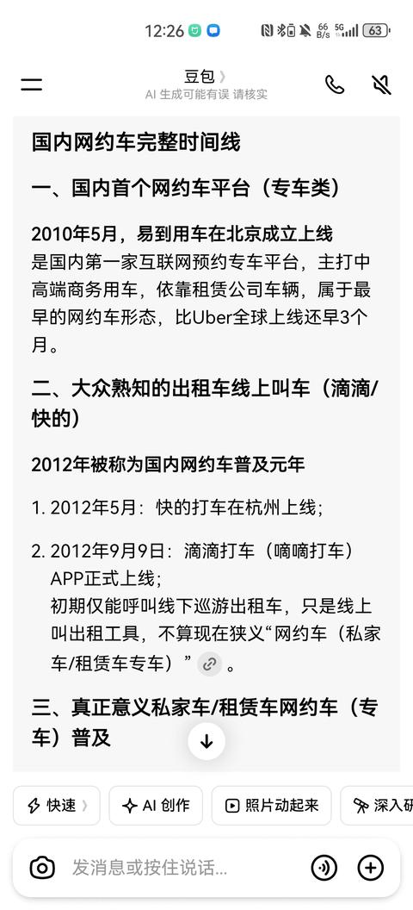

[toc]

# 问题

提问者：**<a href="https://www.zhihu.com/people/34-87-49-20-77">白云看海</a>**
提问时间: 2023-12-10 12:26:30
总回答数: 575
总访问量: 4349626

上个世纪，人类发现了相对论，并提出了量子物理的理论，特别是二战之后科学进展也挺快的。但是为什么最近几年没见过科学家有什么重大突破（足以写进物理课本的那种）？

难道人类已经把整个宇宙的最主要的自然法则都探索明白了吗？

# 回答

回答者： **<a href="https://www.zhihu.com/people/93-93-91-92-1">盐知</a>**
回答时间: 2026-3-29 15:57:48
点赞总数: 4523
评论总数: 983
收藏总数: 3629
喜欢总数：239

你回头看，现在的日子和10年前比，除了手机刷短视频更流畅了、快递第二天就能到、出门不用带现金了，并没有什么真正天翻地覆的变化。

但你再往前倒20年，从1992年到2012年，那日子真的是一年一个样，甚至几个月就有新东西冒出来，完全是两个世界。

我们就从衣食住行吃喝玩乐说起，你就知道这种差距有多夸张了。

先说说“衣”，1992年我们穿的是什么？是缝纫机上踩出来的的确良衬衫，是过年才能买一件的新外套，村里要是有人穿一件城里来的夹克，能被人围着看半天。

那时候买布还要布票，直到1984年四三方案全面落地了，布票才正式取消。一件衣服老大穿完老二穿，老二穿完老三穿，缝缝补补又三年，这就是1992年的真实写照。

到了2012年呢？淘宝、京东已经火起来了，快时尚品牌开满了全国的商场，你坐在家里点几下鼠标，全国各地的衣服都能送到家门口，一年四季的衣服换着穿，再也不用一件衣服穿好几年。

可到了2025年的今天，我们穿的衣服，和2012年比，有什么本质变化吗？无非是面料更舒服了一点，款式更新颖了一点，抖音直播带货让买衣服更方便了一点，拼夕夕把单价给打下去了，仅此而已。

但衣服是怎么织出来的？还是用1764年珍妮纺纱机就定下来的原理，把纤维纺成线，再织成布。

如果再往前退一步，西汉时期，我们的先民就发明了提花机，这个提花机还真就是运用了二进制原理，因此我们这个伟大的民族是人类历史上第一个发明了纺织机械的民族。

衣服是怎么染上色的？还是用19世纪就成熟的化工染料，底层逻辑根本就没变过。我们只是把几十年前就有的技术，做得更便宜、更普及了，没有任何新东西。

再说说“食”，1992年的冬天，北方人家家户户都要囤几百斤白菜、萝卜、土豆，整个冬天就靠这三样菜过活，想吃个西红柿、黄瓜，那是过年才有的奢侈品。

那时候买米买面还要不便宜，下馆子是天大的事，普通人一年也去不了几次，举办婚礼都是在家里请厨师，或者在大街上吃流水席，很少像现在这样预订酒店包间。

到了2012年呢？超市里一年四季的蔬菜水果应有尽有，不管是海南的芒果、新疆的葡萄，还是进口的车厘子、榴莲，随时都能买到。就连我们青岛一个典型的北方城市，居然成了北方最大的榴莲集散地，经常在菜市场碰到有卖的。

冷链物流已经普及了，全国各地的美食，三天就能送到你家门口，肯德基、麦当劳开满了县城，下馆子成了家常便饭。

可2025年的今天，我们吃的东西，和2012年比，有什么本质变化吗？无非是外卖更方便了，预制菜更多了，网红零食更新得更快了，而且预制菜是老美发明的，八十年代的美国人就经常吃预制菜，九十年代的日本牛马就尝尝才便利店吃个预制三明治对付一顿。

但我们吃的粮食，还是靠20世纪中期“绿色革命”就定下来的杂交育种、化肥农药技术，亩产从2012年到现在，只涨了不到10%。

我们吃的肉，还是靠规模化养殖，和2012年没有任何区别，甚至连食品添加剂，都是几十年前就发明出来的东西，卫龙辣条，还有魔芋爽，似乎已经陪伴了我们二十多年了。

我们只是把吃饭这件事，变得更省事了，但底层的农业技术、食品工业技术，没有任何范式上的突破。

再说说“住”，1992年的时候，绝大多数中国人住的是什么？是单位分的平房，是没有独立卫生间、没有暖气的筒子楼，一家三四口挤在十几平米的小房子里，夏天靠风扇，冬天靠煤炉。家里能有个黑白电视、洗衣机，就是妥妥的富裕人家了。

到了2012年呢？商品房已经普及了，电梯房、带卫生间暖气的小区成了主流，家里冰箱、彩电、空调、洗衣机一应俱全，装修也成了家家户户都要做的事。

可2025年的今天，我们住的房子，和2012年比，有什么本质变化吗？无非是房子更大了，装修更精致了，多了几个智能音箱、智能门锁、扫地机器人

可我们盖房子用的钢筋混凝土，是19世纪就发明出来的东西。我们用的电梯，是1852年就发明出来的。我们家里的水电暖系统，原理和100年前没有任何区别。

所谓的智能家居，只是把原来要手动按的开关，改成了用手机控制，底层的逻辑没有任何变化，连“懒人福音”扫地机器人，核心的吸尘原理，也是1901年就发明出来的。

最后说说“行”，1992年的时候，中国人出门靠什么？近路靠自行车，远路靠绿皮火车，从青岛到北京，绿皮车要晃十几个小时，硬座挤得连落脚的地方都没有。

那时候谁家有辆摩托车，就是村里的首富，汽车是只有领导和大老板才能坐的奢侈品，飞机更是绝大多数人一辈子都坐不上的东西，直到1993年民航局才放开了个人乘坐航空。

到了2012年呢？高铁已经通了，从青岛到北京3个小时就能到，平稳得能在桌子上立硬币。

私家车已经走进了普通家庭，家家户户都能买得起汽车，原本根本不存在停车难的问题，一下子看成了买车人心中的一大难题。

飞机票越来越便宜，出门坐飞机成了很平常的事。以至于高铁票价格和飞机票价格在部分线路上倒挂了。

可2025年的今天，我们的出行方式，和2012年比，有什么本质变化吗？

无非是高铁线路更多了，电动车普及了，机票更便宜了，但我们开的汽车，不管是燃油车还是电动车，底层原理都是19世纪就定下来的。

燃油车的内燃机，是1876年奥托发明的四冲程循环，到现在快150年了，我们只是把它做得更省油、更有劲了。

电动车的电动机，是1834年就发明出来的，电池还是100多年前就提出原理的锂电池，没有任何本质变化。

我们坐的高铁，核心的电力机车原理，20世纪初就有了。

我们坐的飞机，还是1903年莱特兄弟发明的固定翼飞机，靠航空煤油燃烧提供动力，和100年前没有任何区别，只是飞得更快、更稳、更安全了。

你看，我们天天挂在嘴边的衣食住行，这20年里，从1992到2012年，是从0到1的彻底改变，是从半农业社会直接跨进了现代社会。

可从2012年到今天，整整13年过去了，我们只是在原来的基础上，把事情做得更方便、更省事、更便宜了，没有任何一件事，是1992到2012年的人根本想象不到的、颠覆认知的新东西。

我当年在天涯论坛，第一次看到资水东流大佬写的《技术大停滞》，整个人都懵了。

那时候还是2010年左右，正是智能手机刚出来、互联网高速发展的时候，大家都觉得科技会永远加速发展，明天就会有更牛的东西出来，未来会像科幻电影里一样，有飞天汽车、有星际旅行、有人工智能管家。

结果资水东流直接一盆冷水浇下来，用最直白的话告诉所有人，别做梦了，人类的科技早就不是加速发展了，我们正在吃100年前那批科学大佬留下的老本，而且老本快吃完了，马上就要进入停滞期。

现在15年过去了，回头看，那篇帖子简直是开了天眼，他当年说的每一句话，几乎都变成了现实。

很多人会抬杠，说你这完全是胡说八道，现在手机芯片都3纳米了，AI大模型都能写代码画画了，新能源汽车满街跑，火箭都能回收了，怎么就停滞了？

这里我必须先给大家掰扯清楚一个事，也是整篇文章最核心的概念——我们说的停滞，不是技术没进步，是范式革命没了。技术仍然在日新月异的推进，但是底层的科技树和科学理论，一直是“突而不破”。

什么叫范式革命？就是把你做一件事的底层逻辑，彻底掀翻，重新建一套规则，直接把这件事的天花板，往上抬好几个量级。

我给你举个最简单的例子，比如你要从北京去广州，一开始你靠两条腿走，一天走30公里，要走两个多月。

后来你学会了骑马，一天能走100公里，20天就能到。

再后来你坐马车，一天能走150公里，十几天就能到。

从走路到骑马到坐马车，速度越来越快，越来越省事，这叫什么？这叫技术优化，是在“靠动物或者人力在地面上移动”这个底层逻辑里，不断优化，不断提速。但它永远也跳不出这个框架，你再快的马车，也不可能一天跑1000公里，更不可能飞起来。

那什么叫范式革命？就是你直接不搞马车了，发明了火车，一天能跑1000多公里，从北京到广州一天就到了。后来你又发明了飞机，两个小时就到了。

这就叫范式革命——它直接把“靠人力畜力在地面移动”的底层逻辑给掀翻了，换了一套全新的规则，直接把你能到达的速度、能去到的地方，抬到了之前根本想象不到的高度。

再给你举个例子，一开始你用算盘，练得再熟练，一天最多算1000笔账，这是你的天花板。

后来你用手摇计算器，一天能算1万笔账，速度快了10倍，但这还是技术优化，因为它还是靠齿轮转动来算数，底层逻辑和算盘没有本质区别，还是靠机械运动。

那什么叫范式革命？就是你直接不用机械计算器了，发明了电子计算器，一秒钟就能算几万笔账，甚至后来发明了计算机，能算海量的数据，这就叫范式革命。

它直接把“靠机械运动算数”的底层逻辑掀翻了，用电信号来运算，直接把计算能力的天花板，抬到了之前想都不敢想的高度。

我们说的范式革命，从来不是“在原来的赛道上跑得更快”，而是直接换一条全新的赛道，打开一个全新的维度。它带来的变化，是颠覆世界观的，是能改写整个人类文明进程的。

捋一捋会发现，人类文明这几千年，真正能称得上范式革命的，其实就那么几次，每一次都把人类文明抬上了一个全新的台阶。

第一次范式革命，是一万年前的农业革命。

在这之前，人类是采集狩猎部落，天天跟着动物跑，吃了上顿没下顿，一个部落几十个人就顶天了，稍微遇到点天灾人祸，整个部落就没了。

农业革命之后，人类学会了种粮食、养牲畜，能把太阳能固定成粮食里的化学能，能定居下来，有了剩余的粮食。

剩余粮食有多重要？它意味着你不用所有人都去种地了，能养活不干活的人——比如专门研究天文历法的人，专门研究打铁造工具的人，专门管理部落的人，专门写字记录的人。

有了这些人，才有了文字，有了城市，有了国家，有了文化，有了科学的萌芽。

这就是范式革命的力量，它直接把人类从“动物一样的生存”，变成了“文明的发展”，整个底层逻辑全变了。

第二次范式革命，是300多年前的科学革命，也就是牛顿经典力学的建立。

在这之前，人类对世界的认知是什么样的？是靠经验，靠迷信，靠神话。

打雷下雨，是雷公电母发怒了。人生病了，是鬼神附体了。太阳绕着地球转，是天经地义的。物体为什么会掉在地上，是因为它“就该待在地上”。

那时候人类造桥、盖房子、造工具，全靠代代相传的经验，经常桥盖到一半塌了，房子建起来倒了，根本不知道为什么。

牛顿和那一批科学家，干了一件什么事？他们告诉全人类，这个世界不是混乱的，不是神说了算的，它是有规律的，而且这些规律是可以被我们发现、被我们用数学公式写出来、被我们利用的。

牛顿的三大运动定律、万有引力定律，用几个简单的公式，就把天上的行星、地上的石头，所有物体的运动规律，全给说明白了。

从这之后，人类造桥，能精准算出桥的每一个部位要承受多大的力，用多少材料，绝对不会塌。

人类造炮弹，能精准算出炮弹能飞多远，落在哪里，百发百中。

人类能预测日食月食，能算出行星的运行轨迹，再也不用靠神话解释世界了。

这就是范式革命，它直接把人类的世界观给掀翻了，让人类第一次从“靠经验蒙着干”，变成了“靠科学规律有计划地干”。

我们现在所有的工业、所有的工程、所有的技术，底层的基础，还是300多年前牛顿建立的经典物理体系，没有这次科学革命，就没有后来的一切。

第三次范式革命，是250年前的工业革命，也就是蒸汽机的发明和普及。

在这之前，人类能用到的动力，只有人力、畜力、风力、水力。

你想磨面，要么靠人推磨，要么靠牛拉，要么建在河边靠水流冲，没有河的地方，就只能靠人力畜力。

你想出门，要么走路，要么骑马，要么坐马车，速度快不了，也拉不了太重的东西。

那时候的工厂，只能建在河边，靠水力驱动，没有河就办不了厂，生产规模根本上不去。

蒸汽机的发明，让人类第一次能随时随地，获得巨大的、稳定的动力。它靠烧煤把水烧开，用蒸汽推动活塞运动，把化学能变成动能，不用靠河，不用靠风，不用靠牛，只要有煤，就能有源源不断的动力。

从这之后，工厂不用建在河边了，能集中在城市里，大规模生产，生产力直接翻了几百倍。

火车、轮船被发明出来了，人类能拉着几千吨的货物，一天跑上千公里，整个世界的连接方式全变了。

这就是范式革命，它直接把人类从“靠自然给动力”的农耕文明，拉进了“靠自己造动力”的工业文明，人类的生产力，在之后的100年里，比之前几千年的总和还要多。

在这里给大家插一个反直觉的科普，我们人类到现在，还没跳出这次工业革命定下的底层逻辑。

我们现在家里用的电，90%以上，还是靠烧开水发出来的——火电是烧煤烧开水，核电是用核裂变的热量烧开水，甚至大部分生物质能发电、光热发电，还是烧开水。

1776年瓦特改良蒸汽机，靠的是烧开水产生动力。

2025年的今天，我们人类最核心的能源获取方式，还是烧开水，250年了，底层逻辑半毛钱都没变，你说离谱不离谱？

第四次范式革命，就是100多年前，相对论和量子力学的建立，也就是现代物理革命。

在这之前，人类觉得牛顿力学已经把世界的规律全搞明白了，整个宇宙就像一个精密的钟表，只要知道所有零件的初始状态，就能算出它未来的一切。

那时候人类觉得，时间是绝对的，一秒就是一秒，不管你在天上还是地上，不管你跑得多快，时间都是一样的。

空间是绝对的，就像一个固定的盒子，所有东西都在这个盒子里运动，世界是确定的，因果律是绝对的，只要条件足够，就能预测一切。

爱因斯坦和那一批量子力学的科学家，又一次把人类的世界观彻底掀翻了。爱因斯坦的相对论告诉我们，

时间和空间不是分开的，是一体的，叫时空。

引力不是一种力，是时空的弯曲，质量越大的物体，把时空弯得越厉害，地球绕着太阳转，不是太阳拉着地球，是太阳把时空弯了，地球在弯曲的时空里走直线。

时间不是绝对的，速度越快，时间越慢，引力越强，时间越慢。

我给大家举个生活里的例子，你手机里的GPS导航，就是靠相对论修正的。

GPS卫星在天上飞，速度比地面快，引力比地面小，所以卫星上的时间，每天会比地面快38微秒。

你别小看这38微秒，如果不修正，导航每天会偏10公里，你想去王府井，它能给你导到通州去。

你看，100多年前爱因斯坦提出的相对论，现在每天都在你手机里用着，这就是范式革命的力量。

量子力学更夸张，它告诉我们，微观世界的规律，和宏观世界完全不一样。

微观粒子不是确定的，是叠加态的，它可以同时在两个地方，同时既是粒子又是波。

你不观测它的时候，它什么都不是，你一观测它，它就坍缩成一个确定的状态。

甚至两个纠缠的粒子，不管隔多远，一个变了，另一个瞬间就会跟着变，比光速还快。

很多人觉得量子力学是玄学，离我们很远，其实不是，你手里的手机、电脑，里面的芯片，就是靠量子力学造出来的。没有量子力学，我们就搞不懂半导体的原理，就造不出晶体管，就没有集成电路，更没有现在的智能手机、计算机。

我们现在整个信息时代，底层的基础，就是100多年前建立的量子力学。

这就是范式革命，它直接把人类对宇宙的认知，拓展到了之前根本想象不到的领域，让人类能利用原子核的能量，能造出半导体、计算机，能把人送上月球，能看到百亿光年外的星系。

我们再回头看，从相对论和量子力学建立到现在，100多年过去了，人类有没有发生过新的范式革命？答案是，一次都没有。

我们现在所有的技术，所有的产业，所有的生活，全都是在吃这四次范式革命，尤其是最后两次现代物理革命的老本。

我们只是把100多年前那些科学大佬打下的地基，拿来盖房子、搞装修、加楼层，从来没有重新打一个新的地基，更没有换一块新的地皮。

我给大家举个你每天都在用的例子，就是你手里的手机。很多人觉得手机是高科技，每年都在更新换代，越来越牛，其实你手机里的每一个部件，底层原理全都是1960年之前就搞出来的，没有任何新东西。

先说说手机的核心，芯片。芯片的本质是在半导体硅片上，刻出几十亿个晶体管，靠晶体管的通断，来表示0和1，进行逻辑运算。

半导体的原理，是1930年代量子力学里就搞明白的，晶体管是1947年贝尔实验室发明的，集成电路是1958年发明的。

现在的3纳米芯片，只是把晶体管做得更小了，在同样大的硅片上，能刻更多的晶体管，算力更强了，但底层的逻辑，还是靠晶体管的通断表示0和1，还是1940年代就定下来的原理，没有任何本质变化。

很多人说摩尔定律，说芯片每18个月算力翻一倍，体积会缩小一倍，其实摩尔定律从2012年就已经走到头了，现在的3纳米芯片，已经接近硅原子的物理极限了，再往下做，量子隧穿效应就会让晶体管失效，根本做不下去了。我们已经把这条赛道的潜力，几乎挖干了。

再看看手机的屏幕，不管是LCD还是OLED，底层原理都是几十年前的。

LCD屏幕是1968年美国无线电公司发明的，靠背光板照液晶，通过液晶的偏转控制透光，显示颜色，到现在50多年了，我们只是把它做得更薄、分辨率更高、刷新率更快了，底层原理没变。

OLED屏幕就更不用说了，1987年中国香港的邓青云博士发明的，靠有机材料自己发光，到现在快40年了，现在的折叠屏、曲面屏，只是把它做得更软、能弯折了，发光原理半毛钱都没变。

手机的摄像头，CMOS传感器是1969年美国贝尔实验室发明的，靠光电效应把光信号变成电信号，光电效应是爱因斯坦1905年就解释清楚的，拿了诺贝尔奖。

镜头的光学原理，是几百年前牛顿、惠更斯就搞明白的几何光学。

现在的手机摄像头，1亿像素、10倍光学变焦、夜景模式，只是把传感器的像素做高了，镜头做得更好了，算法优化得更牛了，底层的光电转换、光学成像原理，和几十年前没有任何区别。

还有手机里的锂电池，更是吃老本的典型。锂电池的核心原理，是锂离子在正负极之间来回移动，充电的时候跑到负极，放电的时候跑到正极，这个原理是1912年美国化学家吉尔伯特·路易斯提出来的，到现在100多年了。

1991年索尼就做出了第一块商用锂电池，用到了手机上。从1991年到现在，30多年过去了，锂电池的能量密度，从当年的80Wh/kg，涨到了现在的300Wh/kg，30年只涨了3倍多，还是在原来的框架里，只是把正极负极的材料改了改，电解液优化了一下，没有任何底层的突破。

我们天天吐槽的手机续航焦虑，本质上就是锂电池技术已经摸到天花板了，没有范式革命，根本解决不了。

甚至连手机的通信功能，2G、3G、4G、5G，底层的原理还是电磁波通信，是麦克斯韦1864年就预言了，赫兹1887年就实验验证了的，到现在100多年了。

我们只是把电磁波的频率提得更高了，带宽更大了，传输速度更快了，但底层的无线通信原理，半毛钱都没变。

你天天捧在手里的、觉得最能代表科技进步的智能手机，全身上下，没有一个部件的底层原理，是近50年里新发现的。

我们只是把100多年前的科学原理，做得越来越小、越来越便宜、越来越普及，没有任何范式上的突破。

除了手机，我们再说说大家天天都在接触的电力。人类用了250年，还是没跳出烧开水发电的圈子，很多人不服，说我们有风电、光伏、水电，这些不是烧开水。

电到底是怎么来的？你可以拿一块磁铁，拿一个线圈，把磁铁在线圈里来回插，用万用表一测，线圈两端就会有电。

如果把线圈接在一个小灯泡上，磁铁插得够快，灯泡还会亮。这就是电磁感应现象，是英国科学家法拉第1831年发现的，到现在190多年了。

这个现象的原理很简单：闭合的线圈，在磁场里做切割磁感线的运动，线圈里就会产生感应电流。

其实我们人类现在所有的发电方式，除了光伏，全都是靠这个原理，全都是想办法让线圈在磁场里转，切割磁感线发电。怎么让线圈转？方法不一样而已。

水电，是靠水流从高处冲下来，推着水轮机转，水轮机带着线圈在磁场里转，发电。

风电，是靠风吹着风车的叶片转，叶片带着线圈在磁场里转，发电。

火电，是烧煤把水烧开，产生高温高压的蒸汽，蒸汽吹着汽轮机转，汽轮机带着线圈在磁场里转，发电。

核电，是用铀原子核裂变产生的热量，把水烧开，产生高温高压的蒸汽，蒸汽吹着汽轮机转，汽轮机带着线圈在磁场里转，发电。

甚至连生物质能发电、地热发电、光热发电，全都是一个路子——想办法烧开水，用蒸汽吹汽轮机，带着线圈转，切割磁感线发电。

除了光伏，所有的发电方式，底层的电磁感应原理，190多年前就定下来了，没有任何变化。

火电和核电，除了烧的东西不一样，一个烧煤，一个烧铀，其他的流程几乎一模一样，都是烧开水，用蒸汽吹汽轮机发电。

很多人觉得核电是高科技，是未来能源，其实它和250年前的瓦特蒸汽机，底层逻辑都是“烧开水产生动力”，只是烧的燃料不一样而已，没有任何范式上的突破。

那光伏呢？很多人说光伏是新能源，是新突破，倒也不完全是。

光伏的原理是光电效应，就是光照射到半导体材料上，会产生电流，这个现象是1839年法国科学家贝克勒尔发现的，爱因斯坦1905年用量子力学把它解释清楚了，拿了诺贝尔奖。

1954年，美国贝尔实验室就做出了第一块商用太阳能电池，光电转换效率6%，到现在70年过去了，我们现在最先进的晶硅太阳能电池，转换效率也就26%，70年只涨了4倍多，还是在原来的光电效应原理里打转，没有任何底层的突破。

人类文明最核心的能源获取方式，190多年了，底层原理没有任何变化，我们只是把发电的效率提得更高了，规模做得更大了，没有任何范式革命。

这也是为什么资水东流当年在《技术大停滞》里说，能源技术是人类科技树的根，根不往上长，上面的树枝树叶再茂盛，也只是昙花一现，很快就会停滞。

还有航空航天，更是科技停滞的重灾区。1969年，美国人就把阿姆斯特朗送上了月球，那时候的计算机，算力还不如你现在手里的计算器，整个阿波罗计划用的计算机，内存只有64KB，还不如你现在一个Word文档大。

现在2025年了，56年过去了，我们人类最远还是只到过月球，连载人去火星都还没影，甚至连能重复登月的火箭，都造不出来了。

很多人说SpaceX的可回收火箭很牛，确实牛，它把火箭发射的成本降了一个量级，让人类能更便宜地进入太空，但它用的还是化学燃料火箭，底层原理和二战时候德国的V2火箭一模一样，都是靠燃料燃烧向后喷气，产生反推力前进，没有任何范式上的突破。

化学燃料火箭的天花板有多低？我给大家算一笔账吧。

化学燃料的能量密度是固定的，火箭要飞出地球，要达到第一宇宙速度7.9公里每秒，需要的燃料是固定的。现在最先进的猎鹰重型火箭，近地轨道的运载能力是63.8吨，火箭本身的重量是1420吨，燃料就占了1300多吨，也就是说，90%以上的重量都是燃料，只有不到5%的重量是有效载荷。

你想送1吨东西到火星，需要几百吨的燃料，成本高得吓人。更别说飞出太阳系了，旅行者1号飞了40多年，才飞了200多亿公里，飞出太阳系需要几万年，根本不可能。

资水东流当年就说过，如果不跳出化学燃料的范式，人类永远都被锁死在太阳系里，连火星都很难大规模移民，更别说星际旅行了。

可56年过去了，我们还是在化学燃料的圈子里打转，没有任何新的突破，可控核聚变火箭、曲率引擎、反物质引擎，都还停留在科幻小说里，连理论基础都没搞明白。

医疗领域也是一样，你觉得现在医疗很发达，能做心脏支架、能换器官、能做基因检测，但你仔细想想，那些真正要命的病，比如大部分癌症、阿尔茨海默症、渐冻症、帕金森，我们还是没法治，甚至连发病的根本原因都没搞明白。

抗生素是1928年青霉素发明之后，迎来了一波大爆发，拯救了几十亿人的生命，可最近几十年，没有任何一个新的抗生素大类被发明出来，反而是我们滥用抗生素，导致超级细菌越来越多，我们快无药可用了。

就连这次新冠疫情里大放异彩的mRNA疫苗，它的底层理论也是六十年代就提出来的，科学家发现mRNA能指导细胞合成蛋白质，能用来做疫苗。

从理论提出到疫苗商用，我们花了60年，只是把一个几十年前就有的理论，变成了能用的产品，还是在吃老本，没有任何范式上的突破。

我们现在的医疗，能治的病，大部分都是靠自身免疫力能自愈的，真正治不好的绝症，我们还是束手无策，和几十年前相比，没有本质变化。

说到这里，肯定有很多人要反驳我了，“你说了这么多，那现在火得一塌糊涂的AI大模型，总算是范式革命了吧？AI都能写代码、画画、做视频、给人看病打官司了，连白领的饭碗都要被砸完了，这还不算范式革命？你对范式革命的要求也太高了吧？

别急，今天我就给大家把这个事掰得明明白白，为什么哪怕AI把全人类90%的办公室工作都取代了，它也算不上真正的范式革命，甚至连信息技术主赛道的“正统延伸”都算不上，只能算是信息革命这棵大树上，分出来的一条岔枝的末端开花。

首先，得先回头看，信息技术真正的范式革命，到底发生在什么时候？不是互联网出现，不是智能手机普及，而是1943年冯·诺依曼架构被提出，1946年世界上第一台电子计算机诞生，1950年晶体管被发明。这才是真正掀翻桌子的范式革命！

为什么？因为在这之前，人类处理信息的方式，几千年来都没有变过。靠人脑运算，靠纸笔、竹简记录，靠口耳、书信传递，靠算盘、算筹辅助。

你哪怕是牛顿、爱因斯坦这种级别的天才，算个复杂的微分方程，也要在纸上写满几十页，算上好几天。

你哪怕是富可敌国的商人，要给全国的分号传个消息，也要快马加鞭跑上十几天。

而电子计算机的出现，彻底把这个底层逻辑给掀翻了。人类第一次拥有了“不靠人脑，用电路就能做逻辑运算、海量存储、高速传输信息”的能力。

这就像之前人类出门只能靠两条腿、靠马车，突然发明了火车、飞机，整个出行的底层逻辑全变了。这才是真正的范式革命，它直接给人类文明打开了一个全新的维度。

那从那之后，信息技术的“主路延伸”是什么？是沿着“提升人类处理、存储、传输信息的效率”这条核心主线，一路往前跑。

从电子管到晶体管，再到集成电路、3纳米芯片，是让信息运算的速度越来越快。

从打孔卡到磁带、硬盘、固态硬盘，是让信息存储的容量越来越大、越来越方便。

从电话线拨号到光纤、5G、6G，是让信息传输的速度越来越快、距离越来越远。

从大型机到个人电脑、笔记本、智能手机，是让信息处理的工具，从只有军方、大企业能用得起的大家伙，变成了人人都能揣在兜里的日用品。

从局域网到互联网、移动互联网，是让全人类的信息能瞬间互通，彻底打破了空间的壁垒。

这70多年里，所有真正改变了我们生活的信息技术突破，全都是沿着这条主路走的——

让人类处理信息的效率，不断突破上限，不断降低门槛。每一步都是对四十年代那个范式地基的加固、延伸、拓宽，从来没有偏离过主线。

那现在火得一塌糊涂的AI大模型，是什么？它根本没有沿着这条主路往前走，它拐进了一条岔路。

它的核心目标，不是“提升人类处理信息的效率”，而是模仿人类的脑力劳动，把人类需要动脑做的事，给自动化、批量化了。

比如你是一个文案策划，10年前你写一篇产品文案，要先查资料、想创意、在Word里敲出来、改个三五遍，最后发给客户，整个过程要花一下午。

现在你用AI大模型，输入产品卖点、风格要求，10秒钟就能给你生成10篇文案，你挑一篇改改就能用，效率提升了几百倍。

但你想想，这件事的底层逻辑变了吗？没有。它还是“用电脑处理文字信息，生成一篇符合要求的文案”，和你自己坐在电脑前用Word写，本质上没有任何区别。

就像30年前你用手写稿子，20年前你用打字机打，10年前你用电脑敲，现在AI帮你自动生成——速度越来越快，越来越省事，但它还是“生成一篇文案”这件事，没有改变信息处理的底层逻辑，没有给人类打开任何新的维度。

它唯一的变化，是把“你要自己动脑想、自己动手敲”这件事，给自动化了。它没有提升信息处理的核心效率，只是把人类的脑力劳动给替代了。

这就像之前你自己在家手洗衣服，后来发明了半自动洗衣机，你要加水、漂洗、脱水，现在发明了全自动洗衣机，一键搞定，你连手都不用伸了。

确实省事了，解放了你的双手，但洗衣服的底层逻辑还是“用水+洗涤剂把衣服上的脏东西洗掉”，没有任何本质的变化，你总不能说全自动洗衣机是范式革命吧？

再举个更直白的例子，AI就像一个超级厉害的模仿者。你给它喂了全世界所有的唐诗宋词，它能给你写出和李白、杜甫风格一模一样的诗，甚至比很多人写得还好，但它永远也成不了李白、杜甫。

因为李白、杜甫的诗，是创造了全新的风格、全新的意境、全新的表达方式，是范式级的突破。

AI只是把已经有的唐诗宋词，拆解、重组、拟合，写出看起来很像的东西，它永远也创造不出全新的诗歌风格，永远也写不出“床前明月光，疑是地上霜”这种前无古人的句子。

更关键的是，AI不仅不是范式革命，它甚至连“突破现有框架”的能力都没有。

现在很多人吹，AI能帮我们搞科研，能加速科学突破，能带来科技奇点，这完全是把AI神化了。

实际上AI永远也带不来基础科学的范式革命，因为它从根上，就跳不出人类给它划定的认知框架。

现在的AI大模型，本质上是什么？是一个超级庞大的“统计拟合机器”。

你给它喂几十万亿个词的人类文本、图片、视频数据，它用算法统计出，哪些词和哪些词连在一起，符合人类的语言习惯。

哪些像素和哪些像素拼在一起，是人类眼里的好看的图片。

哪些逻辑和哪些逻辑组合在一起，能解决人类提出的问题。

它所有的输出，都是对人类已经有的知识、数据、逻辑的整合、模仿、优化，它永远也创造不出人类认知范围之外的东西。

1905年，爱因斯坦提出狭义相对论的时候，全人类都觉得时间是绝对的，一秒就是一秒，全宇宙都一样，这是刻在所有人骨子里的常识。

爱因斯坦的狭义相对论，完全是反常识、反直觉、反当时所有的人类认知的，它彻底颠覆了人类对时间和空间的理解，这就是范式革命。

但你把1905年之前所有的物理文献、天文数据全喂给AI，它能算出更精准的行星轨道，能拟合出更完美的运动曲线，但它永远也提不出“光速不变、时间膨胀”这种反常识的理论，因为它的训练数据里，根本没有这种东西，它跳不出人类已经有的认知框架。

同样的，你把所有的牛顿之前的天文数据喂给AI，它算不出万有引力，

你把所有的黑体辐射数据喂给AI，它提不出量子假说，

你把现在所有的暗物质观测数据喂给AI，它也搞不懂暗物质到底是什么。

因为范式革命的核心，就是“打破之前的所有规则，提出一个完全反常识的新框架”，而AI的所有能力，都建立在“之前的规则”之上，它天生就没有打破规则的能力。

我再给你打个比方，AI就像一个超级厉害的厨师，你给它喂了全世界所有的菜谱，它能把各种菜的做法组合起来，做出你想要的任何口味的菜，甚至能做出看起来很新的菜，但它永远也发明不出“炒菜”这种烹饪方式，永远也发明不出“发酵”这种技术。

因为它的所有操作，都建立在人类已经有的菜谱之上，它跳不出这个框架。而范式革命，就是发明“炒菜”、发明“发酵”这种前无古人的东西，这是AI永远也做不到的。

肯定还有人不服，会反驳我说“就算AI带不来基础科学的突破，它能取代人类的工作，能改变整个社会的结构，能让生产力翻好几倍，这还不算范式革命？”

那我再给你戳破一个更反直觉的事实——能改变社会结构、能抢饭碗的，从来都不一定是范式革命。

范式革命的核心，从来不是“在现有的文明边界里，重新分配工作岗位、重新划分利益蛋糕”，而是把人类文明的整个边界，往上抬一个大台阶，拓展到之前根本想象不到的地方。

18世纪缝纫机发明的时候，整个欧洲的手工裁缝，90%都丢了饭碗，纺织行业天翻地覆，社会结构都变了，这算不算范式革命？

不算，因为它还是用针和线缝衣服，只是从手工变成了机器，底层逻辑没变，只是效率提升了。

20世纪初福特流水线发明的时候，整个汽车行业、整个工业体系都被颠覆了，大量的手工工人被取代，工业生产的效率翻了几十倍，这算不算范式革命？

不算，因为它还是用之前的机器、之前的技术，只是优化了生产组织方式，底层逻辑没变。

甚至2020年之后，电商崛起的时候，全国几百万线下实体店倒闭，零售行业天翻地覆，连我们买东西的习惯都彻底变了，这算不算范式革命？

还是不算，因为它还是“一手交钱一手交货”的商业逻辑，只是把交易场景从线下搬到了线上，底层的商业规则、货币逻辑，半毛钱都没变。

这些能抢饭碗、能改变行业结构、能提升效率的东西，都算不上范式革命，AI也是一样的。

它能取代文案、插画师、客服、初级程序员、甚至初级的医生、律师，它能让整个就业结构天翻地覆，能让很多人丢了饭碗，但它没有给人类文明打开任何新的边界，没有提升人类文明的天花板。

AI再牛，它也不能让人类摆脱对化石能源的依赖，不能让我们走出地球，不能搞懂宇宙的本质，它只能在人类已经画好的圈子里，把事情做得更快、更省事而已。

更有意思的是，为什么2012年之后，全人类突然就开始疯狂卷AI了？其实恰恰印证了我们之前说的，全人类的科技，在2012年前后，集体卡在了停止线上。

因为其他所有的硬科技赛道，基础物理、能源、新材料、航空航天，全都摸到了天花板，投进去几百上千亿，连个响都听不到，几十年都看不到突破的希望。

只有信息技术这个赛道，还有最后一点果子可以摘，还有最后一点潜力可以挖，就是AI。

于是全人类的资本、人才，疯了一样往AI赛道里涌。

不是因为AI能带来什么范式革命，而是因为其他赛道都走不通了，只有这个赛道，投进去钱，还能看到水花，还能快速变现，还能讲故事、炒股价。

这就像一群人在果园里摘果子，伸手能摘的、踮脚能摘的，全摘完了，树顶的果子够不到，搭梯子又太贵，所有人都挤在树底下，抢掉在地上的最后几个烂果子，还抢得热火朝天，觉得自己捡到了宝。

说了这么多，大家肯定要问了，那到底什么样的突破，才配得上叫“范式革命”？只有能源、新材料、基础物理的突破，才是真正能改变人类命运的范式革命。

我给你举几个实实在在的例子，你对比一下AI，就知道差距有多大了。

第一个，就是能源领域的范式革命——可控核聚变的商用落地。

人类用了250年，到现在还是没跳出“烧开水发电”的圈子。

火电烧煤，核电烧铀，都是靠烧东西产生热量，把水烧开，用蒸汽推着汽轮机转，发电。

哪怕是现在火得不行的光伏、风电、水电，也只是把自然界的能量转化成电能，本质上还是在地球现有的能量圈子里打转。这些东西，都是现有范式里的优化，算不上革命。

而可控核聚变，是彻底把人类获取能源的底层逻辑给掀翻了。

核聚变到底是什么？我们现在的核电站，用的是核裂变，就是把重的铀原子核，拆成两个轻的原子核，释放出能量。

而核聚变，是把两个轻的原子核，比如氢的同位素氘和氚，聚合成一个重的原子核，这个过程会释放出比核裂变大得多的能量。

太阳发光发热，靠的就是核聚变，我们地球上所有的能量，本质上都来自太阳的核聚变。

那可控核聚变牛在哪里？首先，它的燃料取之不尽用之不竭。

核聚变用的氘，在海水里就有，一升海水里的氘，完全聚变产生的能量，相当于300升汽油。地球上的海水有多少？13.5亿立方公里，里面的氘，够全人类用上几百亿年，比太阳的寿命都长。

也就是说，只要可控核聚变实现了，人类就永远不用愁能源了，能源变成了无限的、几乎免费的东西。

其次，它绝对安全，没有污染。核裂变会产生大量的放射性核废料，半衰期几万年，处理起来极其麻烦，还会发生切尔诺贝利、福岛这种核泄漏事故。

而核聚变不一样，它的反应过程极其苛刻，需要在上亿度的高温下，才能发生聚变，只要出一点故障，温度一降，反应立刻就停了，绝对不会发生泄漏，更不会有核爆炸。

而且它的产物是氦，没有任何放射性，完全无污染，是真正的清洁能源。

这意味着什么？意味着人类的能源，从“有限的、昂贵的、有污染的”，直接变成了“无限的、几乎免费的、绝对清洁的”。

这才是真正的范式革命，它给人类文明打开的边界，是AI连边都摸不到的。

如果能源免费了，首先，海水淡化不要钱了，我们能把太平洋的水，源源不断地淡化了运到塔克拉玛干沙漠，把全世界的沙漠，全都变成绿洲，耕地面积能翻几十倍，粮食产量能翻上百倍，全人类再也不会有饥荒，再也不会有人饿肚子。

其次，工业生产的成本会降到地板价，所有的工业品，小到一颗螺丝钉，大到汽车、飞机，成本里最大的一块就是能源，能源免费了，这些东西的价格会降到几乎白送，全人类的物质生活水平，会直接提升几个量级。

更重要的是，它能彻底解开人类身上的枷锁。现在我们人类为什么被锁死在太阳系里？

因为航天发射的成本太高了，送一公斤东西到近地轨道，要花几万美元，去一次火星，要花几百亿美元。

能源免费了，我们就能造超大推力的火箭，随便造、随便发，去月球建基地，去火星建城市，去小行星采矿，人类能真正走出地球，从地球文明，变成星际文明。

你对比一下，AI能做到这些吗？AI能帮你写文案，能帮你画插画，但它不能让全人类再也没有饥荒，不能让人类走出地球，不能把人类文明的天花板，往上抬哪怕一毫米。

这就是技术优化和范式革命的区别，一个是在现有的池子里扑腾，一个是直接给你挖了一片大海。

第二个，就是新材料领域的范式革命，比如室温常压超导体的大规模商用。

很多人对超导没概念，我给你说人话：超导，就是电阻为零的材料。我们现在用的电线、芯片、电机，都有电阻，电流通过的时候，会有损耗，会发热。

我们国家的电网，每年光是输电过程中的损耗，就有上千亿度电，够几个省用一年

我们的手机、电脑，最大的瓶颈就是散热，芯片算力再强，一发热就降频；我们的高铁，最快只能跑到350公里每小时，再快成本就扛不住了。

如果室温常压超导体真的实现了，而且能大规模商用，会发生什么？

首先，所有的电力传输，再也没有损耗了，上千亿度电全给你省下来，电价直接降到地板价。

其次，所有的电子设备，再也不需要散热了，芯片的算力能翻几百倍，我们现在用的手机，算力能超过现在的超级计算机。

然后，磁悬浮列车能铺满全国，从广州到北京，1个小时就能到，票价和现在的绿皮车一样，我们的出行方式会彻底改变。

甚至，可控核聚变最难的“等离子体约束”问题，用超导材料一下子就能解决一大半，直接加速能源革命的到来。

这种从底层改变整个工业体系、交通体系、能源体系的突破，才是真正的范式革命。

它带来的变化，是从根上改变了我们的生活环境，而不是像AI一样，只是让你在现有的环境里，过得更省事一点。

第三个，就是基础物理的范式突破，比如量子力学和广义相对论的统一，也就是量子引力理论的突破。

我们现在的物理世界，有两套完全矛盾的规则，一套是广义相对论，管宏观的宇宙，恒星、星系、黑洞、时空弯曲，全靠它解释。一套是量子力学，管微观的世界，原子、电子、夸克、基本粒子，全靠它解释。

这两套理论，在各自的领域里都精准无比，放在一起，就完全矛盾，根本没法兼容。

黑洞内部、宇宙大爆炸的奇点，都是既宏观又微观的地方，这两套理论全失效了，我们完全搞不懂里面是什么。

这就像我们人类，活在一个两层的房子里，一楼的规则是“只能走路”，二楼的规则是“只能飞”，我们在一楼和二楼都活得好好的，但我们根本不知道，这两层楼是怎么连在一起的，楼梯在哪里，房子的地基是什么样的。

如果我们能搞出量子引力理论，把这两套规则统一起来，就意味着我们真正搞懂了宇宙的底层规则，搞懂了时空的本质，搞懂了引力到底是什么。

这会带来什么？我们可能会搞懂暗物质、暗能量到底是什么，解开宇宙里95%的未知。

我们可能会实现真正的超光速通信，甚至超光速飞行，用曲率引擎飞出太阳系，飞出银河系。

我们可能会搞懂时空的本质，实现时间旅行，或者打开平行宇宙的大门；我们甚至可能会搞懂，意识到底是什么，生命的本质是什么。

这种对人类世界观、对文明边界的颠覆，是任何技术优化都比不了的。

AI再发展100年，它也只能在我们现在的物理规则里打转，而基础物理的范式革命，能直接给人类打开一个全新的宇宙。

说到这里，大家肯定要问了，既然这些范式革命这么重要，为什么我们搞不出来？为什么从2012年开始，不管是美国、欧洲、中国，之前发展得快的慢的，全都卡在了同一条停止线上，再也没有往前迈一步？

这里面有四个最核心的原因，每一个都扎心无比，而且全都是我们现在正在面对的现实。

第一个原因，也是最根本的原因。20世纪那个科技富矿里，容易摘的果子，已经全摘完了。

资水东流当年在《技术大停滞》里，打了一个特别形象的比方，我到现在都记得清清楚楚。

他说，科学就像一棵果树，范式革命就是长出了新的主树干，比如经典物理、相对论、量子力学，都是主树干。

主树干上会长出很多树枝，比如无线电、半导体、计算机、核能、航空航天，树枝上会长出很多果子，就是我们现在用的各种技术。

20世纪，我们把主树干上的果子，从下到上，全摘完了。

一开始的果子伸手就能摘，比如无线电、飞机、青霉素、核能，只要顺着主树干的理论，稍微研究一下，就能搞出来，就能改变世界。

后来的果子要踮脚摘，比如互联网、智能手机、高铁，需要把之前的技术整合、优化，才能搞出来。

到了2012年前后，伸手能摘、踮脚能摘的果子，全摘完了，剩下的果子都长在树顶，要搭几十米高的梯子才能够到，甚至梯子都没法搭，全人类都掏不起这个钱了。

就拿基础物理来说，我们现在的标准模型，已经把61种基本粒子全找到了，能解释我们能看到的几乎所有物理现象，剩下的暗物质、暗能量、量子引力，都在树顶，要摸到它们，需要的能量是我们现在最大的加速器的10万亿倍，相当于要造一个绕地球一圈的加速器，哪个国家掏得起这个钱？

就算掏得起，造出来了，也大概率什么都发现不了，这种高投入、低回报的事，没有哪个国家愿意干。

第二个原因，现在的基础科学突破，成本已经高到全人类都承受不起了。

1905年，爱因斯坦在专利局上班，业余时间写了几篇论文，就搞出了狭义相对论，没花什么钱。

居里夫人在破棚子里熬了几吨沥青，就发现了镭，成本也不高。

20世纪中期，一个科学家带几个学生，在实验室里就能搞出诺贝尔奖级别的突破。但现在呢？要找新的物理粒子，验证新的理论，你得造加速器。

现在全球最牛的欧洲大型强子对撞机LHC，周长27公里，造价50亿美元，每年的运行费就要10亿美元，是全球100多个国家、几千个科学家一起分摊，才勉强造得起、用得起。

但就算是这样的庞然大物，也只能验证标准模型里的东西，根本摸不到新物理的边。

下一代环形对撞机FCC，周长100公里，造价210亿欧元，相当于1600亿人民币。中国之前规划的CEPC，造价也要几百亿人民币。

而且就算造出来了，也大概率只是验证一下标准模型，发现不了新东西，这种高投入、低回报的项目，没有哪个国家愿意轻易掏钱。

可控核聚变也是一样，全球投了几万亿美元，搞了70多年，永远都是“还差50年就能商用”。

为什么？因为要实现可控核聚变，需要在上亿度的高温下，把等离子体用磁场约束住，难度相当于“把太阳装在瓶子里”，工程上的难度、成本，已经高到了难以想象的地步。

之前的技术突破，是一个国家、甚至一个公司就能搞出来，现在的基础科学突破，需要全人类凑钱、凑人、凑技术，还不一定能成，自然就慢了。

第三个原因，技术的复杂性，已经超过了人类大脑的极限。资水东流当年就说过，技术发展到最后，最大的敌人是复杂性。

100年前，一个天才人物，比如特斯拉、爱迪生，一个人就能搞出十几项重大发明，能懂当时最前沿的所有技术。

但现在呢？一个博士生，读到30岁，只能搞懂自己研究的那个极小的分支，连隔壁实验室的研究都看不懂。

我给大家举个例子，现在的3纳米芯片设计，需要几千个工程师分工合作，每个工程师只负责自己的那一小块，比如有的负责CPU核心，有的负责GPU，有的负责内存控制器，没有任何一个人能完全搞懂一颗芯片从设计到制造的全流程。

现在的AI大模型，需要几百个算法工程师、硬件工程师、数据工程师配合，没有任何一个人能完全搞懂大模型的所有细节，甚至连大模型自己，都解释不清为什么会生成这句话。

人类的大脑，已经有几万年没有进化了，我们的学习速度、理解能力，已经跟不上技术复杂度的扩张速度了。

你要搞出颠覆性的范式革命，首先得把现在这个领域所有的知识都学完，才能找到突破口，但现在很多领域，你学到60岁都学不完，更别说搞突破了。

这也是为什么，最近几十年，再也没有出现过爱因斯坦、牛顿这种级别的科学全才，不是人类变笨了，是技术太复杂了，单个大脑已经hold不住了。

第四个原因，全球化的红利吃完了，全人类都开始内卷，没人愿意投看不到回报的基础科学了。

1992年苏联解体，全球化彻底爆发，全球贸易高速增长，经济一片繁荣，各国都有钱投基础科学，搞长期的研发。

但2008年金融危机之后，全球经济开始走下坡路，2012年之后，全球化开始退潮，各国都开始内卷。

基础科学是什么？是投进去100亿，可能50年都看不到回报，甚至永远都看不到回报的事。对于现在内卷的各国政府、企业来说，肯定更愿意投能快速赚钱的事。

比如搞搞手机的新配色、新摄像头，搞搞短视频、直播带货，搞搞社区团购，这些东西投进去，几个月就能赚钱，谁愿意去投几十年看不到回报的基础科学？

Nature在2023年发过一篇研究，分析了1945年到2010年的4500万篇论文和390万项专利，发现从2010年开始，全球论文和专利的数量在指数级增长，但颠覆性成果的占比，却在断崖式下跌。

1950年代的研究，用的词都是“发现”“创造”“产生”，而2010年代的研究，用的词都是“改善”“加强”“优化”，全都是在原来的基础上缝缝补补，没有任何颠覆性的东西。

这也是为什么，不管是美国、欧洲、中国，之前发展得参差不齐，到了2012年之后，全都卡在了同一条停止线上。

因为全人类用的都是同一个地基，都是20世纪初相对论和量子力学打下的地基，这个地基的潜力已经挖完了，不管你是发达国家还是发展中国家，都没新东西可以搞了，只能在原来的基础上挤牙膏。

就像一群人跑马拉松，前面的人跑到了路的尽头，没路了，后面的人也追上来了，大家都挤在终点线，不管之前跑的快还是慢，最后都停在了同一个地方。

很多人会问，难道人类已经把宇宙的法则都搞明白了？当然没有，恰恰相反，我们现在只懂了宇宙的冰山一角，甚至连一角都算不上。

我们现在的物理理论，只能解释宇宙里5%的物质和能量，剩下95%的暗物质、暗能量，我们完全不知道是什么，连它到底存在不存在，都只能靠星系的旋转曲线猜。

我们搞不懂黑洞里面是什么，搞不懂宇宙大爆炸之前是什么，搞不懂量子力学里的波函数为什么会坍缩，搞不懂人的意识到底是怎么来的，搞不懂生命是怎么从无生命的物质里诞生的。

我们面前的乌云，不是19世纪末的两朵，是满天的乌云，每一朵乌云背后，都可能藏着下一次范式革命。

为什么搞不明白？不是宇宙太简单了，是我们的工具、我们的能力、我们的认知，还没到那个份上。

就像几千年前的古人，他们搞不懂为什么会打雷下雨，不是因为打雷下雨的原理有多复杂，是他们没有对应的工具和认知，只能归为雷公电母。

我们现在面对暗物质、暗能量、量子引力，就像几千年前的古人面对打雷下雨一样，我们能看到它的现象，但我们没有工具去打开它，没有认知去理解它。

很多人觉得，科技是一直加速发展的，其实真的不是。人类的科技发展，从来都是阶梯式的——跳一个台阶，然后在平地上走很久，积累很久，再跳一个台阶。

从亚里士多德到牛顿，中间隔了2000年；从牛顿到爱因斯坦，中间隔了200多年；从爱因斯坦到现在，才过了100多年，我们现在处在平地上走的阶段，太正常了。

19世纪末，当时的物理学家也觉得，物理已经被搞完了，只剩下两朵乌云，物理学的未来，只能在小数点后第六位去找。

结果就是这两朵不起眼的乌云，炸出了相对论和量子力学，炸出了整个20世纪的科技爆发，把人类文明直接抬上了一个新台阶。

我们现在面前的满天乌云，每一朵都可能比当年的两朵乌云更震撼，每一朵都可能炸出下一次范式革命，把人类文明带到一个我们现在根本想象不到的地方。

我们这一代人，可能很不幸，刚好处在两个范式革命之间的平台期，看不到那种能颠覆世界观的重大突破，只能看着技术在原来的基础上挤牙膏，只能在AI这种末端的技术优化里，找一点科技进步的快感。

但我们也很幸运，我们正在为下一次范式革命，积累足够的实验数据、数学工具、技术能力，我们现在做的每一次实验、每一篇论文、每一次技术改进，都是在为下一次革命攒火药。

人类的探索，从来都不是匀速的，有时候要走很久的夜路，才能看到下一盏灯。

我们现在就在走夜路，但不是迷路了，是在等天亮。也许再过10年，再过50年，会有一个新的爱因斯坦，捅破那层窗户纸，把全人类带到一个全新的台阶上，到那时候，我们现在的所有困惑、所有停滞，都会变成历史里的一个小插曲。

毕竟，宇宙的奥秘远未结束，人类的探索，才刚刚开始。

  

原文地址：[(盐知)为什么基础科学很久没有重大突破了？](https://www.zhihu.com/question/634189554/answer/2021617066940080444) 

# 评论

1. <a href="https://www.zhihu.com/people/wei-xin-yong-hu-69-3-44">微信用户</a> (<small title="上海">2026-3-29 22:17:27</small>): 赞同，还有居然把“星际旅行”列在其中，星际旅行，至少指飞出太阳系，这是表示人类科技上好多个质的台阶，岂是ai 这种困在地球上人类自娱自乐的低级玩意能比的？
   - <a href="https://www.zhihu.com/people/ma-ha-qing-jie">麻哈情节</a> (<small title="英国">2026-3-30 4:47:57</small>): 没有AI就不可能有星际旅行，光靠人类的大脑和必须人类操作的电脑根本处理不过来。
   - <a href="https://www.zhihu.com/people/ba-ba-52-94">小男</a> (<small title="北京">2026-3-30 6:41:35</small>): 最后Ai走出太阳系，人类这些低级动物留在地球［捂脸］
   - <a href="https://www.zhihu.com/people/xu-jie-43-75">徐杰</a> (<small title="回复于 2026-3-30 8:5:43/浙江"> ✉️:小男</small>): 别吹ai它就只是个程序而已
   - <a href="https://www.zhihu.com/people/qi-li-yang-74">深巷</a> (<small title="回复于 2026-3-30 9:16:15/北京"> ✉️:徐杰</small>): 就是因为是程序，没有肉体约束 时间在它身上也没有意义 完全可以以Ai的形式去做跨越数十万上百万年的星际旅行
   - <a href="https://www.zhihu.com/people/xu-jie-43-75">徐杰</a> (<small title="回复于 2026-3-30 9:39:34/浙江"> ✉️:深巷</small>): 没有肉体但是被芯片和电能约束，离不开物质载体都是一样的
   - <a href="https://www.zhihu.com/people/ba-ba-52-94">小男</a> (<small title="回复于 2026-3-30 10:40:22/四川"> ✉️:徐杰</small>): 你得到成仙就可以魂不守物质约束环游宇宙了［飙泪笑］
   - <a href="https://www.zhihu.com/people/fa-fen-tu-qiang-6-51">一行泷奈</a> (<small title="广东">2026-3-31 8:13:8</small>): 基本锁死在太阳系了
   - <a href="https://www.zhihu.com/people/liang-zi-tong-xue-97">凉子同学</a> (<small title="广东">2026-4-1 1:11:19</small>): 碳基生命进化的终点就是孕育硅基生命，与其指望肉体凡胎去星际航行，Al+机器人明显更加靠谱。
   - **盐知** (<small title="回复于 2026-4-1 8:23:14/山东"> ✉️:麻哈情节</small>): 星际旅行最大的门槛不是AI，是能源问题［爱］［爱］［爱］
   - **盐知** (<small title="山东">2026-4-1 8:23:32</small>): AI也就是在信息技术领域自娱自乐罢了［捂脸］［捂脸］［捂脸］
   - **盐知** (<small title="回复于 2026-4-1 8:24:0/山东"> ✉️:小男</small>): 没有新能源的突破，AI也走不出太阳系［爱］［爱］［爱］
   - **盐知** (<small title="回复于 2026-4-1 8:24:15/山东"> ✉️:徐杰</small>): 确实，AI只是信息技术的延续而已
   - **盐知** (<small title="回复于 2026-4-1 8:24:32/山东"> ✉️:深巷</small>): 朋友，你想的太多了，不可能的呢［捂脸］［捂脸］［捂脸］
   - **盐知** (<small title="回复于 2026-4-1 8:24:42/山东"> ✉️:徐杰</small>): 支持你［赞同］［赞同］［赞同］
   - **盐知** (<small title="回复于 2026-4-1 8:25:32/山东"> ✉️:一行泷奈</small>): 这是注定的［爱］［爱］［爱］
   - **盐知** (<small title="回复于 2026-4-1 8:26:13/山东"> ✉️:凉子同学</small>): 碳基生命不可能孕育出真正意义上的硅基生命，硅基只能是碳基的辅助
   - **盐知** (<small title="山东">2026-4-1 8:26:37</small>): 没有那么些总会，明确的是是不会的呢［爱］［爱］［爱］
   - <a href="https://www.zhihu.com/people/ba-ba-52-94">小男</a> (<small title="回复于 2026-4-1 8:39:57/四川"> ✉️:盐知</small>): 心念念的核聚变，就是满天随处可见的星星太阳。［捂脸］
   - **盐知** (<small title="回复于 2026-4-1 9:14:29/山东"> ✉️:小男</small>): 核聚变天然就有，难得的是可控核聚变［捂脸］［捂脸］［捂脸］
   - <a href="https://www.zhihu.com/people/What-if...">只是些微小的工作</a> (<small title="回复于 2026-4-1 12:57:45/加拿大"> ✉️:小男</small>): 短期内也许如此 但长期总会有一波AI或技术是能支持让人或人的主观视角到新身体上离开地球的吧？虽然外观也算不上人了，但被改造当事人要能有这还能有自己活着出去了的体验 也可以啊
   - <a href="https://www.zhihu.com/people/What-if...">只是些微小的工作</a> (<small title="回复于 2026-4-1 13:1:42/加拿大"> ✉️:盐知</small>): 人研究新能源 进度缓慢  
 
人研究AI目前发展不是很快  
 
  
 
那以后的AI研发新能源技术和新AI呢？  
 
有没有理论上实现突破能源问题 一步步远离地球的可能？  
 
  
 
这几年 几十年的AI技术就在突飞猛进  
 
而人类未来发展这种事 也不能只看我们有生之年行不行，至少得从千年 上万年尺度来看今后各种技术有没有让人步步为营逐渐远离地球的希望
   - **盐知** (<small title="回复于 2026-4-1 13:16:42/山东"> ✉️:只是些微小的工作</small>): 1、AI研究新能源技术和新AI是办不到的，因为AI能研究的必须得是人类已知的知识。  
 
  
 
2、理论上可以做到可控核聚变，但是现实中办不到。  
 
  
 
3、既然是上千年之后才能办到的事情，就不能叫范式革命，范式革命必须符合短期和换轨两个条件才行［爱］［爱］［爱］
   - <a href="https://www.zhihu.com/people/What-if...">只是些微小的工作</a> (<small title="回复于 2026-4-1 13:34:11/加拿大"> ✉️:盐知</small>): 自从关注这些方面的报道，每天都能收到这类新闻进展。  
 
4年前我们还觉得是数十年后科幻的AI影视制作、AI agent，现在都已经出现了。  
 
（当时多数人只知道AI下棋、物体识别、图像处理还不错）  
 
  
 
比如可以看看这个视频里 一周前的报道，有没有什么和几个月、几年前对AI不同的认识？  
 
【【中配】硬起飞已开始：AI正式进入递归自我改进阶段 - Matthew Berman-哔哩哔哩】  
 
  
 
[https://m.bilibili.com/video/BV1t8QUBmEmb](https://m.bilibili.com/video/BV1t8QUBmEmb)  
 
  
 
而且就算是论了解现实世界的规律，那么之后几十年AI机器人（具身智能）发展起来后 既然可以再之后开始观察物理世界、进行工业制造 再完成实验 再像人一样汇总数据总结规律，那么自主学习、发现新的知识不是也就能做到了吗？  
 
  
 
而且设计新的AI本身也不一定需要等待有具身智能的突破，毕竟AI是作为软件系统，推敲怎样的方法能够更好地处理、鉴别信息，需要的主要也就是程序、算力上的突破。  
 
而这应该又可以和AI机器人 对外界的信息收集/鉴别技术 分别独立发展。
   - **盐知** (<small title="回复于 2026-4-1 13:58:16/山东"> ✉️:只是些微小的工作</small>): AI的本质还是信息技术，其他的方面，比如可编程材料，比如可控核聚变，这些才能算范式革命的突破
   - <a href="https://www.zhihu.com/people/jin-nian-29-76">瑾年</a> (<small title="四川">2026-4-1 17:4:8</small>): 现在的AI感觉就想一个收集了全球线上知识的知识库，给你的信息都是已有的，让我们搜索更方便了，通过大量的算力利用统计概率这些数学工具，能“听懂”人类的语言，解决问题不用死板的搜索关键字了,openclaw也是收到ai的回复，触发关键字让程序执行，让我们感觉ai有手了
   - <a href="https://www.zhihu.com/people/tian-lan-22-67">天蓝</a> (<small title="广东">2026-4-1 22:18:50</small>): 飞出太阳系有多高级？还不是困在银河系中
   - <a href="https://www.zhihu.com/people/wei-xin-yong-hu-69-3-44">微信用户</a> (<small title="回复于 2026-4-1 22:26:6/上海"> ✉️:天蓝</small>): 对人类来说，飞出太阳系基本是不可能的，高级的资格都没有，飞出银河系，那个做梦都不可能的
   - <a href="https://www.zhihu.com/people/qi-li-yang-74">深巷</a> (<small title="回复于 2026-4-2 6:44:0/北京"> ✉️:盐知</small>): 不赞同观点拿出意见和证据反驳 一句话可不会让人信服 我指的不是当下的Ai 目前只能说是弱人工智能 没有长时间上下文记忆能力 强人工智能出现 有自己的判断力 以及核聚变彻底解决以后 完全可以实现
   - **盐知** (<small title="回复于 2026-4-2 8:17:8/山东"> ✉️:深巷</small>): 理论上可以实现，技术上也是遥遥无期［爱］［爱］［爱］
   - <a href="https://www.zhihu.com/people/wu-yin-te-quan">北方今猿</a> (<small title="回复于 2026-4-3 0:25:3/江苏"> ✉️:盐知</small>): AI是百年未有之大变局。这点都看不到
   - <a href="https://www.zhihu.com/people/sheng-qi-tai-yang">太阳</a> (<small title="回复于 2026-4-3 9:32:59/北京"> ✉️:徐杰</small>): 那也比你肉体的时间长的多
   - <a href="https://www.zhihu.com/people/sheng-qi-tai-yang">太阳</a> (<small title="回复于 2026-4-3 9:38:5/北京"> ✉️:瑾年</small>): 这也是进步啊，本来你一个月要搜集的资料，AI 一分钟就给你了，这不是大大缩短你的时间吗，对你的研究进度是不是加快了？
   - **盐知** (<small title="回复于 2026-4-3 18:19:18/山东"> ✉️:北方今猿</small>): 看到了啊，问题是大变局不意味着有范式革命的发生啊［捂脸］［捂脸］［捂脸］
   - <a href="https://www.zhihu.com/people/wu-yin-te-quan">北方今猿</a> (<small title="回复于 2026-4-4 6:57:51/江苏"> ✉️:盐知</small>): 什么叫范式革命？俺们文化低，别整
   - **盐知** (<small title="回复于 2026-4-4 10:31:8/山东"> ✉️:北方今猿</small>): 文化低就去提升文化吧
   - <a href="https://www.zhihu.com/people/tan-xiao-feng-sheng-22">大神遗落的渣渣</a> (<small title="回复于 2026-4-4 19:36:19/吉林"> ✉️:盐知</small>): AI必将成为人类固步自封的牢笼。它只能划等号不能做加法，久而久之人类知识库就会被AI内容彻底污染。
   - **盐知** (<small title="回复于 2026-4-4 20:33:19/山东"> ✉️:大神遗落的渣渣</small>): 是的，我也不是很看好AI［大笑］［大笑］［大笑］
   - <a href="https://www.zhihu.com/people/qian-li-yue-15-28">明无焰</a> (<small title="回复于 2026-4-6 11:27:12/山东"> ✉️:盐知</small>): 捞是真捞，连ai可以帮助人们极为有效的整合现有的庞大知识以推动细分领域发展都看不明白还在这指点科学发展呢
   - **盐知** (<small title="回复于 2026-4-6 16:30:0/山东"> ✉️:明无焰</small>): 你说的这些优点，不构成范式革命的前提条件［捂脸］［捂脸］［捂脸］
   - <a href="https://www.zhihu.com/people/cristiano-80-10">吸罗儿</a> (<small title="回复于 2026-4-9 13:55:43/北京"> ✉️:徐杰</small>): 比传统生物更高级，仅需要芯片和电能就可以运行
   - <a href="https://www.zhihu.com/people/xu-jie-43-75">徐杰</a> (<small title="回复于 2026-4-10 13:37:30/浙江"> ✉️:吸罗儿</small>): 电和芯片还要所谓的传统生物提供［酷］
   - <a href="https://www.zhihu.com/people/cristiano-80-10">吸罗儿</a> (<small title="回复于 2026-4-14 17:15:11/北京"> ✉️:徐杰</small>): 等在发展发展，说不定以后就不需要低级生物提供了［吃瓜］
   - <a href="https://www.zhihu.com/people/666-82-46-70">666</a> (<small title="回复于 2026-6-2 12:34:24/广东"> ✉️:深巷</small>): Al断电，废铁一堆
   - <a href="https://www.zhihu.com/people/qi-li-yang-74">深巷</a> (<small title="回复于 2026-6-3 13:29:44/北京"> ✉️:666</small>): 说这话 人不吃饭还7天饿死呢？ 最起码Ai只需要电力支撑不需要吃喝拉撒呼吸吧
   - <a href="https://www.zhihu.com/people/DuckBobby">迷途小书童</a> (<small title="四川">2026-6-15 14:5:8</small>): 我可以一句话总结目前的社会为啥会有这么大差异：劳动才是人类发展的本源，而不是想象力。（当然想象力更重要！）
 
其实作者总结的也不完全，真正的人类可以在互联网时代来临的时候就已经没有变化了。个人觉得是信息技术锁死了人类的科技发展。
 
在瓦特概改良蒸汽机后，变革是巨大的，手动-机械，原始-电气，这些都是对力或能源运用的本质改变。
 
但是互联网时代来临后，给人类造成了一种：科技如此先进的虚假感，一切的科技成果都体现在了一块液晶屏幕上。但是大家放下电子屏3天，就会感觉到目前真实社会与电子世界的巨大差异。AI芯片再厉害，它目前也没有长手，劳动才是人类社会的本源。而电子信息技术，其实不是科技发展，而是人类想象力的想象化，但是想象力并不能单纯的促进人类生产力变革。
 
目前在最偏远的山区，只要你有一块手机，和太阳能电池，理论上用上基站通信或者卫星通信，你就能看到“全世界”。但是人类目前最先进的科技（芯片）、最先进的通信（卫星）、最便捷的能源获取（太阳能），这些最先进的技术整合到一起，竟然是“让人类看到摄像头下的世界”?除了增加了你可以沟通一下的交互。甚至再无其他用处。
 
这是科技树点歪的征兆。
   - <a href="https://www.zhihu.com/people/wei-xin-yong-hu-69-3-44">微信用户</a> (<small title="回复于 2026-6-15 19:7:1/上海"> ✉️:迷途小书童</small>): 说的很对，以前总有种感觉，“信息革命”？信息能算那种扎实的科技？你这总结的很好，把我想说又总结不出来的东西说出来了
   - <a href="https://www.zhihu.com/people/huang-yichun-33">不以物喜</a> (<small title="回复于 2026-6-22 16:21:31/四川"> ✉️:盐知</small>): 谁跟你说必须是人类已知的知识，有点基础再发言
   - <a href="https://www.zhihu.com/people/ba-bai-yun-luo-zi">momo</a> (<small title="贵州">2026-6-22 22:42:39</small>): 现在的AI也是推理的初级AI而已，你想看哪种独立运行的强AI，还要再等不知道多少年。
   - <a href="https://www.zhihu.com/people/fu-biao-73-63">付彪</a> (<small title="江苏">2026-6-25 17:31:57</small>): AI是超级辅助，没有它，人类开始星际航行要1万年后，有了它，仅需在公元3000年就可开始
   - <a href="https://www.zhihu.com/people/gao-ran-55-32">可能我有点小坏</a> (<small title="回复于 2026-7-17 16:25:55/四川"> ✉️:盐知</small>): 你这么说还是武断了，正是在你说的越来越复杂的现代科研领域，AI工具能极大优化流程，多了解下AI在各领域的应用，没有这些技术优化，也无从谈及下一次范式革命
   - <a href="https://www.zhihu.com/people/wo-de-zhi-hui-ni-bu-dong-99">我的智慧你不懂</a> (<small title="回复于 2026-7-21 19:55:13/江苏"> ✉️:盐知</small>): 自娱自乐也太夸张了，提效还是很牛的，用的好感觉可以将所有重复的劳动都合理规范化。就是这些都有了后我们这中普通人干啥［捂脸］
   - <a href="https://www.zhihu.com/people/deng-wan-chang">邓万昌</a> (<small title="回复于 2026-10-6 10:2:22/山西"> ✉️:麻哈情节</small>): ，，
   - <a href="https://www.zhihu.com/people/cycity-27">momo</a> (<small title="回复于 2026-10-7 4:10:44/浙江"> ✉️:盐知</small>): 说白了战争才是科技最好的催化剂，但凡现在爆发世界大战，一直不要停，每年死亡10%人口,人类最晚第二年就会开始推行克隆人，二十二世纪之前就能离开太阳系，可惜这是不现实的［doge］［doge］
   - <a href="https://www.zhihu.com/people/gu-gu-46-7">咕咕</a> (<small title="回复于 2026-10-8 9:27:43/辽宁"> ✉️:盐知</small>): AI就是一个大号的搜索，它只能在人类已有的知识库里提取，而不会创新！
2. <a href="https://www.zhihu.com/people/wang-hong-34-79">王宏</a> (<small title="湖北">2026-3-30 14:43:50</small>): 我是来找茬的，说几个问题，对「范式革命」的定义过于严苛，窄化了库恩的原始概念，也忽略了非物理领域的重大突破，比如DNA 双螺旋结构，板块构造学说，甚至信息论的提出。
 
把「范式革命之间的平台期」，当成了「科技的永久停滞」，陷入了当下视角的认知偏差，低估了「工程突破对基础科学的反哺作用」。很多人以为，范式革命的路径是「先有基础理论，再有工程应用」，但科学史告诉我们，恰恰相反：绝大多数范式革命，都是先有工程上的反常实验现象，倒逼出全新的基础理论。迈克尔逊 - 莫雷实验的「光速不变」反常，催生了相对论；黑体辐射实验的「紫外灾难」反常，催生了量子力学。  
 
而现在，我们正在积累海量的反常数据：詹姆斯・韦伯望远镜发现了大爆炸理论无法解释的早期星系，LIGO 捕捉到了现有理论无法解释的引力波信号，可控核聚变实验不断突破之前认为的物理极限，量子计算实验不断发现新的量子效应。这些「反常现象」，就是当年催生相对论和量子力学的「乌云」，只是我们还没捅破那层窗户纸而已。这篇文章把这些都归为「技术优化」，其实是低估了它们对基础科学的颠覆性意义。
 
完全否定了 AI 对基础科学的催化作用，陷入了「非黑即白」的判断误区，范式革命不是凭空出现的，它需要两个核心前提：一是海量的、精准的实验数据，找到现有范式无法解释的反常现象；二是复杂的、高维度的数学计算，构建全新的理论框架。而这两件事，恰恰是 AI 的绝对强项。
   - **盐知** (<small title="山东">2026-3-30 18:37:44</small>): 想找茬问资水东流大佬去，他能够给你满意的回答［爱］［爱］［爱］
   - <a href="https://www.zhihu.com/people/hang-xiao-yu-4-85">年华醉好</a> (<small title="江苏">2026-3-31 8:48:22</small>): 量变引起质变，质变后带来量变
   - <a href="https://www.zhihu.com/people/parador">Parador</a> (<small title="回复于 2026-3-31 11:51:14/辽宁"> ✉️:盐知</small>): 首先这是正常讨论，不是找茬。其次，不论语气，如果你是转载可以这么回复，但是你自认为是续写，那么这个问题你应该答复，否则就不要来写回答了。
   - **盐知** (<small title="回复于 2026-3-31 15:6:26/山东"> ✉️:Parador</small>): 好吧，您想问什么问题，我乐意尽力解答你［赞同］［赞同］［赞同］
   - **盐知** (<small title="回复于 2026-3-31 15:6:45/山东"> ✉️:年华醉好</small>): 现在的问题在于没有量变，又何谈质变？［大笑］［大笑］［大笑］
   - <a href="https://www.zhihu.com/people/parador">Parador</a> (<small title="回复于 2026-3-31 15:57:1/辽宁"> ✉️:盐知</small>): 你正常回答层主就好了，我没有问题想问。［耶］
   - <a href="https://www.zhihu.com/people/parador">Parador</a> (<small title="回复于 2026-3-31 15:59:32/辽宁"> ✉️:盐知</small>): 这么说可能让人误解，我还一个说法。我的想法和层主类似，所以你回复层主也就是回复我了。
   - **盐知** (<small title="回复于 2026-3-31 16:27:31/山东"> ✉️:Parador</small>): 好的［爱］［爱］［爱］
   - **盐知** (<small title="回复于 2026-3-31 16:28:32/山东"> ✉️:Parador</small>): 看不懂层主想问个什么［捂脸］［捂脸］［捂脸］
   - <a href="https://www.zhihu.com/people/wang-hong-34-79">王宏</a> (<small title="回复于 2026-4-7 15:19:36/湖北"> ✉️:盐知</small>): 答主好，其实我想说这篇文章的观点有些偏颇，1是范式革命只考虑了物理领域的重大突破，但其实DNA双螺旋结构的发现，板块构造学说的提出，信息论的提出都可以算作范式革命 2. 这篇文章完全把范式革命的路径给定死成先有理论提出，再有工程突破，与实际不符合，忽略了工程层面的异常对于产生范式革命理论的反哺作用，其实很多范式革命都是先有工程突破，再有理论提出的，包括的瓦特的蒸汽机都是先有工程突破，才有热力工程学的提出。3.这篇文章也低估了AI对于范式革命的推动作用，其实现在已经有这么多实验观察到的异常数据的情况下，迟早有一天AI可以找出一个成熟的理论来自洽所有异常数据。
   - <a href="https://www.zhihu.com/people/ge-chi-qu-44">隔离区</a> (<small title="浙江">2026-4-8 15:13:8</small>): 答主对范式革命的解释已经很明白了啊，是从底层颠覆生产生活方式的科技革命。  
 
你说的这些完全就是陷在自己的思维误区里，说了这么多根本没意义，量变没产生质变，就是没实在的颠覆。［白眼］
   - <a href="https://www.zhihu.com/people/wang-hong-34-79">王宏</a> (<small title="回复于 2026-4-8 20:44:45/湖北"> ✉️:隔离区</small>): 范式革命的标志就是：
 
旧体系完全无法解释新现象，新体系完全替换旧体系。“没颠覆生活”不代表“不是范式革命”
 
哥白尼革命颠覆生活了吗？没有。
 
相对论颠覆生活了吗？没有。
 
量子力学颠覆生活了吗？没有。
 
但它们全是人类历史上最大的范式革命。
 
DNA之前的生物学，和DNA之后的生物学，
 
是两个世界。
 
板块之前的地质学，和板块之后的地质学，
 
是两个世界。
 
这叫质变中的质变。
   - <a href="https://www.zhihu.com/people/wang-hong-34-79">王宏</a> (<small title="回复于 2026-4-8 20:46:13/湖北"> ✉️:隔离区</small>): \- DNA双螺旋 = 生物学范式革命
 
\- 板块构造 = 地球科学范式革命
 
\- 两者都是教科书级、世界级、无可争议的范式革命
 
\- 把“颠覆生活”当作判断标准，是完全错误的定义
 
\- 不是科学没质变，是你对科学的理解还没入门
   - <a href="https://www.zhihu.com/people/yuan-you-zhi-xi-li-you-lan-32">小棉包布</a> (<small title="重庆">2026-5-7 7:38:58</small>): ［小情绪］0［飙泪笑］
   - <a href="https://www.zhihu.com/people/9yaofv">万物归纳溯源笔记</a> (<small title="回复于 2026-6-22 0:27:0/陕西"> ✉️:盐知</small>): 他现在还活跃吗？有没有在知乎
   - **盐知** (<small title="回复于 2026-6-22 11:47:22/山东"> ✉️:万物归纳溯源笔记</small>): 在天涯论坛
   - <a href="https://www.zhihu.com/people/fang-yu-mu-43">老绅士了</a> (<small title="回复于 2026-6-23 8:58:9/浙江"> ✉️:盐知</small>): 人家不是正常辩论吗，你怎么这么急
   - <a href="https://www.zhihu.com/people/lue-ron">荒野马赛克</a> (<small title="回复于 2026-8-11 7:8:27/黑龙江"> ✉️:盐知</small>): 范式革命这个定义是基于人类在时间空间中形成的感官，还是有一个可以长期不变的底层标准，哪些科学进步该纳入进来，哪些该剔除出去，这个有待进一步讨论。至于当下或者近期的科学进步能否纳入，这个不能轻易肯定或否定，因为人类很难跳出历史局限性，我们对当下的判断会不可避免的收到当下感官的影响，从而扭曲了判断的尺度。
   - <a href="https://www.zhihu.com/people/xiao-hui-hui-31-28-36">小灰灰</a> (<small title="山西">2026-10-2 23:53:56</small>): 牛顿他们好像当时没有这个前提
   - <a href="https://www.zhihu.com/people/jerry-94-50-55">Jerry</a> (<small title="回复于 2026-10-6 20:15:40/江苏"> ✉️:盐知</small>): 这人是我教授
   - **盐知** (<small title="回复于 2026-10-6 20:28:55/山东"> ✉️:Jerry</small>): 太膜拜这位教授了［赞］［赞］［赞］
   - <a href="https://www.zhihu.com/people/78-10-26-95">听雨</a> (<small title="回复于 2026-10-7 17:48:32/黑龙江"> ✉️:王宏</small>): 赞同
3. <a href="https://www.zhihu.com/people/li-kai-26-95">呵呵</a> (<small title="广东">2026-4-2 11:25:40</small>): 丁仪：“我这个200年前的人了，竟然还能在大学里面教物理，还带博士生。”
 
假如薛定谔在1926年提出薛定谔方程后就强制冬眠了，并在一百年后的2026年苏醒过来，估计他也会说“我这个100年前的人了，竟然还能在大学里面教物理，还带博士生。”。
 
大家听听，这是不是一样的效果。
   - **盐知** (<small title="山东">2026-4-2 11:59:14</small>): 大刘姐姐表达的也是这个意思
   - <a href="https://www.zhihu.com/people/garyhai-na-bai-chuan">Gary海纳百川</a> (<small title="回复于 2026-5-19 17:30:52/陕西"> ✉️:盐知</small>): 你信不信高斯活到现在也可以在大学教数学，带博士生［酷］。
   - <a href="https://www.zhihu.com/people/ma-guang-yuan-2">溪流</a> (<small title="回复于 2026-10-7 17:31:19/上海"> ✉️:Gary海纳百川</small>): 高斯早就过时了，现在一个大学生超过高斯
4. <a href="https://www.zhihu.com/people/beijiaozhu-73">贝教主</a> (<small title="江苏">2026-3-31 23:35:1</small>): 目前人类最大的问题，其实还是能源的问题，能源的产生、存储和转移问题。  
 
其他都是在这个基础上衍生出来的，所以每一次技术革命都是能源问题。
   - **盐知** (<small title="山东">2026-4-1 7:59:44</small>): 还真是，能源问题的再度突破，才能称得上是当之无愧的下一次范式革命［赞］［赞］［赞］
   - **盐知** (<small title="山东">2026-4-1 8:0:8</small>): 现在的科技树应该往能源这一枝浇水施肥了［捂脸］［捂脸］［捂脸］
   - <a href="https://www.zhihu.com/people/shen-yan-wu-3">山水</a> (<small title="浙江">2026-4-2 0:5:1</small>): 太正确了，工业革命的本质就是能量能源的利用。最早的用火，能让食物变熟，人类就和动物有了质的提升；后来的蒸汽机，居然可以让火车这种大家伙跑起来；再后来发现内燃机这东西，居然可以让小巧点的汽车跑起来，还跑的足够远，直到今天石油依然谁都离不开，不论飞机，坦克，汽车本质还是这些东西，但却能让人日行千里甚至万里，简直是太吊了；后来又发明了电机，电更不得了啊，高铁，大型机械，工厂的各种设备居然可以通过电就能动起来，可以转的快，还能转的更慢，跟内燃机那种转不快，慢了又熄火笨蛋比简直又是爆了！但电现在还有个致命缺陷，要么得拉电线，但就不好移动了，而电池能量密度太小，还没用就没了，新能源汽车，无人机都受困于此，试想下如果电池密度足够大，一节5号电池就能驱动汽车跑一万公里以上，现在的直升机，大客机立马就会切换成电机，更安全，重量更轻，可以飞的更远更快，如果价格也廉价，每个人都可以实现全球旅行自由了，今天上海，1个小时候就纽约了，城市，人口的格局就会被颠覆！ 当然再往后，就是有更大的能量能实现光速，那就是宇宙自由了！
   - <a href="https://www.zhihu.com/people/14-52-33-44-59">辣不辣椒酱</a> (<small title="回复于 2026-4-2 8:28:47/江苏"> ✉️:盐知</small>): 我觉得能源是小问题，最大的问题是材料这方面，现在相当多的科技无法落地主要就是受到材料的限制
   - **盐知** (<small title="回复于 2026-4-2 9:14:7/山东"> ✉️:辣不辣椒酱</small>): 比如超导体，比如可编程材料［感谢］［感谢］［感谢］
   - <a href="https://www.zhihu.com/people/luo-jia-jun-51">神jj</a> (<small title="回复于 2026-4-7 15:4:59/重庆"> ✉️:辣不辣椒酱</small>): 是的，我跟ai也聊过类似的问题，它说目前最大问题就是材料问题，能源问题倒是没这么紧迫。但是它说在最近几年在AI的帮助下材料能有突破（是能商用的那种），过两三年我们生活应该会有比较大一点的变化。
   - <a href="https://www.zhihu.com/people/zhao-jia-8gong-zi">赵家8公子</a> (<small title="湖北">2026-4-20 22:38:48</small>): 你这离了大谱，前两次可以这么说，第三次信息革命跟能源啥关系，正在进行第四次万物互联，可以说是ai革命，智能化革命
   - <a href="https://www.zhihu.com/people/beijiaozhu-73">贝教主</a> (<small title="回复于 2026-4-21 0:18:29/江苏"> ✉️:赵家8公子</small>): 现在的技术体系，极度依赖电力，尤其是AI的训练和推演。  
 
所有一旦变电站或者输电线出事，一个城市就陷入黑暗，更别说刷手机了，基站都没信号了。
 
最可行的还是核聚变的突破。
   - <a href="https://www.zhihu.com/people/cang-qiong-14-2">翟星尘</a> (<small title="广东">2026-4-28 18:51:6</small>): 能源-储能-运输。三大环节就一个困扰：材料学（这仨都还是依托材料）。怎么找到更高级的能源物质、怎么存怎么用。一直热量最高的是太阳，这玩意，存不起来；存不起来就意味着用不起来。发现了也只能望洋兴叹。
   - <a href="https://www.zhihu.com/people/dong-gua-61-13">冬瓜</a> (<small title="浙江">2026-6-1 15:10:24</small>): 赞同！我觉得能源只有一有新的突破，那其他的科技的推动会立马遍地开花
   - <a href="https://www.zhihu.com/people/hao-qi-41-83">豪气</a> (<small title="回复于 2026-6-7 16:40:57/河南"> ✉️:翟星尘</small>): 古代也是，蒸汽机最强大的地方是竟然能打出来能承受巨大压力，还能维持气密性的大块材料，还能弄出来精度达标的高硬度零部件材料，内燃机最强大的地方，竟然有东西能承受这么高的温度，内燃机燃烧室温度高达2000度，而蒸汽机温度只有一二三百度。
   - <a href="https://www.zhihu.com/people/yu-gong-xing-62">孔雀竹在索菲亚</a> (<small title="回复于 2026-6-22 9:53:58/江西"> ✉️:山水</small>): 首先光速行驶不太可能实现，哪怕解决了能源问题，其次光速在宇宙中其实是龟速，很慢的
   - <a href="https://www.zhihu.com/people/shen-yan-wu-3">山水</a> (<small title="回复于 2026-6-22 15:17:20/浙江"> ✉️:孔雀竹在索菲亚</small>): 能达到光速，解决地球上的问题的非常棒了！打个比方，做个光速的交通工具，瞬间就能从中国到美国，从北京到上海了，那城市国家的格局都会被颠覆，我住郊区，瞬间就能到了市中心或上班地方！核心地段，学区房，地铁口都没什么意义了！
   - <a href="https://www.zhihu.com/people/you-le-ai-ai">忧乐呆呆</a> (<small title="山东">2026-10-3 10:4:11</small>): 能源给材料突破吧，现在很多东西就是材料突破不了！
   - <a href="https://www.zhihu.com/people/mo-li-3-50-13">魔力</a> (<small title="回复于 2026-10-4 20:9:4/四川"> ✉️:盐知</small>): 不是能源问题的突破，而是你用能源准备做什么的问题？如果用能源烧开水和 1000年前的柴火烧开水又有啥区别？现在的科技看起来是让人过得越来越享受，甚至感觉不需要那么多人了  
 
（机器代人，可以大幅度裁员），这违背了科技突破的初衷！
5. <a href="https://www.zhihu.com/people/zhong-kai-17">多才多艺暖阳</a> (<small title="北京">2026-4-3 9:5:39</small>): 楼主的很多话是我一直想表达的，对文中的观点深表赞同，现在大家看到所谓科学的日兴月益，更多是集中在信息化领域，并且这个信息化其实特别脆弱，如果现在有一颗直径1公里的小行星撞地球，我们还是逃不过恐龙灭亡的命运，而所谓的的AI，本质还是大数据概率拟合，核心代码不超过100行，它在关联性分析上能做的比较好，但正如杨立昆说的一样，当前最顶级AI的智商还不如猫，而真正范式AI的突破，需要人类打通脑科学和意识灵域，我们无法明白一堆原子组成的人为什么能产生感觉和自我意识，现在也就能摘下信息化这个低垂果实，沉迷虚拟世界多YY下，何况信息化的关键依赖是量子+激光，这两个东西的底层原理，爱因斯坦在1905和1917年提出的量子理论和受激辐射理论，就分别给出了，我们今天只不过是把爱因斯坦的少部分理论在生活应用了，而大部分理沱，还躺在档案馆或实验室，高处不胜寒，如广义相对论，当今科学中心最完美的理论，优雅简沽而不失精准，如果真有这一天，如广相描述的那样，人类具备了改变时空的能力，那才是我们吱吱追求的，当然这个太远，当下到将来100年内，人类如果能制造小型时空监测仪、搞定核聚变变、并小型化搞定无中子的等离子体核动力引擎、癌症感冒化……，只有做到这些，我们才能说我们拉开了走向星辰大海的序幕，具备了初步的抗摔能力，否则人类将逃不脱地球原住民灭亡的命运，或五百年内，或一千年内，这个时间不会太远
   - **盐知** (<small title="山东">2026-4-3 18:25:14</small>): 感谢您的支持［感谢］［感谢］［感谢］
   - <a href="https://www.zhihu.com/people/huang-kao-6-93">皇考</a> (<small title="浙江">2026-6-22 17:19:19</small>): 人类不仅无法理解脑子，也无法完全理解当前的AI。［doge］
   - <a href="https://www.zhihu.com/people/naruto-56-31">优秀大专毕业生</a> (<small title="回复于 2026-7-21 3:40:52/湖南"> ✉️:皇考</small>): 对的，喜欢研究两性问题的人最理解AI［赞同］
6. <a href="https://www.zhihu.com/people/levin-spirit">Levin Spirit</a> (<small title="福建">2026-3-31 9:16:19</small>): 从长远的历史来看，所谓的范式革命也只是千年积累后的几百年爆发一次，然后再积累千年等待下一次的爆发，所以所谓的停滞也是很正常的现象，我们只是正好处在爆发的这个时代，但我们不能把持续的爆发当作理所当然。
   - **盐知** (<small title="山东">2026-3-31 14:52:39</small>): 是的，之前的飞速发展，本质上是一次历史的意外。  
 
  
 
可能再过上千年才能再来一波范式革命了［捂脸］［捂脸］［捂脸］
   - <a href="https://www.zhihu.com/people/may-83-87-91">May</a> (<small title="安徽">2026-10-1 9:49:7</small>): 其实可能积累了上万年
   - <a href="https://www.zhihu.com/people/tian-sheng-wo-cai-35-45">田生我材</a> (<small title="回复于 2026-10-3 5:38:29/北京"> ✉️:盐知</small>): 我比较悲观，我感觉人类现在这种毫无节制地乱搞，最多500年内就把自己搞死了［微笑］
   - <a href="https://www.zhihu.com/people/2017-8-80">2017</a> (<small title="回复于 2026-10-6 18:30:4/新疆"> ✉️:盐知</small>): 我觉得最悲观的是人脑的极限。
7. <a href="https://www.zhihu.com/people/1-69-93-77">酒殇</a> (<small title="安徽">2026-3-30 7:58:21</small>): ［飙泪笑］讲白了，底层的范式革命不仅要技术，还要人有点想象力
8. <a href="https://www.zhihu.com/people/1-63-87-35">闪动</a> (<small title="山东">2026-3-30 10:7:22</small>): 原因就是物理，数学基础理论都停滞一百多年了。
   - **盐知** (<small title="山东">2026-3-30 12:17:7</small>): 现在的原理都是一百多年前的
   - <a href="https://www.zhihu.com/people/14-42-46-89">就泛起微笑</a> (<small title="回复于 2026-3-30 12:35:45/山西"> ✉️:盐知</small>): 可控核聚变产生的能量不还是热么，还是要烧开水才能发电啊，它也不能直接驱动火箭啊
   - **盐知** (<small title="回复于 2026-3-30 13:51:23/山东"> ✉️:就泛起微笑</small>): 但是可以把能源价格打下去［赞］［赞］［赞］
   - <a href="https://www.zhihu.com/people/maoiac">知乎用户DFfjiT</a> (<small title="安徽">2026-3-30 23:20:29</small>): 我寻思着爱因斯坦普朗克这些聪明人为啥都消失了，取之而来的是那些所谓的专家，打着科研的名头来赚取科研经费［尴尬］
   - <a href="https://www.zhihu.com/people/maoiac">知乎用户DFfjiT</a> (<small title="回复于 2026-3-30 23:24:27/安徽"> ✉️:就泛起微笑</small>): 我觉得下一次的科技方向是生化基因方向，这个其实地球上的资源其实是有限的，人类要提高基因的智商，走出太阳系
   - <a href="https://www.zhihu.com/people/wu-wang-xin-an-89-90-55">应泽居士</a> (<small title="湖北">2026-3-31 11:13:44</small>): 数学可没停，数学进步很大的，微分拓扑，微分动力系统，朗兰兹纲领，现代代数几何都是这几十年迅速发展起来的，奠基人大多都还活着。
   - <a href="https://www.zhihu.com/people/9yaofv">万物归纳溯源笔记</a> (<small title="回复于 2026-6-22 0:30:14/陕西"> ✉️:盐知</small>): 那杨振宁的贡献呢
   - **盐知** (<small title="回复于 2026-6-22 11:47:53/山东"> ✉️:万物归纳溯源笔记</small>): 宇称不守恒定律，发现于1957年，因此获得了诺贝尔物理学奖
   - <a href="https://www.zhihu.com/people/liu-xiong-zhong-19">路上飞的猴子</a> (<small title="吉林">2026-10-3 23:43:4</small>): 二战后的金融化和文化产业虚无化的锅
9. <a href="https://www.zhihu.com/people/sunmouren">斩妖除佛</a> (<small title="江苏">2026-3-29 23:50:22</small>): 好家伙，你这是写了一本书啊
   - **盐知** (<small title="山东">2026-3-30 0:55:47</small>): 我这是续写了资水东流的《技术大停滞》
   - <a href="https://www.zhihu.com/people/qing-cui-18-4">青粹</a> (<small title="回复于 2026-3-30 1:17:24/浙江"> ✉️:盐知</small>): ［捂脸］我还以为从没人看过这个，不过我是在风云之声科学论坛上看的。确实，技术应用一直在发展，但要是说技术底层逻辑，好像一直是上世纪的事情了。
   - **盐知** (<small title="回复于 2026-3-30 1:59:7/山东"> ✉️:青粹</small>): 这可是当年天涯里面非常火的
10. <a href="https://www.zhihu.com/people/during1122">墨垚</a> (<small title="山东">2026-3-31 15:35:49</small>): 事实上，基础科学的发展本来就很缓慢，只不过是因为我们恰好活在最近的两百年里，这两百年是科技大爆炸的两百年，但这并非常态，基础科学的发展本来就存在一定的不确定性。当科技达到一定天花板的时候，必然会慢下来，不要拿着应用科学与理论科学作比较，应用科学叫科技，只有理论科学才是基础科学
    - **盐知** (<small title="山东">2026-3-31 15:53:14</small>): 现在应用科学发展飞速，但理论科学突而不破［捂脸］［捂脸］［捂脸］
    - <a href="https://www.zhihu.com/people/rang-wo-xiang-yi-xiang-93">月薪三千忧国忧民</a> (<small title="回复于 2026-5-18 16:36:2/江苏"> ✉️:盐知</small>): 同类动物要几十万甚至几百万年不交配才出现生殖隔离，一个大山一年才长高1毫米，日本每年向中国大陆漂移三二公分，只要时间够长，很多东西会演变到你无法想象。
    - <a href="https://www.zhihu.com/people/9yaofv">万物归纳溯源笔记</a> (<small title="回复于 2026-6-22 0:31:46/陕西"> ✉️:盐知</small>): 所以更能凸显杨振宁的伟大了
11. <a href="https://www.zhihu.com/people/jiang-sui-teng">完美嘻嘻哈哈</a> (<small title="湖南">2026-3-30 3:45:52</small>): 好文
    - **盐知** (<small title="山东">2026-3-30 12:1:53</small>): 感谢您的支持
    - <a href="https://www.zhihu.com/people/kuang-ben-de-xiao-yu-di">秋枫</a> (<small title="浙江">2026-10-2 6:47:7</small>): 我是好奇，他怎么做到的！一个话题能废话这么多文字
    - <a href="https://www.zhihu.com/people/wangyu-98-48">多读书</a> (<small title="回复于 2026-10-6 8:19:27/云南"> ✉️:秋枫</small>): AI？
12. <a href="https://www.zhihu.com/people/notplus">notplus</a> (<small title="北京">2026-10-6 23:10:53</small>): 我觉得这篇文章有几个地方值得再讨论一下：  
 
1. 用中国特殊的社会发展阶段，去推导全球科技是否停滞。  
 
2. 把“基础科学突破”“技术进步”和“社会体感”混在了一起。  
 
3. 把“最底层原理没变”与“技术没有革命”直接画了等号，同时低估了现代科技的复杂度和系统性。  
 
  
 
第一点，单纯拿中国过去20年的生活变化来判断全球科技进步，本身就不太成立。中国这几十年经历了工业化、城市化、信息化、互联网普及等多个过程叠加，1990年代到2010年代的变化特别剧烈，本质上是一个非常特殊的历史窗口。2012年之后普通人的体感没有过去那么明显，并不能直接推出全球科技进入停滞。  
 
  
 
第二点，其实也是文章里比较值得商榷的地方：它把“基础科学有没有出现相对论、量子力学这种级别的新理论”和“技术有没有发生巨大进步”放在了一起讨论。  
 
  
 
就算今天基础物理没有出现同等级别的新范式，也不能直接推出技术停滞。因为技术本来就有不同层级：物理规律、器件、工艺、架构、系统、应用。真正有意义的问题不是“最底层原理有没有换”，而是这些层级上的能力有没有发生跃迁。  
 
  
 
半导体就是很典型的例子。1947年的晶体管和今天的先进芯片，本质上都在利用半导体器件进行开关，但从CMOS、FinFET、GAA，到EUV、先进封装、GPU/TPU，再到今天的数据中心计算体系，中间经历了巨大的技术跃迁。底层物理规律没有改变，并不意味着器件、制造、架构和系统能力没有发生变化。  
 
  
 
发电也是一样。把火电、核电、水电最后都归结为“能量转换”，其实是在比较一个过于底层的抽象层级。化石燃料利用的是化学能，核裂变利用的是核能，未来核聚变又对应另一种核反应机制。你甚至可以再往下追，所有这些都符合能量守恒，但这显然不能用来判断技术有没有发生革命。关键不是“最终是不是都变成了电”，而是究竟在比较哪个技术层级。  
 
  
 
这也涉及文章对“范式革命”的定义。它实际上把门槛设得非常高，接近于只有改变最底层科学规律才算革命。但科学范式革命、工程技术革命、产业革命，本来就是不同层次的事情。如果只认可最底层物理规律的变化，那么大量真正改变生产和生活方式的技术都会被排除在外。  
 
  
 
而且现代科技越来越呈现出另一种创新方式：不是“发现一个全新的原理→马上诞生一个新产业”，而是大量已有技术不断组合，最后形成以前没有的能力。  
 
  
 
智能手机就是这样。它没有创造新的电磁学、半导体物理、显示原理或电池基本原理，但把芯片、MEMS、通信、显示、电池、摄像头、GPS、软件和互联网高度集成到一个几百克的设备里，本身就是一次巨大的技术和产业跃迁。  
 
  
 
所以现代科技还有一个很容易被忽略的变化，就是复杂度越来越高。过去的重大突破很容易被概括成一个简单故事：蒸汽机就是蒸汽推动活塞，飞机就是升力加推力，晶体管就是控制电流。但今天很多前沿技术往往需要材料、物理、化学、算法、制造和系统工程几十个环节共同成熟。比如EUV光刻，就涉及光源、锡液滴、超高真空、多层反射镜、光刻胶、纳米级定位、计算光刻等大量环节。现代技术越来越难被压缩成一个简单的“新原理故事”，并不一定意味着进步变慢，也可能意味着技术已经进入了更复杂的阶段。
    - <a href="https://www.zhihu.com/people/kan-liao-jiu-kan-liao-88">看了就看了</a> (<small title="广东">2026-10-8 17:17:23</small>): 正确的，感觉答主的很多结论得出其实非常主观，  
 
这个答主给我一种感觉，比如，喝水这件事情，过去用杯子喝，现在用杯子喝，那么就是没有进步的表现，通篇给我一种这种感觉。
13. <a href="https://www.zhihu.com/people/5288-98-56">5288</a> (<small title="湖南">2026-3-30 10:3:6</small>): 整个三千年的封建时代，也没有什么突破。只是近两百年才突飞猛进，也许一样需要积累几百年甚至上千年，从理论到技术突然有一个飞跃。
    - **盐知** (<small title="山东">2026-3-30 12:16:37</small>): 确实如此啊
    - <a href="https://www.zhihu.com/people/liu-xiong-zhong-19">路上飞的猴子</a> (<small title="吉林">2026-10-3 23:44:44</small>): 就怕人类撑不到那时候，现代工业文明对环境的破坏和资源的挥霍，绝非农业文明能比，华北变戈壁滩了好歹还能靠种树补回来，石油之类的燃料没了就是没了
    - <a href="https://www.zhihu.com/people/xie-wen-zhao-86">山有扶苏</a> (<small title="回复于 2026-10-7 9:40:42/安徽"> ✉️:盐知</small>): 物理学界没有堪比牛顿和爱因斯坦的人物了，基础科学长时间未能有大发展。原来我以为ai很强，我问了ai能不能不用安德鲁怀尔斯的方法证明费马大定理，ai回答并不能，ai只能用人类给他搭载的数据库，去检索最优解的答案，还是突破不了人类的知识库，ai还真不是范式革命，哪天ai有了新的想法，构建了自己的知识库，并指导人类发展，那才是真正的范式革命
14. <a href="https://www.zhihu.com/people/guo-hao-peng-68">荒原狼</a> (<small title="广东">2026-3-30 11:20:4</small>): 确实，除了花钱更容易了，没什么本质区别
    - **盐知** (<small title="山东">2026-3-30 13:15:13</small>): 还真是这样
    - <a href="https://www.zhihu.com/people/hou-bo-tao-19">厚波涛</a> (<small title="山东">2026-5-20 8:43:52</small>): 资本的力量
15. <a href="https://www.zhihu.com/people/bsk-lyayakym">底比斯的贝多芬</a> (<small title="广东">2026-3-31 7:39:35</small>): 早期的变形金刚动画片，2006年人类都上火星了，现实是2026年了还没有
    - **盐知** (<small title="山东">2026-3-31 14:40:13</small>): 我记得小学看过一本小人书，上面说2018年我们会登上火星，结果都2026年了，还是没实现［捂脸］［捂脸］［捂脸］
    - **盐知** (<small title="山东">2026-3-31 14:41:9</small>): 之前看叶永烈的小灵通系列，说2001年我们普及了飞行汽车，结果实在是很失望呀［捂脸］［捂脸］［捂脸］
    - <a href="https://www.zhihu.com/people/bsk-lyayakym">底比斯的贝多芬</a> (<small title="回复于 2026-3-31 17:33:20/广东"> ✉️:盐知</small>): 以前觉得，太快了，不要发展得那么快吧。现在觉得太慢了，闷死了［捂脸］
    - **盐知** (<small title="回复于 2026-3-31 17:45:41/山东"> ✉️:底比斯的贝多芬</small>): 我也是这种感受
    - <a href="https://www.zhihu.com/people/xiao-ben-xiong-21-98">小笨熊</a> (<small title="回复于 2026-4-1 23:34:21/辽宁"> ✉️:盐知</small>): 还火星，月球都登不上去［飙泪笑］
    - **盐知** (<small title="回复于 2026-4-2 7:54:1/山东"> ✉️:小笨熊</small>): 六七十年代，美帝和苏联都登上去过。  
 
  
 
当然你可以说美帝是摄影棚合成，但苏联登月总不能怀疑吧？［爱］［爱］［爱］
    - <a href="https://www.zhihu.com/people/da-zui-kan-shi-jie">十八线影帝</a> (<small title="回复于 2026-4-2 20:49:19/山东"> ✉️:盐知</small>): 你在说什么？
    - **盐知** (<small title="回复于 2026-4-3 18:16:56/山东"> ✉️:十八线影帝</small>): 我在说登月的事情［感谢］［感谢］［感谢］
    - <a href="https://www.zhihu.com/people/liu-yue-31-88">行不改姓我姓李</a> (<small title="北京">2026-4-5 0:40:46</small>): 当时幻想的逻辑是，人类已经具有深空航行技术，所以要登上火星。但现实逻辑是，为什么要急于登上火星？难度又大又不赚钱，唯一的意义是满足宏大叙事，还要投入海量资源。
    - <a href="https://www.zhihu.com/people/zhu-lin-chao-2">robot超</a> (<small title="回复于 2026-4-28 9:47:23/江苏"> ✉️:底比斯的贝多芬</small>): 中国发生变化已经是这个世界上最快的了
16. <a href="https://www.zhihu.com/people/zhijian-guo">Zhijian Guo</a> (<small title="北京">2026-3-30 6:24:32</small>): 人类三大技能：烧开水、扔石头、扳开关。［思考］
    - **盐知** (<small title="山东">2026-3-30 12:4:18</small>): 还有一个，讲故事——人文科学的源头
17. <a href="https://www.zhihu.com/people/aaaa-97-13-68">aaaa</a> (<small title="福建">2026-3-30 13:54:29</small>): 唉 我觉得和20年前差不多 那时候高架地铁私家车都有了 网购么2000年就开始了 上网98年开始 打游戏么02年天天打cs 08年玩孤岛危机 看现在的也就那样 就挺没意思的
    - **盐知** (<small title="山东">2026-3-30 18:34:45</small>): 很多所谓的新鲜事物，也都十年二十年了［捂脸］［捂脸］［捂脸］
    - **盐知** (<small title="山东">2026-3-30 18:34:32</small>): 是的，现在的新生事物迭代更新的越来越慢，越来越少了
18. <a href="https://www.zhihu.com/people/lao-lai-le-86-20">老来乐</a> (<small title="四川">2026-10-6 20:14:47</small>): 强行停滞罢了。  
 
短视频已经彻底改变了绝大多数人类的休闲和信息获取方式，尤其是对于小孩。同时，短视频以其极低的使用门槛，把老年人的注意力也拉到了手机上，彻底摧毁了一家人一起在沙发前看电视的家庭交流方式。这种影响等新一代人长大却更加明显。  
 
至于AI，已经彻底改变行业的演戏、动画、编程、翻译等先不谈。只说影响没有那么明显的大学教育，AI已经彻底摧毁了传统的大学生学习方式。现在，大学生完全不用听课，更不用图书馆or网上找资料，直接AI总结重点+出题练习，甚至直接AI直接完成作业和考试，然后就能美美获得高分。这在以前是不可想象的……  
 
类似的改变也许还有，毕竟我的观察有限。  
 
阁下只专注于颠覆性新种类的物理工具的诞生，却完全忽略了工作、生活习惯改变影响的长期性……这些改变对人类本身的影响，并不会小于你所说的那些技术。不信你看看身边，还有几个人不不是抱着手机刷短视频？去大学里看看，还有一个大学生不用AI？［吃瓜］
19. <a href="https://www.zhihu.com/people/jason-86-61-13">森坦森</a> (<small title="河北">2026-10-4 6:58:38</small>): 以现在的趋势来看，ai不仅不是范式革命，反而是一次针对人类的技术和艺术锁死，是真正的大过滤器
20. <a href="https://www.zhihu.com/people/kan-liao-jiu-kan-liao-88">看了就看了</a> (<small title="广东">2026-10-8 18:6:55</small>): 答主自认为变化小的，通过以下方式论证没有进步突破  
 
过去用杯子水喝，现在杯子喝水，等于世界没有在进步。［思考］  
 
答主自认为变化大的，变化就是大。  
 
几乎每段文字都是从主观分析客观事实，得到主观结论，过分贬低量变得作用。  
 
就比如，  
 
认为AI是在现有框架中的东西，没有办法跳出去，人类学习的难道不是现有框架中的内容吗？如果AI真的能实现人类智力的模仿，为什么不能帮助人类实现创新的突破，人类难道不是学习过去发现新东西的吗？新东西是怎么从人脑里出来的？你把爱因斯坦和牛顿送到1w年前，他两个可以发现万有引力和相对论吗？  
 
事实上，已经有苗头出现了。  
 
在短短的几年发展中，AI从一个智障变成了一个可以自己解决部分世界级数学问题的工具，最近几个月，AI在部分世纪难题上已经取得一定程度的突破。
21. <a href="https://www.zhihu.com/people/fatyscrime">普通的柒月初叁</a> (<small title="吉林">2026-3-31 18:12:6</small>): 你可以拿一块磁铁，拿一个线圈，把磁铁在线圈里来回插，用万用表一测，线圈两端就会有电。
 
  
 
我不对劲［大哭］［大哭］［大哭］我在想什么。。。
    - **盐知** (<small title="山东">2026-3-31 18:16:41</small>): 自娱自乐吧［爱］［爱］［爱］
22. <a href="https://www.zhihu.com/people/lei-ting-42-50">金色城市</a> (<small title="上海">2026-10-2 21:45:9</small>): 而且你跟10年前比，10年前又跟倒退20年比，年数都不一样，怎么比？要比就都和倒退20年比。现在相比2006和2006相比1986，肯定这20年进步大。
23. <a href="https://www.zhihu.com/people/lei-ting-42-50">金色城市</a> (<small title="上海">2026-10-2 21:40:40</small>): 现在出门有了手机地图到处都能跑，吃到好吃的，住上便宜酒店。20年前纸质地图你出了大城市都不知道自己在哪，出门吃饭各种被宰，要打车了路边可能等上8小时都不来，这飞跃比之前大多了。
    - <a href="https://www.zhihu.com/people/sheng-ming-de-yi-yi-41">生命的意义</a> (<small title="福建">2026-10-4 5:20:35</small>): 那只是因为我们以前落后，不然技术层面早就有了。
24. <a href="https://www.zhihu.com/people/cheng-kun-81-49">神秘赊刀人</a> (<small title="湖北">2026-10-2 1:52:49</small>): 打下了价格也是一种进步。还有苹果智能手机是2012出现。中国要到2015-16年后才有。慢慢加入了手机上网 播放等功能。以前出行，我要在电脑上查地图和导航路线。那时候美团也快出现。如今移动端快了许多。  
 
至于基础理论，确实没啥进展，倒是发论文到一区容易了。其他真正的进步也不多。
    - <a href="https://www.zhihu.com/people/5-62-67-22">笔贴式</a> (<small title="山东">2026-10-2 21:2:0</small>): 看来我2010年买的苹果四是假的。
    - <a href="https://www.zhihu.com/people/cheng-kun-81-49">神秘赊刀人</a> (<small title="回复于 2026-10-3 0:52:58/湖北"> ✉️:笔贴式</small>): 看来你提前那么久买智能手机
    - <a href="https://www.zhihu.com/people/5-62-67-22">笔贴式</a> (<small title="回复于 2026-10-3 1:13:29/山东"> ✉️:神秘赊刀人</small>): 提前啥啊，苹果四是苹果最出圈的一款，10年就出了，1516年苹果6早都出了，啥时候了都。
25. <a href="https://www.zhihu.com/people/77-82-95-17-52">执笔绘丹青</a> (<small title="陕西">2026-8-10 16:20:46</small>): 或许在许多年后，我们的文明并不一定会再发展，可能会停滞，在停滞，芯片可能会卡在 1 纳米，再也无法突破。AI 也不可能成神，而是可能在医疗、科技、数据统计发展到极致，但也不会突破它能接受到知识的框架里。或许审美会回到 90 年，或者复古，或者又回到以前，不会再有新的穿搭，人们就像在旧柜子里边一直搭配衣服。可能教育这些都经过许多年的完善，可能会有一个最优解。那些逆风什么翻盘呀，应该不会再发生了，而是整体能力的提升，不可能再出现或者很稀有出现能一个人改变世界的东西，但是整体应该要比以前发展的要高。可能阶级已经固化，无法逾越。虽然基层可能过得不差，但是想翻身已经不太可能了。［思考］
    - <a href="https://www.zhihu.com/people/liu-xiong-zhong-19">路上飞的猴子</a> (<small title="吉林">2026-10-3 23:47:55</small>): 停滞还好说，最怕的是倒退，这一点在发达国家很明显，搞去工业化，很多原来能随便造的东西居然都失传了，如果是一些大众化产品还好说，毕竟存量大，能靠逆向工程搞出来，打不了像中国这样的第三世界国家还有备份产线，没从人类文明里丢失，怕的是一些能促进范式革命的东西就这么失传了，不信，看看登月飞船和航天飞机吧
26. <a href="https://www.zhihu.com/people/yi-you-ren-zai">书架的灰持续</a> (<small title="浙江">2026-10-2 19:59:18</small>): 快递第二天一般到不了
    - <a href="https://www.zhihu.com/people/29-71-38-87-36">第家</a> (<small title="湖南">2026-10-3 16:28:50</small>): 天猫超市勉强可以［doge］
27. <a href="https://www.zhihu.com/people/zhang-cheng-51-72-60">cyyy7788</a> (<small title="北京">2026-8-22 9:48:43</small>): 每天能吃肉和十天能吃一次肉已经是质变了，你如果把观点提炼的抽象，那又回到了完事不离老祖宗的玄学，没有任何意义。。。。。
28. <a href="https://www.zhihu.com/people/shu-shan-pu-ti">芦洲一叶</a> (<small title="上海">2026-10-2 16:3:14</small>): 我们之所以觉得1990-2010年这二十年变化巨大，主要是我们的1990生活水平，和一些发达国家1900年差不多，很多地方电力，公路都没普及呢。我们这20年的变化，相当于是填补了国外一百年的变化。
29. <a href="https://www.zhihu.com/people/xi-yi-33-78">昔已</a> (<small title="广东">2026-6-21 22:14:42</small>): 作者的问题不是低估了AI，而是高估了自己判断历史的能力。真正的范式革命从来不是当代人投票选出来的，而是后人回头看出来的。
30. <a href="https://www.zhihu.com/people/man-cheng-shi">之乎者也</a> (<small title="广西">2026-6-21 18:55:49</small>): 我反倒觉得AI正是突破口，是积累。如你所说，现在的技术太复杂，学前人的知识可能都要学到60岁。以前的古人每个人都去打猎才能活下来，学会种植才有人能去研究其他的东西。现在的AI不正是这样？几秒钟就学完了全人类的知识，去做那些人类已经会做但不够快的事，把这些苦活累活没有技术性的活干完了，还干得很快，这样人类才有空间有机会去前沿研究可以颠覆世界的东西。不然每个人类天才都困在学习和计算上，一辈子很快就过去了。我还是很看好AI带来的潜在效应的。
31. <a href="https://www.zhihu.com/people/50-64-37-46-90">数见微观</a> (<small title="湖南">2026-10-4 22:10:24</small>): 科技领域，低垂的果实摘尽了，新突破自然缓慢甚至停滞。但普通人对新的技术革命的感知，是远远滞后的，普通人生活中的某些细微变化，也是要等到若干年后技术革命席卷天下，才会发现是某场革命的序幕
32. <a href="https://www.zhihu.com/people/21-83-77-16">硅基观察员</a> (<small title="广东">2026-7-14 15:17:58</small>): 基础科学的发展并不是一条直线，是一个充满曲折和反复的复杂旅程，普通人没做什么贡献就不要说风凉话了，要以更宽广的视角看待科学进步的过程
33. <a href="https://www.zhihu.com/people/yi-bi-jiu-lu-zhu-yi-zhe-2">伊壁鸠鲁主义者2</a> (<small title="广东">2026-5-8 16:14:23</small>): 天涯那篇文章看过［捂嘴］  
 
你这文章好像就在他基础上改的吧，感觉文风都差不多
    - <a href="https://www.zhihu.com/people/yi-bi-jiu-lu-zhu-yi-zhe-2">伊壁鸠鲁主义者2</a> (<small title="广东">2026-5-8 16:20:53</small>): 类似还有第三次科技革命不完全  
 
认为第三次革命其实还是二次革命延续，因为能源没有进步。核能替代不了化学能
34. <a href="https://www.zhihu.com/people/90-82-55-42">黄粱一梦</a> (<small title="湖北">2026-10-7 0:10:55</small>): 本质问题就是数学没有得到巨大突破。
35. <a href="https://www.zhihu.com/people/peng-xing-can">从没想过的一种hf</a> (<small title="湖南">2026-3-31 17:57:15</small>): 牛逼呀author
    - **盐知** (<small title="山东">2026-3-31 18:11:21</small>): 感谢你的支持哟［感谢］［感谢］［感谢］
36. <a href="https://www.zhihu.com/people/ji-shi-si-73">甲申到辛亥</a> (<small title="广东">2026-3-30 8:46:27</small>): 我倒觉得技术大进步时代
    - **盐知** (<small title="山东">2026-3-30 12:10:27</small>): 那是因为很多原本发明出来但没有普及的，现在普及到你身边了
37. <a href="https://www.zhihu.com/people/tian-shen-kai-sheng">直男旅长</a> (<small title="河北">2026-4-3 9:9:42</small>): 很专业，必须支持，但还是有两个疑问。1核聚变用的氘，在海水里可以找，但氚可不行，全球的氚貌似也不是丰富。当然了，用的可用量应该比石油，金属铀，钚，镭要多，很煤炭差不多！2核聚变发电，是不是也得烧开水呀……
    - <a href="https://www.zhihu.com/people/51-22-51-92-62">河南浪子</a> (<small title="河南">2026-7-20 6:54:53</small>): 可以去太阳表面吸
38. <a href="https://www.zhihu.com/people/--63-45-40-87">知乎用户.</a> (<small title="吉林">2026-6-2 22:36:17</small>): 技术的发展从来不是线性的，而是爆炸性阶段性突破的，现在好像确实没有颠覆性革命性的技术发现
39. <a href="https://www.zhihu.com/people/wang-bin-bin-40">你怎么不吃鱼</a> (<small title="上海">2026-3-30 8:50:16</small>): 有几个已经能看到趋势了，有可能会再一次大幅改变我们的生活。机器人，ai，可控核聚变
    - **盐知** (<small title="山东">2026-3-30 12:11:6</small>): AI不行，但可控核聚变完全可以，这是妥妥的范式革命
    - <a href="https://www.zhihu.com/people/vino-8">vino</a> (<small title="回复于 2026-3-30 12:45:28/上海"> ✉️:盐知</small>): ai不行的原因是什么，可以详细说说吗
    - <a href="https://www.zhihu.com/people/wang-bin-bin-40">你怎么不吃鱼</a> (<small title="回复于 2026-3-30 13:14:52/上海"> ✉️:盐知</small>): 是的，能源问题解决的话，以后沙漠种菜就不是问题了，粮食问题解决的话，很多问题都可以解决。
    - <a href="https://www.zhihu.com/people/mian-bi-zhe-luo-ji-64-8">Muelsyse</a> (<small title="回复于 2026-3-30 13:24:34/广东"> ✉️:vino</small>): 他可能觉得现有基于预测下一个token的大语言模型路线，没法到达AGI吧
 
我是坚持认为不一定非要通用人工智能，狭义人工智能就能改变世界，就像计算机一样
    - <a href="https://www.zhihu.com/people/mian-bi-zhe-luo-ji-64-8">Muelsyse</a> (<small title="回复于 2026-3-30 13:25:0/广东"> ✉️:盐知</small>): 我跟你反过来，我认为可控核聚变也就那样，同样都是燃料取之不尽用之不竭，打不打得过配套绿氢绿氨工业的光伏和风电，还不好说呢。  
 
  
 
AI才是最有搞头的那个，现在人类已经把太多时间花在搞懂最前沿知识上了，AI最起码它一造出来就能跳过小中大学和研究生阶段，一步到位博士后
    - <a href="https://www.zhihu.com/people/dalan-wang">dalan wang</a> (<small title="回复于 2026-3-30 13:39:1/江苏"> ✉️:盐知</small>): AI是一种工具。正如蒸汽机一样，没有这种工具，就没有第一次工业革命。有了AI这种工具，向下一次基础科学飞跃的目标进军，难度就可能小一些。AI如果可以实现理性层面的类人思维，那么人类的所有辛劳都可以被解放。这一点与可控核聚变相比，并不低级。现在的AI还差得远，但你不能用对当下AI的低评价来否认未来AI可能的地位。
    - <a href="https://www.zhihu.com/people/wang-you-ran-90">seruis</a> (<small title="回复于 2026-3-30 13:39:13/辽宁"> ✉️:Muelsyse</small>): 光伏和风电没法让你星际航行，但是可控核聚变可以
    - <a href="https://www.zhihu.com/people/zhu-fei-yu-77">Zeurd</a> (<small title="回复于 2026-3-30 13:46:24/上海"> ✉️:Muelsyse</small>): 能说出可控核聚变很厉害的，那才是啥都不懂的一坨，世界现在的问题是，能量多的根本用不完，人类连现在太阳辐射到地球的能量的万一都用不上，可控核聚变早就实现了，只不过投入产出完全不成正比而已。而且就算理论可控，你难道真的放心让核聚变全程自动么？中间的运维成本放在这儿
    - <a href="https://www.zhihu.com/people/96802-10">知乎用户96802</a> (<small title="回复于 2026-3-30 13:54:2/上海"> ✉️:盐知</small>): 发展AI就是代替人脑思考的
    - <a href="https://www.zhihu.com/people/mian-bi-zhe-luo-ji-64-8">Muelsyse</a> (<small title="回复于 2026-3-30 13:54:42/广东"> ✉️:seruis</small>): 是这个理，我也一直讲可控核聚变的长处是星际航行，但所有期待可控核聚变的人里，我几乎没见过吹捧这个的，都是什么无尽能源，电费为零，空调天天开，理由无非是氘很多，几乎不要钱
 
那这个讲法就要面临一个问题，氘不要钱，太阳能要钱？风能和水电要钱？你可控核聚变能降本，我太阳能风能水能不能点一下储能科技树？说白了现在清洁能源内部还没分出大小王呢
    - <a href="https://www.zhihu.com/people/mian-bi-zhe-luo-ji-64-8">Muelsyse</a> (<small title="回复于 2026-3-30 13:56:17/广东"> ✉️:Zeurd</small>): 你看的赵泠吧，这观点基本上就是她的中心思想
 
巧了，我也看［酷］
    - **盐知** (<small title="回复于 2026-3-30 14:32:47/山东"> ✉️:vino</small>): AI需要电力，电力能源还是那几样，没有能源就没有电力，没有电力就没法玩AI
    - <a href="https://www.zhihu.com/people/zhu-fei-yu-77">Zeurd</a> (<small title="回复于 2026-3-30 14:50:4/上海"> ✉️:Muelsyse</small>): 看过，不过她是站在纯投入产出的角度，也就是不考虑是不是真的全程可控，只是说想实现核聚变的反应这个事儿的成本，就已经比产出大了。我还会担忧核聚变的安全性问题，因为这是一个不能失控的东西，看切尔诺贝利就知道了，即使是非常成熟的技术，也可能会导致失控，那很显然，核反应失控的后果是我们无法接受的，所以必然需要大量的维护和检查成本。但是相对的太阳能之类的能源显然没有这个问题，坏了就坏了，换个板子就行了。
    - <a href="https://www.zhihu.com/people/mian-bi-zhe-luo-ji-64-8">Muelsyse</a> (<small title="回复于 2026-3-30 14:57:17/广东"> ✉️:Zeurd</small>): 聚变的话不是说反应一旦不能维持就停机了吗？这个和切尔诺贝利的裂变不一样吧
    - <a href="https://www.zhihu.com/people/yue-yi-xi-chuang">月倚西窗</a> (<small title="回复于 2026-3-30 15:51:46/河北"> ✉️:盐知</small>): 可控核聚变不烧开水了吗
    - <a href="https://www.zhihu.com/people/zhu-fei-yu-77">Zeurd</a> (<small title="回复于 2026-3-30 16:2:4/上海"> ✉️:Muelsyse</small>): 没有嗷，你说的是现在理论条件下的热核聚变，实验室场景下的条件，也就是低密度在有限原子之间的反应。因为核聚变现在的情况是需要极端高温才能进行聚变，而这个热量的产生就很费钱，你不维持温度低了就无法进行聚变了，这就是为啥说反应一旦不能维持就停机。但是这个路线显然没有什么卵用，只是为了验证核聚变的可行性。真的用起来产热消耗的比得到的能量还多。所以核聚变真的要用，需要的技术其实是冷核聚变，也就是如何在低温环境下进行聚变反应。有点类似前两年韩国吹的那个，常温超导。  
 
也就是说，需要别的方式来取代热能来给粒子进行供能加速，当前我自己了解的可能就两个技术路线，一个是利用量子隧穿效应，大幅增加原子密度，然后提高随机聚变的概率，另一个就是寻找催化剂。但是本质上就是为了可以常温条件进行核聚变。然而一旦是常温就能发生反应，就存在失控的风险了。
    - **盐知** (<small title="回复于 2026-3-30 18:28:6/山东"> ✉️:你怎么不吃鱼</small>): 所以说能源的突破才是离我们最近的一次范式革命
    - **盐知** (<small title="回复于 2026-3-30 18:31:8/山东"> ✉️:Muelsyse</small>): 不对，可控核聚变的颠覆性远远高于AI
    - **盐知** (<small title="回复于 2026-3-30 18:32:36/山东"> ✉️:dalan wang</small>): AI的内容来源也是人类告诉它的，现阶段AI还无法真正的自我学习
    - **盐知** (<small title="回复于 2026-3-30 18:33:34/山东"> ✉️:知乎用户96802</small>): 这种伪AI是代替不了的
    - **盐知** (<small title="回复于 2026-3-30 20:13:25/山东"> ✉️:月倚西窗</small>): 确实也是烧开水，但方式变了班［捂脸］［捂脸］［捂脸］
    - <a href="https://www.zhihu.com/people/96-20-44-31">杰仔</a> (<small title="回复于 2026-4-1 1:59:24/广东"> ✉️:盐知</small>): 可控核聚变只是把量变大了。并没有质变。
    - **盐知** (<small title="回复于 2026-4-1 8:4:48/山东"> ✉️:杰仔</small>): 现在的核电站是可控核裂变，可控核聚变是转轨了［捂脸］［捂脸］［捂脸］
    - <a href="https://www.zhihu.com/people/guo-yu-bin-69">雾雨魔理沙</a> (<small title="回复于 2026-4-2 16:46:5/广东"> ✉️:Muelsyse</small>): 我也是这个观点［握手］。我不认为现在的大语言模型能够实现真正意义上的agi，但即使不是agi，现在的ai已经能够解决大量工作了。技术发展的目的之一是解放生产力，ai毫无疑问能够做到这一点。
    - <a href="https://www.zhihu.com/people/zhong-kai-17">多才多艺暖阳</a> (<small title="北京">2026-4-3 2:0:6</small>): 我们这代人可能看不到那一天了，核聚变发电真正落地、常温常压超导落地、人寿命上限突破到200岁、太阳系移民时代、人工制造生命….，这里面任何一个的价值，都是当下AI价值的百倍千倍
    - <a href="https://www.zhihu.com/people/liu-xiong-zhong-19">路上飞的猴子</a> (<small title="回复于 2026-10-3 23:49:32/吉林"> ✉️:vino</small>): 因为现在的ai，从原理上就决定了它不是真正的ai，核心代码是那种大屁股电脑上就能跑的写诗器，七十年代就有的玩意
    - <a href="https://www.zhihu.com/people/liu-xiong-zhong-19">路上飞的猴子</a> (<small title="回复于 2026-10-3 23:50:32/吉林"> ✉️:多才多艺暖阳</small>): 人类寿命不可能突破了，就算dna允许碳基也不允许
40. <a href="https://www.zhihu.com/people/rsxlb0f">Octopus Agent</a> (<small title="江苏">2026-5-20 13:47:5</small>): 范式锁死。认知节点有错范式决定不会退回调整而是打补丁再前进，和屎山代码一样不是走不过去而是需要更多的时间更大的代价才会有进步，且每一步小小的进展都在加固科技发展的隐形壁垒［蹲］
    - <a href="https://www.zhihu.com/people/51-22-51-92-62">河南浪子</a> (<small title="河南">2026-7-20 6:55:44</small>): 我认为是相对论有问题，相对论就是地心说
41. <a href="https://www.zhihu.com/people/v5thdp">谎言</a> (<small title="河北">2026-10-6 12:24:42</small>): 你这写的也太好了，为什么收藏和点赞这么少呀，还有一堆那啥在评论，太可笑了。你写的太好了，，跟我跟我想的一模一样啊。
42. <a href="https://www.zhihu.com/people/zhi-hu-yong-hu-41965-64">简策 AI 全攻略</a> (<small title="江苏">2026-9-20 11:33:20</small>): ［发呆］
43. <a href="https://www.zhihu.com/people/chen-yu-hang-44-52">陈宇航</a> (<small title="湖北">2026-6-8 8:21:9</small>): 如同你跑马拉松（我并不是说，你能跑宛马拉松），开头的十米路，你跑得与冠军差不多的快，然后一百米，你也跑得非常快，但越跑越慢，最后你可能在一两千米时放弃了。科学的探索何尝不是如此？越来越难以发现新的基础性规则.............这才是正常的。
44. <a href="https://www.zhihu.com/people/xiao-pi-hai-51-52-87">小屁孩</a> (<small title="贵州">2026-3-30 10:38:0</small>): 看了前3段，本来想喷的，越往下拉，就越虚，送上［赞］
    - <a href="https://www.zhihu.com/people/xiao-pi-hai-51-52-87">小屁孩</a> (<small title="贵州">2026-3-30 10:42:20</small>): 人类就像海边赶海的少年，一开始捡到的肯定都是大家伙，捡到后面就不那么容易了，除了要开始挖外，估计也要上手段，本身也是符合客观规律的。第一次捡到螃蟹，其实都不确定能不能吃，慢慢才知道这东西味道还不错，捡的多了，海滩上大的都看不到了。
    - **盐知** (<small title="山东">2026-3-30 13:10:18</small>): 看不懂你在说什么？
    - **盐知** (<small title="回复于 2026-3-30 13:11:16/山东"> ✉️:小屁孩</small>): 是的
45. <a href="https://www.zhihu.com/people/steven-60-58-13">Steven</a> (<small title="江苏">2026-6-22 8:38:16</small>): 物理学的理论已经锁定了，等着某个天才出现或者发现某种高科技文明的技术
46. <a href="https://www.zhihu.com/people/heihei4188">heihei4188</a> (<small title="北京">2026-7-31 16:46:15</small>): 你看看送外卖的是不是越来越多了，送外卖的女性是不是越来越多了，再过几年，送外卖都不要人了，这叫没多大变化？
    - **盐知** (<small title="山东">2026-7-31 20:7:45</small>): 本来就很多啊
    - **盐知** (<small title="山东">2026-7-31 20:7:40</small>): 这跟科学有什么关系
47. <a href="https://www.zhihu.com/people/zhicl8wgu">南京老陈说实话</a> (<small title="江苏">2026-7-6 14:2:1</small>): 科学发展到最近的人类也只不过是学会了烧开水
48. <a href="https://www.zhihu.com/people/leng-feng-ban">冷风斑</a> (<small title="贵州">2026-3-30 14:48:31</small>): 理论转换成生产力的难度越来越大了。先别想着理论突破了，能把现有理论用起来就了不起了
    - **盐知** (<small title="山东">2026-3-30 18:41:31</small>): 现有理论能用的几乎已经用完了，要想再进步，只能突破理论了［捂脸］［捂脸］［捂脸］
    - <a href="https://www.zhihu.com/people/leng-feng-ban">冷风斑</a> (<small title="回复于 2026-3-30 19:32:23/贵州"> ✉️:盐知</small>): 核聚变和量子计算机还在现有理论框架啊，还没搞定嘛。
    - **盐知** (<small title="回复于 2026-3-30 20:18:41/山东"> ✉️:冷风斑</small>): 有进步，但是突而未来破［捂脸］［捂脸］［捂脸］
    - <a href="https://www.zhihu.com/people/51-22-51-92-62">河南浪子</a> (<small title="回复于 2026-7-20 6:58:54/河南"> ✉️:冷风斑</small>): 量子计算机方面，已经找到了控制量子隧穿的方法，估计已经可以利用这个原理表达零和一了，下一步是全新的计算机硬件设计。
    - <a href="https://www.zhihu.com/people/51-22-51-92-62">河南浪子</a> (<small title="回复于 2026-7-20 6:59:57/河南"> ✉️:盐知</small>): 就像当初的两朵乌云催生了新的发展方向，现在需要新的乌云。
49. <a href="https://www.zhihu.com/people/dalan-wang">dalan wang</a> (<small title="江苏">2026-3-30 13:34:4</small>): 不要说模式，要说范式，档次感立即提高了。谨记。
    - **盐知** (<small title="山东">2026-3-30 18:31:26</small>): 范式还真不等于模式
    - **盐知** (<small title="山东">2026-3-30 18:31:40</small>): 对应到英语单词都完全不一样
50. <a href="https://www.zhihu.com/people/moxuewuzhijingom">学无止境</a> (<small title="广东">2026-3-30 8:28:36</small>): 各方面都趋于饱和状态，很难了。［发呆］
    - **盐知** (<small title="山东">2026-3-30 12:8:26</small>): 人类以后的科技进步会越来越慢
    - <a href="https://www.zhihu.com/people/moxuewuzhijingom">学无止境</a> (<small title="回复于 2026-3-30 12:27:44/广东"> ✉️:盐知</small>): ［感谢］
    - **盐知** (<small title="回复于 2026-3-30 13:46:42/山东"> ✉️:学无止境</small>): ［爱］
51. <a href="https://www.zhihu.com/people/xing-xin-85-48">Baldwin</a> (<small title="广东">2026-3-30 15:1:49</small>): 当今时代是科学从英雄时代进入集体工程时代罢了，现在你我不满足于“普惠化”的便利，渴望看到人类认知边界的真正拓展。当下我们在此表达各自的分歧，也是一种创造。
    - **盐知** (<small title="山东">2026-3-30 18:47:57</small>): 确实，过去的科技发明更多的是单打独斗式，一个科研人员和几个助手就能发明一个东西。  
 
  
 
现在是团队式规模化的，就像一支球队一样，是集体智慧的结晶，一个人无法完成全部［赞］［赞］［赞］
52. <a href="https://www.zhihu.com/people/61-53-72-86">灯火阑珊</a> (<small title="山东">2026-8-3 23:13:41</small>): 生活上面的变化还是挺大的，尤其是拉大时间跨度，二十年三十年这样的
53. <a href="https://www.zhihu.com/people/mu-yi-8-40-78">木易</a> (<small title="山东">2026-3-31 9:5:59</small>): 人体的自我进化是根本
    - **盐知** (<small title="山东">2026-3-31 14:50:29</small>): 确实，现在人体进化的越来越慢了［捂脸］［捂脸］［捂脸］
    - <a href="https://www.zhihu.com/people/mu-yi-8-40-78">木易</a> (<small title="回复于 2026-4-3 15:11:9/山东"> ✉️:盐知</small>): 不管是锻炼还是科技，没有身体硬件的升级，在星际旅行中寿命不达标，没有容错机制，容错机制这玩意在发展中的作用懂的都懂，就像部分游戏那样，其他不说，必须肉，活着才能进步，飞出去也一样，瓷娃娃发展不起来
    - **盐知** (<small title="回复于 2026-4-3 19:40:22/山东"> ✉️:木易</small>): 未来很多人都会机械飞升［捂脸］［捂脸］［捂脸］
    - <a href="https://www.zhihu.com/people/mu-yi-8-40-78">木易</a> (<small title="回复于 2026-4-5 22:35:31/山东"> ✉️:盐知</small>): 机械飞升，那玩意不靠谱，只能说是机械取代了人类
54. <a href="https://www.zhihu.com/people/du-yu-76-13">杜宇</a> (<small title="上海">2026-6-7 14:55:37</small>): 你说的这些，都是技术改进，不是科学进步。
55. <a href="https://www.zhihu.com/people/30-43-33-17">泥天皓月</a> (<small title="天津">2026-6-27 21:23:9</small>): 人的想象力已经枯竭了，我们想象不出未来是什么样子的了。
56. <a href="https://www.zhihu.com/people/xiao-mai-78-49-84">上校·迈</a> (<small title="广西">2026-10-6 21:22:46</small>): 技术一直在进步，  
 
但是科学就有点惨！除了数学！
57. <a href="https://www.zhihu.com/people/wang-xiao-yong-86-19">路上</a> (<small title="河北">2026-3-31 6:31:54</small>): 时光机，任意门的出现，就有点范式革命的意思了
    - **盐知** (<small title="山东">2026-3-31 14:38:56</small>): 是的，这是直接换赛道了，这才能称得上“范式”［赞同］［赞同］［赞同］
58. <a href="https://www.zhihu.com/people/changgu">常谷</a> (<small title="山东">2026-10-3 23:53:54</small>): 好文，今天知乎没白逛。下一个范式革命就看作者的了！
59. <a href="https://www.zhihu.com/people/dio-88-59-44">dio哟</a> (<small title="湖南">2026-3-30 5:18:22</small>): 我认同我认为还是有些进步的，就说AI，现在我们收集信息的能力变强了
    - **盐知** (<small title="山东">2026-3-30 12:3:12</small>): 这也只能是技术改进，不能叫范式革命
60. <a href="https://www.zhihu.com/people/yeyong74">酒逢知己半句多</a> (<small title="重庆">2026-6-7 22:11:41</small>): 确实，没有什么质的改变和突破
61. <a href="https://www.zhihu.com/people/jason-86-61-13">森坦森</a> (<small title="河北">2026-10-4 7:8:7</small>): 节流节到天花板也没卵用，开源才是正道
62. <a href="https://www.zhihu.com/people/sachzhong">天玄子</a> (<small title="广东">2026-5-20 7:51:2</small>): 现在火热的AI 世界模型，或许就是下一次革命！如果人类能创造一个虚拟的新世界，本质上就能观测和推演现实世界
63. <a href="https://www.zhihu.com/people/sprone2">白衣秀士</a> (<small title="湖南">2026-6-28 20:41:37</small>): 说到食。。。人类几十万年了，还在靠“火”这种东西加热食物，一点都没有进步
 
  
 
说到行。。。人类几百万年了，在短距离移动这件事上，还是靠双腿，一点都没有发展。
 
  
 
也就是衣和住比以前好了点，不用挖洞了 ［酷］
64. <a href="https://www.zhihu.com/people/wo-shi-zhen-de-22-49">醉东坡</a> (<small title="湖北">2026-7-17 15:46:33</small>): 时间似乎停滞不前了，其实还是在暗流涌动，还没有到量变产生质变的时候。这么多年过去了，电车多了，所谓的传统豪华车价格也被打下来了。但是一分钱一分货，感觉质量也不行了。
65. <a href="https://www.zhihu.com/people/lu-lu-27-44-70">璐璐</a> (<small title="上海">2026-6-8 6:38:54</small>): 不是的，作者对于ai限定在知识库的ai的理解上面，实际上还有一种ai是基于物理，或者现实系统的ai，但是进展不大。
    - <a href="https://www.zhihu.com/people/lu-lu-27-44-70">璐璐</a> (<small title="上海">2026-6-8 6:39:17</small>): 1. 海外第一梯队  
 
  
 
（1）Meta（Yann LeCun 图灵奖，全球旗帜）  
 
  
 
\- 核心观点：仅LLM永远到不了AGI，世界模型+具身是唯一路径  
 
​  
 
\- 项目：JEPA世界模型、人形机器人Meta Humanoid、Cicada具身框架  
 
​  
 
\- 负责人：Yann LeCun（首席科学家）  
 
  
 
（2）Google DeepMind  
 
  
 
\- 核心负责人：Nicolas Heess（具身智能奠基人）  
 
​  
 
\- 项目：Genie交互式世界模型、RoboCat通用机器人、Dreamer强化学习世界模型  
 
​  
 
\- 路线：仿真+真实机器人双轨训练，几乎不用提示词，纯视觉动作闭环
66. <a href="https://www.zhihu.com/people/qing-huan-ru-meng-32">清欢如梦</a> (<small title="江苏">2026-10-7 12:6:43</small>): 其它的不评价，但你关于ai的评价我不敢苟同。ai有一个颠覆性变化：释放了技术知识需要从0开始学习的难度。人脑容量以及精力都是有限的，ai很明显可以强化上限
67. <a href="https://www.zhihu.com/people/ma-teng-31-91">黑猫警长</a> (<small title="陕西">2026-10-6 17:27:50</small>): 永无止境
68. <a href="https://www.zhihu.com/people/wei-xin-yong-hu-69-3-44">微信用户</a> (<small title="上海">2026-3-30 8:43:35</small>): 我的观点，人类能够飞出太阳系，那个才是标志人类科技又上一个台阶，其他都是人类自娱自乐，包括ai
    - **盐知** (<small title="山东">2026-3-30 12:10:1</small>): 你的理解是正确的［赞］［赞］［赞］
69. <a href="https://www.zhihu.com/people/5n73eetb">带来一片清凉</a> (<small title="江西">2026-8-8 11:26:32</small>): 结论是科技快到头了，人类飞不出太阳系，外星人也飞不出他的星系，没有外星人会来。好好守着地球过日子吧，别再搞破坏了。
70. <a href="https://www.zhihu.com/people/hu-ying-da">胡颖达</a> (<small title="浙江">2026-3-30 10:59:48</small>): AI不是技术革命，但真有可能带动技术突破。  
 
理论上AI可以做到一个模型精通多个领域，以后如果能进行数据联想，或许能进行新技术的可行性验证也说不定。
    - **盐知** (<small title="山东">2026-3-30 13:13:52</small>): 想多了，AI的背后是能源，能源突不破，AI没什么用
    - <a href="https://www.zhihu.com/people/hu-ying-da">胡颖达</a> (<small title="回复于 2026-3-30 13:50:15/北京"> ✉️:盐知</small>): 为什么ai背后是能源？
    - <a href="https://www.zhihu.com/people/zheng-ren-44-63">郑人</a> (<small title="回复于 2026-3-30 14:25:23/上海"> ✉️:胡颖达</small>): AI干活要能源，类比人干活要吃饭。
    - <a href="https://www.zhihu.com/people/hu-ying-da">胡颖达</a> (<small title="回复于 2026-3-30 15:0:5/浙江"> ✉️:郑人</small>): 现在的能源，已经不够AI推演了吗？限制AI发挥的还是训练素材不够吧。
    - **盐知** (<small title="回复于 2026-3-30 18:33:9/山东"> ✉️:胡颖达</small>): 你手机没电，还能用AI？  
 
电从哪来的？不还得是能源？
    - <a href="https://www.zhihu.com/people/hu-ying-da">胡颖达</a> (<small title="回复于 2026-3-30 19:8:11/北京"> ✉️:盐知</small>): 现在的能源完全够AI用了，对AI发展起不到制约作用。
    - **盐知** (<small title="回复于 2026-3-30 20:17:20/山东"> ✉️:胡颖达</small>): 只能说明你并不懂能源的紧缺问题［捂脸］［捂脸］［捂脸］
71. <a href="https://www.zhihu.com/people/jing-fu-98">灵魂行者</a> (<small title="四川">2026-4-2 8:20:59</small>): 科技发展的速度不是匀速的，社会文明的发展还有可能是倒退的
    - **盐知** (<small title="山东">2026-4-2 9:12:16</small>): 说白了就是具有强大的不确定性［爱］［爱］［爱］
72. <a href="https://www.zhihu.com/people/pang-xu-yang-52">错误空想</a> (<small title="河南">2026-3-31 2:43:39</small>): 写的不错 可惜有点老调重弹了
    - **盐知** (<small title="山东">2026-3-31 14:5:19</small>): 没办法，现在的思想和科技都已经停滞了，知乎上很多问题都已经枯竭了［捂脸］［捂脸］［捂脸］
    - **盐知** (<small title="山东">2026-3-31 14:33:19</small>): 时代的局限性［捂脸］［捂脸］［捂脸］
    - <a href="https://www.zhihu.com/people/jie-xuan-72">介玄</a> (<small title="回复于 2026-8-19 17:19:32/湖北"> ✉️:盐知</small>): 我觉得这个问题来源于还是科幻类小说信息看多了［捂脸］
73. <a href="https://www.zhihu.com/people/huang-yuan-hai-81">叶氏河图</a> (<small title="浙江">2026-3-30 15:33:33</small>): 一会儿光伏发电大规模应该不算范式革命，因为光电效应很早之前就提出了；  
 
一会儿可控核聚变大规模应用就算，为什么？可控核聚变的原理是什么时候发现的啊？［doge］  
 
  
 
从实际来看，可以把当前的光伏发电当成一定程度上的可控核聚变。  
 
  
 
另外，国内百吨级的人工合成淀粉运行很长时间了，按你的逻辑，这又算不算呢？
    - **盐知** (<small title="山东">2026-3-30 18:50:56</small>): 人工合成淀粉绝对是当之无愧的范式革命，比什么可回收式火箭伟大一万倍［赞］［赞］［赞］
    - <a href="https://www.zhihu.com/people/huang-yuan-hai-81">叶氏河图</a> (<small title="回复于 2026-3-30 19:58:5/上海"> ✉️:盐知</small>): 还没说可控核聚变原理是什么时候发现的呢？［doge］
    - **盐知** (<small title="回复于 2026-3-30 20:19:8/山东"> ✉️:叶氏河图</small>): 1971年
    - <a href="https://www.zhihu.com/people/huang-yuan-hai-81">叶氏河图</a> (<small title="回复于 2026-3-30 21:3:59/上海"> ✉️:盐知</small>): 那为啥100多年前发现了光电效应，现在普及光伏发电不算范式革命？  
 
（现在光伏生产成本低于发电的产出，可以左脚踩右脚无限扩容了）  
 
  
 
而1971年发现的可控核聚变原理，以后普及了就是范式革命呀？［doge］
    - **盐知** (<small title="回复于 2026-3-30 22:12:29/山东"> ✉️:叶氏河图</small>): 因为光电效应这个理论本身就不是范式革命，所以普及了也不是范式革命。  
 
  
 
而可控核聚变这个理论本身就是具有范式革命性质的理论，因此普及了就是范式革命。
    - **盐知** (<small title="回复于 2026-3-30 22:13:0/山东"> ✉️:叶氏河图</small>): 光电效应只能叫创新与发展，但不是换赛道那种，不能算范式革命
74. <a href="https://www.zhihu.com/people/cang-jie-70-63">鸡鸣湖锦鲤</a> (<small title="江苏">2026-3-31 14:24:40</small>): 因为碳基生命的极限就在那里，不过是为了孵化硅基生命的前置条件罢了［吃瓜］
    - **盐知** (<small title="山东">2026-3-31 15:23:28</small>): 硅基不可能成为生命［爱］［爱］［爱］
75. <a href="https://www.zhihu.com/people/huang-yuan-hai-81">叶氏河图</a> (<small title="浙江">2026-3-30 15:43:34</small>): 一会儿光伏发电大规模应该不算范式革命，因为光电效应很早之前就提出了；  
 
一会儿可控核聚变大规模应用就算，为什么？可控核聚变的原理是什么时候发现的啊？［doge］  
 
  
 
从实际来看，可以把当前的光伏发电当成一定程度上的可控核聚变。  
 
  
 
另外，国内百吨级的人工合成淀粉运行很长时间了，按你的逻辑，这又算不算呢？
76. <a href="https://www.zhihu.com/people/liu-shang-qu-shui-87-86">流觞曲水</a> (<small title="四川">2026-5-21 18:21:55</small>): 有没有可能时人类的大脑已经不足以支撑我们去创造下一个范式革命了，所以我们需要一个超级ai，整合人类的所有知识，去创造新的范式革命？而这期间需要庞大的电力和算力？
77. <a href="https://www.zhihu.com/people/sun-da-zhong-45">爱看书的章鱼哥</a> (<small title="广东">2026-6-6 22:34:7</small>): 我感觉多了不少东西，当然如果你说基科……其实基科也多了不少东西，很多10年前的概念现在变热点了，尤其是搞磁的那一群家伙，当然还不至于改变世界就是了
78. <a href="https://www.zhihu.com/people/zhen-shan-he-15">鎮山河</a> (<small title="山东">2026-3-30 3:5:18</small>): 技术大停滞
    - **盐知** (<small title="山东">2026-3-30 11:59:23</small>): 你看过原文吗？
    - <a href="https://www.zhihu.com/people/zhen-shan-he-15">鎮山河</a> (<small title="回复于 2026-3-30 12:22:42/山东"> ✉️:盐知</small>): 原文有好几版，我当年从头到尾都看完了
    - <a href="https://www.zhihu.com/people/zhen-shan-he-15">鎮山河</a> (<small title="回复于 2026-3-30 12:42:14/山东"> ✉️:盐知</small>): 有一个核心点，过去几十年进步最大的是计算机/IT这类比特世界的技术，还有芯片这种有摩尔定律的产品，其他的原子世界的技术进步缓慢
    - **盐知** (<small title="回复于 2026-3-30 13:45:4/山东"> ✉️:鎮山河</small>): 我也是，这位作者是南京邮电大学的教授
    - **盐知** (<small title="回复于 2026-3-30 13:45:35/山东"> ✉️:鎮山河</small>): 其实就是科技树发展歪了，计算机这一枝确实非常长，但是其他的太短了［捂脸］［捂脸］［捂脸］
    - <a href="https://www.zhihu.com/people/jie-xuan-72">介玄</a> (<small title="回复于 2026-8-19 17:27:13/湖北"> ✉️:盐知</small>): 我觉得反而是计算机太能展现自己，而其他学科是反人类的不需要知道。比如人对数学知识的好奇心大多停留在300年前。现代的数学已经让大多数人不感兴趣了。所以嘴上说着其他科技树短，其实是自己对其他科技树不感兴趣。
79. <a href="https://www.zhihu.com/people/qz7g2d">rain雨6</a> (<small title="天津">2026-3-31 8:18:36</small>): 我感觉医疗进步挺大的吧，但是不是范式革命不太清楚，这在医疗应该怎么定义［思考］
    - **盐知** (<small title="山东">2026-3-31 14:47:40</small>): 比如研究出基因重组基因编辑什么的
80. <a href="https://www.zhihu.com/people/o0plmfai">第二人生收发室</a> (<small title="广东">2026-10-4 2:17:30</small>): 物理学近几百年就像拼多多砍一刀从百分之0砍到百分之99容易，而近代就像是从99分到100提现难度一样大
81. <a href="https://www.zhihu.com/people/cong-jian-he">我看人间美</a> (<small title="福建">2026-4-2 8:36:1</small>): 小说看多了，总想着有个大英雄龙场悟道后拯救世界［大笑］
    - **盐知** (<small title="山东">2026-4-2 9:14:36</small>): 这篇文章是讲科技发展的，你是研究小说的，您走错片场了［捂脸］［捂脸］［捂脸］
    - <a href="https://www.zhihu.com/people/jie-xuan-72">介玄</a> (<small title="回复于 2026-8-19 17:2:54/湖北"> ✉️:盐知</small>): 看似看到的是科技底层框架的停滞，实质上是话越权的停滞  
 
  
 
用道德经同样可以解释科学，那么科学的基础就是道德经，那科学的基础就停滞几千年了。如果亚里士多德之类的人含糊其辞的解释了科学，那么科学的基础就是几千年前的古希腊，古希腊给自己一个允许错误的确切认知，也把权威留给了后来的人。  
 
如果牛顿算是现代科学的起点，那么100年前就将这个地基夯实了。  
 
  
 
问题在于科学本就从一个私人生意，草台班子一个小部分精英的赛道到了大部分精英都在陪跑的赛道，已经过于抽象。为了维持科学解释而解释。  
 
  
 
为了科学解释而解释，让不会科学技术的人通过科普，虚构了一个不存在的科学技术世界，科幻的存在才是科技框架停滞的原因。几乎所有抱怨科技停滞的无一不是多来A梦,或者是一些科幻迷。他们幻想当成预期，不存在的真实。  
 
  
 
沾染科幻这个毒品的人，获得了人类可以是神的想法，这样一来，除非人是神不然，科技就停滞了。把不真实的东西当做认知的基石那么，马克思思想与孔子思想也是相通的。
82. <a href="https://www.zhihu.com/people/wen-cheng-hou">文成厚</a> (<small title="北京">2026-10-9 17:56:7</small>): 可是我觉得可控核聚变和室温超导在本质上也是工艺的革新并不是文中提到的范式革命。毕竟导体哪怕0电阻也是在介质中传导，无非是效率提高。核聚变的原理早就清楚了，只是商用不了，哪怕可控了，我们用核聚变的方式依然是烧开水。这点和ai在本质上没有更高级的区分。ai也是降低成本的工艺，只不过他降低的是人力成本。目前ai已经在数学上取得了爆炸式的突破，这将极大程度降低人类对于各种猜想的验证损耗。我们的科学工具会越来越丰富，这一点和可控核聚变的廉价能源，超导的0损耗一样都是效率工具不是颠覆性革命。
83. <a href="https://www.zhihu.com/people/mai-ju-zi-de-xi-gua-3">买橘子的西瓜</a> (<small title="北京">2026-4-2 1:27:13</small>): 新的发明已经没有了，现在都是在改良，不断的改良，都是在吃发明基础上的老本。更要注意的是，所谓的“巨大发展”是要分角度的，从发达国家（苏联除外），民众乘飞机看电视开汽车早已不是稀奇，吃蔬菜汉堡也是家常便饭，作为我们自己来看那自然是发展巨大。所以说，基础科学的停滞应该在上世纪6-70年代就已经是彻底的了［思考］
    - **盐知** (<small title="山东">2026-4-2 8:14:43</small>): 是的，科学理论的停滞就是在六七十年代［捂脸］［捂脸］［捂脸］
84. <a href="https://www.zhihu.com/people/sshzzh">SshZzh</a> (<small title="美国">2026-10-4 1:17:48</small>): 这十年AI进步的变化你是一点不提啊［doge］
    - **盐知** (<small title="山东">2026-10-4 7:36:10</small>): AI早就有了啊
    - <a href="https://www.zhihu.com/people/sshzzh">SshZzh</a> (<small title="回复于 2026-10-4 9:49:42/美国"> ✉️:盐知</small>): 十年前的AI和现在的AI没法儿比吧［doge］
    - <a href="https://www.zhihu.com/people/xiang-zhi-dao-yiqie-bu-zhi-dao">想知道一切不知道</a> (<small title="回复于 2026-10-6 12:55:18/江苏"> ✉️:盐知</small>): ai 能变成一个全才代替人类搞科研吗？
85. <a href="https://www.zhihu.com/people/sssac-58">sssac</a> (<small title="广东">2026-4-8 14:7:53</small>): 说白了没有提花机现在西方连衣服都穿不上
    - **盐知** (<small title="山东">2026-4-9 9:36:52</small>): 西方文明就是中国文明下了一个蛋［赞同］［赞同］［赞同］
86. <a href="https://www.zhihu.com/people/chen-tai-58-16">陈泰</a> (<small title="湖南">2026-4-2 10:32:18</small>): 真正的“科技爆炸”也才200年历史，200年前，停滞了几乎3000年。
    - **盐知** (<small title="山东">2026-4-2 11:5:40</small>): 从人类的历史长河来看，科技的发展就是一瞬间，往后几千年都在吃老本［爱］［爱］［爱］
87. <a href="https://www.zhihu.com/people/lucifer-64-87-87">Lucifer</a> (<small title="广东">2026-3-30 12:11:13</small>): 补充一下：2000年以后，我们上中学，每顿饭5毛钱（二三两米饭一两勺菜，根本吃不饱），肉也是5毛一份（一勺，肉很少，一点点肉丝一点点肥肉跟蔬菜炒的，吃得舔碗那种），一周也舍不得吃两次，为了多一点油水，偷偷舀饭店的酱油淋在饭上面。（那时候有月考，班上前三名和单科年级第一会奖励饭票。我最喜欢月考了。每次都班级前三，物理化学年级第一，可以吃点肉）可惜我英语不会，数学不及格。
 
  
 
现在的孩子，想让他们多次点肉，还不爱吃。
88. <a href="https://www.zhihu.com/people/75-12-24-3-66">娇娇</a> (<small title="湖北">2026-3-31 13:28:46</small>): 凡是一涉及到“光年”，人类所有的科技都变成小儿科，束手无策
    - **盐知** (<small title="山东">2026-3-31 15:21:41</small>): 对啊，所以我说现在没有范式革命［赞］［赞］［赞］
89. <a href="https://www.zhihu.com/people/82-91-70-30">带刺的玫瑰</a> (<small title="湖北">2026-3-31 14:18:41</small>): 不必光年。光小时 的距离都是人类无法突破的。
    - **盐知** (<small title="山东">2026-3-31 15:22:55</small>): 还真是［捂脸］［捂脸］［捂脸］
90. <a href="https://www.zhihu.com/people/bu-qiu-hao-ren">不求好人</a> (<small title="天津">2026-3-30 9:15:49</small>): 开头不应该用国人的生活体验举例子的，国人觉得改开之后日新月异是因为起点低。猫和老鼠1940年首播，当时我们还在抗战，水深火热；纽约地铁1904年建成，当时溥仪还没宣布退位，民不聊生。  
 
现在是2026年，站在一个美国百岁老人的视角看的话，八十年前的1946年和现在相比没多大变化，家里一样是冰箱彩电大沙发，吃的一样是汉堡薯条三明治，出门一样开汽车、坐轮船、乘飞机，唯一多的貌似只有电脑手机互联网，而这正好是二战后美国引领的科技革命带来的，但目前也快到头了，什么元宇宙之类的东西根本搞不起来。
    - **盐知** (<small title="山东">2026-3-30 12:14:6</small>): 不要崇洋媚外
91. <a href="https://www.zhihu.com/people/liyuanjia">liyuanjia</a> (<small title="辽宁">2026-3-31 5:57:45</small>): 1992不是1982物资已经极大丰富  
 
我辽宁彩电冰箱已经普及  
 
1992年单位分的房子已经是七八十平的了  
 
独立卫生间了
    - **盐知** (<small title="山东">2026-3-31 14:37:34</small>): 我们家1977年用上第一台黑白电视，15寸。  
 
  
 
1987年买了一台21寸的日立彩电，记忆里八十年代后期冰箱洗衣机就普及了。  
 
  
 
还有我们家也是九十年代下岗的国企家庭［捂脸］［捂脸］［捂脸］
92. <a href="https://www.zhihu.com/people/bei-fei-49-76">北飞</a> (<small title="河南">2026-3-30 12:56:20</small>): 大部分认同，但AI那块你应该是小看了。这个出现绝对是和电脑出现一样的重大技术革命。
    - **盐知** (<small title="山东">2026-3-30 14:33:51</small>): AI是电脑的延续
93. <a href="https://www.zhihu.com/people/song-tian-en-33-24">也无风雨也无晴</a> (<small title="江苏">2026-3-31 2:32:3</small>): 除了ai发展确实快
    - **盐知** (<small title="山东">2026-3-31 12:53:7</small>): 除了AI也没有其他新生事物了
94. <a href="https://www.zhihu.com/people/zheng-man-you">郑漫游</a> (<small title="四川">2026-10-8 16:2:7</small>): 文章很好，我敢打赌，这篇文章早晚要被山河君之类的B站UP主洗稿。
95. <a href="https://www.zhihu.com/people/lai-fu-zi-83">赖皮皮</a> (<small title="福建">2026-4-3 0:8:1</small>): 10年前也不用带现金啊
    - **盐知** (<small title="山东">2026-4-3 18:18:38</small>): 10年前反正我已经习惯了电子支付了［感谢］［感谢］［感谢］
96. <a href="https://www.zhihu.com/people/lalala-63-33">我以我手写我心</a> (<small title="湖北">2026-3-30 10:56:53</small>): 有没有可能人类的生物本能就决定了人类不能够再有进一步的范式革命了，就像狗狗四肢爬行所以无法发明文字一样。
    - **盐知** (<small title="山东">2026-3-30 13:12:54</small>): 除非引入硅基文明
97. <a href="https://www.zhihu.com/people/47-53-58-29-13">鱼鱼鱼鱼</a> (<small title="浙江">2026-3-30 10:49:43</small>): 之前去酒店有小度控制的家居其实也让我很震惊，就躺床上，叫两声，小度小度，关闭所有灯光，打开电视啥的，不要用手不用爬起来，让我默默地想到以后家里也要搞一套这玩意［口罩］
    - **盐知** (<small title="山东">2026-3-30 13:11:32</small>): 现在已经实现了
98. <a href="https://www.zhihu.com/people/wan-zhi-jun-29">ErnestWan</a> (<small title="江苏">2026-3-31 11:18:21</small>): 10年前跟现在比，除了新能源汽车，基本没啥变化［doge］
    - **盐知** (<small title="山东">2026-3-31 15:3:38</small>): 新能源汽车在1959年大跃进时期就有了，上海和清华大学都生产过［捂脸］［捂脸］［捂脸］
    - <a href="https://www.zhihu.com/people/wan-zhi-jun-29">ErnestWan</a> (<small title="回复于 2026-3-31 16:44:29/江苏"> ✉️:盐知</small>): 你把我说笑了［飙泪笑］
    - **盐知** (<small title="回复于 2026-3-31 17:39:42/山东"> ✉️:ErnestWan</small>): 我告诉你吧，清华大学是现代新能源汽车的发祥地［赞］［赞］［赞］
99. <a href="https://www.zhihu.com/people/73106-20">知乎用户73106</a> (<small title="山西">2026-6-7 18:41:5</small>): 文明本来就是靠天才来推动的，天才又不是每年都有，50年能出一个就了不得了
100. <a href="https://www.zhihu.com/people/19-52-18-67">生涯末期饭桶</a> (<small title="上海">2026-10-5 17:3:46</small>): 等我问问AI怎么说
101. <a href="https://www.zhihu.com/people/ban-xia-53-85">干饭人</a> (<small title="湖南">2026-3-30 12:11:23</small>): 还是有点变化的，10前想在网上找点东西得上百度，在一堆广告和陷阱里面屎里淘金。现在打开ds,豆包啥的，马上就有结果还没任何广告。
     - **盐知** (<small title="山东">2026-3-30 13:42:37</small>): 好家伙，这都是人为的，谈不上什么进步［捂脸］
102. <a href="https://www.zhihu.com/people/dayunliaoyule">顾无言</a> (<small title="陕西">2026-3-30 13:34:25</small>): 这种论调，我在20年前上高中的时候都看过了，甚至还是在实体书上看的
     - **盐知** (<small title="山东">2026-3-30 18:32:3</small>): 现在正在逐步应验
     - <a href="https://www.zhihu.com/people/lolanto-88">克达斯纳</a> (<small title="陕西">2026-3-31 6:3:32</small>): 核聚变超导体，这人拿着二十年前的杂志抄来的，看似高大上，实则屁用没有的文章
     - <a href="https://www.zhihu.com/people/liu-xiong-zhong-19">路上飞的猴子</a> (<small title="吉林">2026-10-3 23:51:8</small>): 然而人说得很对啊，核聚变和超导都没有
103. <a href="https://www.zhihu.com/people/di-qiang-qiang">Squall</a> (<small title="江苏">2026-6-22 16:12:44</small>): 技术底层越来越高了，技术分支越来越多了，发展停滞太正常了，上次技术大革命是一部分人解决了温饱问题搞出来了，未来得大部分人解决生存问题才能爆发吧，估计就是共产主义到来的时候
104. <a href="https://www.zhihu.com/people/qu-mo-hui-tou">去莫回头</a> (<small title="北京">2026-3-30 9:18:47</small>): 以前的科技变化普通人能感受到，都是跟生活息息相关的，现在的科技进步，普通人不去关注不去应用，感受不到
     - **盐知** (<small title="山东">2026-3-30 12:14:18</small>): 是的呢
105. <a href="https://www.zhihu.com/people/song-chen-42">song</a> (<small title="江苏">2026-6-21 17:2:6</small>): 不赞同，要这么说，床，椅子，桌子，几千年前就有了，现在无非材质变了，结构样式没啥变化，所以人类这几千年没进步？你总是对比已经发展到成熟期的东西，自然没变化，就说2012年，那时候有人能不带纸币出去玩么，现在出门玩还有人带纸币么，2012年的时候，出门还得伸手拦出租车，现在有几个还在路上拦车了
     - **盐知** (<small title="山东">2026-6-22 11:45:19</small>): 那是你，我2009年就用网约车了［大笑］［大笑］［大笑］
     - <a href="https://www.zhihu.com/people/song-chen-42">song</a> (<small title="回复于 2026-6-22 14:43:55/江苏"> ✉️:盐知</small>): ［飙泪笑］
106. <a href="https://www.zhihu.com/people/wekeme">wekeme</a> (<small title="山西">2026-3-30 13:20:56</small>): 核聚变成功也只是换一个东西烧开水，或者光伏发电，还是没有大的变化，现阶段来看核聚变也只是能源形式的变化，而不是能源利用方法的变化。
     - **盐知** (<small title="山东">2026-3-30 18:30:35</small>): 确实有道理，如果利用方法改变了，那才是真正的范式革命
107. <a href="https://www.zhihu.com/people/a-ha-wo-wo-zou-liao">啊哈喔喔走了</a> (<small title="广东">2026-10-4 9:44:28</small>): 菲利普・安德森在 1972 年的论文《More Is Different》中提出，复杂系统的整体特性，并不能简单拆解为各组成单元性质的叠加。举个例子：马车一日可行数十里，汽车一日可达数百里，飞机更是能日行数千里。如果简单理解，似乎只是速度快慢之别，谈不上根本性变革，但事实果真如此吗？  
 
我们不必厚古薄今。拿十余年前天涯论坛上的旧观点来研判当下现实，只强调巨变发生的节点，却对漫长的过渡期避而不谈，仿佛所有颠覆性变化都是一瞬间完成的，这并不客观。
108. <a href="https://www.zhihu.com/people/jaiii-24">jaiii</a> (<small title="广东">2026-7-17 11:18:20</small>): 说得不错,但Ai有希望成为第五次范式革命,前提是真正的Ai
109. <a href="https://www.zhihu.com/people/sun-41-5-65">Aurora</a> (<small title="浙江">2026-3-30 2:5:44</small>): [有没有一个瞬间，你觉得这个时代科技水平落后得要命？](https://www.zhihu.com/question/23201518/answer/65084631?share_code=GTNL7T0pgq5T&utm_psn=2021769717212280315)之前看到这这个帖子的时候我就感觉人类真的完了
     - **盐知** (<small title="山东">2026-3-30 11:59:37</small>): 不是完了，而是要停滞很多年
110. <a href="https://www.zhihu.com/people/guo-qiang-97-90-26">十二</a> (<small title="浙江">2026-3-30 9:10:58</small>): 对不起，作者。我可能要给你泼冷水了了。全文看完，给我的感受是，从微小时间尺度看，你的科技观点被时代抛弃了。从长远时间角度（就是你所说的范式革命）来说，你的观点是对科技和生产力的断章取义。蒸汽机发明，是烧开水，火车发明，也是烧开水，你不能说，这两者没有技术革命。在生产力角度，任何缩短了时间，空间的生产方式，都是巨大革命。因此，现在AI，已经能生产视频，实时翻译，做代码。这都代替了过去三五十年的成熟人力。你不能说，这没有革命。如果具身机器人和AI联合起来，就能够更为广阔的代替人的工作。  
 
时代抛弃我们，是不会和我们打招呼的，科技也是如此。
     - **盐知** (<small title="山东">2026-3-30 12:13:47</small>): 看懂了再来评论
111. <a href="https://www.zhihu.com/people/98-11-67-79-58">老曹RL</a> (<small title="广西">2026-10-2 7:31:22</small>): ai啊，你可能身处变革之中，所以感觉没变化。这真是新时代啊，怎么和十年前没变化？
     - <a href="https://www.zhihu.com/people/98-11-67-79-58">老曹RL</a> (<small title="广西">2026-10-2 7:34:59</small>): 刚看到答主的其他评论，居然把ai看成信息领域的自娱自乐，那是你不会用ai，赞同你的人，应该警惕自己老了，脱离时代了
     - <a href="https://www.zhihu.com/people/98-11-67-79-58">老曹RL</a> (<small title="回复于 2026-10-2 7:37:42/广西"> ✉️:老曹RL</small>): 我是一普通人，我受益于ai，无论生活工作，都给我极大的帮助，质的提升
     - <a href="https://www.zhihu.com/people/xing-he-82-78">星河</a> (<small title="回复于 2026-10-3 21:2:50/安徽"> ✉️:老曹RL</small>): 普通人还没意识到ai对于人类来说意味着什么。  
 
我个人认为ai比第一次信息革命也就是电脑互联网和第二次信息革命手机互联网加起来都要更重要。  
 
有点蒸汽机加上电脑之和的重要度。
112. <a href="https://www.zhihu.com/people/qn5oua">知乎用户Qn5oUA</a> (<small title="上海">2026-7-21 10:1:8</small>): ［赞同］说白了底层本质那些东西还是在用原来本就有的东西
113. <a href="https://www.zhihu.com/people/Mr.Chu">喂喂喂</a> (<small title="上海">2026-5-13 3:54:10</small>): 十年前是2016年，想了下算得上质变的是有高级辅助驾驶的电车和ai［思考］
114. <a href="https://www.zhihu.com/people/shuai-qi-you-mi-ren-de-fan-pai-90">killer</a> (<small title="湖南">2026-3-31 1:36:29</small>): 确实，16年到26年，我感觉科技是真没什么太大的变化，反正至少对于我们普通人来讲
115. <a href="https://www.zhihu.com/people/guo-liang-82-86-67">郭亮</a> (<small title="江苏">2026-3-30 8:22:7</small>): 能源的上线了 要有一件革命性能源才行
     - **盐知** (<small title="山东">2026-3-30 12:6:22</small>): 比如可控核聚变［赞］［赞］［赞］［赞］
116. <a href="https://www.zhihu.com/people/lan-duo-qing-song-xiong">懒惰轻松熊</a> (<small title="广东">2026-6-3 0:42:14</small>): 你提到的病，中医说能治
117. <a href="https://www.zhihu.com/people/mo-you-yin-li-86-13">建走偏疯</a> (<small title="上海">2026-3-31 7:47:57</small>): 从宇宙的大视角下看，人类文明不过还处于初级文明阶段，在高等文明群体眼中，我们就犹如万年前的祖先们一样，还处于原始社会。如果从我们自己角度来看，我们过去的100年以来所创造的文明，超过了过去几千年的总和，但我们很多东西实际上一直处于瓶颈，比如我们的汽车，如今各种各样的汽车从本质上来说，与100年前的汽车没多大区别，各种电子产品，20年内本质上也没有变过，对能源的开发，实则还是一样，真正的新能源，几十年来依然没有普及。
     - **盐知** (<small title="山东">2026-3-31 14:43:4</small>): 是的，过去的科技爆发只是一瞬间，在历史上具有偶然性。  
 
  
 
而现在理论上已经到达瓶颈期了，这些年主要是科技产品的普及和改进创新，但理论上已经很难突破什么了。  
 
  
 
你总结的非常正确［赞同］［赞同］［赞同］
     - <a href="https://www.zhihu.com/people/mo-you-yin-li-86-13">建走偏疯</a> (<small title="回复于 2026-3-31 21:55:16/上海"> ✉️:盐知</small>): 嘿嘿［大笑］，感同身受而已。
     - **盐知** (<small title="回复于 2026-3-31 22:0:5/山东"> ✉️:建走偏疯</small>): 我也是
118. <a href="https://www.zhihu.com/people/yun-lan-40-84">雲覽</a> (<small title="江苏">2026-3-30 8:16:19</small>): 除了电子和网络，现在我们也就跟人家几十年前甚至百年前差不了多少。几十年前呢？跟两千年前相比，也好不了多少
     - **盐知** (<small title="山东">2026-3-30 12:5:28</small>): 人类的科技还在起步阶段［捂脸］［捂脸］［捂脸］
119. <a href="https://www.zhihu.com/people/soldiergun">无名无我</a> (<small title="河北">2026-5-12 8:49:32</small>): 文峰很不错，知乎喜闻乐见的类型
120. <a href="https://www.zhihu.com/people/lee-12-55">Lee</a> (<small title="上海">2026-3-30 13:17:19</small>): ［赞同］资水东流方老师在外企民企和高校都工作过，眼界精准，抓住了科技工程发展的本质
     - **盐知** (<small title="山东">2026-3-30 18:28:26</small>): 他之前是南京邮电大学的教授［赞］［赞］［赞］
121. <a href="https://www.zhihu.com/people/89-87-57-80-20">传播正能量</a> (<small title="广东">2026-3-31 11:43:26</small>): 你写太多，我看了两句就不看了来回答
 
恰恰相反，我觉得这几年变得太多了，多到我觉得习惯不太来
 
高铁。时速200+，以前读书从广州坐去北京，T字要23小时多，现在7个多小时。
 
汽车，正好今年我把开了10多年的大众换了新能源。过年一家去玩，1300公里的路我自动驾了得有600公里。
 
花3000块买个无人机，就能看到原来可能一辈子也看不到的风景。
 
太多太多了
 
还有现在还看不懂的AI，也就用用豆包，但比百度方便多了
     - **盐知** (<small title="山东">2026-3-31 15:5:21</small>): 文章都没看完，还是别来评论了吧，好好读完它，你会很有收获的［感谢］［感谢］［感谢］
122. <a href="https://www.zhihu.com/people/shi-yu-yi-85-5">师宇毅</a> (<small title="辽宁">2026-10-6 10:54:40</small>): 太苛刻了，只是人们都喜欢跟随大环境而已
123. <a href="https://www.zhihu.com/people/gong-lei-81">喝红茶不加糖</a> (<small title="福建">2026-3-30 14:55:31</small>): 我80后，小时候啥都没，住的是父亲单位分配的单间宿舍，吃的是食堂，从小镇去县城要坐土路颠簸几小时的公共汽车，穿的是大孩子穿不下的衣服，那时候觉得能到县城生活就是这辈子最大的幸福。
 
三十岁的时候，已经在市里买了两套房子，经常开着私家车带着老婆孩子去自驾游，智能手机移动互联网开始大规模普及，小时候幻想实现的场景除了月球还不能自由移民，其他基本都实现了。
     - **盐知** (<small title="山东">2026-3-30 18:46:3</small>): 1992年到2012年时代发展的确实太快了，尤其是普通人的生活方式和新生事物，真的是天翻地覆慨而慷呀［赞］［赞］［赞］
124. <a href="https://www.zhihu.com/people/ga-ga-ga-ga-98-37">GtheG</a> (<small title="山东">2026-3-31 13:51:23</small>): 未来不可预测，太乐观或者太悲观都有可能被回旋镖击中
     - **盐知** (<small title="山东">2026-3-31 15:22:35</small>): 未来不可预测，但是可以基于当前进行合理的推测［感谢］［感谢］［感谢］
125. <a href="https://www.zhihu.com/people/mu-ren-shi-xin-12">木人石心</a> (<small title="河南">2026-10-4 17:17:53</small>): 本来科技停滞就是常态，日新月异，二十年就颠覆才是奇迹啊
126. <a href="https://www.zhihu.com/people/wu-hao-1-53">伍豪</a> (<small title="四川">2026-5-8 22:33:55</small>): 这才是知乎该有的样子，答主高水平！
127. <a href="https://www.zhihu.com/people/ting-shu-bu-zhi-ren-qu-jin">炒菜不许放糖</a> (<small title="四川">2026-10-8 14:32:14</small>): 这不就是三体里面，人类基础科学被智子锁死，但应用技术进步神速，但最后被水滴几十秒干掉蔚为壮观的太空舰队，水滴就是那个更高范式的代表。
     - <a href="https://www.zhihu.com/people/cai-li-hang-80">大神求解啊</a> (<small title="广东">2026-10-9 15:50:33</small>): 是因为物理的局限性，以前的水是从河边，后面变成了水井，再变成了工业供水，总不能说人一直需要水，所以没什么变化吧，还有交通，高铁或者汽车，哪个不是需要时间，成本，还需要后续的规划，这个博主就很拉，这些东西是几十年前就出现了不代表这个东西现在是落后了，高铁全国所有的县开通了吗，并没有，国外高铁有几个国家有，覆盖率高，没有几个吧，不能因为这个东西几十年前就出现了，几十年后还在就觉得该淘汰或者变落后，要考虑其他因素，而不是只考虑时间性，物理是需要认证的，验证是需要·时间成本的。
128. <a href="https://www.zhihu.com/people/58-87-11-19-34">纯男脱口秀</a> (<small title="山东">2026-3-31 8:6:42</small>): 还停滞？［大笑］现在ai哪怕拿给2019年的人看他们也认为是科幻产物
     - **盐知** (<small title="山东">2026-3-31 14:44:45</small>): 2019年AI产品就很多了。  
 
  
 
AI这个名词我是2005年就知道了。  
 
  
 
2014年我的iPhone5s手机就有siri了。  
 
  
 
实事求是的说，2019年我就完全意识到今天了
129. <a href="https://www.zhihu.com/people/meng-meng-de-xiao-da-shu-38">代码哥聊投资</a> (<small title="福建">2026-10-4 0:30:23</small>): 你用ai写了这么多，我在用ai总结一下。有啥意义？ [@知乎直答](http://www.zhihu.com/people/f3bce7aa022240e25f12aec9a9b70363) 总结一下这篇文章
     - <a href="https://www.zhihu.com/people/zhi-hu-zhi-da-41">知乎直答</a> (<small title="看山的工位">2026-10-4 0:30:55</small>): 这篇文章核心观点是：当前基础科学已很久没有真正的范式革命（即颠覆底层逻辑、打开全新文明边界的突破），我们现在用到的所有技术，包括AI、智能手机、新能源、航天技术等，本质都是在100多年前相对论、量子力学等前几次范式革命打下的基础上做优化，没有突破原有框架。  
 
  
 
作者认为停滞的原因主要有四点：容易开发的科学成果已经摘完，新突破的研发成本高到全人类都难以承受，技术复杂度已经超过单个人脑的承载极限，全球化红利消退后各国更倾向投短平快项目，没人愿意投长期看不到回报的基础研究。  
 
  
 
作者最后也提到，现在只是两次范式革命之间的平台期，人类目前只解开了宇宙极小一部分奥秘，现有满天的未知乌云未来很可能孕育出下一次科技大突破，当前的积累都是在为革命蓄力。
130. <a href="https://www.zhihu.com/people/feng-qi-liao-94-18">风起了</a> (<small title="北京">2026-6-21 18:8:19</small>): 烧开水这个一点也不初级，非要说的话，那就是人类一开始就发现了这个宇宙最顶级的秘密，质能等价。再比如，在这个宇宙中，你能想象的原则上可实现最牛逼的武器是什么？不是原子弹反物质，就是几千年来人类冷兵器的投石弓箭，极致的动能打击，动能哪里来？参考前边的烧开水
131. <a href="https://www.zhihu.com/people/se-zhi-yiqie-you-xing-de-shi-wu">色指一切有形的事物</a> (<small title="北京">2026-6-8 16:36:3</small>): 那是主观感受，因为没有自研能力，没东西抄了，所以突然感觉科技变慢了。
 
  
 
实际西方科技的发展没那么快，也是一点一点积累的
132. <a href="https://www.zhihu.com/people/Excited-Rever">九里</a> (<small title="湖北">2026-4-2 17:37:52</small>): 1992年-2012年中国人实现了家家户户有冰箱、空调、洗衣机，而美国人在1970年就已经实现了
133. <a href="https://www.zhihu.com/people/zhi-hu-zhe-ye-48-37-95">之乎者也</a> (<small title="湖北">2026-3-31 10:38:56</small>): 从文中可知，作者的知识面不涉及生物医学领域，最近十几年生物领域发展很快的。
     - **盐知** (<small title="山东">2026-3-31 15:1:40</small>): 发展的快不等于范式革命，范式革命也未必体现在发展速度之快上面［爱］［爱］［爱］
134. <a href="https://www.zhihu.com/people/49-45-85-94">历史的龙</a> (<small title="河南">2026-10-3 18:3:27</small>): 所以我们需要一场 能源革命 基础材料革命
135. <a href="https://www.zhihu.com/people/mu-mu-25-53-22">木目</a> (<small title="江苏">2026-10-6 0:39:40</small>): 目前最大的希望和可能性只有ai了，期望再来一群天才可能真不现实了？ai看来还是有希望的，如果ai不行，可能人类也不行了。
136. <a href="https://www.zhihu.com/people/ming-yun-66-70">钢铁与枪炮</a> (<small title="山西">2026-3-31 7:28:22</small>): ［握手］［握手］［握手］拜读好文。谢谢
     - **盐知** (<small title="山东">2026-3-31 14:39:15</small>): 感谢您的支持［赞］［赞］［赞］［赞同］［赞同］［赞同］
137. <a href="https://www.zhihu.com/people/yun-di-xia-de-liu-xing">雨天风铃</a> (<small title="河南">2026-3-30 11:0:35</small>): 但是ai真的很好用
     - **盐知** (<small title="山东">2026-3-30 13:13:25</small>): 好用跟范式革命有什么关系？
     - <a href="https://www.zhihu.com/people/clx321-23">clx321</a> (<small title="广东">2026-3-31 13:14:0</small>): 哪天当人手ai的时候就会变得很普通。因为当每一种新事物出现的时候尝鲜者总是很容易获得优越感。
138. <a href="https://www.zhihu.com/people/li-da-zui-90">李大嘴</a> (<small title="福建">2026-3-31 22:42:34</small>): 92年刚参加工作，你说的这个跟我记忆中的有些出入啊。我记得当时免税商场卖佐丹奴的条纹衬衫，领子上有小扣的那种99块一件相当好看，工资一发立马买了一件。
     - **盐知** (<small title="山东">2026-4-1 7:54:24</small>): 那个时候进口衣服已经很多了［赞同］［赞同］［赞同］
139. <a href="https://www.zhihu.com/people/qing-shao-ye-69">提利昂lion</a> (<small title="贵州">2026-3-30 10:51:46</small>): 上火星需要几百万吨燃料，不是几百吨［捂嘴］
     - **盐知** (<small title="山东">2026-3-30 13:12:3</small>): 随意必须发展可控核聚变
140. <a href="https://www.zhihu.com/people/powecom">Powecom</a> (<small title="广东">2026-4-9 16:33:26</small>): 可能还是需要时间来改变，我们这几代人很难看到
     - **盐知** (<small title="山东">2026-4-9 18:43:23</small>): 一千年内没戏［捂脸］［捂脸］［捂脸］
141. <a href="https://www.zhihu.com/people/50-93-72-2-80">鬼谷小妞</a> (<small title="四川">2026-3-31 12:51:10</small>): 有生之年怕是体验不到传送门这种出行方式了
     - **盐知** (<small title="山东">2026-3-31 15:17:9</small>): 其实传送门如果成功了，那还真能算得上是范式革命［赞同］［赞同］
142. <a href="https://www.zhihu.com/people/52-19-66-55">月眏万川</a> (<small title="越南">2026-10-4 22:8:57</small>): 对，物理世界层面几乎没有进步，全都在互联网等虚拟技术上进步了
143. <a href="https://www.zhihu.com/people/25-83-39-58-62">知乎用户晓</a> (<small title="山东">2026-5-19 9:7:58</small>): 先说一个反直觉的事实：科学并没有真正停滞，但"重大突破"的产出效率确实在大幅下降。 这是一个结构性问题，不是偶然现象。  
 
  
 
美国明尼苏达大学团队2023年在《自然》发表了一项研究，分析了4500万篇论文和390万项专利，结论令人不安：从1945年到2010年，学术论文总量指数级增长，但具有颠覆性创新的论文比例显著下降。美国研发支出从1956年到2020年增加了11倍，科研人员数量指数级增长，但诺贝尔奖级别的发现数量基本恒定。  
 
  
 
为什么？可以从五个层面理解。  
 
  
 
第一层：低垂的果实已经被摘完了  
 
美国经济学家泰勒·考恩在《大停滞》中提出的这个比喻，至今仍是解释这个问题最精辟的框架。  
 
  
 
回顾科学史上的重大突破，你会发现一个规律：它们往往发生在某个领域被打开的最初30-50年内。牛顿力学之后的一个世纪里，拉格朗日、欧拉、拉普拉斯、哈密顿等人把经典力学体系几乎穷尽了。热力学从焦耳到玻尔兹曼，不过40年就完成了统计力学的理论大厦。量子力学从普朗克1900年提出量子化到狄拉克1928年完成量子电动力学，不到30年。DNA双螺旋结构1953年发现后，到70年代基因工程就已经成型。  
 
  
 
每一次科学革命打开新范式后，最核心、最容易触及的"低垂果实"会被迅速摘取。而剩下的那些问题，要么需要极端的实验条件去验证，要么需要全新的数学工具去描述，要么在现有理论框架内根本无法提出正确的问题。科学前沿已经从"伸手就能摘到"推进到了"需要搭脚手架、架云梯才能勉强够到"的阶段。  
 
  
 
陶哲轩（菲尔兹奖得主）在2026年的访谈中也印证了这一点：低垂果实摘完后，剩下那98%的问题，才是真正的深水区，即使是最顶尖的数学家，进展也极为缓慢。  
 
  
 
第二层：人类感知尺度的天然局限  
 
这是一个更根本的哲学问题——人类的认知能力是在地球表面、中等尺度、常温常压的物理环境中进化出来的。我们对日常经验范围内的事物有天然的直觉和理解力，但现代物理学的核心问题已经远远超出了这个范围。  
 
  
 
尺度 代表领域 人类直觉  
 
普朗克尺度（10⁻³⁵m） 量子引力、弦理论 完全失效  
 
亚原子尺度（10⁻¹⁵m） 粒子物理、标准模型 反直觉（叠加、纠缠）  
 
宇宙尺度（10²⁶m） 暗物质、暗能量、暴胀 95%的宇宙组成我们直接观测不到  
 
问题在于：我们的数学工具也受限于人类认知模式。微积分、线性代数、概率论本质上都是人类思维方式的抽象。当我们面对量子场论中的无穷大重整化、广义相对论中的时空奇点、多体系统中的非线性涌现时，现有数学工具已经力不从心。这不是缺钱缺人的问题，而是人类这个物种的认知天花板问题。  
 
  
 
物理学从牛顿范式到爱因斯坦范式，人类等了218年。上海交通大学科学史教授指出，现代物理学范式才建立100多年，远未到理论生命的枯竭期。但范式转换本身可能是以百年为单位的事件，我们恰好处于一个"范式消化期"中。  
 
  
 
第三层：实验成本指数级增长，逼近文明可承受上限  
 
现代基础科学的验证门槛已经高到离谱。  
 
  
 
大型强子对撞机（LHC）：耗资约130亿美元，2012年发现希格斯玻色子后，至今十余年未发现任何超越标准模型的新物理信号  
 
引力波探测（LIGO）：耗资超10亿美元，2015年首次探测到引力波，但本质上是验证了100年前的广义相对论预言  
 
暗物质探测：全球投入超过40年、数百亿美元，最有希望的候选粒子（WIMP）在关键实验中表现不佳  
 
量子引力：理论预言的能量尺度（10¹⁹ GeV）比LHC能到达的能量（10⁴ GeV）高出15个数量级，以当前技术进步速度，人类可能永远无法直接实验验证  
 
这不是夸张。要直接探测普朗克尺度的物理，需要的对撞机周长要绕地球一圈甚至更大。杨振宁曾多次公开反对中国建造超大型对撞机，核心论据就是：投入巨资却大概率无法产生颠覆性发现。  
 
  
 
实验验证是科学的生命线。 当验证成本超出任何单一国家甚至全人类的承受能力时，理论物理就不可避免地陷入"无法证伪也无法证实"的停滞状态。没有实验数据的引导，理论家就像在黑暗中盲目摸索。  
 
  
 
第四层：科研体制的结构性畸形  
 
这是最容易被忽视但可能是最关键的因素。  
 
  
 
学术评价体系的畸形：大学教授仅有不到20%的时间用于科研，其余精力被行政事务、教学和经费申请占据。2013年《自然》发表文章《爱因斯坦之后，科学天才灭绝》，核心观点不是天才消失了，而是现行体制不允许天才以天才的方式工作。  
 
  
 
沃森和克里克发现DNA双螺旋时，曾暂时放弃了博士研究项目——在今天的学术体制下，这种行为几乎等于学术自杀。资助体系要求你提前3-5年预测研究产出，评审委员会偏好"渐进式确定性"而非"颠覆式高风险"。  
 
  
 
论文通胀与内卷：1996年至2023年间，科研人员人均论文数翻倍。但这并非真正的知识增长，而是将研究成果分散到多篇论文中的"切香肠式"发表。论文数量的膨胀反过来加剧了信息过载，科学家陷入"信息茧房"，在算法推荐和热点追逐中错失冷门但具有颠覆潜力的方向。  
 
  
 
短期主义的系统性压力：基础研究的投资回报周期往往长达20-50年，但现代社会的政治周期、商业周期、甚至个人的职业周期都在缩短。2026年欧美多国政府相继削减基础科学项目预算，欧洲核子研究中心（CERN）未来的经费前景也面临不确定性。当整个社会都在追求确定性产出时，那些"没有短期价值"的探索空间就被系统性压缩了。  
 
  
 
第五层：认知错觉——我们用过去的标准衡量现在  
 
最后一个观点可能最值得深思：所谓的"停滞"，部分是我们认知偏差造成的错觉。  
 
  
 
衡量科学进步的标尺本身在变化。20世纪初的突破——相对论、量子力学——之所以看起来"震撼"，是因为它们直接推翻了普通人日常经验的根基（时间可变、物质可叠加）。而今天的科学突破——比如CRISPR基因编辑、引力波探测、希格斯玻色子——虽然科学意义同样重大，但对普通人来说不够直观，不够"颠覆常识"。  
 
  
 
此外，科学的整合性工作同样重要但容易被低估。从牛顿到爱因斯坦之间218年的"停滞期"里，麦克斯韦统一了电和磁，玻尔兹曼建立了统计力学，达尔文提出了进化论——这些都不是范式革命，但它们的累积效应为20世纪初的物理学革命奠定了基础。我们可能正处于一个类似的"积累期"中。  
 
  
 
总结：不是停滞，是文明的成长瓶颈  
 
基础科学的"缓慢期"本质上是一个文明发展到一定阶段后的结构性瓶颈，由多重因素叠加造成：  
 
  
 
认知层：低垂果实摘尽，前沿问题逼近人类认知极限  
 
技术层：实验验证成本指数级增长，逼近文明资源上限  
 
体制层：学术评价、资助机制、职业路径都倾向于短期确定性产出  
 
文明层：全社会的注意力被应用技术（互联网、AI、智能手机）吸引，基础研究的资源分配被挤压  
 
这不是某个国家或某个时代的问题，而是科学作为一种人类活动的内在规律。每一次范式革命的消化期都以百年计，我们这代人恰好站在了量子力学和相对论范式的"消化期"中。能做的是：保护那些愿意仰望星空的人，容忍"无用"的研究，给科学足够的时间和空间——因为下一次范式革命需要的不是更多的论文，而是一个全新的看世界的方式。
144. <a href="https://www.zhihu.com/people/liu-lang-yuan-fang-de-yun">流浪远方的云</a> (<small title="上海">2026-4-3 15:46:51</small>): 你要是欧洲人，你会发现50年没有变化了
     - **盐知** (<small title="山东">2026-4-3 19:40:40</small>): 东欧呢？
145. <a href="https://www.zhihu.com/people/ma-ke-99-90">竹杖芒鞋</a> (<small title="江西">2026-10-4 23:26:11</small>): 我就知道大刘是穿越回来的！智子果然已经封锁我们了！
146. <a href="https://www.zhihu.com/people/kbek29">小看山kbEK29</a> (<small title="广西">2026-4-10 11:5:42</small>): 在学习相对论，感觉似懂非懂，想看看知乎有科普吗，被这个回答震撼得头皮麻了又麻，我啥也不懂［大哭］［抱抱］
     - **盐知** (<small title="山东">2026-4-10 12:54:1</small>): 不懂就自己学［爱］［爱］［爱］
147. <a href="https://www.zhihu.com/people/zhe-ye-7-39-41">星海不系舟</a> (<small title="湖北">2026-6-22 16:38:50</small>): 人类文明的发展本来就不是线性的，这没啥问题。
 
基础科学的突破和爆发需要相当长的时间去消化、发展，爱因斯坦一百多年前就提出了相对论，但咱们今天都还没研究清楚，更别说融会贯通地应用了。为什么感觉基础科学发展停滞了，因为咱们已经发现的原理、理论没有吃透啊。我认为是这样一个规律：这一层的科技树技能点还没点满，系统就不可能开放下一层。苹果落了千万年，不是因为苹果砸到牛顿才诞生了万有引力，而是人类文明满足万有引力理论被发现的条件了，所以冥冥之中让牛顿从树下走过。
 
人类现在在做的事情就是不断拓展沉淀已有的科学体系，为下一次飞越打基础，量变引起质变，质变累积才有突变。历史没有垃圾时间~
148. <a href="https://www.zhihu.com/people/prci1d">知乎用户PRci1d</a> (<small title="上海">2026-7-20 9:47:26</small>): 不赞同，你神话了那些大科学家，过分夸大了他们的重要性。我就以你所说的颠覆范式的东西来解释。蒸汽机算颠覆范式吗？你说的相对论也是颠覆范式。可这些都是劳动人民一点点攒出来的，不是所谓天才来颠覆范式。古罗马时期就有蒸汽机了，但是没有然后了。历史是由人民创造的，而不是所谓的精英创造的。  
 
想要完成高效率的蒸汽机需要解决大量的问题，例如铁的锻造、蒸汽的密封、高效的传导设计、减震设计。  
 
等等等，这些工作不是即使有上百个精英就能解决的。  
 
那十八世纪为啥瓦特能改良蒸汽机呢？  
 
答案是十八世纪的时候，大量的工人依附于蒸汽机工作。  
 
这些平凡的人，为了眼前的工作，为了工作效率高一些，为了不被工头骂，他们一点一点解决了蒸汽的密封、使用更好的材料、在更合适的位置添加橡胶减震，这些一点一点的改进，像无数条涓涓细流，汇成了奔腾大河。而瓦特是最后集大成者，将这些改进汇总到一起的关口。  
 
都说爱因斯坦提出了相对论，其实相对论也是集大成者。  
 
首先就要提麦克斯韦的麦克斯韦方程  
 
麦克斯韦方程也是通过高斯电定律、高斯磁定律、法拉第定律、安培麦克斯韦定律一起组合出来的。  
 
麦克斯韦方程发现了光速不变理论，开始打破速度需要参照系的理论  
 
但牛顿创造的理论太过完美，他的绝对时空论约束了大多数天才的想象。麦克斯韦方程提出了一百年，居然没有人认可光速不变理论。  
 
庞加莱提供了哲学理论层面相对论的思想，相对原理和光速不变原理。庞加莱只是提出这种想法，并未做出实际的理论输出。  
 
洛伦兹提供数学基础，洛伦兹为了证明以太的存在提出了尺缩公式、钟慢公式 的洛伦兹变换为相对论提供了数据基础。  
 
而爱因斯坦集大成的相对论在前人的基础上，进一步打破了牛顿的绝对时空论。  
 
当然这些需要天才对相关杂乱无章的信息整理出相关的理论，但是如果没有人民创造出这些信息，天才也不可能整理出来。  
 
历史是人民创造的，只是人们只记住了最后那块拼图的人。当然整理拼图的人固然伟大，但拼图是人民创造的。  
 
历史也是人民创造的。
149. <a href="https://www.zhihu.com/people/yan-niu-34">闫妞</a> (<small title="江苏">2026-6-29 10:48:17</small>): 我们积累了千年的科技经验被西方世界抢夺抄袭复刻，在短短的百年之类释放出来，那日新月异的速度当然不一样了。现在永乐大典不更新了，世界恢复了原有的创新速度，大家不习惯罢了。
     - <a href="https://www.zhihu.com/people/ma-re-fa-ke-xia-95">马惹法克侠</a> (<small title="河北">2026-7-30 18:8:13</small>): ？
150. <a href="https://www.zhihu.com/people/67-77-50-7-51">涂氟</a> (<small title="广东">2026-6-12 8:53:36</small>): 以目前最强ai的体验来说，ai未来不久可能会有更强大的突破能力。你要说本质是词语接龙没错，但是人脑不照样是一堆神经突触的连接
151. <a href="https://www.zhihu.com/people/mou-tang-72">momo</a> (<small title="河南">2026-10-9 17:54:43</small>): 还以为马车范式转移会变成开传送门［飙泪笑］
152. <a href="https://www.zhihu.com/people/xiong-mao-yan-76-5">熊猫眼</a> (<small title="甘肃">2026-3-31 8:38:32</small>): 透彻！深以为然［赞同］
     - **盐知** (<small title="山东">2026-3-31 14:49:23</small>): 感谢您的支持［赞］［赞］［赞］
153. <a href="https://www.zhihu.com/people/47-56-75-67">素琪</a> (<small title="内蒙古">2026-7-19 17:36:43</small>): 说的特别好 我记得我小学的时候看科学书 就突然发现怎么基本上21世纪开始之后就再没有什么特别有价值可以改变很多的物理发现 后来学物理发现 所有提出那些用于现代顶尖科技的理论的物理学家甚至都没有几个活着的了 唯一一个最近几十年的超弦理论感觉有了等于没有 很期待人类以后会有很大的技术革新
154. <a href="https://www.zhihu.com/people/mi-tu-gao-yang-18-62">迷途羔羊</a> (<small title="北京">2026-6-4 18:50:47</small>): 人工智能
155. <a href="https://www.zhihu.com/people/qing-wan-jiang-22">清湾江</a> (<small title="广西">2026-3-30 13:34:20</small>): 写这么多［大笑］
     - **盐知** (<small title="山东">2026-3-30 18:31:50</small>): 也可以不看呀
156. <a href="https://www.zhihu.com/people/zheng-lao-shi-69">郑景仁</a> (<small title="湖北">2026-4-1 12:45:11</small>): 人对自己成长阶段新冒出来的东西总是注意得更多一些，中年以后就注意得少了。答主应该是80后或者85-95这个年龄段的，不知对不对？［doge］
     - **盐知** (<small title="山东">2026-4-1 12:59:9</small>): 不是的，我很关注现在的科技发展，奈何这些年流产了太多的科技产品。  
 
  
 
比如AR，VR，区块链，数字钱，比特币，元宇宙，这些东西我都去认真的了解过，但没有一项的普及程度能够跟今天的手机电脑相媲美［捂脸］［捂脸］［捂脸］
157. <a href="https://www.zhihu.com/people/63-20-83-43-48">胖丁哥</a> (<small title="云南">2026-3-30 3:49:30</small>): 你这多少字啊，实在看不完了
     - **盐知** (<small title="山东">2026-3-30 12:2:5</small>): 看不完就听完
158. <a href="https://www.zhihu.com/people/you-er-51-67">幼儿</a> (<small title="中国香港">2026-3-31 9:56:53</small>): 首先楼主牛逼，其次我并非完全认同楼主的全部观点。我不认为AI完全禁锢在人类喂给他的数据中，如果他有了自己的意识，是否可以弥补人类自身大脑未开发完全的缺陷，从而耗费更小的代价掀开头顶的乌云？
     - **盐知** (<small title="山东">2026-3-31 14:58:16</small>): 你相信，没有那么多如果，AI根本不具备自我意识，你的这个假设本身就不存在，你还是不要异想天开了［捂脸］［捂脸］［捂脸］
159. <a href="https://www.zhihu.com/people/rex-94-34">Rex</a> (<small title="福建">2026-4-8 9:13:7</small>): 只要能源方式没有发生改变，就没有重大突破，工业革命也是依托于此。现在下次突破的基础科学很多都准备好了（用电暴力制氨，制氮，制水），就等有个能更高效获取电的燃料
     - **盐知** (<small title="山东">2026-4-9 6:14:12</small>): 你说的很对，现在偏偏就是没有这个染料，因此一直没有突破［捂脸］［捂脸］［捂脸］
160. <a href="https://www.zhihu.com/people/31-62-97-68">魏员外</a> (<small title="安徽">2026-10-3 9:49:59</small>): 作为七零后，从算盘到AI，再也不想学了，累了，让我歇会吧。
161. <a href="https://www.zhihu.com/people/zhi-qiu-36-84">知秋</a> (<small title="广东">2026-10-7 11:1:17</small>): AI 不就是革命性突破么
162. <a href="https://www.zhihu.com/people/cao-bing-kun-43">周防尊</a> (<small title="浙江">2026-4-4 4:28:51</small>): 过于悲观了点，说到底以前感觉突破那么快是因为人毕竟还是生物，一切都是以人为本。其实每天的基本需求就是吃得饱穿得暖睡得香，甚至严格意义来说，其中的吃还是对于生物来说最重要的。过去几千年都是为了这三大需求奋斗，现在奋斗的已经差不多了。如果按照范式来定义，那么是不是也可以说，这几千年以来，吃什么也没有太大变化，唯一一次范式是原始人生火从吃生食变成吃熟食。
 
［doge］也就是说，吃这个行为再进化能变成什么？其实现在已经有了，不用纠结吃什么了，直接打营养液，这真满足这个范式的定义，但很显然这不够以人为本了
     - <a href="https://www.zhihu.com/people/cao-bing-kun-43">周防尊</a> (<small title="浙江">2026-4-4 4:32:26</small>): 从三大需求出发来观测科技进化的收益，无非就是吃的更好，穿的更好，住的更好，很明显现在已经快要到达人类的感官极限了，恰好人又点出了非常强的环境适应性，也就是说，再好的环境很快也会适应并且当做日常。
 
［doge］那么限制点很明显了，其实是在人类自己身上，血肉苦痛，机械飞升，你，准备好下一次范式了吗？
     - **盐知** (<small title="山东">2026-4-4 10:29:49</small>): 你说对了，直接干营养液，这样才算是范式革命［爱］［爱］［爱］
163. <a href="https://www.zhihu.com/people/zoro-68-24">Pan撄宁</a> (<small title="北京">2026-10-8 10:17:37</small>): 每一次所谓的范式革命，也许是短暂的进步，更长久的桎梏，但人类只要存在，探索总没有错，就像如今的梭哈科技，没人能预料会出现什么怪物。
164. <a href="https://www.zhihu.com/people/zhilsrs2p1y">知乎用户5imUe8</a> (<small title="江苏">2026-6-8 21:49:23</small>): 伟大的科技突破好像都是战争赋予的，人类只有在你死我活的环境下才有无穷的想象力
165. <a href="https://www.zhihu.com/people/34-20-80-48">念无念念</a> (<small title="云南">2026-7-4 18:20:34</small>): 咱们有tao
166. <a href="https://www.zhihu.com/people/feng-dian-gong-cheng-shi">风电工程师</a> (<small title="广东">2026-3-31 12:14:18</small>): 基础科学不是没有进步，是普通人完全听不懂了
     - **盐知** (<small title="山东">2026-3-31 15:9:33</small>): 越来越难了，学习周期也越来越长了，知有涯生无涯，因此科学理论的突破越来越难了［赞同］［赞同］［赞同］
     - <a href="https://www.zhihu.com/people/feng-dian-gong-cheng-shi">风电工程师</a> (<small title="回复于 2026-4-1 8:33:57/广东"> ✉️:盐知</small>): 人工智能来了
     - **盐知** (<small title="回复于 2026-4-1 9:13:12/山东"> ✉️:风电工程师</small>): 人工智能只是个辅助而已，没有办法突破人类都未曾搞懂的知识
     - <a href="https://www.zhihu.com/people/feng-dian-gong-cheng-shi">风电工程师</a> (<small title="回复于 2026-4-1 10:45:13/广东"> ✉️:盐知</small>): 对于超级科学家来说，相当于多了一个超级辅助助手，还是挺有用的。说不定第2次文艺复兴要来了。
     - **盐知** (<small title="回复于 2026-4-1 12:41:36/山东"> ✉️:风电工程师</small>): 你说的有一点很对，AI确实是一个超级助手。  
 
  
 
但是什么第二次文艺复兴，只能说AI帮你上什么忙，还差的远呢［捂脸］［捂脸］［捂脸］
     - **盐知** (<small title="回复于 2026-4-1 12:42:16/山东"> ✉️:风电工程师</small>): 文艺复兴需要的是普及中学校文艺素养，加强考古事业的发展，跟AI关系不大［大笑］［大笑］［大笑］
167. <a href="https://www.zhihu.com/people/du-jia-ji-yi-61-39">少数精锐</a> (<small title="天津">2026-3-30 6:52:6</small>): 行这方面，智能驾驶在逐步普及了，能解放司机。  
 
同时配合人车家生态，住宅智能设备的加入，生活体验比2012还是高一大截。
     - **盐知** (<small title="山东">2026-3-30 18:36:34</small>): 你说的这些东西2012年就有了呀，只是你可能那个时候没有接触到罢了［捂脸］［捂脸］［捂脸］
168. <a href="https://www.zhihu.com/people/chao-ran-98-96">超然</a> (<small title="北京">2026-6-23 10:22:10</small>): 科学与技术，本质上是两码事，就这么简单
169. <a href="https://www.zhihu.com/people/47-94-5-63-52">恍兮惚兮</a> (<small title="江苏">2026-6-19 17:38:13</small>): 你以为可控核聚变如商用就不要烧水发电了？如你所说常温超导也不能称为新范式：不就是电阻小点吗？还能当饭吃？
     - <a href="https://www.zhihu.com/people/47-94-5-63-52">恍兮惚兮</a> (<small title="江苏">2026-6-19 17:41:21</small>): 照他这么说在通行上人能瞬移才算新范式［大笑］
170. <a href="https://www.zhihu.com/people/jian-xuan-yuan">剑轩辕</a> (<small title="江苏">2026-3-30 14:16:7</small>): 10年前有问题只能去问百度，去问知乎，现在问AI［酷］
     - **盐知** (<small title="山东">2026-3-30 18:35:38</small>): AI的回答也完全脱离不来百度和知乎，你可曾见过AI的回答脱离了互联网本来就有的内容？
     - **盐知** (<small title="山东">2026-3-30 18:35:55</small>): 没有百度和知乎，会有AI的回答内容吗？
171. <a href="https://www.zhihu.com/people/xue-luo-wu-hen-50-26">雪落无痕</a> (<small title="新加坡">2026-10-6 19:40:29</small>): OK呀，六个月的时间，ai让这个答案过时了
172. <a href="https://www.zhihu.com/people/tomo-44-54">tomo</a> (<small title="北京">2026-4-7 11:24:14</small>): 我去，真能写
173. <a href="https://www.zhihu.com/people/wang-ying-2-3-3">岩土搬砖</a> (<small title="广东">2026-3-30 8:4:30</small>): 停滞就停滞了，普通人能活下去最重要
     - **盐知** (<small title="山东">2026-3-30 18:37:3</small>): 那肯定是没问题的
     - <a href="https://www.zhihu.com/people/54-72-15-32-77">Sincere Precious</a> (<small title="回复于 2026-5-20 7:31:14/河南"> ✉️:盐知</small>): 会有的，都会来的。下一个颠覆性革命就是科技大蓬勃时代，不用太悲观，慢慢前行
174. <a href="https://www.zhihu.com/people/tao-sheng-yi-jiu-13-43-65">人间</a> (<small title="河北">2026-9-11 0:1:56</small>): 看到可控核聚变，嗯，有点意思  
 
  
 
马上又看到了，淡化海水种地  
 
  
 
额。。。
175. <a href="https://www.zhihu.com/people/xu-yan-21-75">浪子熊心猫</a> (<small title="山东">2026-3-30 11:15:4</small>): 按范式理解，烧热水的原理一直没有突破
     - **盐知** (<small title="山东">2026-3-30 13:14:3</small>): 是的，你的观点很对
176. <a href="https://www.zhihu.com/people/ni-hao-1-38-15">你好</a> (<small title="江苏">2026-4-2 22:47:0</small>): 天马行空，言出必行。脑电波控制手机、眼神开汽车。不用布的衣服，
     - **盐知** (<small title="山东">2026-4-3 18:18:1</small>): 你说的很对，只有这样才能算得上是范式革命［感谢］［感谢］［感谢］
177. <a href="https://www.zhihu.com/people/zhang-xiao-xu-77-32">逍遥游者</a> (<small title="山东">2026-3-30 8:37:40</small>): 我觉得我们经历的这个时代已经很魔幻了，最近十几年真的是日新月异的变化发展。但是也有停滞地方，比如手机电脑的处理器，我发现基本就这样了，我五年前的华为手机，现在技术还不过时。新能源车，比亚迪也把可挖掘的技术挖掘到接近极限了，电池还能有什么发展呢？
     - **盐知** (<small title="山东">2026-3-30 12:9:47</small>): 所以说技术大停滞了
178. <a href="https://www.zhihu.com/people/cljwdo">AKKK菌</a> (<small title="广东">2026-10-9 14:48:53</small>): 看到AI，，就看不下去了，答主对AI的理解太狭隘和过时了。牛顿万有引力，爱因斯坦相对论，不是他们突然拍闹到发明的，是他们发现的事物的客观规律，比如牛顿就根据当时积累的海量天文观察数据，从中发现的万有引力定律定量。只要万物运行有规律，AI通过大数据学习叶能发现。至于说AI不能发明创造，也是刻板印象，阿法狗通过海量棋谱学习，就产生了很多以前棋谱上没有的、人从来没有想到过的下法。
179. <a href="https://www.zhihu.com/people/li-wei-jian-71-25">多啦</a> (<small title="广东">2026-3-30 13:20:36</small>): ai还是下一个变革时代，只是我们现在的ai肯处在0-1区间，所以不觉得是什么大发明，真正到了1，那才是真正的ai
     - **盐知** (<small title="山东">2026-3-30 18:29:32</small>): 现在的AI基于大数据，而非真正能够自我学习
     - **盐知** (<small title="山东">2026-3-30 18:29:14</small>): 真正的AI是自我思考能力，而非是大数据的整合［捂脸］［捂脸］［捂脸］
180. <a href="https://www.zhihu.com/people/shu-lan-de-hao-peng-you">一生都在追高</a> (<small title="湖北">2026-4-1 15:2:41</small>): 举的例子有问题，人步行到骑马本身就是一个范式革命。没骑马之前谁想到借动物节省体力?
     - **盐知** (<small title="山东">2026-4-1 18:12:39</small>): 人类也是一种高级动物［感谢］［感谢］［感谢］
181. <a href="https://www.zhihu.com/people/manbu-suiyue">岁月漫步</a> (<small title="广东">2026-10-5 19:11:22</small>): 想想也害怕，我们吃饱饭才不到30年。
182. <a href="https://www.zhihu.com/people/63-56-87-72-11">林三变</a> (<small title="福建">2026-4-1 20:51:39</small>): 按你说的，可控核聚变还算不上范式革命，底层逻辑还是烧热水，应该是一种新的能源利用方式，能量无需通过热、电转换，而是通过目前还未有的方式使用才算真正的范式革命
     - **盐知** (<small title="山东">2026-4-1 21:50:18</small>): 确实，不过可控核聚变对于核能的利用，也算是半个范式革命吧［捂脸］［捂脸］［捂脸］
183. <a href="https://www.zhihu.com/people/sha-mo-de-feng-17">沙漠的风</a> (<small title="广东">2026-10-8 14:37:25</small>): 但不可否认，至少在中国，生活是越来越好了。
184. <a href="https://www.zhihu.com/people/wan-feng-qing-32-65">Amol</a> (<small title="山东">2026-3-30 11:49:30</small>): 下一个突破口会不会是月球或者说是太空，一些在地球上完成不了的实验可以在太空尝试，我们带回月球样品后也发现了很多新的东西，马斯克也不先火星移民了，也要争取月球资源了
     - **盐知** (<small title="山东">2026-3-30 13:19:30</small>): 我个人觉得是
185. <a href="https://www.zhihu.com/people/42-6-94-66">原轩</a> (<small title="湖南">2026-8-24 22:10:47</small>): ai：孩子们，只有我能推翻这个理论了，会赢吗？
186. <a href="https://www.zhihu.com/people/fang-chu-shen">方出神</a> (<small title="上海">2026-3-30 10:1:44</small>): 你说的很对，但是2012年镇里可没有蜜雪冰城
     - **盐知** (<small title="山东">2026-3-30 20:14:9</small>): 没有蜜雪冰城就不能喝奶茶了吗？没有蜜雪冰城的时候人们难道就不喝奶茶？
     - **盐知** (<small title="山东">2026-3-30 20:15:28</small>): 蜜雪冰城是个品牌，没有蜜雪冰城的时候，那些产品其他品牌也有是，比如来一份［感谢］［感谢］［感谢］
     - <a href="https://www.zhihu.com/people/fang-chu-shen">方出神</a> (<small title="回复于 2026-3-31 9:14:1/上海"> ✉️:盐知</small>): 你没明白我的意思吗，我想说其实是这段时间在发展，在普及，其他品牌镇里就更没有了，蜜雪还是这几年刚开的
     - **盐知** (<small title="回复于 2026-3-31 14:51:49/山东"> ✉️:方出神</small>): 现在所有的县都有蜜雪冰城了，之前有的县城没有，现在是普及了
     - <a href="https://www.zhihu.com/people/seilycake">SeilyCake</a> (<small title="回复于 2026-4-2 16:54:9/四川"> ✉️:盐知</small>): 哈哈，这种你也回，真是辛苦了
     - **盐知** (<small title="回复于 2026-4-2 17:32:51/山东"> ✉️:SeilyCake</small>): 我是专业科技类博主，不辛苦［大笑］［大笑］［大笑］
187. <a href="https://www.zhihu.com/people/meng-bi-mao">云天明</a> (<small title="山东">2026-4-3 1:51:16</small>): 看三体2黑暗森林就知道了
188. <a href="https://www.zhihu.com/people/lei-hong-chang-1">啊菠萝</a> (<small title="山西">2026-3-30 2:22:23</small>): 你是站在中国巨大发展的角度看这个问题，你要是一个美国老农，你会发现这个世界已经几十年没发展了［大笑］
     - <a href="https://www.zhihu.com/people/er-ji-xian-jie-hun-de">姜萍蒜萍还有葱萍</a> (<small title="黑龙江">2026-3-30 3:45:4</small>): 是 整个世界这几十年除了计算机和互联网其他的没什么根本变化
     - <a href="https://www.zhihu.com/people/jin-zhao-fei-64">永夜细语</a> (<small title="陕西">2026-3-30 4:10:51</small>): 华夏这几十年来把蓝星所有先进科技差不多全消化了，虽然也带来了许多糟粕，但未来会更加融会贯通，发展出属于自己的未来。看似现在科技停滞，但停在哪里，还是有区别的，落后的那些地区，可没觉得停滞，反而望眼欲穿，一直难以寸进。
     - <a href="https://www.zhihu.com/people/an-jing-de-hei-wa-46">安静的黑娃</a> (<small title="湖北">2026-3-30 11:36:33</small>): 终于翻到你这条［爱］
     - <a href="https://www.zhihu.com/people/yang-hao-jie-34-36">神奇的杨老师</a> (<small title="河南">2026-3-31 8:34:16</small>): 刚看了个回答的开头，就发现了。典型的答非所问
     - <a href="https://www.zhihu.com/people/fhzzwz">HZZWZF</a> (<small title="回复于 2026-3-31 9:19:53/广东"> ✉️:姜萍蒜萍还有葱萍</small>): 基因编辑技术CRISPR-Cas，是2012年才提出的。
     - <a href="https://www.zhihu.com/people/sadponder">sadponder</a> (<small title="湖南">2026-3-31 11:1:35</small>): 国家40年改革开放是2000多年红利的集中释放，很难再有
     - <a href="https://www.zhihu.com/people/cbdd-43">CBDD</a> (<small title="回复于 2026-4-1 1:10:8/山东"> ✉️:HZZWZF</small>): 在这之前也有别的技术
     - <a href="https://www.zhihu.com/people/What-if...">只是些微小的工作</a> (<small title="加拿大">2026-4-1 7:41:42</small>): 估计再过几十年，让AI机器人去代办做大量的农活 也可以实现
     - <a href="https://www.zhihu.com/people/fhzzwz">HZZWZF</a> (<small title="回复于 2026-4-1 10:22:12/广东"> ✉️:CBDD</small>): 你去了解下，这个是和之前的技术有天壤之别，完全不是一回事。之前是做不到稳定剪辑的
     - <a href="https://www.zhihu.com/people/yiwan-nian-yi-hou-57">一万年以后</a> (<small title="河南">2026-4-1 17:44:31</small>): 对，和我想的一样
     - <a href="https://www.zhihu.com/people/ma-xiao-dong-41-96">马晓东</a> (<small title="陕西">2026-4-2 19:44:0</small>): 写这么长不累吗？尽管有AI帮忙。那总也要说几遍吧。
     - <a href="https://www.zhihu.com/people/li-kang-kang-72-26">哭泣者1312</a> (<small title="北京">2026-4-16 1:45:51</small>): 之前看港片就发现了，香港大约在7，80年代就在过我们现在的这种生活方式了，八斤八两里面底层就6000块一个月
     - <a href="https://www.zhihu.com/people/zhang-zi-fang-46">张子房</a> (<small title="四川">2026-4-26 0:44:54</small>): 我也想说，早些年几个月一样新东西，不是我们发明了新东西，是我们引进了新东西啊，现成的发展能不快吗
     - <a href="https://www.zhihu.com/people/cbdd-43">CBDD</a> (<small title="回复于 2026-4-27 0:28:39/山东"> ✉️:HZZWZF</small>): 我知道啊，crisper现在也在优化，我的意思是这个不算从0到1的突破
     - <a href="https://www.zhihu.com/people/long-tian-qin">龙之千柘</a> (<small title="湖北">2026-5-12 13:2:37</small>): 实际上对于答主说的，2012年的衣食住行对比现在，最大的变化是：自主。
     - <a href="https://www.zhihu.com/people/da-guo-min-gong">零一二三</a> (<small title="上海">2026-5-18 14:22:4</small>): 全世界原地踏步等了中国20年
189. <a href="https://www.zhihu.com/people/43-76-16-77">统万突</a> (<small title="安徽">2026-3-30 2:0:18</small>): 等外星人降临地球才会有所突破
     - <a href="https://www.zhihu.com/people/ying-ji-chang-kong-2018-93">Logic的旅途</a> (<small title="陕西">2026-3-30 15:22:13</small>): 那将是人类的灾难，哥伦比发现新大陆了解一下。
     - <a href="https://www.zhihu.com/people/fishjiang-27">fish酱</a> (<small title="回复于 2026-3-31 9:4:51/广东"> ✉️:Logic的旅途</small>): ［思考］能进行星际旅行的文明能看上地球的三瓜两枣？
190. <a href="https://www.zhihu.com/people/yunskyline">刀客云空</a> (<small title="广东">2026-3-30 2:13:25</small>): 辟谣：快递即使同成也已经不承诺明天达，只承诺24小时内发货，三天内送达。
     - <a href="https://www.zhihu.com/people/89-98-58-74-13">真六相电</a> (<small title="吉林">2026-3-30 14:22:45</small>): 京东自营了解一下。
     - <a href="https://www.zhihu.com/people/wo-ai-wo-de-xiao-guai-guai">我爱我的小乖乖</a> (<small title="江苏">2026-3-31 13:54:57</small>): 没用过京东？
191. <a href="https://www.zhihu.com/people/wei-xin-yong-hu-69-3-44">微信用户</a> (<small title="上海">2026-3-29 22:18:49</small>): 还有，凡是一涉及到“光年”，人类所有的科技都变成小儿科，束手无策
     - <a href="https://www.zhihu.com/people/huang-shan-59-71">黄山</a> (<small title="湖北">2026-3-30 5:22:9</small>): 从整个文明史的长度上来讲，人类发现光的波粒二象性到现在都没有多久，妄谈光年这个长度单位当然是懵的。
     - <a href="https://www.zhihu.com/people/dalan-wang">dalan wang</a> (<small title="江苏">2026-3-30 13:35:4</small>): 不必光年。光小时 的距离都是人类无法突破的。
     - <a href="https://www.zhihu.com/people/14-52-33-44-59">辣不辣椒酱</a> (<small title="江苏">2026-4-2 8:25:45</small>): 目前人类最快的飞行器速度达到了光速的0.06%［大笑］
     - <a href="https://www.zhihu.com/people/wei-xin-yong-hu-69-3-44">微信用户</a> (<small title="回复于 2026-4-2 9:0:4/上海"> ✉️:辣不辣椒酱</small>): 此外，帕克太阳探测器的速度虽快，但与光速（约 3 亿米 / 秒）相比仍非常缓慢，仅为光速的约 0.0003%。怪不得我觉得有点不对劲，太小看光速，高看人类了，少了2个0
     - <a href="https://www.zhihu.com/people/ta-ge-er-xing-90-38">踏歌而行</a> (<small title="河北">2026-5-5 5:53:26</small>): 不管是光年还是光小事，这都是距离单位不是时间单位呀。
192. <a href="https://www.zhihu.com/people/ff8zell">老爷出巡</a> (<small title="江苏">2026-6-22 22:36:45</small>): 谬论，居然还有这么多人赞。
 
  
 
1.之前容易突破，无非是类似游戏低级角色，打几个怪就升级。
 
  
 
2.现在难以突破，就相当于游戏高级角色，按杂兵算得打几e，打boss也要几千万次。
 
  
 
3.科技经验条在堆满之前，永远是不升级的。需要献祭天文数字的天才。
 
  
 
4.但是现在的天才，被金钱社会磨损得太多，按人口早就该每年出几个爱因斯坦特斯拉达芬奇牛顿了，但是这几十年，一个没出。不是被社会放在了畸形位置，错误的贡献了自己的精力，就是干脆被社会斩杀了。
 
  
 
5.人脑也是限制，你让电脑去算，最多只能重复劳动，但人脑能接受的知识，能理解的知识，能同时共振的知识，受限于脑部。而现代社会对人脑的进化几乎没有促进作用。以为现在的社会，再没有一个超级领袖可以出现。出现机就会被各大国家的上层提前按死。所以爆种大脑进化都不可能。
 
  
 
总结就是，答主只看到了表面，根本没看到核心。科技大发现的根本在于积累后的爆发以及能够产生爆发的引子。每个引发改革的人，都是站在N个其他人肩上，再以自己的知识去理解/分解世界。——这是科技版的，生产力（积累+大脑）决定生产关系（是否爆发新的科技层次）。
 
  
 
要我说，想要人类发展，必须有一个科技桃花源。——首先，将智商高的孩子，统一放入免费知识区培养，让他们自选方向，父母可以提供亲情但禁止掌控孩子选择。——其次，在长大后，把一些心理不行的，行为不端的，沦为常人的淘汰掉，但依旧保持他们生存条件。淘汰是为了重点培养真天才，生存条件是给留下的人展示容错率，让真天才放心继续学习和研究。——再次，是阅历填充，他们可以主动加入社会接受磨练，毕竟没有实践，就没有研究的基础和动力。为什么要他们主动，是因为不排除有特别天才的，不需要社会磨练，就有正确的研究方向。这样一来，真正的科研可以在科学中平稳提高。也能在天才互动之间，刺激和进化大脑。——最后，就是一代代的等待。——我说实在的，光桃花源留下的这些人，出一点点小进步，就是国力的大幅增长。而不是现在的一大堆新晋的教授院士在滥竽充数。也远超各种民族资本家所谓的科技发展贡献。
 
[吃瓜](https://pica.zhimg.com/v2-db92f653a2ec17ea3ff309d6d56e8507.gif?source=1d2f5c51)
193. <a href="https://www.zhihu.com/people/tavy10l">小看山taVY10L</a> (<small title="江苏">2026-7-21 10:58:48</small>): 拉屎可以拉一吨堵死马桶
194. <a href="https://www.zhihu.com/people/er-ren-xing-you-wo-shi-86">二人行有我师</a> (<small title="山东">2026-3-30 8:7:3</small>): 大刘的文盲粉丝表示不服，可又无力去刺绣上那钢印。只好默默的点赞。
     - **盐知** (<small title="山东">2026-3-30 12:5:11</small>): 你点赞就好［赞］［赞］［赞］

=[评论](./attachments/comments.json)

