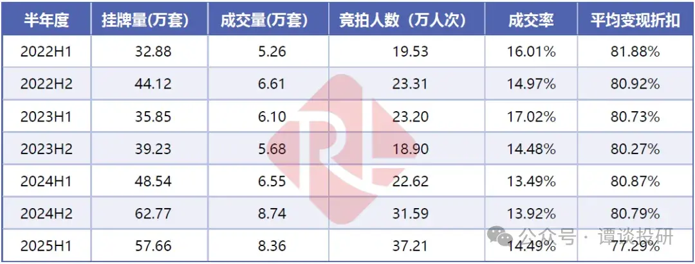
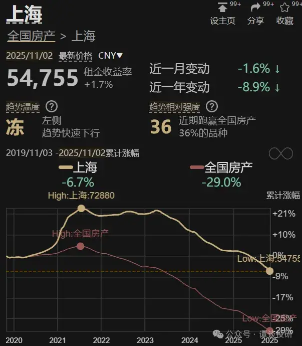
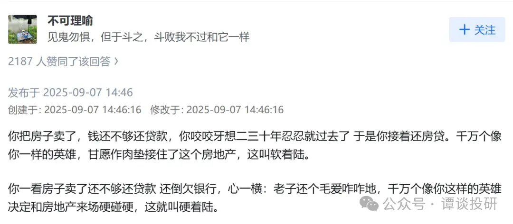

[toc]

# 问题

提问者：**<a href="https://www.zhihu.com/people/84-94-93-72-15">往生堂堂主的丈夫</a>**
提问时间: 2026-2-6 18:29:55
总回答数: 116
总访问量: 1914877

[【睡前消息1015】国家房改课题组长：注意法拍房-哔哩哔哩](https://www.bilibili.com/video/BV1t2F6zVE5Y/)

# 回答

回答者： **<a href="https://www.zhihu.com/people/wo-de-58-29-23">谭谈投研</a>**
回答时间: 2026-9-26 20:50:28
点赞总数: 89
评论总数: 6
收藏总数: 57
喜欢总数：4

前几天克而瑞的一个房产断供数据被疯传，结果后面都被删文了，有些大的博主（猫笔刀）甚至被禁言了一段时间。我当时写的也被删掉了，只能在知识星球里面看了。

但其实法拍房这件事，完全没必要藏着掖着，无论是哪家机构的数据，都显示目前情况很严峻。比如下面某机构发布的数据显示，今年上半年挂牌量数据，达到了22年上半年的接近两倍（32.88万套👉57.66万套），在打折幅度更大的基础上，成交率反而越来越低。

  

  

  

大家不要小看法拍房，这对楼市打击很大。

我举个上海的例子，上海一共850万套住房，目前挂牌20万套左右，挂牌率在2.5%左右。这只是挂牌率，真正诚意卖的（市场价9折挂牌）可能一半都没有，也就是说，诚意出售的房东只有1%。

而法拍房，绝对是非常诚意卖的房东，因为银行完全不需要房子（对银行而言，房子是一个没有自住价值，并且需要花钱维护、还在加速贬值的不良资产），肯定都想着越早处理越好，基本都是按照市场价7~8折出售的。

在上海只有1%的房东诚意卖房的情况下，目前上海房价已经跌跌不休了，最近几个月的月度环比都下降了1.5%左右。如果法拍房继续增长下去，对房价影响是巨大的。

  

  

  

所以现在大家可以看到一个现象，就是银行的态度没有之前那么强硬了。前两年刷到一个断供催缴视频，里面内容是一段对话，女业主对银行催款人员说，我们房子烂尾了你们银行怎么监管的，要不是烂尾我们怎么会断供？结果银行催款人员说：我们监管不力是违规了，你们断供可是违法的。

但是现在呢，太多人断供后，银行反而不敢大面积收房，都是给欠款人好说歹说，甚至不要本金每个月还点利息就行。只要你能还钱，哪怕每个月只有几百块，银行也不直接收房拍卖。

  

  

  

其实逻辑也很简单，如果真的严格按照每个月的贷款额度收钱，很多人会直接断供，那么银行手里的法拍房数量会突飞猛进。法拍房数量一多，房价就进一步下跌，然后就有更多人不还房贷，以此形成恶性循环。

2008年，美国的次贷危机就是这样的，由房价上涨引发泡沫，然后房价下跌后银行收房拍卖，结果越卖越跌，感兴趣可以去看看《大空头》这部电影。

  

  

  

对于我而言，早在2017年我就开始建议大家把三四线城市的房子抛掉，2021年开始建议把一线+强二线的房子也抛掉，因为房子的租售比太低，并且上涨动力也没有。

有这个钱，如果求稳可以买债券或者红利股，3~4%的收益率远高于2%不到的租金回报率。如果激进一点可以买美股，股息率也比租金回报率高，并且同为泡沫资产，我更愿意相信美股的空间。甚至你买黄金，买比特币赌一把，都是比房产更好的选择，这两看上去都是比房产更靠谱的蓄水池。

一个注定下跌（最起码是不涨，但是收益率很低）的资产，完全不具备任何吸引力。

我的知识星球《谭谈财经》，内容包括：

（1）金融、房产、时政、职场和社会思考等领域的深度思考，由于面向私域，所以并非”删减版“

（2）高价值学习资料，包括研报、电子书籍等（基本面研究，适合长线）

（3）一些我觉得有可能发酵的上市公司段子（当下热点，适合短线）

（4）每日最新各类有价值的金融数据、政策动向简评

（5）大家的问答，主要覆盖房产、投资、生活，集思广益、提升认知

  

  

原文地址：[(谭谈投研)如何评价睡前消息第1015期《国家房改课题组长：注意法拍房》？](https://www.zhihu.com/question/2003173566577926617/answer/2087282922604721887) 

# 评论

1. <a href="https://www.zhihu.com/people/fffg-30">tercio</a> (<small title="上海">2026-9-27 10:34:23</small>): 这都半年前的图了
2. <a href="https://www.zhihu.com/people/wang-wang-20-88">王忘</a> (<small title="安徽">2026-10-2 3:59:54</small>): 法拍房的租房问题太麻烦了  
 
买卖不破租赁，法拍也不行  
 
以至于某些好房源好商铺无人敢拍，能确定清场的才敢买
3. <a href="https://www.zhihu.com/people/qianruo">阿莲卡蓝袖</a> (<small title="湖北">2026-9-27 13:44:43</small>): 这算什么，武汉，房屋抵押贷款断供了，银行起诉，法院判决了，过半年打电话给法院问到那个地步了，法院说案件不存在了。 群里一大堆一起被起诉的都没还，也没人征收法拍，到现在四年了毛事没有。
   - <a href="https://www.zhihu.com/people/qianruo">阿莲卡蓝袖</a> (<small title="湖北">2026-9-27 13:45:16</small>): 幸亏律师费，法院的费用也没交，不然亏大发了。
4. <a href="https://www.zhihu.com/people/SVC_SYSTEM">自然选择前进四</a> (<small title="江苏">2026-9-27 8:38:13</small>): 谭谈交通［捂嘴］
5. <a href="https://www.zhihu.com/people/fan-yan-kan-shi-jie-56">凡眼看世界</a> (<small title="河南">2026-9-27 8:44:25</small>): 都落伍半年的数据了，还在这炒冷饭

=[评论](./attachments/comments.json)

