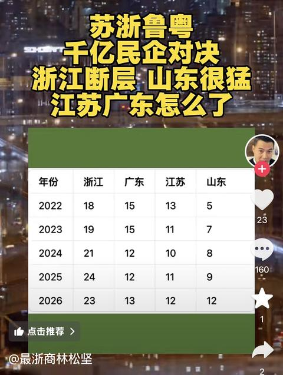

[toc]

# 问题

提问者：**<a href="https://www.zhihu.com/people/agwang-zhe-bao-liao-jun">玖鹤</a>**
提问时间: 2024-9-16 20:39:23
总回答数: 196
总访问量: 2345562

未来有没有保三追二的可能

# 回答

回答者： **<a href="https://www.zhihu.com/people/xue-you-heng-84">豆丁</a>**
回答时间: 2026-10-5 11:9:59
点赞总数: 75
评论总数: 30
收藏总数: 19
喜欢总数：5

以点带面，简单说两句。

当然不是要嘲讽山东，我这个ip也没什么资格去嘲讽，就是说一些人尽皆知，但没有人深入想过、或者想过却不敢提出来的话。

网上山东网友这几年对一些名词应该是耳熟能详的，什么名词呢？

比如山东ip正确。

什么叫山东ip正确呢？

比如鱼头，我今儿早上还见到抖音上一个人大吹特吹“不要去把鱼头当文化的地区”，具体哪个地区把鱼头当文化大家心知肚明，我就不多说了。还有什么投资不过山海关，后来到投资不过长江，更后来图穷匕见、露出本来面目，直接说投资不过钱塘江的。前几句还能理解，最后这句不过钱塘江，钱塘江在什么地方？在哪个省？投资不过钱塘江，具体指的是不过哪里？还有亮出一张图说将来拼了命也要让自己孩子去某个地区的，他图里标的是哪些地方呢？西至安徽中东部，东至长江口，北到扬州、泰州，南到钱塘江流域的一小片区域。

我把这种话术，叫做语言失格。

你说我鱼头是落后文化，那你成天到晚嘴上“乡毋宁”的乱叫搞地域歧视，是不是落后文化？你说我敬酒是经济落后的根源，那你重男轻女、养细姨、还让老婆伺候小三月子，搞出一大堆奸生子算不算落后文化？你说我重国资轻民资弄得国有资产流失，我说你宗大小姐一家这场红遍全国的大戏我长这么大头一次见，简直开了眼界。

论文化，你有什么资格说我落后呢？

当然了，我要说的并不是这些。我要说什么呢？

十几年以前，是没有南北差距的，或者说就算有，也没有今天这么大。

大概在2010年、最迟到2012年前后，当时中国经济总体上还是东富西贫的格局，一线城市大致上只有北上广——深圳是后来的那个。除了北上广之外，从北到南依次是大连、天津、石家庄、青岛、南京、杭州、厦门还有珠三角各市，如东莞、珠海。这个分布大体上遵循沿海城市定律。

我这么说是有根据的，今天红遍整个河北省的正宗安徽牛肉板面，实际上是安徽太和板面在河北的变种，那么问题来了，河北为什么会有这么多的安徽板面？当年究竟发生了什么？当年究竟是一种怎样的经济格局，才会导致这么多安徽人流入河北，以至于让安徽板面居然能成为河北名吃？

当年的大连有另一个名词，叫“北方明珠”，为什么叫北方明珠呢？因为南方也有一个，那个地方叫香港。

当年的天津，是北上广之下的第四城。更古早的时候深圳都排在他后面。

当然不仅是北方，广州火车站有个牌匾叫“统一祖国，振兴中华”。这话是给谁写的？是给港澳台侨胞写的。为什么要写呢？因为当年的港澳台资本，大量流入广州，我们需要这样一个窗口（或者说叫利用民族情怀）来对外展示我们自己，吸引港台投资。以至于“南下打工”这个词，实际上专指去广东。当然了有心人可能会发现，上海有延安路、青岛路、兰州路、乌鲁木齐路，而当年的青岛也有。为什么呢？因为这些地方是我们的窗口城市，就像商店里需要摆自己的招牌一样，我们就这些招牌，自然需要利用这些招牌来宣传我们自己，中华大家庭是一家人，我们自然要让更多的城市和地区为人所知，要让中西部贫穷的兄弟姐妹的名字都能被亮出去，而不是让外国人一听到中国就只知道上海。

现如今默默无闻的天津、山东，曾经是经济对口帮扶省份，比如天津对口甘肃，山东对口重庆，当然了，南方也对口帮扶，比如福建对口帮扶宁夏。比较搞笑的是，现如今一些帮扶省份，自己经济都已经不如所帮扶的地区了，具体是哪里我就不点名了。

当然了，当时的东富西贫虽然是总体格局，但具体而言西部地区虽然已经掉队，还是有部分地区还是有一定余力的。比如甘肃兰州，比如浙江人当年也组团去东北澡堂子当过搓澡工。

这些都发生在现如今的移动互联网时代之前，没有人记录这一切。时间太久远了，模糊了记忆，以至于我们中的很多人，把这些都忘了。

后来一切都变了。

大连第一个掉队，原因我就不解释了。

后来是天津，当然也是有原因的。

再后来，河北因“环境污染”，大量工业企业被整治，“地条钢”被取缔。

再然后是山东，也是大量工业企业南迁，原因据听说好像也是“环保”，对了，你们因此还出过一位以种树而闻名并仕途一路发达的领导。

你说搞环保重不重要？我也认为很重要，所以我觉得南方山清水秀的更适合搞环保，你同意不同意？你不同意？你说这些吃干饭的父母官怎么都不管我们？流官制下哪个官员的升迁是由老百姓决定的？种树出名的那位也是你们那出去的，他管你们了吗？

再然后是限韩令一出，青岛倒下了。后来又是山西，据听说是为了打击煤炭行业的无序发展。

最惨烈、最悲壮的是东北，结局是黑龙江人均GDP以7块钱的优势被甘肃超过。

不仅仅是北方，南方的广州市也没有逃过这个结局，曾经的北上广之一的广州，现如今地位岌岌可危，大有掉到第四城的趋势。据听说现在的广州人不喜欢搞经济了，反而喜欢搞党建，我头一次发现广州人居然会有这种爱好。

没落的地方很多，原因也七七八八，比如什么环保了，产业升级了，新旧动能转换了，“引进来，走出去”了之类的，相互之间，好似，并不相关。

看似闲敲棋子，毫无章法，毫无规律。

而废了这么多地方，崛起的是哪里呢？

马前卒曾经做过一期节目，贵州当地地方财政危机表现之一是独山县水司楼，水司楼是从哪里来的领导建的？

有一期节目曾讲过，贵州当地搞大基建，到处盖高铁盖大楼，他们自己肯定没这么多钱，都是借债的。从哪里借的？从某个省民营资本平台进行融资的，具体是哪个省？

看似闲敲棋子，没有任何关联。

我想强调，在中国看某个城市、某个地区的经济，首要关注的一定是不是经济本身。具体看什么？一定要看你们那曾经最有实力的人，现如今在什么位置。比如天津、广东，山西，当然还有北方明珠。

山东是一个又红又专的地方，但这也是你们的结局，同样也是我们的结局。

从东富西贫，到如今北贫南富、某些省急速增长，一家独大，只有十年而已。

我们这很穷的，我也想举中国之力而富我一隅。

  

原文地址：[(豆丁)山东未来的发展会是怎么样的？](https://www.zhihu.com/question/667341185/answer/2090398329989489518) 

# 评论

1. <a href="https://www.zhihu.com/people/wotcdx">火爆辣椒</a> (<small title="山东">2026-10-5 21:26:26</small>): 不止这十几年，中国第三个证券交易所也在山东，山东的金融起步不比某些地方晚，现在这个样子只能说是经历了太多莫名其妙的事
   - <a href="https://www.zhihu.com/people/jarren-tang">唐远秋</a> (<small title="山东">2026-10-7 18:35:9</small>): 淄博证券交易所
   - <a href="https://www.zhihu.com/people/shi-qu-de-shi-guang-36">逝去的时光</a> (<small title="山东">2026-10-8 22:22:47</small>): 第三个证券交易所三板市场在淄博没有错杀的话，[新三板](https://www.zhihu.com/search?comment_id=11592364074&comment_type=COMMENT&content_id=800151708&content_type=answer&parent_comment_id=11590239275&q=%E6%96%B0%E4%B8%89%E6%9D%BF&request_click_id=78a1a482-2022-4973-ad7e-2ba6fa2431fc&search_source=CommentEntity)也不会再有现在的地方。
   - <a href="https://www.zhihu.com/people/wotcdx">火爆辣椒</a> (<small title="回复于 2026-10-9 17:14:54/山东"> ✉️:逝去的时光</small>): 不是错杀，这就是他们的目的
2. <a href="https://www.zhihu.com/people/momo-92-37-59">momo</a> (<small title="山东">2026-10-9 10:58:40</small>): 实际上山东也没有鱼头酒
   - <a href="https://www.zhihu.com/people/mo-sheng-ren-23-43">邪剑仙</a> (<small title="山东">2026-10-29 14:6:5</small>): 正解，我在它们口中最落后封建的鲁西南地区多年，几乎走遍鲁西南，历酒场无数，从来没听说过什么鱼头文化
3. <a href="https://www.zhihu.com/people/wotcdx">火爆辣椒</a> (<small title="山东">2026-10-5 19:22:46</small>): 他们会说这是长江的优势，但是他们那个地方疑似不沿江
4. <a href="https://www.zhihu.com/people/cym2018_xyz">我沸了</a> (<small title="山东">2026-10-5 12:43:43</small>): 疑似相思了
5. <a href="https://www.zhihu.com/people/tony-92-49-87">Tony</a> (<small title="江苏">2026-10-6 19:19:17</small>): 这是什么意思，你到底说啥了
 

   - <a href="https://www.zhihu.com/people/zhang-yue-60-5">水处理张跃</a> (<small title="山东">2026-10-6 21:51:32</small>): 浙有超能力
   - <a href="https://www.zhihu.com/people/tony-92-49-87">Tony</a> (<small title="回复于 2026-10-6 21:54:15/江苏"> ✉️:水处理张跃</small>): 我就是好奇，他回复啥了，发了16次，被系统删除了16次，挺有毅力的。
   - <a href="https://www.zhihu.com/people/meng-yi-shen-xiang-87">梦呓深巷</a> (<small title="山东">2026-10-8 16:6:28</small>): 你发浙些是什么意思
   - <a href="https://www.zhihu.com/people/tony-92-49-87">Tony</a> (<small title="回复于 2026-10-8 17:6:40/江苏"> ✉️:梦呓深巷</small>): 是这个答主发的，发了16次，被系统删除了16次。我就是好奇，他回复啥了，
   - <a href="https://www.zhihu.com/people/shi-qu-de-shi-guang-36">逝去的时光</a> (<small title="山东">2026-10-8 22:24:34</small>): 知乎是阿里的阿里是哪里的就知道咋回事了。
6. <a href="https://www.zhihu.com/people/39-74-85-32-57">风吹麦浪</a> (<small title="浙江">2026-10-20 14:3:8</small>): 洋洋洒洒写了这么多，看了一下，四个字评价，[燃烧军团](https://www.zhihu.com/search?comment_id=11600736340&comment_type=COMMENT&content_id=800151708&content_type=answer&q=%E7%87%83%E7%83%A7%E5%86%9B%E5%9B%A2&request_click_id=d72b69b7-11ba-49aa-95c3-2fc41b59f38f&search_source=CommentEntity)。
7. <a href="https://www.zhihu.com/people/meng-te-mu-chang-xian-kao-niu-rou-gan-8">秩序</a> (<small title="浙江">2026-10-11 2:5:26</small>): 人们的嘴通常会撒谎，特别是为了“赢”而撒谎；  
 
而欺骗自己是可悲的。
8. <a href="https://www.zhihu.com/people/xwfcnr">风中追风kcl</a> (<small title="山东">2026-10-13 18:28:23</small>): 说白了，三战真打到本土，我真麻溜跑，祖上交够血税了，没意思
9. <a href="https://www.zhihu.com/people/zhang-zhi-34-92">张知</a> (<small title="山东">2026-10-7 3:6:11</small>): 山东发展还不错哦 
10. <a href="https://www.zhihu.com/people/tony-92-49-87">Tony</a> (<small title="江苏">2026-10-6 16:1:4</small>): 之前看过一个贴子，专门说过，山东可不穷，GDP全国前几的。应该是真的，没瞎说。现在网上说的山东IP怎么怎么样，可不是因为山东穷。是山东的一些观念。比如粉红遍地，执着考公，对权力和等极的崇拜，又特别擅长察言观色跟领导搞关系（在别人看来就是溜须拍马）。
    - <a href="https://www.zhihu.com/people/zhang-zhi-34-92">张知</a> (<small title="山东">2026-10-7 3:12:16</small>): 杭州5大行行长都进去了［捂脸］
    - <a href="https://www.zhihu.com/people/shi-qu-de-shi-guang-36">逝去的时光</a> (<small title="山东">2026-10-8 22:26:45</small>): 还见过多少溜须拍马的山东人？
    - <a href="https://www.zhihu.com/people/tony-92-49-87">Tony</a> (<small title="回复于 2026-10-9 10:57:31/江苏"> ✉️:逝去的时光</small>): 特别擅长察言观色跟领导搞关系，在别人看来就是溜须拍马。
    - <a href="https://www.zhihu.com/people/chen-guang-hui-21-2">耳东广</a> (<small title="山东">2026-10-9 11:24:18</small>): 但是[山东考公](https://www.zhihu.com/search?comment_id=11592543063&comment_type=COMMENT&content_id=800151708&content_type=answer&parent_comment_id=11590834948&q=%E5%B1%B1%E4%B8%9C%E8%80%83%E5%85%AC&request_click_id=49c5840a-e1bd-4da5-8714-0096e63e4319&search_source=CommentEntity)这事，也是浙里黑的。其实浙里考公率比山东还高
    - <a href="https://www.zhihu.com/people/tony-92-49-87">Tony</a> (<small title="回复于 2026-10-9 11:27:51/江苏"> ✉️:耳东广</small>): [考公率](https://www.zhihu.com/search?comment_id=11592659011&comment_type=COMMENT&content_id=800151708&content_type=answer&parent_comment_id=11590834948&q=%E8%80%83%E5%85%AC%E7%8E%87&request_click_id=49c5840a-e1bd-4da5-8714-0096e63e4319&search_source=CommentEntity)是不是报名人数除以省人口总数？
    - <a href="https://www.zhihu.com/people/tony-92-49-87">Tony</a> (<small title="回复于 2026-10-9 11:29:59/江苏"> ✉️:耳东广</small>): 为什么要否认爱考公这事呢，又不是啥丢人的事
    - <a href="https://www.zhihu.com/people/chen-guang-hui-21-2">耳东广</a> (<small title="回复于 2026-10-9 11:53:53/山东"> ✉️:Tony</small>): 因为不是事实
    - <a href="https://www.zhihu.com/people/tony-92-49-87">Tony</a> (<small title="回复于 2026-10-9 14:32:30/江苏"> ✉️:耳东广</small>): 不孝有三，无编为大。
    - <a href="https://www.zhihu.com/people/39-74-85-32-57">风吹麦浪</a> (<small title="回复于 2026-10-29 11:5:41/浙江"> ✉️:Tony</small>): 他们只剩嘴了。
    - <a href="https://www.zhihu.com/people/ai-liang-92">艾良</a> (<small title="回复于 2026-10-29 13:1:19/江苏"> ✉️:Tony</small>): 报名人数不是最多，山东还一亿人口，一除这不更低了吗？
    - <a href="https://www.zhihu.com/people/ai-liang-92">艾良</a> (<small title="江苏">2026-10-29 13:3:31</small>): 粉红遍地：爱国也被嘲讽；执着考公：考公人数不是最多的；对权力和等级的崇拜：请问哪里不这样？擅长察言观色和领导处好关系：不能放别的地方叫向上管理，在山东就叫溜须拍马吧？

=[评论](./attachments/comments.json)

