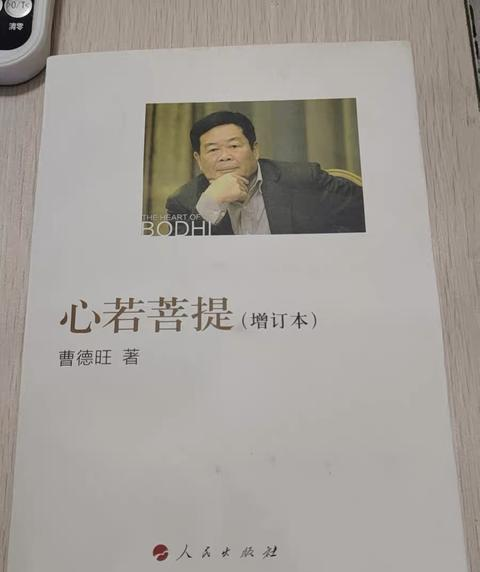
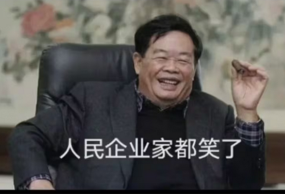
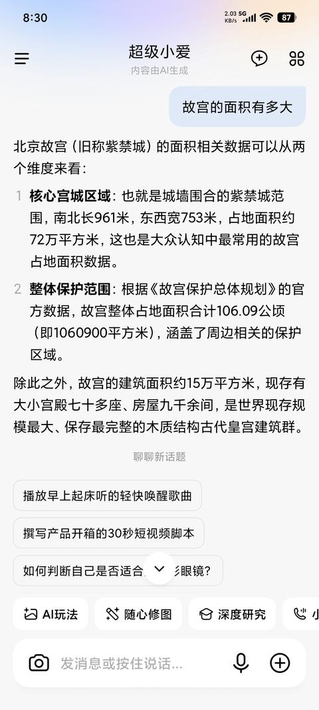

[toc]

# 问题

提问者：**<a href="https://www.zhihu.com/people/qing-an-ya-59">清安鸭</a>**
提问时间: 2020-8-4 9:13:19
总回答数: 1268
总访问量: 24803673

如何评价曹德旺这个人？

# 回答

回答者： **<a href="https://www.zhihu.com/people/han-yun-hao-75">避风岛</a>**
回答时间: 2026-11-10 9:44:4
点赞总数: 7698
评论总数: 751
收藏总数: 2108
喜欢总数：927

2019年山东民营企业发展大会前夜，他受邀参加，下午飞机落地济南

不让我们的车去接，我寻思这人还行啊，久负盛名，名不虚传

结果秘书跟我说，车不去，是因为从北京派车了，但我们的人得去

好吧，纯纯有病啊，公司什么车没有，爱咋咋地吧

晚上七点左右，饭局正式开始，我作为秘书陪同我们董事长

刚落座的第一句，有没有年份茅台？

有。

有就好，不然我辛辛苦苦工作辣么久，喝不到茅台还挺不开心的

你要这么说，确实没毛病，因为平时我们偶尔也喝，你都这么有钱了，应该的

开了两瓶15年，还有一瓶80，我要开，保镖给我摁住了

妈的，是不是得给咱公司省点，保镖年龄比我大不少，跟老板很多年，我很尊敬他，也很尊重他

想想也是，企业之间都是平等的，对面人也不多，喝不了太多酒

就安排人又拿了点生肖、精品

推杯换盏，真正的表演开始了，开始讲怎么教育孩子，开始讲他家的np

我这耳朵啪就竖起来了，这得好好听，最喜欢np什么的了

说家里有16个还是20多个来着，时间久远记不清了

他讲到，自己在家绝对是皇帝般的日子，孩子也跟他住一块

np在家得穿正经np装，就是特别不正经的那种正经服装

专门的培训过后，有固定的台词（开个玩笑）

都是大学生、特别漂亮，开的工资也高

还讲许和宗就是s，还办歌舞团（对不起，我那个时候真的早知道歌舞团，我也见过，恒大歌舞团，娃哈哈歌舞团）

不得交税？搞半天费劲都给别人享受了

我第一次听福建企业家私人饭局讲话，是那么的气势

还讲他妈的怎么搞定那些永远不知道满足的工人，那种鄙夷和嗤笑我记一辈子

讲未来的大学生都不值钱，工作会出现倒挂，这些工人不知道满足

讲来有的是人替代（这个道理我赞同，产业、职业倒挂以后，最后底层的工人和劳动从业者会受到比较大的伤害，但我受不了那种瞧不起人的感觉）

讲了点光辉的履历，按照惯例就得开始吹牛了，说一些兑现不了的承诺

比如说你们产业很牛啊，我个人很看好，你们给我个材料我看看

我饭还没吃一点，酒喝了不少，抓紧又回去搞了一个小时调度材料

那时候还没有Ai，不然哪像那时候那么狼狈，早早把自己蒸馏以后简单多了

回来看了以后，他说这样吧，我个人出资10亿，明天到你们账，你们不要拒绝

我心想，可以啊，真的假的，cash？虽然公司很大，但这笔钱可以纾解很大程度的流动性问题

于是我看到桌上高管同样相互递来了质疑和诧异的眼神

倒是我们老板风轻云淡，讲一句，好好休息，明日事明日讲

___

没有评价，就一些陈年旧事，翻出来让大家看看

当然，没有到账

___

11月12日修改  
经提醒是 **第三届中国企业改革发展论坛，** 谢谢。  
没想到这么快就被熟悉的人发现了，还打趣我说离开这么久，还这么念念不忘，现在不似以前，说话得注意影响。评论区的话我都看了。有骂的，有讲理的，还有替我担着心的。下面这几条算是把话说全，也算给自己立个界。

1.我承认，有小人之心，我本就是微末之人，虽未编排（因为属实）但也有背后嚼舌根的意思，不论别人，我私德有亏。

2.我承认，在饭局以后，第二天最然未到账，但饭局中仍然就企业发展交换了一些成熟的意见，这也是我在回答中只谈论酒桌话题不提专业性的问题，如果想讨论他对企业发展的专业性，可以用Ai搜一下他当年在会议上的讲话原稿，原稿中说的那家企业就是我们，但地理位置讲错了。我当时其实也没当真，当然第二天也没到账（笑），因为都知道他是来调研，我们是第一次见面。写它不是为了指控谁失信，是想说明饭桌上“我个人出资、明天到账、你们不要拒绝”这种话的落地率。场面话在饭桌上是润滑剂，落到纸面上就是另一回事，相信都知道。

3.我认为，这个世界上不存在纯粹的对错，我看评论区好多朋友义愤填膺，大可不必，我不喜欢他，仅仅是因为不喜欢他的风格、他的论点、他的生活，但不代表我会无视他的成功，这个世界上，也可能只有“我喜欢/我不喜欢”是不掺杂任何一点不自由的意志的。评论区里有理性者同我想法一致。

我再啰嗦几个其中的细节：

一是np。到底16个还是20多个，我确实记不清，年头太久了；原话的细枝末节也未必分毫不差。但“他讲了这些”这件事，我记得清楚。我能担保的只有“我当时听见了什么”，担保不了“他当时究竟想表达什么”。

二是我的身份。我那时候就是个秘书，坐桌子侧边，负责倒酒、跑材料。我看见的是一个人吃了一顿饭的样子，不是一个人的一生，而且福建老板我只见了这一个，样本是1，无法套用所有人。拿一顿饭去评一个人，本身就是僭越——这也是我说“私德有亏”的另一层意思。至于事情的真实性，皆由您斟酌，似真则真，似假则假。

三是我的问题。参加工作做秘书这些年来，大小领导见了不少，今天算是我犯得最大的一个错误。这些年来，多么高级别的领导，我都在场，但不外传。因为我明白，老板带我去，是让我替公司看、替公司记，不是让我替公众、替朋友记。我今天打破了这条，这是我心里真正硌得慌的地方。秘书的保密义务，是对公司事务、商业信息的，所以我描述的时候，只能绕开企业和专业部分，只泄露了一个公众人物在私人场合的言行，最后给自己一点没有 **背叛雇主的宽慰。** 

就这样吧，不补充了，促进网络和谐，大家消消气，当玩笑看，再多真删掉了。

  

原文地址：[(避风岛)如何评价曹德旺这个人？](https://www.zhihu.com/question/411909719/answer/2103422671639912584) 

# 评论

1. <a href="https://www.zhihu.com/people/supercode">super-code</a> (<small title="安徽">2026-11-10 15:32:17</small>): 不要以为爬上去高位的有几个表里一致的，都是道貌盎然之徒！有些公开言论都是，记得某些大的灾面前，派他儿子帝都去捐，明确强调是他父亲个人名义捐的，你家企业也是你家的啊，干嘛还这样呢
   - <a href="https://www.zhihu.com/people/du-zi-qian-xing-58">独自前行</a> (<small title="湖北">2026-11-10 16:40:30</small>): 说这话就显得WuZhi了，福耀玻璃是上市公司，他即使是控股股东也不能随意捐赠全体股东的资产。个人捐赠跟公司捐赠也很大区别。
   - <a href="https://www.zhihu.com/people/70-60-40-15">天弈</a> (<small title="回复于 2026-11-10 16:56:29/重庆"> ✉️:独自前行</small>): 大的自然灾害，上市公司很多多会捐款
   - <a href="https://www.zhihu.com/people/hao-peng-cheng">呆萌的</a> (<small title="回复于 2026-11-10 17:55:50/上海"> ✉️:独自前行</small>): 开玩笑呢［捂脸］
   - <a href="https://www.zhihu.com/people/hao-peng-cheng">呆萌的</a> (<small title="回复于 2026-11-10 17:56:36/上海"> ✉️:独自前行</small>): 别说捐款了，实控人伤害小股东利益，在大A还算个事儿吗？
   - <a href="https://www.zhihu.com/people/supercode">super-code</a> (<small title="回复于 2026-11-10 18:48:37/安徽"> ✉️:独自前行</small>): 你花钱给你企业博名还会差吗，上市企业不是你的了？企业实控是散户股民？
   - <a href="https://www.zhihu.com/people/wang-xiao-lin-1981">月明云淡</a> (<small title="江苏">2026-11-10 19:50:11</small>): 错别字改一下
   - <a href="https://www.zhihu.com/people/wo-men-du-hui-you-73-15">我们都会有</a> (<small title="广东">2026-11-10 22:3:6</small>): 这点不能黑他，个人捐1亿等同于公司捐1.66亿啊，涨工资那个梗可以说说他
   - <a href="https://www.zhihu.com/people/zhang-wei-hao-50">罗伯斯庇尔</a> (<small title="浙江">2026-11-11 19:33:6</small>): 曹德旺挺表里一致的，表面也是这个形象
   - <a href="https://www.zhihu.com/people/huo-xing-you-yu-95">火星有雨</a> (<small title="回复于 2026-11-11 20:41:55/福建"> ✉️:呆萌的</small>): 在大A算道德标兵了
   - <a href="https://www.zhihu.com/people/zhang-bo-89-93">布布</a> (<small title="江苏">2026-11-11 21:40:27</small>): 个人感觉，对底层稍稍有点真正的善意的可能就是刘强东了。
 
其他那些都感觉不到这些。
   - <a href="https://www.zhihu.com/people/liu-jin-gua-yu">穹荷</a> (<small title="回复于 2026-11-11 21:54:36/山东"> ✉️:罗伯斯庇尔</small>): 曹旺
   - <a href="https://www.zhihu.com/people/zhang-chong-67-95">亿枪一个</a> (<small title="河北">2026-11-11 22:42:39</small>): 之前听某央企的人讲集团领导每天的生活，他们说通俗地讲就是八个字，上流社会，下流生活
   - <a href="https://www.zhihu.com/people/psen-23">M沐沐</a> (<small title="回复于 2026-11-12 5:54:53/广东"> ✉️:布布</small>): 东哥还是不错的
   - <a href="https://www.zhihu.com/people/zhang-bo-89-93">布布</a> (<small title="回复于 2026-11-12 9:27:16/江苏"> ✉️:布布</small>): 补充一下，可能还有老任和东来也有一点，但没有强东明显。
   - <a href="https://www.zhihu.com/people/tang-jun-yue-36">一颗大白杨</a> (<small title="回复于 2026-11-12 16:30:20/浙江"> ✉️:布布</small>): 任不如河南矿山的那个老板
   - <a href="https://www.zhihu.com/people/zhang-bo-89-93">布布</a> (<small title="回复于 2026-11-12 16:51:2/江苏"> ✉️:一颗大白杨</small>): 哪个老板？？
   - <a href="https://www.zhihu.com/people/9wzfru">好1根</a> (<small title="辽宁">2026-11-12 18:9:29</small>): 表里如一的，除非遇到贵人中的贵人，不然怎么能爬上去。。。
   - <a href="https://www.zhihu.com/people/luo-yu-ming-45">Chris</a> (<small title="回复于 2026-11-13 9:13:26/四川"> ✉️:独自前行</small>): 不需要你在那儿掉书店，普及公司法
   - <a href="https://www.zhihu.com/people/fen-cun-5-56">分寸</a> (<small title="回复于 2026-11-13 15:44:8/广东"> ✉️:布布</small>): 应该是
   - <a href="https://www.zhihu.com/people/ontario-59">ontario</a> (<small title="陕西">2026-11-16 9:18:26</small>): 道貌岸然
2. <a href="https://www.zhihu.com/people/shui-mu-32-72">水母</a> (<small title="上海">2026-11-10 19:47:11</small>): 我们老板风轻云淡，讲一句，好好休息，明日事明日讲。  
 
  
 
这才是格调。  
 
这才是大老板 吃过见过，这种场面话，真的假的都不在意。
   - <a href="https://www.zhihu.com/people/zhigfzi9enr">zhiGFZI9ENR</a> (<small title="重庆">2026-11-11 18:43:54</small>): 人世间潜规则，酒桌上的话不能当真。［大笑］
   - **避风岛** (<small title="山东">2026-11-11 19:5:36</small>): 我们老板体量没那么大，巅峰时500亿左右，我估计说这个有部分人都能猜出来
   - <a href="https://www.zhihu.com/people/chen-fu-1-3">沉浮</a> (<small title="回复于 2026-11-11 20:41:10/山东"> ✉️:避风岛</small>): 谁
   - <a href="https://www.zhihu.com/people/bhzdz2014-77">bhzdz2014</a> (<small title="回复于 2026-11-11 20:50:59/山东"> ✉️:避风岛</small>): 魏桥？
   - <a href="https://www.zhihu.com/people/aixiaotian007">爆炸头666</a> (<small title="回复于 2026-11-11 21:9:6/河南"> ✉️:避风岛</small>): 山东企业，巅峰500亿没多的，那估计就是[金正大](https://www.zhihu.com/search?comment_id=11615528315&comment_type=COMMENT&content_id=804302481&content_type=answer&parent_comment_id=11614667457&q=%E9%87%91%E6%AD%A3%E5%A4%A7&request_click_id=776c968a-aedf-4b05-a942-d3be8f0c3c70&search_source=CommentEntity)或者东阿阿胶
   - <a href="https://www.zhihu.com/people/niuliangniao">豆柴酒造</a> (<small title="回复于 2026-11-11 21:25:24/山东"> ✉️:避风岛</small>): 高某某
   - <a href="https://www.zhihu.com/people/17722975131">人到中年</a> (<small title="广东">2026-11-11 21:48:3</small>): 西王集团？
   - <a href="https://www.zhihu.com/people/jiao-yin-1013">脚印1013</a> (<small title="回复于 2026-11-11 21:49:3/江西"> ✉️:避风岛</small>): 药玻？
   - **避风岛** (<small title="回复于 2026-11-11 22:53:24/山东"> ✉️:爆炸头666</small>): 真不是，别猜了，大家别关注我是干啥的［耶］
   - <a href="https://www.zhihu.com/people/sam-9-38">sam</a> (<small title="广东">2026-11-11 23:9:53</small>): 保护说真话的同志啊，知道了又能怎么样？
   - <a href="https://www.zhihu.com/people/pu-gai-87">呆呆的闹</a> (<small title="河南">2026-11-12 3:31:36</small>): 不是，真不用大老板，你一个职场上被坑了几年的社畜都能知道这玩意在扯淡，回答不一定有这么云淡风轻，但也知道应付几句场面话不去当真的
   - <a href="https://www.zhihu.com/people/li-shen-zhen-5">知之为知之</a> (<small title="山东">2026-11-12 9:18:31</small>): 豪迈
   - <a href="https://www.zhihu.com/people/wang-xiao-hui-11-95">王小辉</a> (<small title="广东">2026-11-12 16:21:12</small>): 是这样的，酒桌上的话，下了酒桌就不能当真［doge］
   - <a href="https://www.zhihu.com/people/railwaywhale">铁道上的蓝鲸</a> (<small title="回复于 2026-11-12 21:25:49/北京"> ✉️:bhzdz2014</small>): 魏桥比福耀大多了，差一个数量级
   - <a href="https://www.zhihu.com/people/kai-kai-86-3-35">猜一下</a> (<small title="回复于 2026-11-12 22:46:4/山东"> ✉️:爆炸头666</small>): 东阿阿胶背后老板是华润，应该不会落落曹旺
   - <a href="https://www.zhihu.com/people/92-77-82-90">温言</a> (<small title="回复于 2026-11-13 14:55:23/北京"> ✉️:bhzdz2014</small>): 低估魏桥了，再加个0差不多
   - <a href="https://www.zhihu.com/people/mo-ji-91-47-36-31">里昂lion宇</a> (<small title="回复于 2026-11-13 19:27:53/山东"> ✉️:bhzdz2014</small>): 魏桥比福耀牛逼多了
   - <a href="https://www.zhihu.com/people/hou-hei-nan">淮右布衣</a> (<small title="回复于 2026-11-14 2:30:41/上海"> ✉️:温言</small>): 在加个0也不够，再加个1差不多
   - <a href="https://www.zhihu.com/people/sha-ji-xian-sheng">杀鸡先生</a> (<small title="内蒙古">2026-11-14 12:57:32</small>): 原来是张震凯
   - <a href="https://www.zhihu.com/people/tu-dou-53-47">土豆</a> (<small title="回复于 2026-11-15 21:36:55/江西"> ✉️:避风岛</small>): 500多亿，还能云淡风轻，这个体量是搞地炼的
3. <a href="https://www.zhihu.com/people/49-69-53-73">啥也不是</a> (<small title="北京">2026-11-10 9:56:16</small>): 荒诞才显得真实
   - <a href="https://www.zhihu.com/people/ni-zheng-xing-kk">金属材料加工</a> (<small title="福建">2026-11-11 0:48:13</small>): 他家很多人去过。加他夫妻没几个人［思考］
   - <a href="https://www.zhihu.com/people/wei-xin-yong-hu-51-36-56-45">是我干的</a> (<small title="回复于 2026-11-11 10:14:18/江苏"> ✉️:金属材料加工</small>): 其他十几个女仆是摆设么？这都是采访放出来的啊
   - <a href="https://www.zhihu.com/people/ni-zheng-xing-kk">金属材料加工</a> (<small title="回复于 2026-11-11 10:16:34/福建"> ✉️:是我干的</small>): 哪个采访？自媒体自己编的采访？
   - <a href="https://www.zhihu.com/people/a-te-la-si-25-99">阿特拉斯</a> (<small title="回复于 2026-11-11 16:43:34/江苏"> ✉️:金属材料加工</small>): 看你IP地址，我信你
   - <a href="https://www.zhihu.com/people/liu-yu-18-44-62">魏博衙兵</a> (<small title="回复于 2026-11-12 8:14:55/北京"> ✉️:阿特拉斯</small>): 可能是福耀系的，还信他？这ip才是最不可信的
   - <a href="https://www.zhihu.com/people/master-99-14">幸运派大星</a> (<small title="回复于 2026-11-12 15:8:30/黑龙江"> ✉️:是我干的</small>): 我记得以前微博年代刷微博看过别人受邀参观他家，全是女仆是真的
   - <a href="https://www.zhihu.com/people/zuo-ri-bu-zhong-xian">皮夹克</a> (<small title="湖北">2026-11-12 16:24:27</small>): 并不荒诞，我经常跟几个榜上一百多名的接班二代吃饭，那几位刚开始挺正经，一喝多聊的都是下三路的事，熟悉了你会发现那些人并不高级，但是比普通人聪明很多，而且奸猾
   - <a href="https://www.zhihu.com/people/yi-ran-jia-ke-chong">零玖零陆ZJ</a> (<small title="回复于 2026-11-12 17:49:50/广东"> ✉️:金属材料加工</small>): 确实有视频，不过不是女仆装，而是西装。可以理解再别墅工作的人员。
   - <a href="https://www.zhihu.com/people/ni-zheng-xing-kk">金属材料加工</a> (<small title="回复于 2026-11-13 0:8:53/福建"> ✉️:零玖零陆ZJ</small>): 你是自媒体瞎编的视频吗？视频里有黑色茅台吗？还是只有白瓶装的？
   - <a href="https://www.zhihu.com/people/chen-li-32-40">沈立</a> (<small title="回复于 2026-11-13 23:42:59/湖南"> ✉️:零玖零陆ZJ</small>): 外人来了，还穿女仆装？人家脑子进水了？
   - <a href="https://www.zhihu.com/people/dawei-wang-38">大尾巴羊</a> (<small title="回复于 2026-11-16 6:56:54/山东"> ✉️:皮夹克</small>): 二代多数不如父辈，只是他爹不愿相信
   - <a href="https://www.zhihu.com/people/zuo-ri-bu-zhong-xian">皮夹克</a> (<small title="回复于 2026-11-16 9:26:28/湖北"> ✉️:大尾巴羊</small>): 其中一个是老爹挂了被迫接的班，这几年公司在他手上市值翻了四倍
4. <a href="https://www.zhihu.com/people/li-qiang-49-35">李强</a> (<small title="湖南">2026-11-10 18:34:46</small>): 我接触到的大老板，其中包含一个市值千亿和一个市值三百多亿公司的大老板，真的私底下都特俗，俗不可耐那种
   - <a href="https://www.zhihu.com/people/90-91-65-85-92">普解</a> (<small title="湖南">2026-11-10 22:14:34</small>): 细说？
   - <a href="https://www.zhihu.com/people/caozhihutama">何岚</a> (<small title="广东">2026-11-11 8:30:43</small>): 世界就是一个巨大的草台班子，对任何政商经济媒体文化领域的人都要祛魅，它们只是有好的家庭出身或者走狗屎运而已，没有什么特别的。
   - <a href="https://www.zhihu.com/people/67-18-40-66">吃我一击</a> (<small title="四川">2026-11-11 18:18:23</small>): 啥行业，传统的餐饮业什么的我相信，比如西贝老板。但是高新技术产业的半知识分子半商人，应该还好吧。
   - <a href="https://www.zhihu.com/people/min-ge-59">取个名可真难</a> (<small title="浙江">2026-11-11 19:24:12</small>): 不要脸的人先享受世界［思考］
   - <a href="https://www.zhihu.com/people/shi-zong-chai-rong">波比熊不是猫</a> (<small title="山东">2026-11-11 19:59:21</small>): 人本来就很俗，俗气才好点儿，这个价位也不需要装着了。
   - <a href="https://www.zhihu.com/people/shuang-gui-pai-men">無极</a> (<small title="回复于 2026-11-11 21:1:16/山西"> ✉️:吃我一击</small>): 都一个样 阿里的人可是商k常客
   - <a href="https://www.zhihu.com/people/ther-35-28">Ther</a> (<small title="北京">2026-11-11 23:8:27</small>): 一个雅的都没有吗［doge］
   - <a href="https://www.zhihu.com/people/zhicmim0">第四次</a> (<small title="江苏">2026-11-11 23:20:21</small>): 俗就俗吧，雅的骗子居多。
   - <a href="https://www.zhihu.com/people/flydidi">flydidi</a> (<small title="回复于 2026-11-12 1:43:27/山东"> ✉️:吃我一击</small>): 黄仁勋算高科技吧？不也是找小三了。比尔盖茨高科技吧？也有小三？马斯克高科技吧？几百个小三…［捂脸］
   - <a href="https://www.zhihu.com/people/67-18-40-66">吃我一击</a> (<small title="回复于 2026-11-12 7:43:21/四川"> ✉️:flydidi</small>): 这和俗不俗有啥关系？古代连嫖娼都视作风流韵事呢。有钱男人三妻四妾再正常不过了按你这个理解，不交配的和尚最雅
   - <a href="https://www.zhihu.com/people/chi-ku-shi-fu-48">吃苦是福</a> (<small title="回复于 2026-11-12 8:16:28/浙江"> ✉️:何岚</small>): 成功的人肯定是特别的，特别的狠，对自己，对别人
   - <a href="https://www.zhihu.com/people/hui-hua-fei-fa-hei-hui-hui-fa-24">溜肥肠我爱吃</a> (<small title="回复于 2026-11-12 8:59:43/辽宁"> ✉️:flydidi</small>): 马斯克算是最坦荡的了 也不藏着掖着的
   - <a href="https://www.zhihu.com/people/chuan-yue-huo-guo">宇文少恭</a> (<small title="安徽">2026-11-12 9:28:4</small>): 我在二十多岁的时候就意识到这个问题
   - <a href="https://www.zhihu.com/people/shun-bian-tu-guo-cao">顺便吐过槽</a> (<small title="四川">2026-11-12 9:28:41</small>): 私底下满口OOXX的，这种反而靠谱点
   - <a href="https://www.zhihu.com/people/zhang-bo-49-63-90">何以解忧有二锅头</a> (<small title="回复于 2026-11-12 10:13:6/广东"> ✉️:何岚</small>): 能力肯定是有的，这个不用怀疑，但有能力，不一定人品就怎么样。
   - <a href="https://www.zhihu.com/people/flydidi">flydidi</a> (<small title="回复于 2026-11-12 12:19:54/山东"> ✉️:吃我一击</small>): n你说话没逻辑，不是你说的高科技的大佬比较干净？
   - <a href="https://www.zhihu.com/people/xiang-feng-yi-yang-99-10">像风一样</a> (<small title="回复于 2026-11-12 17:27:25/广西"> ✉️:何岚</small>): 草台班子认可，你说别人都是好的出身和狗屎运才成功这不可能，他们一定狠和洞悉人性。你是什么出身和狗屎运？
   - <a href="https://www.zhihu.com/people/8ypvlwb">知乎用户8yPVLwB</a> (<small title="天津">2026-11-12 17:55:12</small>): 人就不能免俗嘛
   - <a href="https://www.zhihu.com/people/66-67-2-87-79">阿白</a> (<small title="回复于 2026-11-12 18:17:58/湖北"> ✉️:flydidi</small>): 玩女人算什么丑事，压抑了？
   - <a href="https://www.zhihu.com/people/ming-yue-fu-xiang-lu">明月拂乡路</a> (<small title="山东">2026-11-12 19:32:6</small>): 这几乎是必然的，每一个现行公认的好人点都是创业成功路上的绊脚石。
   - <a href="https://www.zhihu.com/people/wangke-88">真实姓名</a> (<small title="湖北">2026-11-13 7:41:40</small>): 你看被抓的有几个下三路没问题？其实人就那么点事儿，大多数人的高雅都是包装。
   - <a href="https://www.zhihu.com/people/priscillashy">Spike 2</a> (<small title="回复于 2026-11-13 8:50:44/河北"> ✉️:第四次</small>): 说得好像俗的骗子会比雅的少一样。
   - <a href="https://www.zhihu.com/people/flydidi">flydidi</a> (<small title="回复于 2026-11-13 9:1:14/山东"> ✉️:阿白</small>): 没玩过？羡慕？［大笑］
   - <a href="https://www.zhihu.com/people/57-81-76-92-46">关心办副主任</a> (<small title="回复于 2026-11-13 9:16:57/福建"> ✉️:吃我一击</small>): 也就那样，接触过你就知道了。因为工作的关系，我接触过大富豪（C公司产生了大批富豪）、咨询公司高管（麦肯锡、IBM、四大各档次）、教授/科学家，大部分人在专业上确实有深度，但人品、谈吐、思想方面也就那样（很多言论就是伪史论那个类型）。
   - <a href="https://www.zhihu.com/people/hysywq">hysywq</a> (<small title="回复于 2026-11-13 11:42:20/江苏"> ✉️:吃我一击</small>): 学历高不代表素质高，真有那种出尘于世的道德完人，相信也很难发财。而且这些人你不要看他们的外在有一些放纵的行为，其实心里跟明镜一样，绝对不是蠢人撞大运。
   - <a href="https://www.zhihu.com/people/hysywq">hysywq</a> (<small title="回复于 2026-11-13 11:43:20/江苏"> ✉️:Ther</small>): 太雅的可能很难发财
   - <a href="https://www.zhihu.com/people/bu-zhang-yang-63">我变成了太阳</a> (<small title="回复于 2026-11-13 16:10:53/湖北"> ✉️:Ther</small>): 少
   - <a href="https://www.zhihu.com/people/ji-da-wei-33">老酒纪</a> (<small title="山东">2026-11-13 16:30:30</small>): 没有缺点，太聪明的，上层不会放心的
   - <a href="https://www.zhihu.com/people/jiang-zhu-guan">荒野伍</a> (<small title="天津">2026-11-14 13:25:13</small>): 有了钱，有了权，就用不着装了，想干什么就干什么了
   - <a href="https://www.zhihu.com/people/wang-chuan-7-98">一路往北</a> (<small title="回复于 2026-11-15 9:6:52/河南"> ✉️:吃我一击</small>): 后者可能是没有把你当自己人，或者是你们喝的，聊的时间还不够长［害羞］
   - <a href="https://www.zhihu.com/people/lin-jing-74-33">林景</a> (<small title="回复于 2026-11-15 12:2:19/湖北"> ✉️:吃我一击</small>): 所以你的俗指的是什么？举几个例子出来呗
   - <a href="https://www.zhihu.com/people/67-18-40-66">吃我一击</a> (<small title="回复于 2026-11-15 17:4:44/四川"> ✉️:林景</small>): 有升官发财往上爬之外的理想，抱负，追求。比如梁文锋如果只玩量化捞钱割韭菜，那就俗，但是他搞AI这种有利于国家的事情就不俗。马斯克玩女人无伤大雅，人家搞技术研发有利于人类进步，就不俗。
   - <a href="https://www.zhihu.com/people/zheng-gan-fang">六面体</a> (<small title="回复于 2026-11-16 2:14:47/英国"> ✉️:波比熊不是猫</small>): 受过高等教育的俗跟教育缺失的俗不可相提并论
   - <a href="https://www.zhihu.com/people/zheng-gan-fang">六面体</a> (<small title="回复于 2026-11-16 2:24:23/英国"> ✉️:hysywq</small>): 西贝那个你说他心里跟明镜一样不会笑出声吗
   - <a href="https://www.zhihu.com/people/xue-weng-30">夜雪</a> (<small title="江苏">2026-11-16 13:9:10</small>): 大家都是俗人，红尘滚滚，他成功了而已，反而证明俗一样能成功，他的外表一本正经是因为成功了才包装或者包装好了帮助她成功
5. <a href="https://www.zhihu.com/people/yan-shou-zhong-50">社会主义接班人</a> (<small title="北京">2026-11-10 17:25:1</small>): 我懂了，他讲女仆的时候你们就该上女仆了。光有茅台是不行的
   - <a href="https://www.zhihu.com/people/82-41-41-17">我不吃牛肉</a> (<small title="河南">2026-11-11 18:51:38</small>): 有眼力见
   - <a href="https://www.zhihu.com/people/wang-zhu-71-61">肃肃鸨羽</a> (<small title="山东">2026-11-11 20:33:23</small>): 要我看，这秘书就该你来当
   - <a href="https://www.zhihu.com/people/qi-cong-sheng">番茄炒鸡蛋</a> (<small title="回复于 2026-11-11 22:39:25/江苏"> ✉️:肃肃鸨羽</small>): 你打报告，我批条子
   - <a href="https://www.zhihu.com/people/fu-wo-80">负我</a> (<small title="陕西">2026-11-11 23:9:48</small>): 没到账的原因。。被你小子找到了
   - <a href="https://www.zhihu.com/people/zhou-dong-61">刚了解明末清初</a> (<small title="北京">2026-11-13 16:5:3</small>): 要不怎么只有你才是接班人
   - <a href="https://www.zhihu.com/people/tian-zhen-74-40">天真</a> (<small title="河南">2026-11-14 15:54:8</small>): 不愧是帝都ip啊，就是有眼力劲！
   - <a href="https://www.zhihu.com/people/feng-po-wu-hen">秦城二院祝大夫</a> (<small title="浙江">2026-11-14 19:28:45</small>): 人如其名，你这名字起得真好。
   - <a href="https://www.zhihu.com/people/rocarola">Rocarola</a> (<small title="北京">2026-11-15 12:14:55</small>): 没见过世面，又学习了一个专业术语，终于知道np是啥了［握手］
   - <a href="https://www.zhihu.com/people/den-4-20">den</a> (<small title="山东">2026-11-16 8:14:5</small>): 原来是女仆啊，我还以为娘炮呢
6. <a href="https://www.zhihu.com/people/guo-ke-li-de-yu-zhou-60">果壳里的宇宙</a> (<small title="日本">2026-11-10 9:59:17</small>): 曹旺
   - <a href="https://www.zhihu.com/people/wo-xiang-ai-wo-suo-ai">我想暧我所爱</a> (<small title="广东">2026-11-10 15:16:52</small>): 德呢［生气］
   - <a href="https://www.zhihu.com/people/hai-tun-88-99">海豚88</a> (<small title="回复于 2026-11-10 15:21:13/福建"> ✉️:我想暧我所爱</small>): 缺德啊［大笑］［大笑］［大笑］
   - <a href="https://www.zhihu.com/people/51-18-16-9-67">四夷服单于降</a> (<small title="湖南">2026-11-10 17:58:17</small>): 怎么缺了德？［滑稽］
   - <a href="https://www.zhihu.com/people/kidu-85">kidu</a> (<small title="新疆">2026-11-10 18:8:2</small>): 曹德，缺啥名字要补
   - <a href="https://www.zhihu.com/people/pang-zi-kun">zcbm</a> (<small title="回复于 2026-11-10 18:46:50/四川"> ✉️:我想暧我所爱</small>): 没了
   - <a href="https://www.zhihu.com/people/zhi-zhi-wei-zhi-zhi-38-79">金灶沐</a> (<small title="回复于 2026-11-10 19:37:55/河南"> ✉️:我想暧我所爱</small>): 缺德
   - <a href="https://www.zhihu.com/people/tang-dou-79-23">糖豆</a> (<small title="回复于 2026-11-12 6:55:34/黑龙江"> ✉️:kidu</small>): 那曹操缺啥呢［大笑］
   - <a href="https://www.zhihu.com/people/kidu-85">kidu</a> (<small title="回复于 2026-11-12 10:12:44/新疆"> ✉️:糖豆</small>): ［机智］
   - <a href="https://www.zhihu.com/people/yuan-da-tou-79-34">八喜牛排巴成熟</a> (<small title="浙江">2026-11-13 9:46:29</small>): 螬汪
   - <a href="https://www.zhihu.com/people/hf-98">Bengia</a> (<small title="回复于 2026-11-13 13:47:48/福建"> ✉️:糖豆</small>): 缺人妻啊［doge］
   - <a href="https://www.zhihu.com/people/yu-shi-hu-95-52">于是乎</a> (<small title="回复于 2026-11-14 18:11:52/北京"> ✉️:我想暧我所爱</small>): 被收走了
   - <a href="https://www.zhihu.com/people/wang-rou-rou-91-37">王肉肉</a> (<small title="广东">2026-11-16 13:6:48</small>): 无才也无德
7. <a href="https://www.zhihu.com/people/kang-hui-47-30">鞋子特大号</a> (<small title="江苏">2026-11-10 17:2:9</small>): 一个家庭，政商联合一把抓。
   - <a href="https://www.zhihu.com/people/qidazhuang">大壮</a> (<small title="广东">2026-11-11 22:26:0</small>): 知道他搞个大学才投那么点钱，就知道一个沽名钓誉之徒
   - <a href="https://www.zhihu.com/people/zhong-er-xiao-bai">洪文晟通紧固件</a> (<small title="回复于 2026-11-16 10:34:37/福建"> ✉️:大壮</small>): 为什么他当厂长，他哥当时省里当官，哥俩把国企变私人，拼命送订单输血
8. <a href="https://www.zhihu.com/people/guan-yan-chao-8">铁王座</a> (<small title="天津">2026-11-10 11:32:19</small>): 流年不利，小人当道
   - <a href="https://www.zhihu.com/people/63-44-98-25">少年</a> (<small title="浙江">2026-11-14 20:5:8</small>): 水浒传：不是兄弟你不好。是这世道不干净，容不得你这样做人
9. <a href="https://www.zhihu.com/people/gao-shou-gao-gao-shou-29">高手高高手</a> (<small title="北京">2026-11-10 15:5:29</small>): 都说人不可貌相，其实面相还是能看出很多东西来的
   - <a href="https://www.zhihu.com/people/some-40-78">some</a> (<small title="山西">2026-11-10 19:22:44</small>): ［吃瓜］嘛，一般人往往藏不住眼神，习惯了也就容易影响神态，看眼睛，还是有准度。
   - <a href="https://www.zhihu.com/people/zhu-xie-qing-2015">竹叶青2015</a> (<small title="江苏">2026-11-11 17:55:9</small>): 想起了雷政富，这哥俩面相挺像
   - <a href="https://www.zhihu.com/people/lemmmmmmmmon-10">lemmmmmmmmon</a> (<small title="山东">2026-11-12 0:57:24</small>): 人不可貌相指的是可以丑，但是不能狰狞恐怖
   - <a href="https://www.zhihu.com/people/you-cai-shen-70">雅迪电动车</a> (<small title="山东">2026-11-14 0:20:52</small>): 他是貔貅相吧
   - <a href="https://www.zhihu.com/people/soulbadman">大聪明</a> (<small title="回复于 2026-11-14 19:8:11/广东"> ✉️:雅迪电动车</small>): 猪像
10. <a href="https://www.zhihu.com/people/hui-tie-350">灰铁350</a> (<small title="江苏">2026-11-10 16:34:1</small>): 我的成功和我有个哥哥一毛钱关系都没有，类似能力之外的资本为零
11. <a href="https://www.zhihu.com/people/hu-jing-yang-9-31">鼓浪屿守法公民</a> (<small title="福建">2026-11-10 19:44:28</small>): 我见过他本人好几次，在长乐机场。他私人飞机下机，对他的私人机组非常苛刻
    - <a href="https://www.zhihu.com/people/denny-zheng-63">Denny</a> (<small title="澳大利亚">2026-11-15 9:18:3</small>): 可以说两句都是怎样具体细节的“苛刻”吗？
12. <a href="https://www.zhihu.com/people/1q23lsc45j">NKUIVRRH</a> (<small title="四川">2026-11-10 13:21:13</small>): 这么大老板也和我接触的小老板差不了太多，不过小老板没有女仆。［大笑］
    - <a href="https://www.zhihu.com/people/65-61-62-29-11">未设置</a> (<small title="福建">2026-11-10 19:34:15</small>): 只不过你的小老板没有他那个实力而已［捂嘴］［捂嘴］
    - <a href="https://www.zhihu.com/people/draycracy">draycracy</a> (<small title="浙江">2026-11-10 20:26:6</small>): 和曹旺坐一桌的答主老板，在享受上水平也差不多，不然他也懒得跟底层人说这些。他老板就算家里没女仆，也绝对是见识过的。答主不地道，把这种事抖落出来，被有心人刷到了一抓一个准，有些事是不能放上台说的，他写这篇回答和给老毕录像的人没啥区别［大笑］
    - <a href="https://www.zhihu.com/people/lucifer-72-11">Modo</a> (<small title="回复于 2026-11-11 0:53:24/山东"> ✉️:draycracy</small>): 还有共情这种纯资本家的［开心］
    - <a href="https://www.zhihu.com/people/feng-qing-yang-91-34-87">风轻扬</a> (<small title="回复于 2026-11-11 19:4:20/山东"> ✉️:draycracy</small>): 人家说的至少是亲身经历的，你说人家老板的那些就是凭空捏造了
    - **避风岛** (<small title="回复于 2026-11-11 19:7:3/山东"> ✉️:draycracy</small>): 哈哈，确实，不太地道，饭桌上一共八九个人，估计能猜到我是谁，但我就是不太喜欢他，有一点你说错了，我们老板确实简朴，年纪大了，虽然也有500亿的体量，但生活非常朴素
13. <a href="https://www.zhihu.com/people/hu-kai-25-19-2">马尔塞尤</a> (<small title="北京">2026-11-10 19:27:39</small>): 出风水书 
    - <a href="https://www.zhihu.com/people/dovahkiin">Dovahkiin</a> (<small title="重庆">2026-11-11 18:56:22</small>): 假
    - <a href="https://www.zhihu.com/people/rainflycn02">卡拉迪亚流浪者</a> (<small title="广东">2026-11-12 18:40:58</small>): 最讽刺的是这个出版社，达成了完美。
    - <a href="https://www.zhihu.com/people/wxcf694383f5a428c8">爱国不如善待同胞</a> (<small title="回复于 2026-11-13 17:4:53/湖北"> ✉️:卡拉迪亚流浪者</small>): 各种名人出的书，笑死人
    - <a href="https://www.zhihu.com/people/guo-ba-7-73">小袋鼠的家</a> (<small title="广东">2026-11-15 10:50:32</small>): 心若菩提人要狠
14. <a href="https://www.zhihu.com/people/hua-zhi-qing-ci-56">花之庆次</a> (<small title="福建">2026-11-10 16:47:45</small>): 他家和我一个小区，当然那只是他很多套豪宅里的一套，至少那套里面的阿姨就是普通阿姨着装，没有看到什么特别不正经的女仆装，甚至没看到像年轻女大学生的女家政人员出入。
    - <a href="https://www.zhihu.com/people/han-tang-he-ying-15">寒塘鹤影</a> (<small title="浙江">2026-11-10 17:7:22</small>): 他有套超大的别墅，有酒窖那种，媒体去拍过
    - <a href="https://www.zhihu.com/people/111-48-46-13">111</a> (<small title="北京">2026-11-10 17:37:47</small>): 大企业家还住小区嘛［飙泪笑］
    - <a href="https://www.zhihu.com/people/zhang-bao-zi-31">好梦园里哈呼呼</a> (<small title="回复于 2026-11-10 17:39:18/广西"> ✉️:寒塘鹤影</small>): 对，那个纪录片我也记得
    - <a href="https://www.zhihu.com/people/han-tang-he-ying-15">寒塘鹤影</a> (<small title="回复于 2026-11-10 17:40:19/浙江"> ✉️:好梦园里哈呼呼</small>): 确实很大里面人很多
    - <a href="https://www.zhihu.com/people/ji-guan-qiang-du-du-ni">机关枪嘟嘟你</a> (<small title="河南">2026-11-10 19:12:13</small>): 有个纪录片，他家20多个女仆，有个酒窖，存的茅台都升值上亿
    - <a href="https://www.zhihu.com/people/lan-se-huo-yan-51-8">蓝色火焰</a> (<small title="福建">2026-11-10 22:23:40</small>): 华林御景。
    - <a href="https://www.zhihu.com/people/lan-se-huo-yan-51-8">蓝色火焰</a> (<small title="回复于 2026-11-10 22:26:4/福建"> ✉️:111</small>): 住，在省政府1公里以内的小区，买了整座楼，推倒了盖了个别墅。。。
    - <a href="https://www.zhihu.com/people/hua-zhi-qing-ci-56">花之庆次</a> (<small title="回复于 2026-11-10 22:38:30/福建"> ✉️:蓝色火焰</small>): 不是，他那套已经卖掉有好几年了。
    - <a href="https://www.zhihu.com/people/xiang-yuan-49-28">香橼</a> (<small title="回复于 2026-11-11 20:39:37/内蒙古"> ✉️:111</small>): 会不会有人说还和曹旺住一个单元人家很勤快自己仍垃圾哈哈😂
    - <a href="https://www.zhihu.com/people/hua-zhi-qing-ci-56">花之庆次</a> (<small title="回复于 2026-11-11 20:52:38/福建"> ✉️:111</small>): 百度一下就能搜到，别墅小区，但是地段比较偏，便宜的总价不高，无非他那套定制版的单独一条断头路，面积特别大而已。而且他之前有好几套房子都是小区里的豪宅，比如楼下提到的[华林御景](https://www.zhihu.com/search?comment_id=11615584639&comment_type=COMMENT&content_id=804302481&content_type=answer&parent_comment_id=11614605187&q=%E5%8D%8E%E6%9E%97%E5%BE%A1%E6%99%AF&request_click_id=3f993190-5229-4efc-a1ac-ee3f79a89416&search_source=CommentEntity)，高层小区里唯二的别墅。
    - <a href="https://www.zhihu.com/people/chen-liang916">one2three</a> (<small title="回复于 2026-11-11 22:52:48/福建"> ✉️:花之庆次</small>): 他那套就在福州高新区，大洋鹭洲那里。以前是断头路，现在也通车了
    - <a href="https://www.zhihu.com/people/hua-zhi-qing-ci-56">花之庆次</a> (<small title="回复于 2026-11-11 23:2:47/福建"> ✉️:one2three</small>): 没通呀，是外面的通了，去他家那条路本来是可以直接开到后面上南路上的，但是那个门还是没有开起来最后，至于和他有没关系我就不知道了。
    - <a href="https://www.zhihu.com/people/hhpydzx">长缨缚苍龙</a> (<small title="广东">2026-11-13 5:53:37</small>): 鲁豫都做过一期节目，人家那种大豪宅哪里是什么小区的房子。
    - <a href="https://www.zhihu.com/people/luo-yu-ming-45">Chris</a> (<small title="四川">2026-11-13 9:17:57</small>): 反正就是要面子，我得维护本省的面子
    - <a href="https://www.zhihu.com/people/hua-zhi-qing-ci-56">花之庆次</a> (<small title="回复于 2026-11-13 12:47:29/福建"> ✉️:长缨缚苍龙</small>): 他只能有一套房子？
    - <a href="https://www.zhihu.com/people/chen-liang916">one2three</a> (<small title="回复于 2026-11-13 17:23:41/福建"> ✉️:花之庆次</small>): 懂了。
    - <a href="https://www.zhihu.com/people/feng-zhong-ke-17-70">风中客</a> (<small title="回复于 2026-11-13 19:7:50/江苏"> ✉️:花之庆次</small>): 我去，离谱［doge］
    - <a href="https://www.zhihu.com/people/hhpydzx">长缨缚苍龙</a> (<small title="回复于 2026-11-13 22:29:10/广东"> ✉️:花之庆次</small>): 问题是人家请20个管家的是那套豪宅，而不是哪个小区的。
    - <a href="https://www.zhihu.com/people/hua-zhi-qing-ci-56">花之庆次</a> (<small title="回复于 2026-11-13 23:5:54/福建"> ✉️:长缨缚苍龙</small>): 上央视那套在福清工农小学的对面，传说中的洞庭58号豪宅，隔壁是他的一个堂弟家，不如他在这个小区里这套豪。58号没进去过，他堂弟家有一段时间我去过几次去送文件。同样偶尔见过女的进出，没见过女仆装的大学生，好点的穿的像酒店或者银行的大堂经理，就是一身黑西装，普通就是酒店客房阿姨。不是给他洗，我没答主能和他同桌的经历，但从我接触的人谈到的他，我认为他是一个很在乎自己形象和名声的人，很难想象他会放的这么开在初次见面的人面前说这种话
    - <a href="https://www.zhihu.com/people/guang-zhi-zi-84-63">光之子</a> (<small title="回复于 2026-11-14 18:2:33/广东"> ✉️:寒塘鹤影</small>): 这个我知道，我看过了
    - <a href="https://www.zhihu.com/people/chendingzi">陈钉子</a> (<small title="回复于 2026-11-15 4:3:48/四川"> ✉️:花之庆次</small>): 不可能这么乱说话的
    - <a href="https://www.zhihu.com/people/wang-xiao-er-7-67">张小二</a> (<small title="回复于 2026-11-16 5:40:11/浙江"> ✉️:寒塘鹤影</small>): 我看过短视频，不是什么女大学生，都是40多岁的普通家政
15. <a href="https://www.zhihu.com/people/zhang-ji-hui-87-13">柚子同学</a> (<small title="山西">2026-11-10 17:59:0</small>): 缺啥名字里就叫啥，家里没弟弟，女孩子名字叫招娣，缺德，名字里就加个德
    - <a href="https://www.zhihu.com/people/83-61-59-52">浮生一笑</a> (<small title="河南">2026-11-11 18:46:51</small>): 我很歪，名字里有个正
    - <a href="https://www.zhihu.com/people/jia-sheng-64-21">嘉升</a> (<small title="湖北">2026-11-11 21:10:23</small>): 流得滑莫名躺枪了，属于是……
    - <a href="https://www.zhihu.com/people/chendingzi">陈钉子</a> (<small title="四川">2026-11-15 4:9:51</small>): 朱德、彭德怀都带“德”。  
 
名字是对好的期望。  
 
你的家人朋友没个带俊、美、英、豪、华、佳、全、伟的？
    - <a href="https://www.zhihu.com/people/1neuubmw">巨虫苏醒了</a> (<small title="回复于 2026-11-15 9:21:53/江苏"> ✉️:陈钉子</small>): 你的意思是资本家和无产阶级革命者一样？
    - <a href="https://www.zhihu.com/people/chendingzi">陈钉子</a> (<small title="回复于 2026-11-15 21:18:30/四川"> ✉️:巨虫苏醒了</small>): 他意思还是我意思？
    - <a href="https://www.zhihu.com/people/1neuubmw">巨虫苏醒了</a> (<small title="回复于 2026-11-16 7:40:16/江苏"> ✉️:陈钉子</small>): 你啊，你拿那些无产阶级革命家和普通工人阶级 跟 曹汪这个大资本家比 为大资本家开脱你是什么意思？
16. <a href="https://www.zhihu.com/people/71-77-53-80">李根</a> (<small title="湖北">2026-11-11 18:57:2</small>): 想到了以前在天涯论坛看到的一句话：富人真有钱但是假大方，穷人真没什么钱，但是真大方。
    - <a href="https://www.zhihu.com/people/13470012941">虫虫天使虫虫</a> (<small title="辽宁">2026-11-15 20:0:39</small>): 因为穷人没什么钱，才能真大方（拿不出来），富人是真又有钱就不能真大方（否则就得 把钱真拿出来）。
17. <a href="https://www.zhihu.com/people/zhang-hen-chong">张恨虫</a> (<small title="北京">2026-11-10 13:44:14</small>): 你要知道，  
 
名字有叫错的，绰号一般不会叫错。  
 
他绰号曹旺。
    - <a href="https://www.zhihu.com/people/nin-lole-ge-liao">您LOL哦咯了</a> (<small title="上海">2026-11-10 15:4:39</small>): 啥意思？操旺？
    - <a href="https://www.zhihu.com/people/guo-chao-50-94">岁安</a> (<small title="回复于 2026-11-10 15:5:15/辽宁"> ✉️:您LOL哦咯了</small>): 缺德
    - <a href="https://www.zhihu.com/people/12-1-9-10">经世济民</a> (<small title="回复于 2026-11-10 15:5:33/宁夏"> ✉️:您LOL哦咯了</small>): 缺中间那个字
    - <a href="https://www.zhihu.com/people/qi-lu-71-63">七律</a> (<small title="上海">2026-11-10 15:19:40</small>): 和曹金一个逻辑
    - <a href="https://www.zhihu.com/people/truckcar">沈辉腾</a> (<small title="北京">2026-11-10 15:25:44</small>): 啥东西汪汪
    - <a href="https://www.zhihu.com/people/discover-24-95">Discover</a> (<small title="回复于 2026-11-10 15:26:29/陕西"> ✉️:七律</small>): 跟曹金还不一样，看起来跟刘华一样
    - <a href="https://www.zhihu.com/people/wang-wei-82-65-13">这还得熬多久</a> (<small title="回复于 2026-11-10 15:51:15/上海"> ✉️:七律</small>): 郭纲
    - <a href="https://www.zhihu.com/people/lsxz-95">小不忍泽玛利亚</a> (<small title="回复于 2026-11-10 17:20:11/北京"> ✉️:七律</small>): 不应该跟郭纲一个逻辑吗［大笑］
    - <a href="https://www.zhihu.com/people/shi-zi-wang-59">蓝星访察者NO.001</a> (<small title="广东">2026-11-10 17:44:18</small>): 这种多大点事，那个老板不是这种口吻.我之前在工厂做文员，没少以那种打工人身份写那种老板、领导各种演讲稿.这些人的视角下，各种观点有多逆天.就比如我们说最多的对工人各种极致的剥削.在他们视角下，能作为一个自己对社会贡献.工厂打工人，多少人，要是没他们，还在老家伺候着几亩薄田，一年挣不到几个钱.来我这里给我打工，一个月顶你农民一年，你们要学会感恩.［酷］［酷］
    - <a href="https://www.zhihu.com/people/qi-lu-71-63">七律</a> (<small title="回复于 2026-11-10 17:47:29/上海"> ✉️:小不忍泽玛利亚</small>): 我想这么说来着，但转念一想，曹金是本人承认的事实，郭刚是捏造的。
    - <a href="https://www.zhihu.com/people/msh-46">利宜生</a> (<small title="河北">2026-11-10 19:27:11</small>): 肠旺［捂脸］
    - <a href="https://www.zhihu.com/people/hello-63-75">hello</a> (<small title="回复于 2026-11-10 22:29:45/陕西"> ✉️:这还得熬多久</small>): 本名也无德，原名大刚
    - <a href="https://www.zhihu.com/people/ran-shao-de-ling-hun-60">玫瑰色的人生</a> (<small title="重庆">2026-11-11 13:27:3</small>): 
    - <a href="https://www.zhihu.com/people/pu-yi-36">普姨</a> (<small title="安徽">2026-11-11 17:3:26</small>): 他的名字叫曹旺
    - <a href="https://www.zhihu.com/people/22-67-53-31">天1海慧</a> (<small title="回复于 2026-11-12 7:41:21/河南"> ✉️:蓝星访察者NO.001</small>): 和我的前老板一样话术［赞］
    - <a href="https://www.zhihu.com/people/tian-zhong-8-9">田仲</a> (<small title="回复于 2026-11-15 13:33:36/江苏"> ✉️:七律</small>): 跟郭纲一样
18. <a href="https://www.zhihu.com/people/yong-zhe-59-64">泳者</a> (<small title="湖北">2026-11-10 14:0:26</small>): 福建农民开的福耀技校
    - <a href="https://www.zhihu.com/people/yu-ji-bei-38">于嵇北</a> (<small title="陕西">2026-11-11 17:59:58</small>): 曹德旺可不是农民。像你这种动不动拿农民开涮的，有钱了也比曹德旺好不到哪里去。
    - <a href="https://www.zhihu.com/people/yong-zhe-59-64">泳者</a> (<small title="回复于 2026-11-11 18:38:53/湖北"> ✉️:于嵇北</small>): 对，高考生被老农民忽悠上了四年福耀技校［思考］
19. <a href="https://www.zhihu.com/people/he-jian-45-4">淡茶</a> (<small title="广东">2026-11-10 16:37:12</small>): 董事长比较实在 还知道止损，少开一瓶80
    - **避风岛** (<small title="山东">2026-11-11 19:8:51</small>): 那时候80得二十多万，年少轻狂差点喝上
    - <a href="https://www.zhihu.com/people/si-nian-liao-94">杂牌西瓜霜</a> (<small title="回复于 2026-11-12 13:17:36/江苏"> ✉️:避风岛</small>): ［飙泪笑］到底好不好喝
20. <a href="https://www.zhihu.com/people/1397996674">1397996674</a> (<small title="江苏">2026-11-11 17:5:55</small>): 没有他哥，也就那样，典型的中国式企业家
21. <a href="https://www.zhihu.com/people/you-mei-you-ming-zi-bu-yi-yang-ma">旗山呵弹</a> (<small title="广东">2026-11-10 18:36:22</small>): 首先，你说我都相信。  
 
其次，说一下，打工人的一些错觉：认为领导的朋友也是自己的朋友，一桌吃饭时说的话是对我说的。认为老板的朋友也是自己的朋友，一桌吃饭时所说的话也是对我我说的。其实你只是那双筷子。  
 
曹旺和你老板私交很好。
    - **避风岛** (<small title="山东">2026-11-11 19:10:6</small>): 我连筷子也算不上，就一老板的钢笔，饭桌上所有领导都不会把我当人的，所以有些话题才放肆说
    - <a href="https://www.zhihu.com/people/fu-wo-80">负我</a> (<small title="回复于 2026-11-11 23:10:57/陕西"> ✉️:避风岛</small>): 如果茅台➕女仆。。第二天会不会就到账了
    - <a href="https://www.zhihu.com/people/ng-ha-69-18">嗯哈</a> (<small title="回复于 2026-11-12 4:58:18/重庆"> ✉️:负我</small>): 客套话而已，如果真的出资10亿，什么都准备了，直接签合同了。
    - <a href="https://www.zhihu.com/people/lin-jing-74-33">林景</a> (<small title="湖北">2026-11-15 12:7:10</small>): ［思考］你不会以为就你知道吧？你想表达什么呢？
22. <a href="https://www.zhihu.com/people/53-82-34-8">八声甘州</a> (<small title="北京">2026-11-10 16:46:8</small>): 不太信，
 
要吃要喝也就地主老财水平，
 
老曹不至于的。
 
或者真拿你们不当外人（事儿）。
 
或者怕你们拿山东杂酒糊弄人。
 
话说山东杂酒也太多，一个县能有十来个牌子。
    - <a href="https://www.zhihu.com/people/--51-63-12-38">人生岂得长无谓</a> (<small title="福建">2026-11-10 19:11:36</small>): 我们大山东每个县都有一个正经牌子的！
    - <a href="https://www.zhihu.com/people/79-71-59-87-49">三井瘦</a> (<small title="尼日利亚">2026-11-10 19:31:12</small>): 山东企业需要你教怎么处理场面上的事？能跟[曹德旺](https://www.zhihu.com/search?comment_id=11615180556&comment_type=COMMENT&content_id=804302481&content_type=answer&parent_comment_id=11614917770&q=%E6%9B%B9%E5%BE%B7%E6%97%BA&request_click_id=0e59f25d-40b2-4822-ab77-6c5d2b762a38&search_source=CommentEntity)坐一桌的老板在山东也是排得上号的真不至于拿杂酒糊弄人
    - <a href="https://www.zhihu.com/people/53-82-34-8">八声甘州</a> (<small title="回复于 2026-11-10 19:35:13/北京"> ✉️:人生岂得长无谓</small>): 和许多不正经牌子？
    - <a href="https://www.zhihu.com/people/53-82-34-8">八声甘州</a> (<small title="回复于 2026-11-10 19:37:29/北京"> ✉️:三井瘦</small>): 肯定不需要，
 
我也懒得教。
 
要不济南也出个夏雨荷醇酿？
 
就回个话，还尼日利亚IP，又不是发扔子图，为什么许的……
    - <a href="https://www.zhihu.com/people/79-71-59-87-49">三井瘦</a> (<small title="尼日利亚">2026-11-10 19:56:37</small>): 哎呦喂，哪有你地道啊？
    - <a href="https://www.zhihu.com/people/mo-dou-wu-ling">墨斗五灵</a> (<small title="河南">2026-11-10 20:37:27</small>): 你的回答和你的ip让我的血压坐了一回过山车［大笑］
    - <a href="https://www.zhihu.com/people/53-82-34-8">八声甘州</a> (<small title="回复于 2026-11-10 21:50:51/北京"> ✉️:墨斗五灵</small>): 不考虑交下费？
 
占便宜习惯了？
    - <a href="https://www.zhihu.com/people/lucifer-72-11">Modo</a> (<small title="回复于 2026-11-11 0:52:35/山东"> ✉️:八声甘州</small>): 北京ip的穷讲究确实有说法，不要说能参加民营企业家大会的老板，就是山东县城老板也不会不舍得一瓶茅台的［为难］。
    - <a href="https://www.zhihu.com/people/ben-ben-xiao-fei">笨笨小飞</a> (<small title="山东">2026-11-15 2:43:56</small>): 山东新星，茅台连续16年最大经销商了解一下？最近几年坐二望一的泰山名饮了解一下？  
 
山东地方酒多是多，但压根就没有能够突破500元的中高端酒，全挤在几十到一二百的中低端市场，导致茅台那价位上，压根没本地名酒需要支持，自然都认茅台
23. <a href="https://www.zhihu.com/people/28-59-49-4">小舟的舟</a> (<small title="湖北">2026-11-10 19:20:44</small>): 曹旺旺真的名不虚传呀……
24. <a href="https://www.zhihu.com/people/ma-zhang-hao-2007">马张豪2007</a> (<small title="安徽">2026-11-12 7:37:12</small>): 去网上查一查美国工厂里面，中国员工和美国人的待遇，就知道是什么人了
25. <a href="https://www.zhihu.com/people/li-ai-jun-43-73">青春</a> (<small title="河北">2026-11-10 15:12:27</small>): WHH也有歌舞团啊［捂脸］
    - <a href="https://www.zhihu.com/people/tao-dang-20">莱蒙乐事</a> (<small title="浙江">2026-11-10 18:57:58</small>): 有，但不是恒大那种。最早是九十年代收购了罐头厂有个国企身份，需要办个文工团解决一下教育系统关系户的就业，同时也要按照杭州政府要求隔三差五出人马给各种纪念晚会撑场面，后来进入新世纪发现各种演艺活动还能赚钱，比如黄巧灵的宋城，而且给人家跑场子的凑人头也不错，就正式注册了娃哈哈演艺集团
    - <a href="https://www.zhihu.com/people/xue-ding-e-de-mao-84-5">薛定谔的猫头鹰</a> (<small title="广东">2026-11-11 22:52:0</small>): 冷知识，杭州还有个whh娱乐城［害羞］，公主质量比不上一线，但是还不差的
26. <a href="https://www.zhihu.com/people/70-73-90-76-48">乌卡卡</a> (<small title="山东">2026-11-10 16:27:28</small>): 请叫它曹旺
    - <a href="https://www.zhihu.com/people/53-82-34-8">八声甘州</a> (<small title="北京">2026-11-10 17:8:43</small>): 什么意思？
 
取消字辈儿？
 
开除[德云社](https://www.zhihu.com/search?comment_id=11614487392&comment_type=COMMENT&content_id=804302481&content_type=answer&parent_comment_id=11614691181&q=%E5%BE%B7%E4%BA%91%E7%A4%BE&request_click_id=2d8def38-82d8-4f1f-8a79-728c111943aa&search_source=CommentEntity)了？
    - <a href="https://www.zhihu.com/people/zhe-yi-de-tian-shi-74">折翼的天使</a> (<small title="浙江">2026-11-10 17:39:4</small>): 没错，它字很传神
    - <a href="https://www.zhihu.com/people/51-18-16-9-67">四夷服单于降</a> (<small title="回复于 2026-11-10 17:59:47/湖南"> ✉️:八声甘州</small>): 无德［滑稽］
    - <a href="https://www.zhihu.com/people/weed1942">weed1942</a> (<small title="北京">2026-11-11 17:45:30</small>): 郭纲，曹旺
    - <a href="https://www.zhihu.com/people/gavin-chang">小鱼儿</a> (<small title="回复于 2026-11-11 19:3:11/广东"> ✉️:折翼的天使</small>): 旺，更传神［酷］
    - <a href="https://www.zhihu.com/people/che-wu-zhi-hou">彻悟之后</a> (<small title="回复于 2026-11-13 7:53:4/湖北"> ✉️:八声甘州</small>): ‘
27. <a href="https://www.zhihu.com/people/liu-lan-wei-36">刷我的卡</a> (<small title="黑龙江">2026-11-12 1:48:4</small>): 人啊，越缺什么就越炫耀什么，比如《心若菩提》［思考］长一张鬼脸，非说自己有佛相［微笑］
    - <a href="https://www.zhihu.com/people/wei-xue-li-57">西门聊斋</a> (<small title="山东">2026-11-14 15:53:20</small>): 那是鬼脸么
28. <a href="https://www.zhihu.com/people/yi-dong-51">翼咚咚咚</a> (<small title="江苏">2026-11-10 17:55:12</small>): 我比较关心女仆那段还能多讲讲吗
    - <a href="https://www.zhihu.com/people/44-58-80-81-46">8898</a> (<small title="湖北">2026-11-13 6:40:54</small>): 干就完了
    - <a href="https://www.zhihu.com/people/wei-xue-li-57">西门聊斋</a> (<small title="回复于 2026-11-14 15:51:10/山东"> ✉️:8898</small>): 让你多讲讲，你一下子讲多了
29. <a href="https://www.zhihu.com/people/han-yang-81-36">tkshan</a> (<small title="天津">2026-11-11 18:0:13</small>): 其实也都水平一般，很多大佬是瞎猫碰上死耗子了，赶上好时候了。
30. <a href="https://www.zhihu.com/people/besttrader">BestTrader</a> (<small title="上海">2026-11-10 18:3:6</small>): 面如德旺 心若菩提 ［大笑］
31. <a href="https://www.zhihu.com/people/8732182">多喝热水</a> (<small title="陕西">2026-11-10 16:51:57</small>): 点睛之笔，没有到账！！！
32. <a href="https://www.zhihu.com/people/kut-17">凯旋</a> (<small title="天津">2026-11-14 10:57:21</small>): 鄙视劳动阶层目前已经变成风气，前两天也是遇到一个大学者，满嘴优越感，对劳动者极尽鄙视之态。。。早晚还得逼着无产阶级团结。
    - <a href="https://www.zhihu.com/people/xiao-de-29-24">晓得</a> (<small title="广东">2026-11-15 21:6:19</small>): 这是大问题
33. <a href="https://www.zhihu.com/people/zhang-yang-32-10">朕身子乏了</a> (<small title="上海">2026-11-12 7:55:43</small>): 和资本家讲品德［捂脸］
34. <a href="https://www.zhihu.com/people/chuan-yue-huo-guo">宇文少恭</a> (<small title="安徽">2026-11-12 9:24:59</small>): 我们这边有新建成的福耀的基地，我一个同行的伙计在那干采购，干了不到一年受不了了，提桶跑路，本以为是个大企业，制度标准流程应该完善的，应当有一些基本的供应链管理体系，结果纯纯草台班子，基本上就叫供应商报个价就行了，没有资格预审没有考察没有谈判没有跟踪BOM不全，这都是最基本的，把管理人员当一线工人管理。我说这都正常，你看你们大老板的那个神情、生态以及他的公开讲话就窥探一二，你去之前我就知道你干不长。
    - <a href="https://www.zhihu.com/people/qian-si-tong">知了个乎</a> (<small title="云南">2026-11-14 21:15:39</small>): ［捂脸］楼主说的我都信，但你说的我不太信。福耀玻璃人家给宝马，特斯拉供货，没制度标准流程可能吗连供应链都进不去。
    - <a href="https://www.zhihu.com/people/jiao-jun-45-80">李震撼</a> (<small title="湖南">2026-11-16 1:44:2</small>): 兄弟，知道啥叫验厂不？
    - <a href="https://www.zhihu.com/people/chuan-yue-huo-guo">宇文少恭</a> (<small title="回复于 2026-11-16 10:22:58/安徽"> ✉️:知了个乎</small>): 你仔细看看我说的内容，是他基于甲方身份的供应链体系的问题，正因为你说的这种因素才让我们天然的认为他的体系一定很完善，实际上并不是，流程严谨程度比不上一个百强地产的供应链流程。
35. <a href="https://www.zhihu.com/people/jin-hai-song-32">KINGSUN</a> (<small title="浙江">2026-11-10 16:33:14</small>): 有时候富人的圈子真的开眼界。疫情的时候和领导去上海谈一个几百万的项目。对方是个做中间商的，说这段时间给各个国外跨国企业搞口罩和温度计，小赚了几千个，他说我只是加了5倍价格，算良心好的，有些人卖10备。晚餐是在上海老洋房里面的会所吃的，菜品一个个都很精致，吃完饭我们先走，包厢经理要陪他去楼上包厢叙叙旧。
    - <a href="https://www.zhihu.com/people/han-lou-18603293300">小白和小数资</a> (<small title="河北">2026-11-12 16:22:22</small>): 有钱也抢不到货的时期
36. <a href="https://www.zhihu.com/people/chang-liu-55">chang liu</a> (<small title="广东">2026-11-11 17:57:1</small>): 符合曹旺人设［酷］
37. <a href="https://www.zhihu.com/people/yun-shang-qing-feng-69">云上轻峰</a> (<small title="山东">2026-11-11 20:56:26</small>): 看了《美国工厂》这部纪录片就知道，他和传统的那种土财主没啥区别，做慈善我们尊重。
38. <a href="https://www.zhihu.com/people/tian-cheng-72-75">殊文</a> (<small title="山西">2026-11-13 13:55:14</small>): 老板都这样。在外包装 在内都是人性欲望。所以从不对任何商人有好感。
39. <a href="https://www.zhihu.com/people/wu-song-da-hu-29-41">武松打虎</a> (<small title="上海">2026-11-10 14:11:14</small>): 他也喜欢二次元女仆？
40. <a href="https://www.zhihu.com/people/lin-dun-83-25">Denton</a> (<small title="福建">2026-11-12 18:48:24</small>): 去过他家，家政着装得体，没啥女仆装～ 不过是真大真豪～
41. <a href="https://www.zhihu.com/people/yan-er-er-79">燕二二</a> (<small title="陕西">2026-11-13 11:52:42</small>): 我觉得很正常，这样才是真实的人，财富和地位摆在这里，表面上是一套人设，私下就应该满足欲望、享受权利。而你确实不应该把这些暴露给公众。
42. <a href="https://www.zhihu.com/people/gua-ke-42-27">蜗壳</a> (<small title="河北">2026-11-10 10:4:27</small>): 有钱人的快乐你想象不到
43. <a href="https://www.zhihu.com/people/bei-fei-yong-bing">木溪</a> (<small title="福建">2026-11-11 18:45:58</small>): 菩提女仆
44. <a href="https://www.zhihu.com/people/dan-yi-97-48">奥特曼饲养员</a> (<small title="福建">2026-11-13 12:57:58</small>): 答主是素质很高的秘书［赞］［赞］离开了那个环境，让自己稍微放松一点也没关系，不必过于自省“私德有亏”，大家就当听了个故事，大可不必基于自己过往对某人的印象代入进去对比、批判，毕竟那些过往印象，也是他人或有意或无意地灌入我们脑中的。
45. <a href="https://www.zhihu.com/people/dao-dan-ge">超人模式</a> (<small title="江西">2026-11-15 10:21:22</small>): 你私德能有啥亏，谁能忍住不讲，无非是跟谁讲，何况他是个什么人人家美国纪录片早就记录的清清楚楚
46. <a href="https://www.zhihu.com/people/claude-89-30">Claude</a> (<small title="江苏">2026-11-15 15:15:40</small>): 楼主关于工人的我相信，我看到他那个厂子里的搬玻璃，不用手套，手里磨破血，当时觉得这伙计不地道
47. <a href="https://www.zhihu.com/people/jun-97-2-95">范特西jun</a> (<small title="江西">2026-11-15 12:10:10</small>): 有幸在曹老板手下工厂干过两年、这么说吧，一个月白班一个月夜班，12个小时4000左右、14年
48. <a href="https://www.zhihu.com/people/sun-zhu-13-79">毛洪涛先生千古</a> (<small title="江苏">2026-11-12 8:29:9</small>): 明白了，喝酒吹牛逼跟我们村老头一样
49. <a href="https://www.zhihu.com/people/2rowybcu">风中墨镜</a> (<small title="陕西">2026-11-12 20:39:22</small>): 曹德旺是很有风骨的实业家，几十年沉下心深耕汽车玻璃，不追逐金融、地产这些快钱。事业做大后慷慨行善，捐出巨额资产做公益、筹建福耀科技大学，心怀制造业人才培养。他敢说真话，身上既有商人的清醒务实，也有一份回馈社会的担当，当然看待他也要客观，不能神化，他也有作为企业管理者的争议点。
50. <a href="https://www.zhihu.com/people/chen-ri-bi">猴赛雷</a> (<small title="四川">2026-11-14 7:34:7</small>): 待遇太高不利于年青人奋斗。  
 
这句话就能看出一个人本质上的恶。
51. <a href="https://www.zhihu.com/people/zhang-dong-30-80">尚能饭否</a> (<small title="浙江">2026-11-13 9:33:33</small>): 你在地面看到的是具体的工人， 你到半空中看到的只是工人的名词， 再高点，就再也看不到工人了， 很多人爬高了就脱离群众了，而商人脱离群众的速度更快罢了， 别说曹汪， 其他很多富豪老板私下吃饭也是如此的，只不过他们也是两张脸， 所以不要过度神话那些老板，没事少跪
52. <a href="https://www.zhihu.com/people/tian-hei-liao-99">天黑了</a> (<small title="天津">2026-11-12 18:18:55</small>): ［大笑］有些电线杆的人不是白挂的
53. <a href="https://www.zhihu.com/people/tu-shu-4">十一十一十一</a> (<small title="北京">2026-11-13 20:43:25</small>): 俗能理解，色也能理解，吹也能理解，只是这个年纪会讲“女仆”吗？而且在外面吃饭，讲自己家女仆，有意思吗？当然，可能是我想多了［捂脸］
    - **避风岛** (<small title="山东">2026-11-14 11:2:47</small>): 因为我们老板没人伺候，家里只有个打扫卫生的，他说我们老板不懂得对自己好
54. <a href="https://www.zhihu.com/people/xu-hui-88-11">悠悠转转捡芝麻</a> (<small title="上海">2026-11-10 16:57:36</small>): 怎么没有强欲之壶那个卡片呢
55. <a href="https://www.zhihu.com/people/zhi-zi-yu-gui-29">opus one</a> (<small title="山东">2026-11-13 9:13:46</small>): 你不怕他找人暗杀你？
56. <a href="https://www.zhihu.com/people/lin-lian-dui">尽心知性</a> (<small title="福建">2026-11-12 10:13:52</small>): \## 结论：这是一篇由公开材料、私密想象和价值观输出拼成的“爆料体”，不能当作事实引用  
 
  
 
可信度大致分层：\*\*物质细节（飞机、豪宅、茅台、管家）大致 70% 真；饭局对话 20%；“女仆装调教”和“次日十亿到账”低于 5%。\*\*  
 
  
 
\### 逐条核对  
 
  
 
| 说法 | 核查结果 |  
 
|---|---|  
 
| 2019 年在济南、会前夜受邀 | \*\*大致为真，会议名称有误\*\*。2019 年 11 月 2—4 日济南确实举办了“第三届中国企业改革发展论坛”，由国资委与山东省政府共同主办，曹德旺是作主题演讲的民营企业家代表之一。公开记录中查不到 2019 年“山东民营企业发展大会”这个名称的会议；山东同年与之相近的是 7 月 12 日的非公经济人士表彰大会、10 月 11 日的济南全市民营经济发展大会、11 月下旬的全省民营企业高质量发展与人才创新大会 |  
 
| 有私人飞机、从北京派车 | \*\*飞机为真\*\*。2013 年成都商报曾登机采访，2018 年界面新闻、《美国工厂》纪录片都提到他乘私人飞机往返美国工厂。但“自己飞济南、却从北京派车来接机”在逻辑上说不通，是叙事漏洞 |  
 
| 年份茅台、80 年茅台、生肖精品 | \*\*产品真实，场景无从证实\*\*。他确实有藏酒：2011 年环球网报道其藏酒室有三千瓶拉菲和整箱茅台，由私人管家打理；他也说过“真需要可以喝一斤茅台”。但 2017 年他对上海证券报称“我平时不怎么喝酒”，所以“刚落座第一句就问有没有年份茅台”只是作者想象的细节 |  
 
| 家里 16—20 个“女仆”，穿女仆装、大学生、固定台词 | \*\*这个数字有来源，但内容被加料\*\*。2017—2018 年多家媒体探访他福州 5 亩、6000 多平方米的宅子，报道的是“16 位女管家”，而且是他本人带记者参观的。“女仆装、固定日语台词、专招漂亮大学生”没有任何来源，属于把“女管家”改写成“女仆”后层层升级。他在自传《心若菩提》里写自己在舞厅“只要有小姐坐旁边就走开”，这与那套叙事给人的感觉明显冲突；这不能当铁证，但可作为参照 |  
 
| 说许家印、宗庆后是傻子，办歌舞团是浪费 | \*\*事实基础存在，引语没有来源\*\*。恒大歌舞团确实存在（源头是 1999 年的金碧歌舞团，2026 年被法院裁定破产清算，负债 1.85 亿元）；娃哈哈也确有“娃哈哈艺术团”（2014—2015 年成立，做公关传播和商业演出），但把它叫“歌舞团”是明显的贬义改写。曹德旺公开场合从未有过这类评价记录，饭局上是否说过无法证实 |  
 
| 说工人“永远不知道满足”、大学生不值钱、有的是人替代 | \*\*情绪方向有公开依据，措辞是加工的\*\*。他公开说过“要求加工资可以理解，但我要考虑其他企业能不能承受”；人民日报 2025 年专访里他把逻辑讲得很清楚：福耀月均工资约 1 万元，“要高于行业水平，但不能高出太多”。他也多次抱怨招工难、大学生“勉勉强强”。所以“瞧不起人”的判断有土壤，但那段具体台词没有录音、没有旁证 |  
 
| 现场承诺个人出资 10 亿，明天到账 | \*\*最不可能的一条\*\*。他个人大额支出都有迹可循：累计捐赠 260 亿元以上、捐 100 亿元建福耀科技大学，均通过基金会执行并公示；2019—2020 年福耀的资本开支集中在德国 SAM、苏州、美国浮法，国内基地分布在 18 个省区市，不含山东。一笔“个人 10 亿、次日到账、投给一家不相识的山东民企”的投资，在公告、年报、工商信息里都查不到痕迹。而且作者自己结尾写了“当然，没有到账”，等于承认无法验证 |  
 
| 保镖摁住不让开 80 年茅台 | 纯细节渲染，是用来制造“老板节俭或我懂分寸”这种反差的小道具 |  
 
  
 
\### 文本本身的三个可疑信号  
 
  
 
1. \*\*第一人称“我作为秘书陪同董事长”\*\*，却全程不给公司名、不给时间之外的任何可交叉验证的信息。真正在场的人写回忆，通常会给出能让第三方核对的锚点。  
 
2. \*\*作者自己写了“（开个玩笑）”\*\*，就在女仆台词那句后面。说明他知道这是段子式发挥，而读者往往只看截图。  
 
3. \*\*结构太标准\*\*：先垫几个公众已知的真料（私人飞机、豪宅、茅台、16 个管家），再插入一段无从证伪的私密对话，最后落到“首善虚伪、土皇帝心态”的结论。这是知乎、短视频里“富豪饭局爆料”的固定配方。  
 
  
 
4661 个赞说明它符合很多人的既有印象，不说明它真实。\*\*符合预期的爆料最容易传播\*\*，因为它不需要证据，只需要读者愿意信。  
 
  
 
\### 更接近真实的曹德旺  
 
  
 
他确实粗粝、直白、极度自信，也确实是讲排场的人：豪宅、管家、成箱茅台都是他自己摊开给媒体看的，不是别人偷拍。他也确实有一套今天会被骂的劳资观：工资要“比同行高一点，但别高太多”，理由是怕同行承受不了。这些都是有公开原话、可引用的争议。  
 
  
 
但“女仆装”“皇帝般的日子”“次日十亿”，是另一回事：它们把一个可讨论的公众人物，改写成了一则满足窥私欲的寓言。  
 
  
 
\### 一个实用提醒  
 
  
 
这类“某老板饭局”文本，只要\*\*没有录音、没有旁证、没有公司名\*\*，就只是坊间叙事。你可以拿它理解“公众为什么愿意相信曹德旺是这种人”，但不要拿它当事实去评价甚至转发指名道姓的指控。涉及在世企业家的这类具体行为描述，转发者也可能承担名誉权风险。  
 
  
 
如果你想要更硬的验证路径，有两条可走：一是查 2019 年 11 月那场论坛的参会与演讲名单、同期山东本地会议的报道；二是通过企业工商信息查那家“山东民企”2019—2020 年的股东变更里有没有曹德旺或其关联主体。前者我已核对过，后者需要具体公司名才能查。
57. <a href="https://www.zhihu.com/people/ba-ji-tian-keng-jiang">屠龙少年终成恶龙</a> (<small title="江苏">2026-11-11 22:41:33</small>): 要不是我也跟他吃过饭，就信了你的段子
    - <a href="https://www.zhihu.com/people/luo-yu-ming-45">Chris</a> (<small title="四川">2026-11-13 9:29:33</small>): 你和他没吃过，你是骗子，你就是段子
58. <a href="https://www.zhihu.com/people/zhh-he">四海翻腾云水怒</a> (<small title="上海">2026-11-10 17:19:56</small>): 魏桥还是皇明
    - <a href="https://www.zhihu.com/people/jackyjacky-80">JackyJacky</a> (<small title="广东">2026-11-10 18:43:46</small>): 魏桥比他大的多啊
    - <a href="https://www.zhihu.com/people/hou-jun-zhen">朕卡卡西</a> (<small title="回复于 2026-11-10 23:14:48/四川"> ✉️:JackyJacky</small>): 玻璃行业，有交集，应该是太阳能［机智］
59. <a href="https://www.zhihu.com/people/qing-niao-60-75">夹头勿近</a> (<small title="浙江">2026-11-10 16:28:40</small>): 获得本赤作文大晒一等奖的是：我的省长哥哥！
60. <a href="https://www.zhihu.com/people/wu-wei-46-64-44">无畏</a> (<small title="河北">2026-11-14 11:7:30</small>): 从商，尤其是那年代严抓投机倒把还能大富大贵的，没几个是良商善贾，要么涉黑涉恶、要么贱卖公有资产，两者都有的比比皆是。
61. <a href="https://www.zhihu.com/people/yang-mu-xing-kong">仰望星空</a> (<small title="江苏">2026-11-15 6:44:30</small>): 纪录片《美国工厂》看一看，能大概猜到点他的真面目。
62. <a href="https://www.zhihu.com/people/bei-ming-hai-61">北冥海</a> (<small title="江苏">2026-11-15 12:29:3</small>): 不过他说的其中大学生越来越不值钱已经得逞了，本来之前就已经不断贬值，口罩几年，之后又AI大规模普及，大家都经验和技术都被资本夺取了，大学生议价底气更低了
63. <a href="https://www.zhihu.com/people/wo-de-shi-dai-48">我的时代</a> (<small title="湖南">2026-11-12 16:33:34</small>): 你是个实在人 君子
64. <a href="https://www.zhihu.com/people/wu-jia-xiao-gu-niang-56">夏至</a> (<small title="上海">2026-11-13 6:59:56</small>): 他家的家政人员是真家政，多是真的，制服也有，但都是旁边村子里的大妈啊［捂脸］
65. <a href="https://www.zhihu.com/people/shi-ji-wei-dao-60">时机未到</a> (<small title="陕西">2026-11-10 16:32:4</small>): 有点像印度人的作风。
66. <a href="https://www.zhihu.com/people/zhang-da-ping-76">爱大猴</a> (<small title="云南">2026-11-10 16:35:58</small>): 我从不相信这些外表的，我有钱我也这样
67. <a href="https://www.zhihu.com/people/nan-zi-yi-75-59">男子汉</a> (<small title="天津">2026-11-10 16:4:34</small>): 别搞啊，我重仓了[福耀玻璃](https://www.zhihu.com/search?comment_id=11615060363&comment_type=COMMENT&content_id=804302481&content_type=answer&q=%E7%A6%8F%E8%80%80%E7%8E%BB%E7%92%83&request_click_id=8ee7114d-6d49-4b6d-aa5e-8198b561297e&search_source=CommentEntity)
    - <a href="https://www.zhihu.com/people/wojinpengfei">当了个当</a> (<small title="河南">2026-11-10 16:41:18</small>): 干的漂亮［捂脸］
    - <a href="https://www.zhihu.com/people/jia-ying-zhou-ren">嘉应洲</a> (<small title="广东">2026-11-10 17:7:36</small>): 送个热门上去
    - <a href="https://www.zhihu.com/people/zzz-84-9-91">梦zzz</a> (<small title="浙江">2026-11-10 17:45:46</small>): 私德和公司没关系
    - <a href="https://www.zhihu.com/people/xiao-heng-ming">萧恒铭</a> (<small title="浙江">2026-11-10 22:42:4</small>): 在中国，越是缺德对员工苛刻的公司业绩越好
68. <a href="https://www.zhihu.com/people/wu-xin-yang-zhe-67">无信仰者</a> (<small title="上海">2026-11-13 13:2:40</small>): 今天才听说娃哈哈歌舞团
69. <a href="https://www.zhihu.com/people/tsongmsc">司空白</a> (<small title="美国">2026-11-15 17:34:54</small>): 家里十几二十个倪萍？
70. <a href="https://www.zhihu.com/people/qing-yi-nong-nong-13">情意农农</a> (<small title="山东">2026-11-15 14:30:26</small>): 迟早得挂树上
71. <a href="https://www.zhihu.com/people/da-dao-lao-jin">星空下的小哥</a> (<small title="山东">2026-11-14 13:59:27</small>): 怎么感觉他老奸巨猾的［捂脸］［捂脸］［捂脸］
72. <a href="https://www.zhihu.com/people/sui-feng-32-58-16">风雨相伴</a> (<small title="广东">2026-11-12 3:34:2</small>): 我所有认识的福建人都比广东人要拼要吃苦耐劳，不论经商还是在工厂打工的，脱不开福建当地的社会地理环境下创业的福建人［思考］
    - <a href="https://www.zhihu.com/people/luo-yu-ming-45">Chris</a> (<small title="四川">2026-11-13 9:29:56</small>): 不想听这些自吹自擂的话
73. <a href="https://www.zhihu.com/people/pang-pang-jin-gang-tie-yuan-shuai-60">Matt</a> (<small title="上海">2026-11-10 17:59:36</small>): 这就是张维迎，[许小年](https://www.zhihu.com/search?comment_id=11614665187&comment_type=COMMENT&content_id=804302481&content_type=answer&q=%E8%AE%B8%E5%B0%8F%E5%B9%B4&request_click_id=aa7d0e61-e70f-4cc0-943c-20ebc64faabf&search_source=CommentEntity)们最推崇的民营企业主
74. <a href="https://www.zhihu.com/people/haimindashu">海民大叔</a> (<small title="北京">2026-11-11 17:58:57</small>): 曹旺出传记了 应该不会写这些吧［酷］
75. <a href="https://www.zhihu.com/people/joe-little">何妨吟啸且徐行</a> (<small title="奥地利">2026-11-11 12:18:47</small>): 真正爬上去的人，无一不是心狠手辣，否则是无法生存的
76. <a href="https://www.zhihu.com/people/yang-yan-tong-62">茶人</a> (<small title="重庆">2026-11-10 17:46:29</small>): 假的。人家南方人谈生意都喝茶，不喝酒。都特别遵纪守法，尊重商业规则。
    - <a href="https://www.zhihu.com/people/yang-66-19-44">复活季</a> (<small title="上海">2026-11-10 18:58:22</small>): 假的，重庆人不会认为自己不是南方人
    - <a href="https://www.zhihu.com/people/eric-lin-32">林暗山明</a> (<small title="回复于 2026-11-10 19:0:43/浙江"> ✉️:复活季</small>): 重庆也有不少打工的北方人。
    - <a href="https://www.zhihu.com/people/yang-66-19-44">复活季</a> (<small title="回复于 2026-11-10 19:8:47/上海"> ✉️:林暗山明</small>): 身在南方，而且我看了他生活轨迹也在南方，说人家南方人不是很诡异吗，只有故意说假话才会不自觉用别扭的语气
    - <a href="https://www.zhihu.com/people/lecms">朱骊安</a> (<small title="回复于 2026-11-10 19:37:2/山东"> ✉️:复活季</small>): 我觉得楼主应该是在串。去年杭州六小龙的时候就有不少人说浙江福建还有广东的老板谈生意都是喝茶的，不跟北方的土老板一样一堆规矩穷摆谱。
    - <a href="https://www.zhihu.com/people/i1nyad">知乎用户i1NYAD</a> (<small title="回复于 2026-11-10 19:55:47/广东"> ✉️:朱骊安</small>): 我在广东就没见过在酒桌上谈生意的。
    - <a href="https://www.zhihu.com/people/ma-xiao-29-47">马骁</a> (<small title="回复于 2026-11-11 17:3:14/山东"> ✉️:知乎用户i1NYAD</small>): 没谈生意，在酒桌上谈女仆和歌舞团
    - <a href="https://www.zhihu.com/people/zhi0ogir">一路向上窜</a> (<small title="回复于 2026-11-12 7:24:44/山东"> ✉️:知乎用户i1NYAD</small>): 哪里也没酒桌上谈的，因为酒桌上的话到时候人家不认你就干瞪眼
    - <a href="https://www.zhihu.com/people/ye-gui-ren-60-84">夜归人</a> (<small title="福建">2026-11-12 9:49:34</small>): ［惊喜］
    - <a href="https://www.zhihu.com/people/8iswry">我是茂茂v</a> (<small title="回复于 2026-11-13 19:26:10/四川"> ✉️:马骁</small>): 酒桌上那么多人 很多还是第一次见 就谈女仆 我觉得……
    - <a href="https://www.zhihu.com/people/hky4c">小看山Hky4C</a> (<small title="山东">2026-11-14 11:24:57</small>): 赢麻
    - <a href="https://www.zhihu.com/people/hky4c">小看山Hky4C</a> (<small title="回复于 2026-11-14 11:26:3/山东"> ✉️:林暗山明</small>): 人口流入来源里前五没有北方，而且这不正好说明外地人不懂装懂吗
    - <a href="https://www.zhihu.com/people/hjkkkjhhhh">Hjkkkjhhhh</a> (<small title="回复于 2026-11-16 0:28:57/山东"> ✉️:朱骊安</small>): 和湖南的老板吃过饭，他们也喝白酒
77. <a href="https://www.zhihu.com/people/saicjz">saicjz</a> (<small title="山东">2026-11-10 14:5:55</small>): 问题是怎么证明你说的是真事，而不是黑。
    - <a href="https://www.zhihu.com/people/deng-liang-dian">小楼一夜听春雨</a> (<small title="广东">2026-11-10 14:18:52</small>): 怎么？曹旺还需要黑？［飙泪笑］［飙泪笑］［飙泪笑］
    - <a href="https://www.zhihu.com/people/fei-xia-qu">飞下去</a> (<small title="广东">2026-11-10 15:10:44</small>): 确实搜索不到~连类似的在青岛开的也没有
    - <a href="https://www.zhihu.com/people/qqjhf">qqjhf</a> (<small title="上海">2026-11-10 16:33:8</small>): 曹德旺还需要黑吗？谁不知道他家有女仆，你随便用什么浏览器都能搜索出来
    - <a href="https://www.zhihu.com/people/xiang-ruo-gu-59">老头乐</a> (<small title="广东">2026-11-10 16:40:57</small>): 不是，你但凡参加过一点大小老板之间的饭局，就知道他说的至少大部分都是真的。对于这种级别老板来说，喝茅台算个啥？那茅台对他们那就是漱口水好不好？至于一起吐槽市场不好、生意不好做、吐槽工人不好管，这不是很正常的吗？在座大部分都是老板，难道要要去一起去同情工人？觉得自己应该给自己所有的工人涨工资？那个话题还怎么聊下去啊？
    - <a href="https://www.zhihu.com/people/lao-yang-18-18">老杨</a> (<small title="广东">2026-11-10 16:42:51</small>): 为啥对资本家有滤镜？
    - <a href="https://www.zhihu.com/people/shu-ye-56">舒野</a> (<small title="福建">2026-11-10 17:29:37</small>): 2019年11月2日至4日，济南确实举办了第三届中国企业改革发展论坛。 包括著名福建企业家、福耀玻璃创始人曹德旺在内的100多名民营企业代表参加了活动
    - <a href="https://www.zhihu.com/people/zheng-guang-24-93">郑光</a> (<small title="河南">2026-11-10 18:36:56</small>): 你不愿意信就别信，还准备让人家给你拿证明？
    - <a href="https://www.zhihu.com/people/lzkaaa">lzkaaa</a> (<small title="湖北">2026-11-10 18:49:53</small>): 笑亖，这玩意还需要黑？不是，有白过？
    - <a href="https://www.zhihu.com/people/28-59-49-4">小舟的舟</a> (<small title="湖北">2026-11-10 19:23:58</small>): 曹旺旺不需要黑，他在公开的节目，甚至美国人的纪录片里都毫不掩饰对工人的厌恶［飙泪笑］
    - <a href="https://www.zhihu.com/people/41-5-44-61-46">刘昊</a> (<small title="上海">2026-11-10 20:15:12</small>): 山东IP［惊喜］
    - <a href="https://www.zhihu.com/people/luo-yu-ming-45">Chris</a> (<small title="四川">2026-11-13 9:28:15</small>): 最多科员的见识，说是副科级绝对是抬举你
78. <a href="https://www.zhihu.com/people/bian-zhou-zi-61-6">扁舟子</a> (<small title="北京">2026-11-10 18:3:51</small>): 过于抽象，因此是真实的。［doge］
 

    - <a href="https://www.zhihu.com/people/bu-ming-zhen-xiang-40">不明真相</a> (<small title="山西">2026-11-11 18:6:54</small>): 把主编贴出来了［大笑］
    - <a href="https://www.zhihu.com/people/bian-zhou-zi-61-6">扁舟子</a> (<small title="回复于 2026-11-11 18:35:44/北京"> ✉️:不明真相</small>): 你是认识的［doge］［感谢］
 
[［图片］](https://pic1.zhimg.com/v2-e1d3a6209c7d66831b33a6309dce3312_qhd.gif?source=1d2f5c51)
    - <a href="https://www.zhihu.com/people/song-jia-wei-34-18">大鼻子jkttt</a> (<small title="河北">2026-11-11 21:42:32</small>): 评论区写生来了
    - <a href="https://www.zhihu.com/people/17722975131">人到中年</a> (<small title="回复于 2026-11-11 21:43:11/广东"> ✉️:扁舟子</small>): 真生动！
    - <a href="https://www.zhihu.com/people/wang-fei-99-74">飘扬的意志</a> (<small title="四川">2026-11-11 23:48:57</small>): 老葫！！！［捂嘴］
    - <a href="https://www.zhihu.com/people/wang-jing-31-33">Wang</a> (<small title="辽宁">2026-11-12 17:33:9</small>): 老胡中肯
79. <a href="https://www.zhihu.com/people/zheng-guang-24-93">郑光</a> (<small title="河南">2026-11-12 14:33:31</small>): “富人并不创造财富，富人只是占有财富，这就是他们富有的原因。如果他们创造财富， 他们就会被称为工人。”  
 
卡尔·马克思。
    - <a href="https://www.zhihu.com/people/di-shui-yan-cheng-13">生声声生</a> (<small title="浙江">2026-11-15 11:8:42</small>): 。。。你能说马斯克和黄仁勋没有做蛋糕吗？
    - <a href="https://www.zhihu.com/people/lin-jing-74-33">林景</a> (<small title="回复于 2026-11-15 12:9:58/湖北"> ✉️:生声声生</small>): ［思考］他们跟做蛋糕的工人工资一样吗？
80. <a href="https://www.zhihu.com/people/liu-lang-mao-miao">流浪猫喵</a> (<small title="湖北">2026-11-12 22:37:21</small>): 这种福建的资本家，一个比一个会吸血！
81. <a href="https://www.zhihu.com/people/han-wen-fei-90">对置双缸</a> (<small title="浙江">2026-11-10 19:19:49</small>): 你说女仆啥的年份茅台啥的我都不反驳，但你说喝酒喝一半叫人带材料来看就纯扯蛋了。别说这种级别的大佬，就一般的商务宴没有谈具体业务的，100%没有
    - **避风岛** (<small title="山东">2026-11-11 19:11:2</small>): 现在材料还在我电脑里放着
    - <a href="https://www.zhihu.com/people/she-xin-12-35">无欲凡事问为什么</a> (<small title="广东">2026-11-11 22:26:5</small>): 那你还是见的少，见的多了就知道，吃饭喝酒时，材料都是随身携带。
    - <a href="https://www.zhihu.com/people/xiang-feng-yi-yang-99-10">像风一样</a> (<small title="广西">2026-11-12 17:30:37</small>): 有啥不可能老弟
    - <a href="https://www.zhihu.com/people/xue-xian-bian-jing">离火</a> (<small title="江苏">2026-11-12 19:3:58</small>): 这就要看被邀请的人什么性格底色了，我就见过商务宴请上坐主位那人要求看材料的、大致翻翻，也许有他关心的某一页。央企的、ZF的都有。区号020、025、0755、0771都遇到过
    - <a href="https://www.zhihu.com/people/xi-xi-xi-40-87-51">嘻嘻嘻</a> (<small title="广东">2026-11-12 22:40:23</small>): 很正常啊
82. <a href="https://www.zhihu.com/people/yi-yi-de-pi-pa-shu">宜宜的枇杷树</a> (<small title="重庆">2026-11-12 17:42:7</small>): 从群众里来，偏偏要走到群众对立面唉
83. <a href="https://www.zhihu.com/people/wang-kai-69-64">网易长老</a> (<small title="河南">2026-11-10 19:54:44</small>): 上几代人都是吃过苦的，吃得苦越多，越不把人当人。打工不要跟着一代，跟着吃过大苦的领导
    - <a href="https://www.zhihu.com/people/tie-lu-tong-xin-bing">铁路通信兵</a> (<small title="山东">2026-11-10 22:45:5</small>): 大苦小苦，苦上加苦［思考］［思考］［思考］
    - <a href="https://www.zhihu.com/people/mo-mo-31-43">寞寞</a> (<small title="山东">2026-11-11 10:21:18</small>): 哈哈哈，你就差点名某机车厂了［捂脸］
    - <a href="https://www.zhihu.com/people/wei-xue-li-57">西门聊斋</a> (<small title="山东">2026-11-14 15:50:19</small>): 那胖东来怎么说？
84. <a href="https://www.zhihu.com/people/da-xiang-47-66-13">大象</a> (<small title="江苏">2026-11-12 17:55:15</small>): 这些人赚到钱了，眼睛里面也就只有钱了。所谓光环都是他们保护自己的形式。想象一下他们这些人，基本上没有接受过良好的教育，更不要是传统文化教育。
85. <a href="https://www.zhihu.com/people/1111-69-24-86">五院精神科冯大夫</a> (<small title="山东">2026-11-10 9:54:14</small>): 白瞎了那几瓶茅台
    - <a href="https://www.zhihu.com/people/gao-hong-tao-49">ght740808</a> (<small title="四川">2026-11-10 12:28:10</small>): 可不嘛
    - <a href="https://www.zhihu.com/people/xie-luo-fen-fen-77">旭旭梧桐寒露凌</a> (<small title="江苏">2026-11-10 15:38:40</small>): 就当喂猪了［吃瓜］
    - <a href="https://www.zhihu.com/people/shi-pei-qing-44">施佩卿</a> (<small title="上海">2026-11-10 15:55:32</small>): 你刮个彩票还要20块一张呢。你开个企业家盲盒，花个招待费不应该吗。客人一百句废话里有一句有用的话，就值回来了。再说了，钱不买茅台，也交税了
    - <a href="https://www.zhihu.com/people/hu-yu-lv">哇嘎哒</a> (<small title="回复于 2026-11-10 16:24:3/北京"> ✉️:旭旭梧桐寒露凌</small>): 喂猪了前面那俩字是什么 我不认得［为难］
    - <a href="https://www.zhihu.com/people/guningquan">银河系漫游</a> (<small title="回复于 2026-11-10 17:9:32/日本"> ✉️:施佩卿</small>): 还是国内好，日本吃个饭，对标准有要求并且喝酒都不给报销的。
    - <a href="https://www.zhihu.com/people/zhang-chun-yu-14-69">天天打烧饼</a> (<small title="安徽">2026-11-10 17:32:5</small>): 倒也不至于，这么大企业老板不至于为了喝你几瓶茅台兴师动众的跑你这来［飙泪笑］
    - <a href="https://www.zhihu.com/people/bu-xiang-you-yong-de-yu-24">不想游泳的鱼</a> (<small title="江苏">2026-11-10 17:55:29</small>): 五万亩？那么夸张吗？
    - <a href="https://www.zhihu.com/people/wei-fu-78">凌风子</a> (<small title="广西">2026-11-10 18:11:17</small>): 已知，一平方公里等于1500亩［酷］，五万亩=33.33平方公里，等于边长5.77公里的正方形，大概一个县城城区那么大［大笑］
    - <a href="https://www.zhihu.com/people/tao-yao-guang">五个人人</a> (<small title="回复于 2026-11-10 18:45:3/北京"> ✉️:凌风子</small>): 所以得有父保高速。
    - <a href="https://www.zhihu.com/people/san-mao-16-24-26">三毛</a> (<small title="回复于 2026-11-10 19:11:13/安徽"> ✉️:凌风子</small>): 正常一个大学也就1000大几亩，说5w的肯定不知道5w是什么概念
    - <a href="https://www.zhihu.com/people/50-4-57-59-17">我是谁</a> (<small title="广东">2026-11-10 19:48:47</small>): 5W平米就不小了
    - <a href="https://www.zhihu.com/people/zhang-bao-zi-31">好梦园里哈呼呼</a> (<small title="回复于 2026-11-10 20:24:54/广西"> ✉️:不想游泳的鱼</small>): 不是很记得了，我得找找看那个纪录片才知道了
    - <a href="https://www.zhihu.com/people/zhang-bao-zi-31">好梦园里哈呼呼</a> (<small title="回复于 2026-11-10 20:26:56/广西"> ✉️:凌风子</small>): 记岔了，去b站找了下，是6000平方。
    - <a href="https://www.zhihu.com/people/bu-xiang-you-yong-de-yu-24">不想游泳的鱼</a> (<small title="回复于 2026-11-10 20:32:10/江苏"> ✉️:好梦园里哈呼呼</small>): 紫禁城的面积是72万平方米，大约1000亩，5万亩≈50个紫禁城［捂脸］
    - <a href="https://www.zhihu.com/people/bu-xiang-you-yong-de-yu-24">不想游泳的鱼</a> (<small title="江苏">2026-11-10 20:33:25</small>): 6000平米也很大了，不是亿般家庭能做到的。
    - <a href="https://www.zhihu.com/people/yue-yong-da-jiang-16">月涌大江</a> (<small title="回复于 2026-11-10 20:35:53/山东"> ✉️:哇嘎哒</small>): 前面有字吗？
    - <a href="https://www.zhihu.com/people/zhang-bao-zi-31">好梦园里哈呼呼</a> (<small title="回复于 2026-11-10 20:43:43/广西"> ✉️:不想游泳的鱼</small>): 他那个纪录片都蛮久了，记岔了。更正下是六千平方。［拜托］［拜托］
    - <a href="https://www.zhihu.com/people/libeck-32">libeck</a> (<small title="北京">2026-11-10 21:29:18</small>): 保镖大哥立功了，按住了几瓶［捂嘴］［赞］
    - <a href="https://www.zhihu.com/people/wjh-14-40-4">雷布斯</a> (<small title="广东">2026-11-11 17:54:43</small>): 你当真了吧
    - <a href="https://www.zhihu.com/people/10-16-29-81-92">侯哥</a> (<small title="回复于 2026-11-11 18:45:32/四川"> ✉️:不想游泳的鱼</small>): 差不多10亩
    - <a href="https://www.zhihu.com/people/richard-2-2">Richard</a> (<small title="回复于 2026-11-11 19:8:29/广东"> ✉️:五个人人</small>): 还有妈厨高速［飙泪笑］
    - <a href="https://www.zhihu.com/people/richard-2-2">Richard</a> (<small title="回复于 2026-11-11 19:10:20/广东"> ✉️:凌风子</small>): 5W亩差不多有澳门那么大，你确定有那么大吗？
    - <a href="https://www.zhihu.com/people/qiu-zheng-tian-dao">求证天道</a> (<small title="江苏">2026-11-11 20:15:5</small>): 过来蹭茅台的嘛［魔性笑］
    - <a href="https://www.zhihu.com/people/yizhi-xiao-ma-yi-58">一只小蚂蚁</a> (<small title="安徽">2026-11-11 22:5:25</small>): 楼主喝了啊 不愧［酷］
    - <a href="https://www.zhihu.com/people/tod-48-7">TOD</a> (<small title="回复于 2026-11-11 22:41:37/山东"> ✉️:凌风子</small>): 普通县城也没这么大啊［捂脸］
    - <a href="https://www.zhihu.com/people/zhang-jun-sheng-75">张三</a> (<small title="回复于 2026-11-12 11:3:44/北京"> ✉️:不想游泳的鱼</small>): 这个央视4演过的好像是占地10亩
    - <a href="https://www.zhihu.com/people/xiang-feng-yi-yang-99-10">像风一样</a> (<small title="广西">2026-11-12 17:34:33</small>): 5万亩，一个篮球场大概一亩，你知道什么是五万亩
    - <a href="https://www.zhihu.com/people/zhang-bao-zi-31">好梦园里哈呼呼</a> (<small title="回复于 2026-11-12 19:23:10/广西"> ✉️:像风一样</small>): 我说了记错了啊。
86. <a href="https://www.zhihu.com/people/keaixiaozuizui">正经的乱说</a> (<small title="广东">2026-11-12 14:13:22</small>): ［打招呼］看完这场宴会，就更能理解黄仁勋为啥带着黄乐了，这种商业佬参加的私密宴会中，要是不带个能控场的交际花，时刻准备抛出新话题，把话题边界和宴会节奏拉回来的人。。。。那简直是丢人现场啊
87. <a href="https://www.zhihu.com/people/ben-la-deng-32">晚风作酒</a> (<small title="北京">2026-11-13 9:21:59</small>): 如果你真正接触底层工人，农村人，和他们有过工作交集，那么你就会赞同曹德旺的态度
88. <a href="https://www.zhihu.com/people/hao-hao-xian-sheng-29-57-43">好好先生</a> (<small title="江西">2026-11-13 6:19:27</small>): 在中国，没有心狠手辣卑鄙无耻，你怎么拥有庞大产业
89. <a href="https://www.zhihu.com/people/yyz34">东风压倒西风</a> (<small title="西藏">2026-11-10 16:30:1</small>): 这可太正常了，我们老板在各种公私酒局上吹逼出去的投资估计比马斯克也差不了多少，喝酒是喝酒的事，听听就得了
90. <a href="https://www.zhihu.com/people/he-xiao-mo-79-70">香煎生菜</a> (<small title="安徽">2026-11-10 15:27:9</small>): 南方营商环境好［飙泪笑］
91. <a href="https://www.zhihu.com/people/du-zi-qian-xing-58">独自前行</a> (<small title="湖北">2026-11-10 16:43:24</small>): 这种纯段子，我就看看评论区有多少人来嗨的。十个亿，不是支付宝里的十块钱，明天到账？把曹德旺简直说成街头混混，一上桌喝点酒家里啥事都能跟你讲。
    - <a href="https://www.zhihu.com/people/tang-xiao-dao-60-59">唐小刀</a> (<small title="湖南">2026-11-10 18:52:59</small>): 不要把这些人想得多高端
    - <a href="https://www.zhihu.com/people/87-75-82-12">大地</a> (<small title="河南">2026-11-10 18:56:58</small>): 喝酒时候的话不要相信
    - <a href="https://www.zhihu.com/people/si-si-si-yu">思思思yu</a> (<small title="上海">2026-11-10 19:14:39</small>): 我是设计院画图狗，几年前，有个巨富在我面前跟我说：这个项目做好了一人送你们一套房子。我震撼到会议结束。会后我们院长说：有钱人的话听听就算了。
    - <a href="https://www.zhihu.com/people/colin-90-46-84">斯卡帕的Colin</a> (<small title="甘肃">2026-11-10 19:21:47</small>): 他说十亿装逼呢，你还认真上了，他说的时候就没想打钱好吗，他说转100亿都可以，反正嘴嗨的
    - <a href="https://www.zhihu.com/people/zhang-ming-75-29">张明</a> (<small title="浙江">2026-11-10 19:26:46</small>): 我有一段时间给老板当司机。，，，接触了不少中小老板。。，他们真这样
    - <a href="https://www.zhihu.com/people/hei-shan-lao-yao-7-51">黑山老妖</a> (<small title="云南">2026-11-10 19:28:30</small>): 看来你没接触过这类人［捂脸］
    - <a href="https://www.zhihu.com/people/xue-hai-wu-ya-zi-49">EricWood</a> (<small title="内蒙古">2026-11-10 19:33:20</small>): 你真把他们想太好了
    - <a href="https://www.zhihu.com/people/79-71-59-87-49">三井瘦</a> (<small title="尼日利亚">2026-11-10 19:33:47</small>): 你呀还没祛魅，越是上流社会越是下流。老曹说这句话就跟你老板说，兄弟好好干，将来给你一套房一样
    - <a href="https://www.zhihu.com/people/a-ji-37-23">子皮</a> (<small title="四川">2026-11-10 19:52:31</small>): 谁喝高了不吹点牛呢？
    - <a href="https://www.zhihu.com/people/xie-zhi-jun-12-93">冷叶</a> (<small title="福建">2026-11-10 20:58:42</small>): 有啥问题，大小老板都口嗨。人家大老板说10个亿和小老板说每人奖个10w奖金意思一样［打招呼］
    - <a href="https://www.zhihu.com/people/4008910558">天堂鸟</a> (<small title="北京">2026-11-10 21:35:29</small>): 超级大佬我不认识。我认识一个身家几亿的，一个身家号称几十亿的，由于种种原因，接触特别频繁。这两个人，我亲耳听过无数次空口承诺，刚开始一两次我是真信了。后来就免疫了。可问题是，很多新认识的人不知道啊，还是会相信。因为对方的身份地位，怎么看也不是说话不算话的人呀！
    - <a href="https://www.zhihu.com/people/he-chu-ting-feng-89">日落西方</a> (<small title="浙江">2026-11-11 12:5:55</small>): 我见过财富比他高，更俗的。
    - <a href="https://www.zhihu.com/people/xiang-feng-yi-yang-99-10">像风一样</a> (<small title="广西">2026-11-12 17:33:24</small>): 有啥不可能，吹牛一点很正常，不然多无趣
    - <a href="https://www.zhihu.com/people/luo-yu-ming-45">Chris</a> (<small title="四川">2026-11-13 9:27:27</small>): 你就是段子
    - <a href="https://www.zhihu.com/people/92-90-81-89-56">啦啦啦</a> (<small title="回复于 2026-11-14 23:25:11/山东"> ✉️:思思思yu</small>): 现在没这么傻了吧
    - <a href="https://www.zhihu.com/people/bao-zi-65-61-97">包子</a> (<small title="陕西">2026-11-15 7:10:30</small>): 十个亿口头话。也只是说说。
    - <a href="https://www.zhihu.com/people/ban-ren-ma-zuo-guan-cha-zhe-91">半人马座观察者</a> (<small title="天津">2026-11-15 10:13:40</small>): 说明你的见识还是不足以认识真实世界，还没有祛魅。
    - <a href="https://www.zhihu.com/people/jiu-tou-san-qi">回声河沿河风物</a> (<small title="吉林">2026-11-16 15:37:0</small>): 还没祛媚，也正常［捂脸］
92. <a href="https://www.zhihu.com/people/plus-59-67">感恩plus</a> (<small title="陕西">2026-11-10 16:57:39</small>): 为什么[福耀玻璃](https://www.zhihu.com/search?comment_id=11614633579&comment_type=COMMENT&content_id=804302481&content_type=answer&q=%E7%A6%8F%E8%80%80%E7%8E%BB%E7%92%83&request_click_id=594330ef-d54a-409a-bc33-30794da1d391&search_source=CommentEntity)股票的分红还不错 按理说他应该一毛不拔啊
    - <a href="https://www.zhihu.com/people/zhang-ming-64-86-18">张鸣</a> (<small title="湖北">2026-11-10 17:35:40</small>): 你是大股东吗？人家吃饭掉几个米粒，蚂蚁们开开心坏了，遇到大善人布施了
    - <a href="https://www.zhihu.com/people/su-ge-la-ding-90-7">苏格拉顶</a> (<small title="浙江">2026-11-10 22:53:34</small>): 它不想卖股票的情况下，分红是合法的范围内对大股东最有利的做法啊。  
 
如果真的对股东负责，那就回购注销。
    - <a href="https://www.zhihu.com/people/wu-you-49-4">乌有</a> (<small title="广东">2026-11-13 23:14:37</small>): 这应该是他家一直稳的原因，在圈子里舍得分钱
    - <a href="https://www.zhihu.com/people/xiao-de-29-24">晓得</a> (<small title="回复于 2026-11-15 21:12:4/广东"> ✉️:苏格拉顶</small>): 这个懂行，看恒大以前怎么疯狂分红的
93. <a href="https://www.zhihu.com/people/70-65-87-31-37">画龙点金</a> (<small title="湖北">2026-11-12 1:37:2</small>): 资本家的本质跃然纸上。我一点不惊奇。这是人性。不然，阶级斗争不就成了笑话么？
    - <a href="https://www.zhihu.com/people/xiao-de-29-24">晓得</a> (<small title="广东">2026-11-15 21:11:21</small>): ［赞］［赞］［赞］
    - <a href="https://www.zhihu.com/people/70-65-87-31-37">画龙点金</a> (<small title="回复于 2026-11-16 13:48:19/湖北"> ✉️:晓得</small>): ［感谢］［感谢］［握手］
94. <a href="https://www.zhihu.com/people/rechen-17">rechen</a> (<small title="江苏">2026-11-13 15:44:10</small>): 所以说，资本家和无产阶级之间的矛盾是必然的
95. <a href="https://www.zhihu.com/people/wangergou22">朱启明</a> (<small title="山东">2026-11-13 10:56:44</small>): 是MT80这款酒吗？那是得省点［生气］
96. <a href="https://www.zhihu.com/people/wu-kong-88-76">你多少有点放肆了</a> (<small title="山东">2026-11-13 2:52:44</small>): 无聊，
97. <a href="https://www.zhihu.com/people/yingxueshe">赢学社</a> (<small title="新疆">2026-11-13 11:12:56</small>): 写的挺有意思，但是女仆和年份茅台什么的像纪录片里看来的。现在网上还到处都是，酒桌上动不动就量化投资，这也是老梗了。有新意，但没有新的信息。
98. <a href="https://www.zhihu.com/people/lu-xiong-fei-86">陆雄飞</a> (<small title="北京">2026-11-14 8:15:18</small>): 直觉上，从言语风格和内容，都是真实的。  
 
客观冷静，答主确是见过世面，实名羡慕一下。［捂脸］
99. <a href="https://www.zhihu.com/people/ufbay3">知乎用户ufBaY3</a> (<small title="山东">2026-11-13 8:44:13</small>): 毫不意外，结合了资本家的冷血和富有年代感的价值观
100. <a href="https://www.zhihu.com/people/tian-liang-45-72">天天天蓝</a> (<small title="山东">2026-11-16 15:34:23</small>): 我还买过他的书，当时还挺崇拜他，后来我去他老家那个地方出差。曹老板在当地口碑不咋地。
101. <a href="https://www.zhihu.com/people/zoddo-2">ZODDO</a> (<small title="河北">2026-11-16 15:17:19</small>): 第一段我就没看明白说的是什么
102. <a href="https://www.zhihu.com/people/le-dou-zi-83">乐斗仔</a> (<small title="陕西">2026-11-13 9:21:37</small>): 对话是真的还是编的？
103. <a href="https://www.zhihu.com/people/jacksonlee">小李阿獭</a> (<small title="上海">2026-11-16 13:37:53</small>): NP是啥意思啊
     - <a href="https://www.zhihu.com/people/wang-ao-shun">黑暗追光者</a> (<small title="上海">2026-11-16 13:59:29</small>): 女仆
104. <a href="https://www.zhihu.com/people/hu-hu-67-89">胡胡</a> (<small title="北京">2026-11-15 19:33:46</small>): 啥叫NP？
105. <a href="https://www.zhihu.com/people/jhzhang-88">叁度</a> (<small title="江苏">2026-11-16 15:12:0</small>): 福建人打拼是真的拼，他们习惯了不把别人当人，也不把自己当人。
106. <a href="https://www.zhihu.com/people/janehong-xiu-bu-tian-luan">Miss Yang</a> (<small title="山东">2026-11-16 14:34:57</small>): 他 相由心生
107. <a href="https://www.zhihu.com/people/58-70-7-65">你好</a> (<small title="河北">2026-11-16 12:37:20</small>): 有个导演如果他的豪宅，说有20多个，，，
     - <a href="https://www.zhihu.com/people/lan-ren-3-92">懒人</a> (<small title="山东">2026-11-16 14:59:45</small>): 采访还是纪录片介绍他那豪宅，说是助理20多个，人家自己公开的
108. <a href="https://www.zhihu.com/people/you-shang-yi-mo-45">幽上一默</a> (<small title="河南">2026-11-15 21:30:19</small>): np是啥？
109. <a href="https://www.zhihu.com/people/er-wan-75-85">图配二万</a> (<small title="上海">2026-11-15 22:2:32</small>): 从知道福耀玻璃的厂里处理废品玻璃的阿姨工作时连一双劳保手套都没有，就知道他是什么人了。
110. <a href="https://www.zhihu.com/people/zhuang-ju-xian-78">琼恩·斯塔克</a> (<small title="湖南">2026-11-16 14:4:52</small>): 先生言重了，曹旺此人本就\*\*\*\*，先生不过秉实而言，何亏之有？
111. <a href="https://www.zhihu.com/people/li-gang-ben">tooo鱼经</a> (<small title="山东">2026-11-16 8:36:19</small>): 西王吗
112. <a href="https://www.zhihu.com/people/yu-zhi-bin-56">木糖不纯</a> (<small title="河北">2026-11-16 13:18:9</small>): np是啥没理解
113. <a href="https://www.zhihu.com/people/lei-ming-yuan-10">雷明元</a> (<small title="山东">2026-11-12 19:32:31</small>): 不需要道歉
114. <a href="https://www.zhihu.com/people/gengsi">更斯</a> (<small title="河南">2026-11-16 15:32:16</small>): 其他不知道 ，女仆应该是曹德旺在吹牛批！！！ 网上有他住的那套豪宅 很奢侈 也讲过仆人的问题 穿的确实是仆人装 年龄偏大 身材也不好 可能是大学生，但绝对不是年轻漂亮的。
115. <a href="https://www.zhihu.com/people/mrzhao-42-98">MRZhao</a> (<small title="山东">2026-11-13 22:58:40</small>): 老谭？
116. <a href="https://www.zhihu.com/people/alucard-67">三金哥出海商机</a> (<small title="广东">2026-11-15 18:45:19</small>): 曹旺
117. <a href="https://www.zhihu.com/people/nong-fu-88-29">耳目一新</a> (<small title="内蒙古">2026-11-16 3:48:42</small>): 我还忽悠买了老登的书，但是一页没看
118. <a href="https://www.zhihu.com/people/fuboby">勇往直前</a> (<small title="重庆">2026-11-15 11:47:25</small>): 如果是真的其实就是真的，只是我们井底之蛙了
119. <a href="https://www.zhihu.com/people/ren-shen-guo-he-7">淮南之橘</a> (<small title="广东">2026-11-15 22:19:41</small>): 爽就完了，管他小人君子的，老子就是君子［大笑］
120. <a href="https://www.zhihu.com/people/dan-yuan-chang-zui-bu-fu-xing-64">dlvx</a> (<small title="浙江">2026-11-15 19:31:51</small>): 茅80经销商都不备货你们保镖能拿出来［尴尬］
121. <a href="https://www.zhihu.com/people/li-peng-17-10">李仙森</a> (<small title="陕西">2026-11-12 22:5:20</small>): 或许钱的魔力太大了。真能让人变质飘空而不自觉。
122. <a href="https://www.zhihu.com/people/73-51-53-9">金陵副将马国成</a> (<small title="辽宁">2026-11-13 8:40:53</small>): 别的不谈、好的坏的都算上、单论见识这一块、福建老板的水平能领先全国各地至少30年
123. <a href="https://www.zhihu.com/people/ai-xi-fei-de-yuan-gu-ji-si-zhu">艾西非的远古祭祀丶</a> (<small title="湖北">2026-11-13 10:3:14</small>): 感慨一下，能爬上来的能是什么善茬［飙泪笑］，人吃五谷杂粮，都是肉体凡胎  
 
感谢答主让众网友开开眼界了
124. <a href="https://www.zhihu.com/people/66-88-14-86-86">Wilson</a> (<small title="吉林">2026-11-15 8:23:9</small>): 兄弟，你不容易啊［赞］
125. <a href="https://www.zhihu.com/people/14-9-25-35-85">鲁春秋</a> (<small title="山东">2026-11-15 7:59:47</small>): 成王败寇，一个商人而已，古代政府一直对商贾之人轻视，就是因为商人做人没有底线，尤其是成功的商人。
126. <a href="https://www.zhihu.com/people/38-96-36-55-90">天马行空</a> (<small title="广东">2026-11-14 11:4:40</small>): 我没见过大企业家，所以想象不到别人会聊啥，这种饭局百亿市值的企业老板，饭桌上带秘书也就算了，带保镖是什么情况？有人要利用饭局刺杀富豪吗？
     - **避风岛** (<small title="山东">2026-11-14 11:8:30</small>): 我们老板的保镖，不是他的，常年跟随，跟朋友一样
127. <a href="https://www.zhihu.com/people/62-42-73-5-35">吉安宁</a> (<small title="上海">2026-11-14 19:21:43</small>): np是啥？
     - <a href="https://www.zhihu.com/people/91-96-9-70">嗯哼</a> (<small title="河南">2026-11-14 22:35:27</small>): 女仆
     - <a href="https://www.zhihu.com/people/62-42-73-5-35">吉安宁</a> (<small title="回复于 2026-11-15 8:28:32/上海"> ✉️:嗯哼</small>): 哦哦，谢谢啦［赞］［赞］
128. <a href="https://www.zhihu.com/people/xi-niu-86-28">犀牛</a> (<small title="上海">2026-11-13 19:13:27</small>): 关键它居然敢出书，敢说心若菩提
129. <a href="https://www.zhihu.com/people/ban-ren-ma-zuo-guan-cha-zhe-91">半人马座观察者</a> (<small title="天津">2026-11-15 10:8:43</small>): 很真实。记录下公众人物的另一面，也不算僭越，毕竟你是人，不是工具，应该有自己的想法。
130. <a href="https://www.zhihu.com/people/an-shui-wu-you">安睡无忧</a> (<small title="山西">2026-11-13 20:16:20</small>): 中肯的，可信的。记得有个访谈节目央视主持人调侃他喝多了
131. <a href="https://www.zhihu.com/people/wo-shi-shan-shan-ya">我是夏天他爸</a> (<small title="江苏">2026-11-14 9:57:10</small>): 好人不能做生意 做了也发不了财 你可以看看李亚鹏 医院那档子事属于意外 特例 无参考价值
132. <a href="https://www.zhihu.com/people/lan-tai-shi-ling">兰台史令</a> (<small title="陕西">2026-11-14 10:26:14</small>): 永远也不要相信风光的人设。
133. <a href="https://www.zhihu.com/people/wo-yu-cheng-kuang">风干烤虾</a> (<small title="山东">2026-11-14 16:50:15</small>): 你说的很客观了
134. <a href="https://www.zhihu.com/people/wu-la-te">乌拉特</a> (<small title="内蒙古">2026-11-14 16:13:43</small>): 那那个大学到底怎么样？
135. <a href="https://www.zhihu.com/people/fantersy-93">fantersy</a> (<small title="江苏">2026-11-13 17:57:41</small>): 有没有视频？想看
136. <a href="https://www.zhihu.com/people/ezzz-43">ezzz</a> (<small title="山东">2026-11-14 10:24:52</small>): 仅从明面消息上看大面上还不错，但也确实透着底层小老板的狭隘，从福耀职业大学的科研绩效考核就可以看出。他大概不能理解，从0到1和从1到无穷大，需要不同的土壤。
137. <a href="https://www.zhihu.com/people/dheyt">知乎用户DhEyt</a> (<small title="云南">2026-11-13 10:28:31</small>): 这类人，可能是人大代表，受到国家保护哦
138. <a href="https://www.zhihu.com/people/chi-ren-shuo-meng-11-85">郭先生</a> (<small title="安徽">2026-11-14 7:23:35</small>): 怎么感觉像土财主一样［思考］［思考］［思考］
139. <a href="https://www.zhihu.com/people/tiao-da">跳大</a> (<small title="山东">2026-11-13 9:8:11</small>): 看到女仆那，实名羡慕了［飙泪笑］，我估计我有钱了也不是什么好人，所以也别对有钱人有啥幻想。
140. <a href="https://www.zhihu.com/people/duan-song-lao-tou-pi">断送老头皮</a> (<small title="江西">2026-11-13 20:29:5</small>): 不吐不快啊
141. <a href="https://www.zhihu.com/people/tian-xia-zai-jiang-nan">一气玄同</a> (<small title="广东">2026-11-14 8:47:14</small>): 曹旺，很正常
142. <a href="https://www.zhihu.com/people/zhi95x3h">missii</a> (<small title="广东">2026-11-14 4:8:54</small>): 吃喝嫖赌［惊喜］
143. <a href="https://www.zhihu.com/people/joub">小鱼干</a> (<small title="北京">2026-11-13 15:27:34</small>): 哈哈哈，你说的是真的，我也 想吐槽他，我们同事就是去和他聊投资，直接崩溃了
144. <a href="https://www.zhihu.com/people/24-32-8-86-91">游园不值</a> (<small title="福建">2026-11-13 20:2:32</small>): 盛名之下，其实难副。
145. <a href="https://www.zhihu.com/people/mo-ji-91-47-36-31">里昂lion宇</a> (<small title="山东">2026-11-13 19:28:44</small>): 还天天在网上说自己信佛呢
146. <a href="https://www.zhihu.com/people/hello-taojianguo">陶建国</a> (<small title="上海">2026-11-13 14:33:59</small>): 这个有点重磅啊？你不怕被律师函啊？毕竟你又没影像证据。
     - <a href="https://www.zhihu.com/people/zhioti2v">zhioTi2v</a> (<small title="上海">2026-11-13 14:45:55</small>): 这个应该是真的，鲁豫采访过的，有视频，视频里他就讲过茅台和女仆的事情
     - **避风岛** (<small title="山东">2026-11-14 11:4:18</small>): 我有提谁的名字了吗，另外告的话，我也没诽谤啊，就讲了一下我的经历
147. <a href="https://www.zhihu.com/people/jessica-3-59-57">猫在手天下我有</a> (<small title="四川">2026-11-13 11:35:0</small>): 怪不得他口碑那么差
148. <a href="https://www.zhihu.com/people/xing-xing-35-93-50">探索秘境的小白</a> (<small title="北京">2026-11-13 10:59:2</small>): 归根究底都是人，社会价值不代表他的人品和素质，大部分时候都会把成就神化到个人身上。
149. <a href="https://www.zhihu.com/people/dong-shan-64-36">道貌</a> (<small title="山东">2026-11-13 15:9:47</small>): 名字是不是缺啥补啥？
150. <a href="https://www.zhihu.com/people/teng-she-5">隐雾客</a> (<small title="吉林">2026-11-13 15:2:29</small>): ［开心］［开心］［开心］［开心］［开心］背后嚼人舌根有点缺德，不过，它算吗
151. <a href="https://www.zhihu.com/people/xiang-wang-41-26">向往</a> (<small title="辽宁">2026-11-13 10:1:3</small>): 我们公司产值才两千万，老板在北京也没啥产业，因为售后服务在北京，老板有需要去客服部门的时候，有一天下雨，他在车里路过客户企业门卫，看着保安手拿纸壳遮挡头顶，随意的说句，看他俩像个狗一样……
152. <a href="https://www.zhihu.com/people/di-guo-shou-wang-zhe">帝国守望者</a> (<small title="湖北">2026-11-13 12:3:51</small>): 早听闻此人种种不是，唉，可惜了原西安交通大学的王校长去他那所大学当校长了
153. <a href="https://www.zhihu.com/people/ixdync">知乎用户IXDync</a> (<small title="河北">2026-11-13 18:38:32</small>): 缺啥补啥 古人诚不欺我
154. <a href="https://www.zhihu.com/people/ma-zhi-yuan-19">马致远</a> (<small title="辽宁">2026-11-13 9:27:12</small>): 山东的企业也好不到那去
155. <a href="https://www.zhihu.com/people/zhang-li-38-60-96">卡布达</a> (<small title="上海">2026-11-10 16:19:57</small>): 他家祖上在上海给日本人做事的，皇商属于是。日本投降后，他家也离开上海滩了［捂脸］
156. <a href="https://www.zhihu.com/people/saber-55-30-69">Saber Alexander</a> (<small title="山东">2026-11-13 17:1:52</small>): dog ， 哈哈哈
157. <a href="https://www.zhihu.com/people/ke-ke-dou-99-40">伯寅</a> (<small title="陕西">2026-11-13 12:40:5</small>): 我从不认可任何人装逼，因为人再装也跑不出灵长类人科人属人种。我这地界以前有个叫赵政的，全国都是他的，后来一个叫荆轲的掏出匕首来他不还是得跑。想来曹德旺再有钱，也买不了复活甲吧
158. <a href="https://www.zhihu.com/people/he-he-46-55-41">皮卡皮卡</a> (<small title="上海">2026-11-10 15:48:36</small>): 以前风评好的时候我说了一句他的面相不像好人 被喷了几十句
     - <a href="https://www.zhihu.com/people/lan-shan-hua-yuan-2012">蓝山花园2012</a> (<small title="安徽">2026-11-10 19:23:1</small>): 同感，略懂面相风水。风评好的时候，一看这人照片，感觉差距好大，十分不符。
159. <a href="https://www.zhihu.com/people/67-7-39-2-14">星猩</a> (<small title="四川">2026-11-15 8:38:28</small>): 从面相看不咋的
160. <a href="https://www.zhihu.com/people/you-ai-de-le-le">有爱的乐乐</a> (<small title="宁夏">2026-11-16 10:11:15</small>): 这哥们说的很真实，中国的这些老板们，在有钱了皆如此，因为这些人受受环境和气氛熏陶本性如此，平时用媒体报道自己好的一面，真正阴暗的一面也只有其倒了才会被曝出来。
161. <a href="https://www.zhihu.com/people/29-96-31-38">知乎用户nv9958</a> (<small title="江苏">2026-11-11 17:1:24</small>): 从宋朝开始，那个区域的有钱人都是最反动、最无耻的人。
162. <a href="https://www.zhihu.com/people/ye-nan-38-8">海淀以前种水稻</a> (<small title="北京">2026-11-13 8:58:14</small>): 曹旺果真名不虚传，活cs［爱］
163. <a href="https://www.zhihu.com/people/chong-bai-xin-xue">月是故乡明</a> (<small title="湖北">2026-11-10 12:9:49</small>): 看的多了，才发现多数都是名不副实，沽名钓誉之徒，但像这样满嘴跑火车奇葩倒是不多
164. <a href="https://www.zhihu.com/people/79-71-59-87-49">三井瘦</a> (<small title="尼日利亚">2026-11-10 19:43:35</small>): 评论去有些同学还是没有什么见识没有对所谓大人物祛魅。  
 
这么说吧，中国企业家平均素质是远低于中国人的平均素质。真的别把这些人想的太好了
165. <a href="https://www.zhihu.com/people/hky4c">小看山Hky4C</a> (<small title="山东">2026-11-14 11:30:47</small>): 这个是错的，南方人都是从来不上酒桌，上酒桌也是带着南方独生女见识社会，聊的都是江南进士两院院士，只上茶桌不上酒桌，茶桌上打开手机一起玩浙里办
166. <a href="https://www.zhihu.com/people/ding-kun-1984">呦呦呦</a> (<small title="山东">2026-11-10 16:49:40</small>): 狗熊成精吐人言
167. <a href="https://www.zhihu.com/people/tong-nu">海涯</a> (<small title="山东">2026-11-14 23:10:44</small>): 这位的面相可假了

=[评论](./attachments/comments.json)

