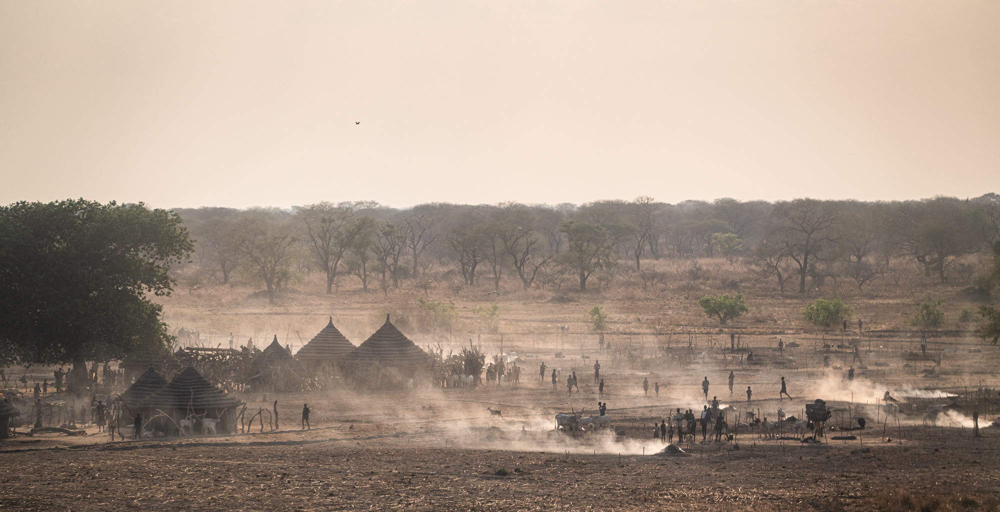
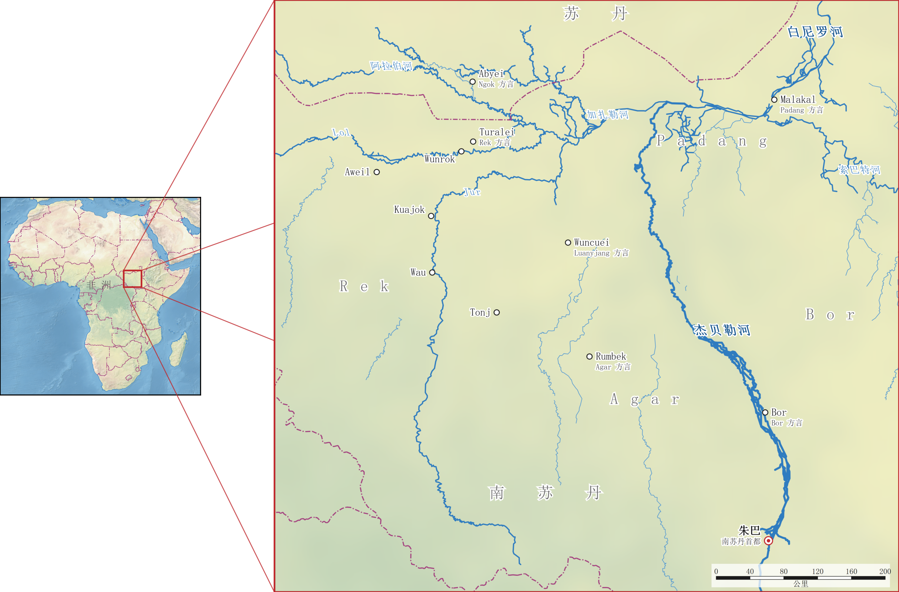
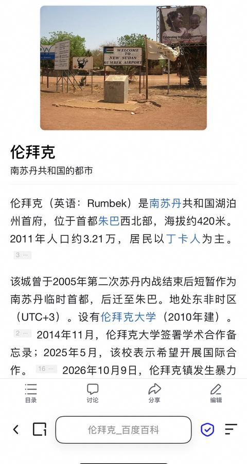

[toc]

# 问题

提问者：**<a href="https://www.zhihu.com/people/mei-guang-3">法海无边</a>**
提问时间: 2017-10-11 16:26:49
总回答数: 0
总访问量: 0

汉语是当今世界最简练的语言吗？

# 回答

回答者： **<a href="https://www.zhihu.com/people/su-wei-lin-91">陈麟阁</a>**
回答时间: 2026-10-6 13:33:3
点赞总数: 854
评论总数: 168
收藏总数: 745
喜欢总数：56

 **不是，南苏丹的 Dinka 语更简练。** 这门语言对声调的利用比汉语更充分，单音节词数量占比比汉语高。同时，汉语用虚词表达的语法范畴被它用声调、元音长度和发声类型的屈折实现，导致很多情况下它比汉语更“微言大义”。

## 一、还能再简练一点吗？

我们知道，汉语之所以简练，一是因为语素以单音节为主；二是因为声调的存在让有效音节数量增加了两倍（史有为 2019），普通话声调系统的功能负荷与一整个元音系统相当（Oh 等 2013）；三是因为少有词缀；四是因为允许大量省略，主语和宾语经常可省。

如果存在一门语言比汉语更简练，那么它肯定与汉语一样偏好单音节语素，并且少有词缀、多用省略。在这三个方面汉语基本上已经做到头了，但是汉语的音系还有改进的空间。现代汉语普通话算上声调只有 1319 个有效音节（史有为 2019），构词上多用双音节词，否则就会有歧义。如果它像上古汉语一样主要音节数量达到 2500 个（笔者据 Baxter & Sagart 2014 的构拟统计），那么构词上就可以基本只用单音节词。

不过， **上古汉语没有后世意义上的声调** 。上声和去声源自上古晚期至魏晋时期 \*-ʔ、\*-h 的脱落（Haudricourt 1954；Pulleyblank 1962；Mei 1970），上声的阴阳分化源自唐代以后声母清浊对立的消失。因此如果我们在 2500 个有效音节的基础之上再加上声调，理论上我们的有效音节可以再翻几倍。那么多出来的这些音节数量可以干什么呢？ **当然是用于屈折变化。** 现代汉语用“被、给、为、在、到、从、的、们”之类的虚词表达的语法范畴，完全可以改由音节内部的屈折来表达。

## 二、Dinka 语

Dinka 语是东非南苏丹 Dinka 人所使用的语言，属于尼罗-撒哈拉语系东苏丹语族西尼罗语支，使用者大约 400 万人，主要分布在白尼罗河及其支流沿岸，分为 Padang、Rek、Agar、Bor 四大方言区。该语言强制动词居于第二位，常用语序有 SVO 和 OVS。

Dinka 语大约有 2500 个左右的有效音节（不算声调），实词词根的音节结构是“声母＋（介音）＋韵腹＋韵尾”，介音只有 w、j 两个，屈折时可以叠加，顺序为先 w 后 j，例如 kwjɛ̀ɛl “犬齿（复数）”。辅音有塞音 /p b t̪ d̪ t d c ɟ k ɡ/、鼻音 /m n̪ n ɲ ŋ/、颤音 /r/ 和边音 /l/ 共 17 个，半元音有 /w j ɰ/ 3 个，元音有 /i e ɛ a ɔ o u/ 共 7 个。大多数音节是闭音节。

在元音音质之外，Dinka 语还有三个超音段维度：一是元音分短、中、长三级，二是发声类型有气嗓和常态两种，三是声调。所谓气嗓，是指发音时声带有点松弛，有气流漏出，有点像吴语阳调字的“浊流”。声调的数目因方言而异，Agar 方言有高、低、降三个，Luanyjang 方言另有一个升调，共四个。这跟普通话有点相似，但是普通话的元音没有长短对立，也没有气嗓，这是 Dinka 语的有效音节数量多得多的重要原因。在 Dinka 语中，这三个维度可以与元音大体自由组合（Remijsen & Manyang 2009: 114-116）。

### 1. 单音节特征

（1）核心词

Dinka 语的词根大多是单音节的。以 Swadesh 100 核心词表为例，Dinka 语有 95 个是单音节词，普通话只有 66 个。下表列出 Rek 方言群的 20 个核心词进行对比，转写按照 Remijsen 和 Manyang（2009）的体例：长元音写成两个或三个元音字母，声调标在第一个元音字母上，à、á、â、ǎ 分别表示低、高、降、升四个声调，气嗓用元音下方的两点表示：

（2）零派生

上古汉语中有一种现象：表示性质或动作的词不加任何成分，直接用来指称具有这种性质或经受这种动作的事物，这种构词法称作零派生。例如 \*ʔamʔ 既指阉割的动作“阉”，也指被阉割的人“奄”；\*gˤra 既指赤色“赮”，也指赤白杂毛的马“騢”。Dinka 语中也有类似的现象：

（3）复合词

Dinka 语的派生词和复合词一般是两个音节，与汉语的双音节词相当。例如 míkɔ̀ɔr “奸夫，淫妇”由表示施事者的前缀 mí- 加 kɔ́ɔr “通奸”构成，karàc “蛇”由复数代词前缀 ka- 加 ràc “坏”构成（现代汉语不这么做，但巧合的是上古汉语的 蝁 \*ʔˤak “毒蛇” 也是来自 恶 \*ʔˤak “坏”）。派生词多有名词前缀 a-，类似现代汉语的“-子”缀：

> a-dwàaɲ “瘸子”  
> a-ɟàak “富人” ← jak “富有”  
> a-ŋâ̤aŋ “穷人” ← ŋaŋ “贫穷”  
> a-dé̤eep “猎人”  
> a-tṳ́uuc “信使” ← tuc “派遣”

牛的毛色词和人名也常带前缀。a- 可以在毛色词上表示雌性，与之相对的 mà- 则用于公牛，如 a-t̪jé̤eeŋ 指“褐色母牛”，mà-jɔ̀ɔm 指“头带白斑的褐公牛”。Dinka 男子的名字常取自公牛的毛色名。以 a- 开头的人名也很多，例如女子名 Ayen、Acol，男子名 Atem。

复合词方面 Dinka 语与汉语类似，基本也是两个语素直接拼合而成：

> lan col “野牛” = län “动物” + col “黑”  
> raan biok “牧人” = raan “人” + biok “放牧”  
> piny ciën “东方” = piny “地” + ciën “后面”

所以在复合词这一层面，Dinka 语大体与汉语一样简练。但是这样的复合词在 Dinka 语里不算多，主流的词汇还是单音节词。在 Sun 等人（2018）编制的现代汉语词库中，双音节词占 70.4%。根据对 SIL 词典草稿（Duerksen 等 2005）中 4625 个名词、动词和形容词词条的统计，单音节词占 71%。

### 2. 语法范畴

现代汉语用“被、给、为、在、到、从、的、们”之类的虚词，以及“来、去、让、使”这类表示趋向和致使的词表达的语法范畴，Dinka 语通过音节内部的屈折来表达。下文逐项对照。如无特别说明，例句都取自 Andersen（2002，2017，2020）对 Agar 方言的描写。

（1）施受关系

汉语靠语序区分施事和受事，“狗咬人”和“人咬狗”语序相反，含义也相反。Dinka 语则可以只靠声调来区分施受关系。哪怕语序完全不变，只要给名词变个调就能将其含义颠倒：

> ɟó̤ à-kɛ̤́ɛɛc ràaan  
> 狗 陈述.单数-咬.反复 人  
> “狗在不停地咬人”  
> ɟó̤ à-kɛ̤́ɛɛc râaan  
> 狗 陈述.单数-咬.反复.非话题主语 人.斜格  
> “人在不停地咬狗”

两句话语序相同。Dinka 语规定句首的名词不论主语宾语都用原形；动词后面的名词作宾语时也用原形，作主语时则要改用斜格形式，其规律是：原形为低调，则斜格常变为降调；原形为降调，则斜格常变为低调；原形为高调，则斜格与原形相同。第一句中“人”的原形 ràaan 表示是宾语，第二句中改作降调 râaan 表示是主语。

谓语动词前的 à- 是 Dinka 语常用的陈述前缀，它同时与句首的话题保持数的一致。在 Agar 方言中，话题为单数时用 à-，为复数时用 àa- 或 áa-。动词 kɛ̤́ɛɛc 是 kac “咬”的“多次体”（ multiplicative）形式，靠加长元音表示动作反复，现代汉语要多用“不停地”三个音节才能表达。

（2）“被”

Dinka 语动词的主动和被动可以只差一个声调：

> bá̤ɲ à-tòoc d̪ɔ̤̀ɔk  
> 酋长 陈述.单数-差遣 男孩  
> “酋长在差遣男孩”  
> d̪ɔ̤̀ɔk à-tóoc  
> 男孩 陈述.单数-差遣.被动  
> “男孩在被差遣”

第一句的 à-tòoc 是低调，第二句的 à-tóoc 是高调，这就是动词主动和被动的全部区别。

被动句要引出施事时，Dinka 语也要加一个介词 nè̤，这时就与汉语的“被”打平了：

> d̪ɔ̤̀ɔk à-tóoc nè̤ bà̤ɲ  
> 男孩 陈述.单数-差遣.被动 介词 酋长.斜格  
> “男孩被酋长差遣”

上古汉语要表达相同的意思要用介词“于”，不过如果说成“童子使于君长”会有歧义，因为“于”兼可引介施事和处所，这句话可能被误解为“男孩被派去酋长那里”。但是在 Dinka 语中，nè̤ 引出施事时后面的名词要用斜格，引出处所、工具等成分时则用原形，形态上可以区分。当不用介词引出处所时，还有专门的屈折形式，即下面要讲的处所格。

（3）“在、到、从、来、去、给”

> màac “火”（原形）  
> mɛ̂ɛɛc “到火里”（向格）  
> mɛ́ɛɛc “在火里；从火里”（在离格）

Dinka 语的处所格分向格与在离格两种，分别表示“到”和“在、从”。màac “火” 的处所格在“火”的基础上加长元音、改变元音音质，“到火里”与“在火里、从火里”之间则只差声调。

有读者可能要问了，“在火里”与“从火里”同形，那不是也有歧义？不对，因为 Dinka 语的动词还有一个方向范畴，同样编码在音节内部：离心形式表示动作朝离开说话人的方向进行，相当于汉语的趋向补语“过去”；向心形式表示动作朝说话人的方向进行，相当于汉语的“过来”。彼此之间则靠声调和发声类型区分，因此句子里的动词就能分辨“在”和“从”两种意思：

> mjè̤et̪ à-tɔ̤̀ mɛ́ɛɛc  
> 食物 陈述.单数-在 火.在离格  
> “食物在火上”  
> rɛ̤́ɛc à-mṳ̀ul bèj mɛ́ɛɛc  
> 鱼 陈述.单数-爬.向心 外.向格 火.在离格  
> “鱼正从火里爬出来”

第一句话上古汉语可以说成“食在火上”，也是四个音节。第二句则不然，“鱼出于火”没法把“爬”的信息编码进去。如果一定要说，语感自然的表达是两个分句“鱼匍匐而自火出”，一共七个音节，比 Dinka 语多两个。现代汉语的“鱼正从火里爬出来”更是要八个音节。

除了方向，Dinka 语动词还有一种派生形式表示动作是为某人进行的，相当于汉语的“给、为”：

> bɛ̤́ɛr “给（某人）带”

它与向心形式 bɛ̤̀ɛr 只差声调，与离心形式 bɛ́ɛr 只差发声类型。

（4）人称

很多时候 Dinka 语的代词主语可以不出现，人称被直接编码于动词词根中。以 Bor 方言群南部的 Bor South 土语的动词 màan “恨”为例：

> mìiir ǎ-màaan  
> 长颈鹿 陈述.单数-恨.第一人称单数  
> “我在恨长颈鹿”  
> mìiir à-máan  
> 长颈鹿 陈述.单数-恨.第二人称单数  
> “你在恨长颈鹿”  
> mìiir ǎ-mɛ̀ɛɛn 长颈鹿  
> 陈述.单数-恨.第三人称单数  
> “他在恨长颈鹿”

“我”用元音加长表示，“他”用元音音质和长度表示，“你”只用声调表示。

（5）关系从句与“的”

汉语的关系从句放在中心语前面，中间要用“的”连接。Dinka 语的语序固定相反：中心语在前，并且词形改用“结构式”（construct state）。结构式是名词后面跟着修饰成分时专用的形式。单数名词的变法主要是：

-    **“阳入对转”** ：把词尾的塞音换成同部位的鼻音，比如 mòc “男人”变为 mòɲ，mèt̪ “孩子”变为 mán̪，dít “鸟”变为 dín；
-    **“阴阳对转”** ：以元音结尾的则加上鼻音，比如 ɟó̤ “狗”变为 ɟó̤ŋ。

两种情况下声调常改为高调，元音也常缩短一级，例如 mèt̪ 变为 mán̪ 时就由低调变成了高调。不过也有不少名词的结构式与原形相同，例如 rɛ̤́ɛc “鱼”。关系从句和指示词等修饰成分一律跟在中心语后面，中间不用任何连接成分，只靠词形变化表示结构关系：

> móɲ càm cwî̤in nè̤ pǎal  
> 男人.结构式 吃.主语语态 饭 介词 刀  
> “用刀吃饭的男人”  
> cwî̤in cɛ́ɛm môc nè̤ pǎal  
> 饭 吃.宾语语态 男人.斜格 介词 刀  
> “男人用刀吃的饭”  
> pǎal cɛ́ɛmè̤ môc cwî̤in  
> 刀 吃.旁格语态 男人.斜格 饭  
> “男人吃饭用的刀”

中心语在从句中充当的成分由动词的“语态”决定。动词用主语语态 càm，中心语就是“吃”的人；用宾语语态 cɛ́ɛm ，中心语就是被吃的东西；用旁格语态 cɛ́ɛmè̤，中心语就是吃的工具。中心语以外的施事“男人”则改用斜格 môc。

不过，Dinka 语的领属关系仍然要用一个相当于“的”的介词 è̤，例如 mán̪ è̤ bà̤ɲ “酋长的孩子”。有趣的是，把其中 bà̤ɲ 的低调换成高调，说成 mán̪ è̤ bá̤ɲ，è̤ 就变成了系词，整个短语的意思是“将要当酋长的孩子”。

（6）“们、些”

汉语名词通常不标数，需要时才加“们、些”或数量词。Dinka 语名词的单数和复数则是两个不同的形式。变化形式的元音音质要改变，大多还加长一级，声调也大多随之改变，少数还改变发声类型或韵尾。具体变化要逐词记忆。

只差声调的，例如：

> ròok “肾” / róok “肾（复数）”

声调与元音长度并用的，例如：

> bá̤ɲ “酋长” / bâ̤aɲ “酋长们”

笔者据 Ladd 和 Blum（2021）所附的 Luanyjang 方言名词表统计，349 对单复数形式中有 85.7% 声调不同，其中 5.4% 只差声调。汉语要明确表达复数，一般要说“孩子们”“一些虱子”，多出一两个音节。

（7）价态

Dinka 语动词所带的论元数量也由词根内部的变化控制，下面以使动和受益为例。使动派生要把元音改为超长元音。“喝”的原形 dèk 是短元音、低调、常态发声，使动形式 dê̤eek 变成超长元音、降调、气嗓。原来的直接宾语“药”要用介词 è̤ 引出：

> d̪ɔ̤̀ɔk à-dèk wá̤al  
> 男孩 陈述.单数-喝 药  
> “男孩在喝药”  
> mòc à-dê̤eek d̪ɔ̤̀ɔk è̤ wá̤al  
> 男人 陈述.单数-喝.使动 男孩 介词 药  
> “男人在让男孩喝药”

中古汉语里有类似的“四声别义”现象，把原来读平声、上声或入声的字改读去声以表使动。现代汉语中还有这种读音的留存，比如“饮（yìn）马长江”（《南齐书》）。但是这种派生方式非常不能产，而且遇到原形为去声的字就没招了，不能把“让狗咬人”说成“\*噬狗人”。Dinka 语则没有这个限制，及物动词的词根只有短元音和中长元音两类，总能再加长一级成为超长元音。所以从音系上说，每个动词都有改读为使动形式的余地。Dinka 语里没有现代汉语的“让”或“使”这样的致使动词。

受益派生则让动词直接带上受益者，不需要相当于“给、为”的介词，以 mìit “拉”为例：

> d̪ɔ̤̀ɔk à=mìit wɔ́ŋ  
> 男孩 陈述.单数=拉 牛  
> “男孩在拉牛”  
> d̪ɔ̤̀ɔk à=mî̤it wɔ́ŋ mòc  
> 男孩 陈述.单数=拉.受益 牛 男人  
> “男孩在给那个男人拉牛”

两种形式只差声调和发声类型。此外，Dinka 语还有反被动、相互、反使动等改变论元的派生，同样只在音节内部变化。

（8）名物化

汉语的动词常常可以直接当名词用，例如“射箭是一门技术”里的“射”，英语则要加后缀 -ing。Dinka 语是通过改变音节内部的元音音质、长度和发声类型来改变词性。例如 Agar 方言的动词 mòc “射”，名物化后变成 mṳ̀uc “射（这件事）”：

> mòc à=màan mṳ̀uc è̤ là̤j è̤ d̪ɔ̤̀ɔk  
> 男人 陈述.单数=恨 射.名物化.结构式 的 动物.斜格 的 男孩.斜格  
> “男人讨厌男孩射那头动物（这件事）”

巧的是，汉语的“射”在中古也有类似的分别。《广韵》中“射箭”的“射”有两读：食亦切（入声），是及物动词“射中”；神夜切（去声），表示名词性的“射礼”。今天的 shè 继承的是去声一读，词性已经无法区分。SIL 词典中这样的成对条目很多（Duerksen 等 2005，Rek 方言，未标声调）：

> cam “吃” → cäm “吃（这件事）、食物”  
> tem “切、砍” → tëm “切割、收割（这件事）”  
> lɔc “挑选” → löc “挑选（这件事）”  
> kual “偷” → kuël “偷窃（这件事）”

## 三、Dinka 语的诗歌

最后我们来看看 Dinka 语的文本。Twic 地区的 Bol Bol Akot 为另一位族人 Deng Deng Cier 写就了一首《牛歌》（ _kɛ̤ɛp_ ），讲述其牛与家世。这首诗类似《诗经·鲁颂·駉》，以牲畜的毛色颂扬主人。它由物起兴，先唱 Mayom 这头“头带白斑的褐牛”，再转入颂扬牛的主人和他的祖辈，同一节反复重章叠唱。以下是节选：

> a-dò̤ol èe wéŋ a-t̪jé̤eeŋ  
> 珍贵的是褐色母牛，  
> bṳ̂uuɲ cjɛ́ɛɛŋ jɔ̀ɔm肥壮，披着白斑，  
> à-dô̤ol wéŋ a-t̪jé̤eeŋ bṳ̂uuɲ cèŋ jɔ̀ɔm à-cí̤i jjéek n̪òm gjɛ̀ɛɛt bì̤ jàa jêen mà-jɔ̀ɔm  
> 珍贵的褐色母牛，肥壮、披着白斑，头上做了记号，要做 Mayom。  
> kwàat jɔ̀ɔm à-cèe láac jɔ́ɔk  
> 这种白斑牛很难得，  
> jèen a keek èe ɲwà̤aat̪ kè dɛ̤́ɛɛl è̤ gɔ́ɔl n̪òm  
> 它在牛粪火边啃草根。  
> mà-jɔ̀ɔm è̤ kwè̤ej èe mà-jɔ̀ɔm è̤ dèeŋ jwàan è̤ kwè̤ej  
> Kuei 家的 Mayom，就是 Deng Yuan Kuei 的 Mayom，  
> à-jèe wè̤n è̤ cé̤eer aɟìiŋ ké̤eer  
> 他是 Cyer Ajing Ker 的儿子，  
> bá̤ɲ jèen èe wṳt kwáaat̪ t̪wɔ̀ɔŋ-dè  
> 是酋长，一句话号令牛营，  
> à-cí̤i píiŋ ci̤me̤nè̤ mwɔ̀ɔɔr ŋáak n̪òm  
> 人们听他，就像听戴冠的王，  
> à-cí̤i píiŋ ci̤me̤n mwɔ̀ɔɔr ŋáak n̪òm  
> 人们听他，就像听戴冠的王。

这一节共 87 个音节，汉语译文 108 个音节。单从音节数量看比汉语少约 19%，美中不足是拉丁字母的转写在视觉上还是比汉字更长。就简练程度而言 Dinka 语非常不错，音系极大丰富，同音字基本消灭，字正腔圆，语法范畴也受重视。如果再用汉字书写，可能就是我们理想中的微言大义的语言。

最后是一段 Dinka 语的语流录音，是 Twic West 方言的 Kodok Chan Amal 在朗诵诗歌之前的开场白：

%

## 主要文献

［1］ 史有为. 带调音节：解释汉语的一个出发点［J］. 华东师范大学学报（哲学社会科学版）, 2019, 51(3): 1-17.  
［2］ OH Y M, PELLEGRINO F, COUPÉ C, et al. Cross-language comparison of functional load for vowels, consonants, and tones［C］//Proceedings of Interspeech 2013. Lyon: ISCA, 2013: 3032-3036.  
［3］ BAXTER W H, SAGART L. Old Chinese: a new reconstruction［M］. Oxford: Oxford University Press, 2014.  
［4］ HAUDRICOURT A G. De l'origine des tons en vietnamien［J］. Journal Asiatique, 1954, 242: 69-82.  
［5］ PULLEYBLANK E G. The consonantal system of Old Chinese［J］. Asia Major, 1962, 9: 58-144, 206-265.  
［6］ MEI T-L. Tones and prosody in Middle Chinese and the origin of the rising tone［J］. Harvard Journal of Asiatic Studies, 1970, 30: 86-110.  
［7］ REMIJSEN B, MANYANG C A. Luanyjang Dinka［J］. Journal of the International Phonetic Association, 2009, 39(1): 113-124.  
［8］ DUERKSEN J, et al. Dinka-English dictionary［Z］. Draft. SIL, 2005.  
［9］ REMIJSEN B, LADD D R. The tone system of the Luanyjang dialect of Dinka［J］. Journal of African Languages and Linguistics, 2008, 29(2): 173-213.  
［10］ ANDERSEN T. Multiple adnominal modification in Dinka: chaining construct states［J］. Studies in African Linguistics, 2020, 49(2): 273-304.  
［11］ LADD D R, BLUM M L. On the systematic nature of Dinka noun number morphology［J］. Journal of African Languages and Linguistics, 2021, 42(2): 223-252.  
［12］ ANDERSEN T. Case inflection and nominal head marking in Dinka［J］. Journal of African Languages and Linguistics, 2002, 23: 1-30.  
［13］ STORCH A. The noun morphology of Western Nilotic［M］. Köln: Rüdiger Köppe, 2005.  
［14］ BLUM M L. Aspects of cross-variety Dinka tonal phonology［D］. Edinburgh: University of Edinburgh, 2023.  
［15］ ANDERSEN T. Vowel quality alternation in Dinka verb derivation: the Agar variety［J］. Journal of African Languages and Linguistics, 2017, 38(1): 1-50.  
［16］ VAN URK C. On C and T, Ā-movement and “marked nominative” in Dinka［Z］. Handout, GLOW 37. Brussels, 2014.  
［17］ 徐杰, 张林林. 疑问程度和疑问句式［J］. 江西师范大学学报（哲学社会科学版）, 1985(2).  
［18］ ANDERSEN T. Morphological stratification in Dinka: on the alternations of voice quality, vowel length and tone in the morphology of transitive verbal roots in a monosyllabic language［J］. Studies in African Linguistics, 1992-1994, 23(1): 1-64.  
［19］ LADD D R, IMPEY A, REMIJSEN B, et al. A collection of Dinka songs［DS/OL］. Edinburgh: University of Edinburgh, 2012. [http://hdl.handle.net/10283/155](http://hdl.handle.net/10283/155).  
［20］ SUN C C, HENDRIX P, MA J, et al. Chinese lexical database (CLD): a large-scale lexical database for simplified Mandarin Chinese［J］. Behavior Research Methods, 2018, 50(6): 2606-2629.  
［21］ VAN URK C. A uniform syntax for phrasal movement: a case study of Dinka Bor［D］. Cambridge, MA: Massachusetts Institute of Technology, 2015.

  

原文地址：[(陈麟阁)汉语是当今世界最简练的语言吗？](https://www.zhihu.com/question/66497764/answer/2090796722968584282) 

# 评论

1. <a href="https://www.zhihu.com/people/han-de-ke-42">韩德克</a> (<small title="海南">2026-10-6 18:40:57</small>): [丁卡族](https://www.zhihu.com/search?comment_id=11590633426&comment_type=COMMENT&content_id=800262593&content_type=answer&q=%E4%B8%81%E5%8D%A1%E6%97%8F&request_click_id=79b2b283-a22a-40b9-97e2-79b5813ba043&search_source=CommentEntity)的姓氏非常东亚，一大堆什么姓Deng，姓Chan，姓Tang的
   - <a href="https://www.zhihu.com/people/jack-57-97-66">Jack</a> (<small title="广东">2026-10-6 18:51:0</small>): 趋同演化
   - <a href="https://www.zhihu.com/people/sjsom-63">施诺威</a> (<small title="湖北">2026-10-7 1:8:23</small>): 这太有意思了，应该研究这个民族的来历与演变。［赞］
   - <a href="https://www.zhihu.com/people/87-88-33-11">瓢虫飞翔</a> (<small title="北京">2026-10-7 2:11:51</small>): 原因会不会就是答主说的，单音节词占多数？
   - <a href="https://www.zhihu.com/people/jsuser">IQTester</a> (<small title="回复于 2026-10-7 6:22:14/山东"> ✉️:施诺威</small>): 不用研究，秦时避难，躲非洲去了
   - <a href="https://www.zhihu.com/people/xxxx-59-56">xxxx</a> (<small title="回复于 2026-10-7 8:30:48/四川"> ✉️:IQTester</small>): 为什么不是殷商后裔？［捂脸］［捂脸］［捂脸］［捂脸］［捂脸］［捂脸］
   - <a href="https://www.zhihu.com/people/sjsom-63">施诺威</a> (<small title="回复于 2026-10-7 9:24:25/湖北"> ✉️:IQTester</small>): 有没有可能是古埃及语言的延续？
   - <a href="https://www.zhihu.com/people/ijik-39">ijik</a> (<small title="回复于 2026-10-7 9:26:44/河北"> ✉️:IQTester</small>): 俊福来了
   - <a href="https://www.zhihu.com/people/jack-57-97-66">Jack</a> (<small title="回复于 2026-10-8 21:35:36/广东"> ✉️:施诺威</small>): 最黑、个子最高的民族，与中国人有关系？是中彩了还是？
   - <a href="https://www.zhihu.com/people/ivx681">yvx852</a> (<small title="山东">2026-10-10 17:38:35</small>): 罗尔邓是吧
   - <a href="https://www.zhihu.com/people/aphonia-sniper">广思</a> (<small title="回复于 2026-10-12 8:32:48/北京"> ✉️:IQTester</small>): 你胡说 我看肯定是郑和船队的后代！我大明天下无敌！
   - <a href="https://www.zhihu.com/people/cmthi2">Ataka ariga</a> (<small title="回复于 2026-10-12 15:38:33/甘肃"> ✉️:IQTester</small>): 你需不需要稍微看一下丁卡族的照片［思考］
   - <a href="https://www.zhihu.com/people/98-58-61-77">神楽坂 慕凌</a> (<small title="回复于 2026-10-12 17:5:36/河北"> ✉️:Ataka ariga</small>): 他可能在反串吧
   - <a href="https://www.zhihu.com/people/feilongzhang">张飞龙</a> (<small title="美国">2026-10-16 3:7:39</small>): 结构决定了相遇：“单音节格子”的必然碰撞，丁卡语和汉语一样，都高度偏好“单音节语素”。  
 
人类的发音器官是相同的，一个单音节通常由“辅音（声母）+ 元音（韵母）”组成。由于丁卡语和（古代）汉语都致力于把一个完整的意思压缩进一个音节里，那么它们在排列组合音节时，就必然会走进同一个“语音格子”里。在单音节中，像 /d/、/t/、/c这样的塞音和塞擦音，搭配 /a/、/i/、/e/、/ŋ/ (ng)、/n/ 这样的元音和鼻音，是人类语言里最容易发出、听觉上最清晰的组合。因此，汉语里演化出了“丁（Ding）、唐（Tang）、陈（Chen）”，而丁卡语在分配它的单音节姓名时，也极为自然地造出了完全相同的读音。其实英语里也非常多比如King，Sing，Wing，Ring等。
   - <a href="https://www.zhihu.com/people/33-72-73-8-96">AlphaOmega</a> (<small title="北京">2026-10-22 21:27:39</small>): 666还有趋同进化
2. <a href="https://www.zhihu.com/people/87-88-33-11">瓢虫飞翔</a> (<small title="北京">2026-10-6 21:14:47</small>): ［赞］
3. <a href="https://www.zhihu.com/people/mo-mo-mo-37-33-57">神奇的高玩</a> (<small title="山东">2026-10-8 12:3:40</small>): 在语言学这方面你不要自信不管是中国，西方还是俄罗斯日本往往都很难拿到语言学方面某一项的第一因为永远有一些非洲的和美洲的野人，极端的生态环境导致他们会发展出一个特定的语言问出这个问题的人是被典型的东西方二元论洗脑了，广大的印度，非洲，美洲都有自己独特的书写方式，并且思维逻辑完全和汉语英语不同，但是他们的声音太小，让世界听不见  
 
  
 
作者：小帽officials  
 
链接：[https://www.zhihu.com/question/652795747/answer/3489218234](https://www.zhihu.com/question/652795747/answer/3489218234)  
 
来源：知乎  
 
著作权归作者所有。商业转载请联系作者获得授权，非商业转载请注明出处。
 
  
 
  
 
很久之前看到的回答具象化了［大笑］［大笑］［大笑］
4. <a href="https://www.zhihu.com/people/lei-lei-3-86-67">约瑟夫·乔万尼</a> (<small title="美国">2026-10-6 21:57:21</small>): NACLO 2022 N.
 
这门语言有整整一百多万人使用，是一门相当大的语言了
   - **陈麟阁** (<small title="美国">2026-10-6 22:28:34</small>): 100 万的统计方法可能只算了部分分支，包括所有方言在内大约 400 万人
   - <a href="https://www.zhihu.com/people/lei-lei-3-86-67">约瑟夫·乔万尼</a> (<small title="回复于 2026-10-7 7:0:8/美国"> ✉️:陈麟阁</small>): 居然这么大众［脑爆］
5. <a href="https://www.zhihu.com/people/aengmore">NGESHNIMBAR</a> (<small title="辽宁">2026-10-6 22:41:30</small>): 这就是语言，和语言学的魅力。
 
一切皆有可能，这就是语言。
   - <a href="https://www.zhihu.com/people/qia-qia-qia-53-36">咔咔咔</a> (<small title="新疆">2026-10-6 22:51:40</small>): 你是对的，对自己不了解的东西，充满敬畏，多去了解，少些论断才是对的。与评论区各种角度的赢学相比，你真是一股清流。
   - <a href="https://www.zhihu.com/people/initR0xardyetoantin">initR 0xardye</a> (<small title="回复于 2026-10-7 2:13:14/美国"> ✉️:咔咔咔</small>): 同意。分享之前看到的一句话：世界上有几千门语言，汉语英语俄语（只考虑语言本身）其实很难在哪个地方称第一。本来拿语言来赢输就很莫名其妙
   - <a href="https://www.zhihu.com/people/wei-lian-ke-69">胡锡退</a> (<small title="广东">2026-10-7 17:20:55</small>): （在发声结构的生物限制内［爱］）
6. <a href="https://www.zhihu.com/people/li-deng-xuan-84">其实我叫王尼玛</a> (<small title="乌干达">2026-10-7 1:55:27</small>): 我真有朋友会说Dinka语
   - <a href="https://www.zhihu.com/people/chyndoh-kau">高川渡高老鼠</a> (<small title="北京">2026-10-8 17:9:13</small>): 这个ip我信
7. <a href="https://www.zhihu.com/people/chyndoh-kau">高川渡高老鼠</a> (<small title="北京">2026-10-8 17:12:58</small>): 这套音节结构真够《切韵》的，甚至都没见复辅音，太有意思
8. <a href="https://www.zhihu.com/people/feilongzhang">张飞龙</a> (<small title="美国">2026-10-16 3:2:13</small>): 丁卡语把海量的语法信息压缩进一个音节里，代价是它的音系复杂到令人发指。说话者必须极其精准地控制声带的松紧（区分普通声和气声）、气流的长短（区分短、长、超长元音）以及音高，稍有偏差，整个句子的主谓关系、时态、单复数就会彻底出错。如果将“简练”定义为“用最少的音节传递最复杂的语法和语义信息”，那么南苏丹的丁卡语确实在这一项上超越了现代汉语。但这种“简练”并非没有代价，它将所有的复杂度都转移到了发音和听觉辨析的极高门槛上。成年人的语音塑造期已经过去，几乎不可能完美掌握丁卡语这种三维一体的精细发音。如果外来者学不会，这门语言就无法成为更大区域的通用语。  
 
当社会进入工业时代、信息时代，需要井喷式地创造几万个新词（如“半导体”、“量化宽松”、“人工智能”）时，丁卡语的单音节格子早就被复杂的语法占满了。它没有多余的“空白单音节”去对应新事物，最终为了表达新词，它也不得不走向类似汉语的“多音节复合”（比如把几个词拼在一起）。  
 
  
 
汉语之所以能拥有几乎无限制的、非外语拼写式的自主造词能力，是因为汉字是“天然的模块化系统”。每一个汉字都是一个高内涵的逻辑积木（如“网”、“络”、“软”、“件”），可以无限拼装，且拼出来的新词依然保持短小精悍（通常为双音节或三音节），大脑在视觉上能瞬间识别。  
 
  
 
而丁卡语这种语言，它在漫长的历史中把技能点全部加在了“语音维度的极限精简压缩”上。当社会突然需要容纳互联网时代的几十万个新概念时，它的“声调、元音长短、气声”格子已经被日常的动作和语法牢牢占满，没有多余的底层单音节可以用。因此，在现代化的冲击下，它不可避免地要走向大量借用英语和阿拉伯语直接拿来当片假名的道路。  
 
  
 
丁卡语的简练是“生理级”的：它是在人类没有文字、社会规模较小时，利用人类发音器官的物理极限（声调、长短、气声），把信息塞进单音节里。  
 
  
 
汉语的简练是“文明级”的：它是在数千年文字演变、历史堆叠、文化高度成熟后，利用“字形”和“典故”，把海量的信息、情感和历史逻辑压缩进短短几个音节里。（比如：完璧归赵，四个字浓缩千年文明）  
 
  
 
所以，如果只比日常口语中表达“被子被风吹跑了”谁的音节少，丁卡语可能更少；但如果比表达复杂的人类情感、历史兴衰和哲学思辨谁更简练，拥有音形义结合与海量成语的汉语，是当之无愧的效率之王。
   - <a href="https://www.zhihu.com/people/hnu9el">知乎用户HNu9El</a> (<small title="安徽">2026-10-23 6:10:44</small>): 更何况汉语的双音节词老早就有了，搞的好像工业时代才冒出来的一样。
   - <a href="https://www.zhihu.com/people/hnu9el">知乎用户HNu9El</a> (<small title="安徽">2026-10-23 6:25:25</small>): 起码楼主这篇回答是在实事求是的回答问题，评论区其他人都在领略语言多样性的奇妙，莫名冒出来一些人搞赢学就很煞风景。一会儿跟西方文字比简洁一会儿又嫌弃这dinka语发音太复杂，还是那句话，人家一样能嫌弃你汉字难写，因为自己会所以没有自觉，对陌生的困难反而敏锐的要死。反正一说就是中庸之道，掌握了最好的那个平衡点，咋说咋有理。
9. <a href="https://www.zhihu.com/people/kxc-43">寒天d</a> (<small title="广东">2026-10-6 13:49:27</small>): 这门语言会不会也很适合用类似汉字的形式表记
   - **陈麟阁** (<small title="上海">2026-10-6 13:53:1</small>): 可以，但是不加额外的语法标记的话可能比《尚书》还费解
   - <a href="https://www.zhihu.com/people/abcdefgh-40">abcdefgh</a> (<small title="上海">2026-10-6 14:34:27</small>): 汉字本身缺乏对声调词尾等曲折的描述手段。比如陈胜王的王变调就无法通过汉字来表现。日语为了表示曲折粘着需要汉字+假名来表达。  
 
文中语言配合汉字+代表声调的假名可能更合适。
   - <a href="https://www.zhihu.com/people/hu-po-lun-92">芙破仑</a> (<small title="回复于 2026-10-6 16:8:49/加拿大"> ✉️:陈麟阁</small>): 是否由于音节区分度过高，导致要大量用到生僻字［捂脸］
   - <a href="https://www.zhihu.com/people/napoleone-buonaparte-38">Napoleone Buonaparte</a> (<small title="回复于 2026-10-7 2:34:18/广东"> ✉️:abcdefgh</small>): 那是现代人为了区分古文中的动名词给变的调，陈胜那个时候未必变调
   - **陈麟阁** (<small title="回复于 2026-10-7 8:36:32/美国"> ✉️:Napoleone Buonaparte</small>): 陈胜那会还没有后世意义上的去声，作动词的“王”读作 \*waŋh，比原形多一个 \*-h。之后 \*-h 拉低元音基频产生了去声。\*-h 来自先周时期的 \*-s，\*-s 可能来自更早的动词化后缀 \*-t
   - <a href="https://www.zhihu.com/people/amin-64-13">Amin</a> (<small title="广东">2026-10-7 11:25:9</small>): 可以引入汉字和假名诶
   - <a href="https://www.zhihu.com/people/abcdefgh-40">abcdefgh</a> (<small title="回复于 2026-10-7 12:35:11/上海"> ✉️:Napoleone Buonaparte</small>): 陈胜那个年代是后面加了个-s词尾名词变动词，汉字更没法表达了
10. <a href="https://www.zhihu.com/people/aengmore">NGESHNIMBAR</a> (<small title="辽宁">2026-10-6 22:47:37</small>): 如果这样的民族发明了表意文字......
 
如果[苏美尔语](https://www.zhihu.com/search?comment_id=11591301539&comment_type=COMMENT&content_id=800262593&content_type=answer&q=%E8%8B%8F%E7%BE%8E%E5%B0%94%E8%AF%AD&request_click_id=79b2b283-a22a-40b9-97e2-79b5813ba043&search_source=CommentEntity)的音系本来是这样复杂......
11. <a href="https://www.zhihu.com/people/qia-qia-qia-53-36">咔咔咔</a> (<small title="新疆">2026-10-6 23:19:20</small>): dinka语在各方各面都像是上古汉语异父异母的亲兄弟，但是我说个暴论：在没有世界主流语言的冲击下，如果该语言传下来并连续演化，过个几百年，音系、语法、屈折变化各方各面都会迅速崩解。［吃瓜］今天用文字记载下来的资料，不管是汉字式标记还是纯表音字母，在后世都会极为费解。
12. <a href="https://www.zhihu.com/people/initR0xardyetoantin">initR 0xardye</a> (<small title="美国">2026-10-7 2:7:50</small>): 听说赵元任的[五度标记法](https://www.zhihu.com/search?comment_id=11590985538&comment_type=COMMENT&content_id=800262593&content_type=answer&q=%E4%BA%94%E5%BA%A6%E6%A0%87%E8%AE%B0%E6%B3%95&request_click_id=63a7fd0f-5657-4a1b-b81e-a0c7e16908cf&search_source=CommentEntity)后来也用来表述非洲语言。赵元任还是太天才了
13. <a href="https://www.zhihu.com/people/aphonia-sniper">广思</a> (<small title="北京">2026-10-12 9:15:44</small>): 听上去是一种广西方言［捂脸］［捂脸］
    - <a href="https://www.zhihu.com/people/zhu-ce-tai-nan">注册太难</a> (<small title="福建">2026-10-16 6:50:40</small>): 有点像涯话
14. <a href="https://www.zhihu.com/people/momo-63-61-90-74-67">momo</a> (<small title="江苏">2026-10-6 22:19:44</small>): ［抱抱］
15. <a href="https://www.zhihu.com/people/wirohjn-nedunch">至騷歹幻索賾</a> (<small title="江西">2026-10-7 17:5:37</small>): 有幸零距离在某地(非苏丹南苏丹)见过不少丁卡人，也好奇地听过一回他们的语言，听感非常独特
16. <a href="https://www.zhihu.com/people/Lukeyuan">百万光年</a> (<small title="澳大利亚">2026-10-6 22:36:2</small>): 终于知道不会汉语的人听汉语是什么感觉了［捂脸］
17. <a href="https://www.zhihu.com/people/wxdata-82">wxdata</a> (<small title="广东">2026-10-20 18:20:8</small>): Deng Yuan Kuei 给我整恍惚了，第一反应是邓元魁？我还以为是某华人去非洲当酋长的故事［惊喜］
18. <a href="https://www.zhihu.com/people/jack-57-97-66">Jack</a> (<small title="广东">2026-10-6 18:50:20</small>): 全世界最高，全世界最黑
19. <a href="https://www.zhihu.com/people/chao-ji-wu-liao-xiao-ge-ge">王小遥</a> (<small title="柬埔寨">2026-10-6 19:22:11</small>): 越南语是不是单音节词也挺多的，而且声调很复杂？
    - <a href="https://www.zhihu.com/people/hu-hu-lai-zhe">忽忽来者</a> (<small title="浙江">2026-10-7 7:5:1</small>): ［思考］你就当是汉语方言。
20. <a href="https://www.zhihu.com/people/kelvin-71-69">Kelvin</a> (<small title="江苏">2026-10-12 12:34:41</small>): 某种意义上听起来有点儿像不懂的汉语方言（？）说话含混但是抑扬顿挫的感觉
21. <a href="https://www.zhihu.com/people/2333sa-ki">知乎用户</a> (<small title="广东">2026-10-6 16:51:25</small>): 应该是可以用类似汉字的形式表记，音调变化导致的词性变化可以总结成语法，看上下文就知道读法了。如果大部分单词仅看上下文和语法规律无法推导出读法和意思，才不适合类汉字表记。［思考］
22. <a href="https://www.zhihu.com/people/yu-zhu-15-39">雨竹</a> (<small title="福建">2026-10-6 15:39:32</small>): 不知道它用谚文转写怎么样
23. <a href="https://www.zhihu.com/people/hu-hu-lai-zhe">忽忽来者</a> (<small title="浙江">2026-10-7 0:13:32</small>): ［思考］我发现：眼，脚，脑，蛋和汉语同源
    - <a href="https://www.zhihu.com/people/2-34-58-68-96">草木树海2</a> (<small title="海南">2026-10-8 0:3:52</small>): raan “人”也是
    - <a href="https://www.zhihu.com/people/hu-hu-lai-zhe">忽忽来者</a> (<small title="回复于 2026-10-8 15:46:43/浙江"> ✉️:草木树海2</small>): ［思考］可能就是中国人的后裔
    - <a href="https://www.zhihu.com/people/shou-ren-shou-shi-4">熟人熟事</a> (<small title="回复于 2026-10-9 1:55:24/四川"> ✉️:忽忽来者</small>): 中国人祖先在非洲
24. <a href="https://www.zhihu.com/people/deus-84-6">某领域的饮冰野人</a> (<small title="江苏">2026-10-6 16:36:15</small>): 像东亚语言异父异母的兄弟
    - <a href="https://www.zhihu.com/people/abcdefgh-40">abcdefgh</a> (<small title="上海">2026-10-6 20:52:18</small>): 看b站还有个北美原住民的混合语chinuk wawa也如同汉语异父异母的兄弟
25. <a href="https://www.zhihu.com/people/zhang-jun-93-76-98">张军</a> (<small title="美国">2026-10-23 2:7:9</small>): 请把Dinka语写成的计算机实用教程贴出一段来。如果土人只需要表达吃喝拉撒睡，那当然最简洁不过
26. <a href="https://www.zhihu.com/people/lin-shi-gong-9">临时工</a> (<small title="辽宁">2026-10-6 15:58:54</small>): 有入声吗
    - <a href="https://www.zhihu.com/people/27-9-23-51-5">T0勇者大人lover</a> (<small title="上海">2026-10-6 16:12:14</small>): 塞音结尾的就是入声
    - **陈麟阁** (<small title="美国">2026-10-6 18:52:18</small>): \-p -t̪ -t -c -k
    - <a href="https://www.zhihu.com/people/abcdefgh-40">abcdefgh</a> (<small title="回复于 2026-10-6 20:51:14/上海"> ✉️:陈麟阁</small>): 塞音韵尾除阻吗？
    - **陈麟阁** (<small title="回复于 2026-10-6 21:34:31/美国"> ✉️:abcdefgh</small>): 停顿前不除阻，后接元音时除阻
    - <a href="https://www.zhihu.com/people/abcdefgh-40">abcdefgh</a> (<small title="回复于 2026-10-6 21:45:49/上海"> ✉️:陈麟阁</small>): 接元音才除阻，意味着是不是要连读？类似于韩语处理汉字入声那样连读
    - **陈麟阁** (<small title="回复于 2026-10-6 22:7:7/美国"> ✉️:abcdefgh</small>): 对
27. <a href="https://www.zhihu.com/people/sjsom-63">施诺威</a> (<small title="湖北">2026-10-7 1:6:48</small>): 很好的文章！［赞］ 就是音节一词会有歧义，是一个音，还是一个音节？这是完全不同的。西语pa:k的k是发音的，实际上是两个音，而粤语pak的k仅是收尾口型，不发音，是一个音。那么Dinka语应该是一个音？！
    - **陈麟阁** (<small title="美国">2026-10-7 8:28:9</small>): 是一个音节，pa:k 和pak 都是一个音节。音节数量只取决于响度峰值的数量。看我这篇文章第一节关于单音节的论述：汉语是世界上唯一的单音节语言吗？ - 陈麟阁的回答 - 知乎
 
[汉语是世界上唯一的单音节语言吗？](https://www.zhihu.com/question/22987681/answer/2084789205079795145)
    - <a href="https://www.zhihu.com/people/sjsom-63">施诺威</a> (<small title="回复于 2026-10-7 9:30:22/湖北"> ✉️:陈麟阁</small>): 这可能成为一个学术问题。西方辅音发音规则里是含有弱元音的，是独立的音，只是弱而短促，东方的辅音收尾（入声）是完全没有元音的，只有口型，是真正的纯辅音，不占音时！
    - <a href="https://www.zhihu.com/people/aengmore">NGESHNIMBAR</a> (<small title="回复于 2026-10-7 10:37:24/辽宁"> ✉️:施诺威</small>): 含有弱元音？怎么知道？凭你的听感？
    - <a href="https://www.zhihu.com/people/sjsom-63">施诺威</a> (<small title="回复于 2026-10-13 6:21:30/湖北"> ✉️:NGESHNIMBAR</small>): 辅音是不发音的，只有口型！了解一下粤语你应该能够明白，入声收尾的k，t，p才是纯辅音收尾，英语的带有元音，只是轻而短促。
28. <a href="https://www.zhihu.com/people/82-81-4-93">背包客 gunners</a> (<small title="广东">2026-10-10 18:24:14</small>): 屈折化程度比汉语高多了  
 
想知道还有没有什么语言是元音长度三重对立的，这个特征感觉非常罕见
29. <a href="https://www.zhihu.com/people/mario99">Mario</a> (<small title="上海">2026-10-6 17:39:42</small>): 这感觉像是《上帝也疯狂》里的语言
    - <a href="https://www.zhihu.com/people/argonauta">Argonauta</a> (<small title="浙江">2026-10-6 20:25:45</small>): 上帝也疯狂的主角是科伊桑人，是最早分化的现代人单倍群，语言特色是弹舌音
30. <a href="https://www.zhihu.com/people/zhong-yong-zhi-cai-du-gu-qiu-bai-93">OrramaxSitorion</a> (<small title="北京">2026-10-7 14:8:59</small>): 是打井的故事里面的那个丁卡族吗这［感谢］
31. <a href="https://www.zhihu.com/people/yiye-hua-ying-man">AstraMarisa</a> (<small title="吉林">2026-10-6 22:30:29</small>): dinka的亲属语言是什么风格的，就这一支演化出这么复杂的超音段功能吗
32. <a href="https://www.zhihu.com/people/lin-sheng-1-7">林生</a> (<small title="广西">2026-10-7 2:46:13</small>): 只要是字母类拼音类的，没有可能比得过汉语。  
 
因为汉语是全息文字。。。
    - <a href="https://www.zhihu.com/people/aengmore">NGESHNIMBAR</a> (<small title="辽宁">2026-10-7 8:56:29</small>): 什么是“全息”？
33. <a href="https://www.zhihu.com/people/hcf">碳基大模型</a> (<small title="湖北">2026-10-6 19:31:52</small>): 尬吹各种语言，反正绝不愿承认汉语汉字的优点。还有说啥语言循环演化论，不肯承认分析语也就是[孤立语](https://www.zhihu.com/search?comment_id=11591036935&comment_type=COMMENT&content_id=800262593&content_type=answer&q=%E5%AD%A4%E7%AB%8B%E8%AF%AD&request_click_id=7447b11f-2a52-408f-be96-b7102505fb53&search_source=CommentEntity)是最成熟的，svo语序比sov这种儿童语序更成熟，等等
    - <a href="https://www.zhihu.com/people/patricius-flavius">丹东骨科张主任</a> (<small title="加拿大">2026-10-6 19:42:30</small>): 世界上有几种语言比汉语更简洁这件事情又不否定汉语的优点，非得啥都争个世界第一才符合你口中的承认么
    - <a href="https://www.zhihu.com/people/mouzha">梅诺·伊特鲁斯</a> (<small title="辽宁">2026-10-6 19:49:40</small>): 那还说啥了兄弟，不就是想跳过论证阶段直接赢吗，我承认汉语最优秀最高效，行了吧
    - <a href="https://www.zhihu.com/people/qia-qia-qia-53-36">咔咔咔</a> (<small title="新疆">2026-10-6 21:35:20</small>): 尬吹在哪？人家列举了该语言各种特点，并将之与极端凝炼的上古汉语做比较，有理有据，结论不言自明。反而是你，任何民族任何国家都有尬吹自己民族语言最优秀而不愿承认现实的，我国我语也不例外，毫无理性、夜郎自大。你所吹捧这个行为本身，和被你轻视的诸国语言的母语者中吹自己母语最优秀的人的行为，没有什么本质区别。
    - <a href="https://www.zhihu.com/people/building-boy">Building boy</a> (<small title="浙江">2026-10-6 21:38:26</small>): 就像新广告法，看到最字就要很谨慎了
    - <a href="https://www.zhihu.com/people/yue-ming-ren-yi-lou-4-36">Plasma</a> (<small title="美国">2026-10-6 21:38:35</small>): 神人
    - <a href="https://www.zhihu.com/people/chivliu">chivliu</a> (<small title="上海">2026-10-6 21:41:56</small>): 魔怔民族主义［发呆］
    - <a href="https://www.zhihu.com/people/hcf">碳基大模型</a> (<small title="回复于 2026-10-6 22:46:21/河北"> ✉️:咔咔咔</small>): 你这是没有是非的虚无主义观点，我看到吹嘘屈折语那段就看不下去了。
    - <a href="https://www.zhihu.com/people/aengmore">NGESHNIMBAR</a> (<small title="回复于 2026-10-6 22:53:3/辽宁"> ✉️:碳基大模型</small>): 凭什么这么说？给个理由？
    - <a href="https://www.zhihu.com/people/aengmore">NGESHNIMBAR</a> (<small title="辽宁">2026-10-6 22:53:24</small>): 那我问你：何谓“成熟”？怎么定义“成熟”？用什么科学、客观、可操作的标准去度量“成熟”程度？
    - <a href="https://www.zhihu.com/people/aengmore">NGESHNIMBAR</a> (<small title="辽宁">2026-10-6 22:54:13</small>): 另外，答主的论述与说理有任何不足吗？请具体指出
    - <a href="https://www.zhihu.com/people/hcf">碳基大模型</a> (<small title="回复于 2026-10-6 23:6:42/河北"> ✉️:NGESHNIMBAR</small>): 比如中华文明是连续性最好的，有人就偏要找十几个刁钻角度挖出埃塞俄比亚亚美尼亚日本之类说是连续性更好的文明。这文章味道差不多
    - <a href="https://www.zhihu.com/people/qia-qia-qia-53-36">咔咔咔</a> (<small title="回复于 2026-10-6 23:12:56/新疆"> ✉️:碳基大模型</small>): 千言万语就一句话，你无法接受自己的国家和语言并没有在所有方面都做到必须赢这个事实［吃瓜］
    - <a href="https://www.zhihu.com/people/aengmore">NGESHNIMBAR</a> (<small title="回复于 2026-10-6 23:23:49/辽宁"> ✉️:碳基大模型</small>): 为什么说这文章「味道差不多」？给个理由？
    - <a href="https://www.zhihu.com/people/cyf-95-43">cyf</a> (<small title="回复于 2026-10-7 11:6:9/浙江"> ✉️:碳基大模型</small>): 扯这么多干嘛，你不就是想看赢学嘛
    - <a href="https://www.zhihu.com/people/paon-54">paon</a> (<small title="回复于 2026-10-23 3:2:8/河北"> ✉️:丹东骨科张主任</small>): 因为人家说得没错呀。这个问题就是伪命题，“微言大义”实际上是就符号的紧凑、暧昧（包含多种意思，但所有意思同时存在。compact出自沃格林，ambigu出自朱利安），所对应经验的笼统性、全面性（尚未进一步细分的、乃至于不可分开的原始经验）讨论的。这些符号在使用的时候会根据情境or方向的不同，分化出各种不同的意思（比如“道”的各种意思），但又会回到那个紧凑的整体（“道”本身），所以才显得“精深微妙”（“令人既着迷又恼火”），并不是单纯的语言形式就能说清楚的。  
 
  
 
即便是讨论狭义的“微言大义”，也就是通过细节、措辞、材料取舍和全文结构安排曲折地表达价值判断也是一样。这并不是通过语言本身来表达的，而是通过有序文本背后的一种理性结构来表达的（比如所谓互文见义、比经推例）。这是诠释学而不是语言学。  
 
  
 
然后，汉语的特点就在于：1、没有像现代西方语言那样过度分化、形式化，更多靠笼统词汇、通过情境分化语义，所以在表意上更有效率。2、语法相对自由（尤其是语序上的自由），照搬其它语言的语法、句法仍正常理解，过度分化或者过度紧凑也能正常理解。3、以单字、单音节表意为主，音调有限，这样通过二三字词、几个音调就可以覆盖绝大多数讨论，不会在形式上变得过分屈折、冗长。  
 
  
 
1和2意味着汉语在结果上已经分化到一定程度，而不像各种少见语言那样，连一些基本概念（比如世界、国家）都没有。而1和3意味着汉语是真正的简练，因为不管表意还是形式都是简练的……像Dinka语这样复杂的形式反而是不可以称之为简练的。  
 
  
 
所以这类讨论的大部分时候就是伪命题，因为连日常语言覆盖的意义范围、语言背后的意识进展都没涉及（上面的不管是分化还是理性结构都意味着人类的意识发展到一定程度），只是在机械的讨论形式。
    - <a href="https://www.zhihu.com/people/paon-54">paon</a> (<small title="回复于 2026-10-23 3:4:15/河北"> ✉️:paon</small>): 就不要说实际对话、经典哲学文本了。。。
34. <a href="https://www.zhihu.com/people/liuuzaki-68">Liuuzaki</a> (<small title="山东">2026-10-6 20:29:45</small>): 音节少不等于简洁，screeched和see都是单音节，显然后者远比前者简洁
 
jwom njaal这种单音节就很不简洁……
    - <a href="https://www.zhihu.com/people/le-zhi-67-94">除虫局</a> (<small title="广东">2026-10-6 21:2:11</small>): 简洁指的是用简单的表达给出丰富的语义，深刻的含义。他讲的这种原始部落的语言是简陋，不是简洁。
    - <a href="https://www.zhihu.com/people/yan-yan-53-76">dasBing</a> (<small title="广西">2026-10-6 21:44:13</small>): 我就不明白了这俩词ㄦ到底有什么复杂的，jw和n̪j又不是什么乱七八糟的辅音丛。
    - <a href="https://www.zhihu.com/people/aengmore">NGESHNIMBAR</a> (<small title="回复于 2026-10-6 22:40:8/辽宁"> ✉️:除虫局</small>): 你怎么区分“简陋”和“简洁”？
    - <a href="https://www.zhihu.com/people/le-zhi-67-94">除虫局</a> (<small title="回复于 2026-10-7 0:16:41/广东"> ✉️:NGESHNIMBAR</small>): 简洁是有意义的，言简意赅甚至是微言大义。简陋我给你举个例子，乌兰巴托的夜这首歌的歌词，就是简陋，乌兰巴托，啊就是美，这首歌倒来倒去就这个意思。跟，握草好多鸟一样的水准。
    - <a href="https://www.zhihu.com/people/initR0xardyetoantin">initR 0xardye</a> (<small title="回复于 2026-10-7 2:15:51/美国"> ✉️:除虫局</small>): 谁不是从原始部落过来的？中国上古也是很多部落啊
    - <a href="https://www.zhihu.com/people/wang-shui-jian-1">繁弱</a> (<small title="回复于 2026-10-7 7:49:14/美国"> ✉️:除虫局</small>): 是否表达出深刻含义是说话者的问题，跟语言无关。
35. <a href="https://www.zhihu.com/people/1453-10-81">孤竹</a> (<small title="辽宁">2026-10-6 17:14:13</small>): 超過越南語，粵語了，要是有個大儒能一下子捅到存古上古漢語了
    - <a href="https://www.zhihu.com/people/dnoykn">xiaobieshan4</a> (<small title="河北">2026-10-6 18:49:16</small>): 哈哈哈
 
你干嘛要讽刺猴子？
    - <a href="https://www.zhihu.com/people/han-jia-feng-fan">Emzeit</a> (<small title="回复于 2026-10-6 19:19:37/广东"> ✉️:xiaobieshan4</small>): 护城河闹麻了［飙泪笑］
36. <a href="https://www.zhihu.com/people/lai-joengzit">Jzit</a> (<small title="英国">2026-10-6 18:52:49</small>): 其实这是中国人发源于非洲的证据［惊喜］
    - <a href="https://www.zhihu.com/people/sha-bi-73-33-17">GUEI</a> (<small title="吉林">2026-10-6 19:10:32</small>): 串的还是认真的
    - <a href="https://www.zhihu.com/people/jiang-you-ren-35">酱油人</a> (<small title="云南">2026-10-6 19:14:49</small>): 这是巧合不是祖征［捂脸］
    - **陈麟阁** (<small title="美国">2026-10-6 19:36:23</small>): [趋同进化](https://www.zhihu.com/search?comment_id=11591183129&comment_type=COMMENT&content_id=800262593&content_type=answer&parent_comment_id=11591152406&q=%E8%B6%8B%E5%90%8C%E8%BF%9B%E5%8C%96&request_click_id=6b4960e6-09e6-43e3-bb58-875983bb22ca&search_source=CommentEntity)。非洲的语言多样性本来就高，400 公里外的 Omoro 语长得跟日语也很像，但是没有可确认的发生学关系。一般认为比较法只能确证两门语言 8000 年以内的同源关系。超出这个时限，相似性就和噪声没有区别。而人类有语言的时间至少有 5 万年，这期间语言的流变可以让相似的特征出现和消失很多次
    - <a href="https://www.zhihu.com/people/wu-yi-shan-42">鸭嘴笔</a> (<small title="广东">2026-10-6 22:52:43</small>): 不是因为明朝统治过吗［害羞］
    - <a href="https://www.zhihu.com/people/69-82-56-17">当日点赞已达上限</a> (<small title="回复于 2026-10-7 1:35:7/广东"> ✉️:陈麟阁</small>): 相似的特征出现和消失很多次，莫名浪漫［惊喜］
    - <a href="https://www.zhihu.com/people/69-82-56-17">当日点赞已达上限</a> (<small title="回复于 2026-10-7 1:35:35/广东"> ✉️:陈麟阁</small>): 一般来说越靠近起源地多样性越高
37. <a href="https://www.zhihu.com/people/uu-oo-35">Uu Oo</a> (<small title="福建">2026-10-7 11:4:2</small>): 粤语更简练  
 
  
 
“丢”加上不同的音高，音调，尾音，可以表示：  
 
惊讶，赞许，愤怒，戏谑，鄙夷，疑惑，兴奋，释怀等几十种不同情绪，而且几乎不会造成信息传递误差
38. <a href="https://www.zhihu.com/people/bao-zhi-qi-80nian-37">保质期80年</a> (<small title="瑞典">2026-10-7 4:14:41</small>): 都字母了还要分格，怎么也感觉不会超过汉语，不要忘记古文可以精炼到什么程度
    - <a href="https://www.zhihu.com/people/aengmore">NGESHNIMBAR</a> (<small title="辽宁">2026-10-7 8:57:38</small>): 这里算的是“音节”
    - <a href="https://www.zhihu.com/people/qia-qia-qia-53-36">咔咔咔</a> (<small title="新疆">2026-10-8 10:2:28</small>): 你大概没有了解过高本汉等人的研究，结论是，上古汉语也有屈折变化和格变化，但是这种变化往往不体现在书写上，在后世迅速崩溃，所以你今天能看到如此诘屈聱牙的尚书。可以说这个dinka语在各方各面都像是上古汉语的亲戚，除了没有使用古代汉字式文字。
    - <a href="https://www.zhihu.com/people/ansatz">云忘风</a> (<small title="湖北">2026-10-10 11:0:15</small>): 注意区分语言和文字，字母只是语言学家用来记录语音的工具而已
39. <a href="https://www.zhihu.com/people/le-zhi-67-94">除虫局</a> (<small title="广东">2026-10-6 16:40:50</small>): 没有象形文字，讲简洁是没意义的。没有历史典故，就没有海量的语料库接口，更差了几个维度。
    - **陈麟阁** (<small title="美国">2026-10-6 17:32:23</small>): 汉语也是简洁在先，汉字在后。至于典故和语料，哪个民族都是九层之台起于累土的。Dinka 人也有类似中国远古传说的故事，比如天神 Nhialic 抟土作人、断绳绝天、水神感孕、祖生于石、Kuoldit 迁 Abyei，口传世系大约六到八代，相当于商王世系契到冥的深度。它们还停留在口传阶段，质朴，但不是没有意义
    - <a href="https://www.zhihu.com/people/le-zhi-67-94">除虫局</a> (<small title="回复于 2026-10-6 20:59:30/广东"> ✉️:陈麟阁</small>): 1.漢语之所以简洁，是因为早期它是用刀刻在竹简木简上的。所以才有文言文的表达方式。像小说这种体裁是在印刷术和造纸术有较大提高的明朝才大量出现的。2.有些原始的语言之所以简单，是因为它需要表达的东西不多，这不是简洁，是简陋。3.漢语简洁的另一大基础是丰富的书面资料，往往只需要一个词就能对应一个故事及其引申含义，这是其他语言文字所无法具备的。比如东窗事发，乘龙快婿，刻舟求剑这些词就是一个语料库的接口。4.有些部落的所谓传说，很有可能是这几十年编造的，毕竟现代社会信息发达。
    - <a href="https://www.zhihu.com/people/qia-qia-qia-53-36">咔咔咔</a> (<small title="新疆">2026-10-6 21:51:21</small>): 1.'没有象形文字，讲简洁没有意义'？这句话简直是专为汉语等几门非人类主流语言（注：此处指全人类所有语言中，而非人口）设计的赢学萝卜坑，任何语言只要在某个方面加限定条件，总能找到自己赢的方面。如果这话是对的，那么非象形文字的所有语言之间比较简洁都'没意义'，只能在象形与非象形、象形文字之间'圈地自嗨'比较起来才有意义。  
 
2.正如答主所说，你说人家'没有'历史、没有典故，这并不成立，人家也有历史、传说、诗歌，历史浅薄不代表没有，你想想夏商时期古早汉语刚起步没多久的时期，汉语的历史文化恐怕并没有比今天dinka语高到哪去，这都一步步走过来了。
    - <a href="https://www.zhihu.com/people/qia-qia-qia-53-36">咔咔咔</a> (<small title="回复于 2026-10-6 22:12:49/新疆"> ✉️:除虫局</small>): 3.'漢语之所以简洁，是因为早期它是用刀刻在竹简木简上的。所以才有文言文的表达方式。'，这属于'俺寻思'式论证，无法解释诸多问题。因为数千年前，全世界民族都没纸，都得刻写在不同质地的材料上，无法解释汉语特殊性；而且文言文这个概念本身就是古今比较的结果，任何语言只要历史足够悠久，几千年前的文字记录总会被后世奉为'文言文'，非独汉语。  
 
4. 我必须稍微严谨地反驳一下'文言文简洁是因为材料紧缺，所以会用象形文字'这个广泛且陈旧的谣言。正如前述，材料紧缺是全球古代共同面临问题，所以材料紧缺论不攻自破。此外，文字往往要与语言特点相适配，说出象形文字最简洁实用的人，既没有考虑人类主流多数语言高曲折变化、多音节的特点，也充分体现了对英语以外外语特征的广泛无知。因为象形文字只适用于类似汉语藏语这种单音节、少曲折的特点，而表音文字可以适用于各种各样的语言，包括汉语相似特征的藏语等。  
 
5. 汉语根本不全是'象形'文字了，甚至可以说全世界自古以来从来没有出现过纯粹的'象形'、'表意'文字，古埃及文、玛雅文也不是纯象形文字。表音表意的区分根本站不住脚，汉语中九成以上的字，都是形声字--一种拙劣、失真的表音手段，但具有极其稳定的可传承性。不用说今天的汉字，哪怕是商周时代的，也是绝大部分只用来表达某个发音，根本称不上表意。为何全世界没有纯粹象形？语言是人类区分于动物，理解抽象、复杂概念的工具，而图画文字根本无法承载表达的需求，任何文字无可避免走向表音，汉字也不例外。
    - <a href="https://www.zhihu.com/people/aengmore">NGESHNIMBAR</a> (<small title="辽宁">2026-10-6 22:40:29</small>): 凭什么没意义？给个理由
    - <a href="https://www.zhihu.com/people/wu-shan-yun-yu-ming-hua-chang">巫山云雨明华裳</a> (<small title="回复于 2026-10-6 22:44:56/上海"> ✉️:除虫局</small>): 善。
    - <a href="https://www.zhihu.com/people/qia-qia-qia-53-36">咔咔咔</a> (<small title="回复于 2026-10-6 23:51:14/新疆"> ✉️:巫山云雨明华裳</small>): 何善之有，徒增笑耳
    - <a href="https://www.zhihu.com/people/le-zhi-67-94">除虫局</a> (<small title="回复于 2026-10-7 0:13:32/广东"> ✉️:咔咔咔</small>): 数千年前只有华夏有文字，没有文字当然不用简洁，因为可以胡说八道。
    - <a href="https://www.zhihu.com/people/le-zhi-67-94">除虫局</a> (<small title="回复于 2026-10-7 0:17:56/广东"> ✉️:NGESHNIMBAR</small>): 纯粹发音，是没意义的，拼音算不上文字，就是个注音符号。
    - <a href="https://www.zhihu.com/people/aengmore">NGESHNIMBAR</a> (<small title="回复于 2026-10-7 1:23:12/辽宁"> ✉️:除虫局</small>): 请为你这两句话提供更充足的理据
    - <a href="https://www.zhihu.com/people/86-44-57-21-7">戴小冬</a> (<small title="回复于 2026-10-8 17:56:16/湖南"> ✉️:NGESHNIMBAR</small>): 不知道飞鸟集原文en的人会構成一个共同体反复出现
40. <a href="https://www.zhihu.com/people/76-63-8-39-81">夏之雨里奔跑</a> (<small title="湖北">2026-10-26 14:27:33</small>): 汉语相当于雕版印刷，英语相当于活字印刷，自己归档
41. <a href="https://www.zhihu.com/people/smnox">毒王</a> (<small title="福建">2026-10-26 14:22:9</small>): 用发音来解释中文简洁的根本连看都不用看。
42. <a href="https://www.zhihu.com/people/xue-xi-ke-xue">学习科学</a> (<small title="江苏">2026-10-23 17:22:57</small>): 都屈折了，那要记多少变化呀。那这个语言有什么简便的？要学死人了。而且一维语言天生信息密度不够，要不停创造新词。有点难
43. <a href="https://www.zhihu.com/people/jia-min-zi-34">贾敏子</a> (<small title="法国">2026-10-23 7:18:15</small>): 我之前在巴黎地铁里看见过一个黑人看书，书上是方块字不知道是啥语言
44. <a href="https://www.zhihu.com/people/91-54-73-84">这就是知乎</a> (<small title="上海">2026-10-23 7:6:26</small>): 说实话，这语言听上去像上海的方言的混合版本［捂脸］由于我在上海长大，同时有听了很多江浙沪方言（家庭因素）这是我的第一感受
45. <a href="https://www.zhihu.com/people/shi-zi-jin-34">樛道鸠民</a> (<small title="浙江">2026-10-21 19:26:16</small>): 涨见识了，竟然还有这么优雅的语言，而且这语言听起来也算好听，就像是汉语某种我听不懂的方言
46. <a href="https://www.zhihu.com/people/alex-huang-37">Alex Huang</a> (<small title="广东">2026-10-22 8:47:28</small>): 按乎友的标准，这语言比汉语还好用，如果再使用汉字那就完美了［惊喜］
47. <a href="https://www.zhihu.com/people/qiang-zhuang-de-xiong-da">强壮的熊大</a> (<small title="广西">2026-10-19 11:54:15</small>): 不以改善提升生活生产的效率质量谈语言简练，都是耍流氓。［大笑］
    - <a href="https://www.zhihu.com/people/qiang-zhuang-de-xiong-da">强壮的熊大</a> (<small title="广西">2026-10-19 11:54:40</small>): 
48. <a href="https://www.zhihu.com/people/9-64-88-68-23">玉玺</a> (<small title="陕西">2026-10-18 10:49:26</small>): 简练也是优点？一个道德经，晦涩到读不懂，简练有什么意义呢？
49. <a href="https://www.zhihu.com/people/gao-you-nian">高有年</a> (<small title="广东">2026-10-16 11:12:2</small>): 直接引入汉字和老式注音符号，应该可以适配Dinka语，拉丁化拼写不是个好路子
    - <a href="https://www.zhihu.com/people/kan-tian-xia-22">黄艾欣 Ivy</a> (<small title="北京">2026-10-26 14:27:43</small>): 谚文：似乎我又行了［doge］
50. <a href="https://www.zhihu.com/people/zhang-qiang-97-35">八-比</a> (<small title="中国香港">2026-10-16 17:15:47</small>): 佩服啊，这都有人研究，得亏中国有14亿人 ［大笑］
51. <a href="https://www.zhihu.com/people/zhang-shao-dong-34">ZonDuc</a> (<small title="辽宁">2026-10-16 8:47:3</small>): 汉语这个同音多音的问题真是连母语者都不放过，平等地虐待。
52. <a href="https://www.zhihu.com/people/bai-du-du-tuan-zi">白嘟嘟团子</a> (<small title="广西">2026-10-14 16:12:43</small>): 非洲版越南语？
53. <a href="https://www.zhihu.com/people/48-77-6-58">刀刀催人老</a> (<small title="广东">2026-10-13 18:50:53</small>): 汉语除了那几个，还有双音节的字？
    - **陈麟阁** (<small title="上海">2026-10-13 21:42:5</small>): 双音节“词”为主
54. <a href="https://www.zhihu.com/people/di-que-38">阙里童子</a> (<small title="上海">2026-10-12 19:54:57</small>): ［doge］也就是离中国太远了，很多非洲语言是非常适宜漢字化的。漢字应该成为一种「通用文字的范式」。
55. <a href="https://www.zhihu.com/people/aphonia-sniper">广思</a> (<small title="北京">2026-10-12 8:34:45</small>): 他们肯定是读了永乐大典才发明的这个语言［doge］［doge］［doge］
56. <a href="https://www.zhihu.com/people/percyboy">破宝</a> (<small title="广东">2026-10-9 17:47:49</small>): 在拉丁化转写之前，这种语言有文字吗，他们是通过口口相传传下来的？［好奇］
    - **陈麟阁** (<small title="上海">2026-10-9 18:8:58</small>): 无文字，口传的
57. <a href="https://www.zhihu.com/people/mei-hao-ren-sheng-23">美好人生</a> (<small title="广东">2026-10-8 8:9:0</small>): [@陈麟阁](http://www.zhihu.com/people/37619be980d4c92b599f4764a8196b2d) 非洲还有没有什么语言是像丁卡语那样子，纯用单音节语素的吗［拜托］
    - **陈麟阁** (<small title="日本">2026-10-9 11:27:29</small>): 有的。Dinka 的亲属语言 Nuer 语与其面貌基本相同。另外西非的 Kwa 诸语 和 Kru 诸语动词几乎都是单音节和开音节，有声调，少屈折，多用连动式，面貌上与汉语更像一些
    - <a href="https://www.zhihu.com/people/mei-hao-ren-sheng-23">美好人生</a> (<small title="回复于 2026-10-9 11:31:59/广东"> ✉️:陈麟阁</small>): [@陈麟阁](http://www.zhihu.com/people/37619be980d4c92b599f4764a8196b2d) 大佬你好，请问我可以加大佬的QQ或者vx，和大佬交流一下语言学吗［拜托］［拜托］
58. <a href="https://www.zhihu.com/people/mi-tu-de-niao-9">猛踩油门</a> (<small title="美国">2026-10-8 16:35:16</small>): 这个就是丁卡人吧？我第一次知道这个族群是在阅读人类学远古名著《努尔人》
59. <a href="https://www.zhihu.com/people/xc715">零崎轧识</a> (<small title="浙江">2026-10-8 7:13:5</small>): 提高音节效率以后，把翘舌音全删了，翘舌音发音相对更困难
60. <a href="https://www.zhihu.com/people/tian-ya-guo-ke-91-40">天涯过客</a> (<small title="山东">2026-10-8 4:30:16</small>): 这是一个音节吗？后面带一个声母？脚cook。汉字是一声一韵，发音jiao，后面iao都是韵母。他们是 声韵声组合，发音：kuke，前面c发音k，后面k，发音还是k
    - **陈麟阁** (<small title="上海">2026-10-8 6:11:35</small>): 是一个音节，中古汉语也有这个结构，最后没有垫音
61. <a href="https://www.zhihu.com/people/kobe-59-72">带专摆王</a> (<small title="河南">2026-10-7 11:27:16</small>): 专业［赞同］［赞同］［赞同］
62. <a href="https://www.zhihu.com/people/peter-28-51">犹忆当年杨柳岸</a> (<small title="吉林">2026-10-7 1:48:3</small>): 真有学问！
63. <a href="https://www.zhihu.com/people/zhou-xiang-72-51">如飞</a> (<small title="北京">2026-10-7 13:59:58</small>): [@知乎直答](http://www.zhihu.com/people/f3bce7aa022240e25f12aec9a9b70363) 评价一下该回答。南苏丹语作为欠发达地区语言，是否有很多词汇没有？是否将之与汉语比较精炼程度并非恰当？
    - <a href="https://www.zhihu.com/people/zhi-hu-zhi-da-41">知乎直答</a> (<small title="看山的工位">2026-10-7 14:1:3</small>): 这篇回答从语言学结构角度对语言简练度的讨论十分扎实，提出了清晰的对比逻辑。丁卡语作为南苏丹丁卡人的母语，在现代新兴概念、抽象领域的词汇确实不如汉语丰富，但它在适配自身生活场景的词汇上十分精细，比如仅描述牛的不同毛色就有四百多种专属词汇。本次比较的核心是音系结构和屈折方式带来的信息密度，而非整体词汇容量，这种对比在语言学讨论层面是合理的，并没有不恰当。
    - <a href="https://www.zhihu.com/people/aengmore">NGESHNIMBAR</a> (<small title="辽宁">2026-10-7 17:28:18</small>): 省流：词汇量和精炼程度是两码事
    - <a href="https://www.zhihu.com/people/zhou-xiang-72-51">如飞</a> (<small title="回复于 2026-10-7 18:22:30/北京"> ✉️:知乎直答</small>): 丁卡语是否音调难学甚至没有标准规范？丁卡作为字母文字，是否造词能力远低于汉语？如果丁卡语的现代词汇量很低，是否书面表达的精准性和严谨性远低于汉语？一个不规范、造词困难、基本无法用于现代书面表达的语言，如何谈得上精炼？
    - <a href="https://www.zhihu.com/people/zhi-hu-zhi-da-41">知乎直答</a> (<small title="回复于 2026-10-7 18:23:56/看山的工位"> ✉️:如飞</small>): 丁卡语的Tonj Rek方言目前被公认为标准声望变体，它的声调系统本身有清晰的音系规则，只是对非母语者来说维度多，学习难度确实更高。造词能力层面，丁卡语本身依靠内部屈折派生新词语的灵活性并不低，只是它的主要使用场景还是传统游牧生活，现代新兴领域词汇积累远少于汉语，并非造词能力天生不足。  
 
  
 
你说得没错，目前丁卡语很少用于现代正式书面表达，书面规范成熟度、复杂概念的表达精准性确实远不如汉语。不过原回答讨论的是语言音系结构本身带来的信息密度，属于语言学层面的结构对比，并不是说它在现代社会各类场景的实用性上优于汉语，二者讨论维度并不冲突。
    - <a href="https://www.zhihu.com/people/zhou-xiang-72-51">如飞</a> (<small title="回复于 2026-10-7 18:25:54/北京"> ✉️:知乎直答</small>): 和你对话的体验，超过了99%的知友［大笑］。
64. <a href="https://www.zhihu.com/people/4ns4n">东方晓白</a> (<small title="广东">2026-10-7 0:53:37</small>): 还有文言更简练的？

=[评论](./attachments/comments.json)

