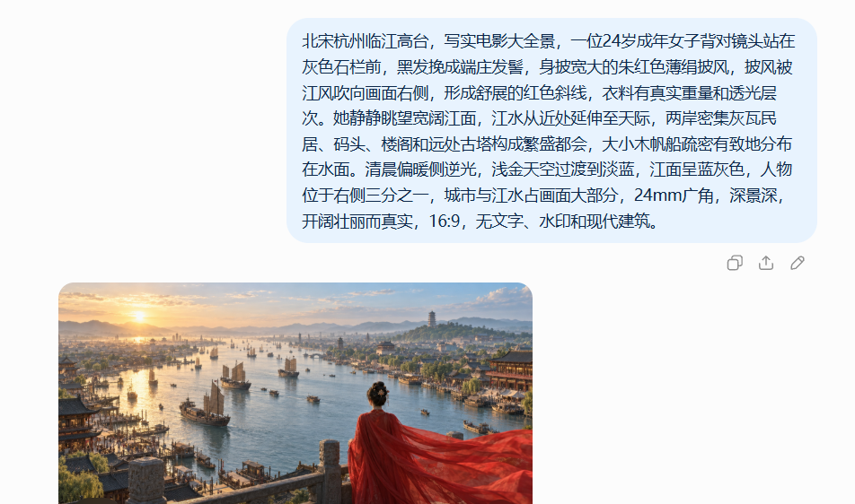
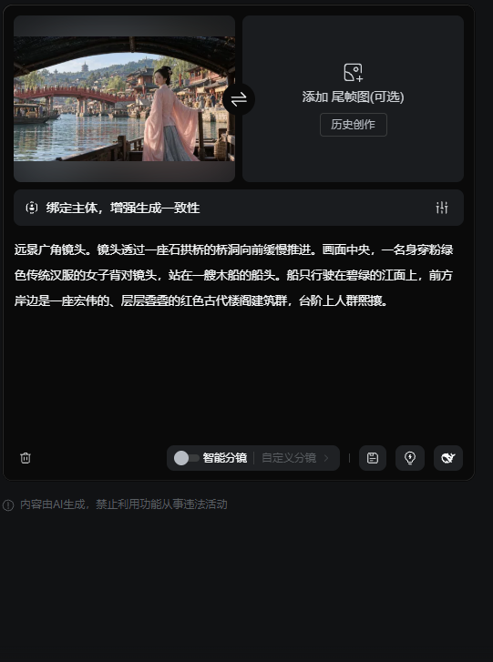
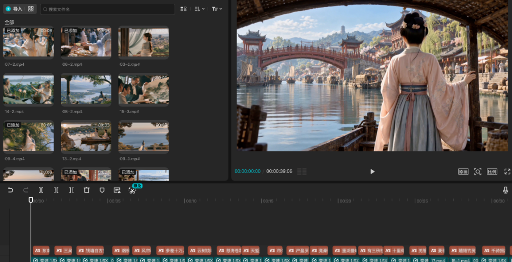

[toc]

发布于: 江苏
创建时间: 2026-10-23 7:55:2
点赞总数: 9
评论总数: 0
收藏总数: 8
喜欢总数: 2

你是在几岁开始接触唐诗宋词，什么时候读《诗经》《楚辞》的？

从《如梦令》，《钗头凤》，到这次做《望海潮·东南形胜》，我想了这个问题。

“烟柳画桥”“怒涛卷霜雪”“三秋桂子，十里荷花”，几句词里就有完全不同的景象。用AI做出来，配上朗诵，课本里的杭州就有了能看见的样子。

虚妄做的这条视频，把柳永笔下的杭州拍得很美。烟柳、西湖荷塘，街巷里的民居，还有钱塘江的怒涛，都跟着词句出现。

配音用的是@卿卿的朗诵，语速舒缓，音色也温润。这首词配上这样的声音，很合适。

我也做了一条。

先交代一下，我的第一版做完，烧了不少积分，发布后又隐藏了。

当时用宋词skill出的分镜图，就拿去转视频，等成片做完，跟其他博主的作品一比，总觉得少了点意境，后面再做这一条视频，把更多时间花在分镜图上。

今天就把这条视频的做法拆开，也把容易花冤枉积分的地方写出来。你想拿自己喜欢的古诗词试试，可以照着这个顺序做。

## 先把词拆成分镜

我调了一个宋词美学skill，用来把词句拆成画面和生图提示词。

把下面这句话发给你的Agent。

> 帮我安装这个skill：github点com/joshesye/songci-guofeng-visualizer，把"点"换成"."后发送

装好后，再让它拆这首词。

> 用宋词国风视觉化skill，把柳永的《望海潮·东南形胜》按词句拆成分镜，为每个分镜生成对应的场景文生图提示词。

我这次拆出了23个分镜。

前面写杭州城里的繁华，再到钱塘江的气势。后面转到西湖，词里有桂花和荷花，也有人游玩、宴饮。最后是“异日图将好景，归去凤池夸”。

拆的时候，把每个镜头对应哪句词看清楚。23个镜头是我这次的拆法，换一首词，镜头数量也可以跟着变。

拿到提示词后，就可以去生图了。

对了，没必要都做《望海潮》。找一首自己喜欢的诗词，换着耍耍。至少看到生成结果时，你知道自己想要的那个画面有没有出来。

## 生图这一步，建议慢一点

我最开始用的是MJ。

它出的风景图确实漂亮，单张拿出来看，很精致。

可这次要把图连成一首词，问题就来了。

景别不好控制，同一个人物换到下一个镜头，很难保持一致。服装和建筑也经常跟我要的宋代感觉对不上。

我调了许久，最后放弃了这套做法，换成Image来出分镜图。

工具换了，图还是得一张张看。

 **先把分镜图调好，能带入宋词意境，再花积分转视频。** 

我第一版吃亏就吃在这里。图一出来，觉得差不多，就往下一步走。等整条视频拼完，才发现不对劲。

现在做这类视频，我建议你把图和对应的词句放在一起看。比如“怒涛卷霜雪”，画面里得有钱塘潮的气势。到了“十里荷花”，再看荷塘的范围和视角，能不能撑住这句词。

一张图很漂亮，也得看看它放在这里合不合适。

有些场景，光改提示词会卡很久。可以找一张合适的参考图垫进去，但要选能使用的素材。

我这次第一个镜头就卡住了。想把“东南形胜，三吴都会，钱塘自古繁华”的感觉做出来，这个视角出了很多次，还是觉得差一点。

碰到这种情况，可以借参考图把视角说清楚，别一直重复抽同一个镜头。

批量生图可以省操作，生成后还得自己挑。尤其是准备转视频的那些图，建议逐张确认，不要直接整批往下跑。

## 图生视频，我这次用的是可灵

分镜图确定后，回到刚才拆分镜的对话里，补上这句话。

> 生成每一个分镜的3秒图生视频提示词。

把对应的图片和视频提示词放进可灵，逐个生成。

我这次生成一条视频花了36积分。这个数字是我当时的设置和消耗，你做的时候看一下自己的生成页面，别把它当成所有模式的统一价格。

这次多数镜头一遍就过了，很少需要反复抽卡。不过，这是我这条片子的情况，换图、换动作，结果也会变。

你手头有别的图生视频工具，也可以先拿一个镜头试。看过效果和消耗，再决定后面用哪个，不必一开始就把23张图全投进去。

分辨率我建议选1080P或2K，按自己的预算来。

## 最后剪辑，跟着朗诵排画面

我用的也是卿卿的配音。

把分段视频放进剪辑软件，按词句排好顺序，再加字幕。

这一步可以把配音先放进去，听着朗诵调整每个镜头的位置。朗诵到哪一句，画面就接到对应的分镜。3秒是前面让AI写提示词时给的时长，剪辑时还要跟着音频调整。

拼好后从头看一遍，看看字幕有没有错字，画面有没有提前跑到下一句。

## 换一首喜欢的，先试几个镜头

《望海潮》很适合拿来练。词句里有具体景物，江潮和荷塘又是两种不同的画面，做的时候能练到不同的景别和节奏。

真要动手的话，建议先挑几句，做几个镜头，把朗诵配上，看看感觉。

满意了，再往下做整首。这样至少不会像我第一版那样，积分花完、视频做完，又把它隐藏了。

  

原文地址：[单条27万赞！古诗词AI视频怎么做？我把制作过程和踩过的坑拆开了](https://zhuanlan.zhihu.com/p/2096281088385619912) 

