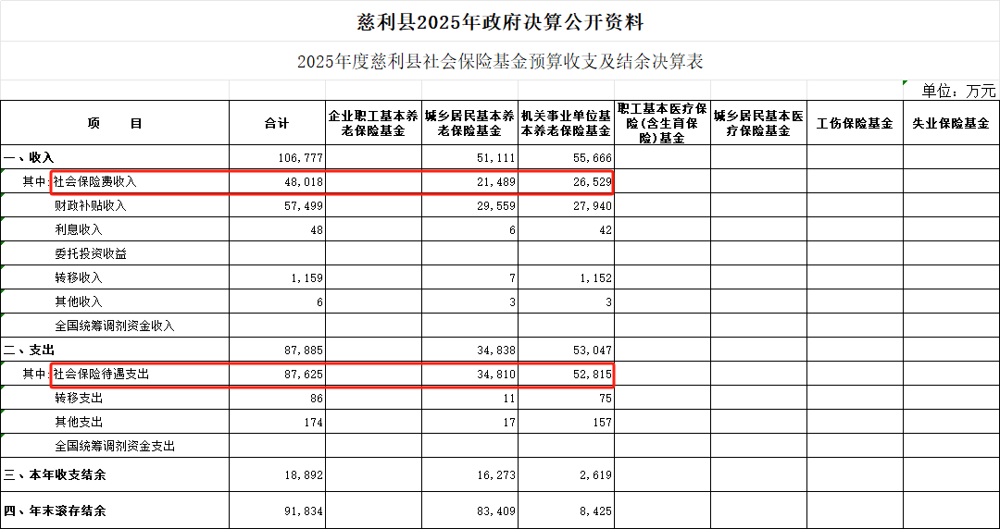

[toc]

发布于: 北京
创建时间: 2026-11-23 8:54:50
点赞总数: 51
评论总数: 44
收藏总数: 48
喜欢总数: 2

事情，先从郭树清的重磅文章《建设更加优化更可持续的社会保障制度》（社会保障评论2026年第5期）开始。

这篇重磅文章的第三部分的标题是，妥善应对未来可能的基本养老保险收支缺口

印象中，这是权威官方为数不多的“#基本养老保险可能出现收支缺口#”的论述。

内容摘要如下：

多方面研究预测未来20年内，职工基本养老保险会发生收不抵支情景，而且由于人口老龄化加速，缺口随后会持续扩大

城乡老年居民每人每月平均约260元的养老金水平远不能满足其基本生活需要

历史上农业和农民为国家和社会提供了巨额财富积累，主要是通过农业税、义务工、工农价格剪刀差和农民工制度实现。如果考虑这些因素，显著调高其基础养老金水平，则会出现另一个收支缺口

  

这段内容说完了。说说下一段内容。城乡高龄老人补贴的事情。

11月16日，湖南省#慈利县民政局#发布《80周岁以上老人高龄津贴政策公告》，其中提及：80周岁至89周岁的老人，每人每月补贴标准5元；90周岁及以上，每人每月100元

11月18日，华商报大风新闻记者联系到慈利县民政局，“5元的标准是根据财政状况确定的，太多了财政难以承担。”工作人员说，“90周岁以上老人每人每月补贴100元，已经实施很多年了。”

  

台账很清晰，值得点个赞！

截图了，重点项的收入和支出，见红框框。

直接说结果吧——

2025年财政补贴的社会保险费收入57499万元，补贴给城乡居民基本养老金的29559万元，补贴给机关事业单位基本养老金的27940万元

城乡居民基本养老金拿到的财政补贴比例约51.4%

社保支出87625万元，城乡居民基本养老金支出34810万元，机关事业单位基本养老金支出52815万元

城乡居民基本养老金支出占社保支出的比例约39.7%

  

2023年3月，慈利县社会保险服务中心公开了《事业单位法人年度报告书》（2022年度），里面有几组离退休人员的数据，摘要如下：

截止2022年12月底，本月底参保人数共计74099人，其中在职参保52179人（企业39669人、机关事业12510人），离退休人员21920人（企业14443人、机关事业7477人）；实际缴费人数39721人（企业27769人、机关事业11952人）

本年度累计发放86531万元，其中机关事业单位累计发放40824万元，企业累计发放45707万元

从以上数据中，可以得出以下最基本的结论

企业退休人员人均发放养老金=45707÷14443=3.16万元

机关事业单位人均发放养老金=40824÷7477=5.46万元

财政补贴情况，以2025年保险费财政补贴和2022年退离休人员为基数

城乡居民人均补贴=29559÷14443=2.04万元/人/年≈1574元/人/月

机关事业单位人均补贴=27940÷7477=3.74万元/人/年≈3114元/人/月

  

数据就摆在这里。客观评价，人均享受到的财政养老金补贴，也不算太多。

但是，相比每月3100多元给机关事业单位的补贴，给80岁以上老人每月5块钱的高龄补贴，有点少了。

给机关事业单位的补贴稍微挤一下，能让高龄老人每月多买两斤肉，都行。

《社会保障评论》2026年第5期

  

原文地址：[官方开始说养老金收支缺口的事了](https://zhuanlan.zhihu.com/p/2108121323323052701) 

# 评论

1. <a href="https://www.zhihu.com/people/wu-shu-wu-mo-wu-jiu">桃之夭夭111111</a> (<small title="河南">2026-11-23 9:26:36</small>): 机关事业单位补贴高，是因为历史欠账多，也就是大家说的[视同缴费](https://www.zhihu.com/search?comment_id=11623018156&comment_type=COMMENT&content_id=288052442&content_type=article&q=%E8%A7%86%E5%90%8C%E7%BC%B4%E8%B4%B9&request_click_id=0063bed5-a1a4-494b-8e4a-9147eb7dfe81&search_source=CommentEntity)部分
   - <a href="https://www.zhihu.com/people/76-22-15-25-93">嘿嘿</a> (<small title="广东">2026-11-23 10:23:28</small>): 那为什么不降低点呢？韩国工作四十年正常缴纳退休才能领折合一万元人民币，重点是人家是啥啥都贵的发达国家啊［尴尬］
   - <a href="https://www.zhihu.com/people/76-22-15-25-93">嘿嘿</a> (<small title="广东">2026-11-23 10:23:27</small>): 那为什么不降低点呢？韩国工作四十年正常缴纳退休才能领折合一万元人民币，重点是人家是啥啥都贵的发达国家啊［尴尬］
   - <a href="https://www.zhihu.com/people/wo-niu-yi-zhi">momo</a> (<small title="回复于 2026-11-23 11:20:33/浙江"> ✉️:嘿嘿</small>): 韩国不是连肉都吃不起每天啃泡菜，在网上被我们嘲笑的一无是处，这时候怎么成了发达国家［思考］
   - <a href="https://www.zhihu.com/people/4-38-71-52">甲申观察4</a> (<small title="江苏">2026-11-23 11:41:21</small>): 同龄的老农民为啥不视同缴纳呢？
   - <a href="https://www.zhihu.com/people/76-22-15-25-93">嘿嘿</a> (<small title="回复于 2026-11-23 13:40:55/广东"> ✉️:momo</small>): 发不发达的又不是网友说了算［捂嘴］［捂嘴］［捂嘴］  
 
部分网友满足虚荣心的，你还当真了？［捂嘴］［捂嘴］［捂嘴］
   - <a href="https://www.zhihu.com/people/tian-ya-ming-yue-42-85">飞鱼归海</a> (<small title="北京">2026-11-23 18:44:56</small>): 是的，农民部分就没有历史欠账，因为从一开始压根就没考虑。
   - <a href="https://www.zhihu.com/people/joe-14-17-4">Joe</a> (<small title="广东">2026-11-23 19:5:13</small>): 咱们就实事求事的说，欠了什么账能值得这么高的回报，摆出来看看。
   - <a href="https://www.zhihu.com/people/bulong-tsai">无业良民</a> (<small title="上海">2026-11-24 8:19:16</small>): 企业也有视同缴费
   - <a href="https://www.zhihu.com/people/di-ji-nao-yu">愿岁并谢</a> (<small title="湖北">2026-11-24 10:47:35</small>): 我觉得视同当时是不是应该拨付一部分进去充实库，政策兜底资金也得兜底吧
   - <a href="https://www.zhihu.com/people/jsy512819aa">jsy512819aa</a> (<small title="四川">2026-11-24 13:8:46</small>): 和咱们有啥关系，和民众有啥关系，而且远高于外面的标准也问题很大
   - <a href="https://www.zhihu.com/people/abc23456789">abc123456789</a> (<small title="回复于 2026-11-24 15:59:44/四川"> ✉️:嘿嘿</small>): 因为看病几乎全额报销，不考虑医疗压力和住房（领上万的一般不会愁住的地方）， 不考虑医疗和住房的前提下，你说说一个月一两万够吃饭不？
   - <a href="https://www.zhihu.com/people/76-22-15-25-93">嘿嘿</a> (<small title="回复于 2026-11-24 16:1:11/广东"> ✉️:abc123456789</small>): 吃饭够，但是孙子买房买车也要啊，还得再涨涨［酷］［酷］［酷］
   - <a href="https://www.zhihu.com/people/abc23456789">abc123456789</a> (<small title="回复于 2026-11-24 16:4:54/四川"> ✉️:嘿嘿</small>): 那确实得涨涨［大笑］
2. <a href="https://www.zhihu.com/people/89-60-40-62">鱼众不同</a> (<small title="山东">2026-11-24 14:23:28</small>): 看看[张雪峰](https://www.zhihu.com/search?comment_id=11623513655&comment_type=COMMENT&content_id=288052442&content_type=article&q=%E5%BC%A0%E9%9B%AA%E5%B3%B0&request_click_id=0063bed5-a1a4-494b-8e4a-9147eb7dfe81&search_source=CommentEntity)的志愿填报就业指导就知道收入分配不均在哪儿了
3. <a href="https://www.zhihu.com/people/tudouxj">奇怪的知识增加了</a> (<small title="江苏">2026-11-24 9:34:44</small>): 不是一直强调不存在缺口吗
   - <a href="https://www.zhihu.com/people/jsy512819aa">jsy512819aa</a> (<small title="四川">2026-11-24 13:10:16</small>): 不存在如今就不会有啥缴纳社保的标识广告牌了，那么大牌子我还是第一次见啊
   - <a href="https://www.zhihu.com/people/ren-jian-55-47">人间</a> (<small title="黑龙江">2026-11-25 12:27:9</small>): 是不是有的单位没有给员工一开始就交百分之百的社保，开的少，应该找单位问问。
4. <a href="https://www.zhihu.com/people/successfulthis">南墙勇进</a> (<small title="广东">2026-11-23 20:35:32</small>): 如果我活到80，我声明，5块不要了。
   - <a href="https://www.zhihu.com/people/339718-86">339718</a> (<small title="湖南">2026-11-25 16:11:50</small>): 我要我要
5. <a href="https://www.zhihu.com/people/huan-le-ma-27-13-70">欢乐马</a> (<small title="四川">2026-11-26 11:44:56</small>): 削峰填谷，体制内泛体制内都太高了
6. <a href="https://www.zhihu.com/people/abc689zmcx">Southeast 789</a> (<small title="浙江">2026-11-25 22:11:17</small>): 靠通胀能解决吗？
7. <a href="https://www.zhihu.com/people/t2kbqli">知乎用户T2KBqLI</a> (<small title="甘肃">2026-11-26 6:43:53</small>): 前几年都没有预测到新出生人口下降的那么多，和人工智能、机器人取代人工这么快这么多。现在有那么多新技术，科学预测失灵了
8. <a href="https://www.zhihu.com/people/38-77-42-42-75">周公无梦</a> (<small title="天津">2026-11-25 16:36:22</small>): 养老金缺口是不争的事实，实事求是也好，装聋作哑也罢，这是客观存在的事实，形势不容乐观，甚至可以说是摆在我们面前最严重的问题，因为它牵涉到千家万户退休老人老有所依老有所养的大问题，国家主管部门应该严肃认真面对，未雨绸缪，才能更好地解决问题！
9. <a href="https://www.zhihu.com/people/kuang-biao-de-gua-niu-55-86">狂飙的蜗牛</a> (<small title="山东">2026-11-26 5:20:19</small>): 消峰平谷
10. <a href="https://www.zhihu.com/people/dzpm2olw">喜欢思考</a> (<small title="湖北">2026-11-24 23:57:58</small>): 有缺口，收到，看到。即可。  
 
有多得很的方法不齐。比如国有股减持后划拨等。
11. <a href="https://www.zhihu.com/people/pan-lao-tai-tai">知乎用户</a> (<small title="江西">2026-11-24 2:4:47</small>): 主要是缴费比例太高，否则每个人都会抢着买社保
12. <a href="https://www.zhihu.com/people/tang-seng-da-ren-23">唐僧大人</a> (<small title="北京">2026-11-24 13:49:15</small>): 985本硕拼死考上的公务员，就是为了和你拿一样的退休金是吧？［捂脸］
    - <a href="https://www.zhihu.com/people/abc23456789">abc123456789</a> (<small title="四川">2026-11-24 16:0:38</small>): 也有大量985本硕没考公务员的。也有大量三本考公务员的
    - <a href="https://www.zhihu.com/people/tian-tian-hao-44">network-watcher</a> (<small title="广东">2026-11-24 17:9:15</small>): 公务员本来就不应该那么高的工资，本质就是普通小文员，而且本身也不生产也不创造财富，压根就不需要985那么高的学历。公务员本来就是要服务人民的，所以公务员工资本来就应该看齐所在地平均工资。
    - <a href="https://www.zhihu.com/people/tang-seng-da-ren-23">唐僧大人</a> (<small title="回复于 2026-11-24 17:56:22/北京"> ✉️:network-watcher</small>): 公务员工作内容比你想象的要复杂的多。按照公司价值创造理论，只有工人和销售人员是直接创造价值的，但是他们的薪水是最低的。［捂嘴］
    - <a href="https://www.zhihu.com/people/mayajianshu">jianshu</a> (<small title="山东">2026-11-24 21:20:36</small>): 985本硕程序员、土木、影视专业被ai冲击，工作都没了着落，公务员怎么就不能降退休金？
    - <a href="https://www.zhihu.com/people/tang-seng-da-ren-23">唐僧大人</a> (<small title="回复于 2026-11-24 21:32:23/北京"> ✉️:jianshu</small>): 选择了先挣钱就要承担低福利和不稳定啊，很公平。
    - <a href="https://www.zhihu.com/people/wu-yu-73-40-84">ABCDE</a> (<small title="浙江">2026-11-25 9:2:5</small>): 我们这里的三本院校万里学院是考公务员的主力［滑稽］
    - <a href="https://www.zhihu.com/people/li-ling-chen-yi">立领衬衣</a> (<small title="回复于 2026-11-25 11:8:14/未知"> ✉️:唐僧大人</small>): 那前提也得是体制内不赚钱
    - <a href="https://www.zhihu.com/people/barcelona-79-84">Barcelona</a> (<small title="北京">2026-11-25 11:52:7</small>): 现在拿大几千上万退休金的那批人，有几个是当年的大学毕业生？现在985本硕毕业的去其他地方工作的，到了退休能不能也以老子是985本硕毕业的为由要求zf发同样的退休金？
    - <a href="https://www.zhihu.com/people/tang-seng-da-ren-23">唐僧大人</a> (<small title="回复于 2026-11-25 12:24:21/北京"> ✉️:Barcelona</small>): 80年代中专以上毕业才会是“干部”，按比例约等于今天的985本硕，其他的是“工人”，想“提干”很难的。现在的985本硕可以选择高薪工作，顶格交社保退休时也可以拿高退休金。你啥学历？［捂嘴］
    - <a href="https://www.zhihu.com/people/barcelona-79-84">Barcelona</a> (<small title="回复于 2026-11-25 14:59:0/北京"> ✉️:唐僧大人</small>): 体制外不挣钱的行业内985本硕毕业生在退休时能否以“985本硕”“在岗时不挣钱”为由获得和体制内一样的养老金？
    - <a href="https://www.zhihu.com/people/abc23456789">abc123456789</a> (<small title="四川">2026-11-25 15:6:54</small>): [702分内蒙状元“堕落”现状曝光 ，网友：给清华北大丢脸，浪费父母培养……](https://zhuanlan.zhihu.com/p/31903257732)  
 
[你怎么看湖北文科状元自述相亲四次失败？](https://www.zhihu.com/question/2108851770684450135)  
 
你觉得这2个高考700多的是考不上吗？如果你放开年龄和专业试试他们考的上不
    - <a href="https://www.zhihu.com/people/abc23456789">abc123456789</a> (<small title="回复于 2026-11-25 15:8:20/四川"> ✉️:Barcelona</small>): 它的意思其实是拿考上了以及985等来找合理性，岂不知这个合理性根本站不住，所以就开始胡搅蛮缠
    - <a href="https://www.zhihu.com/people/tang-seng-da-ren-23">唐僧大人</a> (<small title="回复于 2026-11-25 15:9:32/北京"> ✉️:abc123456789</small>): 别拿个例代表群体。
    - <a href="https://www.zhihu.com/people/abc23456789">abc123456789</a> (<small title="回复于 2026-11-25 15:14:17/四川"> ✉️:唐僧大人</small>): 什么叫个例？请问最近20年211和985毕业的有多少比例考公的？ 大量专业或者家庭因素（比如毕业第一季度就得还助学贷款）不得不匆忙找工作的，以及还有不晓得考公的好处（去年回老家我还遇到一个土木专业的老乡，头部985的，我说体质内生病了可以病退，他和我争。不信。我说去世有40个月的抚恤金，他更不信，他看到的宣传就是无尽的加班和繁忙，觉得考公这个不是个好职业），这种信息墙导致没去考的，请问怎么说？相反大量大专和三本的去考的比例反而更高。
    - <a href="https://www.zhihu.com/people/abc23456789">abc123456789</a> (<small title="回复于 2026-11-25 15:16:3/四川"> ✉️:唐僧大人</small>): 要真如你所说，那就不限专业，年龄放开到50以下，然后每年在高校毕业季展开统一的宣传（宣传讲清楚各种优势和好处）和统考，不就是一个考试嘛，谁怕谁？
13. <a href="https://www.zhihu.com/people/qnwang-68">qnwang</a> (<small title="北京">2026-11-23 18:9:59</small>): 城乡居民大部分缴的少啊，有几个是按5000一年顶格交的，不是都是1000一年压着线交的嘛

=[评论](./attachments/comments.json)

